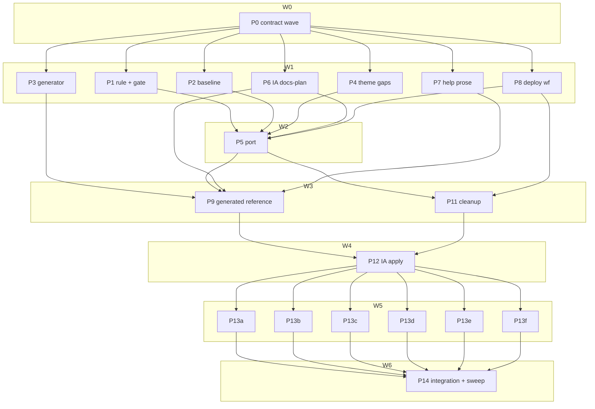

# Plan: OCX docs to the next level — Starlight, use-case focus, lean reference

## Status

- **Plan:** plan_docs_next_level
- **State:** review
- **Tier:** xhigh
- **Tier-grammar:** 5
- **Active phase:** P14 — integration gate done
- **Step:** /hex-execute → handoff
- **Feature branch:** `hex/docs-next-level`
- **Last update:** 2026-10-11 (all pipelines merged; P14 run, sweep rounds 1–5 fixed)
- **Next:** /hex-finalize

---

## Overview

**Date:** 2026-10-11 · **Source:** [`.agents/discussions/docs-next-level.md`](../../.agents/discussions/docs-next-level.md)
(owner-ratified, amended) · **Goal file:** [`.agents/goals/docs-next-level.md`](../../.agents/goals/docs-next-level.md)
— its Done criteria are this plan's acceptance bar.
**Research (evidence base, not re-run):** `.agents/research/research_{reference-vs-explanation,docs-reference-recon,
starlight-reference-generation,theme-gap-ocx-docs,docs-use-case-inventory}.md`.

**Classification.** Scope large (two repos read, ~19 pipelines, 2+ weeks of agent work). Reversibility two-way for
content (git history + redirects), one-way (medium) for published URLs, anchors and `/schemas/` paths, which must
keep resolving. Tier `xhigh` (high band, Phase-3 scope = Large). Gate: auto-approved — goal file § Autonomy
"Prompting: never"; every recommendation in § Decisions accepted. Overlays: `architect=inline` (decisions settled
in the ratified discussion), `research=skip` (five persisted artifacts), `adversary=off` (no new one-way door the
discussion did not settle). No ADR: the discussion is the decision record; § Decisions below closes its three
open questions.

**Model routing** (CLAUDE.md model policy). Builders, doc writers, testers, reviewers: `sonnet`. Inventory, page
seeding, the phase-8 completeness sweep and grep sweeps: `haiku`. `opus` only after a step fails twice on sonnet.

## Objective

1. Reference is only reference: an explicit entry shape, enforced by a gate, persisted as AI config.
2. ocx docs run on Astro 7 + Starlight 0.42 + `@ocx-sh/theme` under `ocx.sh/docs/`, `/schemas/` unchanged.
3. CLI, environment, configuration and exit-code reference generated from code, with a `--check` drift gate.
4. Task-first IA in three tiers; every concept keeps one home; every page reviewed against docs-quality.
5. Production deploy wired to Bunny in-repo; everything served by ocx-sh/website deleted from ocx.
6. Nothing disappears silently: baseline grade and content inventory preserved, haiku sweep dry.

## Scope

**In:** discussion phases 1–8 and the cross-cutting rules; the verification list of the discussion.
**Out:** root site, catalog, other consumers' docs; DNS; theme hardening; new product features for uncovered goals
(e.g. [ocx-sh/ocx#211](https://github.com/ocx-sh/ocx/issues/211)); any edit to `CHANGELOG.md`; any write, commit,
push or PR in `../ocx-website`, `ocx-sh/grimoire-lore` or any other repo; running any deploy workflow; Bunny API calls.

## Decisions

Closes the discussion's open questions and records the grant reality the team lead set.

| ID | Decision | Reason |
|---|---|---|
| D1 | **Theme pin = npm `@ocx-sh/theme@0.1.1` exact**, with `astro@7.3.5`, `@astrojs/starlight@0.42.4`, as the pilots (`rules_ocx/site/package.json:14-16`). Fallback only if a step needs post-release main content: `github:ocx-sh/website#5afea49825806eb941adf7b70e94ae7dcff7b11b&path:/packages/theme` + `allowBuilds`. | 0.1.1 is published from commit `eb94340`, an ancestor of ocx-sh/website `origin/main` — already pushed, so plan_phase3-pilots D13 holds and production never rides an unmerged theme commit. |
| D2 | **I4 strong-reason divergence: no theme PR from this loop.** Theme gaps ship as ocx-local Starlight pieces shaped for upstreaming (`website/plugins/*.mjs`, `website/src/components/Terminal.astro`); `.agents/upstream/ocx-website.md` carries a ready-to-apply patch + notes for the owner. Goal criterion "Theme PR on ocx-sh/website" becomes an owner act. | No grant to push to ocx-sh/website. Theme 0.1.1 exposes everything needed without a theme change: consumer `components` map wins, consumer owns `remarkPlugins`/`rehypePlugins`/`redirects`, `customCss` loads last. |
| D3 | **Roadmap: rewrite the page, no roadmap component.** | Icons are Lucide/Simple-Icons only via the theme's `NAME_MAP`; the Icons8 assets are forbidden by `design-rules.md:84-91`. A list/table page needs no icon. |
| D4 | **Generator = Rust subcommand `ocx_schema_bin docs`**, Bazel genrule `//crates/ocx_schema:docs` → `docs.tar`; output **committed**, drift gate `--check`. | Full `ocx_env` docs and clap long help are reachable only from Rust; `crate_map.toml:109` already allows every edge; committed output keeps lychee and readers non-vacuous on a fresh checkout (deliberate departure from the gitignored SBOM page). |
| D5 | **Production switch = repo changes only.** New `.github/workflows/deploy-docs.yml` calls the ocx-sh/website deploy action; CF Pages workflows deleted in the same PR. Bunny onboarding, the GitHub environment + secret, the `legacy.json` edit and `task bunny:apply` are owner acts. The loop never runs a deploy workflow. | No grant to deploy or touch Bunny. Discussion Q1 dissolves under D1 (the pinned theme is on main). |
| D6 | **The vendored docs-quality rule set is never edited.** The sharpened reference shape lives in ocx `docs-style.md` / `subsystem-website.md` and an ocx-local check; the shared-source proposal (`ocx-sh/grimoire-lore`) is written to `.agents/upstream/docs-quality.md` for the owner. | `.claude/rules/docs-quality/**` is grim-pinned (`grimoire.lock:153`); a local edit is overwritten on the next `grim install`. |
| D7 | **Keep VitePress source syntax where a plugin can carry it**: `{#id}` heading suffixes, `<<< @/_scripts/<slug>.sh`, `<!--@include: …-->`. MDX pages use the escaped `\{#id\}` form. `website/src/_scripts/` keeps its path. | The doc-script and toolchain readers (`test/src/doc_binding.py`, `test_doc_project_toolchain.py`) keep their regexes; the doc-scripts machinery (PT6–PT8) stays untouched. |
| D8 | **Root-site pages leave ocx.** `website/src/index.md` and `team.md` are deleted at the port; their missing pieces (team page, "Content-Addressed and Deduplicated" section) go into the upstream patch, recorded in the inventory ledger as `moved: upstream-patch`. | `ocx-site check` C-014 forbids ocx dist files outside the `/docs/` and `/schemas/` claims; the content keeps a home (patch + git history). |
| D9 | **Transitional ratchet for page contracts.** `doc_declaration` errors on every changed page from the port onward; `page_type`, the reference-shape check and the page budget error except for findings listed in `website/docs-quality-ratchet.d/<owner>.json`, which may only shrink and are deleted (empty) in P14. One file per owning pipeline, so parallel clusters never edit the same file. | The port touches every page; a whole-tree red on day one blocks every merge (docs-quality § Rollout). |
| D10 | **Non-regression grade = finding counts.** A page's grade is the docs-review tuple `(must, should)`; "equal or better" means each new page's counts ≤ its source page's, and `must = 0` for every page at P14. | A count tuple is comparable across splits; a letter grade is not. |
| D11 | **Fragments survive moves client-side.** Old page URLs become stub pages that forward `location.hash` through a fragment map; old monolith reference URLs are generated index pages carrying the map. Map entries live in `website/redirects.d/<owner>.json`, one file per owning pipeline, merged at build; the build fails on a key defined in two files. | Astro `redirects` emit meta-refresh stubs and Bunny edge rules cannot see fragments; 928 explicit anchors are linked from outside. |
| D12 | **Phase-7 grep scope widened by recorded exclusions.** Beyond the discussion's list, the grep also excludes grim-vendored files (`.claude/rules/docs-quality.md`, `.claude/rules/code-docs/**`, `.claude/skills/docs-plan/**`, `.opencode/**`), historical decision records (`.claude/artifacts/**`) and hex state (`.agents/**`). `grep-baseline.txt` uses the same set. | D6 forbids editing vendored files; ADRs record past decisions, not the current site; hex state quotes the terms by design. |

**Execution decisions** (recorded by /hex-execute per goal § Issue resolution):

| ID | Decision | Reason |
|---|---|---|
| D13 | P9 built and ran the generator once to commit its output; P14 ran every test. | D4 commits generated output; a build to produce it is generation, not a test (run rule kept for tests). |
| D14 | C-017 grep also excludes `taskfiles/infra.taskfile.yml`. | It is live Cloudflare DNS API plumbing; DNS is out of scope (§ Scope). |
| D15 | The generated environment page lists no retired spellings. | CLAUDE.md: no migration prose in user docs; retired rows live in `cli.json`'s `retired` array. |
| D16 | Page budget (C-011) stays at 14,200 B gzip / 800 DOM and stays red; the sidebar shows only the current group. | Measured: chrome 597 → 399 DOM, 31 of 112 pages pass; meeting it needs ~188 extra pages or a theme header change. Relaxing a ratified, ecosystem-shared budget is an owner decision. |
| D17 | Splitting the P5/P9 pipelines (P5a/P5b, P9a/P9b/P9c) and adding fix steps (P11b, P14 A/B/F/sweep rounds). | File-disjoint parallelism inside the plan's file sets; contracts unchanged. |
| D18 | The phase-8 sweep stopped after round 5 with every finding fixed or dropped with a reason, not at a zero-new round. | Counts 228 → 140 → 88 → 78 → 77: about 55 new findings per round once the tree stabilised, each a fresh nit a new reader finds, so a zero round is not reachable at this reader size. Owner decides whether to accept this or run more rounds. |

**Trade-off (generator mechanism, ≥3 options).** (a) Rust subcommand writing committed Markdown — full source text,
Bazel-cached, `--check` trivially; cost: long help must be authored in Rust. (b) Astro content loader over a JSON
projection — needs `cli.json` widened (a ledger-gated machine document) and a non-`docsLoader` `docs` collection
Starlight does not document. (c) Hand-written pages + structural lint — today's state, the bloat source. Chosen (a).

## Component contracts

- **C-001 Reference entry shape (rule).** `.claude/rules/docs-style.md` and `subsystem-website.md` state: a
  `doc_type: reference` page is an optional intro of ≤2 sentences, then entries. An entry is a heading with an
  explicit `{#kebab-id}` followed only by a ≤2-sentence description, fact tables or `key: value` lists (type,
  default, env, flag), at most one fenced block, and at most one "See [x](…)" link line. No asides, no
  rationale, no conventions, no sub-sections that are not entries.
- **C-002 Reference-shape check.** `test/lint/test_reference_shape.py` scans every page declaring
  `doc_type: reference` under the docs content root and reports `page:line rule` for: a paragraph >2 sentences;
  an aside (`:::`, `<Aside`); >1 fenced block per entry; a heading without an explicit anchor. Fixtures (planted and clean) under
  `test/lint/fixtures/reference_shape/`, run at P14. Findings listed in the ratchet file (C-004) are tolerated.
- **C-003 docs-quality gate.** Scope: the docs content root only (never `website/tests/`, `website/plugins/`,
  build output). `test/lint/test_docs_quality_gate.py` runs the vendored `doc_declaration.py` and
  `page_type.py` with `sys.executable`: error on pages changed against `git merge-base origin/main HEAD`; whole
  tree reported. Content root is one module constant (`website/src/docs` until P5, `website/src/content/docs`
  after). `test/LINT_FLOOR` follows the test count in the same commit.
- **C-004 Ratchet files.** `website/docs-quality-ratchet.d/<owner>.json` = `{ "<page>": ["<check>:<rule>", …] }`
  (checks: `page_type`, `shape`, `budget`). The gate reads the union. A finding in no file reds; an entry no longer
  produced reds (stale entry); a page listed in two files reds. Deleted at P14 when empty.
- **C-005 Scoped route.** `scripts/scoped_gate.py` routes `website/**` (and `.claude/rules/docs-*`) to a `docs`
  route running `test:lint:structure` and `website:reference:check`, not full verify. Cases in
  `scripts/tests/test_scoped_gate.py`.
- **C-006 Generator CLI.** `ocx_schema_bin docs --out <dir> [--check]`. Writes under `<dir>/reference/`:
  `command-line/index.md` (global flags, fragment map per D11), one page per command group (`package` split into
  ≤3 pages; any page >20 entries is an error), `environment.md`, `configuration.md` (config schema),
  `project-file.md` (project schema, `ocx.toml`), `exit-codes.md` (one table per exit code with its slugs).
  Every page: Starlight front matter `title:`, then `<!-- doc_type: reference -->`, entries per C-001, explicit
  anchors equal to today's ids (incl. `ANCHOR_OVERRIDES` and `OCX_HOME` → `ocx-home`). Deterministic bytes.
  Exit 0 clean/written, 1 drift (`--check`, prints each drifted path), 2 usage.
- **C-007 Generator reader floors.** Rust tests in `crates/ocx_schema` assert the read model holds ≥70 commands,
  ≥280 command flags, ≥12 global flags, ≥50 public env vars, ≥50 config keys, all 13 exit codes; a mutation
  test changes one source doc string and asserts `--check` exits 1, then regenerating returns 0.
- **C-008 Generator wiring.** `website:reference:generate` (cquery + untar, shape of `website/schema.taskfile.yml`)
  and `website:reference:check` (in `task verify` phase 1, `.verify:lint`).
- **C-009 Help prose in source.** Every command whose old reference entry carried a description beyond its
  summary gets it as clap `long_about` / arg `long_help` per `quality-cli-help.md` (two-register, ASCII, no ADR
  refs or dates; `app::tests::cli_help_text_*` stay green). `cli.json` and `cli-schema.json` goldens change in description text only (no structural change, so no ledger entry).
  Env docs stay within the 10-line doc-block cap. Every moved description is a row in `ledger/P7.toml`
  (`home = "<crate path>::<command>"`), so `check.py` proves it landed; text left for a how-to is a row with the
  target page.
- **C-010 Theme-gap plugins (ocx-local).** `website/plugins/heading-ids.mjs` (remark: trailing `{#id}` or
  `\{#id\}` → heading `id`, suffix stripped), `md-links.mjs` (`./x.md#a` → base + trailing-slash URL, fence-aware,
  port of `ocx-website/scripts/previews/links.ts`), `includes.mjs` (`<<< @/_scripts/<slug>.sh{lang}` → fenced
  block; `<!--@include: path{N,}-->` → file lines N…end). `website/src/components/Terminal.astro` fetches its cast
  only when visible or its collapsible opens; never imports the theme's `Terminal.astro`. Tests:
  `node --test website/plugins/`.
- **C-011 Site build.** `task website:build` → `website/dist/docs/**` and `website/dist/schemas/<kind>/v1.json`
  (the 8 kinds, same URLs as today). `ocx-site check --path /docs/` and `--path /schemas/` exit 0. Every built page
  ≤14,200 B gzip and ≤800 DOM elements (`website:check:budget`). `website:lint:links` = lychee
  `--include-fragments` over `dist`.
- **C-012 Old URLs.** `website/old-urls.txt` (from the baseline: every old page URL and every old `page#anchor`,
  written once in P12 and never edited after) each resolve to a built page and anchor (via redirect stub +
  fragment map, D11). `website/tests/old-urls.test.mjs` asserts, over `dist`, that each old URL has a page or stub
  and each fragment exists on the page the map names; lychee checks the targets.
- **C-013 Baseline.** `.agents/docs-baseline/`: `grades.json` `{page: {must, should}}`; `inventory/<page>.json`
  `{anchors, commands, flags, env, config_keys, exit_codes, slugs, links, fences, facts[]}`;
  `grep-baseline.txt` (the phase-7 grep's file list, non-empty); `check.py` → lists every baseline item with no
  home in the new tree and no ledger entry, exit 1 when any. `ledger/<pipeline>.toml` rows
  `{item, page, action = moved|deleted, home?, reason ∈ duplicate|obsolete|speculative|upstream-patch}`.
- **C-014 IA artifact.** `.claude/artifacts/docs_ia.md` (docs-plan output): product shape; three-tier task list
  with user needs; page inventory old path → new path with `doc_type`/`doc_tier`; coverage table against the 40
  goals; merge/split/delete list; sidebar groups; a `cluster` column assigning every new page to exactly one of
  P13a–P13f (generated reference pages carry `cluster = generated`); the home page for every explanatory section
  leaving a reference page. P12 checks the `cluster` set equals the built page set, no page twice.
- **C-015 Deploy workflow.** `.github/workflows/deploy-docs.yml`: `ocx-sh/website/.github/actions/deploy@1b898a76d4c3bbe60d9619a931c74f21660f4eb4`,
  two steps (`/docs/`, `path: /schemas/`), environment `ocx.sh`, secret `BUNNY_STORAGE_KEY`, push to `main` +
  `workflow_dispatch`, `permissions: {}`, concurrency `ocx-sh-deploy`. `deploy-website.yml`,
  `deploy-website-release.yml` and the release workflow's website deploy job removed. actionlint green.
- **C-016 Toolchain.** `ocx.toml`/`ocx.lock` gain `node` (`ocx.sh/nodejs/node:24`) and `pnpm` (`:11`) via
  `ocx add`; `bun` removed once no caller remains.
- **C-017 Cleanup proof.** The discussion's grep (vitepress / pages.dev / cloudflare, its exclusions plus D12's)
  returns nothing, and `grep-baseline.txt` under the same exclusions is non-empty; `website/src/index.md`, `website/src/team.md`, `website/.vitepress/` absent; `task claude:tests` green.

## User-experience scenarios

- **S-001** Reader follows an old link `ocx.sh/docs/reference/command-line#exec` → lands on the `exec` entry of
  the group page. Error: an anchor missing from the map → C-012 test reds naming it.
- **S-002** Contributor edits a clap help string, skips regeneration → `task verify` reds at
  `website:reference:check` listing the drifted page; `task website:reference:generate` → green.
- **S-003** Contributor adds a rationale paragraph to a reference page → `test_reference_shape.py` reds with
  `page:line`.
- **S-004** Contributor adds a page without `doc_type` → `test_docs_quality_gate.py` reds on the changed file.
- **S-005** Docs-only change → `task verify:scoped` runs the `docs` route, not full verify.
- **S-006** New user lands on `/docs/` → first-steps tier pages titled by goal reach a working install and first
  `ocx exec` without visiting reference. Checkable proxy: the tier holds a page with an install fence and an
  `ocx exec` fence, and no first-steps page links `reference/` inside its steps. Error: a page in that tier over
  budget → `website:check:budget` reds.
- **S-007** Reader searches `OCX_HOME` (Pagefind) → environment entry `#ocx-home`.
- **S-008** Tool fetches `https://ocx.sh/schemas/project/v1.json` → same path in `dist/schemas/`.
- **S-009** Owner merges the PR before creating environment `ocx.sh` → `deploy-docs` fails on the missing secret,
  nothing deploys, the live site keeps serving the last Pages build (documented owner order in the PR body).

## Error taxonomy and edge cases

- Generator: unknown command group page >20 entries → exit 2 naming the group; a doc string with a 3+ sentence
  paragraph → C-002 finding on the generated page (fix in source, not page).
- MDX: a `{` in prose breaks the MDX parser → converter escapes; `\{#id\}` handled by C-010.
- `ocx-site check` C-013: any root-relative link to `/licensed/`, `/casts/`, `/team/`, `/logo.svg` in built
  `/docs/` reds → links become claimed paths or absolute `https://ocx.sh/…`.
- Fragment collisions after a split (two groups with the same option anchor) → generator prefixes with the
  command id and adds both ids to the map.
- `trailingSlash: 'always'` changes every URL → old slashless URLs covered by C-012.
- Gitignored generated inputs (casts, schemas, SBOM page, `_scripts`) absent on a fresh checkout → build tasks
  produce them first (today's order kept).

## Rollout / migration

All work lands on `hex/docs-next-level` as one PR (owner squash preference). Order inside the branch: rule + gate
(P1) and baseline (P2) before any page moves; port (P5) before content; generated reference (P9) before IA moves
(P12); content clusters (P13) before the integration sweep (P14). Production order after merge is owner-side
(Owner/meta acts 3). The live site serves the last Cloudflare Pages build until the owner's Bunny flip; nothing in
the repo can take it down.

## Parallelization

| ID | Repo | Scope (C-/S-) | Expected files | Wave | Depends on | Marks | Status |
|---|---|---|---|---|---|---|---|
| P0 | ocx | contract wave: stubs + contract tests for C-002, C-003, C-004, C-006, C-007, C-010, C-012, C-013 | `crates/ocx_schema/src/docs/mod.rs`, `crates/ocx_schema/src/main.rs`, `crates/ocx_schema/tests/docs.rs`, `test/lint/test_reference_shape.py`, `test/lint/fixtures/reference_shape/**`, `test/lint/test_docs_quality_gate.py`, `test/lint/fixtures/docs_ratchet/**`, `website/plugins/*.mjs`, `website/plugins/*.test.mjs`, `website/tests/old-urls.test.mjs`, `.agents/docs-baseline/check.py` | 0 | — | — | merged |
| P1 | ocx | phase 1 rule + gate: C-001–C-005, S-003–S-005 | `.claude/rules/{docs-style,subsystem-website,product-tech-strategy}.md`, `test/lint/test_reference_shape.py`, `test/lint/test_docs_quality_gate.py`, `test/LINT_FLOOR`, `scripts/scoped_gate.py`, `scripts/tests/test_scoped_gate.py`, `.agents/upstream/docs-quality.md` | 1 | P0 | — | merged |
| P2 | ocx | baseline: C-013 | `.agents/docs-baseline/{extract.py,check.py,grades.json,inventory/**,grep-baseline.txt}` | 1 | P0 | — | merged |
| P3 | ocx | generator: C-006, C-007, S-002 | `crates/ocx_schema/src/docs/**`, `crates/ocx_schema/src/main.rs`, `crates/ocx_schema/BUILD.bazel`, `crates/ocx_schema/tests/docs.rs` | 1 | P0 | — | merged |
| P4 | ocx | theme gaps local: C-010, D2, D3, D8 | `website/plugins/**`, `website/src/components/Terminal.astro`, `.agents/upstream/ocx-website.md` | 1 | P0 | — | merged |
| P6 | ocx | IA via /docs-plan: C-014 | `.claude/artifacts/docs_ia.md`, `.agents/docs-plan/**` (friction logs) | 1 | P0 | — | merged |
| P7 | ocx | help prose into source: C-009 | `crates/ocx_cli/src/command/**`, `crates/ocx_cli/src/options/**`, `crates/ocx_env/src/vars.rs`, `.agents/docs-baseline/ledger/P7.toml` | 1 | P0 | — | merged |
| P8 | ocx | deploy workflow: C-015, S-009 | `.github/workflows/{deploy-docs,deploy-website,deploy-website-release,release}.yml`, `.claude/tests/test_workflows.py`, `taskfiles/{infra,release}.taskfile.yml`, `.agents/upstream/pr-body-owner-steps.md` | 1 | P0 | review | merged |
| P5 | ocx | mechanical port: C-011, C-016, D7, D8, S-008 | `website/**` (except `plugins/`, `src/components/Terminal.astro`), `test/lint/{test_doc_binding,test_doc_project_toolchain,test_doc_command_reference,test_doc_scripts_publish_structure,test_env_reference_coverage,test_deprecated_spellings,test_doc_scripts_parser}.py`, `test/src/doc_binding.py`, `test/BUILD.bazel`, `test/doc_scripts/cast.bzl`, `scripts/bazel_tag_guard.py`, `.bazelignore`, `cliff.toml`, `taskfiles/release.taskfile.yml` (changelog:validate text), `.github/workflows/verify-deep.yml`, `.claude/rules/quality-vite.md`, `.claude/rules.md`, `.claude/tests/test_ai_config.py`, `.claude/hooks/post_tool_use_tracker.py`, `ocx.toml`, `ocx.lock`, `taskfile.yml`, `.agents/docs-baseline/ledger/P5.toml` | 2 | P1, P2, P4, P6, P8 | hard, review | merged |
| P9 | ocx | generated reference + reference trim: C-006–C-008, C-012 (reference pages), S-001, S-002, S-007 | `website/src/content/docs/reference/**`, explanation homes named in C-014, `website/taskfile.yml`, `website/reference.taskfile.yml`, `taskfile.yml`, `test/lint/test_doc_command_reference.py`, `test/lint/test_env_reference_coverage.py`, `test/LINT_FLOOR`, `.agents/docs-baseline/ledger/P9.toml`, `website/docs-quality-ratchet.d/P9.json`, `website/redirects.d/P9.json` | 3 | P3, P5, P6, P7 | hard | merged |
| P11 | ocx | cleanup (phase 7): C-016 (bun), C-017 | `.claude/**` (not D12's vendored set, `skills/docs-instrument/**`; P1/P5 files only after they land; includes `.claude/rules/quality-core.md`), `.serena/**`, `CLAUDE.md`, `.code-docs-length.json`, `.gitignore`, `scripts/bazel_doctor.py`, `.agents/discussions/unified-web-presence.md` | 3 | P5, P8 | — | merged |
| P12 | ocx | IA apply: C-012 (moved pages), C-014 | page moves under `website/src/content/docs/**`, `website/astro.config.mjs` (sidebar), `website/redirects.d/P12.json`, `website/old-urls.txt`, `website/docs-quality-ratchet.d/P13*.json` (created), `website/docs-quality-ratchet.d/{P5,P9}.json` (deleted), `.agents/docs-baseline/ledger/P12.toml` | 4 | P9, P11 | — | merged |
| P13a | ocx | first-steps cluster: S-006 | pages with `cluster = first-steps` in C-014, `ledger/P13a.toml`, `website/redirects.d/P13a.json`, `website/docs-quality-ratchet.d/P13a.json` | 5 | P12 | — | merged |
| P13b | ocx | everyday cluster (user-guide split, user-guide/*) | `cluster = everyday`, `ledger/P13b.toml`, `website/redirects.d/P13b.json`, `website/docs-quality-ratchet.d/P13b.json` | 5 | P12 | — | merged |
| P13c | ocx | publishing cluster (authoring/*) | `cluster = publishing`, `ledger/P13c.toml`, `website/redirects.d/P13c.json`, `website/docs-quality-ratchet.d/P13c.json` | 5 | P12 | — | merged |
| P13d | ocx | explanation cluster (in-depth/*) | `cluster = explanation`, `ledger/P13d.toml`, `website/redirects.d/P13d.json`, `website/docs-quality-ratchet.d/P13d.json` | 5 | P12 | — | merged |
| P13e | ocx | integration cluster (CI, network, ecosystem gaps) | `cluster = integration`, `ledger/P13e.toml`, `website/redirects.d/P13e.json`, `website/docs-quality-ratchet.d/P13e.json` | 5 | P12 | — | merged |
| P13f | ocx | misc cluster (roadmap, changelog, contributing, faq remainder) | `cluster = misc`, `ledger/P13f.toml`, `website/redirects.d/P13f.json`, `website/docs-quality-ratchet.d/P13f.json` | 5 | P12 | — | merged |
| P14 | ocx | integration: C-011, C-012, C-013 check, C-017, D9 flip, D10, phase-8 sweep | `website/docs-quality-ratchet.d/` (delete), `.agents/docs-baseline/{grades-after.json,sweep/**}`, fix edits anywhere in the docs tree | 6 | all | hard | merged |

Ratchet and fragment-map entries live in one file per owning pipeline (`*.d/<id>.json`); P12 moves each page's
ratchet entries into the file of the cluster that owns it, so P13 pipelines never share a file. P13 pipelines are
file-disjoint by the `cluster` column; a page needed by two clusters stays with the one C-014 names and the other
links to it. A split in P13 (e.g. `user-guide.md`) adds its fragment entries to its own `redirects.d/P13x.json`.

**Critical path:** P0 → P2 (baseline grading, ~48 pages) → P5 → P9 → P12 → P13b (user-guide split) → P14.
**Shippable after wave 3:** Starlight site with generated reference, Bunny workflow and cleanup — content not yet
re-laid-out; the goal needs wave 6. P11 is held back from wave 2 because it shares `.claude/rules.md` and
`test_ai_config.py` with P5.

## Steps

**Run rule — no verification during development** (owner, goal file § Rules, `a23ec5be2`). No step runs Rust, Bazel, acceptance or lint-suite tests,
`task verify`, Lighthouse, mutation proofs or red/green demonstrations — not even the steps that touch code
(generator, `test/lint` readers). Contract tests are written, never run, before P14. A docs/website-only step may
run one quick docs-local check (an astro build, or the docs-quality scripts on the touched pages) when it is fast.
Every implementation test, and the one red/green kept (generator `--check`), runs at the two final gates: P14
(integration) and `/hex-finalize`. Commit: `task verify:mark` + plain `git commit` (subject is the changelog line,
body names the deferral "verification deferred to the integration gate per owner rule"). `--no-verify` is denied in this session. `.agents/` is gitignored: commit its paths with `git add -f`. Never
edit `CHANGELOG.md`. `../ocx-website` and `../rules_ocx` are read-only: copy what a step needs into the session
scratchpad; no write, branch or commit there.

**P0 — contract wave** (one builder)
1. Stub `ocx_schema_bin docs --out --check` (exit 2 "not implemented"); write `tests/docs.rs` with C-006/C-007
   assertions (floors, determinism, `--check` red on mutation, group size cap) — written, not run.
2. Write `test_reference_shape.py` + planted/clean fixtures, `test_docs_quality_gate.py` skeleton (root constant,
   merge-base scope) and the C-004 ratchet cases (unlisted finding reds, stale entry reds, page in two files reds)
   (written, not run).
3. Stub `website/plugins/{heading-ids,md-links,includes}.mjs` exports + `node --test` cases (md and mdx anchor
   forms, fence-aware link rewrite, `{3,}` include) — written, not run.
4. Stub `.agents/docs-baseline/check.py` with the C-013 file shapes documented in its docstring; stub
   `website/tests/old-urls.test.mjs` (C-012) over a two-page fixture dist (written, not run).

**P1 — rule + gate**
1. Write C-001 into `docs-style.md` and `subsystem-website.md` (operative line, no essay); update
   `product-tech-strategy.md` website rows to Astro/Starlight + node + pnpm 11, Cloudflare → Bunny.
2. Implement C-002, C-003 and the C-004 ratchet reader against P0's tests (not run); bump `test/LINT_FLOOR`.
3. Add the `docs` route (C-005) + cases.
4. Write `.agents/upstream/docs-quality.md`: proposed DOC-TYPE-04/05/18/19 sharpening, a page_type check for
   DOC-TYPE-19 counts and explanatory sections on reference pages, Starlight support for `nav_depth.py`.

**P2 — baseline** (before any page moves; read-only on `website/`)
1. Write the extractor (`.agents/docs-baseline/extract.py`): per page anchors, `ocx` commands and flags, `OCX_*`
   names, config keys, exit codes, slugs, links, fences → `inventory/<page>.json`.
2. haiku workers, one per ≤6 pages: list each page's facts and examples into `facts[]`; each reports pages and
   lines read.
3. sonnet workers, one per ≤8 pages: run the `docs-review` skill per page → `grades.json` `(must, should)`.
4. Record the phase-7 grep file list under D12's exclusions in `grep-baseline.txt` (must be non-empty);
   implement `check.py` (it also compares sweep logs' pages/lines read against inventory counts, P14).

**P3 — generator**
1. Walk `ocx_command()` + `export()` for structure, `get_long_about()`/`get_long_help()` for text, `ocx_env::all()`
   joined with `app::ENV_FLAGS`, `schema_for("config"|"project")` as `serde_json::Value`, `ExitCode::ALL` +
   `detail_registry()`.
2. Render C-006 pages (anchors from today's pages, `ANCHOR_OVERRIDES`, command-id prefix on collisions, fragment
   map in `command-line/index.md`); `--check` compares in memory.
3. Genrule `:docs` → `docs.tar`. No test run; the `--check` red/green runs at P14.

**P4 — theme gaps local**
1. Implement C-010 plugins against P0's node tests (not run).
2. `Terminal.astro`: copy the theme 0.1.1 component and player mount, fetch on IntersectionObserver or
   `ocx:collapsible:change`; same props.
3. Write `.agents/upstream/ocx-website.md`: a `git apply`-ready patch for `packages/theme` (heading ids, link
   rewrite, includes, lazy cast) and `site/` (team page with `team/kate.jpg`, "Content-Addressed and
   Deduplicated" section), plus repin instructions.

**P6 — IA via /docs-plan**
1. Run the `docs-plan` skill on `website/src/docs/` seeded with the 40 goals of the use-case inventory research
   and `.claude/rules/product-context.md`; write C-014 to `.claude/artifacts/docs_ia.md`, friction logs under
   `.agents/docs-plan/`.
2. Fill the C-014 extra columns: `cluster`, new path, and the home for every explanatory section the recon names
   (`configuration.md` precedence/kill switch/`ocx.toml` narrative/`[[trust.policy]]`/`[shell]`, Future Config
   Keys → delete as speculative; `environment.md` Truthy Values/Shell Activation Files/`__OCX_ENV_*`/repeated
   `apply_ocx_config`; `command-line.md` `--format`/json-documents, `exec` running).

**P7 — help prose**
1. For each command entry in `command-line.md` with text beyond its summary, write `long_about`/`long_help` in
   the command module, per `quality-cli-help.md`; one `ledger/P7.toml` row per moved description; anything
   narrative or example-heavy is a row naming its how-to page (P9 moves it).
2. No test run; `app::tests::cli_help_text_*` and the goldens are checked at P14.

**P8 — deploy workflow** (text only; never dispatched)
1. Write `deploy-docs.yml` to C-015 (shape of `rules_ocx/.github/workflows/deploy.yml:44-66`).
2. Delete `deploy-website.yml`, `deploy-website-release.yml`, the release workflow's website deploy job
   and the Pages references in `taskfiles/infra.taskfile.yml` / `release.taskfile.yml`.
3. Extend `.claude/tests/test_workflows.py` with a C-015 shape test (action pinned by full SHA, two paths,
   environment, `permissions: {}`), not run; actionlint at P14.
4. Write the owner order (Owner/meta acts 3, S-009) into `.agents/upstream/pr-body-owner-steps.md` for the PR body.

**P5 — mechanical port** (`hard`)
1. Scaffold `website/` as Astro 7.3.5 + Starlight 0.42.4 + theme 0.1.1 (D1): `package.json`, `pnpm-workspace.yaml`
   (`allowBuilds: {esbuild, sharp}`, `minimumReleaseAgeExclude`), `astro.config.mjs` (base `/docs/`, `site`
   `https://ocx.sh`, `trailingSlash: 'always'`, the P4 plugins, sidebar mirroring today's groups), `ocx add` node
   + pnpm (C-016).
2. Convert `src/docs/**` → `src/content/docs/**` with a scratch copy of `ocx-website/scripts/samples/convert.ts`
   patched to keep `{#id}` (never committed in either repo; command recorded in the commit body); seed every page's
   `doc_type`/`doc_tier` from C-014; rewrite `roadmap.md` without components (D3); delete `index.md`, `team.md`,
   `.vitepress/`, `bun.lock` (ledger rows `upstream-patch`).
3. `/schemas/` second dist, casts under `/docs/casts/`, changelog include, `website:check:budget`, lychee over
   `dist`, `site.bzl`/`BUILD.bazel` for the pnpm build, `website/taskfile.yml`.
4. Update every docs reader listed in the explorer map (doc_binding, project_toolchain, command_reference fence
   ban, PT7, `test/BUILD.bazel` data labels, `cast.bzl`, `bazel_tag_guard.py`, `.bazelignore`, `cliff.toml` regex
   + `changelog:validate` text, `verify-deep.yml` schema path, hook tracker); `quality-vite.md` globs →
   `astro.config.*` with its `rules.md` row and `test_ai_config.py`; gate root constant → `src/content/docs`;
   initial `docs-quality-ratchet.d/P5.json` (incl. `budget` entries for the 10 oversized pages) and
   `ledger/P5.toml`.
5. Quick docs-local check only: `task website:build` succeeds. Everything else (`ocx-site check`, lint suite,
   `claude:tests`, node tests, `check.py`) runs at P14.

**P9 — generated reference** (`hard`)
1. Wire C-008; generate into `src/content/docs/reference/`, commit output; delete the hand-written
   `command-line.md`, `environment.md`, `configuration.md` after step 2.
2. Move each explanatory section to its C-014 home (or delete with reason), plus P7's leftover narrative; one
   ledger row per section.
3. Trim hand-written reference pages (`metadata`, `env-composition`, `execution-records`, `script-host-api`,
   `platforms`, `machine-interface`) to C-001; overflow to explanation homes.
4. Retire the cli.json-vs-page parts of `test_doc_command_reference.py` and `test_env_reference_coverage.py`
   (floors now in C-007); keep the fence ban; adjust `LINT_FLOOR`.
5. C-012 entries for reference URLs in `redirects.d/P9.json`. No test run; the `--check` red/green, shape
   check and S-007 (built `reference/environment/index.html` carries `id="ocx-home"`, Pagefind holds `OCX_HOME`)
   run at P14. Generated pages carry no ratchet entry: P9 leaves `docs-quality-ratchet.d/P9.json` empty (`{}`).

**P11 — cleanup** (phase 7)
1. Rewrite or delete website-stack passages in `subsystem-website.md` (Starlight, theme components, pnpm, Bunny),
   `docs-style.md` component list, `subsystem-taskfiles.md`, `workflow-github.md`, `arch-principles.md`,
   `meta-ai-config.md`, `quality-typescript.md`, skills `docs`, `ocx-sync-roadmap`, `meta-validate-context`,
   agents `worker-doc-writer`, `worker-researcher`, `.serena/` memories, `.code-docs-length.json`; `.opencode/`
   mirrors (regenerate if a task owns them); `.claude/rules.md` rows; `task claude:tests`.
2. Remove `bun` from `ocx.toml` when no caller remains (the recordings bun fixture is a package, not a caller);
   delete `.agents/discussions/unified-web-presence.md`.
3. Grep for remaining `bun` callers and the C-017 grep (D12 exclusions) to find work, not as proof; the
   `ocx lock` check and the C-017 proof run at P14.

**P12 — IA apply**
1. `git mv` every page to its C-014 path; sidebar groups; `redirects.d/P12.json` + stub pages forwarding the
   fragment (D11); write `old-urls.txt` from the baseline anchors; move each page's ratchet entries from
   `P5.json`/`P9.json` into `docs-quality-ratchet.d/P13<x>.json` of its cluster, then delete `P5.json` and
   `P9.json` (both listed as deletions in P12's commit).
2. Implement `old-urls.test.mjs` and the C-014 cluster-set check (not run); quick astro build only.

**P13a–P13f — content clusters** (same steps each; doc writer `sonnet`)
1. For each owned page: `docs-review` grade vs baseline; re-lay-out per C-014 (title by goal, tier, one concept one
   home); split pages over budget.
2. Fill the cluster's gaps from the use-case inventory where the feature exists (P13e: Bazel `rules_ocx` link,
   devcontainer, Python PEP 751, proxy, GHCR/ECR auth recipes, non-interactive consent, offline/frozen CI, publisher
   SBOM/provenance; ocx side only, link `/integrations/<x>/`).
3. Ledger every removed fact; drop the cluster's ratchet entries; target `(must, should)` ≤ baseline and
   `must = 0`. Quick check allowed: the docs-quality scripts on the touched pages. Grades, budget and the S-006
   proxy are measured at P14.

**P14 — integration + completeness** (`hard`) — every deferred test runs here
0. Implementation tests first: `crates/ocx_schema` tests incl. C-007 floors and the mutation test; the generator
   `--check` red (mutated source doc) then green after regenerating — the one red/green kept; `node --test
   website/plugins/ website/tests/`; `task test:lint:structure` (shape, gate, ratchet, readers); `scripts/tests`
   (scoped route); `task claude:tests` (workflow shape); actionlint; `ocx lock` unchanged; `app::tests::
   cli_help_text_*` and unchanged `cli.json`/`cli-schema.json` goldens; `check.py` on the moved tree; C-014
   cluster-set check; S-007 Pagefind token.
1. Whole-tree gate red-able: every ratchet file empty → delete `docs-quality-ratchet.d/`;
   `test_docs_quality_gate.py` whole tree at error; `git ls-files .agents/docs-baseline .agents/upstream` lists
   every expected file.
2. `task website:build`, both `ocx-site check` claims, budget on every page, lychee `--include-fragments`
   + `old-urls.txt`, Lighthouse CI (consumer setup copied from `rules_ocx/site`) 100/100/100/100 on
   `/docs/`, one page per reference family and one per tier.
3. `grades-after.json` via docs-review on every page; D10 comparison; `check.py` exit 0.
4. Phase-8 sweep: parallel `haiku` agents, one per page or reference family, slices (a) code coverage, (b)
   baseline coverage, (c) use-case coverage, (d) gate; each states pages/lines read. Findings → a fix round;
   repeat until a round returns nothing new; rounds logged in `.agents/docs-baseline/sweep/` (untracked scratch, never committed); re-run `check.py`
   after the last fix round (exit 0).
5. C-017 grep proof (D12 exclusions) empty, `grep-baseline.txt` non-empty; index/team/`.vitepress/` absent.
6. Full `task verify`; the hex.md integration additions (no ecosystem crate API change expected, so no
   `satellite:verify`; Windows not touched by docs, ocx_schema change is host-neutral).

## Verification (from the discussion)

| Check | Where |
|---|---|
| `task verify` green at the integration gate; per step narrowest test | P14, every step |
| Generator `--check` red (mutated source) and green; reader floors 70/280/12/50 (+config ≥50) | P14 |
| `doc_declaration`/`page_type` green every page; no reference page with an explanatory section | P14 |
| Every page ≤14,200 B gzip; `ocx-site check` green; Lighthouse 100×4 on representative pages | P14 |
| lychee `--include-fragments` green; old URLs and anchors resolve | P14 |
| Per page grade ≥ baseline; inventory diff fully accounted | P14 |
| Phase-8 sweep last round zero new gaps, reader floors stated | P14 |
| Phase-7 grep empty (baseline non-empty recorded in P2); index/team/.vitepress absent; `task claude:tests` | P14 |
| After phase 6: `/docs/`, `/schemas/` from Bunny, `cutover:verify` green | owner act 3 — not verifiable in-loop |

## Owner/meta acts

1. **Theme PR** on ocx-sh/website from `.agents/upstream/ocx-website.md` (theme gaps + team page + landing
   section); then repin ocx (one-line `package.json` change). Goal criterion 2 stays `not met` until then.
2. **docs-quality PR** on `ocx-sh/grimoire-lore` from `.agents/upstream/docs-quality.md`; then `grim update`.
3. **Production switch** (goal criterion 6): create GitHub environment `ocx.sh` on ocx-sh/ocx with
   `BUNNY_STORAGE_KEY`; `task bunny:onboard -- ocx-sh/ocx` in ocx-website; merge → `deploy-docs` runs; check the
   storage listing; drop `/docs/`, `/schemas/` (and `/casts/ /assets/ /icons/ /licensed/ /team/` plus the root
   files once the root site covers them) from `infra/bunny/legacy.json`; `task bunny:apply` dev then prod;
   `cutover:verify`; retire the Cloudflare Pages project.
4. Push the branch, open the PR, dispatch `verify-deep.yml`, merge — team lead / owner per grants.

## Open questions

None — D1–D12 close the discussion's three. Two risks the plan cannot remove:
- Long help is thin in source (14 files carry `long_about`): P7 is the largest content cost; narrative it cannot
  hold moves to how-to pages.
- Fragment forwarding is client-side only (D11); crawlers and `curl` see the stub, not the anchor.
