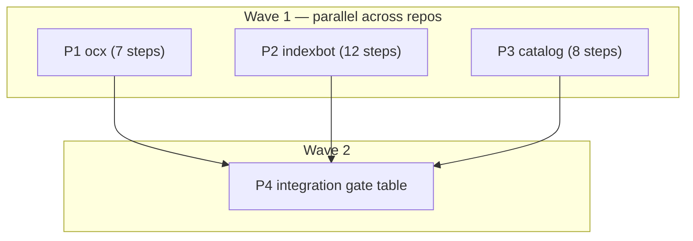

# Plan: index closure — ocx-sh/ocx#639

## Status

- State:   review
- Tier:    high
- Tier-grammar: 5
- Updated: 2026-10-24
- Next:    /hex-finalize
- Repos:   <!-- frozen at execution start; bases are never re-resolved -->
  - `.`        /home/mherwig/dev/ocx/.agents/worktrees/i639  trunk `main` base `10bc9d6f2825783732e7f3d0d1ce09075737c888`  landed: no
  - `indexbot` /home/mherwig/dev/ocx-indexbot  trunk `main` (origin/HEAD) base `c7434553d5d85872253c9a9cc73416332a349e5c`  landed: no
  - `catalog`  /home/mherwig/dev/ocx-catalog   trunk `main` (origin/HEAD) base `9d17f51e10d3fe685b156dd0c359dc34bb20021a`  landed: no
- Execution decisions:
  - Back-pointer (C-308) not written: the run contract keeps both satellite primary checkouts on `main`
    and untouched; the `Hex-Plan:` trailer on every satellite commit is the satellite-side record.
  - One pipeline per repo, so no pipeline sub-branch: ocx steps commit on the lead branch in place;
    each satellite works in `<repo>/.agents/worktrees/i639` on `hex/plan-issue-639-index-closure`.
  - Review fixes land as signed `fixup!` commits on their finding's commit; /hex-finalize autosquashes,
    so each repo keeps one commit per finding.
  - Review decisions (question → research → decision):
    - indexbot G-19 pusher source: commit author/committer ids come from emails a pusher controls →
      GitHub "List repository activities" (`GET /repos/{o}/{r}/activity?ref=…`, `contents: read`) actors
      added to the union; an event counts if at/after PR creation or its tip sha is a PR commit; no
      push activity at the head sha, a page cap, a bulk (ref-less) GitLab push, or any null id → human lane.
    - indexbot transient forge errors in `list_pushers` exit 75 (retry), not the human lane; the
      deterministic page cap maps to the human lane instead.
    - indexbot render refuses an all-quarantined index unless `--allow-empty` (same guard as no roots).
    - ocx acceptance fixtures seeded a base root without its objects; the closure probe is right, the
      fixtures now carry the entry's objects.
- Integration gate (P4), final state per repo:
  - `.` at `202573481`: `task verify` (flock `.agents/acceptance-suite.lock`) VERIFY_EXIT=0 —
    bazel unit 66/66, acceptance 179/179 targets, 3683 cases (floor 3683), 150 skipped (ceiling 255),
    5 xfailed (ceiling 5). Windows native `cargo test --workspace --no-fail-fast` on `C:`: 8985 passed,
    21 failed, 18 ignored — 13 single-process noise (pass alone), 8 environment-only (no symlink
    privilege ×3, `C:\WINDOWS` casing ×1, Bazel-only `SDK_TEST_OCX_BINARY` ×4), none in branch-touched code.
    First gate run red (6 announce acceptance cases, fixture root without objects) → fixed in pass 1.
  - `indexbot` at `1674eff`: `task verify` VERIFY_EXIT=0 — 1846 passed, 100.00% branch coverage;
    `task docs:build` 0; `task wheel:check` 0.
  - `catalog` at `0b397f0`: `task verify` VERIFY_EXIT=0 — 176 files, 2995 tests passed;
    `task docs:build && task docs:check` 0; `task lint:links` 0 (36 OK). First run red: load-induced
    vitest timeouts and a missing `docs/node_modules` link in the worktree (environment) → rerun green.
  - D1 cross-repo: indexbot `tests/core/test_render.py -k yanked` 1 passed; catalog
    `npx vitest run --project unit test/golden` PASS 14 FAIL 0.
- Review: ocx 1 round (changes-requested → 9 fixed, 1 skipped), catalog 1 round (7 fixed),
  indexbot 2 rounds (round 1: 16 fixed; round 2: 4 fixed). Cross-model seat ran in every round.
- Deferred findings (human judgment; for the #639 closing comment):
  - ocx: an existing announce PR's body is never rewritten, so `Carried:`/`Rebuilt on` reach only the
    commit message on a stale branch (needs a new Forge method; A4-adjacent). C-004's missing-object
    path list is a bool. `Spent` branches also print "replacing the branch head".
  - indexbot: pushes older than the 90-day GitLab lookback that are still in the MR are unread; a
    non-owner ancestor kept after an owner force-push is not detected (needs full push history);
    fork PRs/MRs always take the human lane (D15).
  - catalog: a yanked-only 404 does not trigger the c/index.json re-read; `format_version` is checked
    after the walk (a v2 index with a 503 root exits 69); missing readme/logo on path/git sources is silent.

---

## Overview

**Issue:** https://github.com/ocx-sh/ocx/issues/639 — every finding verified on 2026-10-24
(ocx `33669e007`, indexbot `c7434553`, catalog `84c16d1`; A1 reproduced red).
**Evidence and minimal fixes:** `.agents/research/issue639_verified_findings.json` (per finding:
verdict, evidence, fix, proposal assessment; `result.critic` resolves the contradictions).
**Run contract:** `.agents/goals/plan-issue-639-index-closure.md` (§ Rules, § Emphasis bind this plan).
**Re-anchored 2026-10-24 by /hex-plan Discover** onto: ocx `9c4cc8eb0` (no `crates/ocx_announce` or
`crates/ocx_cli/src/command` change since `33669e007`), indexbot `c7434553` (unchanged, v0.6.3),
catalog `9d17f51` (v0.6.0, the Astro port; every C-item still holds there, line anchors moved ≈ +1).

**Classification.** 30 finding IDs in 27 commits (mostly `fix`, A5/A6/A7/B3/B11 `feat`, B5 `docs`), three repos, two-way door: no new boundary, no ADR.
Scope medium (1–2 weeks of steps, parallel across repos). Tier `high` (auto). Overlays:
`architect=inline` (scope and design decided by the owner and the verified findings),
`research=skip` (findings JSON is the research artifact), `adversary=off`.

## Objective

Three PRs, one per repo, each merge-ready: green CI, linear signed history, **one conventional commit
per finding fixed** (subject = changelog line; A1+A9+X4 share one, C11+X2 share one). Invariant across
all three: *no committed or served tag row lacks its CAS object* — yanked rows included.
Landing order (owner's merge order, PRs independent): catalog → ocx → indexbot.

## Scope

### In scope

- ocx (`.`): A1+A9+X4, A2, A3, A5, A6, A7, A8.
- indexbot: B9, B7, B8, B10, B12, B2, B11, B1, B4, B3, B6, B5 (docs only).
- catalog: C1, C2, C11+X2, C4, C5, C3, C10, C8; C12 confirmed fixed (below).

### Out of scope (deferred / dropped — recorded for the #639 closing comment)

- **Deferred:** A4 (merge-base carry: needs a new `Forge` method on two drivers; A1 already makes a
  carried row complete), B13 (repair change-class: a fourth lane plus `ForgePort` changes; B2 plus
  the B3 counts cover detection), B5 merged-MR audit (needs a per-tick merged-MR scan; the docs
  rewording ships now).
- **Dropped:** C6, C7, C9 (design speculation that C1/C11 make moot: tag-scope missing objects are no
  longer fatal), C13.
- **X1 (umbrella) and X3 (pattern):** no commit of their own — closed by A1+A2 (writer side) and C1/C2/C11 (reader side); the #639 closing comment says so.
- **C12 — confirmed fixed on catalog `9d17f51`**, no commit: `src/site/model/detail.ts` `detailWire`
  (L183-209) has no `throw`; `releaseFacts` (L166-176) returns `NO_FACTS` on missing or unparseable
  bytes; `src/site/lib/releaseFacts.ts` `imageIndexFacts` (L20-39) wraps the read in try/catch;
  pinned by `test/site/model/detail.test.ts:207-239,495` and `test/site/lib/releaseFacts.test.ts:34-47`.
  The catalog gate re-runs them.
- Repairing existing dangling rows in the private index (the owner runs the #639 recovery runbook).
- ocx-sh/indexbot#9 (names of any depth): not touched; B2 puts its new helper next to `root_glob` in
  `core/policy.py` so #9 later edits one site.

## Key decisions

| # | Decision | Rationale |
|---|---|---|
| D1 | Yanked tags keep their objects: indexbot render serves them (B9); catalog still fetches them, a 404 on an object referenced only by yanked tags is silent (C11+X2) | Owner decision 2026-10-24; render heals deployed trees on the next run; catalog tolerates old and third-party trees. Catalog golden `test/golden/yanked_excluded` already expects the yanked object — **no catalog golden change** (the verifier's "drop the object" is not the decided fix). |
| D2 | One pipeline per repo, serial steps | No file-disjoint cut exists inside any repo: ocx A1/A2/A3/A6/A5 share `announce.rs`, A2/A8 share `error.rs`; every indexbot finding writes `docs/reference/{cli,contracts}.md` or `tests/security/test_governance_contracts.py` in its own commit; catalog C1/C5/C8/C10 share `test/build/sources_pipeline.test.ts`, C1/C11/C4/C5/C3 share `walker.ts`. Parallelism is across repos. |
| D3 | Goldens and generated docs move **inside** the finding's own step, never at an integration step | One commit per fix is binding (goal § Rules) and each repo has one pipeline, so no concurrent writer exists; a commit with a stale golden would be red on its own. Regenerate with the repo's generator, never hand-edit. |
| D4 | A1 copies each branch-only carried row's object from the stale branch head, verifies sha256; absent or mismatched on head → re-observe that tag through the existing `observe_curated`/`plan_tags` path (dropped + reported on `MANIFEST_UNKNOWN`, transport error exits 75). No fetch-by-digest step. | Verifier's minimal fix; offline, byte-exact, mode-independent; the "add carried tags to the curated set" alternative silently moves digests in an unreviewed PR. |
| D5 | A2 checks only refs the run **introduces or carries** (refs(new root) − refs(base root)) against the `Put` set, with one `get_file_contents` probe at `base_sha` per suspect; violation → new `AnnounceError` variant, exit 65, nothing written or pushed. Inherited holes are tolerated **without a probe and without a warning**. | Zero extra forge calls in the normal case. The rough plan's "inherited holes warn only" is read as "never an error": warning would need a probe per inherited row; A3 heals observed objects and B2/B7 catch the rest downstream. **Divergence from the rough plan's wording.** |
| D6 | A1 lands before A2. A2's red tests are unit tests on the pure closure check; its wiring at both call sites (first attempt and race-retry) is proven by a local, uncommitted mutation: disable A1's carry and watch A1's regression test fail with exit 65 instead of committing a hole. | After A1 no realistic announce path introduces an unput ref, so an integration-level red test for A2 only exists against pre-A1 code; the builder mutation proof is the owner's preferred evidence. |
| D7 | A5 warns only when `Forge::authenticated_identity()` returns `Some` and the PR author differs; `None` (GitLab job token) → no warning, author still reported (A7). | `/user` is not job-token-readable, so "warn when identity unknown" would warn on every CI run (no WARN on the common benign case). **Divergence from the verifier's fix.** Enforcement lives in indexbot B4. |
| D8 | A6 ships `Carried:` and `Rebuilt on <short base sha>, replacing the branch head` only; no `Dropped` line. A7 adds `branch_state`, `base_sha`, `ref_update`, `carried`, `pull_request_author` (omitted when unset); no `closure`/`objects_written`/`carried_dropped`. | Rough-plan scope; additive report fields need no ledger entry or version bump (`adr_ocx_interface_contract.md:280`). |
| D9 | B4 (G-19) is enforced in indexbot: every account that pushed to the PR/MR since its base must own every touched package; a forge that cannot establish the pusher set returns `None` → human lane. | Owner decision (rough plan); a manual push bypasses any ocx-side guard (critic resolution of the A5↔B4 cycle). |
| D10 | B7 quarantines the **whole package** on a dangling reference (omitted from dist and `c/index.json`, stderr warning + CI summary); `--strict` exits 65; a hash mismatch always exits 65. B8 joins the same quarantine list. | Keeps root bytes verbatim (contracts.md §8) — no row-level re-serialization. |
| D11 | C5 combined error: one failure → rethrown unchanged; two or more → one error listing all; build exit = DATA (65) if any failure is DATA-class, else UNAVAILABLE (69). | A retry cannot fix a data failure, so DATA names the caller's next action. |
| D12 | C1's "missing tag object" warning must also fire for path/git sources (`sources_pipeline.test.ts:771` flips from DATA to "builds, warns, platform absent"); the step places it at the narrowest site holding `ctx.warn`. | A silent skip on path sources would hide the same outage the url warning reports. |
| D13 | B6 includes its code half (GitLab `only_allow_merge_if_pipeline_succeeds` / `only_allow_merge_if_all_discussions_are_resolved` read once per poll, stderr warning, no exit change) plus the `ci.md` GitHub bullet fix. | The rough plan's subject promises the warning. |
| D14 | Catalog runs C4 (dedupe) before C11+X2, and the yanked-only flag rides C4's deduped set | C11+X2's "a live reference wins" needs the per-digest merge C4 introduces; the rough plan had C11+X2 first. **Divergence from the rough plan's order.** |
| D15 | B4 pusher set: GitHub uses PR commits' `author.id`/`committer.id` plus `head_ref_force_pushed` actors; GitLab uses push events on the source branch since MR creation; anything unresolvable → `None` (human lane) | GitHub exposes no direct pusher list; the proxy fails closed because an unlinked email yields a `null` id → `None`. |

## Component Contracts

### ocx (`.`)

- **C-001** `announce` stale-branch rebuild (A1) — `announce.rs` (`carry_branch_tags` call sites L128
  and race-retry L352, `observe_and_rebuild` L473) and `announce/pipeline.rs` (`carry_branch_tags`
  L607, `build_files` L857): every tag row carried from the stale branch and not re-observed this run
  has its object `p/<ns>/<pkg>/o/sha256/<hex>.json` committed as a `FileChange::Put` with bytes copied
  from the branch head at `branch_sha`, sha256-verified against the row digest. Absent or mismatched
  on head → that tag is re-observed; `MANIFEST_UNKNOWN` drops the row with a stderr WARN naming the
  tag; a transport error exits 75. Applies under every tag selection (`UnionFile`, `Refresh`,
  `FromRegistry`) and to a durable row whose tag is gone. Both arms (first attempt, race-retry).
- **C-002** Invariant record (A9 + X4) — `adr_announce_diverged_branch_rebuild.md` § "The invariant,
  restated" (L96-98) reads "no tag announced into an open pull request is ever lost, and no committed
  row lacks its object"; L49 corrected; `arch-principles.md` ADR-index row matches; the false
  sentence in `pipeline.rs` (doc of `an_unmoved_description_rewrites_no_desc_but_still_carries_its_blobs`,
  ≈L1471-1481) and the test doc in `forge/git_workspace.rs` (≈L3079-3083) are reworded; the two tests
  that lock A1 in (`the_retry_carries_the_stale_branch_tags_and_resets_the_ref` ≈L2154,
  `a_row_a_stale_rebuild_re_proposes_is_removed_by_the_next_naming_announce` ≈L2987) seed the branch
  object and assert it is in `files`.
- **C-003** Writer closure check (A2) — two parts. (a) Pure fn in `announce/pipeline.rs`:
  `fn unput_introduced_refs(new_root, base_root, files: &[FileChange]) -> Result<Vec<String>, AnnounceError>`
  returns the CAS paths referenced by the new root but not the base root (refs(new) − refs(base)) that
  have no `Put` in `files`; a logo ref is satisfied by its png or svg `Put`; an unparseable digest is
  `Err`. (b) Caller in `announce.rs`, after both `observe_and_rebuild` calls and before `write_out` /
  commit: probe each returned path once with `get_file_contents` at `base_sha`; any still absent →
  `AnnounceError::RootReferencesUnwrittenObject { path }` (`error.rs`, `#[error("the new root
  references {path}, which this run neither writes nor finds on the base")]`, exit 65), nothing
  written (`--output`) or pushed. Inherited refs (already in base) are not checked.
- **C-004** No-op detection (A3) — `announce.rs` `unchanged` predicate (L158) and the retry predicate
  (L375): when a run would report `Unchanged`, each observed object and each desc blob in `files` is
  probed at `base_sha`; any absent → status `Updated` and the object is committed. Same under
  `--output` (status from the same result; the outcome lists object paths the base lacked). Changed
  runs pay no probe.
- **C-005** PR author (A5) — `forge.rs` `PullRequest` gains `author: Option<String>` (GitHub
  `user.login` in `github.rs::pull_request_from_body`, GitLab `author.username` in
  `gitlab.rs::merge_request_from_body`). On reusing an open announce PR, a stderr WARN fires when
  `authenticated_identity()` is `Some(id)` and `id` ≠ author; `None` → no warning (D7).
- **C-006** PR body (A6) — after `Rebuilt` is built in `announce.rs` (call site of
  `pipeline.rs::change_body` L400/L535): append the line `Carried: <tag>, <tag>` (branch-only carried
  tags, sorted, `", "`-joined, each through `is_valid_oci_tag`) when non-empty, and the line
  `Rebuilt on <first 12 hex of base_sha>, replacing the branch head` when `ref_update == Reset`.
- **C-007** Announce JSON report (A7) — `crates/ocx_cli/src/api/data/announce.rs` `AnnounceReport`
  adds `branch_state` (open enum `absent|live|spent|stale`), `base_sha`, `ref_update` (open enum
  `fast_forward|accumulate|reset`), `carried` (tag list), `pull_request_author`; every field omitted
  when unset (IC-04); schema golden `crates/ocx_schema/tests/golden/reports.json` and the
  `crates/ocx_sdkgen/tests/golden/rust/*` goldens regenerated; no `ledger.toml` entry, no version bump.
- **C-008** Private index without token (A8) — help text in `command/package_announce.rs` (≈L36,
  ≈L627) and `command/package_claim.rs:29` says writing to `--output` works without a token on a
  public index repository and a private one needs `OCX_ANNOUNCE_TOKEN` to read the base;
  `MissingBaseRef` Display (`announce/error.rs` L246-253) adds "(a private repository answers an
  anonymous read 404; set OCX_ANNOUNCE_TOKEN)" in lowercase library style; generated
  `website/src/content/docs/reference/command-line/package-publishing.md` regenerated
  (`task website:reference:generate`). No driver reclassification of 404.

### indexbot

- **C-101** Render serves yanked objects (B9) — `core/render.py` `_reachable_digests` uses every tag's
  content (all `root.tags.values()`); `_live_tag_content_digests` deleted; only digests orphaned by a
  repointed tag are pruned. `docs/reference/contracts.md` §8 (L719-726) says so. Golden
  `tests/golden/render/yanked_excluded/expected/dist/…/o/sha256/<yanked hex>.json` added; root and
  `c/index.json` goldens unchanged.
- **C-102** Render closure and integrity (B7) — `cli/render.py` `_load_source_package` runs
  `validate_entry.check_digest_self_consistent` (mismatch → `AnomalyError`, exit 65, always) and
  `check_no_dangling_references` (dangling → package quarantined: root and objects omitted from dist
  and `c/index.json`, stderr line `render: quarantined <package>: dangling <ref>, …` + CI summary);
  new `--strict` (`cli/main.py::_add_render_arguments`) turns quarantine into exit 65. New pure helper
  in `core/validate_entry.py`: `def closure_counts(root: PackageRoot, cas: Mapping[str, bytes]) ->
  ClosureCounts` (frozen dataclass `referenced`, `missing`, `bad`; `bad` = present but failing
  `check_digest_self_consistent`), used by render and by B3.
- **C-103** Malformed root (B8) — `cli/render.py` catches `ValidationError` per root into the B7
  quarantine list (message carries the root path; `--strict` re-raises with the path);
  `cli/reconcile.py::_verify_one` (L217-269) records a malformed root as a finding instead of aborting.
- **C-104** Reconcile CAS-first (B10) — `core/verify_claims.py::_verify_tag_claim` runs
  `_verify_blob_claim` before the registry observation and returns its finding when present, so
  `cas-object-missing`/hash-mismatch surfaces for moved, vanished, yanked and ephemeral rows.
- **C-105** Skipped G-15 visible; reconcile ownership (B12) — `cli/validate_pr.py::run` emits one
  `write_ci_annotation('notice', 'registry checks skipped: <root>, <root>')` (roots sorted) for roots
  whose G-15 check was skipped, on success too; none when nothing was skipped;
  `cli/reconcile.py::_verify_one` runs `core/registry_checks.check_ownership` (and digest-in-scope
  where `verify_claims` lacks it) with its findings feeding `_escalating_findings`.
- **C-106** validate-pr maps CAS paths (B2) — `GitPort.changed_package_roots` (`ports.py`,
  `adapters/local_git.py`) gains an include-deleted mode for CAS paths; `validate_pr.run` maps
  `p/<seg…>/o/sha256/<hex>.<ext>` → `p/<seg…>.json` via a helper moved from
  `classify_pr._cas_owner_root_path` into `core/policy.py` beside `root_glob`; owners absent at HEAD
  dropped; existing `validate_paths` then checks closure and hashes. Root deletions stay excluded.
- **C-107** `indexbot validate --all` (B11) — validates every committed root (discovery shared with
  reconcile), accepts zero roots, admits committed reserved roots; no `--keep-going`; a reserved root
  under `--all` is not a fork bypass.
- **C-108** Human-lane head pipeline (B1) — new `ForgePort.ensure_head_pipeline(number, *, head_sha)`
  (GitLab: existing `_ensure_head_pipeline`; GitHub: no-op; fakes record the call); the gate calls it
  on a non-success disposition only for same-project MRs whose changed paths are all under `p/`.
- **C-109** G-19 pushers (B4) — new `ForgePort.list_pushers(pr_number, *, base_sha, head_sha) ->
  tuple[int, ...] | None` (GitHub: `GET /repos/{o}/{r}/pulls/{n}/commits` → each commit's `author.id` and
  `committer.id` (GitHub user ids, the closest identity GitHub exposes for who put the commit there),
  plus `GET /repos/{o}/{r}/issues/{n}/timeline` events with `event == "head_ref_force_pushed"` →
  `actor.id`; GitLab: `GET /projects/{id}/events?action=pushed` (paginated) filtered to
  `push_data.ref == <source branch>` and `created_at >= <MR created_at>` → `author_id`. Fork MR/PR,
  any `null` id, or a request error → `None`). `governance_check._author_owns_every_touched_package` requires author ∪
  pushers ⊆ `owners[].id` of every touched root; `None` → human lane. Skipped under `auto_merge ==
  "always"` as today.
- **C-110** Review thread (B3) — `governance_check._assign_reviewers_and_comment` appends the
  sentence `Release: a committed maintainer other than the author approves at head <head_sha[:12]>.`
  and per touched root one line `` `<root path>`: N referenced, M missing, K bad `` from C-102's
  `closure_counts` over CAS read at `head_sha`; re-running edits the same comment, never adds one.
- **C-111** GitLab merge settings (B6) — governance-poll reads the project once per run and, for
  each of `only_allow_merge_if_pipeline_succeeds` and `only_allow_merge_if_all_discussions_are_resolved`
  that is false, prints `governance-poll: GitLab project setting <name> is off; the human lane is not
  enforced` to stderr (GitHub: no read); exit code unchanged. `docs/guide/ci.md` GitHub bullet (L412-413) requires
  only the validate check.
- **C-112** Docs (B5) — `docs/guide/ci.md` L440-446: a thread-resolving author with merge rights can
  bypass the human lane on GitLab Free; names the real controls.

### catalog

- **C-201** Missing tag object (C1) — `src/sources/walker.ts`: a tag-object load accepts 404
  (`acceptStatus` `s => s===200||s===404`, no retry), warns naming source/package/tag/digest, skips
  `files.set`; 5xx, network, redirect, oversize and `DIGEST_MISMATCH` stay fatal.
  `src/viewmodel/catalog.ts::catalogPlatforms` skips an unloaded live digest instead of throwing; a
  malformed blob still throws (65). Path/git sources warn too (D12).
- **C-202** Missing readme/logo (C2) — `catalog.ts::casUrl` returns `null` for an unloaded digest;
  `catalogEntry` renders without it.
- **C-204** Fetch once (C4) — `processPackage` dedupes tag digests; one GET per digest; a 404 is
  not retried (no sleep).
- **C-203** Yanked object (C11+X2, lands after C-204) — the deduped digest set carries
  `yankedOnly: boolean`, true only when every tag referencing that digest is yanked (a live reference
  wins); yanked objects are still fetched; a 404 on a `yankedOnly` digest is silent; any other digest
  follows C-201.
- **C-205** All failures reported (C5) — `walker.ts` L544/L710 `Promise.allSettled`;
  `sources_pipeline.ts::resolveCatalog` collects per-source errors; one failure rethrown unchanged, ≥2
  combined with every message; code per D11; failed sources stay uncached.
- **C-206** Torn read (C3) — `readUrlSource`: on root `DIGEST_MISMATCH`, root 404, or any tag-object
  404/mismatch, re-fetch `c/index.json` once without `If-None-Match`; changed bytes → re-walk once;
  unchanged → original outcome.
- **C-207** Format version (C10) — `readOneSource` (one shared check for all readers): `config.json`
  or `c/index.json` with `format_version` present and ≠ 1 → `SourceError("UNSUPPORTED_FORMAT")`
  (`src/sources/types.ts`), exit 65. Absent → accepted.
- **C-208** Git fetch failures (C8) — `src/sources/git.ts` (L199-226) wraps non-`SourceError` git
  failures as `SourceError("FETCH_FAILED")` → exit 69; `PATH_ESCAPE` and `GIT_SHA_UNSUPPORTED`
  unchanged; `docs/src/content/docs/ops/troubleshooting.md` lists the real `FETCH_FAILED` triggers
  (404 after retries, oversize, redirect, git) and that `DIGEST_MISMATCH` can follow a mid-read deploy.

## User-Experience Scenarios

| ID | Action | Expected outcome | Error cases |
|---|---|---|---|
| S-001 | `ocx package announce --tags-file` onto a stale announce branch carrying a branch-only tag | Commit holds the root and every carried row's object; PR body lists `Carried:` and `Rebuilt on <sha>` | Head lacks the object and the tag is gone → row dropped, WARN; registry transport error → exit 75 |
| S-002 | Announce run whose new root would reference an object it does not write | Exit 65, nothing pushed or written | — |
| S-003 | Re-run announce over an index whose committed object is missing | Reports `updated`, commits the object | — |
| S-004 | Announce joins a PR opened by another identity | stderr WARN, `pull_request_author` in JSON | Job-token run: no WARN, author reported |
| S-005 | `ocx package announce --format json` | Report carries `branch_state`, `base_sha`, `ref_update`, `carried`, `pull_request_author` when set | — |
| S-006 | Announce `--output` against a private index without token | Error message says to set `OCX_ANNOUNCE_TOKEN` | — |
| S-101 | Yank a tag, render the index | Dist serves the yanked tag's object | — |
| S-102 | Render a source tree with a dangling or malformed package | Package quarantined, warning + CI summary, rest of site renders | `--strict` → exit 65; hash mismatch → exit 65 always |
| S-103 | MR that only adds or deletes CAS objects | validate-pr validates the owning root | Owner root deleted in the MR → skipped |
| S-104 | Human-lane GitLab MR under `p/**` | Head pipeline created, review thread names who can release and object counts | Fork MR / non-`p/**` path → no pipeline |
| S-105 | Non-owner pushes into an owner's announce MR | G-19 refuses the machine lane → human lane | Pusher set unknown → human lane |
| S-106 | `indexbot validate --all` on main | Every committed root validated | Zero roots → success |
| S-107 | reconcile over a tag whose object is missing and whose tag moved | Reports `cas-object-missing`; ownership checked | Malformed root → finding, run continues |
| S-108 | governance-poll on a GitLab project with merge checks off | stderr warning, exit unchanged | — |
| S-201 | Catalog build over an index with a missing tag object | Builds, warns, tag's platform absent | Integrity failure → exit 65 |
| S-202 | Catalog build with a missing readme/logo | Entry renders without it | — |
| S-203 | Catalog build over a tree whose yanked object is pruned | Builds, no warning | — |
| S-204 | Catalog build with several failing sources | One error lists all; exit 65 if any DATA, else 69 | — |
| S-205 | Catalog build during an index deploy | Re-reads `c/index.json` once and succeeds | Persistent mismatch → original error |
| S-206 | Catalog source with `format_version: 2` | Exit 65 `UNSUPPORTED_FORMAT` | — |
| S-207 | Git source that cannot be fetched | Exit 69 `FETCH_FAILED` | — |

## Parallelization

| Pipeline | Repo | Scope | Expected Files | Wave | Depends on | Marks | Status |
|----------|------|-------|----------------|------|------------|-------|--------|
| P1 ocx-announce | `.` | C-001…C-008, S-001…S-006 | `crates/ocx_announce/src/{announce.rs,announce/pipeline.rs,announce/error.rs,announce/request.rs,forge.rs,forge/api.rs,forge/github.rs,forge/gitlab.rs,forge/git_workspace.rs,claim.rs}`, `crates/ocx_cli/src/api/data/announce.rs`, `crates/ocx_cli/src/command/{package_announce.rs,package_claim.rs}`, `crates/ocx_schema/tests/golden/reports.json`, `crates/ocx_sdkgen/tests/golden/rust/**`, `website/src/content/docs/reference/command-line/package-publishing.md`, `.claude/artifacts/adr_announce_diverged_branch_rebuild.md`, `.claude/rules/arch-principles.md`, `test/tests/test_announce*.py`, `test/tests/test_package_claim.py` | 1 | — | | merged |
| P2 indexbot | `indexbot` | C-101…C-112, S-101…S-108 | `src/ocx_indexbot/{core/render.py,core/verify_claims.py,core/policy.py,cli/render.py,cli/main.py,cli/reconcile.py,cli/validate.py,cli/validate_pr.py,cli/classify_pr.py,cli/governance_check.py,cli/governance_gate.py,cli/governance_poll.py,cli/_wiring.py,ports.py,adapters/local_git.py,adapters/github_api.py,adapters/gitlab_api.py}`, `tests/**`, `docs/reference/{cli,contracts}.md`, `docs/guide/{ci,quickstart}.md` | 1 | — | | merged |
| P3 catalog | `catalog` | C-201…C-208, S-201…S-207 | `src/sources/{walker.ts,git.ts,types.ts}`, `src/viewmodel/catalog.ts`, `src/build/sources_pipeline.ts`, `test/sources/{walker.test.ts,git.test.ts,git-sha-unsupported.test.ts}`, `test/viewmodel/catalog.test.ts`, `test/build/sources_pipeline.test.ts`, `docs/src/content/docs/{ops/troubleshooting.md,reference/cli.md,explanation/security-and-trust-model.md,how-to/configure-sources.md}`, `.claude/rules/subsystem-sources.md` | 1 | — | | merged |
| P4 integration | `.` | cross-repo gate table (all C-/S-IDs, D1 consistency) | — (verification only, no commit) | 2 | P1, P2, P3 | | merged |

**Critical path:** P2 indexbot (12 serial steps) → P4.

**Shippable after wave:** 1 — each repo's branch is independently PR-able once its own gate row is
green; catalog alone already stops the site outage (C1/C11).

**Parallelization justification:** one pipeline per repo — see D2 (every intra-repo cut shares a
source, docs or security-test file inside a single finding's commit).

No contract wave: each repo is one pipeline, and no pipeline consumes another's code.

## Implementation Steps

> Every step is one finding = **one signed conventional commit** (`--no-verify` on the hex branch),
> subject exactly as given (it is the changelog line; never edit `CHANGELOG.md`). Bugfix order inside
> each step: **red regression test first** (show it red), then the minimal fix (show it green), with
> the narrowest command. A step that changes a golden regenerates it with the repo's generator (D3).
> Satellite commits carry `Hex-Plan: ocx-sh/ocx:.claude/artifacts/plan_issue_639_index_closure.md`.
> Narrow commands:
> - ocx: `cargo test -p ocx_announce --lib --features __testing,ocx_oci/__testing,ocx_env/__testing,tokio/test-util <name>`;
>   acceptance `task test:parallel --force -- tests/<module>.py` (never bare `uv run pytest`).
> - indexbot: `task test -- <path>::<test> --no-cov` (a filtered run is iteration only; 100% branch
>   coverage is checked by the full `task test` at the gate, so every new branch gets its test in the
>   same commit). Each step extends or adds the named G-test it lists (`quality-indexbot-security.md`).
> - catalog: `npx vitest run --project unit <file> -t "<name>"`; never `npm install` in a worktree.

### P1 — ocx (`.`)

- [x] **P1.1 — A1+A9+X4** `fix(announce): a stale-branch rebuild commits every carried tag's object`
  - Red: the issue's test (proven red on main) in `announce.rs` `mod tests` beside
    `the_retry_carries_the_stale_branch_tags_and_resets_the_ref`, reusing `FakeForge`,
    `committed_root`, `seed_tags`, `run_announce`, `pull_request`, `object`, `durable_row`: stale
    branch carries a branch-only row, `UnionFile` run, commit must contain that row's object. Second
    case: `Refresh` with a carried durable row whose tag is gone. Third: retry arm.
  - Fix: C-001 per D4 (keep the branch repo in `RootRead`; new `carried: &[(digest, bytes)]` into
    `build_files`; both arms). C-002 test and doc edits in the same commit.
  - Covers: C-001, C-002, S-001.
- [x] **P1.2 — A2** `fix(announce): refuse to commit or write a root that references an object it does not carry`
  - Red: unit tests on the new closure fn (introduced ref without `Put` → error; inherited ref → ok;
    logo png/svg `Put` satisfies; suspect present at `base_sha` → ok; unparseable digest → error).
  - Fix: C-003 per D5; wire after both `observe_and_rebuild` calls. Wiring proof per D6 (local
    mutation of P1.1's carry → P1.1's test exits 65; revert; record the proof in the commit body).
  - Covers: C-003, S-002.
- [x] **P1.3 — A3** `fix(announce): a rerun over a missing object commits it instead of reporting unchanged`
  - Red: `unchanged_root` + `FakeForge` where the base root equals the rebuilt root but an observed
    object is absent at `base_sha` → expect `Updated` and the object `Put`; same under `--output`;
    a normal changed run issues no probe.
  - Fix: C-004 (L158 and retry L375).
  - Covers: C-004, S-003.
- [x] **P1.4 — A6** `feat(announce): the PR body names carried tags and a rebuild onto the base`
  - Red: `pipeline.rs`/`announce.rs` tests next to the existing `change_body` tests: carried + Reset
    run → both lines; no carry, fast-forward → neither; an invalid tag label is filtered.
  - Fix: C-006.
  - Covers: C-006, S-001.
- [x] **P1.5 — A5** `feat(announce): warn when joining an announce PR opened by someone else`
  - Red: `github.rs`/`gitlab.rs` body-parser tests (author parsed); announce test: identity `Some`
    and differing author → WARN; equal → none; identity `None` → none.
  - Fix: C-005 per D7; update every `PullRequest` literal (`announce.rs` ≈1450/≈1694, `claim.rs`
    650/753/1565/1748/1801, `git_workspace.rs` 775, `crates/ocx_cli/src/api/data/announce.rs` 243).
  - Covers: C-005, S-004.
- [x] **P1.6 — A7** `feat(announce): the JSON report states the branch state, base, ref update, carried tags and PR author`
  - Red: `crates/ocx_cli/src/api/data/announce.rs` report test asserting the fields (and their
    omission when unset); `reports_schema_matches_golden` red until regenerated.
  - Fix: C-007 per D8; plumb the values through `AnnounceOutcome` (`announce/request.rs`); regenerate
    `reports.json` (`cargo run -p ocx_schema -- reports > crates/ocx_schema/tests/golden/reports.json`,
    the header of `crates/ocx_schema/tests/golden_schemas.rs`) and the sdkgen Rust goldens with the
    generator the repo uses for them (find it in `crates/ocx_sdkgen/BUILD.bazel` or `task --list`;
    never hand-edit); `compat_gate.rs::the_live_goldens_hold_against_the_baseline_and_the_ledger`
    green with no ledger entry.
  - Covers: C-007, S-005.
- [x] **P1.7 — A8** `fix(announce): a private index read without a token says to set OCX_ANNOUNCE_TOKEN`
  - Red: a test on `MissingBaseRef`'s Display containing `OCX_ANNOUNCE_TOKEN`; a test that renders
    `package announce --help` and `package claim --help` through clap's `Command` and asserts both name
    `OCX_ANNOUNCE_TOKEN`.
  - Fix: C-008; `task website:reference:generate`; confirm `test/tests/test_package_claim.py:1764`
    still holds.
  - Covers: C-008, S-006.

### P2 — indexbot (`indexbot`)

- [x] **P2.1 — B9** `fix(render): serve yanked tags' objects`
  - Red: `tests/core/test_render.py::test_render_yanked_excluded` with the yanked object expected in
    dist; extend `test_g06_render_reachability_filter` (yanked keeps object; orphan still pruned).
  - Fix: C-101; contracts.md §8; add the golden object file (case name kept, D1).
  - Covers: C-101, S-101.
- [x] **P2.2 — B7** `fix(render): refuse mismatched objects and quarantine packages with dangling references`
  - Red: `tests/cli/test_render.py` (dangling → quarantined + warning; `--strict` → 65; hash mismatch
    → 65 with and without `--strict`); new `test_g06_render_never_serves_a_dangling_or_corrupt_package`.
  - Fix: C-102 per D10 (+ closure-count helper for P2.10); `docs/reference/cli.md` render section
    (`--strict`, quarantine), contracts.md §12 render entry.
  - Covers: C-102, S-102.
- [x] **P2.3 — B8** `fix(render): one malformed root is skipped with its path instead of failing the render`
  - Red: render test with one malformed root among good ones; reconcile test (`tests/cli/test_reconcile.py`)
    where a malformed root becomes a finding; extend `test_g12_reconcile_is_verify_only_no_write`.
  - Fix: C-103; contracts.md §12 reconcile entry.
  - Covers: C-103, S-102, S-107.
- [x] **P2.4 — B10** `fix(reconcile): check a tag's object before asking the registry`
  - Red: `tests/core/test_verify_claims.py` + `tests/cli/test_reconcile.py` — moved/vanished/yanked tag
    with missing CAS → `cas-object-missing`; check tests expecting `digest-mismatch` with absent CAS
    (validate-pr shares `verify_claims`). G-12/G-13 stay green.
  - Fix: C-104; contracts.md §7.
  - Covers: C-104, S-107.
- [x] **P2.5 — B12** `fix(validate-pr): report skipped registry checks on success; reconcile checks ownership`
  - Red: revise `test_a_pass_writes_no_annotation_and_no_summary` (L721) to expect the notice when
    G-15 was skipped; reconcile ownership test; extend `test_g15_ownership_probe_dispositions`.
  - Fix: C-105; cli.md validate/reconcile, contracts.md §12.
  - Covers: C-105, S-107.
- [x] **P2.6 — B2** `fix(validate-pr): validate a package when only its objects change or are deleted`
  - Red: `tests/cli/test_validate_pr.py` (CAS-only add, CAS-only delete, owner root deleted →
    skipped; `ScriptedGit` takes the new parameter), `tests/adapters/test_local_git.py`,
    `tests/core/test_policy.py`; new threat-class test "CAS-only PR is validated".
  - Fix: C-106; cli.md validate-pr ("Deletes are excluded" corrected).
  - Covers: C-106, S-103.
- [x] **P2.7 — B11** `feat(validate): --all validates every committed root`
  - Red: `tests/cli/test_validate.py` (`--all` over several roots, zero roots, reserved root admitted
    yet not a fork bypass), `tests/cli/test_wiring.py`.
  - Fix: C-107; cli.md L38-62.
  - Covers: C-107, S-106.
- [x] **P2.8 — B1** `fix(gitlab): human-review MRs confined to p/** get a head pipeline`
  - Red: `tests/cli/test_governance_gate.py` (human lane, same-project, all `p/**` → called; any path
    outside → not; fork → not), `tests/adapters/test_gitlab_api.py` (respx), fake records the call;
    extend `test_threat_arming_a_fork_merge_request_never_starts_a_pipeline_in_the_parent`.
  - Fix: C-108 (`ports.py`, both adapters, `tests/fakes/__init__.py`, `cli/governance_gate.py`);
    `docs/guide/ci.md` L418-424, cli.md L292-297.
  - Covers: C-108, S-104.
- [x] **P2.9 — B4** `fix(governance): G-19 requires every account that pushed to the MR to own the package`
  - Red: extend `test_g19_machine_lane_requires_author_owner` and
    `test_threat_authz_binds_numeric_id_not_login`; new threat test (owner opens, non-owner pushes →
    pending/human lane; pushers `None` → human lane); adapter tests (`tests/test_github_api.py`,
    `tests/adapters/test_gitlab_api.py`); `tests/fakes/test_fakes.py` for `FakeGitHub.pushers`.
  - Fix: C-109 per D9; cli.md G-19 table, contracts.md §12, `docs/guide/quickstart.md` L110.
  - Covers: C-109, S-105.
- [x] **P2.10 — B3** `feat(governance): the review thread says who can release the MR and counts missing objects`
  - Red: `tests/cli/test_governance_check.py` (comment carries the release sentence and
    "N referenced, M missing, K bad"; idempotent); extend `test_g20_human_lane_assigns_maintainers_reviewers`.
  - Fix: C-110 (reuses P2.2's helper); cli.md governance-check.
  - Covers: C-110, S-104.
- [x] **P2.11 — B6** `fix(governance-poll): warn when required GitLab merge settings are off`
  - Red: `tests/cli/test_governance_poll.py` (either setting false → stderr warning, exit unchanged;
    both true → none; GitHub → no read), adapter test for the project read.
  - Fix: C-111 per D13 (new `ForgePort` read + fake + both adapters); `docs/guide/ci.md` L412-413.
  - Covers: C-111, S-108.
- [x] **P2.12 — B5** `docs(ci): a thread-resolving author with merge rights can bypass the human lane`
  - No test (docs only; nothing runs). `docs/guide/ci.md` L440-446.
  - Covers: C-112.

### P3 — catalog (`catalog`)

- [x] **P3.1 — C1** `fix(sources): a missing tag object skips that tag's metadata with a warning instead of failing the build`
  - Red: `test/sources/walker.test.ts` (tag-object 404 → warning, path absent from `files`, zero
    sleeps; 5xx/redirect/mismatch still fatal; `walker.test.ts:706` stays green); flip
    `test/viewmodel/catalog.test.ts:96` to `[]`; flip `test/build/sources_pipeline.test.ts:771` per
    D12; pipeline e2e via `serveTree`.
  - Fix: C-201; doc comments (`walker.ts` L208-227, L596-648; `catalogPlatforms` JSDoc) and the
    retry/404 prose in `explanation/security-and-trust-model.md:65`, `how-to/configure-sources.md:42`,
    `.claude/rules/subsystem-sources.md`.
  - Covers: C-201, S-201.
- [x] **P3.2 — C2** `fix(viewmodel): a missing readme or logo renders without it`
  - Red: flip `catalog.test.ts:178` to `logoUrl: null`; add the readme case.
  - Fix: C-202; `casUrl` and `catalogEntry` doc comments.
  - Covers: C-202, S-202.
- [x] **P3.3 — C4** `fix(sources): fetch each digest once and do not retry a missing object`
  - Red: three tags on one digest → one GET; 404 → zero sleeps.
  - Fix: C-204.
  - Covers: C-204.
- [x] **P3.4 — C11+X2** `fix(sources): a yanked tag's missing object is not an error`
  - Red: `walker.test.ts` (yanked object 404 → no warning, build ok; yanked object present → fetched
    into `files`; digest shared with a live tag → C-201 warning). `RootTag` in `test/sources/helpers.ts`
    already supports `yanked`.
  - Fix: C-203 per D1 (extends P3.3's dedupe); `test/golden/yanked_excluded` unchanged.
  - Covers: C-203, S-203.
- [x] **P3.5 — C5** `fix(build): report every failing source and object, not only the first`
  - Red: walker with two failing objects → combined message; one failure → same error as before
    (existing `rejects.toMatchObject` tests stay green); `resolveCatalog` with a DATA and an
    UNAVAILABLE source → exit 65; two UNAVAILABLE → 69; `sources_pipeline.test.ts:683` stays green.
  - Fix: C-205 per D11; reverse the "first failure is the reported one" doc (L220-222).
  - Covers: C-205, S-204.
- [x] **P3.6 — C3** `fix(sources): re-read c/index.json once when a source changes mid-build`
  - Red: route counter serving index A then B → B wins, two index GETs; unchanged index → original
    error, two index GETs; re-check `walker.test.ts:257`, `:447` call counts.
  - Fix: C-206; troubleshooting.md note.
  - Covers: C-206, S-205.
- [x] **P3.7 — C10** `fix(sources): reject an unknown format_version`
  - Red: path source with `{"format_version":2}` in `config.json` and in `c/index.json` → 65
    `UNSUPPORTED_FORMAT`; absent and `1` → accepted.
  - Fix: C-207 (`types.ts`, `sources_pipeline.ts::readOneSource`); troubleshooting.md error-code row.
  - Covers: C-207, S-206.
- [x] **P3.8 — C8** `fix(sources): git fetch failures exit 69`
  - Red: flip `sources_pipeline.test.ts:731` to UNAVAILABLE; invert
    `test/sources/git-sha-unsupported.test.ts:64-77` (and its header L23-26); `git.test.ts:243` stays green.
  - Fix: C-208; troubleshooting.md rows L49/L50/L102, `reference/cli.md` L128/L140-141, `types.ts`
    `FETCH_FAILED` doc.
  - Covers: C-208, S-207.

### P4 — Integration gate (cross-repo table, C-311)

Each row reports pass/fail on its own; no aggregate verdict. Run after P1–P3 merged onto each repo's
`hex/plan-issue-639-index-closure`.

| Repo | State | Command(s) proving it |
|---|---|---|
| `.` | feature branch head with P1 merged | `task verify` (full); native Windows `cargo test --workspace` staged on `C:` (global CLAUDE.md § Windows); `verify-deep.yml` dispatched on first push and watched fail-fast. `task satellite:verify` not owed: no ecosystem-tier crate changes (ocx_announce internal, ocx_cli interface) — verify-deep still runs it. |
| `indexbot` | feature branch head with P2 merged | `task verify` (format, ruff, pyright strict, bandit, `task test` at 100% branch coverage, lock check); `task docs:build`; CI `unit-matrix` (3.12/3.13/3.14) on push |
| `catalog` | feature branch head with P3 merged | `task verify` (lint, typecheck, `npm test` unit + acceptance with coverage, pack smoke); `task docs:build && task docs:check`; `task lint:links` (docs links touched) |
| cross-repo (D1) | both satellite heads | Property checked: **each side, separately, expects the yanked object present** — indexbot `task test -- tests/core/test_render.py -k yanked --no-cov` (render serves it) and catalog `npx vitest run --project unit test/golden` (`yanked_excluded` input carries it). Not an end-to-end render→build run; the catalog golden is an in-memory fixture. |

Each repo's full-suite result is quoted in its PR body (goal § Rules).

## Risks

| Risk | Mitigation |
|---|---|
| A1's branch-object read adds forge calls on every stale rebuild | Only for branch-only carried rows not re-observed; offline otherwise |
| B7 quarantine hides a package from the live index until repaired | Intended (D10); warning + CI summary name it; `--strict` for CI that prefers to fail |
| indexbot 100% branch coverage per commit slows P2 | Each step owns its branches' tests; P2 is the critical path, sized at 12 small steps |
| catalog C5 changes error shape tests assert on | Single failure rethrown unchanged (C-205) |

## Schedule log
