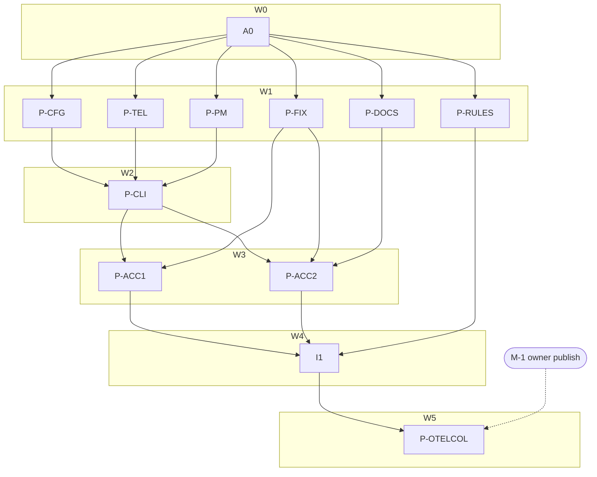

# Plan: OpenTelemetry export for OCX

## Status

- **Plan:** plan_otel_telemetry
- **State:** landing
- **Tier:** xhigh
- **Tier-grammar:** 5
- **Updated:** 2026-11-19
- **Active phase:** 5 — review-fix pass 1 executed (closing review findings applied); P-OTELCOL pending M-1
- **Step:** finalized
- **Feature branch:** `hex/otel-telemetry`
- **Last update:** 2026-11-19 (after 3329a102: review-fix pass 1 — 7 pipelines and 2 fix rounds merged; gate 3 green: `task verify:scoped --force` exit 0, `bazel:test:accept` 208/208 targets and 4428 cases with 0 failed, `task satellite:verify` exit 0; approved under goal loop `.agents/goals/otel-telemetry.md`)
- **Next:** merge of https://github.com/ocx-sh/ocx/pull/746 by a human
- **Reviewed:** 3329a102e416ce509c45ea0ad99295d46684d87f
- **Quality:** finalized 2026-11-19 as one signed commit on `hex/otel-telemetry`; release gate `task verify:scoped --force` green on the finalized tree; no release-grade workflow dispatched, the pull request's own checks are the remote gate; one CI fix pass after the first push (a Windows-only test deadline); the standing collector test is not landed (https://github.com/ocx-sh/ocx/issues/747)

---

## Overview

**Design record:** [`adr_otel_telemetry.md`](./adr_otel_telemetry.md) (Accepted 2026-11-18 under goal-loop authority; D-1…D-25, OBS-12 exemption conditions 1–10, OQ-1…OQ-13, § Amends and respects, § Amendment 2026-11-19 with R-1…R-30) and [`system_design_otel_telemetry.md`](./system_design_otel_telemetry.md) (contracts C-001…C-038, scenarios S-001…S-026, field tables § 4, goal map § 11, review round 1 folded in). This plan cites them and never re-decides them; § Decisions holds only plan-level calls (P-D-*), § Review fixes the round-1 triage.
**Source:** `.agents/discussions/otel-telemetry.md` (handed off to the loop). **Goal file:** `.agents/goals/otel-telemetry.md` (15 source criteria + 3 DONE-block criteria).
**Research:** [`research_telemetry_collector_and_sdk.md`](./research_telemetry_collector_and_sdk.md) (new this run: collector distribution, crate pin confirmed through Context7, semconv names) plus the five discussion-lane files copied to `.claude/artifacts/research_telemetry_{prior_art,codebase_recon,repo_archaeology,admin_enforced_config,council_precedence}.md` (the council file's synthesis carries a "superseded on the token" note). **Discovery:** [`discover_otel_telemetry.md`](./discover_otel_telemetry.md).

**Classification.** Scope large: 10 crates touched (one new), the acceptance suite, docs, AI config, one satellite check. Reversibility one-way (high): the switch and header variable names, the `[telemetry]` keys, the `OCX_CONFIG` list grammar (a G14 break), the `shell state` report field (a reports break), and the record's event and attribute names become contracts the moment an operator's backend queries them. Tier `xhigh` (auto — classifier: new crate, interface break, OBS-12 exemption with no accepted ADR; confident). Overlays: `architect=on` (ADR written this run), `research=1` (the collector, crate-pin and semconv gaps the discussion left unchecked; the persisted research was not repeated), `adversary=on`.

**Meta-plan gate.** xhigh blocks for explicit approval: approved under goal loop `.agents/goals/otel-telemetry.md` (2026-11-18). Spawn set: architecture-explorer ×1, explorer ×4, researcher ×1 (sonnet); architect ×1 (opus); review: reviewer spec (sonnet), architect (opus), researcher (sonnet), reviewer security (opus — `hex.md` always-on perspective for `crates/ocx_config/**`), cross-model `nox-review --harness codex` in plan-artifact scope.

**Model routing** (AGENTS.md policy). Every step `sonnet`; `hard`-marked pipelines run sonnet at high effort. `review`-marked pipelines get the security seat (`opus`, `hex.md` Preferences) before merge. `opus` for any other step only after it failed twice on sonnet. Every spawn sets `model`; never Fable.

## Objective

An operator arms `ocx` with `OCX_TELEMETRY` or `[telemetry] enabled = true` and names a collector through any config tier (managed payload included, or files listed in a now list-valued `OCX_CONFIG`) or the standard `OTEL_EXPORTER_OTLP_*` variables. Every armed command outside the never-send set sends exactly one bounded OTLP/HTTP protobuf request at its end, holding one command record and one record per package installed, pulled or removed, with performance data; a dead collector never changes the outcome. Proven against a ported capture server and one real `otelcol`.

## Scope

**In:** every goal criterion 1–15 (§ Traceability); the AI-config and doc amendments the ADR lists; the `ocx-mirror` lockstep check.
**Out (ADR § Out of scope):** traces, spans, the metrics signal, `TRACEPARENT`, any default destination, a crate shared with Grimoire, drop-in directories and `include`, a first-run prompt, a live check against `otel.ocx.sh`, the existing CI telemetry, an introspection command. Also out of this run: publishing the collector package (owner, M-1), `git push`, PR acts, a local full `task verify`, `CHANGELOG.md` (the commit subject is the changelog line).

## Decisions (plan-level; design decisions are the ADR's D-1…D-25 and R-1…R-30)

| ID | Question → evidence → decision |
|---|---|
| P-D-1 | **Lockfiles in the contract wave, not at integration.** `cargo check --locked` cannot pass with a new crate and new dependency edges until `Cargo.lock` changes, and the acceptance pipelines cannot import `opentelemetry.proto` until `test/uv.lock` has it. → A0 owns `Cargo.lock`, `MODULE.bazel.lock` (only if `bazel:mod:check` says it moved) and `test/uv.lock`, each changed once there, with every dependency R-17 lists; no later pipeline edits a `Cargo.toml` or `pyproject.toml`. Every other hub file regenerates once at I1. |
| P-D-2 | **Who wires the collector under Bazel.** `@tools` is proven only for a tool in the default group (discover § 4, F9); `ocx-previous` is the test-group-only precedent. → The real-collector module is reached the `ocx-previous` way: `module_data` with the project toolchain files, resolver `test/src/otelcol.py` (C-034). No `@tools` change. |
| P-D-3 | **The collector pin waits for the owner.** A `[group.test.tools]` entry with no `ocx.lock` leaf breaks every `ocx` toolchain load, and the package is absent from `ocx.sh` (`ocx --remote index catalog`, 2026-11-18: 150 repositories, none matching `otel|collector|telemetry`). → P-FIX/2 and P-OTELCOL/1 are proven locally with `OCX_TEST_OTELCOL` pointing at the upstream `otelcol_0.165.0_linux_amd64.tar.gz` unpacked in the session scratch directory (never committed). The module, the pin and its suite counts land together in P-OTELCOL, gated on M-1 (R-24); I1 runs without it. Without M-1, goal criterion 12 reads not met and the branch reaches `/hex-finalize` without the real-collector module. |
| P-D-4 | **New acceptance modules carry a `command` marker**, so `test:rows:check` reaches them without a `test/scoped_rows.toml` edit (that file is not touched). |
| P-D-5 | **The breaks ship in the squashed commit's subject.** `hex.md` Preferences squash a PR branch to one commit; the subject carries `!` and the body lists the breaks (`OCX_CONFIG` list with its 32-entry cap, the separator break and the older-binary caveat; `shell state` `config_paths`). Supersedes the ADR's "own commit" wording for the landing shape only (ADR § Migration 1); pipeline commits stay conventional. |
| P-D-6 | **Satellite path.** `taskfiles/satellite.taskfile.yml` defaults `OCX_MIRROR_DIR` to `ROOT_DIR/../ocx-mirror`, which resolves only from the main checkout; from this worktree it names nothing. The checkout is `/home/mherwig/dev/ocx-sh/ocx-mirror`. → I1 runs `task satellite:verify OCX_MIRROR_DIR=/home/mherwig/dev/ocx-sh/ocx-mirror` (a disposable worktree; nothing is written to the mirror). A red needs an `ocx-mirror` change, outside the run's grants (M-3). Retro entry filed. |
| P-D-8 | **Execution-time divergences (hex-execute, 2026-11-19).** (a) `switch_grammar` (C-001) moves from A0/1 to P-TEL/1: `ocx_env` has no tri-state reader (`TriBool` is a declared kind only), and C-001 places the reader in `ocx_telemetry`. (b) A0/2 shipped `TelemetryConfig::merge`, `lock_as_system`, `is_usable` and the header accessors real (with 6 unit tests) instead of stubbed; the lenient deserialize stays P-CFG/1's. (c) Disk: the host had ~5 GB free at A0/2 (ENOSPC mid-build); A0 built with `CARGO_INCREMENTAL=0`, `CARGO_PROFILE_DEV_DEBUG=0`. Space was freed host-side before wave 1 (238 GB free), so each Rust pipeline worktree got its own `target/` seeded by copying the warm A0 build (7.5 GB) under the same settings — parallel builds, warm dependencies. (d) A0/3 added a `test/scoped_rows.toml` `[crates]` row for `ocx_telemetry` (`--check-coverage` reds without a row per workspace member), superseding P-D-4's "not touched" for that one row; extend it to the telemetry modules at I1. (e) A0/4 gave `Decision::Armed` a `warnings: Vec<String>` field (value-free warning lines) so the destination warnings are assertable; the gate tests' `#[allow(clippy::field_reassign_with_default)]` must become `#[expect]` or go (P-TEL). (f) A0 also refreshed `MODULE.bazel.lock` and `scripts/bazel_label_map.toml` (the drift map's generated rows), both bazel gates green. (g) `a_shared_layer_counts_once` drives `setup_owned`, the smallest seam fetching a layer through the stub transport; P-PM may re-seam it to `setup_impl`. (h) P-TEL/4 replaced `CommandOutcome.error_detail` with `result: CommandResult { Succeeded, Failed { detail } }` (an error without a slug must still yield `_OTHER`). (i) P-CFG/5 made `PolicyInputs::to_write` fallible (R-10's refusal), which breaks `crates/ocx_cli/src/app/{context.rs,plugin_dispatch.rs}` until P-CLI/2 adapts them: the feature branch does not compile in `ocx_cli` between the P-CFG merge and P-CLI/2 (`plugin_dispatch.rs` joins P-CLI's file set). (j) P-CFG/2 fixed one test line in `crates/ocx_cli/src/exit/classify.rs` (`config_parse_error_maps_to_config_error` built `Parse` from a raw toml error). (k) `ocx_project::Error::TomlParse` (an `ocx.toml` syntax error) still quotes the source line through toml's `Display`; R-2 named only config files and the managed snapshot — follow-up candidate, not this run. (l) P-CLI's stack fix (P-D-9) boxes each arm of `Command::execute`; the nested group dispatchers (`Package::execute` and siblings) keep the arm-sum frame — follow-up candidate. (m) I1 kept `test/SKIP_CEILING` 275 and `XFAIL_CEILING` 5: the new modules add no Linux skip or xfail, and a local measurement (279 / 3) counts host-dependent skips (missing shells). Windows ceilings +1 each (one win32 skip), inferred, not measured — this host has no Windows interop, so `test:windows-local` and native Windows `cargo test` were not run. (n) I1 fixes on merged code: `test_shell_state_report.py` reads `policy.config_paths` (counterpart of the announced report break); the code-docs ratchet's plan IDs and an over-cap docstring; `ocx_telemetry::client::Failure` taken off `std::error::Error` (the boundary guard counted it as an unarmed CLI-reachable error); the `pins.rs` absent-sibling literal spelled as a template; `ocx_telemetry_test` ships `src/**` as Bazel data; the `--config` help text names "a child OCX process"; the `scripts/` self-test constants count the crate's Bazel targets. (o) S-006's design text listed `ocx --version` (no such flag, exit 64) and `ocx shell completion bash` (the form is `--shell bash`); corrected in the design. (p) `cargo deny check` exits 1 on RustSec advisories against `chrono`, `crypto-bigint`, `ctutils`, `rustls-webpki`, `webpki-root-certs`, `zip`, none touched by this branch; CI runs only `cargo deny check licenses` (green) — follow-up candidate. |
| P-D-9 | **Doubt: are the `command::status::seam::*` stack overflows pre-existing?** P-CLI/2 saw 11 unit tests in `crates/ocx_cli/src/command/status.rs` overflow the 2 MiB libtest thread, and reported them as reproducing on 02c0f441. → Research: `bazel test //crates/ocx_cli:ocx_cli_test` (all 1752 cases) PASSES on `main` 8a265e26 and FAILS on a7064ae3 with `command::status::seam::plain_status_is_compact_and_verbose_adds_pins` overflowing its stack; 02c0f441 already carries P-CFG/P-TEL/P-PM. → Decision: a branch regression (larger futures on the in-process seam path), in scope; fixed in P-CLI by shrinking the futures on that path (boxing), never by raising a test's stack. Also matters for real use: a Windows main thread has 1 MiB. |
| P-D-7 | **Golden tests stay red until I1.** `cli_document_matches_golden`, `config_schema_matches_golden`, the errors and reports goldens and `task website:reference:check` go red in A0 and stay red until I1 regenerates them once; step feedback excludes them, and a step reviewer must not block on them. |

## Review fixes (round 1, plan-artifact scope)

Panel: spec reviewer (sonnet), architect (opus), security reviewer (opus), researcher (sonnet), cross-model `nox-review --harness codex` (ran). Design-level fixes R-1…R-30 are recorded in the ADR's § Amendment 2026-11-19 and folded into the design; each row here names its source and evidence. Plan-level fixes are R-31…R-40.

| ID | Source → evidence → decision |
|---|---|
| R-1 | security High + architect deferred High: per-name header merge independent of `endpoint` sends a user-tier token to a destination a later layer names (owner rule "endpoint and headers from one source") → a layer that sets `endpoint` drops inherited headers. Decided here, not deferred: it applies the owner's closed rule; the cost (a user-file token no longer reaches a managed endpoint; put it in the payload, an `OCX_CONFIG` file or `OCX_TELEMETRY_HEADERS`) is documented |
| R-2 | security High: toml 1.1's error `Display` quotes the source line; the error document prints `{err:#}` (`crates/ocx_cli/src/error_document.rs:95`) → parse errors print path, line, column, message only |
| R-3 | security High: `opentelemetry_http::HttpClient: Debug` forces `Debug` on the client holding headers → `SecretString` to the request, `set_sensitive`, hand-written `Debug` |
| R-4 | security High: the trait returns `Response<Bytes>`; an uncapped hand-written client lets a hostile collector stream until the timeout → empty body, never read |
| R-5 | security Warn: `reqwest::Error` and `ExporterBuildError` `Display` embed the URL → class-only debug line |
| R-6 | security Warn + architect Warn: the guard refuses nothing on this client (`ssrf.rs:195-197,232`; hyper skips lookup for literals) → stated as ratchet compliance; link-local/metadata literal floor; the IPv6-bracket task is dropped |
| R-7 | security Warn + deferred D: headers over `http://` → warning, not refusal (plaintext collectors inside an operator's network are legitimate) |
| R-8 | security Warn: hop-by-hop names and control bytes passed validation → refused at parse |
| R-9 | security Warn: `read_bounded` follows symlinks (`bounded_read.rs:83`) → `symlink_metadata`, `persist_temp_file_noclobber` |
| R-10 | security Warn: a `--config` path with the separator is re-split by the child (`exec_state/policy.rs:363` writes it) → parent refuses, new slug `config_path_contains_separator` |
| R-11 | security deferred A (relative entries): single-path compatibility is goal criterion 3 and T3 is accepted → keep, docs recommend absolute paths |
| R-12 | security deferred B (package env sets `OTEL_*`): the package's code already runs in that environment → no reservation; D-8's text narrowed |
| R-13 | architect High + security deferred C: `subsystem-cli.md` § Credential exemption requires `Credential` for a bearer variable → `Credential`; nested env-only arming loses the env token (documented) |
| R-14 | architect High: `package_url` adds `arch` and the uninstall result lacks the platform (`purl.rs:50-52`, `uninstall.rs:14-19`) → platform when stored, else no `arch`; S-015 compares without `arch` |
| R-15 | architect High: a root losing the singleflight race is a waiter (`pull.rs:237`); separate operations each lead (`apply_pending`, `pull_or_prepare`) → per-entry-point root sets; keep the fetching entry's fields |
| R-16 | architect High: an older `ocx` exits 79 on a list → risk + guide caution |
| R-17 | spec High + architect Warn: `percent-encoding`, `url`, `http`, `bytes` missing before P-D-1 freezes the lock → settled in A0/2 and A0/3 |
| R-18 | architect Warn: `ocx status` promises no network, `ocx config test` no network and no state writes → never-send |
| R-19 | architect Warn: D-11 contradicted design § 3.1 rows 7–8 → one warning rule |
| R-20 | architect Warn: received-list cap; `--config` help (`context_options.rs:14`); `PolicyReport` doc (`shell_state.rs:1180`) → amended |
| R-21 | architect Warn: `try_init(..).map_err(fail)?` (`app.rs:149-159`) drops the Context → slot as out-parameter; duration before `apply_pending`; abort on timeout |
| R-22 | architect Warn: transitive `opentelemetry-proto` unpinned; OBS-20 row missing → pin guard reads `Cargo.lock`; constitution row added |
| R-23 | architect deferred High: `self activate` writes `ocx --global env --shell=…` into every login stream (`activate.rs:1158`) → `env`/`package env` with `--shell` never-send. Decided here: same reason the ADR already exempts `self activate`; plain `ocx env` still sends |
| R-24 | cross-model High: I1/3's glob would run the collector module before I1/5 pins it → P-OTELCOL pipeline after I1, gated on M-1 |
| R-25 | cross-model Warn (request size): the log is bounded by packages the run already materialized → no cap; 10 000-record unit test; 64 MiB exporter cap as backstop |
| R-26 | cross-model Warn (exit bound): a stuck `getaddrinfo` on tokio's blocking pool holds runtime shutdown → endpoint resolved on a detached thread under the deadline, `resolve_to_addrs`; unit test with a never-returning lookup |
| R-27 | researcher High: `set_event_name` takes `&'static str`; proto `event_name` is Development → constants; the decode asserts `event_name` |
| R-28 | researcher Warn: spec reads only `true` for `OTEL_SDK_DISABLED` → superset kept as a recorded deliberate deviation; other `OTEL_LOGS_EXPORTER` values → debug line |
| R-29 | researcher Warn: never retrying is a SHOULD deviation → recorded in D-19 |
| R-30 | researcher Warn: OTel-divergent names and absent `service.instance.id` → stated in the reference page; dry-run recipe in the guide |
| R-31 | spec Block: `OCX_CONFIG`'s kind change reaches `crates/ocx_shell/src/shell/reconcile/fingerprint.rs:183` (pushes the raw value as one path, so a cached `inert` verdict would not track list members) and `crates/ocx_config/src/exec_state/types.rs:160` → both in P-CFG's file set, with a fingerprint unit test |
| R-32 | spec High: C-003, C-029 and S-025 had no test step; the coverage claim was false → named in A0/1, A0/3, I1/1, P-ACC2/3; coverage re-run (§ Traceability) |
| R-33 | spec Warn: A0/1–2, P-TEL/6, P-ACC1/1, P-ACC2/3 were two or three steps each → split |
| R-34 | spec Warn: no contract tests for P-CLI and C-025 → A0/4 adds `every_leaf_has_a_telemetry_class` and `a_shared_layer_counts_once` stubs |
| R-35 | spec Warn: design test names missing from steps → named |
| R-36 | spec Warn: `test_never_collected` had no design trace → it is ADR condition 7's test; cited there |
| R-37 | spec Warn: goldens red until I1 → P-D-7 |
| R-38 | spec Warn: status block vs empty review record → record filled |
| R-39 | spec: `PackageManager` is declared in `crates/ocx_package_manager/src/lib.rs` → named |
| R-40 | cross-model: review routing in the plan and "absent design records" → dropped as stated convention (hex plans carry their review budget; the reviewer's checkout held only the plan file, the records exist beside it) |

## Component contracts

Owned by the system design § 6; IDs are the coverage join keys. One line each.

- **C-001** `OCX_TELEMETRY: TriBool, Public, UserInput`; reader returns `Unset | On | Off | Invalid`.
- **C-002** `OCX_TELEMETRY_HEADERS: String, Public, secret, Credential`; `k=v` grammar, percent-decoded, refused names incl. hop-by-hop, values through `HeaderValue::from_bytes`.
- **C-003** Foreign declarations: `DO_NOT_TRACK`, `OTEL_SDK_DISABLED`, `OTEL_LOGS_EXPORTER`, the honoured `OTEL_*`, the two compression variables (`reader = Dependency`), CI ids.
- **C-004** `OCX_CONFIG` is a `PathList`: later wins, empty entries skipped, cap 32 (`config_list_too_long`, 78), loads under `OCX_NO_CONFIG`; a `--config` path with the separator is never forwarded (`config_path_contains_separator`, 78).
- **C-005** received `policy.config_path` carries the raw list, validated per entry and capped; `shell state` `config_paths`.
- **C-006** `[telemetry]` section type: seven keys, lenient parse, unusable marking, secret headers, schema; parse errors never quote the source line.
- **C-007** merge: an `endpoint` layer drops inherited headers; scalars later-wins; headers per name case-insensitive; attributes per key; unusable poisons; lock ignores later.
- **C-008** `apply_system_locks` locks it; `retain_system_locked_sections` keeps it only when locked.
- **C-009** managed payload folds `[telemetry]` whole, `headers` included.
- **C-010** `ocx.toml` refuses `[telemetry]` (78, `telemetry_section_in_project`); `fold_project_tier` strips it.
- **C-011** gate `decide(section, offline)`: design § 3.1 rows 2–12, R-19 warning rule; no OTel type built.
- **C-012** destination selection: § 3.2, endpoint validation, link-local floor, `/v1/logs`, family, header scoping.
- **C-013** resource builder: § 4.1 from `Resource::builder_empty()`, § 3.3 order, percent-decoded attributes.
- **C-014** command record `sh.ocx.command`: name, duration, `process.exit.code`, `error.type` = slug.
- **C-015** package record `sh.ocx.package`: purl, action, role, store hit, size, three durations, presence rules.
- **C-016** golden payload `crates/ocx_telemetry/tests/golden/payload.json`; wire built from the same value; `event_name` constants.
- **C-017** installation id `state/telemetry/installation-id`: v4, 0600, symlink refused, created only with a destination and only if absent.
- **C-018** HTTP client: ocx roots + extra CAs, timeouts, no redirects, guard as ratchet compliance, detached endpoint lookup, sensitive headers, plaintext warning.
- **C-019** export: collect-only processor, one `export(LogBatch)`, `RetryPolicy::disabled()`, headers cleared, uncompressed, body never read, failures debug-only by class.
- **C-020** debug audit lines; no secret, URL query or error `Display` with a URL on any stream.
- **C-021** CLI wiring: one finish site in `app.rs`, out-parameter slot, exit-code recovery, spawned task under timeout, aborted on expiry.
- **C-022** never-send `telemetry::class(command)`: exhaustive over `Leaf`, plus `--shell` on the env leaves.
- **C-023** no slot under `in_seam()`; `skip_reason` never called; exports in CI.
- **C-024** `ActivityLog` in `ocx_package_manager`: leaders only, per-entry-point root sets, actions, `UninstallResult.pinned` with platform when stored, drained once.
- **C-025** timing and byte attribution rules (ADR D-17).
- **C-026** CI detection: `sh.ocx.ci.provider`, `cicd.*` for GitHub and GitLab.
- **C-027** probes and name parity with execution records.
- **C-028** pin guard `opentelemetry_pins_match_the_exemption` over manifests and `Cargo.lock`.
- **C-029** crate placement: crate map, workspace tables, Bazel, lockfiles, licences.
- **C-030** interface-contract artifacts: goldens, ledger entries, version bumps.
- **C-031** documentation: generated references, `reference/telemetry.md`, `guides/telemetry.mdx`, cross-links.
- **C-032** doc binding: documented field tables equal wire keys both ways.
- **C-033** capture-server fixture `test/src/otlp_fixture.py` (incl. `stream-body`) + self-tests.
- **C-034** real collector: pin, resolver (fails, never skips), file-exporter config and `json_format` reader.
- **C-035** `ocx.toml` has no effect on export (S-013).
- **C-036** rule and AI-config text per ADR § Amends.
- **C-037** `task satellite:verify` green, mirror unchanged.
- **C-038** binary size before/after recorded in the ADR.

## User-experience scenarios

S-001…S-026 as the system design § 7: unconfigured zero requests shown red by arming (S-001), switch without endpoint (S-002), config arms alone (S-003), one request per command (S-004), `OTEL_*` alone never arms (S-005), silent commands on every platform incl. `env --shell`, `status`, `config test` (S-006), each opt-out (S-007), destination precedence incl. the endpoint-drops-headers row (S-008), switch versus file (S-009), managed payload arms (S-010), dead collector (S-011), `OCX_CONFIG` list (S-012), `ocx.toml` (S-013), real collector (S-014), package records (S-015), pid/ppid/CI fields (S-016), operator override (S-017), failure record (S-018), unusable section (S-019), secrets never printed incl. URL query and parse errors (S-020), installation id (S-021), nested `ocx` (S-022), one request many records (S-023), lock survival (S-024, unit), doc binding (S-025), pin guard red (S-026).

## Error taxonomy

Design § 8. No new exit code. Three new slugs, all exit 78: `config_list_too_long` (`ocx_config::error::Error::ConfigListTooLong`), `config_path_contains_separator` (`ocx_config::error::Error`, R-10), `telemetry_section_in_project` (`ocx_project::Error::TelemetrySectionInProject`). Every telemetry failure is a debug line or one stderr warning; nothing from `ocx_telemetry` implements `Classify`.

## Hub files (no pipeline owns them; regenerated once at I1)

`crates/ocx_schema/tests/golden/{cli.json,config.json,errors.json}` and the reports schema goldens, the `ocx_sdkgen` goldens, `crates/ocx_schema/contract/ledger.toml`, `website/src/content/docs/reference/{environment.md,configuration.md}` (generated), generated error-detail pages, `test/SUITE_FLOOR` and `test/limits/**`, `ACCEPTANCE_MODULE_TARGETS` in `scripts/bazel_gate_proofs.py` (and its assertion), `LICENSE-THIRD-PARTY.md`, per-crate `*.cdx.json` if a task regenerates them. Lockfiles `Cargo.lock`, `MODULE.bazel.lock`, `test/uv.lock` are A0's (P-D-1); `ocx.toml` / `ocx.lock` (collector pin) are P-OTELCOL's (P-D-3).

## Contract wave (A0)

One pipeline, four steps, one merge, before any other pipeline. Gate: `cargo check --workspace --all-targets --locked`, `cargo test -p ocx_test_support --test workspace_structure` (C-029: `deps_direction`, `crate_map_toml_matches_rust_table`, `ssrf_guard_ratchet`), `cargo test -p ocx_env` (C-003: the registry test, Public ⇒ `OCX_` prefix), `task bazel:build:drift`, `task bazel:mod:check`, `task rust:license:deps`, `cd test && uv run python -c "import opentelemetry.proto.collector.logs.v1.logs_service_pb2"`. Bodies `unimplemented!()` where behaviour belongs to a pipeline; declarations and one-line wiring the compiler forces are real. Contract tests named after the C-IDs exist and fail against the stubs (P-D-7 goldens excepted).

1. **Declarations** (`crates/ocx_env/src/vars.rs`): C-001, C-002 (`Credential`), C-003 declarations and the C-004 kind change, with the ADR § Amends doc text for `OCX_CONFIG` and `OCX_NO_CONFIG` (real); `switch_grammar` (C-001) green.
2. **Config surface.** `crates/ocx_config/Cargo.toml` += `secrecy`, `http`, `url` (R-17); `crates/ocx_config/src/telemetry.rs` (`TelemetryConfig`, `HeaderValue` redacting newtype, `merge`, `lock_as_system`, `is_usable`, validation stubs); `lib.rs` (`Config.telemetry` field, merge arm calling the stub); `loader.rs` (the exhaustive destructure names `telemetry`, kept when locked — the one line the compiler forces; `ConfigInputs` gains the received-list field); `error.rs` (`ConfigListTooLong`, `ConfigPathContainsSeparator`, each with its `#[exit(ConfigError, slug = …)]`); `crates/ocx_project/src/error.rs` (`TelemetrySectionInProject`); `crates/ocx_cli/src/exit/detail_rows.txt` (three rows); `crates/ocx_store/src/file_structure/state_store.rs` (`telemetry_installation_id_file()`, real).
3. **The new crate and workspace wiring.** `crates/ocx_telemetry/{Cargo.toml,BUILD.bazel,README.md}` and `src/{lib.rs,gate.rs,destination.rs,resource.rs,ci.rs,identity.rs,payload.rs,client.rs,export.rs}` with the public surface stubbed (`decide`, `Decision`, `OffReason`, `Destination`, `DestinationFamily`, `ResourceInputs`, `CommandOutcome`, `PackageRecordInput`, `Slot::finish`); dependencies `ocx_config`, `ocx_env`, `ocx_oci`, `ocx_util`, `opentelemetry*` per ADR condition 1 (each line with the OBS-12 pointer comment), `uuid` (`v4`), `secrecy`, `sysinfo`, `reqwest`, `tokio`, `async-trait`, `serde`, `serde_json`, `http`, `url`, `percent-encoding`, `bytes` (R-17); root `Cargo.toml` (`[workspace.dependencies]` pins and the path dep); `scripts/crate_map.toml` (ADR D-1 rows); `crates/ocx_test_support/tests/workspace_structure.rs` (mirrored tables); `crates/TEST_TARGET_MAP.toml`; the crate lists in `scripts/scoped_gate.py`, `scripts/bazel_accept_proofs.py`, `scripts/bazel_gate_proofs.py` (follow the `ocx_sdkgen` and `ocx_python` precedents, discover § 1); `crates/ocx_cli/Cargo.toml` (+`ocx_telemetry`); `Cargo.lock`, `MODULE.bazel.lock` (P-D-1). `opentelemetry_pins_match_the_exemption` (C-028) green; record `cargo tree -i tonic` (empty) in the commit body.
4. **Activity types, CLI stub, Python dependency, contract tests.** `crates/ocx_package_manager/src/activity.rs` (`ActivityLog`, `PackageActivity`, `Action`, `Role`, `drain`) + module declaration and `PackageManager::with_activity_log` stub in `crates/ocx_package_manager/src/lib.rs` (R-39); `crates/ocx_cli/src/app/telemetry.rs` (`Class`, `class` stub) + module declaration; `test/pyproject.toml` (`opentelemetry-proto==1.45.2` in `[dependency-groups] dev`) and `test/uv.lock`. Red contract tests: `gate_truth_table` (C-011), `destination_table` (C-012), `golden_payload` (C-016, golden file written from design § 4 with the C-016 inputs), `telemetry_full_section_parses` (C-006), `ocx_config_list_later_entry_wins` (C-004), `activity_log_records_leaders_only` (C-024), `a_shared_layer_counts_once` (C-025), `every_leaf_has_a_telemetry_class` (C-022). Commit `chore(telemetry): contract stubs for usage export`.

## Parallelization

| Pipeline | Scope | Expected files | Wave | Depends on | Marks | Status |
|---|---|---|---|---|---|---|
| A0 | contract wave (C-001…C-003, C-022/C-024 stubs, C-028, C-029) | as § Contract wave | 0 | — | | merged |
| P-CFG | C-004 (loader, forwarding), C-005 (decode), C-006, C-007, C-008, C-009, C-010, S-024 | `crates/ocx_config/src/{telemetry.rs,lib.rs,loader.rs,error.rs,exec_state/decode.rs,exec_state/policy.rs,exec_state/types.rs,managed_config/persistence.rs}` + their `tests` modules, `crates/ocx_project/src/{config.rs,error.rs}`, `crates/ocx_shell/src/shell/reconcile/fingerprint.rs`; merge-time additions: `crates/ocx_cli/src/exit/{classify.rs,ocx_config.rs}` (two exit-classification tests built the old raw TOML error), `crates/ocx_package_manager/src/managed_config/{publish.rs,preview.rs}` (review W4) | 1 | A0 | review | merged |
| P-TEL | C-002 (parser), C-011…C-020, C-026, C-028 | `crates/ocx_telemetry/src/**`, `crates/ocx_telemetry/tests/**`, `crates/ocx_telemetry/README.md` | 1 | A0 | hard, review | merged |
| P-PM | C-024, C-025 | `crates/ocx_package_manager/src/{activity.rs,lib.rs,tasks/pull.rs,tasks/install.rs,tasks/uninstall.rs}` | 1 | A0 | hard | merged |
| P-FIX | C-033, C-034 (harness) | `test/src/{otlp_fixture.py,otelcol.py}`, `test/tests/conftest.py`, `test/tests/test_otlp_fixture.py`, `test/lint/test_otelcol_resolver.py`, `test/src/previous_release.py` (merge-time addition: `toolchain_binary` takes the executable name, so the collector resolver reuses it) | 1 | A0 | | merged |
| P-DOCS | C-031 (hand-written) | `website/src/content/docs/reference/telemetry.md`, `website/src/content/docs/guides/telemetry.mdx`, `website/src/content/docs/guides/manage-config-centrally.mdx`, `website/src/content/docs/reference/execution-records.md`, `website/astro.config.mjs`, `.claude/artifacts/docs_ia.md` | 1 | A0 | | merged |
| P-RULES | C-036 | `.claude/rules/subsystem-cli.md`, `.claude/rules/arch-principles.md`, `AGENTS.md`, `.claude/rules/product-context.md`, `.claude/artifacts/adr_exec_env_model.md` (amendment note) | 1 | A0 | | merged |
| P-CLI | C-005 (CLI half), C-021, C-022, C-023, C-027 | `crates/ocx_cli/src/{app.rs,app/telemetry.rs,app/context.rs,app/context_options.rs,api/data/shell_state.rs,command/shell_state.rs}`; merge-time additions: `app/plugin_dispatch.rs` and seven `command/*.rs` call sites (`exec`, `toolchain_exec`, `package_test`, `patch_test`, `launcher/{exec,shim}`, `self_group/update`) for the fallible written policy (R-10), `command/{env,toolchain_env,self_group/activate}.rs` (the `--shell` flag accessor and the new `try_init` argument), `app/seam.rs` (seam test), `command.rs` (P-D-9 stack fix), `crates/ocx_package_manager/src/record/environment.rs` (`parent_pid` made public for reuse) | 2 | P-CFG, P-TEL, P-PM | | merged |
| P-ACC1 | S-001…S-011, S-019…S-023; C-018, C-019 (acceptance), C-023 | `test/tests/{test_telemetry_export.py,test_telemetry_transport.py,test_telemetry_precedence.py,test_telemetry_commands.py}` | 3 | P-CLI, P-FIX | | merged |
| P-ACC2 | S-012, S-013, S-015…S-018, S-025; C-004, C-005 (acceptance), C-010, C-032, C-035 | `test/tests/{test_telemetry_records.py,test_telemetry_contract.py,test_telemetry_project.py,test_config_list.py,test_env_received_policy.py}` | 3 | P-CLI, P-FIX, P-DOCS | | merged |
| I1 | integration gate (orchestrator): C-003 (golden), C-029 (licences), C-030, C-031 (generated), C-037, C-038, S-026 | hub files | 4 | all above | | merged (gate green at 42899f2b) |
| P-OTELCOL | C-034 (pin, module), S-014 | `ocx.toml`, `ocx.lock`, `test/tests/test_telemetry_collector.py`, `test/BUILD.bazel` (`module_data` row), `scripts/bazel_tag_guard.py` (only if it reds), `test/SUITE_FLOOR`, `scripts/bazel_gate_proofs.py` (+1 module) | 5 | I1, **M-1** | | pending (blocked on M-1) |

Waves are derived; launch on dependency-ready. **Critical path:** A0 → P-TEL → P-CLI → P-ACC2 → I1 (→ P-OTELCOL once M-1 lands). **Shippable after wave 4:** the whole feature — arming, precedence, records, package performance, the `OCX_CONFIG` list — proven by unit and acceptance tests against the capture server; the real-collector criterion additionally needs M-1 and P-OTELCOL (P-D-3).

**Width justification.** Six pipelines run in wave 1, the widest the contracts allow. P-CLI waits for three crates because it consumes `ocx_telemetry`'s, `ocx_config`'s and `ocx_package_manager`'s implementations, not only their stubs (its tests drive real records). The acceptance work is split in two along test-module lines so it runs as two concurrent pipelines; it is not started earlier because no acceptance test can go green before P-CLI wires the binary. P-OTELCOL is serial after I1 because its one module cannot land before its pin (R-24).

## Steps

Each step: Stub (A0) → Specify (tests from the contract, red) → Implement (green) inside the step; commit `--no-verify` with a conventional subject; run only the narrowest test the step touched (`cargo nextest run -p <crate> <filter>` or `cd test && uv run pytest tests/<file> -x`), never a full `task verify`, and never a golden test before I1 (P-D-7). Every new check is shown red on the failing input and green on the passing one. A worker brief carries its pipeline row, its step, the C-/S- contracts its Scope names (design § 6–7 excerpt), the ADR decisions and R-rows it implements.

### A0 — contract wave
1–4 as § Contract wave.

### P-CFG
1. C-006 + C-007: `TelemetryConfig` lenient deserialize (precedent `refresh::deserialize_lenient`), per-key validation (ADR D-4 with R-8: hop-by-hop names, `HeaderValue::from_bytes`), unusable marking with key and origin, redacting `Debug`, `#[schemars]` shape (`timeout` 1..=10000), merge rules with R-1; tests `telemetry_full_section_parses`, `telemetry_unknown_keys_are_ignored`, `telemetry_bad_value_marks_the_section_unusable`, `telemetry_debug_never_prints_a_header_value`, `telemetry_cannot_set_system_locked`, `merge_higher_tier_wins_field_by_field`, `headers_merge_case_insensitive`, `a_later_endpoint_drops_earlier_headers`, `unusable_layer_poisons_the_merge`, `merge_system_locked_ignores_every_field`, `merge_does_not_inherit_a_lock`.
2. C-006 (R-2): `Error::Parse` and the managed `InvalidToml` (`managed_config/persistence.rs`) render path, line, column, message without the source line; `parse_error_never_quotes_the_source_line` (token on the broken line) for both.
3. C-008 + C-009 + S-024: `apply_system_locks` and `retain_system_locked_sections` for `telemetry`; managed fold passes it through; extend `apply_system_locks_covers_every_lockable_section` and `lib.rs` `every_lockable_section_respects_system_lock`; `retain_keeps_a_locked_telemetry_section`, `retain_drops_an_unlocked_telemetry_section`, `a_locked_telemetry_section_clamps_the_managed_payload`, `managed_payload_carries_telemetry_with_headers`; S-024 with the system-config test seam.
4. C-010: `ocx_project` refuses `[telemetry]` by name (`RawProjectConfig.telemetry`, `UpdateSectionInProject` shape) and `fold_project_tier` strips it with one warning; `telemetry_section_in_ocx_toml_is_refused_by_name`, `c033_style_project_fold_cannot_contribute_telemetry`.
5. C-004 (loader): `OCX_CONFIG` split (`std::env::split_paths`), empty entries skipped, cap 32 before any file is read, every entry must exist, tier paths, `--config` after the list, the received-list `ConfigInputs` slot loaded in the `OCX_CONFIG` position; `ocx_config_list_later_entry_wins`, `ocx_config_empty_entries_are_skipped`, `ocx_config_list_over_cap_is_refused`, `ocx_config_list_loads_under_no_config`, `ocx_config_tier_paths_list_every_entry`, `received_list_loads_in_the_ocx_config_slot`. Every existing `load_with_*` test stays green unchanged.
6. C-004 (R-31, R-10) + C-005 (decode): `fingerprint.rs` splits `OCX_CONFIG` and watches every entry (`fingerprint_watches_every_ocx_config_entry`: editing the second entry expires a cached `inert` verdict); `types.rs` and `policy.rs` doc lines per ADR § Amends; `validate_policy` checks each split entry for absoluteness and the 32-entry cap (`decode/tests.rs`: one relative entry names `policy.config_path`; five entries refused; an all-absolute list decodes; a single absolute path decodes as today); the `--config` forwarding at `policy.rs:363` refuses a path containing the separator (`config_flag_with_separator_is_not_forwarded`).

### P-TEL
1. C-011 + C-001 reader: `decide` over design § 3.1 rows 2–12 with the R-19 warning rule and R-28 (superset truthiness; other `OTEL_LOGS_EXPORTER` values → debug line), reading only `ocx_env`; `gate_truth_table`, `off_never_reaches_the_exporter` (an export double counting calls).
2. C-012 + C-002 parser: destination selection § 3.2, endpoint validation, `/v1/logs` join, the link-local/metadata literal floor (R-6), header grammar and refusals (R-8), timeout fallback and cap, protocol refusal, the unused-OCX-headers warning; header values kept `SecretString`, `Destination` with hand-written `Debug` (R-3); `destination_table`, `header_variable_grammar`, `secret_variable_is_never_readable_through_get`, `link_local_endpoint_is_unusable`.
3. C-013 + C-026: resource builder with § 3.3 order and the percent-decoding `OTEL_RESOURCE_ATTRIBUTES` parser; CI detection; `resource_precedence`, `resource_attributes_are_percent_decoded`, `ci_detection_table`.
4. C-014 + C-015 + C-016 + C-020: payload value, command and package records with presence rules, event names as `&'static str` constants (R-27), `to_json_line`, the debug audit lines; `golden_payload` byte-equal to the A0 golden, `command_record_fields`, `package_record_presence`, `ten_thousand_package_records_encode_as_one_request` (R-25).
5. C-017: installation id with R-9 (`symlink_metadata`, `persist_temp_file_noclobber`); `identity_*` table (absent → created 0600, valid → reused, symlink / oversized / non-regular / malformed / unreadable → omitted and untouched, read-only parent → omitted, unarmed or no destination → never created), with `identity_symlink_is_refused` (a link to a valid v4 UUID file) and `identity_create_never_clobbers` named rows.
6. C-018 (transport): reqwest client (embedded + extra roots, timeouts, no redirects, user agent, `GuardedResolver` as ratchet compliance), endpoint lookup on a detached thread under the deadline with `resolve_to_addrs` (R-26), the header-clearing `HttpClient` that sets values with `set_sensitive(true)`, returns an empty body and never reads the response — `send_bytes` builds its `http::Response<Bytes>` from `reqwest::Response::status()` and `Bytes::new()` and drops the response unpolled (R-3, R-4), the plaintext warning (R-7); `client_and_destination_debug_never_print_a_header_value`, `response_body_is_never_read`, `stalled_resolver_never_outlives_the_deadline`; `workspace_structure::ssrf_guard_ratchet` green with the baseline unchanged. Read the 0.33.1 sources in `~/.cargo/registry` (`HttpClient`, `LogExporter::export`, `Resource::builder_empty`) before writing the glue.
7. C-019 + C-020 (export): collect-only processor, one `export` under `tokio::time::timeout`, `RetryPolicy::disabled()` (R-29 deviation comment), failure classes as debug lines never carrying an error `Display` (R-5); `no_crate_processor_or_transport_is_named` (non-zero needle on the collect-only processor).
8. C-028: `opentelemetry_pins_match_the_exemption` reads every manifest and `Cargo.lock` (R-22), shown red on each mutation (changed version, dropped `default-features = false`, added feature, a second dependent crate, a `tonic` package, a transitive `opentelemetry-proto` at another version) then green.
9. `crates/ocx_telemetry/README.md`: what the crate owns and the never-send boundary in two short paragraphs (no plan IDs, `code-docs` caps).

### P-PM
1. C-024 (log): `ActivityLog` shared by clones, `with_activity_log`, per-entry-point root sets and `drain` (R-15: role from the union of root sets, the fetching entry's performance fields kept, `installed` over `pulled`); `UninstallResult.pinned` with the platform when the store records it (R-14) and the `Removed` append in `uninstall_all`; `no_log_attached_records_nothing`, `uninstall_records_the_pinned_identity`, `a_root_that_waited_is_still_root`, `the_fetching_entry_keeps_its_performance_fields`.
2. C-024 (append points): one entry per `setup_impl` leader on success, none for a waiter (`pull.rs:237`); store hit from `setup_owned_impl`'s two early returns; `install_all(candidate = true)` marks roots `Installed`; dependency entries carry `Dependency`; `activity_log_records_leaders_only`, `install_marks_roots_installed`, `dependency_entries_carry_role_dependency`.
3. C-025: resolve, download and extract timers and descriptor-size bytes per ADR D-17, with a fake transport: `a_shared_layer_counts_once` (two packages sharing one layer → only the leader counts its size), a second install → `store_hit` true, no download or extract, dependency setup time not inside the root's extract. `crates/ocx_package_manager/Cargo.toml` is untouched (`deps_direction` green).

### P-FIX
1. C-033: port `grimoire:test/src/otlp_fixture.py` to `test/src/otlp_fixture.py` (OCX header, drop the grim-only debug-line helper, keep modes and decode, add `stream-body`), the `otlp_collector` fixture with indirect mode in `test/tests/conftest.py`, and `test/tests/test_otlp_fixture.py` self-tests (each mode red and green; teardown leaves no thread, per `test/lint/test_static_index_shutdown.py`).
2. C-034 (harness): `test/src/otelcol.py` — resolver (`OCX_TEST_OTELCOL`, else `ocx --project <root>/ocx.toml env -g test`, else `pytest.fail` naming `otelcol`, the pin and the variable; `OCX_TEST_NO_OTELCOL=1` alone skips, naming it), per-test receiver port and fresh capture path, the research § A config with internal metrics off, a deadline poll that parses each line with `google.protobuf.json_format.Parse(..., ignore_unknown_fields=True)`. Proven locally with `OCX_TEST_OTELCOL` at the upstream v0.165.0 binary in the session scratch directory (P-D-3): confirm the line shape and run two collectors at once to confirm port 8888 stays unbound; record both results in the commit body. `test/lint/test_otelcol_resolver.py` (missing tool fails, opt-out skips with the variable named; red and green).

### P-DOCS
1. C-031 / C-032 target: `reference/telemetry.md` (`doc_type: reference`) with the design § 4 tables under `{#fields}` → `{#fields-resource}`, `{#fields-command}`, `{#fields-package}` (key column + `Presence` column, the shape C-032's parser reads), the honoured / opt-out / unsupported variable lists, the § 3 ladder, the names that differ from OTel and the deliberately absent `service.instance.id` (R-30).
2. `guides/telemetry.mdx` (`doc_type: how-to`, `doc_tier: integration`): every item C-031 lists — the one story with execution records and the seven shippers, the managed-config recipe with the token warning, the `OCX_CONFIG` list recipe for a CI image with the older-binary caution (R-16) and the absolute-path advice (R-11), the endpoint-drops-headers rule (R-1), the `--clean` note, the `Credential` consequence for nested env-only arming (R-13), and a dry-run recipe (`--log-level debug` against an unreachable endpoint shows the payload line, R-30).
3. Cross-links and site wiring: the token sentence in `guides/manage-config-centrally.mdx`; a link from `reference/execution-records.md`; sidebar entries in `website/astro.config.mjs`; inventory rows in `.claude/artifacts/docs_ia.md` § 5 (the cluster-set test reads it). Run the docs-quality checks over the changed pages.

### P-RULES
1. C-036: the ADR § Amends text into `.claude/rules/subsystem-cli.md` (Background Checks; and the § Credential exemption table needs no row, `OCX_TELEMETRY_HEADERS` being `Credential`), `.claude/rules/arch-principles.md` (crate-layout row, State glossary row, ADR index row), `AGENTS.md` (25 members, crate row), `.claude/rules/product-context.md` (crate count); an amendment note in `.claude/artifacts/adr_exec_env_model.md` at C2 pointing to `adr_otel_telemetry.md` D-20. `task claude:tests` green. Commit `chore:`.

### P-CLI
1. C-022: `app/telemetry.rs` `class(command)` exhaustive over `Leaf` with no wildcard, `Status` and `ConfigTest` never (R-18), `Env`/`PackageEnv` never with `--shell` (R-23); `every_leaf_has_a_telemetry_class` against the literal never set and both `--shell` rows.
2. C-021 (slot, R-21) + C-005 (context): the slot is an out-parameter owned by `run_from`, filled by `Context::try_init` right after the extra CA roots (`context.rs:250-288`), so the `try_init(..).map_err(fail)?` path still exports once the slot is filled; the `ActivityLog` is attached only when armed with a destination; a received `OCX_CONFIG` list goes in the new `ConfigInputs` field under today's precedence (`context.rs:197-216`); `--config`'s help text in `context_options.rs` amended (R-20); C-023 no slot under `in_seam()` (unit).
3. C-021 (finish): one finish call at the tail of `run_from` after `apply_pending` and the error document, duration stopped before `apply_pending`; `Ok` exit code by equality over `0..=255`, `Err` through `classify_decision`; spawned task under `tokio::time::timeout`, aborted on expiry; `telemetry_finishes_at_one_site` (structural, non-zero needle), `exit_code_value_round_trips_every_u8`; `main.rs` and `boundary.rs` structural tests stay green unchanged.
4. Records mapping + C-027: drain → `PackageRecordInput` with `record::purl::package_url`, plain purl, no record without a logical identity; `telemetry_names_match_execution_record_keys`.
5. C-005 (report): `PolicyReport.config_paths` (omitted when empty), its doc (R-20), and `ReceivedConfigMissing` per vanished entry in `api/data/shell_state.rs` and `command/shell_state.rs`; unit tests there. Commit subject carries `!` (reports break).

### P-ACC1
Every module carries `@pytest.mark.command(...)` (P-D-4) and uses the C-033 capture server; ε = 1.5 s.
1. `test_telemetry_export.py` (arming and records): S-001 `test_unarmed_sends_nothing_with_ambient_otel` (red by arming), S-002 `test_switch_without_endpoint_sends_nothing`, S-003, S-004, S-005, S-021 installation id, S-023 `test_one_post_carries_command_and_package_records`.
2. `test_telemetry_transport.py` (dead collector and wire hygiene): S-011 `test_dead_collector_never_changes_outcome` (closed port, 503, hang, delay over timeout, `stream-body`; failing-command variant), `test_no_retry_on_503`, `test_redirect_is_not_followed`, S-020 `test_secrets_never_printed` (headers, URL query, parse error, JSON error document), the C-019 tests `test_ambient_otel_headers_never_reach_an_ocx_destination`, `test_logs_endpoint_never_gets_generic_headers`, `test_content_type_cannot_be_overridden`, `test_ambient_compression_leaves_the_request_uncompressed`, and C-018 `test_collector_behind_extra_ca` (reuse `test/src/tls_index.py` for the HTTPS listener and CA).
3. `test_telemetry_precedence.py`: S-007, S-008 a–f (two captures), S-009, S-010 (seeded managed snapshot; precedent `test_managed_config.py`), S-019, S-022, and C-023 `test_export_runs_in_ci`.
4. `test_telemetry_commands.py`: S-006 `test_never_send_commands_send_nothing`, every command row with the positive control; no POSIX-only skip (it must run on Windows and macOS in the deep tier); the exec rows use a package with a trivial binary.

### P-ACC2
1. `test_telemetry_records.py`: S-015 (package with a dependency via `make_package`; re-run store hit; pull; uninstall purl equality without `arch`; project `ocx pull`; cached `ocx env` → no package records), S-016 (POSIX pid/ppid, Windows ppid absent, GitHub, GitLab, `CI` only; exec child environment unchanged), S-017, S-018 (exit 79 slug equals the error document's `error.detail`; non-zero `Ok` → no `error.type`).
2. `test_telemetry_contract.py`: S-025 / C-032 `test_wire_keys_match_documented_field_table` (ported parser over `reference/telemetry.md`, a run set covering every presence condition, `event_name` asserted on every record, R-27), `test_never_collected` (ADR condition 7), `test_debug_line_matches_wire`.
3. `test_config_list.py`: S-012 a–h (`<sep>` = `os.pathsep`), including the R-10 refusal of a separator-bearing `--config` under `ocx exec`.
4. The C-005 extension of `test_env_received_policy.py` (a list round-trips through `ocx exec --clean -- ocx shell state --format json`) and `test_telemetry_project.py` (S-013, C-035).

### I1 — integration gate (orchestrator)
1. Regenerate hub files once: goldens (`cli.json` — C-003's golden, `config.json`, errors, reports, sdkgen), `task website:reference:generate` and `task website:reference:check` (C-003, C-031), error-detail pages; run the compat gate and add the `[[break]]` entries it reports (G14 for `OCX_CONFIG`, reports for `ShellStateReport` and `VerboseShellState`) with the version bumps it demands (C-030); `task rust:license:notice`, `task rust:license:deps`, `cargo deny check` (C-029); bump `test/SUITE_FLOOR`, `test/limits/**` (skip ceilings for any POSIX-only case) and `ACCEPTANCE_MODULE_TARGETS` (+9 modules: `test_otlp_fixture`, the seven `test_telemetry_*` of P-ACC1/P-ACC2, `test_config_list`) with its assertion.
2. C-038: release `ocx` size on the merge base and the branch (linux x86_64) into the ADR § Quantified Impact, with the crate-count row from `Cargo.lock`.
3. Gates: `task verify:scoped --force` over the series; `task test:parallel --force -- tests/test_telemetry_*.py tests/test_config_list.py tests/test_env_received_policy.py tests/test_config.py tests/test_otlp_fixture.py`; `task satellite:verify OCX_MIRROR_DIR=/home/mherwig/dev/ocx-sh/ocx-mirror` (C-037, P-D-6); `task claude:tests`; native Windows `cargo test --workspace` and `task -x test:windows-local MODE=accept -- tests/test_telemetry_commands.py tests/test_config_list.py` (`hex.md` Preferences (2), global CLAUDE.md § Windows checks); then `task verify:mark` (no local full `task verify`).
4. S-026: show the pin guard red on one mutated pin in a scratch copy, then green; record it for the PR body.
Concurrent with `/hex-review` of the branch.

### P-OTELCOL — after I1, gated on M-1
1. When `ocx.sh/open-telemetry/otelcol:0.165.0` (or the name the owner publishes) resolves: add it to `[group.test.tools]` with `ocx add -g test` and `ocx lock`; `test/tests/test_telemetry_collector.py` (S-014 `test_real_collector_receives_the_command_record`: pinned collector, armed `ocx package install`, decoded file-exporter output carries one `sh.ocx.command` named `package install` with exit 0 and `event_name` set, and one `sh.ocx.package` with action `installed`, within 30 s); `test/BUILD.bazel` `module_data` row with the project toolchain files (P-D-2), a `HAND_DECLARED_READS` row only if `scripts/bazel_tag_guard.py` reds; `SUITE_FLOOR` and `ACCEPTANCE_MODULE_TARGETS` +1. Gate: the module without `OCX_TEST_OTELCOL`, `task verify:scoped --force`. Reviewed as the next review call's delta.

## Review-fix pass 1 (closing review, hex-execute 2026-11-19)

Source: the closing `/hex-review` xhigh over `origin/main...ba84ebb6` (Request Changes), handed over by the meta-orchestrator; approved under goal loop `.agents/goals/otel-telemetry.md`. Every Block, High, Warn and Suggest is taken; none is deferred. Decisions that stand and are not reopened: R-10 (`config_path_contains_separator` at exit 78), R-2 (the scrubber), R-1, R-7, R-13, R-18/R-23.

| Pipeline | Findings | Files | Depends on | Status |
|---|---|---|---|---|
| F-A1 | contract wave: one refused-header list exported from `ocx_config`; join-key constants exported from `ocx_telemetry`; unused `bytes`, `serde`, `sysinfo` dropped with the three lockfiles refreshed | `crates/ocx_config/src/telemetry.rs`, `crates/ocx_telemetry/{Cargo.toml,src/lib.rs,src/resource.rs,src/payload.rs,src/destination/headers.rs}`, `Cargo.lock`, `MODULE.bazel.lock`, `scripts/bazel_label_map.toml` | — | merged (`f2ea7c2f`, `6ac8696d`; Bazel lock and label map unchanged) |
| F-TEL | probe inside the deadline (criterion 11), outer-deadline test, 10 000-record encode, remedies in gate and destination messages, dead protocol branch, ignored generic headers warning, Windows reparse-point id test, proxy lookup (P-D-11), unusable-section warning (P-D-10), timeout and `OTEL_SDK_DISABLED` warnings | `crates/ocx_telemetry/src/**`, `crates/ocx_oci/src/ssrf.rs` | F-A1 | merged (`bdd657b5`) |
| F-CFG | scrubbed `EditError::Parse`, S-024 user-file variant, the 4-entry boundary, remedies in `error.rs`, the misattached loader doc block | `crates/ocx_config/src/{edit.rs,error.rs,loader.rs}` (+ `crates/ocx_cli/src/exit/ocx_config.rs` only if a test there builds the old error) | F-A1 | merged (`bb80cb9f`) |
| F-PM | `activity_log_records_leaders_only` made red-able, failed install, foreign platform, layer waiter | `crates/ocx_package_manager/src/{activity.rs,tasks/pull.rs,tasks/install.rs}` | F-A1 | merged (`ade6b469`) |
| F-CLI | C-021 export after a late `try_init` failure, join keys from `ocx_telemetry`, closure only when armed, boxed-dispatch stack bound, the two exit-78 slugs classified, stale `ReceivedConfigMissing` doc | `crates/ocx_cli/src/{app.rs,app/telemetry.rs,command.rs,api/data/shell_state.rs,exit/ocx_config.rs}` | F-A1 | merged (`231beb36`) |
| F-ACC | fixture hardening, positive controls, closed-port rows, no-retry timeout, S-022 through `ocx exec` with pid equality, config-edit parse leak (stderr and error document), shared helpers | `test/src/{otlp_fixture.py,telemetry_helpers.py}`, `test/tests/{test_otlp_fixture.py,test_telemetry_*.py,test_config_list.py,test_env_received_policy.py}` + one existing config-writer module | — | merged (`4c7f2a51`) |
| F-DOCS | `OCX_CONFIG` as a list in three pages, garbled sentence, telemetry entries in `project-file.md` and `storage.mdx`, `chmod 600`, installation-id path/reset/CI, credential-table row, design record drift, P-D-10 amendment | `website/src/content/docs/**` (hand-written pages), `.claude/rules/subsystem-cli.md`, `.claude/artifacts/{adr_otel_telemetry.md,system_design_otel_telemetry.md}` | — | merged (`b7e1c5cd`) |
| I2 | integration: goldens (`reports.json`), `scripts/bazel_gate_proofs.py` comment arithmetic, gates | hub files | all above | merged (`52f3cefb` hub regeneration; gates 1-3 below) |

| ID | Question → research → decision |
|---|---|
| P-D-10 | **Should the unusable-`[telemetry]` warning print for a user who never enabled telemetry?** Research: R-19 warns on an unusable section "whenever the gate reaches it, armed or not, so a broken operator section surfaces"; the lenient parse keeps every usable key of a broken layer, `enabled` included (`crates/ocx_config/src/telemetry.rs`, `TelemetryConfig::deserialize`), and an unreadable `enabled` is itself recorded as the unusable key. A user who set neither the switch nor `enabled = true` loses nothing when the section is broken; a managed payload that ships `enabled = true` with a broken header still names its intent on every host. → Decision: the warning prints when the run asked for export — `OCX_TELEMETRY` truthy, or the merged section has `enabled = true`, or the unusable key is `enabled` (intent unreadable, so warn). Otherwise the run is off with one debug line and no stderr warning. The fleet case keeps its warning on every host the payload arms, and on every host whose switch is on. Amends R-19 for the section row only (the invalid switch still always warns). Tested in `gate.rs` (both sides) and acceptance. |
| P-D-11 | **The proxy host lookup runs on tokio's blocking pool and can hold exit past the timeout.** Research: `Client::build` pins only a direct route's name; a proxied route leaves the proxy name to `GuardedResolver::resolve`, which calls `tokio::net::lookup_host` on the blocking pool, and runtime shutdown waits for a stuck blocking task. Criterion 11 says a dead or slow collector adds at most the timeout. → Decision (the review's cheap fix): resolve the proxy host the scheme picks on the same detached thread under the remaining deadline (`resolve_within`) and pin it with `resolve_to_addrs`, so no proxied export reaches the blocking pool; `ProxyRules` gains a read-only accessor for that host and port. Test: a proxied route with a never-returning lookup ends in `Timeout` within the deadline. |

### Review call (hex-execute, over `ba84ebb6..231beb36`) and fix round 1

Seats: security (opus), telemetry export spec (sonnet), CLI and package manager with the exit-path spec perspective (sonnet), acceptance tests (sonnet), docs and design record (sonnet), seams (sonnet); cross-model `nox-review --harness codex` (ran, verdict needs-attention). Gate 1 (`task verify:scoped --force` at `52f3cefb`): red at the lint tier (docs-quality paragraph shape in two reference pages; two bare `D-10` IDs in `test_telemetry_precedence.py`).

Every finding is taken into fix round 1 (fixers R2-TEL, R2-CFG, R2-PMCLI, R2-ACC, R2-DOCS) except:
- Not taken: "say about the timeout instead of at most the timeout" (docs seat). The code puts the whole export under one deadline; the 1.5 s in the acceptance bound is the harness's process-timing margin, not export time.
- Not taken: the fake `ghp_FAKE…` token in `test_self_setup.py` (acceptance seat, deferred). It is 20 characters after the prefix, so the GitHub-token pattern (36) does not match it; no allowlist entry needed.
- Measured, not changed unless slow: the synchronous payload build and encode inside the export task (export seat Suggest) — R2-TEL measures a 10 000-record build.

Fix round 1 (R2-TEL, R2-CFG, R2-PMCLI, R2-ACC, R2-DOCS, merged at `2b747dbf`) took every round-1 finding listed above plus the gate-1 failures and two failures the early unit and acceptance stages found: `dependency_setup_time_is_not_inside_the_root_extract` (RCA: not a production bug — the extract timer starts after the dependency join; the fixed 300 ms bound flaked on extract I/O under host load ~20; the assertion became an ordering, `extract <= finished_at - released_at`, red when the timer starts before the join) and the field-table binding broken by a link in the key column of `reference/telemetry.md` (link moved to the description; red in the pre-run, green after). The payload build and encode measured 51-124 ms in release for 10 000 records, so they moved onto the detached thread too. `dockerconfigstore_put_writes_under_exclusive_flock` (lock timeout) failed once under the same load and passed in gates 2 and 3 (infrastructure, not this branch).

Round 2 (delta `52f3cefb..2b747dbf`): security seat (opus) Pass; tests/docs seat Pass with Warns. Fix round 2 (`3329a102`): the second collector's decode check, five toml_edit error rows with a canary, the Windows CI guard reads a detected provider, a narrowed test comment, the `GuardedResolver::with_pinned` operator-configuration doc. Not taken: an end-to-end proxied-request test (reqwest reads its proxy from the process environment; needs a proxy fixture) — follow-up candidate. Round 3 (delta `2b747dbf..3329a102`) and a hub-commit seat (`231beb36..52f3cefb`): Pass; left open as Suggest after the 2-round cap: `crates/ocx_config/src/error.rs` rows assert a line number exists, not that it is the canary's line, and one docstring reads awkwardly.

Gates: gate 1 (`52f3cefb`) red at the lint tier; gate 2 (`2b747dbf`) `task verify:scoped --force` exit 0 (Bazel unit 77/77, scoped acceptance 2883 passed / 274 skipped / 1 xfailed), `task satellite:verify` exit 0; gate 3 (`3329a102`) `task verify:scoped --force` exit 0 (same counts), `task bazel:test:accept` 208/208 targets, 4428 cases (= `test/SUITE_FLOOR`), 0 failed, the floor step exits 201 only on `SKIP_CEILING` (279 > 275: pwsh, fish, nu, elvish, ash absent on this host; none in a module this pass touched; same as P-D-8 (m)), `task satellite:verify` exit 0. Windows: the `ocx_telemetry`, `ocx_oci` and `ocx_config` test targets cross-compile for `x86_64-pc-windows-gnullvm` (Bazel, exit 0); not run (no Windows host). `task claude:tests` 605 passed (I2).

## Owner and meta-orchestrator acts (workers never take them)

| # | Act | Who | Needs | Evidence |
|---|---|---|---|---|
| M-1 | Publish core `otelcol` v0.165.0 to `ocx.sh` for linux/amd64, linux/arm64, darwin/amd64, darwin/arm64, windows/amd64, windows/arm64 (upstream assets `otelcol_0.165.0_<os>_<arch>.tar.gz`, Apache-2.0, 42–49 MB each; suggested name `ocx.sh/open-telemetry/otelcol:0.165.0`) | owner | — | `ocx --remote index list ocx.sh/open-telemetry/otelcol` shows the tag |
| M-2 | Push, PR (not draft), CI per job — through `/hex-finalize` | meta-orchestrator | I1 green, review approved (P-OTELCOL merged or criterion 12 reported not met) | PR URL, check runs |
| M-3 | An `ocx-mirror` change, only if `satellite:verify` reds (none expected: ADR § Migration 3) | meta-orchestrator / owner | I1/3 red | mirror PR |

## Review and loop budget

`/hex-execute` default review: one integration review after I1; `review`-marked pipelines (P-CFG, P-TEL) get the security seat (`opus`) before merge — token, header, URL and TLS paths. Cross-model code-diff pass once on the integrated diff (`nox-review --harness codex`, per `hex.md` Memory). Goal refinement rounds: 2.

## Traceability — goal criteria

| # | Goal criterion | Satisfied by |
|---|---|---|
| 1 | ADR accepted: OBS-12 exemption and amendments | `adr_otel_telemetry.md` (this run, amended 2026-11-19); C-028 — A0/3, P-TEL/8; C-036 — P-RULES/1; S-026 — I1/4 |
| 2 | `[telemetry]` loads from every config tier | C-006…C-010 — P-CFG/1–4; S-003, S-010 — P-ACC1/1, P-ACC1/3; S-024 — P-CFG/3 |
| 3 | `OCX_CONFIG` is a path list | C-004, C-005 — P-CFG/5–6, P-CLI/2, P-CLI/5; S-012 — P-ACC2/3; C-005 acceptance — P-ACC2/4 |
| 4 | Switch and header variables declared and documented | C-001…C-003 — A0/1 (registry test in the A0 gate), I1/1 (golden `cli.json`, `website:reference:check`); C-031 — P-DOCS/1 |
| 5 | Unconfigured `ocx` sends nothing | C-011, C-012 — P-TEL/1–2; S-001, S-002, S-005 — P-ACC1/1 |
| 6 | One request per armed command; exec and prompt hooks silent | C-019 — P-TEL/7; C-021…C-023 — P-CLI/1–3; S-004, S-023 — P-ACC1/1; S-006 — P-ACC1/4 + I1/3 (Windows) |
| 7 | Command record answers usage and failures | C-014, C-016 — P-TEL/4; C-032, S-025 — P-ACC2/2; S-018 — P-ACC2/1 |
| 8 | Package records carry purl, action and performance | C-015 — P-TEL/4; C-024, C-025 — P-PM/1–3; P-CLI/4; S-015 — P-ACC2/1 |
| 9 | Records carry pid, parent pid and CI run id | C-013, C-026 — P-TEL/3; C-027 — P-CLI/4; S-016, S-017 — P-ACC2/1; S-022 — P-ACC1/3 |
| 10 | Opt-out and destination precedence under test | C-011, C-012 — P-TEL/1–2; S-007…S-010 — P-ACC1/3 |
| 11 | Dead collector never changes exit code or stdout | C-018, C-019 — P-TEL/6–7; C-021 — P-CLI/3; S-011 — P-ACC1/2 |
| 12 | Standing test against a real collector | C-033, C-034 — P-FIX/1–2, P-OTELCOL/1 (M-1) |
| 13 | `ocx.toml` cannot configure telemetry | C-010 — P-CFG/4; C-035, S-013 — P-ACC2/4 |
| 14 | Docs tell one story with execution records | C-031 — P-DOCS/1–3, I1/1; C-032, S-025 — P-ACC2/2 |
| 15 | Telemetry crate in crate map; scoped and satellite verify pass | C-028, C-029 — A0/3, P-TEL/8, I1/1; C-037 — I1/3; C-038 — I1/2 |
| — | PR merge-ready / CI green / deep verify (DONE block) | M-2; CI check runs on the head SHA; the deep tier is the owner's to dispatch (`hex.md` Preferences (3)) |

Coverage check (re-run after the round-1 fixes, scripted over the Scope cells and the step text): every C-001…C-038 appears in a Scope cell and in a step that names its test (C-003 in A0/1 and I1/1, C-029 in A0/3 and I1/1, C-030 in I1/1, C-035 in P-ACC2/4, C-036 in P-RULES/1, C-037 and C-038 in I1); every S-001…S-026 appears in a Scope cell and a step (S-014 in P-OTELCOL, S-024 in P-CFG/3, S-025 in P-ACC2/2, S-026 in I1/4).

## Constitution deviations

From the ADR § Constitution check and § Amendment 2026-11-19 (`arch-principles.md`, `product-context.md`):

| Violation | Why needed | Simpler alternative rejected because |
|---|---|---|
| OBS-12: an `opentelemetry*` dependency in a short-lived CLI | Owner's choice of the maintained encoder (Grimoire parity); protobuf reach | Hand-written JSON owns a wire encoder (Block-tier, `quality-core.md`) and loses protobuf-only backends |
| OBS-20 vocabulary: `process.parent.pid`, `process.arch` instead of OTel's `process.parent_pid`, `host.arch` | Command records join execution records on the same keys (goal criterion 9) | The OTel names break the join, and `host.arch` would claim a machine fact ocx does not probe |
| Product principle 2 (offline-first): an armed run makes one request even when everything is cached | The operator explicitly asked for usage records | A file sink alone delivers no OTLP; off by default, offline disarms, bounded, never changes the outcome |
| A third CI-detection site | `ocx_telemetry` may not depend on `ocx_shell` or `ocx_package_manager` | A shared helper for a one-line read adds a crate edge for no behaviour; the host name is not probed twice: the CLI reads it through `ocx_package_manager::record::environment::host()` and hands it to `ocx_telemetry`; names pinned by the C-027 parity test (`ocx_telemetry::keys`) |

## Open questions

None. The discussion's thirteen are answered in the ADR (OQ-1…OQ-13); the plan-level calls are P-D-1…P-D-7; the review's deferred items were decided by evidence (R-1, R-7, R-11, R-12, R-13, R-23).

## Deferred to meta-orchestrator

- **M-1 (owner):** the collector package is not on `ocx.sh`. Until it is, criterion 12 reads not met and P-OTELCOL waits (P-D-3, R-24).
- **Decisions the owner may revisit** (taken under goal-loop authority, each with its reason in § Review fixes): R-1 (a user-file token no longer reaches a managed endpoint), R-13 (`Credential`: nested env-only arming loses the env token), R-23 (`env --shell` sends nothing), R-18 (`status`, `config test` send nothing), R-7 (plaintext headers warn, not refuse).
- **Named residuals:** a proxy host's DNS lookup still runs on the runtime's blocking pool (R-26); `--clean` drops ambient opt-outs for the child (ADR D-21).

## Plan review record

Round 1, 2026-11-19, one round, plan-artifact scope, on the plan + the new ADR and design.

- Panel: spec reviewer (sonnet) — 1 Block, 2 High, 7 Warn; architect (opus) — 4 High, 7 Warn, 3 deferred; security (opus) — 4 High, 6 Warn, 4 deferred; researcher (sonnet) — 2 High, 4 Warn, 1 Suggest; cross-model `nox-review --harness codex` (ran, harness default model, `os-sandbox` containment, verdict needs-attention) — 3 High, 2 Warn.
- Triage: every Block, High and Warn is applied (R-1…R-39) or recorded as not taken with its reason (ADR § Amendment "Considered and not taken"; R-40 dropped two cross-model findings as stated convention). The seven deferred items were decided by evidence and the owner's closed positions, none escalated: R-1, R-7, R-11, R-12, R-13, R-23 and Option F (kept Option A, owner position).
- One security claim was corrected by reading the source: the ambient-compression variable does not stop the exporter in 0.33.1 (ADR § Amendment, "Risk resolved").
- Re-validation (a Block was fixed), 2026-11-19, one `reviewer` spec pass (sonnet) over the fixed plan: Block R-31 closed (every production consumer of `OCX_CONFIG` and `policy.config_path` owned by P-CFG or P-CLI, or name-only), no file overlap, coverage complete, no High; three Warns (unnamed fingerprint, symlink and S-014 tests; R-4 mechanism unstated) fixed inline. Round closed.

## Execution review record (pre-merge security seats, hex-execute)

- **P-CFG** — security seat (opus), 2026-11-19, verdict changes-required: 1 Block, 4 Warn, 7 Suggest. Triage: B1 (a non-table `telemetry` value failed the whole file and echoed the value), W1 (case-duplicate header names in one layer), W2 (validated vs stored endpoint text), W3 (managed fold warning quoted the source line), W4 (`ocx config test`/`push` publish errors carried the raw TOML error — `crates/ocx_package_manager/src/managed_config/{publish,preview}.rs` added to P-CFG's fix set), S1 (narrow `ParseFailure`'s doc), S3 (endpoint query in `Config`'s `Debug` — taken as actionable under C-020), S4 (fingerprint split rules), S5 (test placement) → one fix pass. Not taken: S2 (pre-existing consent-strip reason quotes a `[shell.consent]` line; follow-up candidate). Deferred with decision: S6 (a `--clean` child with both `OCX_CONFIG` and `--config` gets only `--config` — falls under D-21's documented `--clean` risk; the received slot stays one value), S7 (an older same-major parent forwards a separator-bearing `--config` unrefused and a newer child splits it — the older-binary interop residual, R-16's class; documented, no wire change).

- **P-TEL** — security seat (opus), 2026-11-19, verdict changes-required: 1 Block, 4 Warn, 5 Suggest. Triage: B1 (`Destination`'s `Debug` printed the endpoint query), W1 (member-level features on an `opentelemetry*` entry evaded the pin guard), W2 (renamed, target-specific, patched and transitive routes around the pin guard), W3 (IPv4-compatible and NAT64 encodings of a link-local literal passed the floor), W4 (plaintext-header warning skipped for a loopback spelling dialled through a proxy), S1 (installation-id read could follow a swapped link — open once without following), S2 (resource probing on opted-out runs — deferred producer), S3 (id I/O on `spawn_blocking` outlived the abort), S4 (`user-agent`/`content-encoding` selectable) → one fix pass. Deferred with decision: S5 (the AWS IPv6 metadata ULA `fd00:ec2::254` passes the floor — the ADR scopes the floor to `169.254.0.0/16` and `fe80::/10`, and an operator-named destination is trusted (T3); follow-up candidate to widen the floor).

## Schedule log

- 2026-11-18T23:33:46Z · run-start · collector check: `ocx --remote index list ocx.sh/open-telemetry/otelcol` → not found; catalog has no `otel|collector|telemetry` repository · P-OTELCOL blocked (M-1)
- 2026-11-18T23:36:50Z · step A0/1 · model standard · work 2m
- 2026-11-18T23:49:57Z · step A0/2 · model standard · work 13m
- 2026-11-18T23:59:58Z · step A0/3 · model standard · work 10m
- 2026-11-19T00:08:56Z · step A0/4 · model standard · work 9m
- 2026-11-19T00:15:00Z · merged A0 @ 95f85ee9 · ready: P-CFG, P-TEL, P-PM, P-FIX, P-DOCS, P-RULES · blocked: P-CLI (P-CFG, P-TEL, P-PM), P-ACC1 (P-CLI, P-FIX), P-ACC2 (P-CLI, P-FIX, P-DOCS), I1 (all), P-OTELCOL (I1, M-1)
- 2026-11-19T00:17:37Z · step P-RULES/1 · model standard · work 2m
- 2026-11-19T00:17:37Z · merged P-RULES @ 3bbad961 · ready: — · blocked: P-CLI (P-CFG, P-TEL, P-PM), P-ACC1, P-ACC2, I1, P-OTELCOL
- 2026-11-19T00:31:53Z · step P-DOCS/1-3 · model standard · work 4m
- 2026-11-19T00:31:53Z · merged P-DOCS @ 0451e6da · ready: — · blocked: P-CLI (P-CFG, P-TEL, P-PM)
- 2026-11-19T00:31:53Z · step P-FIX/1 · model standard · work 5m
- 2026-11-19T00:31:53Z · step P-FIX/2 · model standard · work 2m
- 2026-11-19T00:31:53Z · merged P-FIX @ 20d333fe · ready: — · blocked: P-CLI (P-CFG, P-TEL, P-PM)
- 2026-11-19T00:31:53Z · step P-CFG/1 · model standard · work 3m
- 2026-11-19T00:31:53Z · step P-CFG/2-3 · model standard · work 3m
- 2026-11-19T00:31:53Z · step P-CFG/4 · model standard · work 2m
- 2026-11-19T00:31:53Z · step P-CFG/5-6 · model standard · work 5m
- 2026-11-19T00:31:53Z · step P-TEL/1-2 · model standard-high · work 7m
- 2026-11-19T00:31:53Z · step P-TEL/3-4 · model standard-high · work 4m
- 2026-11-19T00:31:53Z · step P-PM/1 · model standard-high · work 4m
- 2026-11-19T00:31:53Z · step P-PM/2 · model standard-high · work 5m
- 2026-11-19T00:33:56Z · step P-PM/3 · model standard-high · work 7m
- 2026-11-19T00:33:56Z · merged P-PM @ 25fba56b · ready: — · blocked: P-CLI (P-CFG, P-TEL)
- 2026-11-19T00:48:16Z · step P-CFG/fix · model standard · work 5m
- 2026-11-19T00:48:16Z · merged P-CFG @ 95eff7ee · ready: — · blocked: P-CLI (P-TEL review)
- 2026-11-19T01:04:25Z · step P-TEL/5-6 · model standard-high · work 8m
- 2026-11-19T01:04:25Z · step P-TEL/7-9 · model standard-high · work 6m
- 2026-11-19T01:04:25Z · step P-TEL/fix · model standard-high · work 12m
- 2026-11-19T01:04:25Z · merged P-TEL @ f51141d9 · ready: P-CLI · blocked: P-ACC1 (P-CLI), P-ACC2 (P-CLI), I1, P-OTELCOL (I1, M-1)
- 2026-11-19T01:35:47Z · step P-CLI/1-2 · model standard-high · work 20m
- 2026-11-19T01:35:47Z · step P-CLI/3-4 · model standard-high · work 9m
- 2026-11-19T01:48:22Z · step P-CLI/stack-fix · model standard-high · work 11m
- 2026-11-19T01:48:22Z · step P-CLI/5 · model standard · work 2m
- 2026-11-19T01:48:36Z · merged P-CLI @ eb262987 · ready: P-ACC1, P-ACC2 · blocked: I1 (P-ACC1, P-ACC2), P-OTELCOL (I1, M-1)
- 2026-11-19T01:58:04Z · step I1/1 (goldens, reference pages, ledger) · model standard · work 5m
- 2026-11-19T01:58:04Z · step P-ACC2/1-2 · model standard · work 4m
- 2026-11-19T01:58:04Z · step P-ACC2/3-4 · model standard · work 4m
- 2026-11-19T01:58:04Z · merged P-ACC2 @ 8e98a49a · ready: — · blocked: I1 (P-ACC1), P-OTELCOL (I1, M-1)
- 2026-11-19T02:26:12Z · step P-ACC1/1-2 · model standard · work 5m
- 2026-11-19T02:26:12Z · step P-ACC1/3-4 · model standard · work 5m
- 2026-11-19T02:26:12Z · merged P-ACC1 @ 9b36c17d · ready: I1 · blocked: P-OTELCOL (I1, M-1)
- 2026-11-19T02:26:12Z · collector check before I1: `ocx --remote index list ocx.sh/open-telemetry/otelcol` → not found; catalog has no `otel|collector|telemetry` repository · P-OTELCOL stays blocked (M-1)
- 2026-11-19T02:26:12Z · step I1/1b (suite floors, gate counts, scoped rows) · model standard · work 19m
- 2026-11-19T02:26:12Z · step I1/fix (shell-state test counterpart, code-docs ratchet) · model standard · work 3m
- 2026-11-19T03:01:06Z · I1 gate · `task verify:scoped --force` red ×4 (scripts self-test counts; path-literal guard; boundary guard on `Failure`; `website:test` product name; Bazel `ocx_telemetry_test` data) → fixed → exit 0 at 42899f2b · `task satellite:verify` exit 0 · S-026 red/green · Windows cross-build exit 0; `test:windows-local` not runnable (no Windows interop)
- 2026-11-19T03:01:06Z · hand-off · State: review · Next: /hex-finalize · P-OTELCOL blocked (M-1)
- 2026-11-19T03:30:12Z · review-fix pass 1 run-start · collector check 1: `ocx --remote index list ocx.sh/open-telemetry/otelcol` → not found; catalog has no `otel|collector|telemetry` repository · P-OTELCOL stays blocked (M-1)
- 2026-11-19T03:40:32Z · merged F-A1 on the feature branch (`f2ea7c2f`, `6ac8696d`)
- 2026-11-19T04:14:33Z · merged F-ACC, F-CFG, F-PM, F-TEL, F-DOCS, F-CLI (`4c7f2a51` … `231beb36`)
- 2026-11-19T04:14:58Z · collector check 2 before the integration gate: not found · P-OTELCOL stays blocked (M-1)
- 2026-11-19T04:21:42Z · I2 hub regeneration `52f3cefb` · review call (6 seats + cross-model, ran) ∥ gate 1 (red, lint)
- 2026-11-19T05:10:04Z · fix round 1 merged `2b747dbf` · gate 2 green · round-2 review
- 2026-11-19T05:57:28Z · fix round 2 merged `3329a102` at 05:34:13Z · gate 3 green · hand-off · State: review · Next: /hex-finalize
