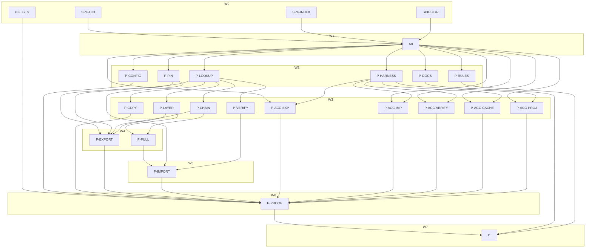

# Plan: package export and import over blob directories

## Status

- **Plan:** plan_package_export_import
- **State:** review
- **Tier:** high
- **Tier-grammar:** 5
- **Updated:** 2026-11-23
- **Active phase:** 7 — I1 integration gate (done)
- **Step:** awaiting /hex-finalize — integration gate green at fec09779 (`task verify:scoped --force` exit 0), cross-build x86_64-pc-windows-gnullvm, satellite check, website build and checks, reference check; V15 filled; `ocx_oci` row raised to 903 (914ed222). Review calls spent: 2 of 2; no further round (goal § Loop shape)
- **Reviewed:** 1a10802f (round 2, delta from d23fd6e1: Needs Work, 0 Block, 14 Warn; xhigh, 7 sonnet seats plus codex; review call 2 of 2)
- **Feature branch:** `hex/adr-package-export-import` (pipelines on `hex/adr-package-export-import--<pipeline>`, worktrees under `.agents/worktrees/`)
- **Last update:** 2026-11-23 (after 914ed222: chore: ocx_oci's unit-test row counts the shard-path tests and the export and import tests)
- **Next:** /hex-finalize — finalize writes the feature subject as import *assembling packages for offline use* (DV-32)
- **Finalize:** /hex-finalize entered 2026-11-23 (target `main` at 9c14311c); its outcome is in the pull request's finalize ledger

---

## Overview

Implements [`adr_package_export_import.md`](./adr_package_export_import.md) (accepted under goal-loop authority on 2026-11-23) and its
[system design](./system_design_package_export_import.md), for goal `.agents/goals/adr-package-export-import.md`. Requirements and
acceptance tests come from `.agents/discussions/bazel-hermetic-package-bundles.md`: block "Track 1 as it stands on 2026-11-22" and
`## Verification` ("Export/import", "Export/import, added 2026-11-22", and the Track 1 line under "ocx side of the Bazel track", a
project export with a patch snapshot).

**Classification.** Feature (`workflow-feature.md`). Scope large, reversibility mixed and stated per surface in the ADR (export layout
and report roots one-way; commands, flags, variables and config two-way before 1.0). The ADR, system design and persisted research are
the large-scope artifacts; this plan runs at `high` as the goal requires and re-decides nothing the ADR decided. Run config: architect
inline (accepted ADR), research skipped (persisted: `research_concurrent_blob_cache_writes.md`, `discover_package_export_import.md`),
adversary off; Review = `reviewer:spec` on the decomposition plus the always-on `reviewer:security` seat (`hex.md › Preferences`,
`crates/ocx_oci/**`, `ocx_store`, `ocx_config`, `ocx_sign`).

**What ships.** `ocx package export`, `ocx package import`, root `ocx export`, root `ocx import`; root flags `--blob-dir`,
`--blob-cache-dir`; variables `OCX_BLOB_DIR`, `OCX_BLOB_CACHE_DIR`; config `[blobs] dirs`, `cache_dir`; report roots `export`, `import`;
slugs `blob_dir_not_found` (79), `export_not_found` (79), `export_dir_invalid` (65); one lookup order for every digest-addressed read
(home → blob directories → blob cache → network); a concurrency-safe cache writer; and the
[ocx-sh/ocx#759](https://github.com/ocx-sh/ocx/issues/759) fix as its own `fix:` commit.

**Out of scope.** Track 2 (rules_ocx under remote execution). Cache eviction, shared volumes, network file systems, multi-user
permissions, orphan-temp cleanup ([ocx-sh/ocx#760](https://github.com/ocx-sh/ocx/issues/760)). Everything in ADR § Out of scope.

## Discovery (2026-11-23, this branch, 0 commits behind `origin/main` at `9c14311c`)

Six read-only workers re-read every seam the system design names. Findings that change the plan:

| # | Finding | Effect |
|---|---|---|
| F1 | No new crate edge needed (`scripts/crate_map.toml`); `ocx_oci` may reach only `ocx_util`, `ocx_console`, `ocx_exit`, `ocx_env` | Lookup, writer, markers, verify overlay stay in `ocx_oci` |
| F2 | `Context::try_init` builds the index at `context.rs:383`, the manager at `:491`; one place attaches the lookup | A0 wires it once; `BlobLookup` holds an `Arc` (index and manager are cloned per view) |
| F3 | `cas_shard_path` callers: `ocx_store` `blob_store.rs`, `layer_store.rs`, `package_store.rs`, `shim_store.rs`, `file_structure.rs` re-export; `ocx_package_manager` `tasks/common.rs`, `tasks/garbage_collection/reachability_graph.rs` | Mechanical sweep in A0, no alias (DV-10) |
| F4 | `MAX_CONCURRENT_BLOB_TRANSFERS`, `MAX_REFERRERS_PER_LEAF` private in `copy.rs`; `INDEX_REFRESH_CONCURRENCY` `pub(super)` with a test needle (`index_common.rs:209`) and doc mentions (`index_catalog.rs:16`, `local_index.rs:1125`) | Constant moves in A0 |
| F5 | Verify reaches the registry through `client.transport()` in ~10 functions (`verify/pipeline.rs`, `simplesigning_read.rs`, `attestation_sidecar.rs`); `Client::with_transport` exists only under `cfg(any(test, feature = "__testing"))` (`client.rs:288`) and resets mirrors and transport config; `transport()` lends only `&dyn` | DV-1: a release-build overlay constructor, not `with_transport` |
| F6 | Offline, the chain has no sources (`context.rs:739-740`, `:773`), so `kind_for_registry` returns `Derived`; configured namespaces live on `LocalIndex.index_namespaces` (`context.rs:362-364`) | DV-3 |
| F7 | Metadata reads touch the home store at `fetch_blob` (`:771-826`) and `recover_absent_dispatch` (`:330-367`); `fetch_manifest_raw_bytes` bypasses it | DV-2 |
| F8 | `refresh_published` reads dispatch objects through any source but checks no catalog entry and adopts the fetched `repository` on first sight | DV-4 |
| F9 | `guard_physical_dial` short-circuits when physical equals logical registry (`lib.rs:453`) | SP-3 expected to hold |
| F10 | `resolve_version` returns `Registry` early for a non-index-served name (`lib.rs:352`); a `Resolve` probe can walk sources | DV-5 |
| F11 | `CatalogTransaction` (`store.rs:586`, `:704`, `:733`) writes roots then the catalog last | C-009 reuses it |
| F12 | The layer pipeline after `.take()` (`client.rs:921`) is inline; a file source needs a generic inner function; failure leaves `output_dir` behind | SP-5; retries recreate the directory |
| F13 | `read_bounded` refuses non-regular files with `O_NONBLOCK` (`ocx_util/src/fs/bounded_read.rs:72-110`); `FileIndexTransport::open_for_read` duplicates it privately; the sync `refuse_if_symlink_in_path` is `pub(crate)` (`symlink_walk.rs:84`) | C-022; A0 makes the sync check `pub` |
| F14 | `record_origin` is gated on "no provided metadata" only (`pull.rs:449`, `:523`) | C-020 returns the origin from the read |
| F15 | A flag-only `--index` reaches a child through the `__OCX_ENV_STATE` policy (`RootFlags`, `Relaxing`); `validate_policy` (`decode.rs:302-311`) requires absolute policy paths; a new optional field needs no major bump (`types.rs:7`, `:16-18`) | DV-7, C-023 |
| F16 | `fold_project_tier` (`loader.rs:1116`) strips `[shell]`, `[records]`, `[update]`, `[telemetry]`; `ocx.toml` refuses unknown tables already (`ocx_project/src/config.rs:27`) | DV-8, C-024 |
| F17 | Compose does not filter reserved `OCX_*` keys from a package pushed by a foreign tool; only publish refuses them (`validation.rs:190-203`, test `:763`) | Pre-existing; follow-up (§ Deferred), system design § 12 row corrected |
| F18 | No fixture blocks the network or counts registry requests; `forward_proxy` records proxied requests; three zot registries run (`registry`, `target_registry`, `prod`) | P-HARNESS with SP-8 |
| F19 | #759 acceptance criterion 5: the `project_context.rs` comment states the current rule | P-FIX759 owns it |
| F20 | Interface counterpart paths (goldens, baselines, sdkgen goldens, generated reference, `Leaf` rows, `visit_report_roots`, `families!`) | § Hub files, I1 |

## Decisions recorded by this plan

Divergences from the system design, each with its reason (goal § Rules: diverge only with a recorded strong reason; no feature is
cut). Question → research (Discovery row or review finding) → decision.

| ID | Question | Decision | Reason |
|---|---|---|---|
| DV-1 | How does `LookupOnly` verification avoid every registry read? (C-013) | `ocx_oci::Client::with_blob_overlay(self, mode: OverlayMode, home_blobs, lookup, registry, accept_artifact_types)` (release build). `LookupOnly` replaces the transport the client's recipe builds with `LookupTransport`; `Live` wraps the recipe-built transport; mirrors, transport config and lock timeout are kept; `with_transport` stays test-gated. `AutoVerify::with_referrer_source(LookupOnly)` builds its client with it, one client per logical registry. | F5 and security review B1. One seam covers every read site. Fallback (SP-6 fails): thread the lookup through `VerifyContext` and the read functions, design C-013 as written |
| DV-2 | Which `ChainedIndex` reads consult the lookup? | `fetch_blob`, `recover_absent_dispatch`, and `fetch_manifest_raw_bytes` if SPK-INDEX finds a caller on an export, copy or verify path | F7 |
| DV-3 | Where does import read a registry's kind? | `Index::source_kind_for` delegates to a `LocalIndex` method over the configured `index_namespaces`, valid offline | F6 |
| DV-4 | Does `refresh_published` give C-008 its guarantees? | No. `import_tags` checks each root against the export catalog entry, and on first sight rewrites `repository` to `oci://<registry>/<repo>` before the merge commit. Any fallback commit still merges through `RootScope::Tags` with the committed root | F8, security W8 |
| DV-5 | How does a derived tag resolve locally with a lookup attached? | `resolve_version` probes the local index with `IndexOperation::Query` first | F10 |
| DV-6 | How does pull know the leaf came from the network? (C-018) | C-020: the read returns its origin; no process-wide state | F14, security W4 (a digest-keyed "most recent read" races across concurrent pulls and could mint provenance) |
| DV-7 | How do flag-given blob settings reach a child ocx? | Two `Relaxing` policy fields in `__OCX_ENV_STATE` and two `RootFlags` fields, as `--index`; values absolutized before `to_write`; `validate_policy` refuses relative entries and more than 32; a `--blob-dir` value holding the list separator is refused as `--config` is (`policy.rs:361`, `:390`) | F15, security W5; ADR Decision 7 "propagate to child ocx"; `subsystem-cli.md` § Exec-Env Projection rules out exporting `OCX_BLOB_*` into the child env |
| DV-8 | May a project-tier `config.toml` set `[blobs]`? | No: stripped with one warning, as `[telemetry]` | F16; ADR Decision 7 |
| DV-9 | Acceptance module layout | `test_package_export_import.py` becomes `test_package_export.py`, `test_package_import.py`, `test_package_import_verify.py` | Parallel pipelines, per-module Bazel caching, the Sigstore test alone |
| DV-10 | `cas_shard_path` move | Sweep every caller in A0, no alias | F3; AGENTS.md "no re-export alias" |
| DV-11 | Shared regular-file open | `ocx_util::fs::open_regular` (C-022) | F13 |
| DV-12 | Copy's lookup without a signature change | `Client::with_blob_lookup`; `copy_leaf` reads `client.blob_lookup()` keyed by the source identifier's registry | Keeps the ecosystem `copy_leaf` signature stable for ocx-mirror |
| DV-13 | Finalize series shape | Three commits: the `fix:` for #759, the `fix:` for F17 (DV-18), then the feature (overrides the `hex.md` squash-to-one preference on this branch) | Goal criterion 7, ADR Decision 13 |
| DV-14 | Which carried markers does import write into the home? (ADR Decision 10) | Only markers of referrers that auto-verify accepted for that subject. A package no policy covers gets no home markers; its referrer manifests and blobs still land in the home `blobs/`, so a later import after adding a policy restores them | Security W3: home markers are listed first, so junk signature-type markers from an untrusted export would exhaust `MAX_SIGNATURE_CANDIDATES` on every later verify of that digest. A subset of the ADR rule, never wider |
| DV-15 | When does the per-root marker cap count? (C-021) | After both filters: digest-verified manifest names the subject AND its `artifactType` (read from the verified manifest, never the marker) is in the caller's accept list. Listing reads at most 4096 names per root (warning on overflow); `MAX_REFERRERS_PER_SUBJECT` (256) counts accepted candidates per root | Security W2; system design § 12 "filter before the cap" |
| DV-16 | Does a `LookupOnly` verify run the dial guard? | No: `guard_physical_dial` is skipped under `LookupOnly` because no connect can follow it; Rekor and TUF stay held by `offline = true` | Security W1: an air-gapped import would otherwise do a DNS lookup |
| DV-17 | Import's content phase and export routing | Content is addressed by logical registry and digest only; an export root's `repository` is never resolved, dialled or guarded | Security W7 |
| DV-18 | Is F17 in scope? | Yes (meta-orchestrator, goal § Decision log 2026-11-23): one wave-0 pipeline P-F17, regression test first, fix on the read/compose path reusing publish validation's reserved-key definition; an already-published package keeps resolving (the key is dropped with one warning). Own `fix:` commit | The new cache variable widens the effect; supersedes the § Deferred findings F17 row |
| DV-20 | Early starts | P-HARNESS, P-DOCS and P-RULES start beside A0 from the feature branch; A0 runs steps 3–4 and 5–6 on two sub-branches merged back into the A0 branch | None of the three reads A0 code; A0's ocx_oci and config/CLI halves are file-disjoint |
| DV-21 | P-LOOKUP and P-CONFIG start before A0 merges | Each branches from the A0 branch once A0's steps 1–6 committed (`db3c2af2`); both merge onto the feature branch after A0. Likewise P-LAYER from P-LOOKUP, and P-PIN, P-CHAIN, P-VERIFY, P-COPY from A0 steps 1–8 (`efe7918a`, plus P-LOOKUP where the plan's DAG names it) | Their only inputs are A0 steps 3–6; A0 steps 7–12 touch none of their files |
| DV-22 | Who bumps the suite counts | P-ACC pipelines commit no `SUITE_FLOOR` / `bazel_gate_proofs.py` counts; I1 recounts once from a collection run. The red-proof binary is built once by the orchestrator from the A0 ref (`cargo build -p ocx --features __testing`), not per pipeline | Five pipelines bumping one hub file conflict on every merge; § Hub files already names I1 as the recount |
| DV-23 | How does import's verify resolve a digest-pinned subject offline? (P-VERIFY found SP-6's frozen-index assumption false: `verify_resolver`'s leaf-manifest read walks the source; the lookup served only `fetch_blob` and `fetch_manifest_raw_bytes`) | `ChainedIndex`'s digest-addressed manifest read (the one `verify_resolver` uses) consults home then the lookup, the same seam P-CHAIN gave `fetch_manifest_raw_bytes`; import runs verify on an `Offline` chain. P-IMPORT owns the edit in `chained_index.rs` with a unit test | One lookup chain for every digest-addressed read (ADR Decision 2); a separate verify resolver would be a second chain |
| DV-24 | P-PROOF's export side starts beside P-IMPORT | Step 2 (green) runs on the export, cache and copy modules in its own worktree while P-IMPORT builds; it may not edit `tasks/import.rs` or `chained_index.rs`. Mutations (step 3) wait until P-IMPORT merges. Schema goldens are regenerated once before it (commit after P-EXPORT) so the runner's conformance check knows the new flags | Those modules need no import code; step 3 stays alone |
| DV-25 | S-033: what is a "project-tier `config.toml`"? (P-ACC-CACHE found `[blobs]` in `ocx.toml` refused and `fold_project_tier` uncalled at runtime) | Research (P-PROOF): the project tier is `ocx.toml`; no project-level `config.toml` is discovered at runtime, and `ProjectConfig` is `deny_unknown_fields`. Decision: the contract for `[blobs]` in a project is the existing named refusal (78), asserted by `test_project_tier_blobs_section_is_stripped`; the `fold_project_tier` strip stays as a unit-tested defensive guard | The refusal is stricter than a warn-and-strip and already shipped for `[shell]` |
| DV-26 | Origin recording after a home hit (P-PROOF) | C-018 holds: only a `Network` leaf read records an origin. The credential prefetch's leaf origin is passed to the pull setup so a registry pull still records it (`fix:` in `tasks/pull.rs`); origin acceptance tests pull from a fresh home, since the publishing home holds a home copy | Contract C-018 / V18; review checks the publish-then-install and dependency cases |
| DV-27 | I1 step 1 beside P-PROOF's mutations | Hub regeneration runs on its own branch while the mutation workers run; they commit evidence files only, so the hubs see the final code | Mutations never land in a commit |
| DV-28 | Integration gate: `oci_identifier_mint_ratchet` red on `tasks/export.rs export_descriptor` | Question: route the snapshot-pinned patch descriptor through the index, or admit the mint? Research: `patch/persistence.rs` already dials the same descriptor as named, and the allowlist admits it because a descriptor is not a package and no index serves one. Decision: keep the mint in the same `passthrough` shape and add one reviewed allowlist line under that group (fdf45b52) | Gate |
| DV-29 | R1-ACC: what does "publish-then-install leaves `refs/origins` empty" assert, and may a refused import leave blobs? | Research: R1-ACC found the publishing home holds no home copy of the leaf, so that install is a genuine network fetch and records an origin, as on `main`; DV-26's "home copy" premise does not hold. Decision: the no-origin case is an install served from an import (home or export bytes, registry guard at zero). A refused import may leave digest-verified metadata blobs in the home blob store (content-addressed cache, collected by `ocx clean`); it must leave no pin, tag pointer or package | C-018 records provenance only for a network read; a verified blob grants nothing |
| DV-30 | P-F17 landed with a unit test, not the planned acceptance module `test/tests/test_env_reserved_keys.py` | Accept: the regression test is `composer::tests::reserved_variables_in_package_metadata_are_dropped_on_read` (red before 5ac62f44, recorded in its body) | `emit_package_vars` is the single env emission site for root, dependency and companion composition, so the unit pins every path; an acceptance module would need a foreign-tool push fixture for the same assertion |
| DV-31 | R1-DOCS: the shipped report and slug shape differ from system design § 9/§ 10 | The design was amended to the wire (`manifests` with an object `Platform`; slugs `export_root_mismatch`, `shard_collision`, `blob_path_relative`, `lookup_io`, `export_platform_required`) in f69f5e83 and 81c2e2da | The wire is the contract and already shipped in goldens; the design follows it (review round 2 found the row missing) |
| DV-32 | Import says it installs (commit subjects, help, report schema) though the owner ruled import does not install | Help, report descriptions and guide reworded to "assembles" in 916fc0ff; finalize writes the feature subject as import *assembling packages for offline use*, never *installing* (daba5efd and 0efb704c say "install"; finalize recomposes, history is not rewritten now). Code check: `ocx package import` creates no candidate/current symlink and no GC root (`import_leaf` → `pull`); root `ocx import` registers the project as `ocx pull` does (ADR § root import) | Discussion 2026-11-22 "Import does not install"; V8 `test_import_roots_nothing` |
| DV-33 | Gate 2: the round-2 marker merge left a persistent `.tmp/marker.lock` in the blob cache, a sidecar the Locking Policy forbids (`test_concurrent_pulls_share_cache` red) | The lock moved to the home lock root via `lock_scoped_blocking` (new blocking sibling of `lock_scoped`, same key), keyed by the cache root's identity, in f9e6c2bb | Serializes one home's processes. Processes of different homes sharing one cache can still lose an entry of the advisory marker (slug-collision detection only), never a blob; the cross-home shared-volume guarantee is ocx-sh/ocx#760, out of scope |
| DV-34 | Gate 2: the round-2 accept-list filter kept non-signature referrers out of the home entirely, against ADR § import "carried referrers go into the home `blobs/`" (`test_import_junk_referrer_markers_do_not_hide_a_real_one` red) | Every referrer naming the subject is copied; the cap counts only such candidates and takes signature types first (449b67b9). Markers still need auto-verify acceptance (DV-14) | Keeps the review's property (junk-typed referrers cannot push a signature past the cap) without narrowing the ADR's copy rule |
| DV-19 | Step granularity | One worker runs a small pipeline's steps serially in its worktree; A0 and the `hard` pipelines are split across several workers at step-group boundaries | Orchestrator context budget over 25 pipelines; the steps, commits and order are unchanged |

Constitution (`arch-principles.md`): no deviation. CLI types stay in `ocx_cli` (`BlobSettings`); library crates take plain paths.
System design § 12 row "Elevation, env injection" is corrected in this commit to "publish-time only" (security W6).

## Component contracts

C-001…C-019 are system design § 6, carried unchanged except where DV-1…DV-17 name a realization. Verify-side unit tests live where
DV-1 puts the code: `ocx_oci::blob_lookup::transport::tests` and `ocx_package_manager` `auto_verify::tests`; this supersedes the
`ocx_sign` `verify::tests` paths in system design § 13. New plan-level contracts:

- **C-020 Read origin (`ocx_index`).** `BlobOrigin { Home, Lookup(LookupOrigin), Network }`. The leaf-manifest read pull's setup uses
  returns it with the bytes (`Fetched<T> { value: T, origin: BlobOrigin }` on that one call path). `Network` only when the bytes came
  from a source in that call. `record_origin` runs only on `Network` (C-018). Units:
  `chained_index::tests::{origin_network_only_for_source_bytes, origin_home_after_network_is_home, concurrent_reads_report_own_origin}`.
- **C-021 `LookupTransport` and the overlay (`ocx_oci`).** `blob_lookup::transport::LookupTransport` implements `OciTransport` over the
  home blob root and the lookup for one logical registry, ignoring `image.registry()` of the physical reference it is handed. Digest
  reads: home, then lookup, verified. `list_referrers`: in `Live` the inner listing first, then marker-only candidates from home, blob
  directories, then cache, filtered per DV-15. Tag reads are not-found; push is refused. `listing_complete(subject)` reads `.complete`.
  `Client::with_blob_overlay` per DV-1. Units: `transport::tests::{lookup_only_never_calls_inner, live_listing_first,
  planted_marker_without_subject_dropped, non_signature_markers_do_not_consume_cap, marker_cap_per_root, listing_name_bound,
  markers_keyed_by_logical_registry, cache_markers_after_dir_markers, tag_read_not_found, push_refused, listing_complete_reads_marker}`,
  `client::tests::blob_overlay_keeps_mirrors` (green in A0); `auto_verify::tests::{lookup_only_never_lists_live,
  incomplete_listing_named, markers_filtered_before_cap, lookup_only_skips_dial_guard_dns}` (`lookup_only_skips_dial_guard_dns` sits in
  `ocx_sign` `verify::pipeline` tests if the guard is reached only there).
- **C-022 `ocx_util::fs::open_regular(path) -> io::Result<Option<(std::fs::File, Metadata)>>`.** Stat, open `O_NONBLOCK` on Unix,
  re-check `is_file` on the handle; non-regular or missing is `None`. Used by `FileIndexTransport`, `read_bounded`, `BlobLookup`. Units:
  `open_regular::tests::{fifo_is_none, symlink_to_file_follows, missing_is_none}`.
- **C-023 Blob settings in the exec state (`ocx_config::exec_state`).** `Policy.blob_dir: Option<Vec<PathBuf>>`,
  `Policy.blob_cache_dir: Option<PathBuf>`, both `Relaxing`; `RootFlags.blob_dir`, `RootFlags.blob_cache_dir`; flag values absolutized
  before `to_write`; `validate_policy` refuses relative paths and lists over 32; `MINOR` (`types.rs:18`) goes from 0 to 1, `MAJOR`
  unchanged. Units: `policy::tests::{blob_dir_flag_reaches_child_policy, blob_dir_with_list_separator_refused}`,
  `decode::tests::{blob_cache_dir_relative_refused, blob_dir_over_cap_refused, minor_zero_state_defaults_blob_fields}`; acceptance
  S-034.
- **C-024 `[blobs]` never from a project tier.** `fold_project_tier` strips `blobs` with one warning naming `config.toml`. Unit
  `loader::tests::project_tier_blobs_stripped`; acceptance S-033.

## User-experience scenarios

S-001…S-032 are system design § 6, unchanged. New:

| ID | Scenario | Red under |
|---|---|---|
| S-033 | A project-tier `config.toml` declares `[blobs] cache_dir`; `ocx pull` warns once and writes nothing there | The strip removed |
| S-034 | `ocx --blob-dir D package exec pkg -- <abs path of ocx> --offline package pull other@sha256:…` where only `D` holds `other`: exit 0 | Policy fields not written |
| S-035 | `ocx package export pkg:1` without `-o`: 64; `ocx export -o D` outside a project: 64; with `ocx.toml` but no `ocx.lock`: 78 | Grammar checks removed |
| S-036 | Empty home, `ocx --offline --blob-dir DIR/blobs package install pkg:1`: exit 81 `index_resolution_blocked`; the blob directory never answers a tag | A blob directory answering a tag |
| S-037 | Export and import reports: `blob_count`, `written_size`, `referrer_count`, every status value and `home_digest` presence match § 9 of the system design | A field dropped |

**Scenario → test.** Every scenario has one named acceptance test (or the unit named). V-rows are red-proven by mutation in P-PROOF;
every other scenario is red-proven by the A0-binary run (Red-proof protocol step 1) and green at P-PROOF step 1.

| Scenario | Test | Module (pipeline) |
|---|---|---|
| S-001 | `test_export_tagged_package_layout` | `test_package_export.py` (P-ACC-EXP) |
| S-002 | V1 `test_import_then_offline_install_by_tag` | `test_package_import.py` (P-ACC-IMP) |
| S-003 | V2 `test_import_refuses_changed_byte` | P-ACC-IMP |
| S-004 | V3 `test_import_one_name_pins_only_it` | P-ACC-IMP |
| S-005 | V4 `test_import_verifies_from_carried_referrers` | `test_package_import_verify.py` (P-ACC-VERIFY) |
| S-006 | V6 `test_import_then_exec_without_export` (also asserts home `blobs/` holds no layer archive) | P-ACC-IMP |
| S-007 | V7 `test_import_then_project_exec_survives_clean` | `test_project_export_import.py` (P-ACC-PROJ) |
| S-008 | V8 `test_import_roots_nothing` | P-ACC-IMP |
| S-009 | V9 `test_import_no_names_pins_every_tag`; export half `test_export_bare_identifier_exports_latest` | P-ACC-IMP; P-ACC-EXP |
| S-010 | V10 `test_import_platform_present_and_missing` | P-ACC-IMP |
| S-011 | V11 `test_export_keeps_registries_apart` | P-ACC-EXP |
| S-012 | V12 `test_concurrent_pulls_share_cache` (8 processes behind a start barrier) | `test_blob_cache.py` (P-ACC-CACHE) |
| S-013 | V13 `test_warm_cache_zero_registry_requests` | P-ACC-CACHE |
| S-014 | V14 `test_export_platform_filter` | P-ACC-EXP |
| S-015 | `test_missing_blob_dir_flag_is_79_env_is_skipped` | P-ACC-CACHE |
| S-016 | `test_cache_flipped_byte_is_refetched`; `test_blob_dir_hit_is_not_copied_to_cache` (ADR Decision 8) | P-ACC-CACHE |
| S-017 | V16 `test_import_conflict_and_named_replace` | P-ACC-IMP |
| S-018 | `test_export_slug_collision_refused` | P-ACC-EXP |
| S-019 | `test_import_without_marker_or_index_is_invalid` | P-ACC-IMP |
| S-020 | `test_import_truncated_layer_is_65` | P-ACC-IMP |
| S-021 | `test_planted_cache_blob_records_no_origin`; V18 unit `pull::tests::lookup_hit_records_no_origin` | P-ACC-CACHE; P-PULL |
| S-022 | `test_first_sight_import_uses_identity_pointer` | P-ACC-IMP |
| S-023 | `test_reexport_adds_platform` | P-ACC-IMP |
| S-024 | `test_import_corrupt_root_is_invalid` | P-ACC-IMP |
| S-025 | V17 `test_root_import_patch_snapshot_round_trip` | P-ACC-PROJ |
| S-026 | `test_global_export_import_registers_nothing` | P-ACC-PROJ |
| S-027 | `test_import_digest_identifier_writes_no_pin` | P-ACC-IMP |
| S-028 | `test_copy_from_export_by_tag_with_source_down` | `test_package_copy_from_export.py` (P-ACC-CACHE) |
| S-029 | `test_exec_in_registered_project_writes_nothing`; `test_package_exec_outside_project_stays_unrooted` | `test_exec_registers_project.py` (P-FIX759) |
| S-030 | `test_import_missing_layer_is_export_not_found` | P-ACC-IMP |
| S-031 | `test_export_commits_first_sight_pin` | P-ACC-EXP |
| S-032 | `test_offline_export_of_unknown_tag_is_81` | P-ACC-EXP |
| S-033 | `test_project_tier_blobs_section_is_stripped` | P-ACC-CACHE |
| S-034 | `test_blob_dir_flag_reaches_child_ocx` | P-ACC-CACHE |
| S-035 | `test_export_requires_output_and_package` (EXP); `test_root_export_grammar_errors` (PROJ) | P-ACC-EXP; P-ACC-PROJ |
| S-036 | `test_blob_dir_alone_never_resolves_a_tag` | P-ACC-CACHE |
| S-037 | `test_export_report_fields`; `test_import_report_fields` | P-ACC-EXP; P-ACC-IMP |
| smoke | `test_root_export_smoke`, `test_root_import_smoke` (`@pytest.mark.smoke`) | P-ACC-PROJ |

**Track 1 acceptance tests → proof** (discussion `## Verification`; ADR § Validation mutations).

| Discussion acceptance test | Proof | Red-proof mutation |
|---|---|---|
| Export, import into empty home, no registry, install by tag | V1 | Import skipping `import_tags` |
| One changed byte refused, exit 65 | V2 | Bad blob-directory copy not remembered |
| Imported for one package writes no pin for another | V3 | Export copying the whole home root |
| Trust policy verifies offline from carried referrers; fails after `--no-referrers` | V4 | Import not storing referrer markers |
| `oras cp` reads the bundle | V5 — dropped by the owner's 2026-11-22 format reversal | — |
| Import, delete export, block network: `ocx exec` on an imported package runs | V6 | Import leaving layers unextracted |
| Same with a project, `ocx clean`, `ocx exec` again offline (#759) | V7 | Reverting the #759 registration |
| Import, no install, no project, `ocx clean`: packages and metadata blobs both removed | V8 | Import creating a candidate symlink |
| No names pins every tag; one name pins only it | V9 | Import enumerating one source only |
| `--platform` held assembles; missing one fails naming it | V10 | Error message without the platform |
| Registries `a` and `b`, same repository path, stay apart | V11 | Keying blobs by repository |
| Concurrent pulls into one empty cache | V12 | `persist` instead of `persist_noclobber` plus an unverified fast path; escalation below |
| Warm cache: zero registry requests, counted | V13 | Tee skipping metadata |
| No `--platform` holds every platform; two hold exactly two | V14 | Filter ignoring the second value |
| Interface gate: `cli.json`, report goldens, contract rows, `SUITE_FLOOR` | V15 (I1) | Removing a report golden |
| Project export with a patch snapshot: composed env offline equals connected | V17 | Root export skipping snapshot companions |
| (ADR) No-names conflict kept, named package moves | V16 | `import_tags` moving a pin without a name / ignoring the name |
| (ADR) Planted cache file writes no origin | V18 | Dropping the network gate on `record_origin` |

## Error taxonomy

ADR Decision 7 and system design § 10, unchanged; no new exit code. Owners and conversion points:

| Raised as | Where | Becomes |
|---|---|---|
| `BlobSettingsError::BlobDirNotFound` | `ocx_cli::app::blob_settings` | `blob_dir_not_found` (79), its own `Classify` row |
| `LookupError::DigestMismatch` / `OverCap` / I/O | `ocx_oci::blob_lookup` | `digest_mismatch` (65) / `invalid_manifest` (65) / 74, own `Classify` rows |
| `LookupError::ShardCollision`, `ExportMarkerError::{SlugCollision, Invalid}` | `ocx_oci::blob_lookup` | `ocx_package_manager::Error::ExportDirInvalid` (65) in `tasks/export.rs` and `tasks/import.rs`; in the cache a shard collision is one warning and a skipped write |
| `ocx_index::Error::ExportRootMismatch` (catalog vs root) | `ocx_index` (`import_tags`) | `ExportDirInvalid` (65) in `tasks/import.rs` |
| absent blob at import, unknown registry/tag/platform in the export | `tasks/import.rs` | `ocx_package_manager::Error::ExportNotFound` (79) |

Every new error variant in every crate is declared in A0 with its `#[exit(...)]` row; every new classified type is a rung in
`crates/ocx_cli/src/exit.rs` `families!` (`UNARMED_AT_THE_BOUNDARY` in `workspace_structure.rs` reds a missing one).

## Spikes

The seven system design § 16 spikes run **first**: three spike pipelines in wave 0, before A0, so A0 stubs the post-fallback shape. A
spike is a throwaway probe in its worktree (prototype code is deleted before commit); the pipeline commits only its evidence file. A
failed spike takes its fallback; no step waits on a human. SP-8 (test harness) does not shape any stub and runs as P-HARNESS step 1.

| ID | Claim | Pipeline | Discovery evidence | Fallback |
|---|---|---|---|---|
| SP-1 | Offline the chain has no sources; import reads the kind from configured namespaces | SPK-INDEX | F6: claim confirmed, design form fails | DV-3; if `index_namespaces` is unreachable from `LocalIndex`, `ImportRequest` carries a `kind_by_registry` map the CLI builds from the config's index sources |
| SP-2 | `refresh_published` serves a restricted root over `FileIndexTransport` | SPK-INDEX | F8 | DV-4; if `refresh_published` cannot take rewritten bytes, `import_tags` reads the committed root, merges with `RootScope::Tags`, rewrites `repository` only on first sight, and commits through `CatalogTransaction` |
| SP-3 | The identity pointer passes `guard_physical_dial` for a published namespace | SPK-INDEX | F9: holds | A first-sight published root keeps the export's pointer only when it equals the identity pointer; otherwise the tag is `export_dir_invalid` |
| SP-4 | `tempfile::Builder::permissions` applies before the umask on 3.27.0 | SPK-OCI | not seen in use | `OpenOptions::create_new(true)` with `mode(0o666)` under `cfg(unix)`, tempfile-style random name in `.tmp/`, retry on `AlreadyExists`, owned by `tempfile::TempPath::from_path` |
| SP-5 | The layer pipeline takes a file source unchanged | SPK-OCI | F12: holds as a refactor | Adapt the `tokio::fs::File` to the transport's stream type (`ReaderStream`) and feed the existing function |
| SP-6 | Every **network call** in verify (transport reads, the dial guard's DNS, Rekor, TUF) is covered under `LookupOnly` | SPK-SIGN | F5: the two-site form fails; overlay covers transport reads; dial guard needs DV-16 | Thread the lookup through `VerifyContext` and the read functions (`pipeline.rs`, `simplesigning_read.rs`, `attestation_sidecar.rs`) |
| SP-7 | The keep-tag write needs nothing from the source | SPK-OCI | holds (`publisher/copy.rs:285-325`) | Serve the read from the lookup by digest (edit in `crates/ocx_package/src/publisher/copy.rs`, then P-COPY owns it), else skip the keep tag with one warning |
| SP-8 | A home can be denied all registry traffic and count every request it attempts | P-HARNESS | F18 | Primary: `[mirrors]` route to a local counting reverse proxy or a closed-port listener that records connections. Fallback: `forward_proxy` with `HTTPS_PROXY`/`HTTP_PROXY` and an empty `NO_PROXY` |

SPK-INDEX also settles DV-2's third site (callers of `fetch_manifest_raw_bytes`) and the unverified § 16 claim "every metadata read
goes through the content-store seam" (list each read site and whether the lookup reaches it).

## Red-proof protocol (goal criterion 5)

1. **Test first.** When A0 merges, the orchestrator records its merge SHA and creates the local ref
   `hex/adr-package-export-import--a0-ref` (never pushed). Each P-ACC pipeline (wave 2) writes its tests from the scenarios, builds the
   binary from that ref in a scratch worktree, runs its module against it, and records every test's failing line in its evidence file.
   A test that passes against A0 is wrong and is rewritten.
2. **Green.** Tests go green as the code below them merges. P-PROOF step 1 runs every new module and fixes code, never a test, unless
   the test contradicts a contract (the fix commit names the contract).
3. **Right reason (V-rows).** P-PROOF applies each ADR § Validation mutation in a scratch worktree, greps the mutated text to prove it
   landed, rebuilds, runs the one test, records the failing assertion (it must be the scenario's own assertion, not setup), and discards
   the mutation. A mutation that leaves the test green means a second guard exists: mutate further until one reds
   (`quality-core.md` § Unchecked Green). **V12:** the test runs its 8 processes behind a start barrier; under the mutation it repeats
   20 times and records the failure rate; if no run reds, escalate the mutation to "write straight to the final path, no temp", which
   exposes partial files to concurrent readers, and record both.
4. Unit tests follow Stub → Specify (red) → Implement (green) inside each step.

## Evidence files (no two pipelines write one file)

Each spike, P-HARNESS, P-ACC and P-PROOF pipeline writes only its own
`.claude/artifacts/evidence/package_export_import/<pipeline>.md`. The orchestrator folds a one-line summary per spike and per test into
this plan's § Spike results and § Red-proof log at merge; no pipeline edits this plan.

## Hub files (no pipeline owns them; regenerated once at I1)

`crates/ocx_schema/tests/golden/{cli,cli-schema,reports,errors,config}.json`; `crates/ocx_schema/contract/baseline/*` (only if the
compat gate asks; additive change, so no `ledger.toml` entry is expected, and I1 proves it with the gate);
`crates/ocx_sdkgen/tests/golden/rust/**`; `website/src/content/docs/reference/{environment.md,configuration.md,exit-codes.md,
command-line/**}` and the generated error-detail pages (`task website:reference:generate`); `test/SUITE_FLOOR`, `test/SKIP_CEILING`,
`test/XFAIL_CEILING`, `test/CONFORMANCE_FLOOR`, `test/limits/**`; `ACCEPTANCE_MODULE_TARGETS` and its assertion in
`scripts/bazel_gate_proofs.py`; `Cargo.lock`, `MODULE.bazel.lock` if a dependency changes (none planned).

**One exception.** P-FIX759 bumps `ACCEPTANCE_MODULE_TARGETS` (+1) and `test/SUITE_FLOOR` (by its collected cases, from
`pytest --collect-only -q`) in its own `fix:` commit, so that commit stands alone under DV-13. I1 recounts on top.

## Contract wave (A0)

One pipeline, serial steps, one merge, after the three spike pipelines. Gate: `cargo check --workspace --all-targets --locked`,
`cargo test -p ocx_test_support --test workspace_structure`, `cargo nextest run -p ocx_env`, `cargo nextest run -p ocx_cli app::tests`,
the existing unit suites of every touched crate green, every new contract test compiling and red. **Stub rule:** anything an existing
code path reaches with an empty lookup is real and behaves as today (constructors, accessors, `is_empty`, an empty `BlobSettings`,
`with_blob_overlay` construction); only methods no existing path calls may be `todo!()`. Red contract tests exist in A0 for every
contract with a named unit, except C-005/C-006 (red in P-LAYER step 2), C-014 (P-COPY), C-016 (P-FIX759) and C-018 (P-PULL), whose
units are written red inside those pipelines. One A0 test is green, not red: `client::tests::blob_overlay_keeps_mirrors`, because A0
owns the whole overlay constructor in `client.rs`. Each step reads the spike evidence files first and stubs the post-fallback shape.

1. **Moves (refactor, behaviour unchanged).** `cas_shard_path` into `crates/ocx_oci/src/cas_path.rs`, every caller swept (F3);
   `ocx_index::PACKAGE_REFRESH_CONCURRENCY` (8) replacing `INDEX_REFRESH_CONCURRENCY` with the test needle and doc mentions re-pointed;
   `MAX_CONCURRENT_BLOB_TRANSFERS` `pub`; `MAX_REFERRERS_PER_LEAF` replaced by `ocx_oci::blob_lookup::MAX_REFERRERS_PER_SUBJECT`.
   Commit: `refactor: blob paths and transfer limits move to the crates that share them`.
2. **Shared file helpers.** `ocx_util::fs::open_regular` (C-022, real) used by `FileIndexTransport` and `read_bounded`; the sync
   `refuse_if_symlink_in_path` made `pub`. Commit: `refactor: one regular-file open for index and blob reads`.
3. **Env and config declarations.** `crates/ocx_env/src/vars.rs` rows `OCX_BLOB_DIR` (`PathList`) and `OCX_BLOB_CACHE_DIR` (`Path`),
   `Public`, `UserInput`, final doc text; `crates/ocx_config/src/blobs.rs` (`BlobsConfig`, final schemars docs) plus the `Config` field
   and `merge` arm in `lib.rs`. Red tests: C-024.
4. **Exec state and root flags.** `exec_state` `Policy` and `RootFlags` fields and `field_names.golden.json` (C-023, fields only);
   `--blob-dir`, `--blob-cache-dir` in `crates/ocx_cli/src/app/context_options.rs`, final ASCII help text;
   `crates/ocx_cli/src/app/blob_settings.rs` (`BlobSettings`, `BlobDir`, `SettingOrigin`, `BlobSettingsError`, `resolve` returning empty
   settings). Red tests: C-015's six, C-023's five.
5. **`ocx_oci` lookup surface.** `blob_lookup.rs`, `blob_lookup/{writer,stream,markers,export_marker}.rs`: C-002, C-003, C-004,
   C-012, C-017 types, signatures and error variants. Red tests: system design § 13 rows C-002, C-003/C-004, C-017, plus C-012's
   `markers::tests::{write_marker_idempotent, write_complete_roundtrip, invalid_name_skipped, cap_enforced}` and
   `blob_lookup::tests::with_leading_dir_first`.
6. **`ocx_oci` client and transport surface.** `blob_lookup/transport.rs` (C-021 types, constructors real); `Client::with_blob_cache`,
   `with_blob_lookup`, `blob_lookup()`, `with_blob_overlay` (real and complete: keeps mirrors, transport config and lock timeout;
   green unit `client::tests::blob_overlay_keeps_mirrors`), `extract_layer_from_stream` and `pull_blob_into` (`todo!()`); `pub mod`
   lines in `crates/ocx_oci/src/lib.rs`. Red tests: C-021's units. After A0, only P-LAYER edits `client.rs`.
7. **`ocx_index` surface.** `Index::with_blob_lookup` (stores it), `Index::source_kind_for` (A0 owns this delegate in
   `lib.rs`, final; it calls a `LocalIndex` stub that P-PIN implements, so P-CHAIN never touches it),
   `BlobOrigin`, `Fetched<T>` and the C-020 read signature, `LocalIndex::import_tags`, `TagPlan`, `TagOutcome`, `Error::ExportRootMismatch`,
   `crates/ocx_index/src/export.rs` with `write_export_index` `todo!()`. Red tests: C-007, C-008, C-009, C-020.
8. **`ocx_package_manager` surface.** `ExportRequest`, `ExportOutcome`, `ImportRequest`, `ImportOutcome`; `PackageManager::export`,
   `import`, `import_project` delegating to `tasks/{export,import}.rs` stubs (`pub(crate) mod` lines in `tasks.rs`);
   `PackageManager::with_blob_lookup` (real); `Error::{ExportNotFound, ExportDirInvalid}` with slugs; `ReferrerSource`,
   `AutoVerify::with_referrer_source` (stores it); the snapshot companion reader in `tasks/resolve.rs` made reachable from
   `tasks/export.rs` if it is not (visibility only). Red tests: C-010, C-011, C-019.
9. **Report types.** `crates/ocx_cli/src/api/data/{export,import}.rs` complete (`Printable`, roots, plain tables per system design § 9)
   and registered in `api.rs` `visit_report_roots`; `crates/ocx_cli/src/exit.rs` `families!` rungs for every new classified type.
10. **Package commands (real glue).** `command/{package_export,package_import}.rs`, `options/export_referrers.rs`, variants in
    `command/package.rs`, `Leaf` rows in `command/leaf.rs`, `pub mod` lines in `command.rs`.
11. **Root commands (real glue).** `command/{export,import}.rs` and their `Command` variants; lock entries → `LockPin` (unit
    `lock_pins_cover_selected_groups_and_platforms`), `--global` uses `$OCX_HOME/ocx.lock`.
12. **Context wiring.** `app/context.rs` resolves `BlobSettings`, builds one `BlobLookup` and attaches it to the client, the index and
    the manager; `Context::blob_lookup()`. Commit: `chore: export and import contract stubs`.

## Parallelization

| Pipeline | Scope | Expected files | Wave | Depends on | Marks | Status |
|---|---|---|---|---|---|---|
| SPK-OCI | SP-4, SP-5, SP-7 | `.claude/artifacts/evidence/package_export_import/SPK-OCI.md` | 0 | — | | merged |
| SPK-INDEX | SP-1, SP-2, SP-3, DV-2 third site, § 16 metadata-seam claim | `.claude/artifacts/evidence/package_export_import/SPK-INDEX.md` | 0 | — | | merged |
| SPK-SIGN | SP-6 (every network call) | `.claude/artifacts/evidence/package_export_import/SPK-SIGN.md` | 0 | — | | merged |
| P-FIX759 | C-016, S-029; S-007 prerequisite; #759 AC 1–5 | `crates/ocx_project/src/registry.rs`, `crates/ocx_cli/src/command/toolchain_exec.rs`, `crates/ocx_cli/src/app/project_context.rs`, `test/tests/test_exec_registers_project.py`, `test/SUITE_FLOOR`, `scripts/bazel_gate_proofs.py` (§ Hub files exception) | 0 | — | | merged |
| P-F17 | F17 fix: compose drops reserved `OCX_*` / `__OCX_*` keys from published metadata with one warning (DV-18) | `crates/ocx_package_manager/src/**` compose site, `crates/ocx_package/src/**` reserved-key definition (visibility only), `test/tests/test_env_reserved_keys.py` (new) | 0 | — | | merged |
| A0 | contract wave: C-001, C-022 real; stubs for C-002…C-021, C-023, C-024; CLI glue for all four commands | as § Contract wave | 1 | SPK-OCI, SPK-INDEX, SPK-SIGN | | merged |
| P-LOOKUP | C-002, C-003, C-004, C-012, C-017 | `crates/ocx_oci/src/blob_lookup.rs`, `crates/ocx_oci/src/blob_lookup/{writer,stream,markers,export_marker}.rs`, `crates/ocx_store/src/file_structure/blob_store.rs` | 2 | A0 | hard, review | merged |
| P-PIN | C-007 (`source_kind_for`), C-008, C-009; S-022 unit half | `crates/ocx_index/src/{local_index.rs,export.rs}`, `crates/ocx_index/src/store.rs` (visibility of `ensure_source_config` only) | 2 | A0 | | merged |
| P-CONFIG | C-015, C-023, C-024 | `crates/ocx_cli/src/app/blob_settings.rs`, `crates/ocx_config/src/{blobs.rs,loader.rs}`, `crates/ocx_config/src/exec_state/{policy.rs,types.rs,decode.rs}`, `crates/ocx_config/src/exec_state/types/field_names.golden.json` | 2 | A0 | | merged |
| P-HARNESS | SP-8; fixtures for every acceptance module | `test/src/{registry_guard.py,export_dir.py}` (new), `test/tests/conftest.py`, `test/tests/test_registry_guard.py`, `.claude/artifacts/evidence/package_export_import/P-HARNESS.md` | 2 | A0 | | merged |
| P-DOCS | goal criterion 6, hand-written docs | `website/src/content/docs/guides/export-and-import.mdx` (new), `website/src/content/docs/guides/work-offline.mdx`, `website/astro.config.mjs`, `.claude/artifacts/docs_ia.md` | 2 | A0 | | merged |
| P-RULES | AI config upkeep | `.claude/rules/{subsystem-cli-commands.md,subsystem-tests.md,product-context.md,arch-principles.md}` | 2 | A0 | | merged |
| P-LAYER | C-005, C-006 (tee, `pull_blob_into`) | `crates/ocx_oci/src/client.rs` | 3 | P-LOOKUP | | merged |
| P-CHAIN | C-007 (lookup seam, `with_blob_lookup`, `resolve_version`), C-020 | `crates/ocx_index/src/{chained_index.rs,lib.rs}` | 3 | P-LOOKUP | | merged |
| P-VERIFY | C-013 via C-021 and DV-1, DV-15, DV-16 | `crates/ocx_oci/src/blob_lookup/transport.rs`, `crates/ocx_package_manager/src/tasks/auto_verify.rs`, `crates/ocx_sign/src/verify/{pipeline.rs,candidates.rs}`; under the SP-6 fallback also `crates/ocx_sign/src/verify/{simplesigning_read.rs,attestation_sidecar.rs}` | 3 | P-LOOKUP | hard | merged |
| P-COPY | C-014 (DV-12); S-028 code half (its tag half needs P-CHAIN, joined at P-PROOF) | `crates/ocx_oci/src/copy.rs`, `crates/ocx_cli/src/command/package_copy.rs`; under the SP-7 fallback also `crates/ocx_package/src/publisher/copy.rs` | 3 | P-LOOKUP | | merged |
| P-ACC-EXP | S-001, S-009 export half, S-011, S-014, S-018, S-031, S-032, S-035 (export), S-037 (export) | `test/tests/test_package_export.py`, its evidence file | 3 | A0, P-HARNESS | | merged |
| P-ACC-IMP | S-002, S-003, S-004, S-006, S-008, S-009, S-010, S-017, S-019, S-020, S-022, S-023, S-024, S-027, S-030, S-037 (import) | `test/tests/test_package_import.py`, its evidence file | 3 | A0, P-HARNESS | | merged |
| P-ACC-VERIFY | S-005 | `test/tests/test_package_import_verify.py`, its evidence file | 3 | A0, P-HARNESS | | merged |
| P-ACC-CACHE | S-012, S-013, S-015, S-016, S-021, S-028, S-033, S-034, S-036 | `test/tests/{test_blob_cache.py,test_package_copy_from_export.py}`, its evidence file | 3 | A0, P-HARNESS | | merged |
| P-ACC-PROJ | S-007, S-025, S-026, S-035 (root), smoke tests for root `export` and `import` | `test/tests/test_project_export_import.py`, its evidence file | 3 | A0, P-HARNESS | | merged |
| P-PULL | C-018 with C-020, the pull layer seam, clean retry directory, V18 unit | `crates/ocx_package_manager/src/tasks/{pull.rs,pull_local.rs,resolve.rs}` | 4 | P-LAYER, P-CHAIN | | merged |
| P-EXPORT | C-010, root export | `crates/ocx_package_manager/src/tasks/export.rs` | 4 | P-LOOKUP, P-PIN, P-CHAIN, P-LAYER | | merged |
| P-IMPORT | C-011, C-019, DV-14, DV-17 | `crates/ocx_package_manager/src/tasks/import.rs` | 5 | P-PULL, P-PIN, P-VERIFY | hard | merged |
| P-PROOF | Red-proof protocol steps 2–3; goal criterion 5 | any code file a failing test points at (runs alone in its wave), its evidence file | 6 | P-FIX759, P-CONFIG, P-COPY, P-EXPORT, P-IMPORT, P-ACC-EXP, P-ACC-IMP, P-ACC-VERIFY, P-ACC-CACHE, P-ACC-PROJ | | merged |
| I1 | integration gate (orchestrator): hubs, V15, satellite and Windows checks | § Hub files | 7 | all above | | active |
| R1-INDEX | Review round 1. **Block:** import's first-sight published-root write keeps the export's `publishers` (`local_index.rs:816-827`, `merge_root` `:1043-1050`); strip it as `RootScope::Routing` does, unit test. Warn: `ExportRootMismatch` must surface as `export_dir_invalid` 65 (plan error taxonomy); `chained_index.rs:1153` source-path home and cache writes ignore `write_policy` (`ReadOnly` documented as writing nothing) and no test pins a tag-addressed read's home write | `crates/ocx_index/src/{local_index.rs,chained_index.rs}` | 8 | — | review | merged 76dc9fcd |
| R1-IMPORT | Review round 1, Warn: marker cap counts raw names before the subject and `artifactType` filters (`tasks/import.rs:685`, DV-15); a home marker is written when any blob is accepted, not the referrer manifest itself (`:717`, DV-14); export index reads are unbounded, follow links out of `DIR` and do not refuse non-regular files (`:270-345`, `:567` via `ocx_index/src/store.rs:384`, `:473`; design § 12), cap `list_wire_repositories`; `LookupError::ShardCollision` must map to `export_dir_invalid` (`:760`, C-004). Unit tests per fix | `crates/ocx_package_manager/src/tasks/import.rs`, `crates/ocx_index/src/store.rs` (read helpers only) | 8 | — | hard | merged 15db8725 |
| R1-EXPORT | Review round 1, Warn: offline with referrers on and no complete local listing exports silently; ADR Decision 9 / C-010 require `offline_mode` 81 naming `--no-referrers` (`tasks/export.rs:510-535`); shard collision to `export_dir_invalid` (`:181`); re-export over a present copy reads each layer twice (`:634`, return `AlreadyPresent` before `copy_stream`). Unit test for the offline refusal | `crates/ocx_package_manager/src/tasks/export.rs` | 8 | — | | merged aaca0445 |
| R1-PULL | Review round 1, Warn (regression vs `9c14311c`): dependency pulls record no origin because the prefetch closure walk leaves home copies and `setup_dependencies` passes no hint (`tasks/pull.rs:763`); carry each dependency's network origin through. Bind the root hint to its pinned digest (`:292`); return the origin from the read that serves the bytes, never `Network` under `Offline` (`resolve.rs:422-437`); a lookup-sourced layer over the decompression cap is rejected and the walk continues (`pull.rs:1187`). Unit test: dependency from a fresh home records an origin | `crates/ocx_package_manager/src/tasks/{pull.rs,resolve.rs}` | 8 | — | | merged a5cdbd6a |
| R1-LOOKUP | Review round 1, Warn: `ocx-export.json` `format_version` never checked on read or rewrite (`blob_lookup/export_marker.rs:60`, `writer.rs:389`; C-017, add `UnsupportedVersion` → 65); writer `Absent` after `Occupied` fails instead of retrying the publish (`writer.rs:288`); `reject` deletes a just-verified replacement (`stream.rs:137`, `writer.rs:423`); an over-cap copy ends the walk, contradicting ADR "a bad copy never stops a good one" (`blob_lookup.rs:197-198`); `digest` file written after `data` (`writer.rs:155`) and its write failure misreports a published blob (`:297`); 64 MiB hash on an async worker (`blob_lookup.rs:200`); copy republishes marker-listed referrers with no subject or artifact-type filter, cap after filtering (`copy.rs:553-598`); `note_registry` re-reads the marker per blob (`writer.rs:388`) | `crates/ocx_oci/src/{blob_lookup.rs,copy.rs}`, `crates/ocx_oci/src/blob_lookup/{export_marker,writer,stream}.rs` | 8 | — | hard | merged ad1a33f2 |
| R1-SETTINGS | Review round 1, Warn: more than 32 blob dirs are silently dropped by `.take(MAX_BLOB_DIRS)` (`app/blob_settings.rs:85,98,106`) and `to_write` writes an uncapped list the child refuses (`ocx_config/src/exec_state/policy.rs:412`): refuse with 78 in both; `absolutize` falls back to a relative path (`policy.rs:25`): make it fallible. Suggest: help at `app/context_options.rs:127` says the list separator is refused where only the child write refuses it. Unit tests for flag-over-env and the cap | `crates/ocx_cli/src/app/{blob_settings.rs,context_options.rs}`, `crates/ocx_config/src/exec_state/policy.rs` | 8 | — | | merged 3beada2b |
| R1-ACC | Review round 1, Warn: hostile-export import tests (symlinked `index/<dir>`, traversal name, junk markers past 256, marker key not its slug), each asserting exit, guard count 0 and an unchanged home; DV-26 cases (dependency origin from a fresh home; publish-then-install leaves `refs/origins` empty); a red control for the registry guard on lock-pinned `pull` and `import`; negative import tests assert no partial pins or blobs | `test/tests/{test_package_import.py,test_blob_cache.py,test_install.py}` | 8 | — | | merged d150b933 |
| R1-DOCS | Review round 1, Warn: system design § 9 still says `platforms` with a string platform where the wire ships `manifests` with an object `Platform`, and § 10 lacks the slugs `export_root_mismatch`, `shard_collision`, `blob_path_relative`, `lookup_io`, `export_platform_required`: amend both and add a DV row; the guide says `ocx import` pulls what `ocx export` wrote, but import defaults to the default group and host platform (`guides/export-and-import.mdx:89`); the guide's runnable fences have no doc-example binding or no-run marker (DOC-EX-01/06) | `.claude/artifacts/system_design_package_export_import.md`, `website/src/content/docs/guides/export-and-import.mdx` | 8 | — | | merged f69f5e83 |
| R2-IMPORT | Review round 2 (delta `d23fd6e1..1a10802f`, Needs Work, 0 Block). W1 a marker registry slugged `locks` escapes the index walk; W2 symlinked `index` root followed; W3 cap counts any non-empty `artifactType`, not the accept list; W4 walk-guard and cap tests; D5 cap alignment; W14 `open_regular` follows a swapped-in symlink; W10 layer hashing on an async worker; W11 one `ShardCollision` mapping with the export root as `dir` | `tasks/{import,export,common}.rs`, `ocx_oci/src/blob_lookup/export_marker.rs`, `ocx_util/src/fs/open_regular.rs`, `ocx_index/src/store.rs` | 9 | — | | merged 1868fae2 (941f4939, e0956fc7) |
| R2-RESOLVE | W7 (regression from da373882) `--remote` moved tag records no origin; W9 offline-origin test cannot see `offline_view`; `offline_view` trait default; D1 decided: `ReadOnly` writes no index entry, blob and cache writes allowed under every policy (inspect contract) | `tasks/resolve.rs`, `ocx_index/src/{chained_index,index_impl}.rs` | 9 | — | | merged 65aacc84 (13b9fc95, 7eeecab3) |
| R2-OCI | W5 marker cached per handle loses a registry under two processes; W8 retry-after-`Absent` untested; D4 digest sidecar fsync; D2 `remove_if` race accepted and commented; W6 copy drops referrers whose type falls back to the config media type | `ocx_oci/src/blob_lookup/writer.rs`, `ocx_oci/src/copy.rs` | 9 | — | | merged (e94bc52d, d9ff5184) |
| R2-SETTINGS | W12 blob-dir cap checked three times; W13 "at most 32 read" text where the code refuses (78); guide omits the offline referrer refusal (81); guide fence markers | `ocx_config/src/exec_state/policy.rs`, `ocx_env/src/vars.rs`, `ocx_config/src/blobs.rs`, `guides/export-and-import.mdx` | 9 | — | | merged (faa0057d, 08f2bb14) |

Waves are derived; launch on dependency-ready. **Critical path:** SPK-* → A0 → P-LOOKUP → {P-CHAIN, P-LAYER} → P-PULL → P-IMPORT →
P-PROOF → I1 (by effort P-LAYER, a `client.rs` refactor in four steps, likely outweighs P-CHAIN). **Shippable after wave 5:** the four
commands, blob directories and the cache, unit-proven; acceptance green and red-proven after wave 6; contract counterparts after I1.
P-FIX759 is shippable alone once it merges. Marks: 3 `hard` of 25 pipelines, 1 `review`.

**Width justification.** Wave 2 runs six pipelines, wave 3 nine, the widest the contracts allow. `ocx_oci` work is serial behind
P-LOOKUP because the tee, the verify transport and copy read and write real bytes through `BlobWriter` and `BlobLookup` in their unit
tests. P-PULL, P-EXPORT and P-IMPORT split along `tasks/` files; P-IMPORT waits for P-PULL because import is a pull. P-PROOF runs alone
because a mutation may touch any code file.

## Steps

Each step runs Stub (in A0) → Specify (tests from the contract, red) → Implement (green), commits `--no-verify` with a conventional
subject, and runs only the narrowest test it touched: `cargo nextest run -p <crate> <filter>`, or for acceptance the task that copies
`//crates/ocx_cli:ocx` to `test/bin/ocx` (`taskfiles/rust.taskfile.yml:289`; name via `task --list`) then
`cd test && uv run pytest tests/<module>.py -x`. Never a full `task verify`, never a golden test before I1. A brief carries its
pipeline row, its step, the C-/S- IDs, the ADR decisions and DV rows it implements, and these rules. Commit subjects are changelog
lines; `CHANGELOG.md` is never edited. Intermediate `test:`/`chore:` subjects are squashed by DV-13's finalize, so only the two final
subjects reach the changelog.

### SPK-OCI, SPK-INDEX, SPK-SIGN — spikes (wave 0)
1. Probe each claim in the § Spikes table with a throwaway test or a read of the code, show both outcomes where a test is possible, and
   write per spike: claim, method, result (holds / fails), evidence (file:line, test output line), the shape A0 must stub. Delete the
   prototype code; commit only the evidence file (`chore: spike evidence for <area>`).

### P-FIX759 — own `fix:` commit for ocx-sh/ocx#759 (`workflow-bugfix.md`)
1. Regression tests first, red on current code, in `test/tests/test_exec_registers_project.py` (`@pytest.mark.command("exec")`): fresh
   home, a project with a committed `ocx.lock`, `ocx exec` only, `ocx clean`, tools still present
   (`test_exec_on_fresh_clone_survives_clean`); S-029's two tests. Record the red lines in the commit body.
2. `ProjectRegistry::register_if_absent` (`Registered::{Written, AlreadyPresent}`, one `read_link`, write only when absent or pointing
   elsewhere) and its best-effort wrapper; units `register_if_absent_no_write_when_present`, `rewrites_when_pointing_elsewhere`.
3. `toolchain_exec.rs` calls it after a successful composition, project tier only, never `--global`, fetched or not; the per-prompt
   hook untouched; the `project_context.rs` module comment states the current rule. Bump `ACCEPTANCE_MODULE_TARGETS` and
   `test/SUITE_FLOOR` (§ Hub files exception). Commit `fix(exec): ocx exec registers the project so ocx clean keeps its tools`, body
   with the root cause (loaders never registered; the ledger is now one symlink per project) and `Fixes #759`.

### A0 — contract wave
Steps 1–12 as § Contract wave. After merge: record the merge SHA and create `hex/adr-package-export-import--a0-ref`.

### P-LOOKUP (hard, review)
1. C-017 `export_marker`: `read_marker` (`read_bounded`, 64 KiB), `merge_registry` with ASCII case folding, slug-equals-value, unknown
   fields tolerated; § 13 row C-017 units.
2. C-004 `BlobWriter`, ADR Decision 8 steps 1–9 with the SP-4 result: occupant verify, `digest` sibling, shard-collision refusal, temp in
   `<root>/.tmp/` with the umask mode, hash while writing, `sync_data`, sync `refuse_if_symlink_in_path` before each `create_dir_all`,
   `persist_temp_file_noclobber` or `persist_temp_file`, one `Occupied` re-verify, Windows rename retry up to 2 s on the three error
   codes; § 13 row C-003/C-004 units including `concurrent_writers_converge` (16 threads, one digest).
3. C-003 `BlobCacheDir`: `open` (refuses a symlinked ancestor, 74), `writer`, `write_verified`, `remove` (ancestor check, never a link
   target), best-effort cache marker with collision warning.
4. C-012 markers: `write_marker`, `write_complete`, `read_markers` (name listing bounded per DV-15, invalid names skipped with a
   warning); A0's four marker units green.
5. C-002 `BlobLookup` reads: `blob_data_path`, `open_stream` via `open_regular`, `read_metadata` via `read_bounded` with hash, the
   system design § 5.1 walk as a `LookupWalk` callers drive (bad directory copy remembered, cache mismatch removed and counted), a
   missing env/config directory warned once and skipped, `.tmp/` never read, `with_leading_dir`; § 13 row C-002 units.
6. `crates/ocx_store/src/file_structure/blob_store.rs` builds paths through `blob_data_path` and stores markers through C-012, no
   behaviour change for existing callers. Commit: `feat: blob directories and a shared blob cache are read and written through one
   verified lookup`.

### P-PIN
1. DV-3: the `LocalIndex` configured-kind method behind `Index::source_kind_for`; unit `unconfigured_registry_imports_derived`.
2. C-009 `write_export_index` over `CatalogTransaction`: roots restricted to the tags, dispatch objects verbatim, catalog re-authored and
   committed last, `config.json` ensured, merge with an existing root (union; a moved tag `replaced`); § 13 row C-009 units.
3. C-008 `import_tags`: tag plan, DV-4 catalog check (`OcxIndex::fetch_catalog_strict` plus `IndexStore::root_catalog_entry`) and
   first-sight routing rewrite, `Published` and `Derived` paths, merge never deletes a row; § 13 row C-008 units with
   `new_root_gets_identity_pointer` covering both kinds, plus `catalog_mismatch_is_export_root_mismatch`.

### P-CONFIG
1. C-015 `blob_settings::resolve`: flags, else `OCX_BLOB_DIR` (`std::env::split_paths`, empty entries skipped, at most 32), else merged
   config anchored at its file; missing flag dir 79, missing env or config dir passes; cache flag ▸ env ▸ config, empty env unset; § 13
   row C-015 units (the Windows quoted entry under `cfg(windows)` plus a pure split test).
2. `[managed]` relative blob path refused at load (78); C-024 strip in `fold_project_tier`.
3. C-023 ladder: `RootFlags` into `PolicyInputs::env_slot` and `to_write` (`Relaxing`), absolutized values, separator guard,
   `validate_policy` rules, `MINOR` to 1; A0's C-023 units green; `resolve` reads the slot so a child sees the parent's flag values with
   origin `Env`.

### P-HARNESS
1. **SP-8.** Choose the mechanism with a self-test showing both outcomes: a guarded home records an attempted request and fails it; an
   unguarded home succeeds. Evidence file.
2. Fixtures: `registry_guard` (blocks and counts per home), `second_home` (fresh `OcxRunner` with its own `OCX_HOME`), `registry_pair`
   (`registry` and `target_registry` serving one repository path with different content), export-dir helpers (flip a byte, truncate,
   delete a blob, corrupt a root, read the marker), a start barrier for concurrent processes. Self-tests in
   `test/tests/test_registry_guard.py`.

### P-DOCS (`docs` skill; `docs-quality.md`, `docs-style.md`, `subsystem-website.md`)
1. `guides/export-and-import.mdx` (`{/* doc_type: how-to */}`, `{/* doc_tier: everyday */}`), goal before the first `##`, sections with
   `{#kebab-id}` anchors: export a package; import on an offline machine; export and import a project; use an export in place
   (`--index DIR/index --blob-dir DIR/blobs`); share a blob cache in CI; what an import pins (no-names `conflict`, naming a package
   moves it); trust an export (`[[trust.policy]]` for an untrusted exporter; an export discloses internal hosts and paths; deleting a
   cache is always safe; a cache must not cross a trust boundary private content would cross). `<ShellSession>` frames,
   reference-style links, sentences of at most 25 words.
2. `work-offline.mdx` cross-link section; sidebar entry beside "Work offline" in `astro.config.mjs`; `docs_ia.md` § 5 row
   `| — | guides/export-and-import.mdx | how-to | everyday | everyday | settings |` (`website/tests/cluster-set.test.mjs`). Commit:
   `docs: guide to moving packages between machines with export and import`.

### P-RULES (`chore:`)
1. `subsystem-cli-commands.md` rows for the four commands and two root flags; `subsystem-tests.md` visible verb count (+2) and the new
   modules; `product-context.md` Storage Layout and the air-gapped use case (Update Protocol trigger 6); `arch-principles.md` ADR index
   row. `task claude:tests`. Commit: `chore: rules know export, import and blob directories`.

### P-LAYER
1. Split `pull_layer_with_caps` after `.take()` into a generic inner function over `impl AsyncRead + Unpin + Send + 'static` per the
   SP-5 result, caps, drain and checks unchanged; existing `client` tests green.
2. C-005 `extract_layer_from_stream`: a short read maps to `DigestMismatch`; `extract_from_stream_matches_network`.
3. C-006 tee between `.take()` and `HashingAsyncReader` through `BlobWriter` with `std::fs` on the blocking thread, keyed by the
   caller's logical registry, `finish` only after completeness and digest pass, failure one warning; units `tee_writes_only_verified`,
   `tee_failure_does_not_fail_pull`, `retry_uses_fresh_output_dir`.
4. `Client::pull_blob_into(transport, descriptor, writer)` streams one raw blob into a `BlobWriter` under the blob caps; unit
   `pull_blob_into_verifies_digest`.

### P-CHAIN
1. C-007 lookup seam at `fetch_blob`, `recover_absent_dispatch` and, per SPK-INDEX, `fetch_manifest_raw_bytes`: home miss → lookup →
   source; a lookup hit written to the home; a source fetch written through to the cache; consulted under `ChainMode::Offline`; debug
   log of the serving origin; § 13 row C-007 units.
2. C-020 origin returned from the leaf read; its three units.
3. `Index::with_blob_lookup` into the chain; DV-5 `Query` probe in `resolve_version` when the lookup is not empty;
   `derived_tag_resolves_locally_with_lookup`.

### P-VERIFY (hard)
1. C-021 `LookupTransport` `lookup_only` and `live` with DV-15 filtering; its units.
2. `AutoVerify::with_referrer_source(LookupOnly)`
   builds one overlay client per logical registry with the signature `artifactType` accept list and `offline = true`; DV-16 dial-guard
   skip in `pipeline.rs` under `LookupOnly` (`lookup_only_skips_dial_guard_dns`); `no_signatures_found` names "referrers were not
   exported" when the listing is incomplete; units `lookup_only_never_lists_live`, `incomplete_listing_named`,
   `markers_filtered_before_cap`.

### P-COPY
1. C-014 via DV-12: `copy_leaf` reads leaf manifest, blobs and referrer listing from `client.blob_lookup()` first, keyed by the source
   registry as written; sidecar sweep skipped with one warning when the source is unreachable and the leaf came from the lookup;
   `package_copy.rs` builds the client with the context lookup; units `digest_source_from_lookup`, `sidecar_skipped_with_warning`.

### P-ACC-EXP, P-ACC-IMP, P-ACC-VERIFY, P-ACC-CACHE, P-ACC-PROJ (`qa-engineer` skill, `subsystem-tests.md`)
1. Write the module's tests from § Scenario → test with the P-HARNESS fixtures; each module carries `@pytest.mark.command(...)` for its
   verbs; P-ACC-PROJ adds the two `@pytest.mark.smoke` tests; Sigstore tests use `sigstore_stack` and skip under
   `OCX_TEST_NO_DOCKER=1` with the standard reason. P-ACC-IMP writes its 16 scenarios in two steps: pins and platforms (S-002, S-004,
   S-008, S-009, S-010, S-017, S-022, S-023, S-027, S-037), then integrity and errors (S-003, S-006, S-019, S-020, S-024, S-030).
2. Red-proof protocol step 1 against `hex/adr-package-export-import--a0-ref`; evidence file. Commit `test: acceptance tests for <area>`.

### P-PULL
1. Layer seam in `extract_layer_atomic`: after the home `layers/` check, before `require_client`, open the lookup stream for the logical
   registry and extract through C-005; the ADR Decision 2 walk with its 65 / 81 / 79 end-of-sources verdicts and the discarded-count
   message; retries in a fresh output directory; one unit per verdict.
2. C-018 with C-020: `record_origin` only on a `Network` leaf read; `pull::tests::lookup_hit_records_no_origin`. Commit:
   `feat: pulls read layers from blob directories and the cache before the registry`.

### P-EXPORT
1. C-010 resolution half: per-`DIR` scoped lock, tags through the ambient chain (first-sight pin committed), platform filter and the
   digest-needs-one-platform rule (64), C-009 index, marker last, slug-collision refusal; units `digest_needs_one_platform`,
   `offline_unknown_tag_is_81`, `first_sight_tag_commits_home_pin`, `slug_collision_refused`, `marker_written_last`.
2. C-010 blob half: dependency closure, blobs through home → lookup → network into `BlobWriter` (`pull_blob_into`) bounded by
   `MAX_CONCURRENT_BLOB_TRANSFERS` and `jobs`, referrers with `.complete`; `offline_missing_archive_is_81`.
3. Root export: lock pins per selected group and platform, patch snapshot companions and descriptors when `patches.snapshot.json` is
   active, no `index/`; units `root_export_writes_no_index`, `snapshot_companions_exported`. Commit:
   `feat(package): ocx package export and ocx export write packages and their blobs to a directory`.

### P-IMPORT (hard)
1. Plan half: marker read, root-against-catalog check, directory mapping, named-identifier cross-check, tag plan per package; units
   `no_marker_is_invalid`, `catalog_mismatch_invalid`, `missing_platform_named`.
2. Content and pins: offline view with `DIR/blobs` leading and `LookupOnly` verify, content first on `read_only_view` addressed by
   logical registry and digest only (DV-17, `import_never_resolves_export_repository_host`), pins last through `import_tags`,
   per-package commit boundary, `conflict` warning and exit 0, digest identifiers; units `never_dials`, `content_before_pins`,
   `failed_package_commits_nothing`, `conflict_materializes_nothing_exits_zero`, `named_package_replaces`.
3. Referrers into the home per DV-14 (manifests and blobs always; markers only for accepted candidates);
   `failed_verify_writes_no_markers`.
4. C-019 root import: marker and lock-registry cross-check, project pull offline with `DIR/blobs` leading and `LookupOnly`, render,
   register (never under `--global`), no index pin; units `root_import_registers_project`, `global_root_import_registers_nothing`.
   Commit: `feat(package): ocx package import and ocx import install packages from an export without network access`.

### P-PROOF
1. Build, run every new acceptance module, fix code until green (Red-proof protocol step 2).
2. Mutations V1–V4 and V6 (protocol step 3). 3. V7–V11. 4. V12–V14 (V12 per its escalation rule). 5. V16–V18. Each writes one line
   per test into its evidence file: `V<n> · <test> · red: <assertion line> under <mutation> · green: <SHA>`.

### I1 — integration gate (orchestrator)
1. Regenerate every hub (`cargo run -p ocx_schema -- <kind>` per golden, sdkgen goldens, `task website:reference:generate`); recount
   `SUITE_FLOOR`, ceilings and `ACCEPTANCE_MODULE_TARGETS` from a real collection run; `task contract` compat gate green with no ledger
   entry (V15, red-proven once by deleting the new report golden); `task test:rows:check`, `task test:lint:structure`,
   `task claude:tests`.
2. `task verify:scoped --force`; `task bazel:test:accept` over the new modules; `OCX_MIRROR_DIR=<checkout> task satellite:verify`
   (`ocx_util`, `ocx_oci`, `ocx_index`, `ocx_config` gained API; DV-12 keeps `copy_leaf` stable; no ocx-mirror checkout exists on this
   host, so clone it read-only into the scratchpad); Windows: `task cross:build TARGET=x86_64-pc-windows-gnullvm` (no `/mnt/c` here),
   CI is the Windows test gate; then `task verify:mark`.
3. Fold the evidence files into § Spike results and § Red-proof log; hand to `/hex-review`, then `/hex-finalize` with DV-13's shape.

## Spike results

(Folded by the orchestrator from the SPK-* and P-HARNESS evidence files at merge. Evidence: `.claude/artifacts/evidence/package_export_import/`.)

- SP-1 · holds; design form fails, fallback not needed: `LocalIndex::source_kind_for_import(&self, registry) -> SourceKind` over `is_index_namespace` (pub, set offline); `Index::source_kind_for` delegates; `ChainedIndex::kind_for_registry` unchanged.
- SP-2 · fails in tag-set form → fallback: `import_tags` checks the export `c/index.json` entry first, rewrites `repository` only when no root is committed, `persist_dispatch` per tag (`Ok(None)` is an error), commits through `commit_and_sweep_published_root(.., RootScope::Tags(set))`.
- SP-3 · holds; the identity pointer uses the identifier's registry string verbatim.
- SP-4 · holds: `tempfile::Builder::permissions(0o666)` (3.27.0) is masked by the umask like `open(2)`; no hand-rolled create. Tests assert `0o666 & !umask`.
- SP-5 · holds as a pure refactor, no `ReaderStream`: private generic `extract_layer_from_reader<S: AsyncRead + Unpin + Send + 'static>` split at `client.rs:921`.
- SP-6 · holds under DV-1 + DV-16: one overlay transport covers every verify registry read; `guard_physical_dial` skipped when `client.blob_overlay_mode() == Some(LookupOnly)`; Rekor/TUF held by `offline = true`. Import's verify index must be `ChainMode::Frozen` (P-VERIFY asserts with a panicking source). `ReferrerSource` is an enum `{ Registry, LookupOnly(..) }`. Offline verify needs a cached or pinned trust root (`OfflineNoPinnedRekorKey`, 81).
- SP-7 · holds: the keep-tag write reads only the target; `publisher/copy.rs` untouched.
- DV-2 third site · on the import path: `fetch_manifest_raw_bytes` (callers `common.rs:327`, `:578`) returns `Ok(None)` offline; the lookup is consulted there before the offline return. § 16 seam claim fails as stated; the lookup attaches at all three sites.

## Red-proof log

(Folded by the orchestrator from the P-ACC-* and P-PROOF evidence files at merge.) One file holds every red and green run:
[`evidence_package_export_import.md`](./evidence_package_export_import.md).

- A0 red run (`hex/adr-package-export-import--a0-ref` `087a19d5`, `cargo build -p ocx --features __testing`): every new acceptance test red except three guards (`test_export_requires_output_and_package`, `test_root_export_grammar_errors`, and the #759 guard `test_package_exec_outside_project_stays_unrooted`); most reds are the stubbed `package export` the scenario drives.
- Mutations (green baseline `85f862d6`, each test `1 passed`): V1–V4, V6–V14, V16–V18 red under their mutations (P-PROOF-M1/M2/M3). Second guards found and recorded: V4 (verify reads `DIR/blobs`, so the export-side mutation reds it), V6, V7 (three registration sites), V9, V10, V12 (acceptance reds only under the escalated mutation, 20/20; the unit `concurrent_writers_converge` reds under both), V16 (decision in `plan_tags`). V15 is the integration gate's.

## Review fixes (round 1, plan-artifact scope)

Spec seat: Needs Work (2 Block, 10 Warn, 5 Suggest). Security seat (opus): Needs Work (1 Block, 8 Warn, 2 Suggest). All applied:
spikes moved ahead of A0 into three wave-0 pipelines (spec B1); per-pipeline evidence files, no shared plan writes (spec B2); overlay
constructor instead of the test-only `with_transport` (security B1, DV-1); C-012 units, scenario → test table with S-033…S-037,
report-field, index-never-chains and no-home-layer assertions, `with_leading_dir` unit (spec W3–W5); C-020 returned from the read
(spec W6, security W4); C-023 version rule and `validate_policy` (spec W6, security W5); undeclared files declared, error conversion
points stated (spec W7, W12); A0 ref for the red run (spec W9); split A0, P-ACC-IMP, P-PROOF, P-EXPORT, P-IMPORT steps (spec W10); V12
barrier and escalation (spec W11); DV-14…DV-17 (security W1–W3, W7); SP-2 fallback merges (security W8); system design § 12 row
corrected and the F17 follow-up names the cache as a confidentiality sink (security W6); S1/S2 test additions (security Suggest).
No Block-severity finding was left open; the Block fixes are structural (ordering, file ownership, a constructor), recorded here.

**Re-validation (one pass, spec seat):** Needs Work, one Block — `client.rs` edited by both A0's overlay and P-VERIFY step 2 while
P-LAYER owns it. Applied: A0 owns the whole overlay and its green test; P-VERIFY no longer touches `client.rs`; the C-021 unit list
now names the `auto_verify` tests; `source_kind_for` delegate ownership stated. The artifact loop's cap is one re-validation and no
human is present, so this mechanical fix was applied without another pass under the goal's autonomy rule.

## Deferred findings

| Finding | Why deferred | Action |
|---|---|---|
| ~~F17~~ (now DV-18, fixed in P-F17): compose does not filter reserved `OCX_*` / `__OCX_*` keys from a package pushed by a foreign tool; `OCX_BLOB_CACHE_DIR` makes this a confidentiality sink (private-registry blobs written where the package says) | Pre-existing for every `OCX_*` variable; outside this goal (goal § Issue resolution step 6) | The loop files a follow-up issue naming `OCX_BLOB_CACHE_DIR`; this run may not |
| Cache eviction, shared volumes, permissions, orphan temps, ancestor-check race | [ocx-sh/ocx#760](https://github.com/ocx-sh/ocx/issues/760) | none |
| Everything in system design § 15 | As stated there | none |
| Round 2 D2: check-then-unlink race in the cache writer's `remove_if` | Worst case one re-download; eviction and shared volumes are [ocx-sh/ocx#760](https://github.com/ocx-sh/ocx/issues/760) | Accepted, commented at the site (e94bc52d) |
| Round 2 D3: an unreadable working directory while absolutizing a blob path reports `config_io` | The caller's next action (fix the config or environment) matches 78; a new slug buys nothing | Accepted |
| Round 2 D5: `MAX_WIRE_REPOSITORIES` (1M) and `MAX_INDEX_ENTRIES` (65536) differ | The repository cap is shared with the home index (`local_index.rs`, `regenerate.rs`); the export walk is bounded by the entry cap first | Accepted |
| Round 2: export writes a marker registry slugged `locks`, which import now refuses | No real registry is named `locks`; import refuses it safely (65) | Follow-up candidate |
| Round 2: blob-directory reads (`blob_lookup/stream.rs`) and `FileIndexTransport` follow a symlink leaf | Blob directories and `--index` are operator-configured, trusted inputs; only an imported export is untrusted, and that path now refuses links | Follow-up candidate |

## Open questions

None. No `[NEEDS CLARIFICATION]` marker.

## Schedule log
