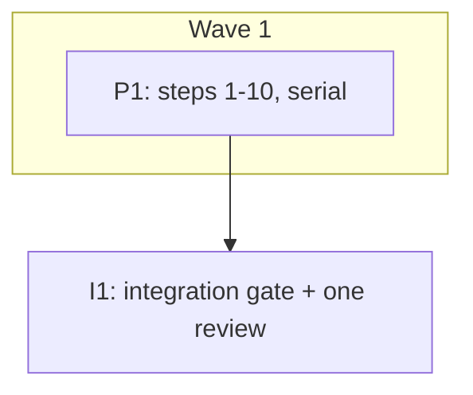

# Plan: open shells and background refresh pick up patch changes; one sync installs each companion once

## Status

- **Plan:** plan_patch_refresh_745
- **State:** done
- **Tier:** high
- **Tier-grammar:** 5
- **Active phase:** 1 — P1 (merged)
- **Step:** finalized
- **Feature branch:** `hex/patch-refresh-745`, cut from the worktree branch `duo`
- **Last update:** 2026-11-23 (finalize: `origin/main` 9c14311c integrated, series squashed to one commit)
- **Review:** spec and security findings applied 2026-11-22 (one Block, on C-013, fixed; the re-check found no Block and its four plan fixes are applied)
- **Open at approval:** Q1…Q3 default to their recommendations
- **Next:** the owner merges the pull request from `hex/patch-refresh-745`
- Reviewed: 1a78684ac01c2bedccd3d265999f3ed0df96f3c2
- Finalize: 2026-11-23 — release gate green on the tree that integrates `origin/main` 9c14311c (`task verify:scoped --force`, the five patch acceptance files); the remote gate is the pull request's own checks.

---

## Overview

Resolves [ocx-sh/ocx#745](https://github.com/ocx-sh/ocx/issues/745). Classification: **bug fix**
(`workflow-bugfix.md`), scope medium, reversibility two-way door. No ADR: every change is internal state
under `$OCX_HOME/state/` or behaviour the existing records already promise.

```
Verdict:    bug
Confidence: medium
Size:       L — three crates (ocx_shell, ocx_package_manager, ocx_cli) plus ocx_store's state paths
Cause:      Patch state feeds env composition but is not in the prompt hook's watch set, and no patch
            writer touches a watched file; the background refresh never probes patches while the
            managed config is unchanged.
Repro:      reproduced — both step 1 tests red on a real pty with the installed hook (eac10f74)
```

**Causal chain.**

1. The shell gate re-runs `ocx --offline self activate --reconcile` only when a watch-set member is newer
   than the session stamp (`crates/ocx_shell/src/shell/hook.rs:324-359`).
2. `watch_paths_in` lists no patch state (`crates/ocx_shell/src/shell/reconcile/fingerprint.rs:144-195`).
3. Every patch record write goes through `PatchTagMap` and touches nothing else
   (`crates/ocx_package_manager/src/tasks/patch_discovery.rs:61-107`).
4. `update_managed_config` syncs patches but rewrites the watched snapshot only when the config changed
   (`crates/ocx_package_manager/src/tasks/managed_config.rs:95-114`).
5. `check_managed_config_refresh` returns `UpToDate` on no drift without looking at patches
   (`managed_config.rs:194-197`).
6. Companion installs are deduplicated per `(companion, platform)` (`patch_discovery.rs:589`), and the
   report sums one count per base and platform (`patch_discovery.rs:899`, `tasks/patch_sync.rs:399`).

**The issue's lines, mapped.**

| Issue line | Fix |
|---|---|
| `config update` does not auto-load new patches | C-001…C-003 (shell), C-010, C-011 (republished patch), C-013 |
| `patch sync` prints the same install several times | C-020, C-021 |
| check project toolchain and its auto-update | C-010 covers project-lock bases; the toolchain drift notice stays tag-only (out of scope, below) |
| new patch env not loaded into the shell | C-001…C-003 |

## Decisions

- **D-1 — one zero-byte patch-state stamp, watched.** `$OCX_HOME/state/patch-state.stamp`, published by
  `StateStore::touch` (the public entry; it renames a temp file over the path, so a planted symlink is
  replaced, never followed), is a watch-set member. Rejected: merging the two record trees into one file
  (one exclusive lock would serialise every concurrent discovery pass, and `resolve_site_patch_roots`,
  freeze and compose would all be rewritten); touching an already-watched file (`ocx.lock` and the managed
  snapshot have their own owners and would stale unrelated verdicts). Precedent: the consent stamp is a
  watched `state/` file for the same reason (`fingerprint.rs:189-192`).
- **D-2 — the stamp moves when any record changed, and after that record is written.** A descriptor
  record and a companion pin both count. `ocx patch sync` rewrites every pin on every run, so an
  unconditional touch would recompose every open shell on every sync. Touch-after-write means a prompt
  that fires mid-sync recomposes again after the last write.
- **D-3 — the mutators take the stamp path.** Every `PatchTagMap` mutator gains the stamp as a parameter,
  so a new writer cannot skip the touch and still compile. `patch test` passes its scratch root's stamp.
- **D-4 — the background tick revalidates, it does not sync.** Under refresh posture `apply`, an
  unchanged config still runs one manifest-digest probe per distinct descriptor source and refetches on
  drift, the mode `ocx package install` and `ocx package pull` already use. A full sync per tick would
  resolve every companion on every tick. Consequence in Q1.
- **D-5 — `companions_installed` is corrected, not redefined.** Its published description is "Number of
  companion packages installed or re-installed". The value becomes the number of distinct installed
  companion packages. Recommendation in Q2.
- **D-6 — a patch snapshot makes the automatic syncs skip, not warn.** `ocx patch sync` keeps refusing
  with exit 78. The syncs that ride `ocx config update`, `ocx index update` and `ocx index sync` return
  early at debug level.
- **D-7 — old state is left alone.** No record format changes, so nothing is migrated or orphaned. A
  machine that updates gets the new gate through the binary swap (C-031).
- **D-8 — the tick acts only on the tier the managed payload declares.** That is the authority the one
  existing unattended installer already uses (`sync_patches_from_payload`, `managed_config.rs:259-269`).
  A `[patches]` tier that comes from an `OCX_CONFIG` file or from `OCX_PATCHES` never triggers a
  background install. Consequence in Q3.
- **D-9 — a payload is the sole authority on the update that delivers it.** When `ocx config update`
  persists a changed config, a payload without `[patches]` syncs nothing: the manager still holds the
  pre-update config, and an operator who removed the tier is retiring that registry. The effective-tier
  fallback (C-013) applies only when the config was already current.

## Scope

### In scope

The four fixes above, their tests, and the doc sentences that state the old behaviour.

### Out of scope

- **Platform in the download bar label.** The label is built in `ocx_oci` with no platform in scope
  (`crates/ocx_oci/src/client.rs:911-913`). Threading it is an ecosystem-crate API change with an
  ocx-mirror lockstep. After C-020 identical labels remain only for companions that really are six
  different downloads.
- **`ocx direnv` reload.** `.envrc` is a static `watch_file ocx.toml ocx.lock`
  (`crates/ocx_cli/src/command/direnv_init.rs:29`) that already misses the managed snapshot and every
  config tier. Same class, wider gap, its own issue.
- **The frozen patch snapshot file as a watch member.** Under a snapshot nothing syncs; only
  `ocx patch freeze` rewrites it.
- **Patch drift in the toolchain drift notice.** C-010 enumerates project-lock bases, so the tick covers
  them; the notice itself stays about tool tags.
- **Elvish and nushell.** Elvish has no in-shell mtime test and reconciles at the next `cd` or `ocx`
  call; nushell's hook never runs the reconcile. Neither has a gate to extend.

### Accepted residuals from review

- **`--frozen` and the tick.** `--frozen` is not part of the background gate
  (`crates/ocx_cli/src/app/background_check.rs:36-54`), so a tick may move patch records just before a
  `--frozen` command composes. That already happens today on a config change; the plan makes it possible
  once per refresh interval. Patches are frozen by a patch snapshot, not by `--frozen`. Unchanged here.
- **C-013 under a concurrent config update.** The manager loads its config at process start. If another
  process persists a newer managed config between that load and this process's fetch, the result is
  `AlreadyCurrent` while `patches()` still holds the older tier, and the fallback syncs it once. The same
  window exists today for any `ocx patch sync` that is running while a config changes.
- **The temp name `StateStore::touch` uses is predictable.** A same-user issue in every existing caller,
  not something this plan adds.

## Component contracts

### Shell wake

- **C-001 — stamp path.** `StateStore::patch_state_stamp() -> PathBuf` returns
  `<state root>/patch-state.stamp`. It is keyed off the `FileStructure` root, as the two record paths
  are, and never follows `--index` or `OCX_INDEX`.
- **C-002 — every changing write moves the stamp.** Each `PatchTagMap` mutator (`write_tag`,
  `write_no_descriptor`, `write_has_descriptor`) takes the stamp path. When the map it writes differs
  from the map it read, it publishes the stamp after the record write returns, with no `await` between
  the two: `StateStore::touch` hands the rename to `spawn_blocking`, which finishes even when a deadline
  drops the caller. When the map is unchanged the stamp's mtime does not move. A failed touch logs at
  debug and never fails the write.
- **C-003 — the stamp is a watch-set member.** `watch_paths_in` always lists it, directly after the
  managed snapshot, whether or not it exists. An absent stamp that appears opens the gate
  (`fingerprint.rs:126`). `ocx shell state --verbose` therefore prints one more member; the change is
  additive.

### Background refresh

- **C-010 — `PackageManager::revalidate_patches(&self, platform) -> crate::Result<()>`.** It covers the
  same bases as `sync_patches` (installed, their dependency closure, registered-project and home lock
  bases) through one shared enumerator, and runs them through `discover_patches_all` in
  `PatchDiscoveryMode::Revalidate` against the manager's own `patches()` tier. Offline, with no tier, or
  under a patch snapshot it returns `Ok(())` and makes no request.
- **C-011 — the tick revalidates under `apply`.** In `check_managed_config_refresh`, when the config has
  not drifted and the posture is `Apply`, the tick calls C-010 for the host platform on a manager that
  carries the snapshot payload's `[patches]` tier (`patches_from_payload` then `with_patches`, as
  `sync_patches_from_payload` does), bounded by a 5 s deadline, before it touches the throttle marker.
  A payload without `[patches]` makes no patch request. A timeout or an unreachable registry logs at
  debug. Every other failure logs a warning on stderr, as the apply-on-drift path does: a required
  companion that failed, a signature or trust-policy refusal, an authentication error, and any error
  with no exit-code class (loud by default, so an unclassified failure is never silent). Every outcome still touches the marker and returns
  `UpToDate`. Under `Notify` no patch request is made.
- **C-012 — a snapshot is a skip.** `sync_patches_from_payload` and
  `index_common::sync_patch_descriptors` return early, logging at debug, when a patch snapshot is active.
  Neither logs a warning for `PatchError::SnapshotActive`.
- **C-013 — `ocx config update` on a current config syncs the effective tier.** When the update result is
  `AlreadyCurrent` and the payload declares no `[patches]`, the sync uses the effective tier
  (`patches()`); when that is also absent it returns. When the result is `Updated`, the payload alone
  decides: no `[patches]` in it means no request to any patch registry.

### One install per companion

- **C-020 — one sync resolves and installs a companion once per distinct content.** Within one
  `sync_patches` call, a companion's top manifest digest is resolved from the registry once per
  companion reference, however many bases and platforms name it. `install_companion` runs once per
  `(companion reference including registry, repository and tag, leaf digest selected for that
  platform)`. The pull still goes through `pull_as` on the pinned top digest, so digest checking and
  auto-verify are unchanged. Two companion repositories that serve the same bytes are two installs, each
  with its own pin record and origin marker. A platform-independent companion named by three bases
  across six platforms is one resolve and one install. A failed leader still shares nothing: each waiter
  retries and keeps its own error. A platform the companion's index does not offer keeps the error
  `fetch_companion` returns today (`NotFound` or `Internal`, `patch_discovery.rs:350-358`), although the
  leaf is now selected before the install key exists. Two leaders of one companion that write the same
  pin are serialised by the record's exclusive `LockedJsonFile` lock and write the same value.
- **C-021 — the report counts distinct companions.** `PatchSyncReport.companions_installed` is the number
  of distinct `(companion reference, resolved leaf digest)` pairs installed in the run.

### The next release

- **C-030 — the self-update hand-off syncs patches (characterization).** The hand-off command
  `ocx self setup <tag>@sha256:<hex> --handoff` resolves the adopted `[managed]` seed without a flag
  (`crates/ocx_cli/src/command/config_setup.rs:53-62`); `--handoff` only gates profile edits. On a
  machine with an adopted, unpaused, tag-following managed config it reaches `update_managed_config`, so
  patch records are current when it returns. This holds on HEAD; the test pins it.
- **C-031 — a shell opened before the update takes the new gate.** After the hand-off selects a freshly
  assembled binary, the watched `current/content/bin` member is newer than the session stamp, so the next
  prompt of a bash, zsh, fish or PowerShell session runs the new binary's reconcile. The new binary's
  watch-set membership digest differs from the old one, because the patch stamp joined the set, so the
  hook is re-emitted with a gate that carries the stamp.

## User-experience scenarios

- **S-001** — A shell is open in a project whose tool carries a patch. The operator republishes the
  patch; the user runs `ocx patch sync`. The next prompt shows the new patch environment. Error case: the
  sync fails on a required companion (exit as today). No descriptor record advances. A companion pin that
  advanced before the failure moves the stamp, and the recompose it triggers reads the unchanged
  descriptor, so the shell keeps the last good environment.
- **S-002** — Same shell; the user runs `ocx config update` and the config is already current. The patch
  sync that rides it advances a record; the next prompt shows the new environment.
- **S-003** — A second shell is open while a sync runs in the first. Whatever prompt it draws mid-sync, a
  later prompt recomposes again after the last record write. Covered by step 2's "stamp after record"
  unit test.
- **S-004** — Posture `apply`, config unchanged, patch republished. The next eligible command's tick
  refetches the descriptor and installs its companions; open shells recompose at their next prompt. Error
  cases: registry unreachable or deadline hit, the command runs normally and the tick retries after the
  interval; a required companion fails verification, one warning on stderr and the command still runs;
  offline, CI, or a non-terminal stderr, no tick (unchanged).
- **S-005** — `OCX_PATCH_SNAPSHOT` is set. `ocx config update` and `ocx index update` print no patch
  warning; `ocx patch sync` still exits 78.
- **S-006** — Bare `ocx patch sync` with one platform-independent companion shared by two bases. The
  report shows `Companions 1`, and the companion's install is announced once.
- **S-007** — A developer machine runs `ocx self update` to the next release. Patches are re-synced by
  the hand-off, and each open shell recomposes at its next prompt. Error cases: a paused or
  digest-pinned managed config, or no registry access, skip the sync by design (`refresh_skip_reason`).
- **S-008** — The operator removes `[patches]` from the managed config. `ocx config update` applies the
  new config and contacts no patch registry.

### Error taxonomy

No new error variant, slug or exit code. `PatchError::SnapshotActive` (exit 78) is unchanged for
`ocx patch sync`. Every background path stays best-effort: it never fails the command and never writes
to stdout.

## Parallelization

One pipeline. The three fixes meet in `tasks/patch_discovery.rs` and `tasks/patch_sync.rs`, so no
contract cuts them into file-disjoint pipelines; they are steps of one. No contract wave.

| Pipeline | Scope | Expected Files | Wave | Depends on | Marks | Status |
|---|---|---|---|---|---|---|
| P1 | C-001, C-002, C-003, C-010, C-011, C-012, C-013, C-020, C-021, C-030, C-031; S-001…S-008 | `crates/ocx_store/src/file_structure/state_store.rs`; `crates/ocx_shell/src/shell/reconcile/fingerprint.rs`; `crates/ocx_package_manager/src/tasks/{patch_discovery,patch_sync,patch_test,managed_config}.rs`; `crates/ocx_package_manager/src/activation.rs` (tests); `crates/ocx_cli/src/command/{index_common,shell_state}.rs`; `crates/ocx_cli/src/api/data/patch_sync.rs`; `test/tests/{test_shell_reconcile_edge_cases,test_patches,test_managed_config}.py`; `website/src/content/docs/{guides/global-toolchain.mdx,explanation/managed-configuration.md,explanation/patches.mdx,explanation/shell-integration.mdx,publishing/maintain-patches.mdx,troubleshooting/shell.mdx}`; `.claude/rules/subsystem-file-structure.md` | 1 | — | — | merged |



Critical path: P1 → I1. Shippable after wave: 1 — the whole fix.

### Pipeline steps

Each step is one fresh agent. Steps that change behaviour run only the tests they wrote or touched.
Acceptance paths are relative to `test/` (`task test:parallel --force -- tests/<file>.py`). A test
marked *guard* is expected green on HEAD: it pins behaviour the later steps must not break.

1. **Shell regression tests, red.** In `tests/test_shell_reconcile_edge_cases.py`, modelled on
   `test_ec_fp_003_env_only_edit_with_lock_untouched_recomposes` with the patch helpers of
   `tests/test_patches.py` (`_publish_descriptor_global`, `_publish_private_companion`, `_patch_state`):
   `test_ec_patch_001_patch_sync_recomposes_the_next_prompt` (S-001) and
   `test_ec_patch_002_config_update_on_a_current_config_recomposes_the_next_prompt` (S-002). Both assert
   the patch-supplied variable's new value at the next prompt. Show both red on HEAD. Covers C-002,
   C-003.
2. **Stamp and writers.** Add C-001 with a `state_store.rs` unit test modelled on
   `consent_stamp_file_is_consent_json_in_the_project_state_dir`: the path is
   `<state root>/patch-state.stamp`, under the same root the two record paths key off. Give the
   `PatchTagMap` mutators the stamp parameter and the changed-map touch (C-002); update every caller,
   including `patch_test.rs` and the roughly thirty test call sites. Unit tests in `patch_discovery.rs`:
   a changing descriptor write, a no-descriptor record and a companion pin each move the stamp; an
   identical rewrite does not; the stamp is written after the record (S-003). Read `clean.rs` and
   confirm `ocx clean` sweeps only `state/projects/`, so the stamp survives a clean.
3. **Watch member.** Add the stamp to `watch_paths_in` (C-003) with a unit test modelled on
   `watch_paths_carry_the_consent_stamp_a13`. Fix the watch-set tests in `activation.rs` and `activate.rs`
   that pin the member list, and any `ocx shell state --verbose` test or
   `troubleshooting/shell.mdx` listing that enumerates the members
   (`crates/ocx_cli/src/command/shell_state.rs:111`). Add
   `test_ec_patch_003_offline_recompose_does_not_move_the_patch_stamp`: with the stamp present, a
   per-prompt reconcile leaves its mtime unchanged (no recompose loop). Add `EC-PATCH-*` rows to the
   edge-case register `analysis_shell_env_edge_cases.md` and cite them from the three tests, which cite
   `EC-FP-003` as a stand-in until then (`test/lint/test_shell_reconcile_edge_cases_structure.py`).
   Rebuild the binary under test first: step 1 ran against a stale `test/bin/ocx`. Step 1's tests go green.
4. **Refresh regression tests, red.** In `tests/test_managed_config.py`, beside
   `test_setup_refresh_syncs_patch_descriptors` and the background-tick tests:
   `test_background_tick_revalidates_a_republished_patch_when_the_config_is_unchanged` (S-004, C-011) and
   `test_config_update_under_a_patch_snapshot_prints_no_patch_warning` (S-005, C-012). In
   `tests/test_patches.py`, beside `test_patch_sync_under_a_snapshot_is_refused`:
   `test_index_update_under_a_patch_snapshot_prints_no_patch_warning` (S-005, the `index_common` half).
   Show the three red. Guard, in `tests/test_managed_config.py`:
   `test_config_update_that_drops_patches_contacts_no_patch_registry` (S-008, C-013). Its fixture: the
   adopted config declares `[patches]` for a registry, so the manager's own tier is set; the republished
   config drops the section, so the update returns `Updated`; the registry's request count is taken
   right before `ocx config update` and is unchanged after it. In step 6, show this guard red once with
   the fallback applied on `Updated`, then restore the rule.
5. **Revalidate entry.** Add C-010 as a signature with an `unimplemented!()` body and write its unit
   tests in `patch_sync.rs` first: one probe per distinct descriptor source across bases; no request
   offline, without a tier, or under a snapshot. Show them red. Then extract the base enumeration
   `sync_patches` uses and implement.
6. **Tick and skips.** Wire C-011 into `check_managed_config_refresh` with its 5 s deadline; add C-012 to
   `sync_patches_from_payload` and `index_common::sync_patch_descriptors`; add C-013. Unit tests in
   `managed_config.rs` beside `check_managed_config_refresh_apply_on_drift_persists_silently`: apply and
   no drift revalidates on the payload's tier; a payload without `[patches]` makes no request even when
   the manager's own tier is set (D-8); notify and no drift makes no patch request; a timed-out
   revalidation still returns `UpToDate` and touches the marker; a required-companion failure warns and a
   timeout does not; `AlreadyCurrent` with a payload without `[patches]` syncs the effective tier;
   `Updated` with a payload without `[patches]` syncs nothing, on a manager built with
   `with_patches(Some(..))` so the fallback had a tier to misuse. Step 4's tests go green and its guard
   stays green.
7. **Dedup regression tests, red.** Unit, in `patch_sync.rs` beside
   `sync_fetches_each_distinct_descriptor_once_across_bases_and_platforms`:
   `sync_resolves_and_installs_a_platform_independent_companion_once` (C-020) and
   `sync_counts_each_distinct_companion_once` (C-021). Acceptance, in `tests/test_patches.py`:
   `test_patch_sync_installs_a_shared_companion_once` (S-006): bare sync, one platform-independent
   companion, two bases, `companions_installed == 1`, and the companion's install announced once on
   stderr. Record in the test's doc comment which output line the run on HEAD repeats. Show the three
   red. Guards, unit: `sync_installs_each_leaf_of_a_platform_specific_companion` (a six-leaf companion
   still installs six) and `sync_pins_each_companion_repository_that_serves_one_digest` (two repositories,
   one digest, two pin records).
8. **Dedup.** Two commits, each with its red test from step 7.
   - **8a — resolve once, install once per leaf (C-020).** Resolve the top digest once per companion
     reference per sync and key the install singleflight on `(companion reference, selected leaf
     digest)`. Read `pull_as` first to find where the platform leaf is selected, and check what
     `InstallInfo` carries per platform before sharing one across passes. Check that
     `MAX_SHARED_COMPANION_INSTALLS` still suits the new key. Keep
     `a_shared_companion_install_answers_later_passes` and both guards green.
   - **8b — count the union (C-021).** Return installed identities from `discover_from` and count their
     union in `sync_patches`. Update the `companions_installed` doc comment in `api/data/patch_sync.rs`
     only if its meaning needs a sharper sentence.
9. **The next release.** C-030: extend `test_setup_refresh_syncs_patch_descriptors` with a `--handoff`
   case; it is a characterization test, green on HEAD. C-031: prove the two halves in
   `tests/test_shell_reconcile_edge_cases.py` and say so in the doc comment — a freshly assembled
   `current` target opens the gate of a running session, and a session whose recorded membership digest
   predates the patch stamp gets its hook re-emitted with the stamp in the gate. No two-binary session:
   `test/src/previous_release.py` exposes only `toolchain_binary` and `resolve`, and the file drives no
   session on the previous release. Do not add a skip. `test_ec_fp_005_self_update_recomposes_every_open_shell`
   stays as it is unless the two halves make it implementable in the same change.
10. **Docs.** `guides/global-toolchain.mdx` (the watch-set sentence), `explanation/managed-configuration.md`
    (posture `apply` also revalidates patch descriptors on an unchanged config, on the tier the managed
    config declares), `publishing/maintain-patches.mdx` and `explanation/patches.mdx` (how an open shell
    learns of a patch change; the companion pin rule stays as written), `troubleshooting/shell.mdx` and
    `explanation/shell-integration.mdx` (the watch-set member list), `.claude/rules/subsystem-file-structure.md`
    (the stamp row beside the two record trees). No changelog edit.

## Landing and verification

- **I1.** `task verify:scoped --force`; then
  `task test:parallel --force -- tests/test_shell_reconcile_edge_cases.py tests/test_patches.py tests/test_managed_config.py tests/test_exit_codes.py`;
  then `task test:shell-latency` (the gate gains one stat per prompt against the 2 ms budget);
  then `task verify:mark`. No local full `task verify`. No satellite run: no ecosystem-tier crate changes
  its API.
- **Hub files.** No schema golden moves unless Q2 is answered "semantic break"; then the ledger entry,
  `SCHEMA_VERSION = 2` and the regenerated goldens land at I1.
- **Commit.** One squashed commit per the finalize preference:
  `fix(patch): open shells pick up patch changes, a republished patch is found without a config change, and one sync installs each companion once`.
  Body: the root cause, `Closes #745`.

## Risks

- **Unreproduced cause.** Step 1 is the reproduction. If either test is green on HEAD, stop and re-open
  the RCA before step 2.
- **Coarse mtimes.** A stamp written in the same filesystem timestamp tick as the session stamp is not
  "newer". Every existing watch member shares this; no new mitigation.
- **Tick latency.** C-011 adds registry probes before a command. It is bounded by the 5 s deadline,
  throttled by the refresh interval, and skipped in CI, offline and without a terminal. Not measured:
  whether revalidating an already-installed pinned companion re-runs auto-verify over the network on
  every tick. Step 6 reports what it saw.
- **Dedup across platform-specific leaves.** Keying on the top digest alone would install one leaf for
  six platforms. C-020 keys on the selected leaf; a step 7 guard proves a six-leaf companion still
  installs six.
- **Dedup across repositories.** Keying on the leaf digest alone would skip the pin and the origin marker
  of a second repository serving the same bytes, and a later compose would report it not installed
  (exit 79 when required). C-020 keeps the companion reference in the key; a step 7 guard proves it.
- **C-031 rests on directory mtime.** The watched binary member is `…/current/content/bin`; a freshly
  assembled package gives it a new mtime. Re-selecting a version already in the store may not open the
  gate. Step 9 states what it proved.

### Deferred from the execution review (2026-11-22)

One review call over `27e79b0a..5208da6b` (spec, test coverage, quality, performance and docs seats; the
security seat; a cross-model pass under codex through `nox-review`, which ran), then one fix pass and a
re-review of the fix delta. No Block finding. What was not fixed, and why:

- **The tick's patch re-check runs before the foreground command.** `crates/ocx_cli/src/app.rs:184` awaits
  the tick, so under `refresh = "apply"` an unchanged config can add up to the 5 s deadline to a command's
  start, once per refresh interval, when the patch registry is slow. Raised by the cross-model pass and the
  performance seat. The Risks section already names it; the choice is a foreground latency budget (run it
  after the command, or lower the deadline), which is the owner's.
- **A re-check that needs more than the deadline never converges.** Descriptor advances commit only after
  every probe of the batch finished (`patch_discovery.rs`, `commit_descriptor_advances`), so a store whose
  probes need more than 5 s pays the deadline at every interval and records nothing. Needs a decision on
  per-source commits.
- **A registry outage on a non-required tier warns from the tick.** `revalidate_descriptors`
  (`patch_discovery.rs:794`) logs a warning for a failed probe and absorbs the error, so the tick's
  quiet-on-outage filter never sees it. The function is shared with `install` and `pull`, whose output a
  fix would change.
- **An applied tick and the command that follows it.** When the tick applies a drifted payload, the command
  in the same process still runs on the manager loaded at start, so its own patch discovery can contact a
  registry the payload just removed. It predates this plan and is the in-process form of the C-013
  residual above.
- **A companion download longer than the deadline restarts at every tick**, and the re-check passes no
  shared install group, so several bases may each try a newly referenced companion.
- **The four-way `SelectResult` mapping exists three times** (`tasks/resolve.rs:481`, `tasks/common.rs:760`,
  `select_leaf` in `patch_discovery.rs`). Extracting it touches two files this plan does not own.
- **The empty-store branch of `revalidate_patches` repeats the discover-and-tolerate wrapping** of
  `discover_patches_all`, whose empty-input early return blocks reuse.
- **No test pins the order "record, then stamp".** The order is read off `write_tag` and
  `write_no_descriptor`; the tests check the end state.
- **The prompt-gate tests run on bash only.** The other shells' tests in that file drive `matrix.prompt`,
  which bypasses the hook's gate, so zsh, fish and PowerShell need per-shell hook drivers first.

## Open questions

- **Q1 — the tick finds a changed descriptor, not a companion republished under an unchanged tag.**
  `Recommended: accept` — the documented rule is that a companion pin advances only on `ocx patch sync`,
  and `ocx config update` and the self-update hand-off still run a full sync.
- **Q2 — is the corrected `companions_installed` a `semantic` contract break?** For the same inputs the
  value drops (two bases sharing one companion report 1, not 2) under an unchanged name.
  `Recommended: no, a bug fix` — the published description already says packages installed; no ledger
  entry and no version bump.
- **Q3 — a `[patches]` tier the managed config does not declare gets no background refresh.** That covers
  machines with no managed config and tiers set through `OCX_CONFIG` or `OCX_PATCHES` (D-8).
  `Recommended: leave` — an unattended install should come only from the tier the operator published;
  those machines keep revalidation on install and pull, `ocx patch sync`, and C-013 on
  `ocx config update`.

## Constitution deviations

None. The stamp follows the `state/` marker convention and the locking policy (a rename-published
zero-byte file needs no lock).

## Schedule log

- 2026-11-22 — step 1 `eac10f74`: `test_ec_patch_001` and `test_ec_patch_002` red on the value assertion (old value still shown). The bug is reproduced. A first draft through `matrix.prompt()` passed, because that helper bypasses the hook's newer-than gate; the tests drive a real pty.
- 2026-11-22 — step 2 `b790dc6f`: `StateStore::patch_state_stamp()` and the stamp parameter on the three `PatchTagMap` mutators; an unchanged map keeps its record write and skips only the touch. `ocx clean` sweeps only `state/projects/` (`clean.rs:405-415`), so the stamp survives.
- 2026-11-22 — step 3 `495e5a3d`: the stamp is a watch-set member; `test_ec_patch_001…003` green on a rebuilt binary; register rows `EC-PATCH-001…003` added (row count 237 → 240 in the structure lint). The disk filled during the step; the two `ocx shell state` checks were rerun by the orchestrator afterwards (80 unit, 25 acceptance, all passed). `test_ec_patch_003` was not shown red.
- 2026-11-22 — step 4 `83605c82`: three tests red on their own assertion (tick, config-update and index-update warnings under a snapshot); the dropped-registry guard green. `index sync` shares `sync_patch_descriptors` with `index update`, so one test covers both.
- 2026-11-22 — step 5 `fe6ba6a0`: `revalidate_patches(&self, platform: &Platform)` over the shared `patch_bases_per_platform`; three unit tests seen red on the stub, then green (33 in the module).
- 2026-11-22 — step 6 `083ca40d`: tick, snapshot skips and the `AlreadyCurrent`-only fallback. Unit and acceptance guard both seen red with the fallback applied on `Updated`, then green. `operator_must_see` treats exit codes `Unavailable` and `TempFail` as quiet; an auth failure on the patch registry warns once per refresh interval. `PATCH_REVALIDATION_DEADLINE` is 5 s. Not measured: the revalidation's own latency.
- 2026-11-22 — step 7 `f1816aff`: red — six tag resolves for one platform-independent companion (expected 1), `companions_installed` 18 for three bases and 12 in the acceptance run (expected 1); both guards green. The line users see six times is `no trust policy covers '<companion>'; installing … without signature verification`. The tag resolve goes through `pull_manifest_raw`, not `fetch_manifest_digest`. Test-only addition in the ecosystem crate `ocx_oci`: `StubTransportInner.manifest_reads` in `client/test_transport.rs`.
- 2026-11-22 — step 8a `7664b32d`: `CompanionInstalls` holds three singleflight groups (top-digest resolve by companion reference; install by companion reference and selected leaf; the old `(reference, platform)` group kept as an outer fast path). `select_leaf` reuses `index().select`. For review: it fetches the top manifest once per platform and repeats `resolve.rs`'s four-way `SelectResult` error mapping.
- 2026-11-22 — step 8b `93bd7074`: the count is the union of `(companion reference, leaf digest)` pairs; 117 unit tests green; `test_patch_sync_installs_a_shared_companion_once` green including the announced-once half. No doc comment or golden moved.
- 2026-11-22 — step 9 `5c6cc62e`: three characterization tests green — `test_setup_handoff_refresh_syncs_patch_descriptors` (`ocx self setup --no-modify-path --handoff` under the self-image seam, no positional), `test_ec_patch_004` (a freshly assembled `current/content/bin` opens the gate) and `test_ec_patch_005` (a stale membership digest re-emits the hook with the stamp). Both gate tests went red under a no-op mutation. Not proven: zsh, fish and PowerShell (bash only); the previous release's real hook text; re-selecting a version already in the store.
- 2026-11-22 — step 10 `37bf0b0f` (+ a paragraph split): `guides/global-toolchain.mdx`, `explanation/managed-configuration.md`, `publishing/maintain-patches.mdx` and the two subsystem rules. The pass was thin: the other listed pages were left alone as stating nothing false, and the facts were not re-verified against code by the writer. The review's docs seat checks drift.
- 2026-11-22 — P1 complete on `hex/patch-refresh-745`; integration gate and review started.
- 2026-11-22 — integration gate, first run on `5208da6b`: the four acceptance files green (347 passed); `task test:shell-latency` with nothing red (per-prompt reconcile 8.3 ms against 10 ms; the shell-startup gate could not be decided on this host); `task verify:scoped --force` red on the code-docs linkage ratchet, four plan identifiers in test docstrings, fixed in `07f0cc98`.
- 2026-11-22 — review call over `27e79b0a..5208da6b`: six seats and the cross-model pass (codex, ran, five findings: one dropped as a stated convention, two fixed, two deferred). No Block. Convergence: C-003 was partial (no report test for the new watch member) and is met after `8486e4f8`; every other contract and scenario met.
- 2026-11-22 — fix pass: `79615800` (docs: storage tree, shell troubleshooting list, managed-config network list, two subsystem rules), `8486e4f8` (tests: the offline-recompose test observes the recompose and a moving stamp; the watch-set report names the stamp; `test/SUITE_FLOOR` 4437 → 4449; two over-marked tests lose `requires_testing_build`), `1a78684a` (the tick re-checks the global descriptor on a store with no packages; a dead test-only method and three `type_complexity` lints removed; the deadline test now reaches the delayed probe; the per-leaf companion count, the warning classes and the over-cap path are covered). C-011's warning rule is restated above to match the code: every failure that is not a transient registry outage warns.
- 2026-11-22 — re-review of the fix delta `5208da6b..1a78684a`: pass, nothing actionable. Integration gate, second run on `1a78684a`: `task verify:scoped --force` exit 0 (77 Bazel test targets pass, clippy on the five touched crates, the scoped acceptance arm 1537 passed) and five acceptance files 373 passed. The latency lane was not rerun; the fix pass touched no prompt-path code. `task satellite:verify` was not run: the only `ocx_oci` change is a field on a test-support stub.
