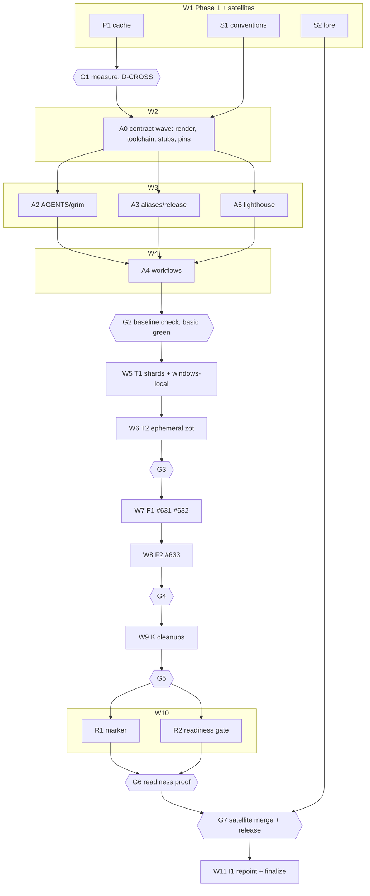

# Plan: PR #637 round 2 — cache first, then tiers, test tooling, platform, cleanups, release gate

## Status

- **Plan:** plan_pr637_round2
- **State:** executing
- **Tier:** high
- **Tier-grammar:** 5
- **Updated:** 2026-10-24
- **Active phase:** 3–5 — test tooling, platform, cleanups: W5–W9 (T1, T2, F1, F2, K), scope stops at G3–G5
- **Step:** W5–W9 landed, Windows residue cleared locally, awaiting G3–G5
- **Feature branch:** `hex/humble-meandering-fox` ([ocx-sh/ocx#637](https://github.com/ocx-sh/ocx/pull/637))
- **Last update:** 2026-10-24 (after 87ea8bb07: test(windows): the Windows acceptance limits come from a measured four-shard run)
- **Next:** G3–G5 (meta): push #637, dispatch deep; macOS fixes are proven only by that deep run

---

## Overview

**Target:** [ocx-sh/ocx#637](https://github.com/ocx-sh/ocx/pull/637) (no open review threads) and its issues
[#631](https://github.com/ocx-sh/ocx/issues/631) [#632](https://github.com/ocx-sh/ocx/issues/632)
[#633](https://github.com/ocx-sh/ocx/issues/633) [#634](https://github.com/ocx-sh/ocx/issues/634)
[#635](https://github.com/ocx-sh/ocx/issues/635) [#636](https://github.com/ocx-sh/ocx/issues/636)
[#638](https://github.com/ocx-sh/ocx/issues/638).
**Binding input:** `.agents/batches/pr637-batch2.md` findings 1-17 (later wins: 10 refines 9, 12 refines 10,
15 supersedes 9's release rule, 17 supersedes 16's "merge/release stay owner acts"). Goal file
`.agents/goals/pr-637.md`. **Research:** [`research_pr637_round2.md`](./research_pr637_round2.md) (Q1-Q7; not re-run).

**Classification.** Scope large (3 repos, 15 pipelines + 1 contract wave, 11 waves). Reversibility one-way
(medium): cache trust boundary, CI tier policy, the release gate and two published satellite releases. Tier `high`
(explicit; gate announced and proceeded). Overlays: `architect=inline` (findings carry the decisions; this plan
closes the rest in § Decisions), `research=1` (persisted above), `adversary=off`. No new ADR: the cache change
amends `adr_bazel_build_adoption.md`; every other decision is a finding or a row in § Decisions.

**Model routing** (CLAUDE.md policy). Every pipeline: `sonnet`; `hard` = sonnet at high effort. Inventory and
grep sweeps: `haiku`. `opus` only after a step fails twice on sonnet. Every spawn sets `model` and a
`Model rationale:` line.

## Objective

1. Phase 1: every Bazel lane authenticates to and writes the remote cache; warm times measured; cross placement
   decided from the numbers.
2. ocx adopts the ocx-sh/conventions contract (basic + deep tiers, `basic-gate`, `run-deep`, `nightly-red`,
   `baseline:check` green) with full Linux acceptance (4 shards) on every PR.
3. Acceptance tooling: Bazel-style 0-based sharding flags, a local Windows run, one ephemeral zot per pytest run.
4. Windows long paths and empty bin scan fixed; macOS + Windows full suite on every deep run.
5. Stale #635/#636 text fixed; doctest counting and its rules_rust patch dropped.
6. A release is refused unless a green readiness run exists for the exact tagged SHA, run on the real release bytes.
7. One PR per satellite repo, released once; ocx ends pinned to the released conventions tag and lore digest.

## Scope

In: the 17 findings, the 7 issues, one PR each on `ocx-sh/conventions` and `ocx-sh/grimoire-lore`.
Out: merging #637, releasing or tagging ocx, the main ruleset change (owner), `ocx-mirror` (no finding needs it),
the merge queue going live (finding 10: basic stays on `merge_group`, nothing more).

## Decisions

Question → research → decision. Findings already decided are not repeated.

| ID | Question | Research | Decision |
|---|---|---|---|
| D1 | Shard shape: pytest options or a selector? | Q3: Bazel selects targets (one `sh_test` per module, no `shard_count`), so pytest options cannot serve the Bazel path | One selector, `accept_shard.py --shard-count N --shard-index I`, used by both paths; env fallback inside it |
| D2 | Where does `--remote_upload_local_results=true` live? | Q1: `--bazelrc` files load after `.bazelrc`, later wins; the grant today rides `CLI_ARGS` on one lane | In the CI rc beside the credential (write mode). No step passes the flag. ADR ruling 5a amended |
| D3 | Label trigger: wrapper workflow or template? | Q2: template verify-deep carries `pull_request: [labeled]` + `run-deep` | Template verify-deep after adoption; no wrapper; the trigger-shape pins change |
| D4 | Where does the server-side release gate sit? | Q6: `plan-jobs` red still lets `host` run; `local-artifacts-jobs` sits in `host.needs` | `local-artifacts-jobs = ["./readiness-gate"]` in `release.yml` |
| D5 | In-flight lore edits: vendor an edited copy into ocx? | Adopted lint runs `grim:check`; an edited vendored copy reds it. Finding 17's "no grim drift gate" premise ends with finding 9 | No vendored edit. A deviation note in `subsystem-ci.md` § Bazel remote cache until I1's `grim update` |
| D6 | `deep_os` for ocx? | Q2: the template deep job runs `task ci:deep` per OS; ocx's macOS/Windows legs need cross outputs and per-OS limits | `deep_os = [ubuntu-latest]`; native legs live in repo-owned `deep-repo.yml` |
| D7 | `site.deploy` for ocx? | `deploy-docs.yml` needs Rust + Bazel (schema, reference) | `site.deploy = false`; `deploy-docs.yml` stays repo-owned |
| D8 | Which bytes does readiness test? | Finding 15 | The cargo-dist archive the installer resolves per platform, extracted, as `OCX_COMMAND` |
| D9 | Free zot ports? | Q4: zot `port: "0"` binds and logs the kernel port at info level | Port `"0"` + log parse; info logging for the ephemeral config only |
| D10 | Ports to xdist workers? | Q4: controller `pytest_configure` runs before workers spawn; workers inherit env | Controller exports `OCX_TEST_*_PORT` and `OCX_INSECURE_REGISTRIES`; workers read env only |
| D11 | Crash safety mechanism? | Q4: `preexec_fn` unsafe with threads | POSIX pipe-EOF watchdog child; Windows Job Object `KILL_ON_JOB_CLOSE` via ctypes |
| D12 | Satellite worktrees? | Owner checkouts sit on owner branches | `git -C <satellite> worktree add <ocx>/.agents/worktrees/sat-<repo> -b <branch> origin/main`; removed at I1 |
| D13 | D-CROSS metric and threshold? | Finding 11 "≤ ~3 min per triple" | One metric: job wall time (`gh run view --json jobs`, `startedAt`→`completedAt`) of each cross job on the warm run. Slowest ≤ 3:00 → variant A, else B |
| D14 | Conventions version? | Tags `v0.1.0`, `v0.1.1`; new answers + hooks | `v0.2.0` (new template surface, defaults byte-identical) |
| D15 | Finding 10's "main" level? | Finding 12 moves its acceptance onto every PR | Collapses into basic; push to main runs basic only |
| D16 | Keep `smoke-acceptance`? | Finding 10 "basic unchanged" | Kept, in `basic-repo.yml` |
| D17 | #633 "blocking" means? | Finding 10; finding 15 supersedes the latest-deep check | `nightly-red` issue on a red deep, and readiness (which runs the same macOS/Windows suite on release bytes) refuses the release; no merge block, no separate nightly-state check |
| D18 | Where do contract-baseline tag drift, `test:rows:check`, live proofs, full scripts/tests go? | Finding 9/10 | `ci:deep` only; `task verify` unchanged locally |
| D19 | scripts/tests PR job on `scripts/**`: path filter? | A path filter on a gated workflow leaves a required check skipped | A changed-files step inside the job; the job always runs, exits early when untouched |
| D20 | Acceptance binary on PRs: artifact or rebuild? | Reusable workflows share the caller's run, so artifacts would work; a rebuild from the warm cache is fewer moving parts | `binary: build` rebuilds `//crates/ocx_cli:ocx` in `acceptance.yml`; `binary: artifact:<name>` only where the bytes must be the release bytes (R2) |
| D21 | Two cache rc writers after adoption (ocx action + conventions setup)? | S1 adds `bazel-cache: trusted` to the setup action | I1 switches repo-owned jobs to the conventions setup cache step and deletes `.github/actions/bazel-cache-rc` iff the two rc goldens (C-002, C-010) are identical; else both stay and C-003 covers both |
| D22 | How do repo workflows get secrets from template callers? | `secrets: inherit` is a zizmor finding | Answer `repo_workflows = { secrets = [...] }`; the template maps each name explicitly |
| D23 | Why `zizmor_ignore`? | `release.yml` is cargo-dist-generated and drift-checked; it cannot be hand-fixed | Answer lists generated workflows only; hand-written ones are fixed (A4) |
| D24 | Fork PRs after P1? | Q1: no secrets → no rc → the lane runs as it does today | Unchanged; S-002 |
| D25 | Finding 15 says `release:prepare` refuses without readiness for the tagged commit — but which step can see that commit? | Template `release:prepare` "never tags or pushes"; the bump commit it prepares does not exist when it runs | The refusal lands on the step that creates the tag: ocx `task release:tag` (C-064). `release:prepare`'s own `release:gate` checks the full mark and provenance |
| D26 | Scripts that spawn Bazel themselves (`bazel_pin_check`, `ignore_check`, `build_drift`, `tag_guard`)? | They run analysis-only queries; no cache need | Unchanged. `ponytail:` ceiling: each costs one server restart in a job that also built; G1 measures it, fixed only if the numbers show it matters |

**D-CROSS branches (decided at G1, built by A4).** Variant A (slowest warm cross job ≤ 3:00): reusable `cross.yml`
(8 triples) is called by `basic-repo.yml`, so every PR and push to main cross-builds; `deep-repo.yml` calls the
same `cross.yml` so its native legs read outputs inside one run. Variant B (> 3:00): the 8 cross jobs live only in
`deep-repo.yml`; basic builds Linux only. Either way a native macOS/Windows leg `needs:` the cross job of its triple
in the same run, and `test_workflows.py` pins whichever variant G1 recorded.

## Component contracts

**Phase 1 — caching**

- **C-001 Cache rc derivation.** Root `taskfile.yml` `vars:` holds the one `CACHE_RC`
  (`--bazelrc=$RUNNER_TEMP/bazel-cache.rc` iff that file exists, else empty); the six per-task copies are deleted.
  Every `ocx exec bazel -- bazel …` line under `taskfiles/**`, `test/taskfile.yml`, `website/*.yml` (including
  `website/recordings.taskfile.yml`) passes `{{.CACHE_RC}}` as its first startup option. `scripts/test_bundle.py`'s
  `bazel()` seam applies the same rule. Local runs (no `RUNNER_TEMP`) unchanged. A structural test in
  `test_workflows.py` asserts every such line carries `{{.CACHE_RC}}` and reds on today's `cross.taskfile.yml`.
- **C-002 Action write mode.** With `write-auth` set, the rc file is exactly
  `build --credential_helper=bazel-cache.ocx.sh=$RUNNER_TEMP/bazel-cache-helper` and
  `build --remote_upload_local_results=true`, one per line, mode 0600, helper 0700. Read mode and its input are
  deleted (no caller left). An existing credential still refuses; empty `write-auth` writes no file. `selftest.sh`
  compares the rc against this golden.
- **C-003 Lane policy test** (`test_workflows.py`; replaces `test_exactly_one_job_holds_the_cache_write_credential`
  and its cluster — the tests at 709, 2998, 3020, 3090, 3192, 3277 at `975d07b01`, re-anchor by name; 3277's
  read-credential assertion goes):
  (a) every job that writes a cache rc passes `write-auth: ${{ secrets.BAZEL_CACHE_WRITE_AUTH }}` (or, for the
  conventions setup action, `bazel-cache: trusted` + `cache-write-auth: ${{ secrets.BAZEL_CACHE_WRITE_AUTH }}`)
  with no event predicate and no read credential; (b) no step passes `--remote_upload_local_results`; (c) every job
  running a Bazel lane has the cache step — detection covers `bazel`, `task cross:`, `schema:generate`,
  `rust:build`, `rust:clippy:check`, `rust:doc:ratchet`, `test:smoke`, `test:accept:native`, `satellite:`,
  `recordings:`, `website:`, `test_bundle.py`, `ci:*`, with a reader floor on the lane count it found; (d) every
  caller of a reusable workflow that holds a cache step passes `BAZEL_CACHE_WRITE_AUTH` by name.
- **C-004 Policy record.** ADR rulings 5/5a/5b, the security row and the rollout row amended (every lane holding
  the secret writes; the untrusted path holds none). `research_bazel_cache_trust_boundary.md` stale lines marked.
  `subsystem-ci.md` § Bazel remote cache states the policy and the D5 deviation note.
- **C-005 Measurement record.** § Schedule log gets, per run: URL, each job's wall time (D13 metric), the
  `INFO: N processes: M remote cache hit` ratio per Bazel job. Numbers only, never log excerpts.

**Phase 2 — tiers**

- **C-010 Template extension** (conventions). Answers:
  - `repo_workflows` (`false` default | `{ secrets = [...] }`): verify-basic job `repo` calls
    `./.github/workflows/basic-repo.yml`, verify-deep job `repo` calls `deep-repo.yml`, each secret mapped by name,
    `permissions: contents: read`; `basic-gate` and `nightly-red` need `repo`; both files seeded as stubs.
  - `bazel_cache_write` (`main` default | `trusted`): renders `bazel-cache: write` or `trusted` on every template
    job that runs a `ci:*` alias (lint, test, build, docs, deep) when `bazel = true`. Setup action mode `trusted`
    writes the credential on every event and the C-002 rc lines; a golden test in conventions holds the same text.
  - `zizmor_ignore` (list of generated workflow paths) → `.github/zizmor.yml`.
  - Optional task hooks: `release:gate` (replaces the latest-deep check when present), `release:validate` (after
    git-cliff), `release:verify` (replaces `verify`).
  - Runner validator accepts `macos-15-intel`, `macos-26`, `windows-11-arm`, `ubuntu-24.04-arm`.
  Defaults render byte-identical for every existing `fleet.toml` answer set.
- **C-011 Fleet answers.** `fleet.toml [repos.ocx]`: `adopted = true`, `site.dist = website/dist`,
  `site.deploy = false`, `deep_os = [ubuntu-latest]`, `repo_workflows.secrets = [BAZEL_CACHE_WRITE_AUTH]`,
  `bazel_cache_write = trusted`, `zizmor_ignore = [.github/workflows/release.yml]`.
- **C-012 Adoption.** `CONVENTIONS_SRC=<sat-conventions> CONVENTIONS_REF=<pushed S1 SHA> FLEET_TOML=<sat-conventions>/fleet.toml scripts/adopt.sh <ocx worktree> ocx`
  renders template-owned files, appends `CLAUDE.md` to `AGENTS.md` under "## Imported from CLAUDE.md", removes
  `removed_by_adoption` paths, keeps existing seeded files. `task baseline:check` exits 0 at G2.
- **C-013 CI aliases** (membership is the contract; `task --dry <alias>` lists exactly these):

  | Alias | Tasks | Tier |
  |---|---|---|
  | `ci:lint` | `rust:format:check`, `shell:verify`, `claude:verify`, `test:lint`, `test:lint:structure` (`-m "not deep"`), `bazel:pin:check`, `bazel:build:nobuild`, `bazel:build:drift`, `bazel:tag:guard`, `bazel:lint`, `bazel:mod:check`, `rust:license:*`, `scripts:suite-census`, `scripts:dead-path-sweep`, `rust:clippy:check`, `rust:doc:ratchet` | basic |
  | `ci:test` | `bazel:test:unit`, `rust:test:bazel-skipped`, `website:test` | basic |
  | `ci:build` | `rust:build`, `website:reference:check` | basic |
  | `ci:docs` | `website:build`, `website:lighthouse` (summary names Lighthouse) | basic |
  | `ci:deep` | `test:rows:check`, `test:lint:deep` (`-m deep`: the contract-baseline repository tests), `scripts:self-test` (full, incl. live-graph proofs) | deep |

  Actionlint is the template's `workflows:lint`, not repeated. `test:lint:structure` and `test:lint:deep` keep
  separate floors; the moved count is named in the commit body.
- **C-014 Basic tier** (`basic-repo.yml`): binaries job, Linux acceptance via reusable `acceptance.yml`,
  `smoke-acceptance`, `conventional-commits`, scripts-tests (D19), cross via `cross.yml` iff variant A.
  `acceptance.yml` inputs: `os` (runner label), `shard-count` (number, default 4), `binary` (`build` |
  `artifact:<name>`), `limits-dir` (default `test`), `release-binary` (bool → `OCX_TEST_RELEASE_BINARY`), secret
  `BAZEL_CACHE_WRITE_AUTH` (optional); matrix shards + one merge job running `accept_floor --expect-shards`. Until
  T1 lands the matrix uses today's 1-based `SHARD=i/4`.
- **C-015 Deep tier** (`deep-repo.yml`): cross ×8 in-workflow (variant B) or via `cross.yml` (variant A),
  `unit-native`, native acceptance (Phase 4 widens it), `satellite-verify`, `satellite-contract`,
  `index-conformance-drift`, `shell-activation-deep` via `workflow_call` (weekly cron deleted). The old
  verify-deep push-main trigger and weekly cron go with the render.
- **C-016 Per-PR integrity checks stay on basic:** `tag:guard`, `build:drift`, `mod:check`, `pin:check`, suite
  census / `SUITE_FLOOR` / `LINT_FLOOR`, `TestSelfTestsRunOnAGate`, `test_workflows.py`, `claude:tests`,
  `test/lint`, dead-path sweep, actionlint.
- **C-017 Release hooks.** `release:gate` = `commit_gate.py --require-full-mark` + provenance proof;
  `release:bump-files` = `cargo set-version`; `release:validate` = `changelog:validate`; `release:verify` =
  `task verify NOCACHE=1`. ocx's own `release:prepare` deleted; `TestReleasePrepareGuard` rewritten against the
  template task.
- **C-018 Agent instructions.** `AGENTS.md` holds today's `CLAUDE.md` body as clean prose (the import heading and
  the old "stop reading this file" pointer text removed); `CLAUDE.md` is the template `@AGENTS.md`. Every reader
  (`test_ai_config.py`, `.claude/hooks/**`, `.claude/taskfile.yml`, `commit_gate`/`scoped_gate`/`dead_path_sweep`/
  `bazel_accept_proofs`, `test_deprecated_spellings.py`) reads `AGENTS.md`.
- **C-019 Toolchain.** Every `ocx.toml` ref exact `X.Y.Z` equal to today's lock; `go-task` → `task`; groups
  `lint` (prek, gitleaks, grim, uv), `release` (git-cliff).
- **C-020 Lighthouse.** `website:lighthouse` wraps the existing `website/scripts/lighthouse.mjs` and
  `lighthouse.budgets.mjs` (budgets kept); shown red once with a lowered budget.

**Phase 3 — test tooling**

- **C-030 Shard selector.** `accept_shard.py --shard-count N --shard-index I`, 0-based, selects `stems[I::N]`;
  `--format stems|paths|labels` kept. Precedence: flags, else `TEST_TOTAL_SHARDS`/`TEST_SHARD_INDEX`. Touches
  `TEST_SHARD_STATUS_FILE` when set. Exit 2: `N < 1`, `I < 0`, `I ≥ N`, one flag without the other, one env var
  without the other. Exit 1: empty selection (today's rule). Reports `shard-<I>-of-<N>.xml`;
  `accept_floor --expect-shards N` requires indices `0..N-1`. Task vars `SHARD_COUNT`/`SHARD_INDEX` on
  `accept:native` and `bazel:test:accept`.
- **C-031 Windows local run.** `task test:windows-local MODE=accept|unit [SHARD_COUNT= SHARD_INDEX=] [EXE=<path>] -- <pytest args>`
  → `scripts/windows_local.sh`: exit 69 unless WSL with `cmd.exe`; cross-builds gnullvm `ocx.exe` (+ test bundle
  for `unit`) unless `EXE` names one; stages `git ls-files -co --exclude-standard` working-tree content into the
  fixed `%USERPROFILE%\ocx-wintest\<checkout-name>\` (rsync `--delete`, venv kept); runs `task test:accept:native`
  (or the bundle) through `cmd.exe /c` from that `C:` cwd; strips CR; exits with the child's code. zot resolves
  from `ocx.lock` via the staged `ocx.exe`.
- **C-032 Ephemeral zot.** The controller's `pytest_configure` starts registry/target/prod zot with `port: "0"`,
  parses each port from the log, waits for `GET /v2/` 200 (60 s, then `UsageError` naming the log), exports ports
  and `OCX_INSECURE_REGISTRIES`, tears down in `pytest_unconfigure`. Skipped for xdist workers, `--collect-only`,
  `OCX_TESTS_NO_REGISTRY` and the lint tier. SIGKILL of pytest leaves no zot (D11). Each Bazel target gets its own
  zot; zot stack locks leave `test/bazel.bzl`. `test:services:native:*`, their CI steps, the compose zot services
  and hard-coded `localhost:500x` reads are deleted.

**Phase 4 — platform**

- **C-040 #631.** On Windows, a persist target of ≥ 260 UTF-16 units goes to the OS call as `\\?\…`; the prefix
  never reaches a stored path, a report or an exported env value (path.rs and resolver.rs refusals stay). If the
  test is still red with the target prefixed, the temp-file path goes through the same helper (finding 3).
- **C-041 #632.** `bin_scan` refuses on a host that cannot scan only when the scan scope is non-empty; exit 65 and
  slug `bin_scan_unsupported_host` unchanged. `test_patch_test_composes_a_companion_onto_a_base` restored, without
  `no_bin_scan=True`.
- **C-042 #633.** Deep runs the full suite on macOS arm64 and Windows x64, 4 shards + merge per OS, against
  `test/limits/<os>/`. Tests needing Docker or the Sigstore stack skip with reason prefix `no docker:` only when
  the job declares `OCX_TEST_NO_DOCKER=1` (never inferred; Linux stays strict). `workspace_structure` cargo cases
  stay Linux-only, one sentence in `adr_crate_split_workspace.md`. Limits bootstrap: Windows from a local
  C-031 run of all 4 shards; macOS from the first deep run's merge-job counts, committed at G4.

**Phase 5 — cleanups**

- **C-050 #635/#636 text.** Stale comments fixed (`release_provenance_check.py:31-32`, `rust.taskfile.yml`
  85-86/147-152/616/644/865-871, the moved verify-deep comment now in `deep-repo.yml`); ADR note in
  `adr_test_speed_tiers.md`; `test_diff_guard.py` docstring, its task desc and the subsystem-tests "Diff guard"
  bullet scope it to crate-split ranges. `release-readiness.yml`'s stale header belongs to R2 (C-060).
- **C-051 #634 item 2.** `patches/rules_rust_keep_doctest_stdout.patch`, its `patches/BUILD.bazel` export and
  `MODULE.bazel:43-47` deleted, lock refreshed; the doctest floor rests on exit code only; doc-test count rows,
  cases and proofs removed from `bazel_test_floor.py`, `bazel_build_drift.py`, `TEST_TARGET_MAP.toml`,
  `bazel_gate_proofs.py`, `bazel_floor_proofs.py`, `bep_to_otlp.py`; `adr_bazel_rules_rs_migration.md` Finding A
  and lines 102/111 rewritten.

**Phase 6 — release readiness**

- **C-060 Readiness workflow.** `release-readiness.yml` (dispatch; inputs `bypass` bool, `reason` string;
  `run-name: readiness <sha>` plus ` BYPASS: <reason>` when set; `bypass` with an empty reason fails): dist plan →
  dist build per target → `scan-binaries` → `acceptance.yml` × 6 (`binary: artifact:<target>`,
  `release-binary: true`, `limits-dir: test/limits/<os>-release`; linux x64 `ubuntu-latest`, arm64
  `ubuntu-24.04-arm`; macOS arm64 `macos-latest`, x64 `macos-15-intel`; Windows x64 `windows-latest`, arm64
  `windows-11-arm`) → `shell-activation-deep` → verdict (`if: always()`; success iff every need succeeded, or
  `bypass` is set — then every test job is skipped and the verdict writes the reason to the step summary). Header
  7-14 and verdict text 54 rewritten.
- **C-061 Testing marker.** `requires_testing_build` registered in `test/pyproject.toml` (`--strict-markers`). A
  module or `test/src/**` helper whose text names a `__OCX_TESTING_[A-Z_]+` variable carries the marker, and so does
  every module importing such a helper. `OCX_TEST_RELEASE_BINARY=1` skips marked tests with reason prefix
  `release bytes:`. `test/lint/test_testing_marker.py` reds an unmarked use; `test/limits/<os>-release/` counts the
  skips.
- **C-062 Gate script.** `scripts/release_readiness_gate.py --sha <sha>` → 0 when a successful readiness run exists
  for that exact SHA (prints its URL and run-name, so a bypass is named), 1 when none, 69 when `gh` is missing or
  unauthenticated; any other error exits non-zero. Every non-zero refuses.
- **C-063 Server-side gate.** `readiness-gate.yml` (`workflow_call` input `plan`; `workflow_dispatch` input `sha`)
  runs C-062 on the tagged SHA; `dist-workspace.toml` adds it to `local-artifacts-jobs` with
  `{ contents = "read", actions = "read" }`; `release.yml` regenerated by `dist generate`.
- **C-064 Release flow.** (1) `task release:prepare BUMP=…` (template: `release:gate`, bump, git-cliff,
  `release:validate`, `release:verify`; never tags or pushes). (2) The releaser commits `release: vX`, pushes it to
  `release/vX`, dispatches readiness on that SHA. (3) `task release:tag` (ocx, new) runs C-062 on HEAD, refuses
  unless 0, then `git tag vX` and `git push --atomic origin HEAD:main vX`. (4) `readiness-gate` re-checks the
  tagged SHA; red → `host` never runs. `workflow-release.md` documents the four steps.

## User-experience scenarios

| ID | Action | Expected | Error cases |
|---|---|---|---|
| S-001 | Same-repo PR runs any Bazel lane | rc written, cache read and written, second run hits | secret empty → no rc, uncached, green |
| S-002 | Fork PR | no rc, lane runs as today | — |
| S-003 | Scheduled deep goes red, then green | one `nightly-red` issue opened/updated; next green closes it | cancelled run → no issue change |
| S-004 | Maintainer adds `run-deep` to a PR | deep runs on that PR | other labels → no run |
| S-005 | `task test:windows-local MODE=accept -- -k patch` in WSL | staged on `C:`, suite runs, exit = pytest's | outside WSL → 69 |
| S-006 | `kill -9` the pytest controller | no zot process remains | zot not ready in 60 s → UsageError naming the log |
| S-007 | `task release:tag` on a prepared release commit | refuses without a green readiness run for HEAD; proceeds with one; a bypass run is accepted and its reason printed | `gh` unauthenticated → 69, refused; `task release:prepare` without a full mark → refused |
| S-008 | Tag pushed without a readiness run for its SHA | `readiness-gate` red; `host` never runs; nothing published | — |
| S-009 | Windows persist to a > 260-char target | succeeds | stored path never carries `\\?\` |
| S-010 | `ocx package push` with empty bin scope on a no-scan host | proceeds | non-empty scope → exit 65 `bin_scan_unsupported_host` |
| S-011 | `task baseline:check` | exit 0 | contract drift → non-zero naming the rule; unpushed `_commit` → "not reachable" |

## Error taxonomy

`accept_shard.py` 2 (usage) / 1 (empty). `windows_local.sh` 69 (not WSL), else child code. zot startup → pytest
`UsageError`. `release_readiness_gate.py` 0/1/69, every non-zero refuses. bin scan exit 65 unchanged. No new `ocx`
exit code, slug, report field or env var reaches the contract ledger (`OCX_TEST_*` are test-harness variables).

## Hub files

Owned by no pipeline; a pipeline reports the delta in its handoff, the phase gate regenerates with the owning task
(`task --list` names it): `test/SUITE_FLOOR`, `SKIP_CEILING`, `XFAIL_CEILING`, `test/limits/**` after first
creation, `test/LINT_FLOOR` (+ the deep floor C-013 adds), `test/scoped_rows.toml`, `ACCEPTANCE_MODULE_TARGETS`,
`cli.json`, schema goldens, generated reference pages, `test/uv.lock`, mirrored `.opencode/**`.

## Parallelization

| ID | Repo | Scope (C-/S-) | Expected files | Wave | Depends on | Marks | Status |
|---|---|---|---|---|---|---|---|
| P1 | ocx | Phase 1 cache: C-001–C-005, S-001, S-002 | `taskfile.yml` (vars), `taskfiles/{bazel,rust,cross}.taskfile.yml`, `test/taskfile.yml`, `website/{taskfile,reference.taskfile,schema.taskfile,recordings.taskfile}.yml`, `scripts/test_bundle.py`, `scripts/tests/test_test_bundle.py`, `.github/actions/bazel-cache-rc/**`, `.github/workflows/{verify-basic,verify-deep,deploy-docs}.yml`, `.claude/tests/test_workflows.py`, `.claude/artifacts/{adr_bazel_build_adoption,research_bazel_cache_trust_boundary}.md`, `.claude/rules/subsystem-ci.md` | 1 | — | review | merged |
| S1 | conventions | C-010, C-011 | `copier.yml`, `src/**`, `template/**` (built), `.github/actions/setup/action.yml`, `scripts/baseline_check.py`, `scripts/adopt.sh`, `docs/contract.md`, `MANIFEST.toml`, `fleet.toml`, `drift/**`, tests | 1 | — | hard | pending |
| S2 | lore | #634 item 1, BZL-CACHE-02 | `rules/bazel-quality/{rust,caching}.md`, `skills/bazel-adopt/references/branch-rust.md`, `publish.toml` | 1 | — | — | pending |
| A0 | ocx | contract wave: C-012, C-019, stubs, contract tests for C-014/C-015/C-003(d) | `ocx.toml`, `ocx.lock`, template-owned files, `AGENTS.md` (adopt.sh append only), seeded stubs (`.github/workflows/{basic-repo,deep-repo}.yml`, `.gitleaks.toml`, `.github/renovate-local.json`), `.copier-answers.yml`, exit-1 stubs in `taskfiles/{ci,release}.taskfile.yml`, `.claude/tests/test_workflows.py` (new job-shape + `acceptance.yml` input pins), `.claude/tests/test_ai_config.py` (`TestVerifyDeepBuildMatrix` → `deep-repo.yml`, `TestSelfTestsRunOnAGate`), `test/lint/test_smoke_coverage.py` (c) | 2 | P1, G1, S1 pushed | — | merged |
| A2 | ocx | C-018, grim | `AGENTS.md`, `CLAUDE.md`, `.claude/tests/test_ai_config.py`, `.claude/hooks/**`, `.claude/taskfile.yml`, `scripts/{commit_gate,scoped_gate,dead_path_sweep,bazel_accept_proofs}.py` (+ tests), `test/lint/test_deprecated_spellings.py`, `grimoire.{toml,lock}`, grim outputs, `.claude/rules.md` | 3 | A0 | — | merged |
| A3 | ocx | C-013, C-016, C-017, D18 | root `taskfile.yml`, `taskfiles/{ci,release,scripts}.taskfile.yml`, `.claude/tests/test_hooks.py`, `.github/renovate-local.json`, `.gitleaks.toml`, `.bazelrc`, `test/taskfile.yml`, `test/pyproject.toml`, `test/lint/test_contract_baseline.py`, `.claude/rules/{workflow-release,subsystem-taskfiles}.md` | 3 | A0 | — | merged |
| A5 | ocx | C-020 | `website/taskfile.yml` | 3 | A0 | — | merged |
| A4 | ocx | C-014, C-015, D-CROSS, D19, D20 | `.github/workflows/{basic-repo,deep-repo,acceptance,cross}.yml`, hand-written workflows (zizmor fixes; `shell-activation-deep.yml` cron → `workflow_call`), `.claude/tests/test_workflows.py`, `.claude/tests/test_ai_config.py`, `test/lint/test_smoke_coverage.py`, `.claude/rules/subsystem-ci.md` | 4 | A2, A3, A5 | review | merged |
| A6 | ocx | template-job prerequisites for C-013/C-020 (W4 residue, opened by the orchestrator) | `taskfiles/{ci,git}.taskfile.yml`, `website/scripts/lighthouse.mjs`, `scripts/{test_bundle,bazel_doctor}.py` (+ tests), rule prose | 4 | A3, A5 | — | merged |
| T1 | ocx | C-030, C-031, S-005 | `scripts/accept_shard.py`, `scripts/accept_floor.py`, `scripts/windows_local.sh`, `scripts/tests/test_accept_{shard,floor}.py`, `test/taskfile.yml`, `taskfiles/bazel.taskfile.yml`, `.github/workflows/acceptance.yml`, `.claude/tests/test_workflows.py`, `adr_test_speed_tiers.md`, `.claude/rules/{subsystem-tests,subsystem-taskfiles}.md` | 5 | G2 | — | merged |
| T2 | ocx | C-032, S-006 | `test/conftest.py`, `test/src/native_registries.py` → `test/src/zot.py` (new), `test/zot-config.json`, `docker-compose.yml`, `test/bazel.bzl`, `test/BUILD.bazel`, `scripts/bazel_accept_proofs.py`, `test/taskfile.yml`, `.github/workflows/{acceptance,basic-repo,deep-repo}.yml`, hard-port readers (`test/tests/fixtures/golden/generate.py`, `test_bench_smoke.py`, `attestations.py`, `test_shell_reconcile.py`), `.claude/rules/subsystem-tests.md` | 6 | T1 | hard | merged |
| F1 | ocx | C-040, C-041, S-009, S-010 | `crates/ocx_util/src/fs.rs`, `crates/ocx_package/src/bin_scan.rs`, `crates/ocx_cli/src/command/package.rs` (help), `crates/TEST_TARGET_MAP.toml`, `test/tests/test_patch_smoke.py`, `adr_declared_binaries_metadata.md` | 7 | G3 | — | merged |
| F2 | ocx | C-042 | `.github/workflows/{deep-repo,acceptance}.yml`, `test/limits/{macos,windows}/**` (creation), sigstore/docker fixtures under `test/src/`, workspace_structure tests, `adr_crate_split_workspace.md`, `.claude/rules/{subsystem-tests,subsystem-ci}.md` | 8 | F1 | — | merged |
| K | ocx | C-050, C-051 | `scripts/{release_provenance_check,test_diff_guard,bazel_test_floor,bazel_build_drift,bazel_gate_proofs,bazel_floor_proofs,bep_to_otlp}.py` (+ tests), `taskfiles/{rust,scripts}.taskfile.yml`, `.github/workflows/deep-repo.yml` (comment), `patches/{rules_rust_keep_doctest_stdout.patch,BUILD.bazel}`, `MODULE.bazel`, `MODULE.bazel.lock`, `crates/TEST_TARGET_MAP.toml`, `adr_test_speed_tiers.md`, `adr_bazel_rules_rs_migration.md`, `.claude/rules/{subsystem-tests,subsystem-taskfiles,subsystem-ci}.md` | 9 | G4 | — | merged |
| R1 | ocx | C-061 | `test/tests/**` (markers), `test/conftest.py`, `test/pyproject.toml`, `test/src/**` helpers, `test/lint/test_testing_marker.py`, `test/limits/*-release/**`, `.claude/rules/subsystem-tests.md` | 10 | G5 | — | pending |
| R2 | ocx | C-060, C-062, C-063, C-064, S-007, S-008 | `.github/workflows/{release-readiness,readiness-gate,release,acceptance}.yml`, `dist-workspace.toml`, `scripts/release_readiness_gate.py`, `scripts/tests/test_release_readiness_gate.py`, `taskfiles/release.taskfile.yml`, `.claude/tests/test_workflows.py`, `.claude/rules/{workflow-release,subsystem-ci}.md` | 10 | G5 | hard, review | pending |
| I1 | ocx | repoint to released satellites, D21 | `.copier-answers.yml`, template-owned files, `grimoire.lock` + outputs, `.claude/rules/subsystem-ci.md` (deviation note out), `.github/actions/bazel-cache-rc/**` + callers (iff D21) | 11 | G7 | — | pending |

Fewer parallel pipelines than file count allows, by design: phases run in the owner's order; T1→T2 share
`test/taskfile.yml` and `acceptance.yml`; F1→F2 is finding 7's dependency; K is one pipeline because its three
issues share the subsystem rule files; R1 ∥ R2 are disjoint (R2 reads R1's env name and limits path from C-061).
Marks: `hard` on 3 of 15 pipelines (S1, T2, R2).

**Critical path:** S1 ∥ (P1 → G1) → A0 → A3 → A4 → G2 → T1 → T2 → F1 → F2 → K → R2 → G6 → G7 → I1.
A0 waits for G1 although it does not read D-CROSS: finding 11 forbids placing jobs per tier before the measurement.
**Shippable after wave: 1** — P1 is the caching phase and lands alone on #637; every gate after it leaves #637
green and shippable at that phase.

## Steps

**Worker rules (carry verbatim into every brief).** Never edit `CHANGELOG.md`; the commit subject is the changelog
line (Conventional Commits; `chore:` for AI config). Bazel only via `ocx exec bazel -- bazel <cmd>`; never
`ocx exec bazel -- shutdown` (a system shutdown) — write `ocx exec bazel -- bazel shutdown`. No secret, token or
credential-bearing log in any file, commit, PR text or issue; a found secret is reported by location and class
only. Set `model` on every spawn with a `Model rationale:` line. Never merge #637, never release or tag ocx. Windows
changes run locally via `task test:windows-local` (before T1 lands: stage on `C:` and run through `cmd.exe /c` from
a `C:` cwd, the `/mnt/c/Users/ecom/grim-wintest/run.sh` shape) before any Windows CI push. Do not touch
`~/.cache/ocx/spike-ob-*` or the `windows-gate` worktree. Acceptance runs go through
`task test:parallel --force -- <file>`, never a hand-rolled `uv run pytest`. Narrowest verification per step;
commits use `--no-verify`; no push, PR, issue, dispatch or label act — report them.

### P1 — cache (W1, review)
1. C-001 structural test first (red on today's `cross.taskfile.yml`); hoist `CACHE_RC`; delete the six copies; add
   `{{.CACHE_RC}}` to every listed bazel line, incl. the cquery after `test:unit` and `recordings.taskfile.yml`.
2. `test_bundle.py` `bazel()` seam + red/green case in `test_test_bundle.py`.
3. Action write mode (C-002) + golden in `selftest.sh`; delete read mode.
4. Workflows: every cache step passes `write-auth` from secrets unconditionally; `deploy-docs` switches from read;
   delete the `CLI_ARGS` upload grant.
5. C-003; show it red by deleting one job's `write-auth`, then green.
6. C-004 records.
Verify: `bash .github/actions/bazel-cache-rc/selftest.sh`; `task claude:tests --force`;
`task scripts:self-test -- -k test_bundle`; `task ci:actionlint`.

### S1 — conventions (W1, hard)
1. `git -C /home/mherwig/dev/ocx-conventions fetch origin`, then
   `git -C /home/mherwig/dev/ocx-conventions worktree add /home/mherwig/dev/ocx-sion/.agents/worktrees/sat-conventions -b hex/ocx-adoption origin/main`.
   Never switch the owner checkout (`feat/docs-reports-artifact`).
2. C-010 answers, hooks, validator, setup action `trusted` mode + rc golden (C-002 text).
3. Fit check against ocx's `cliff.toml`, `renovate.json`, `.pre-commit-config.yaml`, `claude.yml`, `CLAUDE.md`,
   `.bazelrc`: a table (file, ocx delta, destination = template answer | seeded local file such as
   `renovate-local.json` or a `hooks:pre-commit` task | dropped + reason). Pass: every delta has a destination.
   The table goes in the S1 PR body and § Schedule log.
4. C-011 `fleet.toml`. Render every `fleet.toml` entry before/after; every non-ocx render byte-identical.
Verify: conventions' own `task verify` (template:check, drift, tests).

### S2 — lore (W1)
1. `git -C /home/mherwig/dev/grimoire-lore fetch origin`, then worktree
   `/home/mherwig/dev/ocx-sion/.agents/worktrees/sat-lore`, branch `hex/ocx-rules-rs-cache` from `origin/main`.
   Never switch the owner checkout (`hex/ocx-project-baseline`).
2. rules_rs guidance in `rules/bazel-quality/rust.md` + `skills/bazel-adopt/references/branch-rust.md`: resolves
   from `Cargo.lock`, hermetic `@llvm`, cross from Linux, doctests gated by exit code (rules_rust#87 rationale).
3. `rules/bazel-quality/caching.md` BZL-CACHE-02: every lane holding the write secret may write when the untrusted
   path holds none.
4. `publish.toml`: bazel-quality minor, bazel-adopt patch, bundle bazel-essentials patch.
Verify: `task ci:check` in the lore worktree.

### G1 — measurement gate (meta)
Push P1; dispatch verify-deep; after it completes dispatch again; record C-005 for both runs and the push's basic
run. Decide D-CROSS (D13) and write it into § Schedule log. Close #638 with the numbers.
Push the S1 branch and open its PR before A0 (and re-push after every S1 amend); push S2 and open its PR.

### A0 — contract wave (W2)
1. C-019 toolchain; `ocx lock`.
2. C-012 render from the pushed S1 SHA.
3. Exit-1 hook stubs; seeded workflow stubs.
4. Contract tests, red until A4: job-shape and `acceptance.yml` input pins (C-014/C-015), C-003(d), the
   `TestVerifyDeepBuildMatrix` repoint, `TestSelfTestsRunOnAGate` (deep or scripts-tests job), smoke coverage (c).
Commit as one series. Verify: the new tests fail for the named reason (missing job/input), nothing else in
`task claude:tests --force` turns red that A2/A3/A4 do not own; `task baseline:check` runs and names only gaps
A2/A3/A4/A5 own.

### A2 — agent instructions + grim (W3)
C-018; `grimoire.toml` adds `shell-essentials`; lock, outputs, catalog rows. Do not edit `test_hooks.py` (A3).
Verify: `uv run --directory .claude/tests pytest test_ai_config.py -q -k "not TestVerifyDeepBuildMatrix and not TestSelfTestsRunOnAGate"`
(the two excluded tests are A0's contracts, green at A4); `task grim:check`.

### A3 — aliases + release hooks (W3)
C-013 (table), C-016, C-017, D18: `deep` marker registered, the two repository tests in
`test_contract_baseline.py` marked, `test:lint:deep` + its floor; `hooks:pre-commit`; renovate rules →
`.github/renovate-local.json`; `.gitleaks.toml` allowlist over the full history (findings by reference only);
`.bazelrc` imports `bazel/baseline.bazelrc`.
Verify: `uv run --directory .claude/tests pytest test_hooks.py -q`; `task --dry ci:lint ci:test ci:build ci:docs ci:deep`
matches the C-013 table; `task test:lint:structure` and `task test:lint:deep` green; gitleaks full-history exit 0.

### A5 — Lighthouse (W3)
C-020. Verify: one green run, one red with a lowered budget.

### A4 — workflows (W4, review)
1. `acceptance.yml` (C-014 inputs; 4 shards + merge, Linux, today's `SHARD=i/4`), `basic-repo.yml`,
   `deep-repo.yml`, `cross.yml` iff variant A. Windows and macOS jobs move verbatim (diff shows equal step lists);
   if a moved Windows job reds, reproduce with the worker-rules cmd.exe recipe before re-pushing.
2. `shell-activation-deep.yml` → `workflow_call`, cron deleted; index drift into `deep-repo.yml`.
3. zizmor fixes in hand-written workflows.
4. Turn A0's contract tests green; `subsystem-ci.md` tier table.
Verify: `task ci:actionlint`; zizmor exit 0; `task claude:tests --force`; `task test:lint:structure`.

### G2 — tiers gate (meta)
Regenerate hubs; `task baseline:check` exit 0 (S1 SHA pushed); `task verify:scoped --force`; push #637; basic green;
dispatch deep; create labels `run-deep`, `nightly-red`.

### T1 — sharding + windows-local (W5)
C-030 (tests first: 0-based names, precedence, status file, every exit row); callers, matrix `[0,1,2,3]`, pins,
prose. C-031 script + task. Verify: `task scripts:self-test -- -k accept_`;
`task test:windows-local MODE=accept -- tests/test_patch_smoke.py` green; a failing selection propagates non-zero.

### T2 — ephemeral zot (W6, hard)
C-032. Verify: `task test:parallel --force -- tests/test_install.py`; SIGKILL proof (no zot left, POSIX);
`task test:windows-local MODE=accept -- tests/test_install.py` + Job Object kill proof;
`ocx exec bazel -- bazel test //test:test_install` (one target, its own zot).

### G3 (meta)
Regenerate hubs; push; basic + deep green.

### F1 — #631 + #632 (W7)
1. #631 red test first (Windows, > 260-char target) via `task test:windows-local MODE=unit`; fix in the persist
   callers, C-040 fallback if still red; `TEST_TARGET_MAP.toml` cases only if the Linux count moves.
2. #632 red test (empty scope on a no-scan host), fix, help text; the regenerated reference is a hub.
3. Restore the test name; drop `no_bin_scan=True`.
Verify: `ocx exec bazel -- bazel test //crates/ocx_util:ocx_util_test //crates/ocx_package:ocx_package_test`;
`task test:windows-local MODE=accept -- tests/test_patch_smoke.py`.

### F2 — #633 (W8)
C-042; Windows limits from `task test:windows-local MODE=accept SHARD_COUNT=4 SHARD_INDEX=<0..3>`.
Verify: the four local shards green against `test/limits/windows/`; deep dispatch (meta) at G4.

### G4 (meta)
Dispatch deep; commit macOS limits from its merge-job counts; re-dispatch; macOS + Windows green; close #631,
#632, #633.

### K — cleanups (W9)
C-050 then C-051. Verify: `task bazel:mod:check`; `task bazel:test:unit` (doctest floor by exit code);
`task scripts:self-test -- -k "bazel_ or bep or diff_guard or provenance"`.

### G5 (meta)
Push; basic + deep green; close #636.

### R1 — testing marker (W10)
C-061; inventory by grep (research Q6 is the floor). Verify: `task test:lint:structure` (guard red on an unmarked
fixture, green on the tree); `OCX_TEST_RELEASE_BINARY=1 task test:parallel --force -- tests/test_logging.py` skips
with `release bytes:`; the same module through `task test:windows-local MODE=accept`.

### R2 — readiness gate (W10, hard, review)
C-060, C-062 (tests first: 0/1/69, non-zero refuses), C-063, C-064 (`release:tag`), `workflow-release.md`.
Verify: `task scripts:self-test -- -k release_readiness`; `dist generate --check --mode ci` clean;
`task ci:actionlint`; zizmor exit 0; `task test:windows-local MODE=accept EXE=<xwin-built release exe> -- tests/test_logging.py`
with `OCX_TEST_RELEASE_BINARY=1`.

### G6 (meta)
Push; dispatch readiness on #637 HEAD → green; dispatch `readiness-gate` with a SHA lacking a green run → red, then
with HEAD → green; close #635.

### G7 — satellite release (meta)
Preconditions: G6 green, #637 threads closed, S1/S2 PRs CI green and threads closed. Re-render every
`adopted = true` entry in `fleet.toml` (conventions, ocx-website, ocx) at the candidate ref: non-ocx diffs empty.
Merge conventions; assert its merged tree equals the S1 head tree ocx last rendered from; tag `v0.2.0`. Merge
lore; assert tree equality the same way; wait for `publish.yml`. One release each — a defect found after this
point is a follow-up, not `v0.2.1` inside this goal.

### I1 — repoint + finalize (W11)
`copier update --vcs-ref v0.2.0` and the setup action SHA; `grim update bazel-essentials` to the released digest;
delete the D5 note; D21; regenerate hubs; full `task verify`; push; basic, deep and readiness green; close #634;
remove the `sat-*` worktrees; force-with-lease at finalize.

## Coverage

| Finding / issue | WP | Closing evidence |
|---|---|---|
| 1 sharding | T1 | `test_accept_{shard,floor}.py` green; deep run shows `shard-0-of-4` … `shard-3-of-4` |
| 2 / [#638](https://github.com/ocx-sh/ocx/issues/638) A+B | P1, G1 | C-001 and C-003 red→green; two deep runs with cache hits in § Schedule log |
| 3 / [#631](https://github.com/ocx-sh/ocx/issues/631) | F1 | Windows unit test red→green locally; deep Windows green |
| 4 / [#632](https://github.com/ocx-sh/ocx/issues/632) | F1 | unit test red→green; `test_patch_test_composes_a_companion_onto_a_base` green without `no_bin_scan` |
| 5 / [#635](https://github.com/ocx-sh/ocx/issues/635) | K, R2 | C-050 diff; readiness header rewritten and `scan-binaries` run on release bytes (G6) |
| 6 / [#636](https://github.com/ocx-sh/ocx/issues/636) | K | docstring, desc and bullet diff (G5) |
| 7 / [#633](https://github.com/ocx-sh/ocx/issues/633) | F2 | deep macOS + Windows 4-shard merges green against `test/limits/<os>/` (G4) |
| 8 / [#634](https://github.com/ocx-sh/ocx/issues/634) | S2 (item 1), K (item 2), I1 | `bazel:mod:check` green without the patch; lore release + `grim update` digest (I1) |
| 9 adopt contract | S1, A0-A5, G2 | `task baseline:check` exit 0; `fleet.toml` `adopted = true` |
| 10 levels | A3, A4 | C-013 table; basic/deep job pins in `test_workflows.py` |
| 11 caching first | P1, G1 ordering | G1 numbers precede A0 |
| 12 acceptance per PR | A4 | PR run shows 4 Linux shards + merge |
| 13 windows-local | T1 | S-005 run |
| 14 ephemeral zot | T2 | S-006 proofs; services tasks deleted |
| 15 readiness | R1, R2, G6 | forced-red/green proof; readiness dry run green; `release:tag` refusal test |
| 16 one PR per repo | S1, S2, G7, I1 | one PR each, tree-equal merge, ocx pins released tag/digest |
| 17 autonomy/runners | S1 validator, R2 runners, G7 order | runner labels in workflows; merge order conventions → lore → ocx |

## Verification

Per step: the narrowest named check above. Per gate: regenerate hubs, `task verify:scoped --force`, push, CI.
Finalize: full `task verify`, basic + deep + readiness green on #637 HEAD.

## Owner/meta acts (in order)

1. G1: push P1 to #637; dispatch verify-deep twice; read timings and logs (numbers only); close #638.
2. Push the S1 branch and open its conventions PR (before A0; re-push after each amend); push S2 and open its lore PR.
3. At each gate: push #637; dispatch deep; rerun infra flakes once per job per SHA.
4. G2: create labels `run-deep` and `nightly-red`.
5. Close issues at their gates (#631-#633 G4, #636 G5, #635 G6, #634 I1) with a comment and `state_reason`.
6. G6: dispatch readiness dry run and the `readiness-gate` forced-red/green proof.
7. G7: merge conventions + tag `v0.2.0`; merge lore (publish.yml).
8. I1: push the ocx repoint; re-verify; force-with-lease at finalize.
9. **Owner:** ruleset 13466314 required check → `basic-gate`; merge #637. The owner's conventions branch
   `feat/docs-reports-artifact` may need a rebase onto `v0.2.0`.

## Open questions

None. Every doubt is a row in § Decisions; D-CROSS is decided by G1's measurement.

## Schedule log

- 2026-10-22 — plan written (hex-plan high); spec review round 1: 4 block + 19 warn + 2 suggest, all applied.
- 2026-10-22 — P1 executed as 4 parallel step branches (`p1-{tasks,action,lanes,records}`) + 2 residual commits, merged
  onto `hex/humble-meandering-fox` at a569b8113. Verify: `selftest.sh` 0; `task claude:tests --force` 378 passed / 20
  skipped; `task scripts:self-test -- -k test_bundle` 16 passed; `task ci:actionlint` 0. C-001 red (17 call sites incl.
  `cross.taskfile.yml:44,45`) → green; C-003 red (`verify-basic.yml:smoke` with `write-auth` deleted →
  `test_every_cache_step_passes_the_write_secret_and_nothing_else`) → green after restore.
  Decisions taken in execution (question → research → decision):
  - C-003(d) needs a caller to pass the secret → `release-readiness.yml` `deep` passes `BAZEL_CACHE_WRITE_AUTH` by
    name (file outside P1's set; R2 rewrites it later). `verify-deep.yml` `workflow_call.secrets` declares it and
    `OTEL_OTLP_AUTH` (actionlint reads a declared block as the whole `secrets` context).
  - C-003(c) lane tokens vs. what the tasks run → 11 lanes found (floor 11): 4 write (`verify-basic:smoke`,
    `verify-deep:build`, `verify-deep:cross`, `deploy-docs:build`); 7 named non-Bazel exclusions (`workflow-lint`,
    `smoke-acceptance`, `unit-native`, `acceptance`, `acceptance-native`, `satellite-verify`, `satellite-contract`) —
    `test:accept:native`, `satellite:` and `SKIP_BUILD` paths never reach Bazel, so they get no credential.
  - Every writer uploads → would a lane upload acceptance verdicts (`adr_test_speed_tiers.md` D6)? No CI lane runs
    `bazel:test:accept`; to keep D6 by construction it passes `--remote_upload_local_results=false` after its targets
    (a command-line flag outranks the CI rc), pinned by `test_bazel_test_accept_never_uploads_verdicts_whatever_rc_a_lane_passes`.
  - C-002 "exactly" → the rc carries the two lines and no comment header (D21 compares it byte-for-byte with S1's golden).
  - Vendored lore: the old same-repo-PR read-only clause is BZL-CACHE-01 as well as 02 → S2 amends both (sent to the
    meta-orchestrator); `subsystem-ci.md` § Bazel remote cache carries the D5 note naming both.
  - Left stale, out of P1: `scripts/bazel_doctor.py:784` and `.claude/skills/init-bazel-config/SKILL.md:134` still set
    the org secret `BAZEL_CACHE_READ_AUTH` (it may still serve `rules_ocx`); vendored `bazel-adopt` / `bazel-quality.md`
    text follows I1's `grim update`.
- 2026-10-22 — **G1 executed (C-005, D13).** Runs on `42d7b3370`: verify-deep
  [run 1](https://github.com/ocx-sh/ocx/actions/runs/39693735688) (first after P1) and
  [run 2](https://github.com/ocx-sh/ocx/actions/runs/39697641072) (repeat), the push's
  [basic run](https://github.com/ocx-sh/ocx/actions/runs/39693729788). Pre-P1 baseline on `4c6cfa68a`: verify-deep
  [39533123731](https://github.com/ocx-sh/ocx/actions/runs/39533123731), basic
  [39533129113](https://github.com/ocx-sh/ocx/actions/runs/39533129113). Wall = `startedAt`→`completedAt` per job.
  Executed = `processwrapper-sandbox` actions of the job's first Bazel invocation (`INFO: N processes`; the later
  invocations are local action-cache re-runs). Ratio = remote hits ÷ (hits + executed).

  | Job | pre-P1 | run 1 | run 2 | executed | remote hits (run 2) | ratio | upload HTTP 500, run 1 / run 2 |
  |---|---|---|---|---|---|---|---|
  | Cross aarch64-apple-darwin | 22:45 | 28:39 | 20:08 | 1630 | 0 | 0% | 12843 / 12848 |
  | Cross aarch64-pc-windows-gnullvm | 18:53 | 19:22 | 18:23 | 3243 | 0 | 0% | 20314 / 20321 |
  | Cross aarch64-unknown-linux-gnu | 16:42 | 13:06 | 14:05 | 1754 | 0 | 0% | 14442 / 14442 |
  | Cross aarch64-unknown-linux-musl | 17:21 | 18:03 | 17:08 | 3084 | 0 | 0% | 20368 / 20369 |
  | Cross x86_64-apple-darwin | 12:24 | 13:11 | 13:31 | 1521 | 0 | 0% | 11810 / 11810 |
  | Cross x86_64-pc-windows-gnullvm | 22:57 | 30:05 | 31:15 | 3730 | 0 | 0% | 22879 / 22904 |
  | Cross x86_64-unknown-linux-gnu | 15:53 | 17:26 | 13:12 | 1645 | 0 | 0% | 14029 / 14032 |
  | Cross x86_64-unknown-linux-musl | 13:12 | 17:49 | 13:10 | 2975 | 0 | 0% | 19932 / 19931 |
  | Build (Linux unit tests, schema; also builds the acceptance binaries) | 10:09 | 11:39 | 17:33 | 2266 | 0 | 0% | 18539 / 18123 |
  | Smoke (Linux), basic run | 18:45 | 14:24 | n/a (one run) | 2126 | 0 | 0% | 26346 |
  | Satellite Verify / Contract | 1:37 / 8:42 | 1:40 / 4:08 | 3:44 / 4:09 | no Bazel | n/a | n/a | n/a |

  Whole deep run, created→last job: 28:19 pre-P1, 36:03 run 1, 36:45 run 2.
  - **Zero remote hits in every Bazel job of every run**; executed counts are identical across pre-P1, run 1 and
    run 2, so run 2 on the same SHA was a cold build. Acceptance shards and the macOS/Windows unit and smoke legs run
    no Bazel (they download the Build job's binaries), so "unit" and "acceptance build" are the one Build row.
  - **Auth is fixed.** Pre-P1 every cross job logged 1–3 HTTP 401 (rc written, never passed to the cross task calls:
    C-001). Run 1 and run 2: 0 × 401, 0 × 403 on every Bazel lane; each wrote its rc (`Cache mode: write`, rc mode 600,
    helper 700).
  - **Writes are attempted, authenticated, and refused by the server.** Every upload gets HTTP 500 "no space left on
    device" from `bazel-cache.ocx.sh` (its CAS volume is full): 155156 responses in run 1, 154780 in run 2 across the
    nine Bazel jobs. Main push `56155691e` (2026-10-20 16:17, [basic](https://github.com/ocx-sh/ocx/actions/runs/39456163806)
    Smoke (Linux)) already showed 768 such responses beside 583 remote hits of 1479 non-internal actions, so the volume
    was full before P1 and still served old entries. P1's rc, upload grant and lane policy are exercised; nothing persists.
  - **A refusing cache costs time.** Build job Bazel elapsed 564 s pre-P1, 651 s run 1, 940 s run 2 (177 upload
    timeouts under `--remote_timeout=30s` in run 2); job wall 10:09 → 11:39 → 17:33.
  - D26: the analysis-only Bazel calls in Smoke (Linux) took 0.5–1.9 s each, one server start per job; the `ponytail:`
    ceiling holds, nothing to fix.
  - **D13 = B.** Slowest warm cross job 31:15 (`x86_64-pc-windows-gnullvm`), fastest 13:10 (`x86_64-unknown-linux-musl`);
    all eight exceed 3:00, so cross lives only in `deep-repo.yml` and basic builds Linux only (A4 builds variant B).
    **Provisional:** run 2 was cold, so 31:15 is a cold number. The Bazel build is ~93% of a cross job's wall
    (740 s of 792 s on `x86_64-unknown-linux-gnu`); after the owner frees the cache volume, re-dispatch verify-deep
    twice and re-apply D13 to the second run before A4. B stands unless the slowest warm cross job then drops to 3:00 or less.
  - #638 stays open until a run shows remote hits above zero on a cross job.
- 2026-10-22 — **A0 contract wave landed** (wave commit 16ccb2795; render from S1 `7d067fa`). Commits e8a9e84da
  (C-019 pins), 829c8c1fa (C-012 render), 3f4936fe1 (task stubs), 32ffcc35a (contract tests). Verify: `ocx lock
  --check` 0; all 15 pre-existing lock rows byte-identical (go-task→task), 6 new group rows; `task baseline:check`
  fails on exactly 2 lines — C-006 `shell-essentials` (A2), C-014 `ci:docs` never mentions Lighthouse (A3 + A5); a
  planted `cliff.toml` edit showed the drift check red, then green. `task claude:tests --force`: 60 failed / 356
  passed — every red owned: A2 5 (CLAUDE.md→AGENTS.md readers), A3 3 (`TestReleasePrepareGuard`), A4 52
  (`test_workflows.py` + the two `test_ai_config.py` contracts). `task test:lint:structure`: 3 red — A2
  (`test_deprecated_spellings` reads AGENTS.md), A4 ×2 (smoke coverage). Contract tests shown green on a scratch
  copy of the target shape; 40 single mutations each reddened the named test.
  Decisions (question → research → decision):
  - Python pin → the plain `3.14.7` tag rolled to a newer build and no longer matches the lock → the build-qualified
    `3.14.7_20260814` (the baseline's exact-version pattern accepts the suffix).
  - Role groups → template jobs install `default,<role>` and `ocx exec -g` composes only the named group → every
    tool stays in `[tools]`; `lint` = prek, gitleaks, grim, uv, actionlint (`workflows:lint` runs actionlint under
    `-g lint`); `release` = git-cliff; `test`/`build`/`docs` declared empty. `ponytail:` every CI job pulls the full
    default set; split per role if setup time shows up in the numbers.
  - D13 switch → "re-checkable" needs one place to flip → reusable `cross.yml` exists in both variants; `deep-repo.yml`
    always calls it; `basic-repo.yml` calls it iff `CROSS_VARIANT == "A"` in `test_workflows.py`. Flipping D13 = that
    constant + one call job.
  - C-003(d) as written is unsatisfiable: template `verify-deep.yml` declares no `workflow_call.secrets`, and passing
    an undeclared secret is an actionlint error → restated: a caller passes each secret the callee declares required,
    plus `BAZEL_CACHE_WRITE_AUTH` wherever declared; no `secrets: inherit` (cargo-dist `release.yml` exempt).
  - S1 fit-check items, owner per item: (1) zizmor 9 findings → A4 fixes; `notify-discord.yml`'s
    `dangerous-triggers` takes an inline ignore with its reason (`workflow_run` is its purpose; it checks out no code).
    (2) `notify-discord.yml` `workflow_run.workflows` → A4 renames to the template names and a test ties every listed
    name to a workflow's `name:`. (3) write-capable `claude.yml` → kept, A4 moves it to repo-owned `claude-write.yml`
    (v1.0.252, `contents: write`) on the triggers the template's read-only workflow does not take: issue labelled
    `claude`, issue opened with `@claude`, and a comment phrase without `@claude` (`/claude-write`), so the two never
    both answer; on `@claude` comments the template's read-only responder answers. Owner-visible. (4) template
    pre-commit stage (staged gitleaks) → accepted (template-owned file); `hooks:pre-commit` stays undefined (ocx keeps
    no repo pre-commit work); A3 adds `hooks:repo-commit-msg` = `commit_gate.py --check-message` and makes `git:hooks`
    run `task hooks:install` beside the pre-push copy. (5) CLAUDE.md readers → A2 (C-018). (6) rc loader → one per
    lane, picked by who imported the rc: the conventions setup action's `.bazelrc.user` try-import in template jobs,
    `CACHE_RC`'s `--bazelrc=` in repo-owned jobs (ocx's `bazel-cache-rc` action); `CACHE_RC` is empty whenever
    `.bazelrc.user` already names the rc, and `.bazelrc` try-imports `.bazelrc.user` once (A3); exactly-once shown with
    `--announce_rc` after A3. (7) `release-readiness.yml` → A4 passes no secret to template verify-deep (uncached until
    R2 replaces that call) and grants the nested jobs' permissions; conventions-side change reported.
  - File sets amended: A3 += `taskfiles/git.taskfile.yml`, `.claude/tests/test_workflows.py` (loader case only),
    `.claude/rules/meta-ai-config.md` and `website/src/content/docs/contributing/bazel.md` (old `release:prepare`
    prose); A4 += `.github/workflows/{claude-write,notify-discord,release-readiness}.yml`; A2 may touch
    `.claude/tests/test_hooks.py` only for AGENTS.md readers (A3 owns `TestReleasePrepareGuard`).
- 2026-10-22 — **W3–W4 landed, awaiting G2** (feature tip c83909c69). Merges: A2 973b234a1, A3 7e00109d5, A5
  431b37690, A4 cb3a9b203, A6 3ccbcd79b (W4 residue: template-job prerequisites). Contract drift: one additive test
  (A3's `CACHE_RC` loader case); no A0 contract test edited. Verify on the tip: `task claude:tests --force` 453
  passed / 0 failed; `task test:lint:structure` 457 passed; `task baseline:check` OK; `task ci:actionlint` and
  `task workflows:lint` (actionlint + zizmor 1.30.1) exit 0, zizmor no findings, one inline ignore
  (`notify-discord.yml` dangerous-triggers, reasoned); A4 step-list equality for every moved macOS/Windows job (no
  command changed, a planted edit reds it); step-disposition table (127 rows, 7 dropped with reasons) in b44e9ac79's
  body. Item 6 proof (`bazel info --announce_rc`, pinned binary): local `.bazelrc.user` read 1×; template lane (rc via
  `.bazelrc.user`) 1× with `CACHE_RC` empty; repo lane (`--bazelrc=`) 1× with `CACHE_RC` set; both loaders at once
  read it 2× — Bazel accepts a double load silently, so the one-loader rule is the only guard.
  Decisions (question → research → decision):
  - grim lock → `grim add`/`grim lock` re-resolve every `:latest` (20 digests would move, against D5) → lock built as
    the `grim add` output with each existing digest restored; `grim install` accepts it, `grim:check` 0. Committing the
    lock render dropped two local edits to vendored files (`rust-quality/cli-contract.md` EXIT-09, the
    `crates-of-record.md` research pointer): vendored files follow the lock; upstream to lore if still wanted.
  - `.agents/skills/` un-ignored → grim's codex client writes there and the template's `grim:check` reads git status.
  - `.bazelrc` imports the baseline at the top (template seed shape) → `.bazelrc.user` is no longer the last rc line, so
    a flag later in `.bazelrc` beats the user rc; no later line sets the credential helper or upload flag. Conventions
    fix: move the `.bazelrc.user` try-import out of `bazel/baseline.bazelrc` into the seed's last line.
  - Template jobs check out no submodules and `Cargo.toml` patches `external/*` → `git:submodules` (status-skipped when
    initialised) runs first in every `ci:*` alias; conventions fix: `submodules: recursive` on template checkouts.
    Rust toolchain: runner rustup 1.29.1 installs the pinned 1.95.0 itself. Chrome: `CHROME_PATH` → `CHROME_BIN`
    (runner image) → Playwright. Live shells: `basic-repo.yml` `unit-live-shells` keeps the nu/elvish/fish arms the
    template `test` job would skip.
  - Full-site Lighthouse (never a CI gate before) → 18 of 89 measured pages (of 149) pass; the rest miss performance 100,
    dom ≤ 800 or bytes ≤ 147 KiB, and a whole-tree run takes over an hour with retries → `ci:docs` audits the 18
    passing pages (exit 0), each page joins once it passes; whole tree stays local. Docs backlog, owner-visible.
  - Capability changes, owner-visible: JUnit becomes annotations + job summary (repo jobs hold `contents: read` only);
    deep runs nightly, on dispatch, on the `run-deep` label and from readiness — no push-to-main or merge queue
    (C-015, D15, D17); Linux acceptance moved to every PR; Claude split into the template's read-only `@claude`
    responder and repo-owned `claude-write.yml` (label `claude`, issue opened with `@claude`, `/claude-write`).
  - Reusable nesting: release-readiness → verify-deep → deep-repo → acceptance/cross = 4, limit 10 (GitHub docs).
  - Found, not in scope: cargo-dist `release.yml` `custom-docker-publish` grants no `artifact-metadata` that
    `docker-publish.yml` requests (startup failure on the next tag; fix in `dist-workspace.toml` + regenerate); listed
    as a known gap in the permission test.
- 2026-10-24 — **W5–W9 landed, awaiting G3–G5** (outage recovery; entry completed below as the Windows triage closes).
  - **#631 red proof** (Windows host, `task test:windows-local MODE=unit -- //crates/ocx_util:ocx_util_test`): at
    28dc10b17 (the test commit, before fix 0d0eea897) 240 passed / 3 failed — `fs::tests::persist_temp_file_publishes_to_a_target_of_260_units_or_more`,
    `…_when_the_temp_file_path_is_also_260_units_or_more`, `persist_noclobber_leaves_an_occupied_target_of_260_units_or_more_untouched`,
    each `Os { code: 3, kind: NotFound }` ("The system cannot find the path specified"); green after 0d0eea897.
  - **Windows hang RCA** → on Windows store links are NTFS junctions; `Path.is_symlink()` is false for them and
    `rglob` follows them, and `refs/`/`symlinks/` point back into the store, so a walk over `$OCX_HOME` loops
    forever. Fix: `helpers.rglob_no_links` (skips junctions), 30 sites converted; a `pytest_runtest_protocol`
    deadline (`OCX_TEST_DEADLINE_SECONDS`, default 600) dumps every stack and kills a stuck worker so xdist names
    the test. Repro modules went from hanging to 9:39. Windows-local runs take `flock -o` (an inherited lock fd
    held by a Bazel server blocked the acceptance lock once).
  - **macOS residue (10, test bugs, CI is the proof)** → exit 79 from hard-coded linux/amd64 packages on a
    darwin/arm64 host (test_project_pull's "non-host" literal was the host); BSD `uuidgen` prints uppercase (rc 64
    in single-layer-new.sh); no `flock(1)` on macOS (test_project_concurrency holds the lock from Python);
    `__CF_USER_TEXT_ENCODING` injected into the child env. Merged 5e3878376.
  - **Windows residue** → five workers (toolchain render, trampolines, junction-aware forward refs, POSIX-only
    helpers, unit fixtures; skip on observed WinError 1314 only) merged; one product bug: `resolve_command_windows`
    looped PATHEXT outermost, so a later-PATH `tool.exe` shadowed an earlier-PATH `tool.bat` → fixed 75b4ade0b
    (PATH directories outermost, regression test).
  - **Windows-local on 75b4ade0b** (fresh cross-build, `task test:windows-local`): shard 0 501 passed / 272 skipped
    / 1 xfailed; shard 1 660 / 212 / 0; shard 2 642 / 488 / 1; shard 3 348 / 565 / 0; 0 failed in every shard.
    Unit: 43/43 targets, 8886 passed, 0 failed, 6 ignored. `test/limits/windows/` committed from these counts
    (87ea8bb07: floor 3690, skip ceiling 1537, xfail ceiling 2), replacing the Linux placeholder.
  - Deferred: `test/limits/macos/` still absent (TODO(G4) at the leg) — committed from the first deep run's counts.
