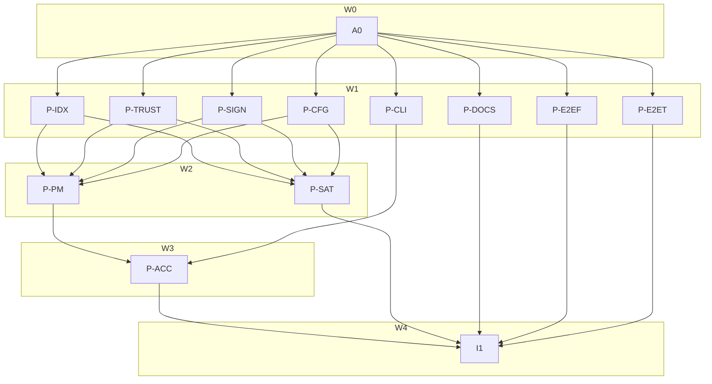

# Plan: Package signatures checked by the client, declared in a signed index (slice 1)

## Status

- **Plan:** plan_publisher_trust_client
- **State:** review
- **Tier:** xhigh
- **Tier-grammar:** 5
- **Updated:** 2026-11-13
- **Reviewed:** 1050da5b7..f829953ce (xhigh, Request Changes; fix pass 1 merged at a69d1b312)
- **Active phase:** I1 integration gate green — `task verify:scoped --force` run 10, exit 0, tip 45c7f5e03 (tree d9edf62f4)
- **Step:** /hex-execute complete — review fixes, security decisions and the cross-model fix merged
- **Feature branch:** `hex/release-signing-trust-default-2026-11-12`
- **Last update:** 2026-11-13 (/hex-execute, integration gate run 10 on 45c7f5e03)
- **Finalize:** /hex-finalize 2026-11-13 — release gate green: `task verify:scoped --force` run 10 (tree d9edf62f4), `task satellite:verify` exit 0, native Windows `cargo test --workspace` (7833 passed; 6 first-pass failures, none from this branch: 1 flake, 2 staging artifacts that pass once the docs tree is staged, 4 that need the Bazel-provided binary); recomposed to one commit; the pull request's ledger block carries the remote result
- **Re-finalize:** 2026-11-13 — the first push went red in CI on 3 `test_exit_codes.py` cases the scoped gate does not run and on the docs Lighthouse job; fixed, then gated again: `task verify:scoped --force` run 11 exit 0, whole acceptance suite `task test:parallel --force` 4076 passed, local `task ci:docs` 60 pages pass
- **Next:** merge the pull request (the human's step)

---

## Overview

**Design record:** [`adr_publisher_trust_distribution.md`](./adr_publisher_trust_distribution.md) (Accepted 2026-11-13 under goal-loop authority, decisions D-1…D-14) and [`system_design_publisher_trust.md`](./system_design_publisher_trust.md) (contracts C-001…C-020, scenarios S-001…S-015). This plan cites them and never re-decides them; § Decisions below holds only the plan-level calls (P-D-*).
**Source:** `.agents/discussions/release-signing-trust-default-2026-11-12.md` (handed off to the loop). **Goal file:** `.agents/goals/release-signing-trust-default-2026-11-12.md` (11 source criteria + 3 DONE-block criteria).
**Research:** [`research_fulcio_claim_oids.md`](./research_fulcio_claim_oids.md) (new, the Fulcio OID spike) plus the October set listed in the discussion § Research.

**Classification.** Scope large: 7 crates, acceptance suite, docs, one satellite (ocx-mirror), two fixture repositories. Reversibility one-way (high): index wire field `publishers`, config key `signatures`, `claims` on signers, four `error.detail` slugs, install now verifying by default. Tier `xhigh` (auto: protocol + security default change, the ADR was only Proposed). Overlays: `architect=on` (ADR amended this run), `research=1` (Fulcio spike), `adversary=on`.

**Model routing** (AGENTS.md policy). Every step `sonnet`; pipelines marked `hard` run sonnet at high effort. Review seat for `review`-marked pipelines: security `opus` (hex.md Preferences). `opus` for any other step only after it failed twice on sonnet. Every spawn sets `model`; never Fable.

## Objective

A package's index root lists `publishers`; ocx verifies the package signature against them on every fetch with no local configuration, ANDed with any operator `[[trust.policy]]`; `signatures` per registry turns it off or makes it mandatory; keyless entries can pin Fulcio claims by name or OID; `ocx package sbom` takes the newest verified SBOM. Proven red/green locally, and end-to-end against real GitHub-issued certificates from `ocx-sh/e2e-package` through `ocx-sh/e2e-index`.

## Scope

**In:** slice 1 per discussion § Decisions › Sequencing and the goal's § Definition of done; the ocx-mirror lockstep upgrade the ecosystem-tier changes force; the two fixture repositories' content (prepared locally).
**Out:** release signing of ocx / ocx-mirror / grimoire and backfill; production `ocx-sh/index`, `indexbot`, `catalog`; catalog signature, `expires`, `ocx index sign`, `[sigstore."<host>"]` (slice 4); a local full `task verify`; `CHANGELOG.md` (the commit subject is the changelog line, `feat!:`).

## Decisions (plan-level; design decisions are the ADR's D-1…D-14)

| ID | Question → evidence → decision |
|---|---|
| P-D-1 | **Where does the e2e runner workflow live?** C-019 put it in this repository. Evidence: GitHub only dispatches a `workflow_dispatch` workflow whose file exists on the default branch; this run may not write ocx `main`, and the branch file would 404 on dispatch. → The runner lives in `ocx-sh/e2e-index` as `.github/workflows/client-e2e.yml` (input `ocx_ref`), which checks out `ocx-sh/ocx` at that ref, builds `ocx` with cargo, and runs this repository's `test/e2e/` module. The test module and its marker stay in this repository (C-019 otherwise unchanged). Writing and dispatching in `e2e-index` is inside the goal's grants. |
| P-D-2 | **Where does the recorded real GitHub-Actions certificate for the C-008 unit test come from?** C-008 names an `e2e-package` certificate, which exists only after a meta-orchestrator publish (critical-path dependency on a remote act). Evidence: any public-Sigstore keyless signature made in GitHub Actions carries the same claim extensions and is readable from the public Rekor log. → P-SIGN records one leaf from public Rekor (a GitHub-Actions-signed public release, e.g. a `sigstore/cosign` release artifact) as `test/tests/fixtures/golden/github_actions_leaf.pem` with its expected claim values beside it; the `e2e-package` certificate is exercised by the e2e dispatch (C-019). If no public leaf can be fetched, the step falls back to synthesized certificates only and records that in the Schedule log; the e2e run then carries the real-certificate proof alone. |
| P-D-3 | **Is ocx-mirror affected?** Evidence: `ocx-mirror/crates/ocx_mirror_pipeline/src/registry_sync/index_write.rs` and its tests name `IndexRoot`; struct fields are added to `IndexRoot`, `KeylessMatcher`, `RegistryConfig`, `VerifyContext` (ecosystem-tier crates, AGENTS.md: consumer upgraded in the same series). The mirror also rewrites roots, so it could drop `publishers` on sync, which the discussion forbids for a pass-through. → Pipeline P-SAT upgrades the mirror in a local clone `.agents/worktrees/sat-ocx-mirror` on branch `hex/publisher-trust-lockstep` (local commits only), keeps `publishers` byte-preserved through `index_write`, and is gated by `task satellite:verify`. Pushing it is a meta-orchestrator step (M-9). |
| P-D-4 | **How is the `key` fixture's private key handled?** → Generated by P-E2EF under umask 077 in the session scratch directory, outside the repository (R-13), never committed or logged; only the public PEM enters `e2e-index` and the test expectations. The meta-orchestrator stores the private key as an `e2e-package` Actions secret (M-2) and deletes the local copy. |
| P-D-5 | **Which fixture values are known before publishing?** `source_repository_identifier` / `source_repository_owner_identifier` come from `gh api repos/ocx-sh/e2e-package` (read-only, done by P-E2EF), the workflow paths are chosen by P-E2EF, the key is P-D-4's. → the `publishers` values are fixed before any publish; the roots and dispatch objects carry digests and are generated after M-3 (R-11). |
| P-D-6 | **Open question `[[trust.policy]]` structure** → stays (ADR D-10). Closed. |
| P-D-8 | **Can the e2e run be evidenced before the feature branch is pushed?** (meta-orchestrator amendment, 2026-11-13) The branch reaches `ocx-sh/ocx` only inside the final /hex-finalize, but criterion "E2E fixtures exist and are exercised" must be evidenced before it. → `client-e2e.yml` takes two inputs, `ocx_repository` (default `ocx-sh/ocx`, validated `owner/name`) and `ocx_ref` (40-hex), and builds the client from that repository and ref with `submodules: recursive`; the meta-orchestrator first points it at a source ref mirrored into `ocx-sh/e2e-index`, then at the real branch. Amends P-D-1 and R-13. |
| P-D-9 | **Key file location** (P-D-4 said the session scratch directory, which can vanish mid-session) → `/home/mherwig/.ocx-e2e-secrets/` (mode 700, outside every repository); the meta-orchestrator deletes it after `gh secret set`. |
| P-D-10 | **Execution amendments accepted** (deviations reported by steps, judged by the review): `SignatureInvalid` maps to `publisher_mismatch` only when the round lists a key publisher (a wrong key is "signed by nobody listed"); with no usable trust root, keyless backends are dropped from a round that also lists a key (the outcome C-012 wants: the key candidate can pass, a keyless one cannot); a `.1.1`-only certificate refuses with the existing `IssuerMismatch` plus a warning naming `.1.8`; the `publisher_mismatch` hint names `ocx index update <repo>` unconditionally. Design C-008 amended. |
| P-D-11 | **`declared_publishers` shape** (fix D4: a declared `[]` and an empty intersection both read `Some([])`) → `DeclaredPublishers { Undeclared, Declared, Diverged }`; `[]` → 65, `Diverged` → 77 with its own message. Design C-003 amended. |
| P-D-12 | **S-016 root cause** — a locked `ocx exec` resolves the pin in `find`, whose routing write copied the source's `publishers` into the committed root before the install hook read it. → a routing pointer's first write does not adopt `publishers`; digest/lock requests read `committed_publishers`. Design C-002/C-003 amended. Residual (deferred): after a lock-first install, a later tag install whose tag is already committed reads the root as undeclared until `ocx index update`. |
| P-D-13 | **Origin gate bypass** (review security Block: `refs/origins/` is written by every fetch) → a separate `refs/verified/<repo>` marker written only after a passed publisher round; the `--no-pull` local probe is gated too. Design C-011 amended. |
| P-D-14 | **`signatures` lookup across spelling variants** (review security Block) → every matching entry is read; a system-locked one wins, else the strictest. |
| P-D-15 | **Interim bump rule vs owner decision** (`test_contract_version_bytes` demanded `errors` v2 for the four new slugs; owner decision in 681cc9f00 / ADR `adr_ocx_interface_contract.md` § 493 keeps `errors` at v1, edited in place, until the first baseline) → the lint's errors arm no longer demands an `$id` bump while no baseline exists; the const/major agreement check stays. `ocx package sbom` bumps its `cli.json` command version to 2. |
| P-D-16 | **`package verify <id>@digest`** uses the effective publisher list while an install of the same digest uses the committed list → kept: the explicit verify resolves first (R-10) and is deliberately at least as strict. Design C-016 amended. |
| P-D-17 | **Signature-mode rounds** (review: intersecting first-match reports by referrer digest broke S-007) → each round passes independently in signature mode; the per-document AND (R-5) applies to attestations and SBOM only. Rounds are an ordered `Vec<Round { kind, policies }>` owned by the library. |
| P-D-18 | **Released 0.6.6 cannot sign, attest or verify an image-index subject on GHCR** (M-3 run 43342280140: `SIGNABLE_MANIFEST_TYPES` lacks the index type and GHCR enforces Accept; the signed subject descriptor hard-codes the image media type) → fixture signs and verifies platform manifests only (`-p`; meta-orchestrator commit 898696d in e2e-package). Scope (meta-orchestrator ruling): no goal-criterion path fetches an index subject — auto-verify verifies the platform-selected leaf, `test/e2e` uses install and `--platform` — so the ocx defect is out of scope here and filed as a follow-up issue by the meta-orchestrator. |
| P-D-19 | **Why does `/docs/changelog/` score Lighthouse performance 0.99 against a ≥1 budget, on main (a536e92ff) as on this branch?** → Research (CI logs, local Lighthouse ×3): the newest releases in the generated CHANGELOG contain a non-Latin character, which makes the browser fetch the theme's `rest` font subset after layout; one extra round trip moves LCP from ~1.5 s to ~1.8 s. Preloading that subset alone restores 100 (3 of 3 runs, LCP ~1.5 s). → Decision: the changelog page preloads that font in its front matter (99b0ad4c0); the budget stays ≥1 and CHANGELOG.md stays untouched. A theme bump that renames the font file needs the href updated, which the gate reds on. |
| P-D-7 | **Contract wave holds the four error variants with their `Classify` rows and `detail_rows.txt` lines**, because every pipeline names them; the generated goldens (`errors.json`, sdkgen, config schema) and the contract ledger are hub files regenerated once at I1. |

### Review fixes (Round 1, plan-artifact scope; applied to the ADR, the design and this plan)

Each row: finding (seat) → evidence → decision. The ADR's D-list and the design's contracts were amended to match (§ Plan review record).

| ID | Decision |
|---|---|
| R-1 | **C-011's "skip when installed" is dropped** (security Block: the store keys content by digest, so content installed unverified under another name, by `pull_local` or by `--no-verify` would be linked unverified under a declared name; architect Warn: it also narrowed operator auto-verify, which the source never asked for). Today's behaviour stays: every `setup_impl` leader verifies. **New C-011 — origin gate on the find fast path:** `find`/`find_or_install` of a package whose root declares `publishers` treats the content as installed only when its `refs/origins/` holds a marker for that logical repository (written only on a genuine fetch, i.e. after the leader's check or an explicit `--no-verify`); otherwise it falls through to the pull, which verifies. Undeclared packages keep today's fast path. |
| R-2 | **C-003 fails closed:** an unreadable or unparsable committed root is an error, not `None` (security Block). |
| R-3 | **C-003 effective list** (security Warn D-11 + architect Warn D-11; replaces "removing never reaches a committed copy"): committed present and a root fetched by this process present → the element-wise intersection (JSON value equality); committed absent, fetched present → fetched (an index can only add a check to an undeclared package); fetched absent → committed (deleting the field never removes a check). An empty intersection refuses `publisher_mismatch` naming `ocx index update <pkg>`. Never widens the committed list; `merge_root` is unchanged. |
| R-4 | **`null` and every other present value are carried** (codex Block): `IndexRoot.publishers` deserializes through a presence-preserving `deserialize_with`, so `"publishers": null` is `Some(Value::Null)` → `Invalid` → 65; tested at install level. |
| R-5 | **Attestations: both rounds bind one document** (security + codex): a document is eligible only when it verifies in every applicable round (matched by referrer digest); newest-wins (C-017) runs over that eligible set. `tasks/attest.rs` and `tasks/sbom.rs` move into P-PM. |
| R-6 | **C-012 per candidate, not per round** (security Warn mixed lists; architect Warn newest-wins): `Transparency` becomes `Verify` / `VerifyIfRootAvailable`. A key candidate's tlog evidence is checked when a trust root is available with no network (override, home file, cache) and ignored otherwise (`signed_at = None`). The trust root is resolved lazily on the first keyless candidate; its unavailability fails that candidate only, and the round continues to the next candidate. Operator key-only policies keep tlog checks whenever the root is local. `signed_at` comes from a verified SET only (researcher). |
| R-7 | **C-012 also wired into `ocx package verify` and `ocx package sbom`** (architect Warn): P-CLI step. |
| R-8 | **Lock and digest installs on a home with no root for the package are undeclared** (security Warn; the owner's "ocx.lock makes no request" wins): they install as today with the INFO line, operator policy still applies, and `signatures = "required"` refuses 81 naming `ocx index update <pkg>`. New scenario **S-016** pins both. Recorded as a consequence in the ADR threat model. |
| R-9 | **Error layer** (architect Warn): `ocx_sign::VerifyErrorKind` gains nothing. The four refusals live in a new `ocx_package_manager::tasks::signer_rounds::RoundsError` (`#[derive(Classify)]`: `PublisherMismatch { source: VerifyErrorKind }` 77, `PublishersUnrecognized` 82, `PublishersInvalid` 65, `PublishersRequired` 81), so the `ocx index update` hint stays in the operations tier; `ocx_trust::PublishersRefusal` stays unclassified (the `TrustPolicyError` precedent). |
| R-10 | **`ocx package verify` / `sbom` resolve first, then read publishers, then verify** (codex Block): the resolve may commit or memo the root under today's rules, so a fresh home sees the declaration. With nothing covering (no flags, no policy, no publishers) the SBOM command keeps today's permissive mode (codex Warn; `package_sbom.rs` test at :867 stays green). |
| R-11 | **e2e index content is generated after publishing** (codex Block: roots carry digests): P-E2EF writes a generator `scripts/build_index.py` in the `e2e-index` clone plus the `publishers` values; worker step E2E-G (on the meta-orchestrator's request after M-3) runs it against the published tags and commits locally; then M-5. |
| R-12 | **`two-sboms` is signed by the pinned release workflow** (codex Block): `release.yml` takes a `case` input (`main`, `two-sboms`), so `build_signer_uri` matches the `claims` root. |
| R-13 | **Fixture and workflow hardening** (security Warn): key generated with umask 077 in the session scratch directory, never under the repository; the meta-orchestrator pipes it to `gh secret set` and deletes it; a passphrase, if the key format needs one, is a second secret; `gitleaks` over both clones before M-1/M-5. Workflows: top-level `permissions: {}`, job-level grants only, `key-sign.yml` without `id-token`; guard on `github.repository_id`; every action and `setup-ocx` pinned by SHA and the ocx version pinned; `client-e2e.yml` accepts only a 40-hex `ocx_ref`, `persist-credentials: false`, `submodules: recursive`, no secrets, pytest with `working-directory: test`. GHCR: `release.yml` runs first, then the package is linked to the repository, given Actions access and made public, then the other cases run (researcher). |
| R-14 | **Smaller fixes:** canonical decimal OID arcs only (no leading zeros, u32, no sub-arcs), non-minimal DER and non-UTF8String tags are non-matches; exactly-once applies to `.1.8` and the SAN too; a certificate with only `.1.1` is refused with a message naming `.1.8`; remote `identity_regexp` compiled with a 64 KiB size limit; `key_pem` of an unsupported key type → `Unrecognised`, malformed → `Invalid`; a `key` field is `Invalid` and checked before the unknown-field rule; `[registries]` keys are normalised like registry identifiers before the `signatures` lookup; `SignatureRequirement::Unknown` is skipped in the JSON schema; the `signatures` values are snake_case (`if_declared`) per IC-06 — the discussion's spellings were working names (goal § Emphasis). Docs pair `build_signer_uri` with `source_repository_identifier` and mention `build_signer_digest` (reusable workflows). ADR notes: Rekor v2 (no integrated time) is a known limit of newest-wins; slice 3's ingest parser must apply the same duplicate-key rule as `serde_json`; T7 wording corrected. |

## Component contracts

Owned by the system design § 4; IDs are the coverage join keys. One line each:

- **C-001** `IndexRoot.publishers: Option<serde_json::Value>`, presence-preserving (`null` is `Some`), never fails the root parse (R-4).
- **C-002** `merge_root` unchanged; four characterisation tests pin `publishers` across scopes.
- **C-003** `Index::declared_publishers` — the effective list of R-3 (committed ∩ fetched, adopt on absent→present, keep on fetched-absent); unreadable committed root → error (R-2); zero requests.
- **C-004** `ocx_trust::parse_publishers` — per-entry Usable / Unrecognised / Invalid, the design's table.
- **C-005** `PublisherSet::compile` — ANY-of policy, or `Unrecognised` / `Invalid` refusal.
- **C-006** claim-key vocabulary — names `.1.8`–`.1.24`, raw OIDs on the Fulcio arc, Raw ≤ 6, Der ≥ 8.
- **C-007** operator keyless signers gain `claims`; bad claim key → 78 `trust_policy_invalid`.
- **C-008** claims match in `verify::identity` — every claim, exactly-once extension, byte-exact.
- **C-009** `[registries."<registry>"] signatures = "if_declared" | "required" | "off"`; unknown → `required` + one WARN.
- **C-010** `signer_rounds` decision; `AutoVerify` always constructed.
- **C-011** origin gate on the find fast path for declared packages; every leader pull verifies, as today (R-1).
- **C-012** per-candidate transparency: key candidates need no network, tlog checked when a root is local; trust root resolved lazily on the first keyless candidate (R-6, R-7).
- **C-013** publisher-round mismatch kinds → `PublisherMismatch`.
- **C-014** four new rows in `RoundsError` (R-9): 77 `publisher_mismatch`, 82 `publishers_unrecognized`, 65 `publishers_invalid`, 81 `publishers_required`.
- **C-015** `--no-verify` / `OCX_NO_VERIFY` skip both rounds and refusals, today's one warning.
- **C-016** `ocx package verify` (both modes) and `ocx package sbom`: resolve, then publishers, then rounds unless signer flags are given; both rounds bind the same document; uncovered SBOM stays permissive (R-5, R-10).
- **C-017** newest verified attestation by SET-verified tlog time wins over the eligible set; unlogged candidate or tie → 65.
- **C-018** previous ocx release installs a package whose root carries `publishers`; undeclared packages unchanged.
- **C-019** e2e fixtures and the dispatched client run (location amended by P-D-1).
- **C-020** docs: `reference/configuration.md`, the index-format reference, error-detail pages.

## User-experience scenarios

S-001…S-016 as the system design § 5 (install pass, wrong signer 77, unsigned 79, undeclared + `required` 81, unrecognised 82 / invalid 65, key without network, publishers AND operator policy, `off`, `--no-verify`, no-request paths, newest SBOM, attestation by another signer, previous release, rotation, unknown setting value, and S-016: fresh home + `ocx.lock` pinning a declared package installs undeclared with INFO, and refuses 81 under `required`). S-017 (R-1): content installed via an undeclared repository at digest D, then a declared package whose tag resolves to D is run with `ocx exec` → it is verified (77 when signed by nobody listed).

## Error taxonomy

No new exit code. Four new slugs (C-014) on `ocx_package_manager`'s `RoundsError` (R-9); `ocx_sign::VerifyErrorKind` is unchanged; existing slugs reused for everything else (C-013 pass-through list). The compat gate decides which ledger entries the additions need (I1).

## Hub files (no pipeline owns them; regenerated once at I1)

`crates/ocx_schema/tests/golden/errors.json`, `crates/ocx_schema/tests/golden/config.json`, the `ocx_sdkgen` goldens, `crates/ocx_schema/contract/ledger.toml`, `test/SUITE_FLOOR`, `test/SKIP_CEILING`, `scripts/bazel_gate_proofs.py` module counts, `Cargo.lock`, `MODULE.bazel.lock`, generated reference pages (if `configuration.md` sections are rendered from the schema, the generator runs here and P-DOCS edits only hand-written prose).

## Contract wave (A0)

One commit, one step, before any pipeline. Gate: `cargo check --workspace --all-targets --locked` (compile only — the contract tests are meant to fail until their pipeline lands, so `verify:scoped`, which runs unit tests, is not the A0 gate); commit `--no-verify`. Bodies `unimplemented!()`; contract tests named after the C-IDs exist and fail against the stubs. C-003, C-007, C-011, C-012 get their red tests inside their pipeline's first step instead (Specify inside the step).

- `ocx_index`: `IndexRoot.publishers` field with its presence-preserving deserializer (real, small); `Index::declared_publishers` stub.
- `ocx_trust`: modules `claims` (`ClaimEncoding`, `ClaimSelector`, `ClaimKeyError`, `resolve_claim_key`, `CompiledClaim`) and `publishers` (`PublisherEntry`, `PublisherSet`, `PublishersRefusal`, `parse_publishers`, `compile`); `KeylessMatcher.claims`; `CompiledKeyless.claims` + optional identity rule, with the mechanical caller change at `ocx_sign/src/verify/identity.rs` (`.matches()` on an `Option`).
- `ocx_sign`: `Transparency { Verify, VerifyIfRootAvailable }` + `VerifyContext.transparency` (every existing constructor passes `Transparency::Verify`, behaviour unchanged).
- `ocx_config`: `SignatureRequirement` (with `#[serde(other)] Unknown`, schema-skipped), `RegistryConfig.signatures`, `Config::signature_requirement` stub.
- `ocx_package_manager`: `tasks::signer_rounds` module (`SignerRounds`, `RoundsDecision`, `SignerRoundsInput`, `signer_rounds` stub) and `RoundsError` with its four `#[exit(...)]` variants, summaries and `detail_rows.txt` lines (P-D-7, R-9).
- Contract tests (fail on stubs): one per C-001, C-004, C-005, C-006, C-008, C-009, C-010, C-017 at the unit seam the design names.

Files: `crates/ocx_index/src/{wire.rs,lib.rs}`, `crates/ocx_trust/src/{lib.rs,claims.rs,publishers.rs}`, `crates/ocx_sign/src/verify/{identity.rs,pipeline.rs}` + every `VerifyContext` construction site (grep), `crates/ocx_cli/src/exit/detail_rows.txt` (+ the classifier registry list if `RoundsError` is a new classified type), `crates/ocx_config/src/registry.rs`, `crates/ocx_config/src/lib.rs`, `crates/ocx_package_manager/src/tasks/{mod.rs,signer_rounds.rs}`.

## Parallelization

| Pipeline | Scope | Expected files | Wave | Depends on | Marks | Status |
|---|---|---|---|---|---|---|
| A0 | contract wave (all C stubs) | as § Contract wave | 0 | — | | merged |
| P-IDX | C-001, C-002, C-003 | `crates/ocx_index/src/{wire.rs,lib.rs,ocx_index.rs,local_index.rs,store.rs}`, `crates/ocx_index/tests/index_wire_conformance.rs` + fixture | 1 | A0 | | merged |
| P-TRUST | C-004, C-005, C-006, C-007 | `crates/ocx_trust/src/{lib.rs,claims.rs,publishers.rs}` | 1 | A0 | review | merged |
| P-SIGN | C-008, C-012 (pipeline) | `crates/ocx_sign/src/verify/{identity.rs,pipeline.rs,trust_resolve.rs}`, `test/tests/fixtures/golden/github_actions_leaf.*` | 1 | A0 | hard, review | merged |
| P-CFG | C-009 | `crates/ocx_config/src/{registry.rs,lib.rs}` | 1 | A0 | | merged |
| P-CLI | C-010 (context), C-012 (commands), C-015 (help), C-016, C-017 | `crates/ocx_cli/src/app/context.rs`, `crates/ocx_cli/src/conventions.rs`, `crates/ocx_cli/src/command/{package_verify.rs,package_sbom.rs,package_sign_common.rs}`, `crates/ocx_cli/src/options/verify.rs` | 1 | A0 | | merged |
| P-DOCS | C-020 | `website/src/content/docs/reference/configuration.md`, the index-format reference page, error-detail pages, `website/src/content/docs/explanation/signing.mdx` (only where it states verification is opt-in) | 1 | A0 | | merged |
| P-E2EF | C-019 fixture repos (local clones) | `.agents/worktrees/e2e-package/**`, `.agents/worktrees/e2e-index/**`; key material in the session scratch directory (R-13) | 1 | A0 | | merged |
| P-E2ET | C-019 client test module | `test/e2e/**`, `test/pyproject.toml` (marker `e2e_public` only) | 1 | A0 | | merged |
| P-PM | C-010, C-011, C-012 (wiring), C-013, C-014, C-015, C-016/C-017 (per-document AND) | `crates/ocx_package_manager/src/tasks/{signer_rounds.rs,auto_verify.rs,pull.rs,find.rs,find_or_install.rs,verify.rs,attest.rs,sbom.rs}` | 2 | P-IDX, P-TRUST, P-SIGN, P-CFG | hard, review | merged |
| P-SAT | ocx-mirror lockstep (P-D-3) | `.agents/worktrees/sat-ocx-mirror/**` (satellite clone) | 2 | P-IDX, P-TRUST, P-CFG, P-SIGN | | merged |
| P-ACC | S-001…S-017 acceptance, C-011, C-014, C-018 | `test/tests/test_publisher_trust.py`, `test/tests/test_publisher_trust_previous.py`, `test/tests/test_auto_verify.py`, `test/tests/test_sbom.py`, `test/src/static_index.py`, `test/BUILD.bazel` (`module_data` rows) | 3 | P-PM, P-CLI | | merged |
| I1 | integration gate (meta) | hub files | 4 | all | | pending |

Waves are derived; launch on dependency-ready. **Critical path:** A0 → P-SIGN → P-PM → P-ACC → I1. **Shippable after wave 3:** the whole client slice locally (install/pull/exec verify against `publishers`, `signatures`, claims, SBOM newest-wins), proven by unit + local acceptance; the e2e proof needs the meta-orchestrator steps M-1…M-8.

**Width justification.** P-ACC is not started earlier: acceptance tests need the real rounds to go green, and a test-only pipeline cannot finish green before P-PM merges. P-CLI's command wiring compiles against the A0 `signer_rounds` stub and is proven in P-ACC.

## Steps

Each step: Stub (already in A0) → Specify (tests from the contract, red) → Implement (green) inside the step; commit `--no-verify`; run the narrowest test the step touched (`bazel test` / `cargo nextest` on the crate, or `task test:parallel --force -- <file>` for acceptance), never a full `task verify`. Every check is shown red on the failing input and green on the passing one.

### A0 — contract wave
1. Write every stub and contract test in § Contract wave; gate `cargo check --workspace --all-targets --locked`; commit `chore(trust): contract stubs for index-declared publishers`.

### P-IDX
1. C-001: presence-preserving deserializer; unit tests over the six shapes (absent, array, object, string, number, `null` → `Some(Null)`); the conformance fixture (`full-fields.json`) gains the field and round-trips raw.
2. C-002: four characterisation tests in `local_index.rs` (first sight carries, `Package` overwrites, `Tags`/`Routing` leave, absent never removes) — green before any change; if one is red, stop and report (R-3 rests on it).
3. C-003: `declared_publishers` with the R-3 effective list (intersection, adopt on absent→present, keep on fetched-absent) and R-2 (unreadable committed root → error); derived source → `None`; unit with a transport stub asserting zero calls, one test per R-3 row and one corrupt-root refusal.

### P-TRUST
1. C-006: `claims.rs` table and `resolve_claim_key` from `research_fulcio_claim_oids.md` with R-14's canonical-arc rule; unit over every row, N = 1, 6, 7, 8, 24, 99, a foreign arc, a leading zero, a sub-arc, an unknown name.
2. C-004 + C-005: `publishers.rs` parse and compile; table-driven test, one row per design table line (R-14 ordering: `key` field → `Invalid` before the unknown-field rule; unsupported key type → `Unrecognised`; 64 KiB regex limit) plus a mixed list; never reads a file.
3. C-007: `claims` on operator `KeylessMatcher`, `compile_keyless_matcher` rule (issuer + one of identity / identity_regexp / non-empty claims), bad claim key → `TrustPolicyError` → 78; a test pins that unknown operator fields stay tolerated.

### P-SIGN
1. P-D-2: fetch one GitHub-Actions Fulcio leaf from public Rekor, store PEM + expected claims (`.1.8`, `.1.9`, `.1.10`, `.1.15`, `.1.17`, `.1.20`, and whether `.1.23`/`.1.24` are present) as a golden fixture with the source entry UUID in a sidecar.
2. C-008: claim extraction + match in `identity.rs` (exactly-once for claims, `.1.8` and the SAN; Raw/Der decode; non-minimal DER and wrong tag non-match; byte-exact; absent never matches; `.1.1`-only certificate refused with a message naming `.1.8`). Tests build `CompiledClaim` literals directly — never through `resolve_claim_key`, so this step needs nothing from P-TRUST. Synthesized-certificate tests one red + one green per rule; the recorded leaf matched for repository ID and owner ID, rejected on a changed `build_signer_uri`.
3. C-012 (pipeline): `Transparency::VerifyIfRootAvailable` per candidate — key candidates verify with no network, tlog checked only when a local root exists, `signed_at` only from a verified SET; trust root resolved lazily on the first keyless candidate, its unavailability fails that candidate only. Unit: a key candidate with an unreachable Rekor URL and no cache passes; a mixed set offline with no cache still accepts the key candidate; a logged key candidate with a local root gets `signed_at`.

### P-CFG
1. C-009: `signatures` parse (snake_case values), Some-wins merge, system lock, registry-key normalisation (R-14), `signature_requirement(registry)`, `Unknown` → `Required` with one WARN per process, `Unknown` absent from the generated schema; unit per case.

### P-CLI
1. C-010 (context half): `build_auto_verify` always returns an `AutoVerify` (unit test: no policies → `Some`); `manager_with_verify_flag` no longer short-circuits; `options/verify.rs` long help says index `publishers` and operator policy both apply (`quality-cli-help.md`).
2. C-017: newest-wins selection in `package_sbom.rs`'s `single_document` over the eligible set; three unit cases (strictly newest, unlogged candidate refuses 65, tie refuses 65).
3. C-016 + C-012 (commands): `package_verify` / `package_sbom` / `package_sign_common` resolve first, then call `signer_rounds` when no signer flag is given (R-10), skip trust-root resolution for key-only rounds; uncovered SBOM keeps permissive mode (the `package_sbom.rs` test near :867 stays green). Behaviour proven in P-ACC.

### P-DOCS
1. C-020: `configuration.md` sections `registries.<name>.signatures` and `trust.policy.signers.claims` (check `crates/ocx_schema/src/docs/render.rs` first: generated parts are regenerated at I1, prose goes beside them); the index-format reference gains `publishers` with the entry rules and an entry shape, and a claims example pairing `build_signer_uri` with `source_repository_identifier` (R-14); error-detail entries for the four slugs. No migration prose. Run the docs tasks `task --list` names for the website (lint + build) on the touched pages and report which ran.

### P-E2EF (local only; no push, no settings, no dispatch)
1. Clone `ocx-sh/e2e-package` and `ocx-sh/e2e-index` into `.agents/worktrees/`; read the repository and owner IDs with `gh api repos/ocx-sh/e2e-package`; generate the `key` fixture keypair per P-D-4 / R-13.
2. `e2e-package`: a cargo Rust program with one dependency; workflows: `release.yml` (`workflow_dispatch` from `main`, input `case` = `main` | `two-sboms`: build, `ocx package push` to `ghcr.io/ocx-sh/e2e-package:<case>`, keyless sign, CycloneDX SBOM attest once or twice minutes apart, self-verify against the exact identity), `release-tag.yml` (tag push → `:tag`), `other-signer.yml` (dispatch → `:other` + SBOM by itself), `key-sign.yml` (dispatch → `:key`, signed with the secret key, no `id-token`), `unsigned.yml` (dispatch → `:unsigned`). Hardening per R-13.
3. `e2e-index`: the generator `scripts/build_index.py` (reads the published tags and digests, writes `c/index.json`, `p/e2e/*.json`, dispatch objects for roots `claims`, `oid`, `tagged`, `none`, `future` per C-019 with the fixed `publishers` values, `repository` = `oci://ghcr.io/ocx-sh/e2e-package`), Pages config, and `.github/workflows/client-e2e.yml` per P-D-1 / R-13. Run `gitleaks` over both clones; commit locally in each; report the clone paths and HEAD SHAs.

### P-E2ET
1. `test/e2e/test_publisher_trust_public.py` (+ conftest): pointed at the built binary and `[registries."e2e.ocx.sh"] index = "https://ocx-sh.github.io/e2e-index"`; the C-019 expectation matrix (claims/oid → main pass, key pass, tag/other 77, unsigned 79, tagged → tag pass, none → pass and 81 under `required`, future → 82, two-sboms → newer SBOM); marker `e2e_public` registered and excluded from `task test` and the Bazel targets. Run `task test:lint:structure` and report that it passes with `test/e2e/` present.

### P-PM
1. C-010 + C-014: implement `signer_rounds` (requirement → declared → parse/compile or refusal → operator tier → Uncovered) and `RoundsError`; unit over the ADR check table, one row per case, each refusal asserting its exit code and slug.
2. C-013 + C-015: in `maybe_auto_verify`, coverage → opt-out (one WARN, unchanged text) → publisher round with the mismatch remap → operator round; unit per mapped kind, one pass-through, and the opt-out over a `Refused` decision.
3. C-011: the origin gate in `find` / `find_or_install` for declared packages (R-1); unit with a store fixture: content without the logical repository's origin marker falls through to the pull.
4. C-012 wiring: per-round trust-root laziness and `Transparency::VerifyIfRootAvailable` in `auto_verify.rs`; `StubTransport` tests — key-only with no trust root passes, keyless resolves once per batch; the existing one-candidate test stays green.
5. C-016/C-017 library half: `tasks/attest.rs` / `tasks/sbom.rs` take both rounds and return only documents verified in each (R-5); unit with publisher-signed A beside operator-signed B → neither alone is eligible.

### P-SAT (satellite clone, local commits only)
1. `git clone /home/mherwig/dev/ocx-mirror .agents/worktrees/sat-ocx-mirror`, branch `hex/publisher-trust-lockstep`; build it against this branch's merged tree the way `task satellite:verify` does (`OCX_MIRROR_DIR`); fix struct-literal breaks; make `index_write` preserve `publishers` byte-for-byte (test in `index_write/tests/rewrite.rs`); run `task satellite:verify` (and `satellite:contract` if Docker is up); report the clone HEAD SHA.

### P-ACC
1. `static_index.py`: `publishers` keyword on `write_package` (absent by default — fixtures under `ocx.sh` must not start verifying).
2. `test_publisher_trust.py` (local Sigstore stack, keyless `identity` entries and a `key` entry): S-001…S-010, S-014…S-017, plus `publishers: null` → 65 (R-4); S-010 counts index and registry requests on the static index server.
3. `test_sbom.py` / `test_auto_verify.py`: S-011 (two SBOMs at different times → newer), S-012 (attestation by another signer → 77 `publisher_mismatch`), publisher-signed A beside operator-signed B (R-5); existing `test_auto_verify.py` cases stay green, including `:170`'s warning assertion.
4. `test_publisher_trust_previous.py` (C-018, S-013): `ocx-previous` installs a package whose root carries a usable and an unrecognised entry; `test/BUILD.bazel` `module_data` / `_PROJECT_TOOLCHAIN` rows as needed; `bazel_tag_guard` hand-read entries if it reds.

### I1 — integration gate (orchestrator)
1. Regenerate hub files (§ Hub files) once; run the compat gate and add ledger entries for what it reports; bump `SUITE_FLOOR` / module counts.
2. `task verify:scoped --force` over the series; `task satellite:verify`; `task claude:tests` only if `.claude/` changed beyond artifacts; then `task verify:mark` (no local full `task verify`). Concurrent with `/hex-review` of the branch.

## Meta-orchestrator steps (remote and other-repo acts; workers never take them)

In order; each names its evidence for the goal file.

| # | Act | Needs | Evidence |
|---|---|---|---|
| M-1 | Push `.agents/worktrees/e2e-package` to `ocx-sh/e2e-package` `main` (after gitleaks) | P-E2EF merged | commit URL |
| M-2 | Set `e2e-package` secret(s) from the scratch key file via `gh secret set` (stdin), delete the file; Actions workflow permissions allow the job-level `id-token` / `packages` grants | M-1 | settings confirmed (no value in any log) |
| M-3 | Dispatch `release.yml` (`case=main`) first; then link the GHCR package to the repository, grant Actions access, make it public (irreversible — confirm the org allows public packages); then dispatch `release.yml` (`case=two-sboms`), `other-signer.yml`, `key-sign.yml`, `unsigned.yml`, and push tag `v0.1.0` for `release-tag.yml` | M-2 | run URLs + conclusions; tags list of `ghcr.io/ocx-sh/e2e-package` |
| M-4 | Have a worker run `scripts/build_index.py` in the `e2e-index` clone against the published tags (local, read-only registry reads) and commit; cross-check the `main` certificate's claims with a read-only `ocx package verify` from the branch build | M-3 | generated index commit SHA, verify output |
| M-5 | Push `.agents/worktrees/e2e-index` to `ocx-sh/e2e-index` `main` (after gitleaks); enable GitHub Pages | M-4 | Pages URL serving `c/index.json` |
| M-6 | Push this branch to `origin` (via `/hex-finalize` or directly) so `ocx_ref` is fetchable | I1 green | branch SHA |
| M-7 | Dispatch `client-e2e.yml` in `e2e-index` with `ocx_ref=<branch SHA>`; watch | M-5, M-6 | run URL + conclusion (goal criterion "E2E fixtures exist and are exercised") |
| M-8 | Open the PR (not draft); CI per job; deep-verify evidence is the remote readiness run / CI's sharded gate | M-6 | PR URL, check runs |
| M-9 | ocx-mirror lockstep: push `hex/publisher-trust-lockstep` from the satellite clone and open its PR — **outside the goal's grants** (see Deferred) | P-SAT | — |

## Review and loop budget

`/hex-execute` default review: one integration review after I1; `review`-marked pipelines (P-TRUST, P-SIGN, P-PM) each get the security seat (`opus`) before merge. Cross-model code-diff pass once on the integrated diff (`codex:rescue`, terra/default per memory). Goal refinement rounds: 2.

## Traceability — goal criteria

| Goal criterion | Satisfied by |
|---|---|
| Index entry declares publishers | C-001, C-004, C-005 — P-IDX/1, P-TRUST/2; S-005 in P-ACC/2 |
| Client verifies against publishers | C-003, C-010, C-011, C-013, C-014 — P-IDX/3, P-PM/1–3, P-CLI/1; S-001…S-003, S-010, S-016, S-017 in P-ACC/2 |
| Per-registry signatures setting | C-009, C-010 — P-CFG/1, P-PM/1; S-004, S-008, S-015 in P-ACC/2; docs P-DOCS/1 |
| Generic claims match on keyless | C-006, C-007, C-008 — P-TRUST/1,3, P-SIGN/1–2; e2e claims/oid cases P-E2ET/1 + M-7 |
| Key publisher needs no Sigstore network | C-012 — P-SIGN/3, P-PM/4, P-CLI/3; S-006 in P-ACC/2 |
| Publishers and trust.policy both pass | C-010 — P-PM/1–2; S-007 in P-ACC/2 |
| --no-verify skips the check | C-015 — P-PM/2, P-CLI/1; S-009 in P-ACC/2 |
| SBOM: publishers apply, newest wins | C-016, C-017 — P-CLI/2–3, P-PM/5; S-011, S-012 in P-ACC/3; e2e two-sboms |
| Previous ocx release still installs | C-018 — P-ACC/4 (S-013); P-SAT keeps mirrors passing `publishers` through |
| E2E fixtures exist and are exercised | C-019 — P-E2EF, P-E2ET, M-1…M-7 |
| ADR, design and reference amended | ADR + design amended this run (committed with this plan); `configuration.md` C-020 — P-DOCS/1 |
| PR merge-ready / CI green / deep verify (DONE block) | M-8 PR URL; CI check runs on the head SHA; deep verify = the remote readiness run / CI's sharded `task verify` (no local full verify) |

Coverage check (re-run after the fixes): every C-001…C-020 and S-001…S-017 appears in at least one Scope cell and one test step above; C-014 is in P-PM's Scope and tested in P-PM/1 and P-ACC/2.

## Constitution deviations

`arch-principles.md` checked: no new crate, no new crate edge (ADR D-1); library hosts substance (`signer_rounds` in `ocx_package_manager`), CLI stays thin. Principle "Offline-first" holds — no index request is added (C-003, D-5); the error refusals stay in the operations tier, not in the ecosystem `ocx_sign` (R-9). None.

## Open questions

None. `[[trust.policy]]` structure closed (P-D-6).

## Deferred to meta-orchestrator

- **M-9 needs a grant the goal does not hold**: pushing the ocx-mirror lockstep branch and opening its PR acts on `ocx-sh/ocx-mirror`, which the goal's grants (e2e repositories only) do not cover, while AGENTS.md requires the consumer upgrade in the same change series. Research cannot settle a grant.
- **Contract baseline rotation pending** (pre-existing on every commit after v0.6.6): `test/lint/test_contract_baseline.py` reds "run `task contract:rotate TAG=v0.6.6`"; ADR `adr_ocx_interface_contract.md` § Baseline rotation makes each rotation an owner/release act that no feature branch performs. CI's structure-lint tier will be red on this branch until it lands on main.
- **Review security items, decided by the meta-orchestrator (2026-11-13, class only):** (1) `--no-verify` against a system-locked `signatures = "required"` — no change; `--no-verify` stays the opt-out for every signature check, as 0.6.6 does for a locked `[[trust.policy]]`; carried to the owner as one policy question for both locks. (2) a remote claims-only keyless entry pinning no repository/owner claim — no client change; an authoring rule for the later slice's index gate, carried to the owner. (3) `index update`/`sync` replacing a committed non-empty `publishers` — one WARN per changed package (fc38872af). (4) lock-first install in a fresh home — accepted per ADR D-5, line stays INFO; the reference names `signatures = "required"` for CI (8dc0aad80). (5) an unparseable committed root blocking `--no-verify` — the opt-out passes that one error only (d88fd0a87, 3b855adc2). Cross-model addendum: a failed pre-rounds resolve in `package verify`/`package sbom` now refuses instead of reading no publishers (b5148f93d).

## Plan review record

Round 1, 2026-11-13, one round, plan-artifact scope, on the plan + the amended ADR and design.

- Panel: spec reviewer (sonnet) — 0 Block, 7 Warn, 3 Suggest; security (opus) — 2 Block, 6 Warn, 5 Suggest; architect (opus) — 0 Block, 6 Warn, 4 Suggest; researcher (sonnet) — 0 Block, 3 Warn, 4 Suggest; cross-model `codex:rescue` (ran, default model) — 5 Block, 3 Warn.
- Triage: every Block and Warn was actionable and is applied (R-1…R-14 above, the A0 gate, the P-PM split, the C-014 tests, the P-SAT wave). The three findings the seats marked "owner decision" (C-011 operator narrowing, D-11 stale list, D-11 adoption) were settled by evidence and the source's own requirements (R-1, R-3); none is deferred.
- Not taken: warning on a `[registries]` key that matches no registry (the set of registries is open; normalisation instead, R-14); the PyPI / npm prior-art citations (unverified by the researcher, not load-bearing).
- Re-validation: the mechanical coverage check was re-run on the fixed plan (above).

## Schedule log

- 2026-11-13 A0 d6a64e418. W1 merges: P-IDX a0f098e37, P-TRUST f968d6d0f, P-SIGN 0553d9cd0, P-CFG d44bc08ba, P-CLI e683169db, P-DOCS 28641395e, P-E2ET c07ab1e48 (P-E2EF: clones only, e2e-package 44ace66, e2e-index dd02e05). W2: P-PM 725d73e62, E2ET follow-up debd3769c, P-SAT (satellite clone a0d324a, no mirror change; `satellite:verify` green before and after). W3: P-ACC 58382fe42, origin-marker follow-up cdbee6deb. Acceptance defects D1–D7 fixed: fix A 2e5d044da, fix B 1d31d62ad. Hub regen 71622aa9e, comment cleanup 785629a94/c6602cacf, lint fixes ceaaa4975/02b4c5eb2.
- 2026-11-13 I1 run 1: `task verify:scoped --force` routed acceptance to test_publisher_trust/_previous/test_sbom — 68 passed, 2 failed (S-016). Review xhigh: Request Changes (security Blocks P-D-13, P-D-14; docs Block; codex absent — usage limit). Fix pass 1 (f1 config, f2a gate, f2b rounds, f3 tests, f4 docs, f5 tests) merged a69d1b312; hub regen 65bc105a5.
