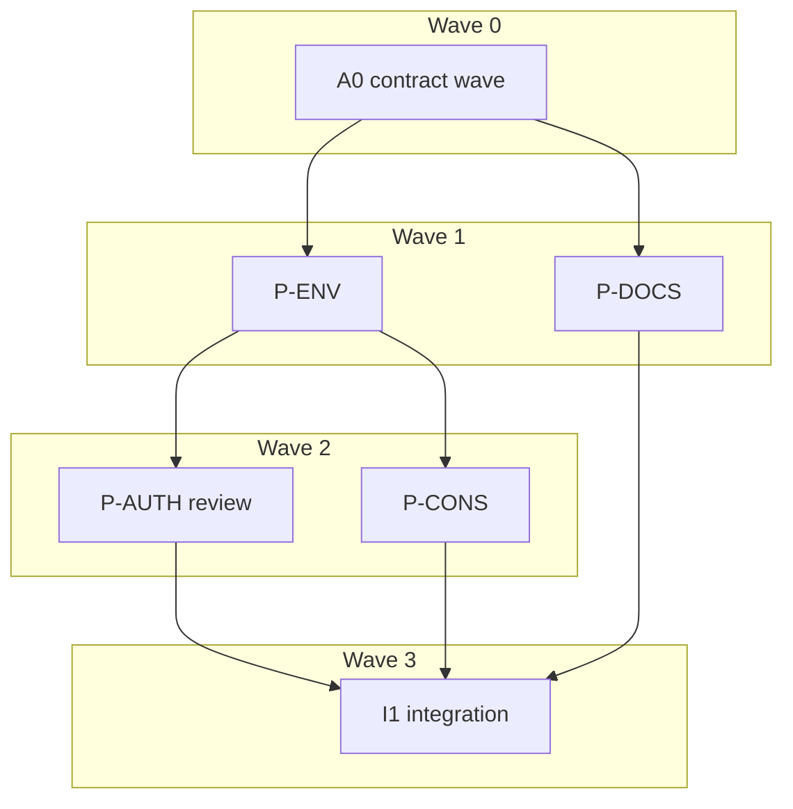

# Plan: secrets from a file or another variable

## Status

- **Plan:** plan_secret_references
- **State:** review
- **Tier:** high
- **Tier-grammar:** 5
- **Active phase:** 5 — handoff (review call 1 converged after inner round 2; integration gate run 4)
- **Step:** /hex-execute → handoff
- **Feature branch:** `hex/auth-token-file`; pipelines on `hex/auth-token-file--<pipeline>`
- **Last update:** 2026-11-23 (after 242abbe4: review round 2 converged; item-2 Warn closed by evidence)
- **Open at approval:** none; the six docket questions are decided in § Docket, under goal-loop authority
- **Next:** /hex-finalize

---

## Overview

Resolves [ocx-sh/ocx#756](https://github.com/ocx-sh/ocx/issues/756). Classification: **feature**
(`workflow-feature.md`), scope medium, reversibility two-way door. No ADR: the owner closed the design in
the discussion (`.agents/discussions/auth-token-file.md` § Decisions), and nothing here changes the
credential key or the helper protocol. This plan designs inline and does not reopen those decisions.

**What ships.** Every OCX-owned secret variable, plus the user half of a credential pair, accepts one of four
value forms: a literal, `file://<path>`, `env://<NAME>` or `plain://<text>`. The value is resolved in one
step inside `ocx_env`, at the seam every secret already reads through. A reference that cannot be resolved
is a hard error with its own classification. For a registry credential it never becomes the
warning-plus-anonymous fallback.

**Interface change.** A literal secret that begins with one of the three prefixes changes meaning. That is a
semantic change to public `OCX_*` variables (IC-16); see § Docket D-Q2 for how it is recorded.

Research cited (copied from `.agents/research/`):
[`research_auth_token_file_codebase_recon.md`](./research_auth_token_file_codebase_recon.md),
[`research_auth_token_file_prior_art.md`](./research_auth_token_file_prior_art.md),
[`research_auth_token_file_value_reference_vs_suffix.md`](./research_auth_token_file_value_reference_vs_suffix.md).
Research ran in the discussion; this plan runs none (research=skip).

## Decisions

Owner decisions are the discussion's § Decisions and are not repeated here. These are the plan's own
design decisions, each a two-way door.

- **D-1 Resolution is a property of the declaration, not of a caller.** `EnvVar` gains
  `accepts_reference: bool`. The `env_vars!` macro sets it to `secret && visibility == Public` with no
  attribute, so a secret declared later gets the rule for free (goal criterion 2). A non-secret declaration
  opts in with a new `reference` attribute. Foreign secrets (`CI_JOB_TOKEN`, `SIGSTORE_ID_TOKEN`,
  `OTEL_EXPORTER_OTLP_HEADERS` and the rest) are never reference-capable.
- **D-2 The read returns `Result`.** `SecretVar::get` and `get_slot` change from `Option<Sensitive>` to
  `Result<Option<Sensitive>, ReferenceError>`. The compiler then forces every caller, in this repo and in
  ocx-mirror, to decide what an unresolvable reference does. No caller can forget, which is the security
  point. See § Trade-offs for the alternatives.
- **D-3 Opted-in non-secrets get their own type.** The macro emits `ReferenceVar` for a non-secret
  declaration with `reference`. Its readers return `Result<Option<String>, ReferenceError>`. The value is a
  plain `String`, so a username still prints in diagnostics. The plain `EnvVar` readers (`get`, `get_os`,
  `get_raw`, `get_slot`) answer `None` for any declaration with `accepts_reference`, exactly as they
  already do for `secret`. That way `.declaration().get_slot(..)` cannot bypass resolution.
- **D-4 Presence without resolution.** `SecretVar::is_set()` and `ReferenceVar::is_set()` report whether
  the raw value is non-empty, reading no file. The telemetry presence checks use it, so asking "is a header
  variable set" never opens a file.
- **D-5 The error type lives in `ocx_env`.** `ReferenceError` derives `ocx_exit::Classify`, as
  `InvalidEnv` already does. That adds no crate edge (`ocx_env` → `ocx_exit` exists) and no crate.
  `ocx_env` stays std plus `ocx_exit` (plus its existing optional `tempfile` under `__testing`): no
  `thiserror`, so `Display` and `Error::source` are written by hand, as for `InvalidEnv`.
- **D-6 The parse is public and the read is private.** `ocx_env::SecretReference::parse(&str)` is public,
  so another crate can test spelling parity with `FileReference` (goal criterion 7). The file read stays a
  private module function.
- **D-7 Telemetry fails closed, not loud.** An unresolvable `OCX_TELEMETRY_HEADERS` reference turns export
  off for the run with one warning naming the variable and the reference, never the value. Recorded
  divergence from the discussion's "hard error" wording; the strong reason: accepted
  `adr_otel_telemetry.md` says telemetry "never fails a command" (lines 180, 297). Off-for-the-run sends
  nothing at all, so no export goes out without its credential headers. That is the same fail-closed
  property the anonymous-fallback rule protects. `ReferenceError` is still raised and classified; the
  telemetry consumer chooses the off branch, as it already does for a malformed value
  (`ocx_telemetry/src/destination.rs:203-209`).
- **D-8 The acceptance test runs against the anonymous registry.** The discussion assumed an authenticated
  registry fixture. There is none: zot and `registry:2` run anonymous. Recorded divergence; the strong reason: the anonymous registry is the stronger
  witness for the security point, since today a missing token file there yields a successful anonymous pull
  (red), and after the change exit 74 (green). That the file content becomes the credential is proven by
  the `ocx_oci` unit tests on the `Auth` value. Building an htpasswd registry fixture is new test
  infrastructure outside this goal; it is follow-up candidate F-5. Evidence that the registry is anonymous:
  `test/tests/test_login.py:431-432`.
- **D-9 Empty after stripping is empty.** A file holding only line endings has nothing to read once
  trailing CR/LF are stripped, and reads as `FileEmpty`. `plain://` with nothing after it is the empty
  literal, which the reader reports as unset (`Ok(None)`), as every empty value already is.
- **D-10 `env://` targets are documented, not projected.** Security review (W-4): an `env://` target is
  an ordinary variable outside the propagation model. A `Credential` variable holding `env://X` is scrubbed
  from children while `X` is inherited, and a nested `ocx` under `ocx exec` resolves the reference against
  an environment where package or project `[env]` may define `X`. Research: projecting the resolved value
  into children would put secret material into their environment, which every `Credential` class exists to
  prevent; refusing nested resolution would break the CI pattern `env://CI_REGISTRY_PASSWORD` under
  `ocx exec`; the owner's no-chaining decision already treats the target as a plain variable; the
  `--key env://` note in `subsystem-cli.md` documents the same property for signing keys. Decision:
  document it (C-031, C-034), change no behaviour.
- **D-11 Swallowing is checked at integration.** Security review (W-5): `.ok().flatten()` and
  `unwrap_or_default()` still compile on the new `Result`. I1 step 3 greps the workspace for a
  reference-capable read followed by `.ok()`, `.unwrap_or` or `.unwrap_or_default` outside tests and
  requires zero hits; M-1 carries the same contract for ocx-mirror.

## Trade-offs

Where the unresolvable-reference error reaches the caller. Weighted: forgetting-proof 3, ecosystem churn 2,
code size 1.

| Option | Forgetting-proof | Ecosystem churn | Size | Verdict |
|---|---|---|---|---|
| **A. `get`/`get_slot` return `Result`** (chosen) | the compiler refuses an unhandled reference, here and in ocx-mirror | breaks the ecosystem pin and four ocx-mirror read sites; upgraded in the same series (`task satellite:verify`) | one signature, every caller touched once | **chosen** |
| B. Keep `get -> Option`, add `try_get -> Result` | a caller on `get` silently gets the literal (`file:///…` sent as the token) or `None` (anonymous) | none | two readers per type | rejected: the anonymous fallback is reachable by omission |
| C. Resolve at each caller, outside `ocx_env` | every caller must remember | none in `ocx_env` | per-caller code | rejected by the owner (discussion § Decisions, "the file read lives in `crates/ocx_env`") |

Reversibility: two-way. The signature can widen or narrow again in a later series; only the
`accepts_reference` field in `cli.json` is published.

## Scope

### In scope

- `crates/ocx_env`: the parse, the one-step resolution, the bounded read, `ReferenceError`, `ReferenceVar`,
  `is_set`, the `accepts_reference` property and its structural invariants.
- Every consumer of a reference-capable read: `ocx_oci` auth, `ocx_announce` forge credentials, `ocx_sign`
  key password and ambient tokens, `ocx_telemetry` headers, `ocx_cli` identity token and prune.
- The contract surfaces: the `cli.json` env field, the generated environment reference, the error
  classification registry and goldens.
- Docs: `guides/authenticate.mdx`, the generated `reference/environment.md`, `.claude/rules/subsystem-oci.md`.
- The ecosystem pin `crates/ocx_config/src/ecosystem_api_pin.rs`.

### Out of scope

The discussion's § Intent list stands: no suffix variable, no command source, no `--env-file`, no age, no
index authentication, no change to `ocx login`, no change to the host slug, no package-declared secrets.
Also out: the three side defects (§ Follow-up candidates), the `MissingEnv`/`InvalidType` anonymous
fallback (F-4), and an authenticated registry fixture (F-5).

## Component contracts

Contract IDs are join keys only. Per `code-docs.md`, no source comment names one.

### `ocx_env` — the value grammar (P-ENV, stubs in A0)

- **C-001 `SecretReference::parse(value: &str) -> SecretReference<'_>`.** Total; never errors. Variants:
  `Literal(&str)`, `File(&str)`, `Env(&str)`, `Plain(&str)`. The prefixes `file://`, `env://` and
  `plain://` match ASCII-case-insensitively at the start of the value only (`FILE://`, `Env://`). The rest
  after the prefix is kept verbatim: no trim, no `~` or `$` expansion, no further split
  (`file://./weird://x` is `File("./weird://x")`). Any other value is `Literal`, one with `://` elsewhere
  included (`Authorization=Basic%20x://y`). Single-colon `file:` is `Literal`. No other scheme is
  recognised: `https://x` and `vault://x` are `Literal`. `Debug` is written by hand and prints the variant
  only (`Literal(<redacted>)`), since `Literal` and `Plain` hold a secret; no derived `Debug`.
- **C-002 `SecretVar::get(&'static self) -> Result<Option<Sensitive>, ReferenceError>`** and
  **`get_slot(&'static self, slot: &str)`** with the same return. Raw unset, empty or not UTF-8 →
  `Ok(None)`, as today. A declaration without `accepts_reference` returns the raw value as `Ok(Some(..))`,
  unparsed, and never `Err`. A declaration with it resolves per C-006–C-009. A resolved empty value
  (`plain://`) → `Ok(None)`. The retired-name lookup (`lookup`) still runs first.
- **C-003 `SecretVar::is_set(&'static self) -> bool`** and **`is_set_slot(&'static self, slot: &str) -> bool`**.
  True when the raw value is non-empty; opens no file and reads no other variable.
- **C-004 `ReferenceVar`.** Emitted by `env_vars!` for a non-secret declaration carrying `reference`.
  Methods: `const fn new(EnvVar)`, `declaration()`, `get() -> Result<Option<String>, ReferenceError>`,
  `get_slot(slot)` with the same return, `is_set()`, `is_set_slot(slot)`. Same semantics as C-002 with
  `String` in place of `Sensitive`. `EnvVar::{get, get_os, get_raw, get_slot}` answer `None` when
  `accepts_reference` is true (D-3); `bool_or` is unaffected (no reference-capable `Bool`).
  `ocx_env::dynamic(name)` also answers `None` for a name that fills a reference-capable declaration, so a
  lookup by name cannot skip resolution (it already does so for secrets via `is_declared_secret`).
- **C-005 `EnvVar::accepts_reference: bool` and its invariants**, held by new tests in
  `crates/ocx_env/src/vars/tests.rs`:
  1. every `secret` + `Public` declaration has it (today: `OCX_IDENTITY_TOKEN`, `OCX_KEY_PASSWORD`,
     `OCX_SIGNING_KEY`, `OCX_TELEMETRY_HEADERS`, `OCX_ANNOUNCE_TOKEN`, `OCX_ANNOUNCE_GIT_TOKEN`,
     `OCX_AUTH_{REGISTRY}_TOKEN`);
  2. no `Foreign`, `Plumbing` or `Testing` declaration has it;
  3. no `Path`, `PathList` or `PathOrPem` declaration has it, and the macro refuses `reference` on them
     (a compile-time refusal or this test; the test is the floor);
  4. the non-secret declarations with it are exactly `OCX_AUTH_{REGISTRY}_USER` and
     `OCX_ANNOUNCE_GIT_USERNAME`, named in the test as an allow list, both still `secret: false` and
     `propagation = UserInput`;
  5. a declaration with `accepts_reference` is a `SecretVar` or a `ReferenceVar`, never a bare `EnvVar`.
- **C-006 `env://<NAME>`.** Checks, in order: `NAME` not empty, no `=`, no NUL, else `EnvNameInvalid`. Not
  the name of the variable that carries the reference, compared ASCII-case-insensitively on Windows and
  exactly elsewhere, else `EnvSelfReference`. For a pattern, the carrying name is the slot-filled name. The
  POSIX grammar (`is_valid_env_key`) is not applied. The target is read raw through the one seam
  (`read_named`), a declared secret's name included, and its value is taken literally (C-009). Unset,
  empty or not UTF-8 → `EnvTargetUnset`, worded differently from `EnvNameInvalid`.
- **C-007 `file://<path>`.** Checks, in order: path not empty and no NUL, and not in the Windows device
  namespaces `\\.\` or `\\?\` (on every host), else `FilePathInvalid`; `Path::is_absolute()` on the host,
  else `FilePathRelative`. Then the read: `std::fs::metadata` (follows symbolic links) must report a
  regular file, else `FileNotRegular`; open with `O_NONBLOCK` on Unix through std's
  `OpenOptionsExt::custom_flags` and a `cfg(target_os)`-pinned constant (Linux, macOS; the precedent is
  `ocx_util::fs::read_bounded`, `crates/ocx_util/src/fs/bounded_read.rs:80-111`), so a path swapped to a
  FIFO after the check cannot block the open; re-check the handle's metadata is a regular file
  (`FileNotRegular`); read at most `MAX_REFERENCED_SECRET_BYTES + 1` bytes, where
  `MAX_REFERENCED_SECRET_BYTES = 64 * 1024`; more than the cap → `FileTooLarge`; an I/O failure (missing,
  permission, ACL refusal) → `FileUnreadable` carrying the source; not UTF-8 → `FileNotUtf8`, which drops
  the `FromUtf8Error` (it carries the bytes) and never formats it; strip every trailing `\r` and `\n`, keep
  all other trailing whitespace; empty after the strip → `FileEmpty` (D-9). No file mode, owner or
  directory allowlist check. A drive-letter path (`C:\x`) and a UNC path (`\\host\share\x`) are absolute on
  Windows and pass verbatim; on Unix they are relative and refused. The read is synchronous std I/O; the
  one-line comment at the read states it is capped at 64 KiB and run once per variable per command (D-Q3).
  On a target OS without a pinned constant the open carries no flag, with a `shortcut:` comment naming
  that limit.
- **C-008 `plain://<text>`** resolves to `<text>` verbatim; `plain://plain://x` → `plain://x`;
  `plain://env://X` → `env://X`; `plain://file:///x` → `file:///x`.
- **C-009 One step.** File content and an `env://` target's value are never parsed again, even when they
  begin with a prefix and even when the target is a declared reference-capable secret. `A=env://B` with
  `B=env://A` yields the text `env://A`. No error and no warning for this.
- **C-010 `ReferenceError`** — `#[derive(Debug, Clone, ocx_exit::Classify)]` with hand-written `Display`
  and `std::error::Error` (D-5), no `#[non_exhaustive]` (matched downstream). Every variant names the
  carrying variable; a file variant names the path, an `env://` variant names the target; none holds or
  prints a literal value or file content. A printed path or target longer than 128 characters is cut to
  128 plus `…`, so an old literal secret that happens to begin with a prefix never prints whole. Clone is
  required for the per-registry auth cache; the I/O source is held as `Arc<std::io::Error>` and returned by
  `source()`.

  | Variant | Fields | Exit | Slug | Message (lowercase, no period) |
  |---|---|---|---|---|
  | `EnvNameInvalid` | `variable` | 78 ConfigError | `secret_reference_invalid` | `'{variable}' references an environment variable by a name no environment can hold` |
  | `EnvSelfReference` | `variable` | 78 | `secret_reference_invalid` | `'{variable}' references itself` |
  | `FilePathInvalid` | `variable` | 78 | `secret_reference_invalid` | `'{variable}' references a file with an empty or NUL-bearing path` |
  | `FilePathRelative` | `variable`, `path` | 78 | `secret_reference_invalid` | `'{variable}' references the relative path '{path}'; a file reference needs an absolute path` |
  | `EnvTargetUnset` | `variable`, `target` | 74 IoError | `secret_reference_unreadable` | `'{variable}' references '{target}', which is unset or empty` |
  | `FileUnreadable` | `variable`, `path`, `source` | 74 | `secret_reference_unreadable` | `cannot read '{path}', referenced by '{variable}'` |
  | `FileNotRegular` | `variable`, `path` | 74 | `secret_reference_unreadable` | `'{path}', referenced by '{variable}', is not a regular file` |
  | `FileEmpty` | `variable`, `path` | 74 | `secret_reference_unreadable` | `'{path}', referenced by '{variable}', is empty` |
  | `FileTooLarge` | `variable`, `path`, `cap` | 65 DataError | `secret_reference_malformed` | `'{path}', referenced by '{variable}', is larger than {cap} bytes` |
  | `FileNotUtf8` | `variable`, `path` | 65 | `secret_reference_malformed` | `'{path}', referenced by '{variable}', is not UTF-8` |

  The split follows `crates/ocx_trust/src/key_ref.rs`: nothing to read is I/O (74), an over-cap value is
  data (65). A reference the grammar refuses is configuration (78), as `InvalidEnv` already is. Each slug
  repeats with one code and one summary, which `Classify` permits. Summaries (the `error.detail` text):

  | Slug | Summary |
  |---|---|
  | `secret_reference_invalid` | `An OCX secret variable holds a file:// or env:// reference the grammar refuses` |
  | `secret_reference_unreadable` | `A file:// or env:// reference in an OCX secret variable has nothing to read` |
  | `secret_reference_malformed` | `A file referenced by an OCX secret variable is too large or not UTF-8` |

  Registered in `ocx_exit::families!` (`crates/ocx_cli/src/exit.rs`); one row per variant in the detail
  snapshot `crates/ocx_cli/src/exit/detail_rows.txt` (`exit.rs:387`); one `assert_detail` test per slug in
  `crates/ocx_cli/src/exit/ocx_env.rs`, beside `InvalidEnv`'s.

### Consumers (A0 compiles them, P-AUTH and P-CONS prove them)

- **C-020 Registry auth never falls to anonymous on a reference error.** `get_env_auth` maps
  `ReferenceError` into new `AuthError::Reference(#[from] ReferenceError)` with `#[exit(delegate)]`.
  `Auth::get_or_fallback(registry) -> Result<native::Auth, AuthError>`: a `ReferenceError` from the
  `OCX_AUTH_*` triple is returned, never logged-and-anonymous; every other `AuthError` keeps today's
  warning plus `Anonymous` (F-4). The per-registry singleflight caches the outcome, a reference error
  included, as `Result<native::Auth, ReferenceError>`; every concurrent waiter for that registry gets the
  same error, and no registry request for it is sent. The group-full and vanished-leader branch
  (`auth.rs:59`) returns the same `Result`, never `Anonymous`. `get_env_auth` moves off the runtime thread
  into a `spawn_blocking` of its own (D-Q3), separate from the Docker one at `auth.rs:83`; its `JoinError`
  never maps to `Ok(None)` or `Anonymous`: a panic is resumed (`std::panic::resume_unwind`), and a
  cancellation (runtime shutdown only) is returned as an error. The Docker arm's `JoinError` handling is
  unchanged.
- **C-021 Credentials from references.** `get_env_auth` resolves `USER` and `TOKEN` before it parses
  `TYPE`, so a reference error wins over `InvalidType` (`TYPE=bogus` with `TOKEN=file:///missing` is exit
  74, not an anonymous pull). `OCX_AUTH_<slug>_TOKEN=file://…` alone yields `Bearer(content)`;
  with `OCX_AUTH_<slug>_USER` (literal or reference) yields `Basic(user, content)`; both from files yields
  `Basic`; `TYPE=basic` and `TYPE=bearer` read the resolved values. The `TYPE`-less ladder and the
  helper-suppression rule are otherwise unchanged (the lone-`USER` fall-through is F-1, untouched).
- **C-022 Transport propagation.** `NativeTransport::auth_for` returns `Result`; each of its call sites
  propagates through new `ClientError::Credential(#[from] AuthError)` with `#[exit(delegate)]`, so the
  process exits with the `ReferenceError` code. `ocx package prune`'s token read
  (`crates/ocx_cli/src/command/package_prune.rs:262`) propagates the same way.
- **C-023 Announce.** `ForgeCredentials::resolve(transport) -> Result<Self, ReferenceError>`; a
  reference error in `OCX_ANNOUNCE_TOKEN`, `OCX_ANNOUNCE_GIT_TOKEN` or `OCX_ANNOUNCE_GIT_USERNAME` is
  returned, never collapsed to the job token or the default username. The `:` filter on the username
  applies to the resolved value. `package_announce.rs:241` and `package_claim.rs:208` propagate it.
- **C-024 Signing key password.** `key_password() -> Result<String, ReferenceError>`; unset or empty is
  still `Ok(String::new())`; a reference error is `Err`, never the empty password. `KeyBackendError` gains
  `Reference(#[from] ReferenceError)` with `#[exit(delegate)]`.
- **C-025 Identity token.** `OCX_IDENTITY_TOKEN` is read inside `tokio::task::spawn_blocking` in
  `crates/ocx_cli/src/command/package_sign_common.rs`; a reference error propagates and is not treated as
  unset (no fall-through to ambient OIDC).
- **C-026 Ambient OIDC (Foreign).** `oidc_ambient_inline.rs` presence checks use `is_set()`; value reads
  propagate `Err` through a new `SignErrorKind::Reference(#[from] ReferenceError)` variant with
  `#[exit(delegate)]` (no `.ok()` or `unwrap_or_default()`). A Foreign secret never errs (C-002), so
  behaviour is unchanged; the test pins that a Foreign secret holding `file:///x` reads as the literal.
- **C-027 Telemetry (D-7).** An `Err` from `OCX_TELEMETRY_HEADERS` turns export off for the run and adds
  one warning: `telemetry is off: <ReferenceError Display>`. The command's exit code is unchanged.
  Presence checks at `destination.rs:301,338,353` use `is_set()`.

### Contract surfaces and docs (P-DOCS)

- **C-030 `cli.json` env field `accepts_reference: bool`**, from `EnvVar::accepts_reference`, emitted the
  way `secret` is (`crates/ocx_schema/src/cli.rs:548`). Additive (compat rules G13/G14 do not read it).
  The sdkgen IR ignores it; the sdkgen goldens are expected unchanged.
- **C-031 `reference/environment.md`.** Each reference-capable variable gets a fact line in
  `env_page` (`crates/ocx_schema/src/docs/render.rs:930-951`), driven by the property:
  `Value forms: literal, file://<path>, env://<NAME>, plain://<text>` with a link to one global entry
  `## Secret references`, rendered beside `## Truthy values`. The global entry states the four forms, that
  a reference resolves in one step and does not chain, the 64 KiB cap, the CR/LF strip, and that an
  unresolvable reference fails the command. It respects the reference-shape gate in
  `subsystem-website.md`. It also states that an `env://` target is an ordinary variable: it is
  inherited by children even when the carrying variable is scrubbed, and a nested `ocx` resolves the
  reference against its own environment (D-10).
- **C-032 Declaration docs (`vars.rs`).** `OCX_SIGNING_KEY` gains one sentence: read as a
  `--key env://OCX_SIGNING_KEY` target, its value is taken literally; a file key is `--key file://<path>`.
  No other doc comment repeats the forms (C-031 renders them).
- **C-033 `guides/authenticate.mdx`.** The resolution order at lines 15-18 becomes three items:
  `OCX_AUTH_<HOST>_*` (literal, `file://`, `env://`, `plain://`), then Docker config and credential helpers
  as compatibility, then anonymous. A new subsection
  `### Read a token from a file {#authentication-token-file}` under `## Environment variables` gives a
  batch-job example: a token file readable only by the job's user (POSIX `chmod 600`; Windows `icacls` on
  a UNC path), `OCX_AUTH_<slug>_TOKEN=file://…`, and one sentence that a missing file fails the command.
  It states once that references do not chain.
- **C-034 `.claude/rules/subsystem-oci.md`** auth-chain line: an `OCX_AUTH_*` reference that cannot be
  resolved fails the command, never anonymous. `.claude/rules/subsystem-cli.md`'s credential paragraph
  beside the `--key env://` note gains the D-10 sentence.

### Invariants held without new code

- **C-040 Bounds unchanged.** `is_reserved_ocx_key` (`crates/ocx_env/src/lib.rs:448`) is not edited, so
  project and package environment surfaces still cannot set `OCX_*`; its existing tests
  (`crates/ocx_config/src/env.rs:575`) stay green. The gates that hold at read time are
  `reserved_key_dropped` (`crates/ocx_package_manager/src/tasks/resolve.rs:213`) and the exec-state
  decode (`crates/ocx_config/src/exec_state/decode.rs:251`); publish-time validation is not the bound. A
  new unit test pins that `reserved_key_dropped` drops a package entry `OCX_AUTH_x_TOKEN=file://…`. The cap
  and the regular-file check are C-007.
- **C-041 No new crate; lookup stays in `Auth`.** `scripts/crate_map.toml` is not edited; per-host lookup
  stays `ocx_oci::auth::Auth`. Proven by `git diff --stat origin/main -- scripts/crate_map.toml` empty at I1.
- **C-042 Ecosystem pin.** `crates/ocx_config/src/ecosystem_api_pin.rs` pins the new signatures:
  `SecretVar::get`/`get_slot` → `Result<Option<Sensitive>, ReferenceError>`, `&OCX_AUTH_USER` as
  `&'static ReferenceVar`, `ReferenceVar::get_slot`, `SecretVar::is_set`, `ReferenceError`.
- **C-043 Spelling parity.** A test in `crates/ocx_oci` (depends on both crates) runs one table through
  `ocx_util::fs::path::FileReference::parse` and `ocx_env::SecretReference::parse` and asserts the
  `file://` rest is identical for: `file:///abs`, `FILE:///abs`, `file://C:\x`, `file://\\host\share\x`,
  `file://`, `file://./weird://name`; and that `file:x` is `Literal`.

## User-experience scenarios

- **S-001 Batch job, token file.** `OCX_AUTH_ghcr_io_TOKEN=file:///home/u/.ocx/token ocx package pull …` →
  the token is read, trailing newline stripped, sent as Bearer. Errors: S-002–S-005.
- **S-002 Missing file.** Same command, file absent → exit 74, one stderr line naming
  `OCX_AUTH_ghcr_io_TOKEN` and the path; no anonymous request; `--format json` error document carries
  `error.detail` slug `secret_reference_unreadable`.
- **S-003 Relative path.** `…_TOKEN=file://token` → exit 78, message says the path must be absolute.
- **S-004 Over cap / not UTF-8.** → exit 65 naming variable and path, never content.
- **S-005 Directory or `/dev/zero`.** → exit 74 `FileNotRegular`; never hangs on a character device.
- **S-006 User and token from two files.** `…_USER=file:///run/secrets/user`, `…_TOKEN=file:///run/secrets/pass`
  → Basic. A missing user file is exit 74 naming `…_USER`; the token content appears nowhere in output.
- **S-007 `env://`.** `…_TOKEN=env://CI_REGISTRY_PASSWORD` → that variable's raw value. Unset target →
  exit 74 "unset or empty"; `env://A=B` → exit 78 worded as an invalid name; self reference → exit 78.
- **S-008 A literal that starts with a prefix.** `…_TOKEN=plain://file://abc` → the literal `file://abc`.
- **S-009 No chaining.** `…_TOKEN=env://OTHER` with `OTHER=file:///x` → the literal text `file:///x`; no
  warning.
- **S-010 Announce.** `OCX_ANNOUNCE_TOKEN=file://…` → the forge token from the file; unresolvable → the
  command fails with that reference's code, not exit 80 for a missing credential.
- **S-011 Signing.** `OCX_KEY_PASSWORD=file://…` opens an encrypted key; unresolvable → fails, never tries
  the empty password.
- **S-012 Telemetry.** `OCX_TELEMETRY_HEADERS=file://…` → headers from the file; unresolvable → command
  exits as it would, one warning "telemetry is off: …", nothing exported.
- **S-013 Non-opted variable.** `OCX_INDEX=file:///srv/ocx-index` → still the path; `CI_JOB_TOKEN=file:///x`
  → the literal.

### Error taxonomy

| Failure | Exit | Slug | Remediation the message implies |
|---|---|---|---|
| invalid reference (name, self, empty/NUL path, relative path) | 78 | `secret_reference_invalid` | fix the variable's value |
| nothing to read (unset target, unreadable, not regular, empty) | 74 | `secret_reference_unreadable` | create or fix the file or target |
| unusable content (over 64 KiB, not UTF-8) | 65 | `secret_reference_malformed` | fix the file's content |

### Edge cases (all in the P-ENV unit table)

Literal; literal with `://` inside; `file://` Unix path; drive-letter and UNC (`cfg(windows)` read cases,
parse cases on every host); mixed-case prefix; `env://`; missing file; directory; empty file; file of
only `\n`; over cap by one byte; exactly at the cap; content ending `\n`, `\r\n`, `\n\n`, and `\t\n`
(tab kept); unset target; `env://` target and file content that look like references (taken literally);
`plain://` with text, with nothing, with each prefix after it; `env://` name empty and with `=`; self
reference, including a lower-case spelling on Windows; relative path; `\\.\pipe\x` and `\\?\x` paths
(`FilePathInvalid`); symbolic link to a regular file (followed); symbolic link to a directory (refused);
`/dev/zero` on Unix (`FileNotRegular`, returns without hanging); not-UTF-8 content; a 200-character
relative path (printed cut to 128 plus `…`). The same table runs for an opted-in `ReferenceVar`. Also:
a non-opted non-secret keeps `file://…` literally; `OCX_INDEX=file:///srv/x` reads as that path (S-013);
`is_set` and `is_set_slot` answer from the raw value and open no file (a `file://` naming a missing file
is `true`); `EnvVar::{get, get_os, get_raw, get_slot}` and `ocx_env::dynamic` answer `None` for
`OCX_AUTH_x_USER` and `OCX_ANNOUNCE_GIT_USERNAME`; `SecretReference`'s `Debug` and every `ReferenceError`
`Display` contain neither the file content nor the literal (a sentinel string written to the file and to
a `plain://` value, asserted absent).

## Docket (question → research → decision)

- **D-Q1 Relative path after `file://`?** Research: an environment variable has no file to anchor to
  (`FileReference::anchored_at` exists only for config-file-relative references); a batch job's working
  directory is not stable (`research_auth_token_file_prior_art.md`). Decision: refuse,
  `FilePathRelative`, exit 78 (C-007).
- **D-Q2 Ledger entry and `!` subject?** Research: `cli.json` does publish a per-variable value grammar
  (`value`, `crates/ocx_schema/src/cli.rs:156-176`), so the recommendation's "no value grammar" condition
  does not hold. The ledger has no subject that can name an env variable: subjects are report roots,
  command paths or `*` for errors (`crates/ocx_schema/contract/ledger.toml:1-23`), and
  `crates/ocx_sdkgen/src/compat.rs:1223-1224` states the env registry is document-wide with no version to
  bump. IC-16 classes a meaning change under the same name as semantic. Decision: no
  ledger entry (nothing can carry it; F-6 asks for one); publish the additive `accepts_reference` field
  (C-030) so programs can detect the grammar; the landing commit subject carries `!`, e.g.
  `feat(env)!: secret variables read file://, env:// and plain:// references`, with the meaning change
  listed in the body. Divergence from the recommended plain `feat`, on the research above.
- **D-Q3 `SecretVar::get` is sync and called on async paths.** Research: `get_env_auth` runs on a runtime
  thread inside async `lookup`; `package_sign_common.rs:171` reads in an async fn; the other readers are
  sync functions run once per command. The rust-quality rule ASYNC-02 forbids blocking std I/O inside
  async without `spawn_blocking`, and a UNC share read can stall. Decision: the reader stays sync and
  std-only; the two async sites move the read into `spawn_blocking` (C-020, C-025); the remaining sync
  readers accept a blocking read capped at 64 KiB, stated in one comment at the read (C-007).
- **D-Q4 Lone `_USER` vs "any `OCX_AUTH_*` disables helpers".** Research confirmed both sides:
  `auth.rs:166-170` falls through on a lone `USER`; `vars.rs:484-485`, `environment.md:89-90` and
  `authenticate.mdx:81` say any value disables helpers, while `authenticate.mdx:67` says `USER` alone is
  ignored. Decision: separate defect, not planned here; F-1. C-021 keeps today's behaviour.
- **D-Q5 Windows `HOME` vs `USERPROFILE`.** Research confirmed from code: the reader
  `external/docker_credential/src/lib.rs:120-125` uses `DOCKER_CONFIG` else `HOME`; the writer
  `crates/ocx_oci/src/auth/store.rs:159-171` uses `ocx_env::home_dir()` (`USERPROFILE` on Windows). Not
  run. Decision: separate defect, reproduce in CI first; F-2.
- **D-Q6 cosign's loader and `file://`.** Research: `adr_key_reference_grammar.md` E-1 (lines 69-84)
  records a run against cosign v3.1.1 in which `file://…` fails with
  `loading URL: unrecognized scheme: file://`, and already calls OCX's `file://` "an OCX extra that cosign
  refuses" (lines 42, 161, 298-299). The research file's unverified note is superseded by that measurement.
  Decision: no wording change needed; F-3 records it as closed.

## Parallelization

| Pipeline | Scope | Expected files | Wave | Depends on | Marks | Status |
|---|---|---|---|---|---|---|
| A0 contract wave | stubs for C-001–C-005, C-010, C-020/C-022–C-027 (compile), C-042; red tests for S-002 (acceptance) | `crates/ocx_env/src/lib.rs`, `crates/ocx_env/src/reference.rs` (new), `crates/ocx_env/src/vars.rs` (two `reference` attributes only), `crates/ocx_env/src/tests.rs` and `crates/ocx_env/src/vars/tests.rs` (call-site `.get()` adaptations only), `crates/ocx_config/src/ecosystem_api_pin.rs`, `crates/ocx_cli/src/exit.rs`, `crates/ocx_oci/src/auth.rs`, `crates/ocx_oci/src/auth/error.rs`, `crates/ocx_oci/src/client/error.rs`, `crates/ocx_oci/src/client/native_transport.rs`, `crates/ocx_cli/src/command/package_prune.rs`, `crates/ocx_announce/src/forge/credentials.rs`, `crates/ocx_announce/src/forge/gitlab.rs` (tests), `crates/ocx_cli/src/command/{package_announce.rs,package_claim.rs}`, `crates/ocx_sign/src/sign/{key_backend.rs,oidc_ambient_inline.rs,error.rs}`, `crates/ocx_telemetry/src/destination.rs`, `crates/ocx_telemetry/src/gate.rs` (test call site `:951` only), `crates/ocx_cli/src/command/package_sign_common.rs`, `crates/ocx_cli/src/exit/ocx_env.rs`, `crates/ocx_cli/src/exit/detail_rows.txt`, `test/tests/test_secret_reference.py` (new) | 0 | — | | merged |
| P-ENV | C-001–C-009, C-010 (behaviour); edge-case table; S-003, S-004, S-005, S-008, S-009, S-013 (unit level) | `crates/ocx_env/src/reference.rs`, `crates/ocx_env/src/tests.rs`, `crates/ocx_env/src/vars/tests.rs` | 1 | A0 | | merged |
| P-DOCS | C-030–C-034 | `crates/ocx_schema/src/cli.rs`, `crates/ocx_schema/src/docs/render.rs`, `crates/ocx_env/src/vars.rs` (doc comments), `website/src/content/docs/guides/authenticate.mdx`, `.claude/rules/subsystem-oci.md`, `.claude/rules/subsystem-cli.md` | 1 | A0 | | merged |
| P-AUTH | C-020–C-022, C-043; S-001, S-002, S-006, S-007 (unit level) | `crates/ocx_oci/src/auth.rs`, `crates/ocx_oci/src/client/native_transport.rs`, `crates/ocx_oci/src/client/error.rs`, `crates/ocx_cli/src/command/package_prune.rs` | 2 | P-ENV | review | merged |
| P-CONS | C-023–C-027, C-040 (new test); S-010–S-012 | `crates/ocx_announce/src/forge/credentials.rs`, `crates/ocx_sign/src/sign/{key_backend.rs,oidc_ambient_inline.rs}` (tests), `crates/ocx_telemetry/src/destination.rs`, `crates/ocx_cli/src/command/package_sign_common.rs`, `crates/ocx_package_manager/src/tasks/resolve.rs` (test only) | 2 | P-ENV | | merged |
| I1 integration | S-002 green; C-040–C-042 checks; hubs; gates | hub files below, `test/tests/test_secret_reference.py` | 3 | all | | done |
| R1-ENV (convergence, hex-review round 1) | C-007 partial: refuse `//./` and `//?/` device forms (Windows separators), C-002 gap: a non-UTF-8 value that begins with a prefix is a `ReferenceError`, never `Ok(None)` (one raw-read predicate shared with `is_set`); C-001/C-006/C-010 partial: parse table, Display wording, non-UTF-8 target, multibyte truncation tests | `crates/ocx_env/src/{reference.rs,lib.rs,tests.rs}` | 4 | I1 | review | done |
| R1-DOCS (convergence, hex-review round 1) | C-031 partial: the `## Secret references` failure bullet excepts `OCX_TELEMETRY_HEADERS` (D-7); `OCX_SIGNING_KEY` capability matches its literal read | `crates/ocx_schema/src/docs/render.rs`, `crates/ocx_env/src/vars.rs`, regenerated `environment.md`/`cli.json` | 4 | I1 | | done |
| P-MIRROR (convergence, goal § Recorded decisions) | M-1 prepared as a patch file under `.claude/artifacts/`, proven by `task satellite:verify` against a scratch clone of ocx-mirror; landing deferred to an issue | `.claude/artifacts/` patch file | 4 | I1 | | done |

**Hub and generated files (no pipeline owns them; regenerated once at I1):**
`website/src/content/docs/reference/environment.md` (`task website:reference:generate`),
`crates/ocx_schema/tests/golden/cli.json`, `crates/ocx_schema/tests/golden/cli-schema.json` (`EnvSpec`
gains a field), `crates/ocx_schema/tests/golden/errors.json`,
`crates/ocx_schema/contract/baseline/*.json` (only if the compat gate asks), any `website/src/public/schemas/**`
copy the generator writes, `test/SUITE_FLOOR`, `scripts/bazel_gate_proofs.py` (every site its
`counts OK` self-check reads: `ACCEPTANCE_MODULE_TARGETS` 209 → 210 at L251 and the assert at L1685,
`ACCEPTANCE_RULE_TARGETS` 218 → 219 at L271 and L1689-1690, the stage-4 floor 416 → 417 in `STAGE_FLOORS`
and its assert near L1693, the docstring at L253-254 and the message at L1704), `test/scoped_rows.toml`
(only if `task test:rows:check` asks), the `error.detail` reference the registry generates. Expected unchanged:
`crates/ocx_sdkgen/tests/golden/**` (C-030). These go stale at A0; do not regenerate them inside a pipeline.

**Disjointness.** Wave 1: P-ENV owns `reference.rs` and the two test files; P-DOCS owns `vars.rs` and
non-`ocx_env` files. Wave 2: P-AUTH owns three `ocx_oci` files and `package_prune.rs`; P-CONS owns
files in `ocx_announce`, `ocx_sign`, `ocx_telemetry`, `ocx_package_manager` and `package_sign_common.rs`.
No file appears in two pipelines of one wave.

**Under-parallelization.** P-AUTH and P-CONS could start at wave 1 by file set, but their red-first tests
need P-ENV's resolution to produce a real `ReferenceError`; a stub cannot show the fallback red for the
right reason.

**Critical path:** A0 → P-ENV → P-AUTH → I1.
**Shippable after wave: 2** — every reader resolves and every consumer is proven; wave 3 adds the
acceptance proof, regenerated contract files and the gates. Wave 1 alone changes behaviour for every secret
with the auth fallback not yet proven, so it does not ship.

### Pipeline steps

Every step: no plan or contract ID in a source comment (`code-docs.md`); test first, watch it red, then
implement; commit with `--no-verify` on the pipeline branch; run only the crate's own tests
(`cargo nextest run -p <crate>` or the matching `bazel:test:unit` target).

**A0 — contract wave**

1. `ocx_env` API. Add `crates/ocx_env/src/reference.rs` with `SecretReference` (+ `parse`, implemented —
   it is total and tiny), `ReferenceError` (full, C-010), `MAX_REFERENCED_SECRET_BYTES`, and
   `pub(crate) fn resolve(variable: &str, raw: String) -> Result<Option<String>, ReferenceError>` whose
   stub body returns `Ok(Some(raw))` unparsed (an `Ok`, not `unimplemented!()`, so the workspace's other
   tests keep running). In `lib.rs`: the `accepts_reference` field; the macro's `reference` attribute and
   derived default (D-1); `ReferenceVar` (C-004); the new `SecretVar` signatures calling `resolve` when
   `accepts_reference`; `is_set`/`is_set_slot`; the `EnvVar` readers' `None` for `accepts_reference`.
   `vars.rs`: `reference` on `OCX_AUTH_USER` and `OCX_ANNOUNCE_GIT_USERNAME`. Adapt `ocx_env`'s own tests to
   the new return type only. Done when `cargo check -p ocx_env --all-targets` passes.
2. Pin and registry: `ecosystem_api_pin.rs` (C-042); `ocx_env::ReferenceError` in `families!`
   (`crates/ocx_cli/src/exit.rs`); the ten rows in `crates/ocx_cli/src/exit/detail_rows.txt`; one
   `assert_detail` test per slug in `crates/ocx_cli/src/exit/ocx_env.rs` (C-010).
3. Consumers compile with their contract handling (C-020 error variant and propagation through
   `get_or_fallback`, without the singleflight change; C-022–C-027). In `auth.rs` keep the
   `lookup_or_anonymous` fallback **as is** for now: P-AUTH must show it red. Adapt test call sites to the
   new return type, e.g. `crates/ocx_telemetry/src/gate.rs:951` becomes `.get().unwrap().expect(..)` so its
   message still asserts what it says. Done when `cargo check --workspace --all-targets` passes.
4. Add `test/tests/test_secret_reference.py` (I1 finishes it): case "missing token file fails the pull"
   (S-002) asserting exit 74, the variable name and path in stderr, and slug `secret_reference_unreadable`
   in the `--format json` error document; it is red now (the pull succeeds anonymously). Module
   `pytestmark` names the command files it drives (`subsystem-tests.md`); env built from `dict(ocx.env)`;
   the registry is the `target_registry` fixture (`test/conftest.py:212`) and its slug is built as the local
   `slug(registry)` helper in `test_credential_helper_reentry.py:128-130` builds it.

**P-ENV**

1. Write the edge-case table (§ Edge cases) in `crates/ocx_env/src/tests.rs` through `ocx_env::overrides`
   and `tempfile`; red against the stub. Include a non-opted non-secret keeping `file://…` and a Foreign
   secret keeping `file://…`. The C-001 parse rows are green on arrival (A0 implements `parse`); every
   resolution row is red.
2. Implement `resolve` and the bounded read (C-006–C-009). Green.
3. Structural invariants C-005 in `vars/tests.rs`; show each red once by a scratch mutation in the
   pipeline worktree only (an extra `reference` on a `Path` variable in `vars.rs`, a removed allow-list
   entry), then revert; P-DOCS owns `vars.rs` in this wave, so no mutation is committed.

**P-DOCS**

1. `cli.rs`: `accepts_reference` on `EnvSpec`, with a unit test beside `on_invalid_reaches_the_export`.
2. `render.rs`: the fact line and the `## Secret references` entry (C-031), with a unit test that a
   reference-capable variable renders the line and a plain one does not.
3. `vars.rs` doc sentence (C-032); `authenticate.mdx` (C-033) per `docs-style.md` and `docs-quality.md`;
   `subsystem-oci.md` and the `subsystem-cli.md` sentence (C-034). Do not regenerate `environment.md` here.

**P-AUTH** (marks `review`)

1. Regression test first, in `auth.rs`: with `OCX_AUTH_<slug>_TOKEN=file://<missing>`, `get_or_fallback`
   returns `Err(AuthError::Reference(FileUnreadable…))`. Run it against the unchanged fallback and record
   it red (it answers `Anonymous`). Then make `lookup_or_anonymous` pass `ReferenceError` through and move
   `get_env_auth` into its own `spawn_blocking` whose `JoinError` never answers `Ok(None)` (C-020). Green.
   Add a test with a panicking env lookup (through a test-only seam beside `Auth::with_docker_lookup`)
   that expects the panic or an `Err`, never `Anonymous`.
2. Cache the outcome as `Result<native::Auth, ReferenceError>` (C-020), the `auth.rs:59` branch included;
   update `a_failed_lookup_is_not_retried` to cover both an anonymous-falling error and a reference error;
   add a concurrent-waiters test (two `get_or_fallback` calls, one reference error each, one file read).
3. C-021 table: token file → Bearer; user + token files → Basic; `TYPE=basic` with files; `env://`
   target; trailing newline stripped; `TYPE=bogus` with `TOKEN=file:///missing` → the reference error, not
   `InvalidType`. C-043 parity test.
4. `native_transport.rs`: each `auth_for` site propagates (C-022); a test that a transport call with an
   unresolvable reference returns `ClientError::Credential` and sends no request (the counting test
   transport). `package_prune.rs:262`: a test that an unresolvable reference fails the prune with the
   reference's error, not the "no token" message.

**P-CONS**

1. Announce (C-023): tests that a reference error is returned for each of the three variables and that
   the `:` filter applies after resolution.
2. Signing (C-024, C-026): `key_password` returns `Err` for an unresolvable reference; existing three
   assertions keep passing with `.unwrap()`; a Foreign ambient token holding `file:///x` reads literally.
3. Identity token (C-025): read through `spawn_blocking`; an unresolvable reference fails the command
   (unit test at the function that reads it).
4. Telemetry (C-027): unresolvable header reference → no destination, one warning naming the variable,
   never the content; presence checks via `is_set`.
5. Reserved-key bound (C-040): a unit test in `resolve.rs` that `reserved_key_dropped` drops a package env
   entry `OCX_AUTH_x_TOKEN=file://…`.

**I1 — integration**

1. Finish `test_secret_reference.py`: S-001 (token file, pull succeeds), S-002 (now green), S-003 (exit
   78), S-006 (missing user file next to a real token file: exit 74, the token text in neither stream),
   S-009 (no chaining). Use `pytest.param(..., id=...)` rows.
2. Regenerate hubs: `task website:reference:generate`, the `cli.json` and `errors.json` goldens, the
   baseline only if the compat gate asks, `test/SUITE_FLOOR`, `ACCEPTANCE_MODULE_TARGETS` 209 → 210,
   scoped rows if asked. Confirm sdkgen goldens unchanged.
3. Gates: `task verify:scoped --force` on the series; `task website:reference:check`; `task claude:tests`
   (the rule edit); `task cross:build TARGET=x86_64-pc-windows-gnullvm` (Windows compile; the Windows
   unit cases run in CI); `git diff --stat origin/main -- scripts/crate_map.toml` empty (C-041); the D-11
   swallow grep over `crates/` (non-test code) for a `SecretVar`/`ReferenceVar` read followed by `.ok()`,
   `.unwrap_or` or `.unwrap_or_default`, zero hits, shown to find a planted case once.
4. Satellite: `OCX_MIRROR_DIR=/home/mherwig/dev/ocx-sh/ocx-mirror task satellite:verify` after act M-1
   lands; until then the run is red by design and the step reports `blocked: M-1`.
5. One review call (security seat fires on `crates/ocx_oci/**`), then `task verify:mark`.

## Goal coverage

| # | Goal criterion | Satisfied by |
|---|---|---|
| 1 | Four value forms: literal, file://, env://, plain:// | C-001, C-006–C-008; P-ENV steps 1-2 |
| 2 | Every secret variable resolves through SecretVar | D-1, C-002, C-005 (1); A0 step 1, P-ENV step 3 |
| 3 | User variables opt in, stay non-secret | D-3, C-004, C-005 (4); A0 step 1, P-ENV steps 1, 3 |
| 4 | Other, path-valued and foreign variables untouched | C-002, C-005 (2)(3), S-013; P-ENV steps 1, 3 |
| 5 | One-step resolution, no chaining, no error | C-009, C-031, C-033, S-009; P-ENV step 1, P-DOCS steps 2-3, I1 step 1 |
| 6 | Reference checks, each with its own error | C-006, C-007, C-010; P-ENV steps 1-2 |
| 7 | file:// spelling matches FileReference | C-001, C-043; P-AUTH step 3 |
| 8 | Bounded regular-file read; trailing CR/LF stripped | C-007; P-ENV steps 1-2 |
| 9 | Unresolvable reference is a hard error, never anonymous | C-010, C-020, C-022, D-7; P-AUTH steps 1-2, 4; I1 step 1 (S-002) |
| 10 | Errors print the reference, never a value | C-001 (`Debug`), C-010; P-ENV step 1 (sentinel rows), I1 step 1 (S-006) |
| 11 | Three existing bounds stay in place | C-040, C-007; P-ENV step 1, P-CONS step 5, I1 step 3 |
| 12 | Lookup stays in Auth; no new crate | C-020, C-041; I1 step 3 |
| 13 | Docs state the model once, with a batch-job example | C-031, C-033; P-DOCS steps 2-3, I1 step 2 |

The three `(DONE block only)` criteria are the loop's, after finalize.

## Acts this plan needs and does not hold

- **M-1 ocx-mirror upgrade (same change series).** `ocx_env` is ecosystem tier and its API breaks
  (D-2, D-3). Four read sites in `/home/mherwig/dev/ocx-sh/ocx-mirror` move to the new signatures:
  `crates/ocx_mirror_http/src/auth.rs:142` (`OCX_AUTH_USER.get_slot` now returns `Result`),
  `:143-145` (`OCX_AUTH_TOKEN.get_slot`), and `crates/ocx_mirror_pipeline/src/ocx_cli/announce.rs:38-39`
  (presence checks → `is_set()`). `src/command/package/sync.rs:361-362` (`dynamic_secret`) is unchanged.
  Then bump ocx-mirror's ocx submodule pointer and run `task satellite:verify`. Contract for the mirror
  (D-11): a reference error from its env rung (`ocx_mirror_http/src/auth.rs` `from_env`) propagates and
  never reaches the netrc rung or anonymous, with a test. Needs a grant to act in ocx-mirror.

## Risks

- A0 is wide (one signature reaches five crates). Mitigation: its consumer edits are mechanical
  propagation with the contracts above; non-mechanical work (fallback, caching, telemetry branch,
  `spawn_blocking`) sits in wave 2.
- A literal secret that already begins with `file://`, `env://` or `plain://` now resolves. No known
  token format begins that way; the `!` subject announces it (D-Q2), and `plain://` is the escape.
- `OCX_SIGNING_KEY` is reference-capable by declaration but read only as a `--key env://` target, so its
  own value is never resolved (owner decision: no chaining). C-032 says so on the variable.

## Constitution deviations

None. Checked against `.claude/rules/arch-principles.md`: no new crate or edge (`ocx_env` → `ocx_exit`
exists); the error classifies itself in the crate that owns it; one concept per file (`reference.rs`);
no `#[non_exhaustive]` on an enum matched downstream.

## Review record

Round 1 (2026-11-23), plan-artifact scope: `reviewer:spec` (2 Block, 6 Warn, 5 Suggest) and
`reviewer:security` (1 Block, 5 Warn, 5 Suggest). Applied: spec B-1 (A0 owns `sign/error.rs`), B-2
(summaries, `detail_rows.txt`, `exit/ocx_env.rs` tests), W-3–W-8, S-9–S-13; security B-1 (own
`spawn_blocking`, `JoinError` never anonymous, `auth.rs:59` branch), W-1 (references before `TYPE`), W-2
(redacting `Debug`, `FromUtf8Error` dropped), W-3 (read-time gates cited, `reserved_key_dropped` test),
W-4 → D-10, W-5 → D-11 and the M-1 contract, S-1 (`O_NONBLOCK` via std `custom_flags`), S-2 (device
namespaces refused), S-3 (printed reference cut to 128), S-4 (`dynamic` refuses), S-5 (no `thiserror`).
Declined: security S-2's deadline on UNC reads — a `spawn_blocking` read cannot be cancelled, so a
timeout returns while the thread keeps reading and adds an error class for no bound; the CI job timeout
already caps a stalled share. Cross-model review: off (tier baseline; no new one-way door).

## Follow-up candidates (outside this goal)

- **F-1** Lone `OCX_AUTH_<slug>_USER` falls through to the credential helper while three docs say any
  `OCX_AUTH_*` value disables helpers, and `OCX_AUTH_USER`'s doc says "basic only" though the untyped
  ladder reads it (`auth.rs:166-170`, `vars.rs:484-489`, `authenticate.mdx:67,81`).
- **F-2** Windows without `DOCKER_CONFIG`: `ocx login` writes under `USERPROFILE`, the vendored reader
  looks under `HOME` (`store.rs:159-171` vs `external/docker_credential/src/lib.rs:120-125`). Reproduce in
  CI first.
- **F-3** cosign `file://` wording: closed, no issue; `adr_key_reference_grammar.md` E-1 already records
  the v3.1.1 measurement.
- **F-4** `AuthError::MissingEnv` and `InvalidType` (e.g. `TYPE=basic` without a token) still end as a
  warning plus an anonymous pull (`auth.rs:63-75`); the same security class as this goal, not in its scope.
- **F-5** No authenticated registry fixture exists; an htpasswd zot would let acceptance tests prove a
  credential is accepted, not only selected.
- **F-6** The contract ledger has no subject for an env variable, so a semantic env break (IC-16) has no
  machine-readable record (`compat.rs:1223-1224`).

## Schedule log

- 2026-11-23 A0 contract wave (/hex-execute). Deviations, recorded: (1) `detail_rows.txt` gains three rows,
  one per distinct slug, not ten — the snapshot lists one row per slug, and only three rows pass its test.
  (2) Two files outside A0's list were touched to compile: `crates/ocx_project/src/resolve.rs` (an exhaustive
  `ClientError` match gains `Credential` in the `Other` arm) and `crates/ocx_schema/src/cli.rs` (a test fixture
  gains `accepts_reference: false`). (3) `KeyBackendError` does not derive `Classify`; its `Reference`
  variant is classified by delegation in `key_backend_row` (`crates/ocx_sign/src/sign/error.rs`).
  (4) `get_env_auth` still parses `TYPE` before `USER`/`TOKEN`; the reference-before-`TYPE` order is P-AUTH's
  (C-021). The anonymous fallback for a reference error is kept on purpose so P-AUTH starts red.
- 2026-11-23 Red evidence for the anonymous fallback (acceptance): at the contract-wave commit `f469f626`,
  `test/tests/test_secret_reference.py::test_a_missing_token_file_fails_the_pull_instead_of_going_anonymous`
  failed with `assert 0 == 74` — the pull with `OCX_AUTH_<slug>_TOKEN=file://<missing>` succeeded anonymously.
  Run: a debug `ocx` built at that commit, `OCX_COMMAND=<it> uv run pytest tests/test_secret_reference.py -p no:xdist`.
- 2026-11-23 Wave 1 merged: P-ENV (`999041d2`, invariant tests shown red by scratch mutation; the `Path` and
  allow-list mutations red as compile errors, since `reference` turns the static into a `ReferenceVar`) and
  P-DOCS (`a0cabd60`). P-DOCS touched two files outside its set, accepted: `crates/ocx_schema/src/docs/mod.rs`
  and `docs/read.rs` carry `accepts_reference` into the docs model's own `EnvVarEntry`.
- 2026-11-23 Integration gate run 1 at `3e0588e0`: `task verify:scoped --force` red — `test/lint/test_code_docs_ratchet.py`
  (the `OCX_SIGNING_KEY` doc block grew to 12 lines, over the 10-line cap); its other lanes were cancelled with
  it. `task website:reference:check` green, `task claude:tests` green, `task cross:build
  TARGET=x86_64-pc-windows-gnullvm` built, with an `unused import: OpenOptions` warning (review Block 1).
- 2026-11-23 Review call 1 (changes requested). Fix-pass decisions, under goal-loop authority:
  - Question: a non-Unicode value that starts with a reference prefix — which error? Research: today it reads as
    unset, which reaches the anonymous fallback (the goal's security point). Decision: new variant
    `ValueNotUnicode`, exit 78, slug `secret_reference_invalid` (no new slug); `is_set` agrees with the reader.
  - Question: should `OCX_SIGNING_KEY` opt out of `accepts_reference`? Research: the owner decision is "all
    secrets"; C-005(1) and goal criterion 2 name all seven; the value is only read as an `env://` target, taken
    literally (no chaining). Decision: keep it reference-capable; pin the literal read with a test in
    `ocx_trust::key_ref`; the doc block says so.
  - Question: `LookupAborted` slug. Decision: own slug `credential_lookup_aborted`, exit 75 (a shutdown cancel is
    retryable); `credential_helper_timeout` names a helper that never ran.
  - Deferred to the owner (not fixed): permission-denied file reads exit 74 rather than 77 (signing-key reads do
    the same; fix both or neither); announce credentials read synchronously in async code (plan D-Q3 accepted);
    a Docker-lookup panic still maps to anonymous (unchanged by plan); no deadline on a hung `file://` read (plan
    declined); no zeroize, BOM not stripped, `--env NAME` passes the raw reference text to the child.
- 2026-11-23 Integration gate run 2 (at 97004148): `task verify:scoped --force` red on two Bazel unit targets
  (`//crates/ocx_sdkgen:ocx_sdkgen_test`: the generated Rust SDK golden lacked the four new error details and the
  trimmed `OCX_SIGNING_KEY` summary; `//crates/ocx_telemetry:ocx_telemetry_test`: two loopback client tests,
  green on rerun, no telemetry client change on this branch). Website reference check, AI config tests,
  windows-gnullvm cross build (0 warnings), swallow grep (0 hits), crate map diff (0) and
  `OCX_MIRROR_DIR=<scratch clone> task satellite:verify` green. The SDK golden was regenerated with
  `ocx-sdkgen --lang rust --contract crates/ocx_schema/tests/golden` (cdbeec0f).
- 2026-11-23 Integration gate run 3 (at cdbeec0f): `task verify:scoped --force` exit 0 (Bazel unit floor 54
  targets, 10587 cases; acceptance selection incl. `test_secret_reference.py` 7 passed). ocx-mirror
  `tests/workspace_structure.rs` 12 passed against this tree. Handoff: `State: review`, `Next: /hex-finalize`.
- 2026-11-23 Warn "a permission-denied read exits 74, not 77" closed without a code change. Question: does the
  `crates/ocx_trust/src/key_ref.rs` split the goal criterion names map a permission-denied key file to 77?
  Research: `key_ref.rs` reads no file; its split is "nothing to read is I/O (74), an over-cap value is data
  (65)". The key-file read it governs fails as `KeyBackendError::Io`, which `key_backend_row`
  (`crates/ocx_sign/src/sign/error.rs`) maps to `IoError`/`key_unreadable` (74) for every `io::ErrorKind`; the
  walker stops at that classified cause, so the `io::PermissionDenied` rung (77) is never reached. Decision: the
  secret reference read already matches (unreadable 74, malformed 65); no change.
- 2026-11-23 Review call 1, inner round 2 (re-check of `99aa6259..HEAD` by the perspectives with round-1 findings:
  security, spec-compliance + docs, quality + tests; three sonnet reviewers). Verdicts: security approve,
  spec/docs approve, quality changes-requested (one Warn). Fixed: a cancelled `spawn_blocking` join in
  `build_signer` panicked inside `into_panic`; only a real panic is resumed now, a cancel is
  `SignErrorKind::Internal` (982a9297). Docs: split a 35-word sentence and linked the unused
  `env-secret-references` definition in launcher-forwarding.md; announce-from-ci.md names `OCX_ANNOUNCE_TOKEN`
  instead of an ambiguous "It" (242abbe4). Left open (Suggest): a non-Unicode value with no reference prefix
  still reads as unset, as before this feature; UNC paths (`\\server\share`) are not refused by `file://`
  (carried); `build_signer_blocking` has no doc comment; the readable-token acceptance test cannot prove the
  file was read (unit test `a_trailing_newline_is_stripped_from_a_token_file` does). Converged: no Block, no
  open Warn.
- 2026-11-23 Integration gate run 4 (at 242abbe4): `task verify:scoped --force` exit 0 (Bazel unit floor 54
  targets, 10587 cases, 19 of 77 targets executed, the rest cached; acceptance selection incl.
  `test_secret_reference.py` 7 passed). No slug, exit code or `ocx_env` signature changed after run 3, so the
  reference check and the mirror patch were not re-run.
