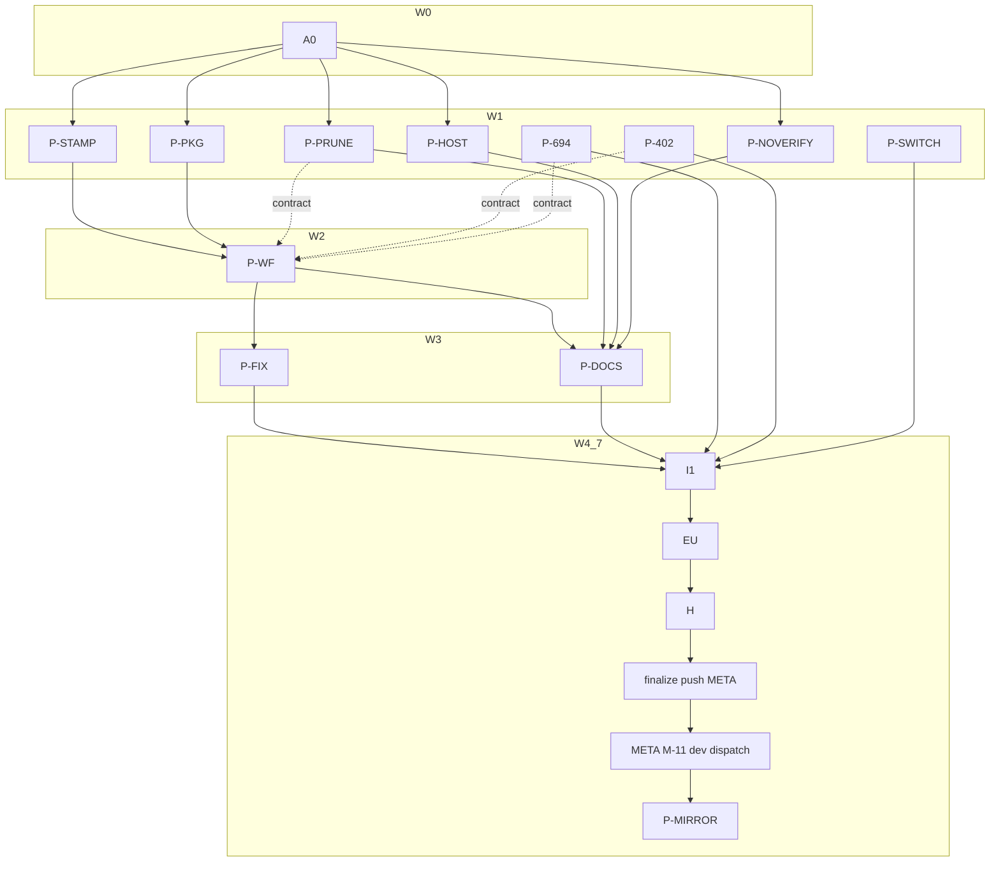

# Plan: Signing dogfood, loop A — ocx and ocx-mirror sign their own releases

## Status

- **Plan:** plan_signing_dogfood
- **State:** executing
- **Tier:** high
- **Tier-grammar:** 5
- **Updated:** 2026-11-14
- **Active phase:** 9 — R2-* review-2 fixes merged (ocx 3368b4870, mirror 7c9f516 local); remote M-11/pin/M-16 open
- **Step:** /hex-execute pass 4 (review-2 fixes) done; `task verify:scoped --force` on 3368b4870 exit 0
- **Feature branch:** `hex/signing-dogfood` (ocx); `hex/signing-dogfood` in `.agents/worktrees/sat-ocx-mirror-release` (ocx-mirror, from its `origin/main`)
- **Last update:** 2026-11-14 (pass 4: R2-OCX W1/W3/W4/W5/W6 and R2-MIRROR M-W1 merged; D-35/D-36 reworded, D-40, D-41; W2 deferred to owner; mirror 7c9f516 not pushed)
- **Next:** `/hex-review .claude/artifacts/plan_signing_dogfood.md` — review 3 over 57b4a1765..HEAD (ocx) and bc7bd9d..7c9f516 (mirror)
- Reviewed: 57b4a17657d983c98337b0626b145bd0f6f8084a

---

## Overview

**Source (governs):** `.agents/discussions/signing-dogfood.md` (ratified, handed off to the loop 2026-11-13). **Goal file (binding):** `.agents/goals/signing-dogfood.md` — ten source criteria G1…G10 below, plus three DONE-block criteria.
**Design this builds on:** `.agents/discussions/release-signing-trust-default-2026-11-12.md` › Decisions › Publisher side; merged [ocx-sh/ocx#696](https://github.com/ocx-sh/ocx/pull/696); `.agents/loop-security-findings-release-signing.md` items 1 and 5; `.claude/artifacts/adr_bazel_build_adoption.md` § stamping (`:1651-1702`).
**Research (not re-run):** `.claude/artifacts/research_signing_dogfood_{dev_channel,codebase,archaeology,prior_art}.md`. Discover reports of this run are folded into § Facts.
**Prior art reused:** ocx-mirror's Bazel release stamping (`ocx-mirror:release/{BUILD.bazel,provenance.bzl,provenance_env.py,workspace_status.py}`, `taskfiles/bazel.taskfile.yml:125-140`) — ported, not re-invented.

**Classification.** Scope medium-to-large (ocx: workflows, Bazel, 5 crates, docs; one satellite; two fixtures). Reversibility one-way (medium): release asset names, `dist-manifest.json` and install paths are held constant; new interface surface is additive (`--forge` on prune, two `error.detail` slugs, a `commit.branch` field) except the `sbom`/`verify` default (D-12). Tier `high` (explicit). Overlays: `architect=inline` (no decision here that the ratified discussion leaves open; the one ADR touched gets an amendment, D-19), `research=skip`, `adversary=off`.

**Model routing** (AGENTS.md). Every step `sonnet`; `hard`-marked pipelines run sonnet at high effort. Security seat on `.github/workflows/**`, `crates/ocx_oci/**`, `crates/ocx_sign/**`, `crates/ocx_config/**` diffs: `opus` (hex.md Preferences). `opus` for any other step only after it failed twice on sonnet. Every spawn sets `model`; never Fable; never `subagent_type: "fork"`.

## Constraints (verbatim, carried into every worker brief)

- Never merge.
- Never cut a production release, tag or backfill dispatch.
- Never write to ocx.sh, ghcr.io/ocx-sh/ocx/cli or ghcr.io/ocx-sh/ocx/mirror.
- Never add publishers to ocx-sh/index.
- Secrets and tokens are read from the environment and never written to a file, a log or a commit.
- Security findings are never filed as issues and never written with exploit detail into a committed file.

House rules for every step: workers act only in this checkout, its `.agents/worktrees/`, and the three local fixture/satellite worktrees; every remote act is a `META:` step (§ META steps) and a pipeline pauses there. No local full `task verify`; each step runs the narrowest test it touched; the docs page gets `task ci:docs`. Never edit `CHANGELOG.md` (the commit subject is the changelog line). `bazel` only as `ocx exec bazel -- <cmd>`; never `ocx exec bazel -- shutdown`. Git reads that decide anything go through `python3` + `subprocess`. Acceptance tests run as `task test:parallel --force -- <file>` (never a hand-rolled `uv run pytest`).

## Goal criteria (G) → where they land

| G | Criterion (goal file) | Pipelines / steps | Verification cases |
|---|---|---|---|
| G1 | GHCR dev channel | P-STAMP, P-PKG, P-WF (S-001), P-FIX, META M-4, M-11, M-13 | V-01…V-04 |
| G2 | Local publish task | P-PKG, P-STAMP | V-05 |
| G3 | Bazel release replaces cargo-dist | P-STAMP, P-PKG, P-WF, P-DOCS | V-06, V-07, V-08 |
| G4 | Signed SBOM + signed manifest per platform, no tag before its signature | P-402, P-PKG, P-WF, P-FIX, META M-5 | V-09, V-10 |
| G5 | Backfill, both proven in e2e | P-WF (backfill.yml), P-FIX, META M-6, M-8 | V-11, V-12 |
| G6 | Client carry-overs | P-HOST, P-NOVERIFY | V-13, V-14 |
| G7 | prune on GHCR via `--forge` | P-PRUNE, A0, META M-7 | V-15, V-16 |
| G8 | ocx-mirror release cycle ported | P-MIRROR, META M-15, M-16 | V-17 |
| G9 | Release candidates | P-WF (candidate mode), P-SWITCH, P-FIX, META M-7 | V-18, V-19 |
| G10 | Registry docs measured | P-DOCS, META M-7 evidence | V-20 |
| — | Non-breaking (Emphasis) | I1, P-FIX | V-21 |

---

## Facts (Discover, 2026-11-13; file:line on this branch)

- **Release assets of v0.6.6** (read with `gh release view v0.6.6 --json assets`): 8 archives `ocx-<triple>.tar.gz|.zip` (Windows named `pc-windows-msvc`), one `.sha256` per archive, `sha256.sum`, `dist-manifest.json`, `ocx.cdx.xml`. This set is the compatibility contract (C-003). Contract IDs skip C-010.
- **cargo-dist footprint:** `release.yml` (generated, tag-triggered), `dist-workspace.toml`, `verify-release-ci.yml` (`dist generate --check`), `release-readiness.yml` (dist plan/build, `:64-130`), the `plan` input on `readiness-gate.yml`, `verify-version.yml`, `scan-binaries.yml`, `post-release-oci-publish.yml`, `docker-publish.yml`, `sdkgen-publish.yml`; exemptions in `.github/actionlint.yaml:4-9`, `.github/zizmor.yml:13-134`, `.github/renovate-local.json:6`; guard `.claude/hooks/pre_tool_use_validator.py:67-71` + `.claude/tests/test_hooks.py:527-529`; 26 sites in `.claude/tests/test_workflows.py` (`:2595-2727`, `:3455-3870`); `about.toml:27-37`; rules `workflow-release.md:17-38,42,66,93,97,125-127`, `subsystem-ci.md:38,117,141,334,353`, `rust-quality/current-apis.md:76`, `workflow-git.md:5`, `rules.md:129,142,156`, `subsystem-deps.md:25`.
- **Bazel cannot build msvc.** `MODULE.bazel:93-102` platform triples and `taskfiles/cross.taskfile.yml:16-24` carry 6 Unix + 2 `pc-windows-gnullvm`. Consumers naming msvc: `oci-publish.yml:225-234`, `post-release-oci-publish.yml:58`, `deploy-dev.yml:142-144,192`, `sdkgen-publish.yml:72,179`, `release-readiness.yml:91-92,167-168,230-231`, `shell-activation-deep.yml:136-150`, `install-ocx.mdx:215-216,443-444`, `about.toml:33,37`, `scripts/tests/test_cross_matrix.py:37-38`; external: setup-ocx (`download.ts:127`), www-setup `install.sh` (by `dist.json` row).
- **Bazel provenance today:** `crates/ocx_cli/BUILD.bazel:45-61` `_TESTING_PROVENANCE` on the library (`:88-91`), `crate_features = ["__testing"]` (`:85`), binary `stamp = 0` (`:115`), `_TARGET_TRIPLES` (`:63-72`, no musl entry). `.bazelrc` has no stamp config. `build_info.rs:97-149` reads `__OCX_BUILD_CHANNEL`, `VERGEN_GIT_{SHA,DESCRIBE,DIRTY,COMMIT_TIMESTAMP}`, `VERGEN_BUILD_TIMESTAMP`, `VERGEN_CARGO_{TARGET_TRIPLE,DEBUG}`, `VERGEN_RUSTC_SEMVER`, `GITHUB_*`; no branch field. `scripts/release_provenance_check.py`: `--scan` markers (`:58`), `--exec` needs channel ≠ test, 40-hex SHA, clean, `ci.run_url` matching `^https://github.com/ocx-sh/ocx/actions/runs/\d+$`, non-epoch timestamp; `--link` glibc floor 2.34 (`:66`).
- **Publish recipe** lives inline in `oci-publish.yml:225-363` (layout `bin/ocx` + `LICENSE` + `LICENSE-THIRD-PARTY.md`, `ocx package create -m packaging/ocx/metadata.json`, `push --cascade`). No shared script. No signing anywhere in the `ocx/cli` path; sdkgen's `sign` job signs the index (`sdkgen-publish.yml:250-257`) and fails on ghcr.io ([ocx-sh/ocx#694](https://github.com/ocx-sh/ocx/issues/694)).
- **#694 cause:** `SIGNABLE_MANIFEST_TYPES` (`crates/ocx_oci/src/media_type.rs:25-28`, pinned by test `:93-101`) is the subject `Accept` at `ocx_sign/src/sign/pipeline.rs:255`, `attest/pipeline.rs:187`, `verify/pipeline.rs:1838,1863,2197`, `verify/attestation_sidecar.rs:95`; subject descriptor hard-codes `OCI_IMAGE_MEDIA_TYPE` at `sign/pipeline.rs:277,504`, `attest/pipeline.rs:203`. No test transport honours `Accept` (`ocx_oci/src/testing.rs:271,583`).
- **Host default:** `conventions::platform_or_default` (`crates/ocx_cli/src/conventions.rs:110-112`); `package_sbom.rs:37-43` and `package_verify.rs:28-34` keep `Option<Platform>` meaning "the index".
- **`--no-verify` under lock:** `auto_verify.rs:299-303` returns `Ok(false)` for every decision when opted out, `origin_gate_open` `:187-191` ignores the lock; lock at `ocx_config/src/lib.rs:227`, `signature_requirement` `:239-279` does not return it. Unit test `c015_opt_out_skips_a_refused_decision_with_one_warning` (`auto_verify.rs:1171`) pins the old behaviour. **Item 5 (unreadable root) is already fixed** (`auto_verify.rs:271-288`, acceptance `test_publisher_trust.py:492`); this loop adds only a regression check for it under the lock change.
- **Prune:** `ocx_package/src/prune.rs` `prune(client: &ocx_oci::Client, …)` `:495`, delete at `delete_and_confirm` `:691-724`; exit 82 slug `registry_delete_unsupported` (`ocx_oci/src/client/error.rs:250`); `--force` already deletes tags the index does not list (exit 75 otherwise, `package_prune.rs:32-42`). `ocx_announce` depends on `ocx_package` (`scripts/crate_map.toml:68`), so the deleter trait lives in `ocx_package`, the GitHub impl in `ocx_announce`, wiring in `ocx_cli`. `ForgeKind` + host inference `ocx_announce/src/forge/kind.rs:45,58,73`; `FakeForge` patterns in `ocx_announce/src/forge/github.rs:880-960` (unit) and `test/tests/fake_forge.py:358` (acceptance; no packages routes yet).
- **Announce never writes a default branch directly:** `--output` writes locally, else a PR (`options/forge_write.rs:44-55`). Hence D-11.
- **Fixtures:** e2e-package publishes one platform `linux/amd64+libc.glibc` (`scripts/publish.sh:12`) with setup-ocx 0.6.6; signs as `release.yml@refs/heads/main` etc.; guard `repository_id == '1455949009'`. e2e-index roots are hand-built by `scripts/build_index.py` (`TAGS` fixed at `:37`, `format_version: 1` at `:142,172`); `client-e2e.yml` builds ocx from a 40-hex ref of an allowlisted repo (`ocx-sh/ocx` or `ocx-sh/e2e-index`) and runs `test/e2e -m e2e_public` (tests live in this repo, `test/e2e/test_publisher_trust_public.py`).
- **ocx-mirror:** tag-triggered `release.yml`, Bazel stamped `build-matrix.yml` (6 targets, gnullvm), `oci-publish.yml` with no `id-token`/sign/SBOM, `deploy-dev.yml` → dead `dev.ocx.sh`, setup-ocx `0.6.3` pinned in 5 places, `ocx.toml:9` `ocx = "ocx.sh/ocx/cli:0.6.3"`. Existing worktree `.agents/worktrees/sat-ocx-mirror` holds the unlanded, unpushed branch `hex/publisher-trust-lockstep` (12 commits ahead of `origin/main`) — left untouched (D-17).

---

## Decisions (question → evidence → decision)

The discussion's eight open questions (D-1…D-8) take the recommended answer unless noted; D-9 onward were found in Discover.

- **D-1 Bazel build information.** Evidence: Bazel never runs `build.rs`; ADR `:1696-1702` allows stamping only on the dist profile with `no-remote-cache`; ocx-mirror already ships a working port (`release/provenance.bzl` → `rustc_env_files`, STABLE keys, `--define=…=release`). **Decision:** port ocx-mirror's `release/` rule into `bazel/release/` (define `ocx_provenance=release`, `--workspace_status_command='python3 bazel/release/workspace_status.py'`), used only by `task cross:build:release` (CI release/candidate/dev and the local task); unstamped builds keep their cache keys. Add a branch: `__OCX_BUILD_BRANCH` (cargo `build.rs` passes it through; the status script reads `GITHUB_REF_NAME` when `GITHUB_REF` is `refs/heads/*`, else `git rev-parse --abbrev-ref HEAD`), surfaced as optional `commit.branch` in `ocx version --format json` and in `--verbose` (additive report field).
- **D-2 SBOM generator.** Evidence: `cargo-cyclonedx 0.5.9` pinned in `ocx.toml:35` (docs group); e2e-package already runs it via `ocx package exec`. **Decision:** `cargo cyclonedx --format json --target <triple> --manifest-path crates/ocx_cli/Cargo.toml` per triple, from the same `Cargo.lock`; the pin moves to `[group.release.tools]` too (docs keeps its own). The CycloneDX JSON is the per-platform attestation predicate; the release keeps an `ocx.cdx.xml` asset (one XML run, same tool) so the asset set stays identical.
- **D-3 `sdkgen-publish.yml` sign job.** **Decision:** fix #694 in the client (P-694: index type in the subject `Accept`, subject descriptor media type taken from the fetched manifest, referrer fetches keep their own narrower list). The sign job stays; its identity becomes `sdkgen-publish.yml@refs/heads/main` (the caller now runs on `main`, not a tag), so `packaging/sdkgen/trust-policy.toml:13` changes with it.
- **D-4 Pruning dev builds.** **Decision:** the dev-mode run prunes `ghcr.io/ocx-sh/dev/cli` tags older than `prune_after_days` (default 30) with `ocx package prune --forge github --force --tags-file`, built from the run's own binary. A structural test reds when `--force` appears in any step whose target is not the dev package.
- **D-5 Packages-API owner type.** **Decision:** one `GET /users/{owner}` per prune run (`type` = `Organization` → `/orgs/…`, `User` → `/users/…`); no cache.
- **D-6 Who creates the dev package.** Evidence: a first push from a local token links nothing; a workflow push links the package to its repository. **Decision:** the first push of `ghcr.io/ocx-sh/dev/cli` is META M-11 (release workflow, dev mode, from the pushed feature branch). The local task's GHCR push refuses with exit 1 and a one-line reason when the package does not yet exist. A package that starts private is an owner action (listed, not worked around).
- **D-7 Shared or copied workflows.** Evidence: a called workflow signs with its own identity. **Decision:** a copy in each repository; signing jobs are defined in the top-level `release.yml` / `backfill.yml` (never in a reusable workflow), so the identity is `<repo>/.github/workflows/release.yml@refs/heads/main` (the one exception is sdkgen's existing `sign` job, D-3, which keeps its own identity for the separate `ocx/sdkgen` package); repository-specific values sit in one top-level `env:` block so copies differ only there. Template sharing is a later step.
- **D-8 `publishers` identities for an own package.** **Decision:** two keyless entries — `release.yml@refs/heads/main` and `backfill.yml@refs/heads/main` — each pinning `source_repository_identifier` and `source_repository_owner_identifier` (GitHub issuer). Proven in the e2e-index root `e2e/release`; the production entry text for `ocx-sh/index` goes into the PR body for the owner, never into `ocx-sh/index`.
- **D-9 Windows asset names.** Evidence: Bazel builds only gnullvm; setup-ocx, `install.sh`/`dist.json`, `install-ocx.mdx` download by the msvc name. **Decision:** Windows archives keep their names `ocx-{x86_64,aarch64}-pc-windows-msvc.zip`; the binary inside is the gnullvm build and reports its real triple (`build.target`). One mapping table in `scripts/release_assets.py` (`ASSET_TARGET`) is the only place the alias lives. ocx-mirror has shipped gnullvm Windows binaries since its Bazel move. The OCI platform (`windows/amd64`, `windows/arm64`) is unchanged.
- **D-10 Fixture ocx before the ocx branch is pushed.** Evidence: `client-e2e.yml` builds ocx from a 40-hex ref of `ocx-sh/ocx` or `ocx-sh/e2e-index`. **Decision:** the fixture release/backfill workflows take the same two inputs and build ocx from source when given; META M-1 pushes the feature branch's source to `ocx-sh/e2e-index` as branch `ocx-src/<short-sha>` (granted: e2e push). The ocx-sh/ocx dev dispatch waits for the finalize push.
- **D-11 Fixture announce without a merge.** Evidence: announce opens a PR or writes `--output`; "Never merge". **Decision:** fixture candidate/release runs announce with `--output index-out` and upload it as an artifact; META commits it straight to `ocx-sh/e2e-index` `main` (a push, granted). `build_index.py` preserves the root `e2e/release` it does not generate. Production keeps the PR path through `ocx-sh/index` and its bot.
- **D-12 `sbom`/`verify` host default.** **Decision:** a tag identifier without `-p` resolves to the host platform as `install` does (`platform_or_default`); when the tag resolves to a single manifest, that manifest is the subject (no narrowing to fail); an identifier named by digest (`…@sha256:`) is the exact subject, so an index stays addressable that way. No new flag. Behaviour change to a CLI interface: commit subject `feat(cli)!:`; a contract-ledger entry only if the contract gate reds on it.
- **D-13 `--no-verify` under a system lock.** **Decision:** `signature_requirement` returns whether the winning value is system-locked; when it is locked `required`, `--no-verify`/`OCX_NO_VERIFY` is refused with exit 81, new slug `no_verify_refused`, message naming the system config file; checked on both the find fast path (`origin_gate_open`) and the rounds path. Unlocked `required` keeps today's opt-out. Item 5 gets one regression test combined with the lock (corrupt committed root + unlocked opt-out still installs).
- **D-14 #402 ordering.** **Decision:** `ocx package push --sign/--sbom` pushes the platform manifest by digest, signs and attests it, and only then writes any tag (keep tag, the target tag's index merge, cascade). Invariant: at every instant a tag is visible, every platform manifest reachable from it carries its signature and, when `--sbom` was given, its attestation.
- **D-15 Prune credential and endpoint.** Evidence: the code's forge credential is `OCX_ANNOUNCE_TOKEN`, the discussion's assumption (`GITHUB_TOKEN`/`GH_TOKEN`) does not match. **Decision:** the forge deleter uses the registry credential ocx already resolves for the registry host (on GHCR that is a GitHub token with `packages: write` / `delete:packages`); no new public `OCX_*` variable. API base: `ghcr.io` → `https://api.github.com`; `containers.<host>` → `https://<host>/api/v3`. Test override: hidden `__OCX_TESTING_GITHUB_API_URL`, declared in `ocx_env` as testing-only.
- **D-16 Candidate retention.** **Decision:** no cron. Release-mode runs prune candidates whose final `X.Y.Z` is at least `prune_after_days` old and that are not the newest build of their line, then `announce --tags-from-registry` removes their rows. Fixtures pass `prune_after_days: 0`.
- **D-17 ocx-mirror worktree.** Evidence: `.agents/worktrees/sat-ocx-mirror` carries unlanded, unpushed `hex/publisher-trust-lockstep`. **Decision:** never touched; this loop's worktree is `.agents/worktrees/sat-ocx-mirror-release` from ocx-mirror `origin/main`, branch `hex/signing-dogfood`.
- **D-18 Fixture platforms.** **Decision:** e2e-package builds on two native runners (`ubuntu-24.04`, `ubuntu-24.04-arm`) so per-platform signing and SBOM are proven on two platforms; the publish/sign job is one job on amd64.
- **D-19 ADR.** `adr_bazel_build_adoption.md` says releases stay on cargo-dist (`crates/ocx_cli/BUILD.bazel:37` repeats it). **Decision:** a dated amendment section in that ADR (owner decision of 2026-11-13, D-1, D-9); no new ADR.
- **D-20 Local registry.** **Decision:** `task release:local:registry` runs the toolchain's `zot` on `localhost:${OCX_LOCAL_REGISTRY_PORT:-15000}` (store `${XDG_STATE_HOME:-$HOME/.local/state}/ocx/dev-registry`) with on-demand sync from `ghcr.io`, so `OCX_MIRRORS='{"ghcr.io":"http://localhost:15000"}'` serves local pushes and passes every other `ghcr.io` read through. A lock made against a local build is local-only (its digests exist nowhere else); the doc line says so.

- **D-21 Candidate version spelling** (found in execution, P-SWITCH). Question: the plan spells candidates `X.Y.Z-rcN`, but ocx's version grammar (`crates/ocx_package/src/version.rs`) takes only alphanumerics in a pre-release, so `ocx package push …:0.9.0-rc.1` exits 65. Evidence: P-SWITCH run, `ade1676e1`. **Decision:** candidates are `X.Y.Z-rcN` everywhere (dispatch input, ocx package tag, git tag `vX.Y.Z-rcN`, GitHub pre-release, fixtures `0.1.0-rcN`); the `plan` job's candidate check is `^X\.Y\.Z-rc[1-9][0-9]*$`. Widening the version grammar is an interface change outside this loop. Known ceiling: `rc10` sorts before `rc9` lexically — cut at most nine candidates per line.
- **D-22 `--link` NEEDED allow-list** (P-STAMP). Question: stamped Bazel gnu binaries need only `GLIBC_2.28` (floor 2.34 passes) but list `librt.so.1`/`libpthread.so.0`/`libdl.so.2` (Bazel sysroot glibc 2.28), which `NEEDED_ALLOWED` refuses. **Decision:** these are glibc's own components, present on every glibc host; add exactly those three to the allow-list, keep every non-glibc library refused. Not a workaround of the floor (V-08 is the floor).
- **D-23 No test seams in a release binary** (P-STAMP security finding, class: test-only code compiled into a shipped binary). Question: Bazel compiles every tier crate with `__testing`; the stamped build dropped it only on `ocx_cli`, so `__OCX_TESTING_*` seams (system-config path, API URLs) would ship and could bypass D-13's lock. **Decision:** under `--define=ocx_provenance=release` every crate drops `__testing`; `release_provenance_check.py --scan` fails on any `__OCX_TESTING_` string in the binary. Unstamped cache keys unchanged.

- **D-24 Stamped release builds use no remote cache** (P-WF review, class: cache poisoning of signed bytes). Evidence: ADR `:1696-1702` stamps only with `no-remote-cache`; P-WF passed `BAZEL_CACHE_WRITE_AUTH` to the stamped cross builds. **Decision:** stamped builds get no cache credential (`release.yml`, `release-readiness.yml`); `cross.yml` passes write-auth only when not stamped; a C-017 test pins it.
- **D-25 No main-only environment around release/candidate publish** (P-WF review question). Evidence: a branch can edit its own copy of `release.yml` and drop any `environment:`; `GITHUB_TOKEN` `packages: write` reaches every package linked to the repository either way; what consumers trust is the signer identity `release.yml@refs/heads/main`, which a branch cannot obtain. **Decision:** no extra environment; the release/candidate self-verify pins the literal `…/release.yml@refs/heads/main` identity. Recorded for the owner in the PR body (a branch can overwrite a prod tag with a non-main-signed build; detection is the identity pin).
- **D-26 Backfill pins digests, not release-asset hashes** (P-WF review question). **Decision:** backfill resolves each platform's digest once and verifies/signs/attests `ref@<digest>`, printing it; it does not cross-check GitHub release asset hashes (OCI digest is the signed subject; the asset set is a separate artifact).

- **D-27 Candidate "line" for retention** (P-WF question). **Decision:** a candidate's line is its final release `X.Y.Z`; once `X.Y.Z` exists and is at least `prune_after_days` old it is the newest build of the line, so every `X.Y.Z-rcN_<ts>` build tag and rolling `X.Y.Z-rcN` tag is selected together (avoids `prune_shared_version`); nothing of a line is selected before that. Implemented in `scripts/release_prune_select.py`.

- **D-28 e2e-index wire tree at the repository root** (P-FIX). Question: `ocx package announce` reads the committed root at `p/<pkg>.json` (plus `config.json`, `c/`) at the index repository root, as in `ocx-sh/index`; e2e-index served them from `docs/`. **Decision:** e2e-index moves to the production layout (`git mv`, e2e-index `d084989`); Pages assembles its site from the root files; served URLs unchanged. META commits of `index-out` artifacts land at the root (`p/e2e/release.json`, `c/index.json`).
- **D-29 V-21 old-client subset** (I1a). Evidence: with the v0.6.6 binary, `test/e2e -m e2e_public` gives 6 passed, 8 skipped (release-cycle cases, fixtures unpublished), 11 failed — all 11 in `test_publisher_trust_public.py`, asserting declared-publisher refusals 0.6.6 does not implement (e.g. expects 77, gets 64 `no_identity_provided`); branch binary 17 passed, 8 skipped, 0 failed. **Decision:** no install regression; the suite has no old-client marker, so V-21's "old-client subset" is the install cases. Gating the new-client cases by client version is I1b work. The toolchain's `ocx-previous` is 0.6.5, not 0.6.6 (retro entry; pin unchanged).

- **D-30 Corrections found in I1b/EU/H (pass 2).** D-4: the dev prune exempts the newest build of each dev line, so a quiet repository never loses its only build (EU block finding, regression-tested in `scripts/tests/test_release_prune_select.py`). D-20: the store is `.../ocx/dev-registry/<port>`, one store per port; `task release:local:registry:stop` stops it. D-21 correction: `ocx package push …:0.9.0-rc.1` is accepted as an opaque tag (not a version), so the guard is the `plan` job's `^X\.Y\.Z-rc[1-9][0-9]*$` check, which rejects `rc.1`. C-013: host inference selects the GitHub forge for `ghcr.io` only; a `containers.<host>` registry needs an explicit `--forge github`, so no registry credential is ever sent to a host derived from an index (H1 security fix). `ocx package push` contract version 1 → 2 (D-14 is a semantic break: tags appear only after signing), ledger entry plus sdkgen golden.
- **D-31 `ocx-previous` 0.6.5 → 0.6.6** (I1b item 4). Question: bump the nesting-test pin? Evidence: V-21 is satisfied by the install subset with the 0.6.6 binary passed explicitly (D-29); the pin is read by `test/src/previous_release.py` for unrelated nesting tests, and bumping it relocks the test group. **Decision:** out of scope; follow-up candidate.
- **D-32 V-21 red half.** Question: which fixture makes the publisher-trust new-client cases red? **Decision:** the local one: run `test/e2e/test_publisher_trust_public.py` with the v0.6.6 binary and the `new_client` gate removed — 11 failed (expects 77, gets 64); with the gate, they skip with a reason naming the client contract version (`package verify` < 2). No remote act.

- **D-33 ocx-mirror release tools project** (P-MIRROR). Question: where does the mirror pin the publishing ocx? Evidence: a root relock by ocx 0.6.6 or later writes `lock_version` 4; the template's conventions `setup@v0.3.4` bootstraps ocx 0.6.5, which reads only v3, so a root relock reds every template-owned CI job. **Decision:** a separate project `packaging/release-tools/` (own v4 lock, `--project`) holding `cargo-cyclonedx`, `git-cliff` (D-38) and the `ocx` pin from M-11; root lock untouched; fold back once conventions moves to 0.6.6 or later. Mirror decisions found in execution: **DM-1** release tools in their own project (this decision); **DM-2** `backfill.yml` takes the pinned ocx from the release-tools project, one ocx source per repository; **DM-3** the mirror's `verify` and readiness gates stay for release and candidate and gate `publish`; **DM-4** candidates are `X.Y.Z-rcN` (D-21), the old `-rc.N` git tags with no registry publish are gone.
- **D-34 ocx-mirror port mapping** (P-MIRROR). `build-matrix.yml` replaces `cross`/`build`/`scan` and its smoke covers provenance; a separate `sbom` job runs `cargo cyclonedx` per triple; the GitHub release asset set is unchanged (no `.cdx.json`); no docker or sdkgen post jobs; `deploy-dev.yml` and `oci-publish.yml` deleted.
- **D-35 Prune on GitHub Packages fails closed** (R1-PRUNE). A kept version whose manifest is not served (Accept now includes the Docker list and v2 manifest types), or any tagged version that appears or changes (id, digest or tags) or a delete-set member that changes between planning and the pre-DELETE re-list, refuses the run before any DELETE with exit 75 (untagged churn does not abort; R2-OCX); a version entry without `id`/`name` is a forge failure (exit 69); cosign `sha256-<hex>.sig`/`.att` tags join the delete set. An index row naming another digest than the version carrying the tag refuses with exit 75 and new slug `prune_index_stale` (additive; no ledger). Residual: no conditional delete in the API, so the race is narrowed, not closed; a candidate prune must not overlap a release push of identical bytes.
- **D-36 Cascade repair announce scope** (R1-HARDEN, R2-OCX). `announce_scope` is `None` for an alias or whole-graph request (unbounded) and `Some(set)` for any request containing a build tag; a `Written` alias is announced only under `None` or when the set contains it, so a superseded build whose leaf owns no alias (`Some(empty)`) announces no `Written` alias.
- **D-37 Provenance of the mirror's pinned ocx** (R1-HARDEN). Identity and issuer live beside the pin in `packaging/release-tools/ocx-identity.env` and are swapped with it; the action verifies the locked platform digest (no `-p`) before install and asserts the `ocx` on PATH is the locked install by bytes, not the bootstrap. Fails closed until the pin exists.
- **D-38 git-cliff only from a locked toolchain** (R1-HARDEN). ocx `ocx exec -g release -- git-cliff`; mirror `ocx --project packaging/release-tools exec -- git-cliff` (2.14.1); a structural test in ocx reds any floating install in `release.yml`/`backfill.yml`.
- **D-40 Mirror release-ocx accepts a branch identity in dev mode only** (R2-MIRROR). The goal needs the mirror's dev run to use this loop's branch-built ocx through the pin. `release-ocx` takes a required `mode` input (reaching `run:` only through `env:`); `scripts/release_ocx_identity.py` accepts any identity for `dev` (publishes only to `ghcr.io/ocx-sh/dev/mirror`) and, for `release`, `candidate`, `backfill`, only exactly `https://github.com/ocx-sh/ocx/.github/workflows/release.yml@refs/heads/main`; an unknown mode is refused (allow-list in the script). `ocx-identity.env` keeps the branch identity until the pin swap (recorded follow-up). Test `scripts/test_release_ocx_identity.py` (13 cases, bazel `release_ocx_identity_test`).
- **D-41 Push report doc text is a ledger `doc` change** (R2-OCX, W5b). Rewording `PushReport` attestation docs changed `reports.json` descriptions; the compat gate required two `doc` rows in `crates/ocx_schema/contract/ledger.toml` (`/$defs/AttestationStatus/x-ocx-enum/1`, `/$defs/PushReportRoot/properties/attestation`); a `doc` rule bumps no version. W4: `sole_staged_digest` invariant breach exits 1, not 64. W2 (exit 75 for non-retryable refusals) stays an owner decision.
- **D-39 Installer stays stable-only; fixture proves the pre-release flag** (E3). www-setup `get_latest_version` picks only `channel == stable` rows built from GitHub releases (pre-releases are `next`), never the OCX index; `install-ocx.mdx` no longer promises a prerelease channel. The fixture `release.yml` gains a `github-release` job (`--prerelease` in candidate mode, after `publish`), proven by run 43531108304.

Open questions: none (`[NEEDS CLARIFICATION]` count 0).

---

## Component contracts

IDs are the coverage join keys. "Red" and "green" name the case each test must show.

### Build and packaging

- **C-001 Stamped Bazel release build.** `task cross:build:release TARGET=<triple> CHANNEL=<release|candidate|dev> VERSION=<semver>` writes `target/cross-release/<triple>/ocx[.exe]` built `-c opt --define=ocx_provenance=release` with the workspace status script. The binary reports: channel = `CHANNEL` as given, `commit.sha` 40-hex of `HEAD`, `commit.dirty` from tracked files, `commit.timestamp`, `commit.branch`, `build.timestamp` (UTC now), `build.target` = the Bazel triple, version = `VERSION`; in Actions also the `ci` block. Without the define, `//crates/ocx_cli:ocx` is byte-for-byte the action it is today (cache key unchanged; `bazel:tag:guard` green). Red: unstamped `task cross:build` binary → `release_provenance_check.py --scan` exits nonzero; green: stamped binary → `--scan` 0 and, with `GITHUB_SERVER_URL/REPOSITORY/RUN_ID` set to an `ocx-sh/ocx` run, `--exec` 0.
- **C-002 `commit.branch` field.** Optional string in the `version` report (`api/data/version.rs`) and `--verbose` line; absent when unknown; `__testing` placeholder value `placeholder`. Schema golden updated in A0. Cargo builds pass `__OCX_BUILD_BRANCH` through `build.rs`.
- **C-003 `scripts/release_assets.py`.** `build --dist DIR --version V --sha S` takes `target/cross-release/<triple>/ocx[.exe]` for the 8 triples and writes, per triple, `ocx-<asset-target>.tar.gz` (Unix) or `.zip` (Windows) containing `ocx-<asset-target>/ocx[.exe]`, `LICENSE`, `LICENSE-THIRD-PARTY.md` (same inner layout as v0.6.6 — read once from a v0.6.6 archive and pinned in the test), `<archive>.sha256`, `sha256.sum` over all archives, `dist-manifest.json` with the fields v0.6.6's manifest carries for each artifact (shape pinned by a fixture copied from v0.6.6), `ocx.cdx.xml`, and `ocx-<asset-target>.cdx.json` per triple (CycloneDX JSON, `cargo cyclonedx --target`). `ASSET_TARGET` maps the two gnullvm triples to the msvc asset names (D-9). Red: test compares the produced name set to the v0.6.6 set and fails on any missing/extra name (mutate the map); green: equal.
- **C-004 `scripts/publish_ocx_package.sh`.** `publish_ocx_package.sh --identifier REG/NS/REPO:TAG --platform P --binary PATH --sbom PATH [--sign] [--no-keep-tag] [--cascade] [--tags-file F] [--metadata packaging/ocx/metadata.json]`: stages `bin/ocx` + licences, `ocx package create`, `ocx package push` with the given flags (the `ocx` on `PATH` is the binary under release, the one the run built). Reads credentials only from the environment, prints none. Called by `release.yml`, the local task and (by copy) the fixtures. Red/green: `scripts/tests/test_publish_ocx_package.py` runs it against a throwaway zot with a stub `ocx` recording argv, asserting the argv for each flag set and that no environment value appears in its output.
- **C-005 Local publish.** `task release:local:registry` starts/reuses the local zot (D-20), idempotent, prints its URL. `task release:local:publish [PUSH=ghcr]` builds the host triple stamped (`CHANNEL=dev`, `VERSION=<cargo version>-dev+<UTC>`, tag `<cargo version>-dev_<UTC>`), runs `release_provenance_check.py --scan`, publishes to `localhost:<port>/ocx-sh/dev/cli:<tag>` with `--no-keep-tag --cascade`, and prints the two env lines and the `ocx.toml` pin a second checkout uses. `PUSH=ghcr` additionally pushes to `ghcr.io/ocx-sh/dev/cli:<tag>` with the token from `GITHUB_TOKEN`/`GH_TOKEN` (never echoed); refuses when the package does not exist (D-6). Unsigned (local identity cannot sign keylessly without a browser; not attempted).

### Client

- **C-006 Host default for `sbom`/`verify`** (D-12). Omitted `-p` + tag identifier: index → host platform's manifest; single manifest → itself; digest identifier → exact object. Help text rewritten (ASCII, no internal refs). Red: `ocx package verify <tag>` on a two-platform signed-per-platform package (index unsigned) exits 79 today; green: exits 0 against the host platform.
- **C-007 `--no-verify` refused under a system lock** (D-13). New `RoundsError::NoVerifyRefused { registry }` (or the module the contract wave chooses), exit 81, slug `no_verify_refused`, message names the system config file and the setting. Applies to flag and env, on the fast path and the rounds path. Red: today `OCX_NO_VERIFY=1` installs an unsigned package under a system-locked `required`; green: exit 81 with the slug. Unlocked `required` + opt-out: unchanged (one WARN, installs).
- **C-008 #694 index subject** (D-3). `sign`, `attest`, `verify` of an image-index subject send an `Accept` including `application/vnd.oci.image.index.v1+json`; the subject descriptor carries the fetched manifest's media type. Referrer fetches unchanged. Red: a new `ocx_oci::testing` transport that 404s when the requested type is absent from `Accept` (ghcr.io behaviour) fails sign/attest/verify of an index; green: passes.
- **C-009 Push signs before any tag** (D-14). Red: a recording transport sees the tag `PUT` before the signature referrer `PUT` today; green: every tag write comes after the signature (and attestation) writes of every manifest it reaches. Acceptance: `push --sign --sbom --cascade` then list order assertion via the recording seam (unit level), plus an acceptance check that a `push --sign` failure (signing endpoint unreachable) leaves no new tag.
- **C-011 Prune deleter seam.** `ocx_package::prune` gains `trait TagDeleter { async fn delete(&self, plan: &DeletePlan) -> Result<DeleteOutcome, PruneError>; }` (exact shape fixed in A0) with the registry-API implementation over `ocx_oci::Client` (today's behaviour, unchanged results and exit codes).
- **C-012 GitHub packages deleter** (`ocx_announce::forge::github_packages`). For each requested tag: resolve owner type (D-5), list the package's versions (paginated), find the version whose `metadata.container.tags` holds the tag; the delete set is that version, the platform-manifest versions its index lists that no other remaining tagged version's index lists, and the referrer fallback-tag versions (`sha256-<digest>`) of every manifest in the set with the manifests they list. Refuse (exit 81, slug `prune_shared_version`) when any version in the set carries a tag outside the requested tags and their fallback tags. `--dry-run` lists the set and deletes nothing. 401/403 → today's `DeleteDenied` (exit 80). Confirmation probe unchanged (registry `HEAD` must answer `MANIFEST_UNKNOWN`).
- **C-013 `ocx package prune --forge <github|gitlab>`.** Inferred `github` for `ghcr.io` and `containers.*` GitHub hosts; absent on other hosts → registry API as today (exit 82 when unsupported). `--forge gitlab` refused, exit 64 (usage) with "GitLab's registry does not accept OCX packages, see https://github.com/ocx-sh/ocx/issues/480" (one line). Interface artifacts: `cli.json` golden (A0), generated reference page (`task website:reference:generate`), `reference/exit-codes.md` 82 row text, the `package_prune.rs:62-64` help sentence and its pin test `:349`.

### Workflows (ocx-sh/ocx)

- **C-014 `release.yml`** (hand-written; replaces cargo-dist). `on: workflow_dispatch` inputs `mode` (`release|candidate|dev`), `version` (release: `X.Y.Z` = `Cargo.toml` version; candidate: `X.Y.Z-rcN`, same `X.Y.Z`; dev: ignored), `prune_after_days` (default 30). Top-level `permissions: {}`; one `env:` block of repository values (D-7). Jobs:
  - `plan`: guards — `release`/`candidate` require `github.ref == 'refs/heads/main'` and `github.repository_id` of ocx-sh/ocx; refuse if tag `v<version>` exists. Outputs channel, version, tag `<version>_<UTC>` (dev: `<next>-dev_<UTC>` via git-cliff as today), target package (`dev` → `ghcr.io/ocx-sh/dev/cli`; else `ghcr.io/ocx-sh/ocx/cli`).
  - `readiness` (release/candidate only): `readiness-gate.yml` on `github.sha`.
  - `build`: `cross.yml` with `stamp: true`, channel, version (C-001), then `release_assets.py` (C-003); uploads one artifact.
  - `scan`: `scan-binaries.yml` over the archives (`--scan`, `--exec`, `--link`).
  - `publish` (defined in this file; `packages: write`, `id-token: write`): installs the run's musl `ocx`, `publish_ocx_package.sh --sign` with `--sbom <triple>.cdx.json` per platform (6 OCI platforms: musl Linux, darwin, gnullvm Windows), `--cascade` in every mode (a pre-release carrying a build cascades only to its own rolling tag — `X.Y.Z-rcN`, `X.Y.Z-dev` — never to `latest`/`X`/`X.Y`/`X.Y.Z`, `cascade.rs:51-67`), applied once after every platform is pushed and self-verified, `--no-keep-tag` in candidate and dev; self-verifies every platform against `${GITHUB_SERVER_URL}/${GITHUB_WORKFLOW_REF}` (signature and `--attestation --type cyclonedx`).
  - `github-release` (release/candidate; `contents: write`; needs `publish`): creates tag `v<version>` at `github.sha` and `gh release create` with C-003's set; `--prerelease` for candidate; notes from git-cliff.
  - `announce` (release: durable; candidate: `--ephemeral`; environment `ocx.sh`, `OCX_ANNOUNCE_TOKEN`): after `github-release`.
  - `prune`: dev → D-4; release → D-16; then `announce --tags-from-registry` (release only).
  - `post`: `docker-publish.yml`, `sdkgen-publish.yml` (release only).
  Dev mode writes nothing but the dev package: no git tag, no GitHub release, no announce, no docker/sdkgen.
- **C-015 `backfill.yml`.** `on: workflow_dispatch` inputs `tags` (newline list; empty = every version tag), `dry_run`. Guard: `refs/heads/main` + repository id. Job `backfill` (defined in this file; `environment: release-backfill` with a required reviewer; `packages: write`, `id-token: write`): for each tag and each platform of its index, skip the platform when `ocx package verify -p P --certificate-identity <this workflow's identity>` passes (signature) / `--attestation --type cyclonedx` passes (SBOM) — each independently; else `ocx package sign -p P` / generate the SBOM at the tag's source ref (`v<version>` for ocx; the fixture overrides one function) and `ocx package attest -p P --type cyclonedx`. Prints a per-tag table (signed / attested / skipped). Never moves a tag.
- **C-016 Satellite workflows.** `cross.yml` gains `stamp`, `channel`, `version` inputs (unstamped default unchanged); `release-readiness.yml` builds through `cross.yml` stamped and stages the archives from `release_assets.py` (Windows legs run the gnullvm binary); `readiness-gate.yml`, `verify-version.yml` (version input instead of `GITHUB_REF_NAME`), `scan-binaries.yml`, `docker-publish.yml`, `sdkgen-publish.yml` lose the cargo-dist `plan` input and artifact names; `shell-activation-deep.yml` Windows target follows. Deleted: `oci-publish.yml`, `post-release-oci-publish.yml`, `deploy-dev.yml`, `verify-release-ci.yml`, `dist-workspace.toml`. Exemptions for `release.yml` removed from `actionlint.yaml`, `zizmor.yml`, `renovate-local.json`; the generated-file guard for `release.yml` removed from the pre-tool hook and its test.
- **C-017 Structural workflow tests** (`.claude/tests/test_workflows.py`, replacing the 26 cargo-dist sites). Each shown red by mutating the workflow text in a temp copy, green on the real file: (a) every job that runs `ocx package sign`, `ocx package attest` or `push --sign/--sbom` and holds `id-token: write` is `release.yml:publish`, `backfill.yml:backfill`, or the named allowlist entry `sdkgen-publish.yml:sign` (D-3); other `id-token` holders (`docker-publish`, `build-windows-shims`, `claude`) sign nothing of ours and are out of the assertion; (b) release/candidate guards on `refs/heads/main` + repository id; (c) dev mode's target package matches `^ghcr\.io/ocx-sh/dev/`; `github-release`, `announce`, `post` jobs carry `if: mode != 'dev'`; (d) `--force` on prune appears only where the target is the dev package; (e) `github-release` needs `publish` (no tag before signature); (f) the C-003 asset set equals the v0.6.6 set; (g) every input a caller passes is declared by the callee (kept); (h) the readiness gate stays upstream of `publish` for release/candidate; (i) `backfill` job has `environment: release-backfill`.

### Fixtures, satellite, docs

- **C-018 e2e-package** (local worktree, pushed by META): `release.yml`/`backfill.yml` are copies of ocx's (C-014/C-015) differing only in the `env:` block (incl. `READINESS: false`, which drops the ocx-specific `readiness` job; C-017(h) applies to ocx only), the build step (fixture Rust binary, two native runners, D-18); inputs `ocx_repository`/`ocx_ref` build ocx from source (D-10); dev target `ghcr.io/ocx-sh/dev/e2e-package`; release target `ghcr.io/ocx-sh/e2e-package` under version tags `0.1.0`, `0.1.0-rcN` (no collision with the six case tags); announce `--output` artifact (D-11). Existing case workflows untouched. A new case workflow `unsigned-v.yml` publishes `0.0.1` unsigned as the backfill subject.
- **C-019 e2e-index:** root `e2e/release` (repository `oci://ghcr.io/ocx-sh/e2e-package`, `publishers` = D-8's two entries) maintained by META commits from announce artifacts and preserved by `build_index.py`; `TAGS` stays for the generated roots; `format_version: 1` unchanged; `test_build_index.py` covers preservation. `ocx.toml`/`ocx.lock` + `dev-pin.yml` (M-13) pin the ocx dev build and run `ocx version --verbose`.
- **C-020 Public e2e suite** (`test/e2e/test_release_cycle_public.py`, marker `e2e_public`): release tag installs under `e2e/release` with signature and SBOM checks on both platforms; `verify`/`sbom` without `-p` pass; `0.0.1` refused before backfill (recorded run), installs after; second backfill run adds no referrer (count of attestations by the backfill identity equals 1 per platform); candidate installs by pin, floating tags unchanged, after prune the row is gone and install exits 79.
- **C-021 ocx-mirror port** (worktree `.agents/worktrees/sat-ocx-mirror-release`): `release.yml` rewritten to C-014's shape (its `build-matrix.yml` keeps building; modes; publish job with `--sign --sbom` per platform; dev to `ghcr.io/ocx-sh/dev/mirror`); `backfill.yml` copy; `deploy-dev.yml` and its `dev.ocx.sh` secrets removed; `oci-publish.yml` deleted or reduced to unsigned non-release use (whichever leaves no caller); `packaging/release-tools/ocx.toml`/`ocx.lock` pin (DM-1; the root lock stays v3) `ghcr.io/ocx-sh/dev/cli:<tag from M-11>`; setup-ocx bootstrap `0.6.6` with `project` activation so the dev ocx publishes; SBOM via `cargo cyclonedx --target`. No mirror feature work. A follow-up issue (M-17) records the swap to the released ocx.
- **C-022 Docs.** `publishing/snapshot-tracks.md`: registry table gains GHCR (registry API deletes no tag; prune works through `--forge github`, inferred for `ghcr.io`; evidence M-7) and gitlab.com (the registry refuses the package push, `MANIFEST_INVALID`, exit 69; nothing reaches prune); the `:299` documentation-only sentence goes; the GitLab CI recipe keeps GitLab CI with a GitLab-hosted index and pushes to `ghcr.io` (any registry that takes OCX packages), plus one line linking [ocx-sh/ocx#480](https://github.com/ocx-sh/ocx/issues/480). `install-ocx.mdx`: one section "Verify the package signature" (`ocx package verify ocx.sh/ocx/cli:<v> --certificate-identity …/release.yml@refs/heads/main`, `ocx package sbom …`), Windows asset names unchanged. `CONTRIBUTING.md`: "Publish a local build" (C-005). Rules: `workflow-release.md`, `subsystem-ci.md`, `rust-quality/current-apis.md:76`, `workflow-git.md:5`, `rules.md`, `subsystem-deps.md:25`, `crates/ocx_cli/BUILD.bazel:37` comment, `about.toml`; ADR amendment (D-19); `system_design_publisher_trust.md` C-015 text (D-13); `taskfiles/release.taskfile.yml` `release:tag` → dispatch `gh workflow run release.yml -f mode=release -f version=…` (owner's command, documented).

## User-experience scenarios

- **S-001 Dev build from a branch.** Maintainer dispatches `release.yml` mode `dev` on a branch → `ghcr.io/ocx-sh/dev/cli:<next>-dev_<ts>` (6 platforms, each signed + SBOM) and the floating `<next>-dev`; nothing else changes. Errors: `mode=release` on a branch → `plan` fails with "release and candidate run only from refs/heads/main"; production identity check against the dev build → `verify` exit 77.
- **S-002 Release.** Owner dispatches mode `release` version `X.Y.Z` on `main` → readiness checked, 6 platforms signed + attested, then tag `vX.Y.Z` and GitHub release with the unchanged asset set, announce, rolling tags. Errors: version ≠ `Cargo.toml` → `plan` fails naming both; readiness missing → fails naming the SHA; any platform's sign fails → no tag, no release.
- **S-003 Candidate.** Mode `candidate` `X.Y.Z-rcN` → pushed `--no-keep-tag`, signed, announced `ephemeral`, GitHub pre-release; `latest`/`X`/`X.Y`/`X.Y.Z` unchanged; installer manifest unaffected. Errors: version not `X.Y.Z-rcN` → `plan` fails.
- **S-004 Switch a terminal to a candidate and back.** `ocx install ocx.sh/ocx/cli:X.Y.Z-rcN && ocx select ocx.sh/ocx/cli:X.Y.Z-rcN` → the shim runs the candidate; `ocx select ocx.sh/ocx/cli:X.Y.Z` → back. Errors: selecting an uninstalled version → today's exit and message.
- **S-005 Backfill.** Owner dispatches `backfill.yml` (reviewer approves) → every listed tag's platforms gain a signature and SBOM by the backfill identity; rerun → table shows all skipped. Errors: tag absent → listed as missing, run fails at the end; sign failure on one platform → others continue, run fails.
- **S-006 Local publish and reuse.** `task release:local:registry && task release:local:publish` → prints tag, `OCX_MIRRORS`, `OCX_INSECURE_REGISTRIES`, and the `ocx.toml` line; another checkout pins it, `ocx lock`, `ocx exec -- ocx version --verbose` shows the local build. `PUSH=ghcr` without an existing package → refuses with the reason. Errors: no zot → task names `task release:local:registry`.
- **S-007 `verify`/`sbom` default.** `ocx package verify ocx.sh/ocx/cli:X.Y.Z` with no `-p` verifies the host platform's manifest. `…@sha256:<index>` verifies the index itself.
- **S-008 Locked opt-out.** Fleet with system-locked `signatures = "required"`; `OCX_NO_VERIFY=1 ocx install pkg` → exit 81 `no_verify_refused` naming the system config. Without the lock → one WARN, installs.
- **S-009 Prune on GHCR.** `ocx package prune ghcr.io/org/pkg --tags-file old.txt` (forge inferred) → deletes those versions, their only-referenced platform manifests and referrer fallback tags; `--dry-run` lists the same and deletes nothing. Errors: a version also tagged durable → exit 81 `prune_shared_version` naming the other tag; token without delete rights → exit 80; `--forge gitlab` → exit 64 with the #480 line.

## Verification cases (each shown red then green; owner step in brackets)

| V | Case (discussion § Verification) | Red | Green | Step |
|---|---|---|---|---|
| V-01 | Dev run publishes to the dev namespace only | C-017(c) mutation; prod tag list diff before/after | M-11: dev tag present, `ghcr.io/ocx-sh/ocx/cli` tag list unchanged | P-WF, M-11 |
| V-02 | Dev binary prints real build info | unstamped binary fails `--exec` | M-11 binary `version --verbose` shows SHA/branch/timestamp; `--exec` 0 | P-STAMP, M-11 |
| V-03 | Dev build fails verification against the production identity | — | `verify --certificate-identity …release.yml@refs/heads/main` exit 77 (red is the expected outcome); branch identity exit 0 | M-11 |
| V-04 | Fixture pins the dev build through `ocx.toml` and runs it in CI | pin a missing tag → `ocx lock` fails | `dev-pin.yml` green | P-FIX, M-13 |
| V-05 | Local build resolved by a second checkout | no `OCX_MIRRORS` → pin unresolvable | with redirect → resolves and runs | P-PKG (I1) |
| V-06 | Same asset names as cargo-dist | C-003 test with mutated map | name set = v0.6.6 | P-PKG |
| V-07 | Release-mode binary prints real commit/branch/timestamp | unstamped → `--scan` red | stamped → green (local, CI env simulated); M-5 fixture analog | P-STAMP |
| V-08 | Bazel gnu builds pass the glibc floor | `--link` on a binary over the floor (mutated floor) | stamped gnu binaries `--link` 0 | P-STAMP |
| V-09 | Every platform signed + SBOM-attested in the run that pushed | fixture run with `--sbom` removed fails self-verify | M-5: both platforms verify + attestation | P-WF, M-5 |
| V-10 | No tag before its signature | C-009 recording test; C-017(e) | ordering test green | P-402 |
| V-11 | Unsigned tag backfilled, installs under a root listing the backfill identity | `0.0.1` install exit 77/79 before | exit 0 after M-6 | M-6, M-8 |
| V-12 | Second backfill adds nothing | first run attests (count 0 → 1) | second run table all skipped; attestation count unchanged | M-6 |
| V-13 | `verify`/`sbom` host default | today exit 79 without `-p` | exit 0 | P-HOST |
| V-14 | `--no-verify` refused under lock; item 5 still holds | today installs | exit 81; corrupt root + unlocked opt-out installs | P-NOVERIFY |
| V-15 | Prune on GHCR deletes and confirms | fake API without delete route → error | fake-forge acceptance green; M-7 real GHCR | P-PRUNE, M-7 |
| V-16 | Prune refuses a shared version; dry run deletes nothing | fake-forge test with the shared-version guard removed deletes the durable tag's version | exit 81 slug; dry run leaves tag list equal | P-PRUNE, M-7 |
| V-17 | ocx-mirror dev run publishes all platforms signed + SBOM to `dev/mirror` only, built with the pinned dev ocx | dev build verified against the production identity exits 77 | M-16 evidence (`ocx package verify` per platform, prod tag list unchanged) | P-MIRROR, M-16 |
| V-18 | Candidate cycle in fixtures | floating tag digests compared before/after | M-7: announced ephemeral, installed by pin and install+select, pruned, row removed | P-FIX, M-7 |
| V-19 | Switch to a candidate and back | shim still runs old version before `select` | after `select` runs candidate; back again | P-SWITCH |
| V-20 | Docs rows backed by measurement; no GitLab registry push example | `grep registry.gitlab` on the page hits today; no GHCR/gitlab.com row today | page has the GHCR row (M-7 run cited in the commit body) and the gitlab.com row (exit 69 `MANIFEST_INVALID`, #480 comment), no GitLab registry push; `task ci:docs` 0 | P-DOCS |
| V-22 | `ocx package verify`/`sbom` pass against the workflow identity with no `--platform` (fixture) | 0.6.6 binary exits 79 on the same call | C-020 case green at M-8 | P-FIX, M-8 |
| V-21 | Previous release (0.6.6) still installs every fixture case | a fixture root with a bumped `format_version` (throwaway, local) fails under 0.6.6 | e2e suite with `OCX_E2E_BINARY` = 0.6.6 on the old-client subset: all exit 0, plus new `e2e/release` tags install | I1 |

---

## Parallelization

| Pipeline | Repo | Scope (IDs) | Expected files | Wave | Depends on | Marks | Status |
|---|---|---|---|---|---|---|---|
| A0 | ocx | contract wave: C-002, C-007, C-011, C-012, C-013 stubs + goldens | `ocx_package/src/prune.rs` (trait + stub), `ocx_announce/src/forge/github_packages.rs` (stub), `ocx_package_manager/src/tasks/signer_rounds.rs` (variant), `ocx_package/src/prune.rs` error variant, `ocx_cli/src/command/package_prune.rs` (flag parse, `unimplemented!` wiring), `ocx_cli/src/api/data/version.rs` (field), `ocx_env` testing var, `crates/ocx_schema/tests/golden/*`, `crates/ocx_schema/contract/baseline/*`, `ocx_cli/src/exit/detail_rows.txt`, `ocx_sdkgen/tests/golden/rust/*` | 0 | — | — | merged |
| P-STAMP | ocx | C-001, C-002 (fill), V-02, V-07, V-08 | `bazel/release/**`, `crates/ocx_cli/BUILD.bazel`, `crates/ocx_cli/build.rs`, `crates/ocx_cli/src/app/build_info.rs`, `taskfiles/cross.taskfile.yml`, `scripts/release_provenance_check.py` (+ test) | 1 | A0 | hard | merged |
| P-PKG | ocx | C-003, C-004, C-005, S-006, V-05, V-06 | `scripts/release_assets.py`, `scripts/publish_ocx_package.sh`, `scripts/local_publish.py`, `scripts/tests/test_{release_assets,publish_ocx_package,local_publish}.py`, `scripts/tests/fixtures/v0.6.6/*`, `taskfiles/release.taskfile.yml`, `ocx.toml`, `ocx.lock` | 1 | A0 (C-001 task contract only) | — | merged |
| P-HOST | ocx | C-006, S-007, V-13 | `ocx_cli/src/command/package_{sbom,verify}.rs`, `ocx_package_manager/src/tasks/verify.rs`, `test/tests/test_{verify,sbom,attest}.py` | 1 | A0 | — | merged |
| P-NOVERIFY | ocx | C-007, S-008, V-14 | `ocx_config/src/lib.rs`, `ocx_package_manager/src/tasks/auto_verify.rs`, `test/tests/test_auto_verify.py`, `test/tests/test_publisher_trust.py` | 1 | A0 | review | merged |
| P-694 | ocx | C-008 | `ocx_oci/src/media_type.rs`, `ocx_oci/src/testing.rs`, `ocx_sign/src/{sign,attest,verify}/pipeline.rs`, `ocx_sign/src/verify/attestation_sidecar.rs` | 1 | — | review | merged |
| P-402 | ocx | C-009, V-10 | `ocx_package/src/publisher/**` (push path), `ocx_package_manager/src/tasks/{sign,attest}.rs` if the order lives there, `ocx_cli/src/command/package_push.rs`, `test/tests/test_push_sign_order.py` (new) | 1 | — | — | merged |
| P-PRUNE | ocx | C-011, C-012, C-013, S-009, V-15, V-16 | `ocx_package/src/prune.rs` + `prune/tests.rs`, `ocx_announce/src/forge/github_packages.rs`, `ocx_announce/src/forge.rs` (`pub mod`), `ocx_cli/src/command/package_prune.rs`, `test/tests/fake_forge.py`, `test/tests/test_package_prune.py` | 1 | A0 | review | merged |
| P-SWITCH | ocx | S-004, V-19 | `test/tests/test_self_candidate_switch.py` (new; code change only if red persists) | 1 | — | — | merged |
| P-WF | ocx | C-014…C-017, S-001…S-003, S-005, V-01, V-09 (structure) | `.github/workflows/**` (C-016 list), `dist-workspace.toml` (delete), `.github/{actionlint.yaml,zizmor.yml,renovate-local.json}`, `packaging/sdkgen/trust-policy.toml`, `.claude/tests/test_workflows.py`, `.claude/hooks/pre_tool_use_validator.py`, `.claude/tests/test_hooks.py`, `about.toml` | 2 | P-STAMP, P-PKG; contract-only: P-PRUNE (C-013 flag), P-402 (C-009), P-694 (C-008) — first met at I1 | hard, review | merged |
| P-FIX | e2e-package, e2e-index, ocx | C-018, C-019, C-020, V-04, V-11, V-12, V-18 | e2e-package `.github/workflows/{release,backfill,unsigned-v}.yml`, `scripts/*`, `README.md`; e2e-index `scripts/build_index.py`, `scripts/test_build_index.py`, `ocx.toml`, `ocx.lock`, `.github/workflows/dev-pin.yml`, `TESTING.md`; ocx `test/e2e/test_release_cycle_public.py` | 3 | P-WF | — | merged |
| P-DOCS | ocx | C-022, V-20 | `website/src/content/docs/publishing/snapshot-tracks.md`, `getting-started/install-ocx.mdx`, `CONTRIBUTING.md`, `.claude/rules/{workflow-release,subsystem-ci,workflow-git,subsystem-deps}.md`, `.claude/rules/rust-quality/current-apis.md`, `.claude/rules.md`, `.claude/artifacts/{adr_bazel_build_adoption,system_design_publisher_trust}.md`, `.serena/memories/tech_stack.md`, generated reference pages | 3 | P-WF, P-PRUNE, P-HOST, P-NOVERIFY | — | merged |
| I1 (I1a local, I1b fixture loop) | ocx (+fixtures) | integration, V-05, V-21, V-22, META M-1…M-8 | — | 4 | all of wave 1–3 | — | merged (local; remote META open) |
| EU | all | end-user break pass | regression tests + fixes as found | 5 | I1 | — | merged |
| H | all | ≤4 hardening review rounds | fixes | 6 | EU | — | merged (2 rounds; H2 found only smaller issues) |
| P-MIRROR | ocx-mirror | C-021, V-17 | worktree `sat-ocx-mirror-release`: `.github/workflows/{release,backfill,oci-publish,deploy-dev,build-matrix,docs}.yml`, `ocx.toml`, `ocx.lock`, `taskfiles/release.taskfile.yml`, `AGENTS.md`, `scripts/{publish_mirror_package.sh,release_prune_select.py,release_sbom.py,backfill_release.py}` + tests, `packaging/release-tools/{ocx.toml,ocx.lock}`, `.github/actions/release-ocx/action.yml`, `.github/workflows/verify-version.yml` | 7 | H, finalize push, M-10 green, M-14 green, M-11 | — | merged (local; remote M-11/pin/M-16 open) |
| R1-SBOM | ocx, ocx-mirror | C-003, C-015, C-021 contradicts: the pinned cargo-cyclonedx 0.5.9 writes `<stem>.json`, the scripts expect `<stem>.cdx.<fmt>`; script-test stubs encode the wrong name | `scripts/release_assets.py`, `scripts/backfill_release.py` + tests; mirror `scripts/release_sbom.py`, `scripts/backfill_release.py` + tests | 8 | P-MIRROR | — | merged |
| R1-MCACHE | ocx-mirror | C-021 / D-24 partial: the stamped `build:release` still reads the remote and disk Bazel caches | mirror `taskfiles/bazel.taskfile.yml` | 8 | P-MIRROR | — | merged |
| R1-PRUNE | ocx | C-012 partial: the protection pass of the GitHub-packages delete set fails open (manifest not found, malformed version entry); a deleted version whose digest differs from the index row is neither refused nor reported | `crates/ocx_announce/src/forge/github_packages.rs`, `crates/ocx_package/src/prune.rs` + tests | 8 | P-PRUNE | review | merged |
| R1-HARDEN | ocx, ocx-mirror | C-009, C-013, C-014 partial: cascade-repair tags file lists out-of-scope `Written` aliases; git-cliff installed unpinned in token-bearing steps; push-sign-order and index-host refusal red cases not shown reachable | `crates/ocx_cli/src/command/package_cascade_repair.rs`, `.github/workflows/release.yml` (both repos), `test/tests/test_push_sign_order.py`, `test/tests/test_package_prune.py` | 8 | P-WF, P-402, P-PRUNE | — | merged |
| R1-DOCS | ocx | C-022 partial: GHCR row says no run is recorded though one is; gitlab.com row's measurement lives only in the discussion; verify section's identity is wrong for backfilled versions; push report prose for a failed `--sbom` | `website/src/content/docs/publishing/snapshot-tracks.md`, `getting-started/install-ocx.mdx`, `reference/command-line/package-publishing.md` | 8 | P-DOCS | — | merged |
| R2-OCX | ocx | D-35, D-36, C-022 partial: the pre-DELETE re-list misses a newly appeared tagged version that references a set member (comment and D-35 claim more); an empty announce scope from a build-tag request that owns no alias leaves `Written` aliases unbounded; `sole_staged_digest` exits 64 for an internal invariant; the prune reference page omits the D-35 refusals; the push report type docs still describe a failed attestation as a landed push; the GHCR row omits the hand-moved legacy tags | `crates/ocx_announce/src/forge/github_packages.rs`, `crates/ocx_package/src/cascade/graph.rs`, `crates/ocx_cli/src/command/{package_cascade_repair,package_push,package_prune}.rs`, `crates/ocx_cli/src/api/data/push.rs`, generated reference pages + goldens, `website/src/content/docs/publishing/snapshot-tracks.md` | 9 | R1-PRUNE, R1-HARDEN, R1-DOCS | review | merged |
| R2-MIRROR | ocx-mirror | D-37 partial: the identity beside the pin names a branch ref, not `refs/heads/main`; nothing refuses a non-main identity | mirror `.github/actions/release-ocx/action.yml`, `packaging/release-tools/ocx-identity.env` (at pin time) | 9 | R1-HARDEN | — | merged (local; mirror 7c9f516 unpushed) |

Shared generated surfaces: A0 owns every golden for the new surfaces; any later change to generated text (`cli.json` help, reference pages, `exit-codes.md`) and the `test/SUITE_FLOOR` bump plus new Bazel acceptance targets (`test/bazel.bzl`, `scripts/bazel_gate_proofs.py`) are done once, in I1a, from the case counts each pipeline records in its commit body. Wave 1 runs eight pipelines concurrently; serialise only Bazel/cargo builds (`flock -o .agents/acceptance-suite.lock` for acceptance runs; one Bazel build at a time).

**Critical path:** A0 → P-STAMP → P-WF → P-FIX → I1 (fixture META M-1…M-8) → EU → H → finalize push → M-11 → P-MIRROR → M-15/M-16.
**Shippable after wave 4:** the ocx side complete and proven in fixtures (G1 local half, G2–G7, G9, G10); G1's ocx-sh/ocx dispatch and G8 follow the finalize push.

---

## Steps per pipeline

Each step: Stub → Specify (failing test) → Implement → narrowest test green → commit (`--no-verify` allowed on hex branches).

**A0 (contract wave, one commit).**
1. Add the stubs named in the table with `unimplemented!()` bodies and doc comments stating C-011…C-013; register slugs `no_verify_refused`, `prune_shared_version` (exit 81) and the `--forge` flag on prune (parse only); add `commit.branch` optional field; declare `__OCX_TESTING_GITHUB_API_URL` (testing, hidden). Regenerate goldens (`crates/ocx_schema` tests, sdkgen goldens) and run the contract gate task; add ledger entries only if it reds. Test: `cargo test -p ocx_schema -p ocx_exit` and the contract task green; `cargo check --workspace`.

**P-STAMP.**
1. Port `ocx-mirror:release/` to `bazel/release/` (rename keys `STABLE_OCX_<VAR>`, define `ocx_provenance`), add `__OCX_BUILD_VERSION`, `__OCX_BUILD_BRANCH`. In `crates/ocx_cli/BUILD.bazel` select the provenance file and drop `__testing` under the define, extend `_TARGET_TRIPLES` to all 8 triples. Keep `stamp = 0` / `no-remote-cache` as the tag guard needs.
2. `task cross:build:release` in `taskfiles/cross.taskfile.yml` (C-001), output `target/cross-release/<triple>/`.
3. `build.rs` passes `__OCX_BUILD_BRANCH`; `build_info.rs` fills `commit.branch`; `--verbose` line. Test (C-002): unit test on the version report — `placeholder` under `__testing` (green today after A0), absent when the env is unset, real branch in the stamped binary's `version --format json` (red: field missing before this step).
4. Tests: `scripts/tests/test_release_provenance_check.py` gains the stamped/unstamped pair (V-07); measure `--link` on both gnu triples (V-08) — if the floor fails, stop and report (it blocks G3; no workaround). `ocx exec bazel -- build //crates/ocx_cli:ocx` cache key unchanged (`bazel:tag:guard`, `bazel:build:drift`).

**P-PKG.**
1. Copy the v0.6.6 `dist-manifest.json`, `sha256.sum` and one archive listing into `scripts/tests/fixtures/v0.6.6/` (download is a read). Write `release_assets.py` + test (V-06).
2. Extract `publish_ocx_package.sh` from `oci-publish.yml:225-363` with the C-004 flags + test.
3. `release:local:registry`, `release:local:publish` (C-005) as thin tasks over `scripts/local_publish.py`; `release:tag` → dispatch command; `cargo-cyclonedx` into `[group.release.tools]`, `ocx lock`. Test: `scripts/tests/test_local_publish.py` — argv to `publish_ocx_package.sh`, the printed `OCX_MIRRORS`/`OCX_INSECURE_REGISTRIES`/pin lines, `PUSH=ghcr` refusal when the package is absent (red: refusal removed), no token in output; `test/lint` taskfile tests; V-05 by hand in I1a.

**P-HOST.** 1. Specify: acceptance tests in `test_verify.py`/`test_sbom.py` for no-`-p` on a two-platform package (red today), single-manifest tag, digest identifier. 2. Implement D-12; rewrite help; update the prior loop's C-010 tests at `test_verify.py:1214`, `test_sbom.py:276`; sweep `test_attest.py` etc. for no-`-p` callers. Test: those files via `task test:parallel --force -- <file>`.

**P-NOVERIFY.** 1. Specify: unit tests (locked + opt-out refused on both paths; unlocked unchanged; invert `auto_verify.rs:1171`); acceptance test in `test_auto_verify.py` with a system config lock + `OCX_NO_VERIFY=1` → 81, and corrupt root + unlocked opt-out → installs. 2. Implement D-13. Test: `cargo test -p ocx_config -p ocx_package_manager`, the two acceptance files.

**P-694.** 1. Add an `Accept`-honouring transport to `ocx_oci::testing`. 2. Specify sign/attest/verify index-subject unit tests (red). 3. Implement C-008; update the pin test `media_type.rs:93`. Test: `cargo test -p ocx_oci -p ocx_sign`.

**P-402.** 1. Locate where `push --sign` writes tags vs signatures (`ocx_package/src/publisher/**`, `package_push.rs:159-173,562-600`). 2. Specify the recording-order unit test (red) and the acceptance "sign failure leaves no new tag". 3. Reorder (D-14). Test: crate unit tests + `test_push_sign_order.py`.

**P-PRUNE.** 1. Fill C-011 (registry impl; existing prune tests unchanged and green). 2. C-012 against a `FakeForge`-style recorded API (owner type, pagination, shared-version refusal, dry run, 401→80). 3. Specify then implement C-013: parse tests for inference (`ghcr.io` → github, `containers.example.com` → github, `localhost:5000` → none), `--forge gitlab` → exit 64 with the #480 line, interplay with `--force`/`--dry-run`/`--tags-file`; wiring; extend `test/tests/fake_forge.py` with packages routes that delete on the test zot; acceptance in `test_package_prune.py`. 4. Help sentence `:62-64` + pin test. Test: `cargo test -p ocx_package -p ocx_announce -p ocx`, `test_package_prune.py`.

**P-SWITCH.** 1. Acceptance test: publish the test binary as `<registry>/ocx/cli:0.9.0` and `:0.9.0-rc.1`, `ocx self setup`-equivalent home, install+select rc → shim reports rc; select back. 2. Only if red on current code: smallest fix, then green.

**P-WF** (`hard`, `review`).
1. `cross.yml` stamp inputs; `release-readiness.yml` onto it; `readiness-gate.yml`, `verify-version.yml`, `scan-binaries.yml` inputs.
2a. `release.yml` dev mode first (plan, build, scan, publish to the dev package; no tag/release/announce) — the first target green under `task workflows:lint` and the C-017(c) test.
2b. Release and candidate modes (readiness, `github-release`, announce, prune, post).
2c. `backfill.yml` (C-015).
3. `docker-publish.yml`, `sdkgen-publish.yml` (+ trust policy), `shell-activation-deep.yml`; delete the five files; drop exemptions and the hook guard.
4. Rewrite `test_workflows.py` (C-017, each assertion shown red by mutation); `task workflows:lint` (actionlint + zizmor) and `task claude:tests` green.

**P-FIX** (local commits in the two worktrees; pushes are META).
1. e2e-package: copy `release.yml`/`backfill.yml`, adjust `env:` + build step, two runners, ocx-from-source inputs, `unsigned-v.yml`, README rows.
2. e2e-index: `e2e/release` root + preservation in `build_index.py` + test; `ocx.toml`/`ocx.lock`/`dev-pin.yml` (pin filled at M-13); TESTING.md rows.
3. ocx: `test/e2e/test_release_cycle_public.py` (C-020), skipped with a reason when the fixture tags do not exist yet.

**P-DOCS.** Steps per C-022; `task website:reference:generate`; `task ci:docs`; `task claude:tests` for rule/catalog edits.

**I1a — local integration (fixes here are not review rounds).** Merge wave branches; regenerate goldens/reference pages once, bump `test/SUITE_FLOOR` and register new acceptance modules (P-402, P-SWITCH) as Bazel targets; confirm `test/e2e/` modules need no floor/target registration; `task verify:scoped --force`; `task test:parallel --force` (whole acceptance suite once, scoped gate skips `test_exit_codes`); `task ci:docs`; V-05 by hand (second checkout); V-21 local run. 

**I1b — fixture proof loop.** Pause for META M-1…M-8 (fixture proofs); fix and repeat until V-04…V-21 that run before the finalize push are green. 

Both: `task satellite:verify` if any ecosystem-crate API changed (`ocx_package`, `ocx_oci`, `ocx_sign`, `ocx_config`). Native Windows `cargo test --workspace` staged on `C:` (global CLAUDE.md) since Rust changed.

**EU — end-user break pass.** Three to five `sonnet` subagents, each in its own throwaway worktree and `OCX_HOME`, each a persona: (1) maintainer cutting a dev build and a local publish, reusing it from a second checkout; (2) CI author pinning a candidate, switching back, verifying/SBOM without `-p`; (3) fleet operator with system-locked config trying every opt-out spelling; (4) publisher pruning against the fake forge and a local zot only, with odd tag sets (shared versions, rolling tags, dry runs) — real-GHCR prune stays META M-7; (5) release reviewer reading `release.yml`/`backfill.yml` for guard bypasses (mode spoofing, ref spoofing, input injection into `run:`). Same constraints block in each brief. Each reported bug → regression test first, then fix. Security findings are recorded by location and class only.

**H — hardening.** At most four coarse review rounds over the whole diff (sonnet spec+quality+docs; opus security seat on workflows and signing paths; one cross-model pass in round 1 if available). A round that finds only smaller or unrelated issues ends the reviewing; a blocker is fixed even at the limit.

**P-MIRROR** (after finalize push and M-11).
1. Create `.agents/worktrees/sat-ocx-mirror-release` from ocx-mirror `origin/main`, branch `hex/signing-dogfood` (D-17).
2. C-021 changes; `ocx.toml` pin to M-11's tag, `ocx lock`; actionlint; the mirror's own scoped checks.
3. Pause for M-15/M-16; fix until V-17 is green.

**R1-* (closing review gaps, 2026-11-14; each red first, then green).**
- R1-SBOM: run the pinned `cargo cyclonedx` once to fix the real output name (`--override-filename <stem>.cdx`, or read `<stem>.json`); change every stub in the script tests to write what the real tool writes; one test that drives the real tool.
- R1-MCACHE: give the mirror's `build:release` ocx's `--remote_cache= --disk_cache= --noremote_accept_cached --noremote_upload_local_results`, for build and cquery.
- R1-PRUNE: in the protection pass, a manifest-not-found or malformed version entry refuses the whole prune (transient exit); refuse or at least report when the version deleted for a tag carries a digest other than the index row's.
- R1-HARDEN: bound `announce_tags`' `Written` tags by the scope; git-cliff through the pinned release tool group in both repos; show `test_a_push_whose_signing_fails_writes_no_tag` red on the old order and assert the failure is the signing step; an acceptance case for the index-named non-ghcr.io host refusal through `execute`.
- R1-DOCS: GHCR row tagged measured with run 43510835871 and the "no run recorded" sentence removed; gitlab.com row scoped to gitlab.com and the copy measurement; verify section names the backfill identity for versions released before signing; the failed-`--sbom` clause of the push report prose.

## META steps (remote acts; the meta-orchestrator only)

Each: when → command shape → grant → evidence. Tokens come from the environment; nothing is echoed.

- **M-1** (I1, after wave 3 merged): `git push https://github.com/ocx-sh/e2e-index HEAD:refs/heads/ocx-src/<short-sha>` of the ocx feature branch → e2e push grant → branch SHA equals local HEAD.
- **M-2**: push e2e-package local `main` (force allowed); create environment `release-backfill` with the owner as required reviewer → e2e settings grant → `gh api repos/ocx-sh/e2e-package/environments`.
- **M-3**: push e2e-index local `main` (wire tree now at the repo root, D-28) → e2e grant → Pages deploy green; `dev-pin.yml` stays red (placeholder) until M-13.
- **M-4**: `gh workflow run release.yml -R ocx-sh/e2e-package -f mode=dev -f ocx_repository=ocx-sh/e2e-index -f ocx_ref=<sha>`; make `ghcr.io/ocx-sh/dev/e2e-package` public if private (fixture package setting, e2e grant) → run URL, tag list of the dev package and of `ghcr.io/ocx-sh/e2e-package` before/after.
- **M-5**: same, `mode=release version=0.1.0` → run URL; `ocx package verify`/`--attestation` per platform; GitHub release asset list.
- **M-6**: dispatch `unsigned-v.yml` (`-f ocx_repository=ocx-sh/e2e-index -f ocx_ref=<sha>`) and commit its `index-out` artifact (the `0.0.1` row) to e2e-index `main`; dispatch `backfill.yml` twice (approve the environment each time) → both run tables; attestation counts.
- **M-7**: `mode=candidate version=0.1.0-rc1` → commit its announce artifact to e2e-index `main` (D-11); floating-tag digests before/after; install by pin and install+select (local); then `mode=release version=0.1.1 prune_after_days=0` (or a local `ocx package prune --forge github` with the local token) → prune output, commit the `--tags-from-registry` announce artifact; `--dry-run` and a shared-version refusal run locally against the fixture package → outputs (the GHCR docs row evidence).
- **M-8**: `gh workflow run client-e2e.yml -R ocx-sh/e2e-index -f ocx_repository=ocx-sh/e2e-index -f ocx_ref=<sha>` → run URL green (V-11, V-12, V-18 via C-020).
- **Finalize push** (meta's /hex-finalize): push `hex/signing-dogfood`, open the ocx PR (body: owner actions list + D-8 `publishers` text for later).
- **M-10**: dispatch `release-readiness.yml` on the pushed branch (verification workflow, CI grant) → green including Windows gnullvm legs.
- **M-11**: `gh workflow run release.yml -R ocx-sh/ocx --ref hex/signing-dogfood -f mode=dev` → dev-dispatch grant → dev tag, prod package tag list unchanged, V-02/V-03 outputs. If `ghcr.io/ocx-sh/dev/cli` is private: owner action (Deferred).
- **M-12**: optional `task release:local:publish PUSH=ghcr` from this machine → dev-push grant → tag listed.
- **M-13**: e2e-index pin of M-11's tag, push, dispatch `dev-pin.yml` → run green (V-04).
- **M-14**: post-finalize CI on the ocx PR (rerun infra flakes once; fix real reds, re-finalize).
- **M-15a**: push ocx-mirror `hex/signing-dogfood` (done: bc7bd9d). **M-15b**: open the one ocx-mirror PR (done: draft ocx-sh/ocx-mirror#113).
- **Pin** (between M-11 and M-16): commit the M-11 dev tag into `packaging/release-tools/ocx.toml`, `ocx --project packaging/release-tools lock`, re-push.
- **M-16**: `gh workflow run release.yml -R ocx-sh/ocx-mirror --ref hex/signing-dogfood -f mode=dev` → dev-dispatch grant → V-17 evidence; `ghcr.io/ocx-sh/ocx/mirror` tag list unchanged.
- **M-17**: open follow-up issues on ocx-sh/ocx: ocx-mirror swap to the released ocx after the owner's release; any EU/H finding outside scope (non-security).

Proofs only possible after the finalize push: M-10, M-11 (V-01…V-03 on ocx itself), M-12, M-13 (V-04), M-15/M-16 (V-17). Everything else is proven in the fixtures before it.

## Owner actions (reported in the PR body, not worked around)

- Create environment `release-backfill` (required reviewer) in ocx-sh/ocx and ocx-sh/ocx-mirror.
- Make `ghcr.io/ocx-sh/dev/cli` and `ghcr.io/ocx-sh/dev/mirror` public if they start private.
- After merge: first production run is a candidate; backfill existing tags; then add D-8's `publishers` to `ocx-sh/index`.

## Risks

- Bazel gnu glibc floor above 2.34 (V-08) blocks G3; detected in P-STAMP step 4, reported, no workaround.
- gnullvm Windows binary behind msvc asset names (D-9): readiness Windows legs (M-10) are the gate.
- GHCR packages API semantics (untagged versions, fallback referrer tags) differ from the recorded fake: M-7 is the real check; C-012's delete set may need a correction there.
- Fixture announce by direct commit (D-11) diverges from the production PR path; production path stays unit- and acceptance-tested as today.
- `dist-manifest.json` consumers outside this repo (www-setup): shape pinned against v0.6.6, not its readers.

## Rollback

All ocx changes land in one PR; reverting it restores cargo-dist (no production release is cut by this loop). Fixture and dev packages are disposable.
