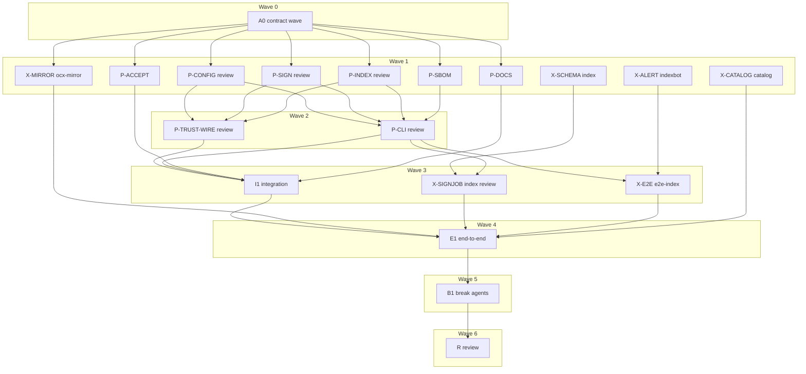

# Plan: signed index catalogs, Sigstore instance tables and the `ocx.sh` signing job

## Status

- **Plan:** plan_signing_dogfood_index_signing
- **State:** landing
- **Tier:** xhigh
- **Tier-grammar:** 5
- **Active phase:** 9 — fix pass and finalize, past both caps on the owner's instruction "fix and finalize" (2026-11-25)
- **Step:** finalized
- **Feature branch:** `hex/signing-dogfood-index-signing`; pipelines on `hex/signing-dogfood-index-signing--<pipeline>`
- **Last update:** 2026-11-25 (finalize: `origin/main` f41c6684 had not moved, series squashed to one commit)
- **Open at approval:** none; the seven docket questions are decided in § Docket, under goal-loop authority
- **Review:** three rounds; round 3 asked for one documentation fix (the slug an oversized catalog exits with, in `explanation/signing.mdx`). It is applied together with the two reference gaps and the license header of ocx-sh/ocx#780. Not re-reviewed: the review cap was spent
- **Next:** the owner merges the five pull requests in the order of § "PR order and release constraint"; the pin in ocx-sh/index#1606 is all-zero until step 3 of that order
- **Reviewed:** c7056f7f88dd2b4446d3e5787aae5a91c01ec856

---

## Overview

Goal: `.agents/goals/signing-dogfood-index-signing.md`. Source: `.agents/discussions/signing-dogfood-index-signing.md`
(handed off to this loop). Classification: **feature** (`workflow-feature.md`), scope large, six repositories,
one one-way door (the `[trust.sigstore]` break, granted). Authority for the design: the accepted
[`adr_publisher_trust_distribution.md`](./adr_publisher_trust_distribution.md) Sequencing item 4, **amended by this
plan in the design phase** (§ Amendment: slice 4 as planned in that ADR, committed with this plan). The amendment
records the two owner departures (no registry-level `sigstore` key; keyless `ocx index sign`) and every name the
mirror loop builds on. Companion design: [`system_design_publisher_trust.md`](./system_design_publisher_trust.md) § 8
summarises slice 4 at the ADR's first wording; where it disagrees, the amended ADR and this plan govern.

**What ships.**

1. `[sigstore."<fulcio-authority>"]` tables replace `[trust.sigstore]`, which is refused by name (exit 78).
2. Keyless signer entries take a `sigstore` field naming a table; no field means the public instance.
3. `ocx index sign <DIR>` writes `expires` into `c/index.json` and signs its exact bytes into
   `c/index.json.sigstore.json`, keyless or with `--key`.
4. The client checks the catalog signature, its expiry and each root file's digest against the catalog on the
   remote-to-local path, under `index_signature = off | warn | enforce` (default `warn` for `ocx.sh`).
5. `ocx package sbom --dependencies | --no-dependencies`.
6. In the satellites: the index schema admits `expires`; the `ocx.sh` deploy workflow signs on every change and
   weekly; an expiry alert in `ocx-sh/indexbot`; an end-to-end proof in `ocx-sh/e2e-index`; the ocx-mirror
   lockstep; a catalog-renderer docs fix.

**Research.** None run by this plan (research axis skipped): the discussion's research stands
([`research_multi_instance_sigstore_config.md`](./research_multi_instance_sigstore_config.md) and the signing-dogfood
research set). Discovery ran four Sonnet workers over the index fetch path, the signing CLI, the trust and config
architecture, and the five satellites; their findings are folded into the contracts below with file anchors.

**Interface changes.**

- **Break, granted:** `config.toml` `[trust.sigstore]` is refused. Config is not a gated contract document, so the
  record is the `config.json` schema golden plus a `!` subject.
- **Additive:**
  - the `c/index.json` field `expires`;
  - the new file `c/index.json.sigstore.json`;
  - the `config.toml` keys `[sigstore.*]`, `index_publishers`, `index_signature` and `index_expiry`;
  - the `sigstore` field on keyless entries;
  - the command `ocx index sign` with report root `index_sign`;
  - the flags `--sigstore` (verify, sbom), `--dependencies`/`--no-dependencies` (sbom) and
    `--verify`/`--no-verify` (index update, index sync, and every other `index` verb that reads a remote
    source, R2-FIX);
  - the `package` field on sbom entries;
  - the new `error.detail` slugs.
- **Meaning change:** `OCX_SIGSTORE_TRUSTED_ROOT` is now the environment form of `--sigstore-trusted-root`, read by
  `ocx package verify` and `ocx package sbom` only, and replaces the root of the *selected* instance (IC-16: the
  `cli.json` summary moves, carried by the same `!` subject).

**Breaks that need a `!` subject at landing** (recorded for `/hex-finalize`; it composes the subjects):

1. `config.toml` `[trust.sigstore]` is replaced by `[sigstore."<host>"]` tables.
2. `OCX_NO_VERIFY` and `--no-verify` now also skip the signed index catalog check.
3. `OCX_SIGSTORE_TRUSTED_ROOT` is read by `ocx package verify` and `ocx package sbom` only, and applies to the selected
   Sigstore instance only.

**Suggested landing subject** (finalize squashes the series to one commit, and the subject is the changelog line):
`feat(trust)!: signed index catalogs and Sigstore instance tables; [trust.sigstore] is refused`.

## Decisions

Closed by the owner (source § Decisions); restated only where a contract depends on them:

- 2026-11-26, owner decision: `OCX_SIGSTORE_TRUSTED_ROOT` is read by `ocx package verify` and `ocx package sbom`
  only; multi-package paths never read it.

- Two loops. This loop does index signing. The mirror loop is
  `.agents/discussions/signing-dogfood-mirror.md`.
- The tables replace `[trust.sigstore]` as a hard break, refused by name.
- There is no registry-level `sigstore` key.
- `ocx index sign` takes the package-sign flags for key and keyless.
- Two follow-ups stay outside: the TUF mirror (`[mirrors]` `trust_root` role) and signing of the managed
  configuration.
- `ocx.sh` rolls out to `warn`, not `enforce`.
- Production acts stay with the owner.

Decided here, each with its reason (the § Docket and § Doubts resolved carry the research):

- **P-D1 Signature format: DSSE in a v0.3 bundle.** The bundle is a `dsseEnvelope` over an in-toto Statement with
  subject `c/index.json` and predicate type `https://ocx.sh/attestation/index-catalog/v1`. It is not a
  `messageSignature`, for two reasons:
  - The repository already writes and verifies DSSE: `ocx_sign/src/attest/{dsse,statement}.rs`, with `pae`,
    `build`, `parse` and `binds_subject`.
  - Its `messageSignature` builder was deleted, and the verify pipeline refuses that shape on purpose
    (`ocx_sign/src/verify/pipeline.rs:1633`, `sign/bundle.rs:590-614`).

  The predicate type is the domain separator. A signature the same identity made over anything else cannot pass as
  a catalog signature. The predicate is `{"registry": "<registry>"}`, and the verifier compares it with the
  registry the index source serves, never its URL. So one identity signing two indexes cannot have one catalog
  accepted for the other, and a mirror of `ocx.sh` still passes (security review Block 3, codex).
- **P-D2 `expires`.** It is a top-level RFC 3339 UTC string inside the signed bytes, so the signature covers it. A
  verified catalog that carries no `expires` is treated as expired (`index_catalog_expired`, reason "no expiry").
  Without this rule a freeze or replay of a signed catalog would be unbounded. Two more bounds:
  - an `expires` more than 400 days ahead is refused as `index_signature_invalid`, so one stolen short-lived
    token cannot mint a catalog valid indefinitely (the signer's maximum is 366);
  - the client keeps the highest `expires` it has verified per source, and refuses a lower one as
    `index_catalog_rollback`. That bounds a replay inside the 30-day window.
- **P-D3 One verdict per source per process.**
  - What is checked: the catalog and its signature are fetched once, then held.
  - Where the verdict applies: every remote catalog read (`fetch_catalog_strict`) and every remote root read
    (`fetch_root`, `fetch_root_uncached`), whether or not the root is committed afterwards. `ocx update` reads
    roots with `ChainMode::Remote` and never commits them, and `ocx package prune` reads uncached roots, so a check
    placed only at the commit would miss both (security review Block 1).
  - **Accepted limit:** roots already committed locally are not re-checked; local state is trusted, and a
    committed resolve makes zero requests. A store moved from `warn` to `enforce` re-validates on the next
    `ocx index update`, which re-reads every committed root (codex).
  - Under `off` the client fetches nothing extra and behaves byte-for-byte as before (non-breaking requirement).
- **P-D4 The root digest uses the existing catalog map.** The catalog already maps `<ns>/<pkg>` →
  `sha256:<root digest>` (`ocx_index/src/wire.rs:124-131`). The check hashes the fetched root bytes
  (`CachedRoot`) before `merge_root` re-serializes them. No wire change to `packages`, so the catalog renderer and
  the mirror keep reading it unchanged.
- **P-D5 Check injected through `ocx_index::CatalogVerifier`.** It is implemented in
  `ocx_package_manager::index_trust`, because `scripts/crate_map.toml` forbids `ocx_index → ocx_sign/ocx_trust`.
  `OcxIndex` takes it through a builder method with no default verifier. Code that constructs `OcxIndex` without
  one, ocx-mirror among them, compiles unchanged and checks nothing.
- **P-D6 The built-in `ocx.sh` signer list applies to the registry `ocx.sh` whatever index URL it is routed to.**
  A mirror or proxy is never a trust point (ADR positive consequence). The cost is accepted and named in the mirror
  loop: an `ocx.sh` index reached through a mirror warns until that loop serves the upstream bytes unchanged.
- **P-D7 Signing defaults with no registry-level key.**
  - `ocx package sign`, `attest` and `push`, and `ocx index sign`, select the table by the authority of
    `--fulcio-url`. Without the flag they use the public instance.
  - Key mode has no Fulcio. It selects the table whose `rekor_url` authority equals `--rekor-url`'s, and without
    the flag the public table.
  - Cost, accepted under the owner's decision: a private-instance signer passes `--fulcio-url` on every run, where
    `[trust.sigstore] fulcio_url` set it once before.
  - `rekor_upload` moves into the instance table.

## Scope

### In scope

The ten source requirements, in full (§ Goal coverage maps each to contracts and pipeline steps).

### Out of scope (source § Intent)

- `enforce` for `ocx.sh`.
- The TUF mirror.
- Managed-config signing.
- Rekor v2 ([ocx-sh/ocx#107](https://github.com/ocx-sh/ocx/issues/107)).
- Every mirror feature.
- The index bot's `publishers` rules and the catalog badges.
- Production acts: `publishers` or a signature in the production index, a release, a merge.
- `ocx.toml`'s `[trust.sigstore]`. It was never read (`ocx_project` ignores it) and becomes an ignored unknown
  key. Only `config.toml` tiers and managed payloads are refused (§ Doubts resolved Q-14).

## Component contracts

IDs: C-0xx Sigstore tables, C-1xx index signing, C-2xx client check, C-3xx sbom, C-4xx docs and contract files,
C-5xx satellites. **No plan or contract ID goes into a source comment** (`code-docs.md` LNK-01).

### Sigstore instance tables (P-CONFIG, P-SIGN, P-CLI)

- **C-001 Table shape.** `Config.sigstore: Option<BTreeMap<SigstoreAuthority, SigstoreInstance>>`.
  - Location: `ocx_trust`, next to the `SigstoreTrust` type it replaces (`ocx_trust/src/lib.rs:76-122`).
    `SigstoreTrust` is deleted.
  - `SigstoreInstance` fields:
    - `trusted_root: Option<PathBuf>`;
    - `trusted_root_json: Option<String>`, mutually exclusive with `trusted_root` (78 when both are set);
    - `fulcio_url: Option<String>`;
    - `rekor_url: Option<String>`;
    - `rekor_upload: Option<bool>`;
    - `system_locked: bool`, which is not serialized, the same as today.
  - No `deny_unknown_fields` (fleet forward-compat).
  - Merge is per table and per field, last tier wins, as the old table merged at `lib.rs:134-153`.
  - Relative-path anchoring (`anchor_relative_root`, `lib.rs:157`) applies per table.
  - `retain_system_locked_sections` (`loader.rs:1248-1255`) keeps a locked table whole.
- **C-002 Authority key.** `SigstoreAuthority` is a newtype over the lowercase `host[:port]`.
  - Only `:443` is dropped. Every other port stays, so `http://h` maps to `h:80`, not `h`: a bare table key has
    no scheme to judge a default by.
  - It is parsed from a table key and from a URL by the same function, through the `url` crate's host parser
    (IDNA applied).
  - It is refused (78, slug `sigstore_authority_invalid`) when it is empty, carries a scheme, path, userinfo or
    query, ends in a dot, or is not a valid host.
  - The public instance is `fulcio.sigstore.dev`, a built-in table with the public Fulcio and Rekor URLs and the
    TUF root. A user table under that key overrides its material field by field.
- **C-003 Table validation.**
  - When `fulcio_url` is present, its authority must equal the key (78, slug `sigstore_table_key_mismatch`).
    Absent, it defaults to `https://<key>`.
  - `rekor_url` is optional. Verification takes tlog keys from the trusted root and needs no URL. Signing with a
    Rekor upload against a table with no `rekor_url` fails 78, slug `sigstore_rekor_url_missing`. For the public
    table the URL defaults to `ocx_oci::endpoint::DEFAULT_REKOR_URL`.
  - Every configured URL still passes `validate_sigstore_url` before it is dialled (SSRF guard, unchanged).
- **C-004 `[trust.sigstore]` refused by name.** The check is a raw `toml::Table` probe before the typed parse, in
  the shape of `strip_managed_update` (`loader.rs:396-408`).
  - It covers four places: every `config.toml` tier, a managed payload, the `ocx config push` input
    (`managed_config/publish.rs` `validate_managed_config_payload` `:269`), and `ocx config test`, which reaches
    the probe through the loader (a test row in P-CONFIG proves it).
  - It refuses every TOML form: a `[trust.sigstore]` table, a dotted `trust.sigstore.x` key, an inline table, and
    an array of tables. Each form gets one test.
  - Exit 78, slug `trust_sigstore_retired`, a new variant on the `ocx_config` error with `#[exit(ConfigError, …)]`.
  - The message names the file and both halves of the move:
    `` `[trust.sigstore]` is no longer read; move its keys to `[sigstore."<fulcio host>"]` (the host of its fulcio_url, or "fulcio.sigstore.dev"), and add `sigstore = "<fulcio host>"` to each keyless signer that trusted it ``.
    The second half matters: moving only the keys leaves keyless `[[trust.policy]]` signers verifying against
    the public instance, which the old table had replaced.
  - The probe must fire before the typed parse. Once the field is gone, the typed parse would drop the table
    silently and widen trust to the public instance.
  - **A stale managed snapshot must not lock a fleet out.** `ocx config update` loads the existing snapshot with
    this probe lowered to one warning, so the refresh that replaces the snapshot can run. Every other command
    refuses.
- **C-005 Managed-payload rules per table.** `guard_managed_sigstore_trust` (`loader.rs:414-480`) generalises to
  every table:
  - `trusted_root` (a path) is always stripped;
  - `trusted_root_json`, `fulcio_url` and `rekor_url` are stripped unless the `[managed].source` is digest-pinned;
  - `rekor_upload` from an unpinned source is honoured only as `true`. A movable tag must not turn transparency
    off for every key-mode signer in a fleet.
  - `inline_trusted_root` (`publish.rs:372`), which hardcodes `trust.sigstore`, moves to `[sigstore."<authority>"]`
    for each table that has a `trusted_root` path.
- **C-006 Convention path and cache per instance.**
  - The public instance keeps `$OCX_HOME/sigstore/trusted-root.json` (`loader.rs:1294`) and its cache file.
  - Another instance uses `$OCX_HOME/sigstore/instances/<host>_<port>/trusted-root.json`, with the port always
    written (443 included). The name is injective because the port is all digits and comes last. An IPv6-literal
    authority has no convention path, and its table must name `trusted_root` or `trusted_root_json`.
  - The trust-root cache keeps `cache_key_for_rekor` (`trust_cache.rs:126`) for the public instance. Every other
    instance goes to `state/trust_root/instances/<hex sha256 of the authority>.json`, a separate subdirectory.
    So a table keyed `rekor.sigstore.dev` cannot collide with the public entry, and `a:5555` cannot collide with
    `a_5555` (`to_relaxed_slug` maps `:` to `_` and is not used here).
- **C-007 Per-instance trust-root ladder.** `resolve_trust_root` / `resolve_local_trust_root`
  (`verify/trust_resolve.rs:29,51`) take the selected `SigstoreAuthority` and its `SigstoreInstance`. The six
  sources stay in today's order and scope down to that instance:
  1. flag `--sigstore-trusted-root`;
  2. `OCX_SIGSTORE_TRUSTED_ROOT`;
  3. the table's `trusted_root` / `trusted_root_json`;
  4. the convention path;
  5. the cache;
  6. TUF, for the public instance only. A private instance with none of the first five fails 78, slug
     `sigstore_trusted_root_missing`.

  Steps 1 and 2 are read by `ocx package verify` / `sbom` only, and replace only the instance the run selected: the
  instance named by `--sigstore`, else the public one. Signing selects its instance by P-D7 and reads neither.
  Auto-verify, policy roots and the catalog check start at step 3 for every instance they span.

  A test per path shows that an override set for one instance never replaces another instance's root, and that no
  other path reads the variable.
- **C-008 `sigstore` field on keyless signer entries.**
  - `KEYLESS_FIELDS` (`ocx_trust/src/publishers.rs:17`) gains `sigstore`.
  - `KeylessMatcher` / `CompiledKeyless` (`lib.rs:423-468,712`) carry `instance: SigstoreAuthority`, defaulting to
    `fulcio.sigstore.dev`.
  - The field is valid in three places: index `publishers`, `index_publishers` and `[[trust.policy]]` signers.
  - On a `key` entry the field is invalid: `publishers_invalid` (65) from an index, 78 from config.
  - The test that pins `sigstore` as unknown (`publishers.rs:323`) is rewritten to accept the field.
  - Only an older binary still reads the field as unknown (82). That is the published-index cost the owner
    accepted.
- **C-009 Verification partitions by instance.**
  - For a keyless candidate, `Verifier` (`verify/pipeline.rs:919`, `VerifyContext.trust_root` `:149`) runs once per
    instance named by at least one usable entry, against that instance's trust root, which is resolved lazily on
    first use.
  - The identity match at `:1397` runs only over that instance's entries.
  - An entry naming an authority with no local table matches nobody: no network, no error of its own. A candidate
    with no other match ends in today's mismatch outcome (77).
  - `AutoVerify` (`auto_verify.rs:485-581`) and `decide_rounds` (`signer_rounds.rs:326`) carry the instance through.
  - `key` candidates still need no Sigstore network (ADR amendment of `adr_offline_verify_trust_cache.md`).
- **C-010 Signing selects the table.** `resolve_endpoint` / `resolve_sigstore_pair`
  (`package_sign_common.rs:193-230`) take `Option<&SigstoreInstances>` in place of `Option<&SigstoreTrust>`. The
  lookup is the one P-D7 states. The self-check after signing uses the selected instance's trust root. This covers
  `ocx package sign`, `attest`, `push` and `ocx index sign`.
- **C-011 Explicit-flag verification names an instance.**
  - `ocx package verify` and `ocx package sbom` gain `--sigstore <AUTHORITY>`. It requires
    `--certificate-identity` and sets the instance of the ad-hoc entry those flags build. Without it the instance
    is the public one.
  - Help text states the default and what the flag does, and no history (`quality-cli-help.md`).

### Index signing (P-INDEX, P-SIGN, P-CLI)

- **C-101 Wire.** In `ocx_index` (`wire.rs`, `wire_writer.rs`):
  - `CatalogDocument` gains `expires: Option<DateTime<Utc>>`, serialized as RFC 3339 with seconds and `Z`, and
    omitted when `None`. `chrono` is already a workspace dependency.
  - `serialize_catalog` (`wire_writer.rs:26`) stays the single writer.
  - Constants: `CATALOG_PATH = "c/index.json"` (if one does not already exist) and
    `CATALOG_SIGNATURE_PATH = "c/index.json.sigstore.json"`.
  - Code that builds a `CatalogDocument` literal gets `expires: None` (`regenerate_catalog`, ocx-mirror).
- **C-102 Detached statement signing.** New module `ocx_sign::detached`:
  - `pub async fn sign_statement(payload: &[u8], subject_name: &str, predicate_type: &str, signer: &dyn Signer, endpoints: &SigningEndpoints) -> Result<SignedStatement, SignError>`
    builds the in-toto Statement v1 (`attest/statement.rs`), the PAE (`attest/dsse.rs`), signs it, records it in
    Rekor when asked, and returns the v0.3 bundle bytes plus the signer identity and tlog index.
  - `pub async fn verify_statement(payload: &[u8], bundle: &[u8], subject_name: &str, predicate_type: &str, predicate_check: &dyn Fn(&serde_json::Value) -> bool, signers: &CompiledSigners, roots: &dyn TrustRootSource) -> Result<VerifiedStatement, VerifyErrorKind>`
    refuses each of the following:
    - a bundle over 256 KiB, or one that does not parse;
    - a non-DSSE content;
    - a payload type other than `application/vnd.in-toto+json`;
    - a statement with other than exactly one subject. This is a new check: `binds_subject`
      (`attest/statement.rs:158`) accepts any one matching subject among several and is not reused;
    - a subject name ≠ `subject_name`;
    - a subject digest ≠ sha256(`payload`);
    - a predicate type ≠ `predicate_type`, or a predicate the caller's check refuses (the registry, P-D1);
    - a failed signature, certificate chain or tlog proof.

    The bundle goes through the pipeline's `BundleParts` parse (`verify/pipeline.rs:1608`) in Attestation mode, so
    a keyless bundle with no tlog entry stays unrepresentable. A key-mode bundle without a tlog entry is valid,
    as on the package path.

    It returns the matched signer entry. Names may change in A0; the semantics may not. Verification reuses the
    pipeline's certificate, tlog and identity helpers, lifted to `pub(crate)` where they are private now. It does
    not duplicate them.
  - No change to `external/sigstore-rs` is expected. If A0 finds one unavoidable, it stops and reports a blocker
    (fork changes need a PR against `ocx/integration`, which no grant covers).
- **C-103 `ocx index sign <DIR>`.** New leaf `crates/ocx_cli/src/command/index_sign.rs` under the `Index`
  dispatcher.
  - **Flags.** The flattened `KeyOpt` and `RekorUploadOpt` groups, plus `--fulcio-url`, `--rekor-url`,
    `--identity-token-file`, `--identity-token-stdin` and `--no-tty`, declared the way `package_sign.rs:25-118`
    declares them. Where those flags are not already groups, A0 moves them into one shared `options::` group that
    both commands flatten, so the two cannot drift.
  - **Not taken, with reason:**
    - `--signature-format`: a detached file has one format;
    - `--no-cache`: it bypasses only the referrers cache, which this command never reads (RUL-72: no inert flag);
    - `--platform`, `--tags`, `--tags-file`: no package.
  - **`--registry <REGISTRY>`** is required and is written into the predicate (P-D1). It names the registry the
    index serves, for example `ocx.sh`.
  - **`--expires-in-days <N>`** is an integer, default 30, max 366. `0` writes `expires = now`, for the expired
    fixture.
  - **Flow (sign first, write last):**
    1. Refuse `--offline` (81, `refuse_when_offline`).
    2. Read `<DIR>/c/index.json` through `ocx_util::fs::read_bounded`. A file error keeps its existing
       classification; an unparseable catalog is 65.
    3. Set `expires`, keeping every other member, and serialize with `serialize_catalog` into memory.
    4. Sign those in-memory bytes (C-102). A failure here returns with both files untouched.
    5. Write both new files as temp files beside their targets, then rename the catalog, then the signature.
       Use `persist_temp_file` with default permissions (`write_private_file_atomic` is wrong: the files are
       published).
    6. Report.

    An interruption between the two renames leaves a new catalog beside the old signature. The recovery is to
    re-run the command, which is idempotent apart from a new `expires`. Clients refetch once, then refuse or
    warn (C-208). The deploy job's smoke check (C-502) catches a pair left that way before it is served.
  - The identity token is handled as in `package_sign.rs`: `resolve_override_token :57`, `Credential` class,
    never logged.
  - **Report root `index_sign`:** `schema_version`, `catalog_path`, `signature_path`, `catalog_digest`,
    `expires_at`, `signer` (the vocabulary type `package sign` reports), and `tlog_index`, omitted when no Rekor
    upload happened.
  - **Plain rendering:** one line per path plus the expiry.
- **C-104 Help.** `ocx index sign` help says what it writes, that it signs keylessly unless `--key` is given, and
  links `https://ocx.sh/docs/explanation/signing#index-signatures`. ASCII only.

### Client check (P-INDEX, P-TRUST-WIRE, P-CLI)

- **C-201 Config keys.** Under `[registries."<registry>"]`, in `ocx_config/src/registry.rs` next to `signatures`
  (`:67`), with merge at `:96-115`:
  - `index_publishers: Option<Vec<toml::Value>>`, kept raw in config and compiled by `ocx_trust` the way
    `publishers` compiles;
  - `index_signature: Option<IndexSignatureMode>` with values `off | warn | enforce`;
  - `index_expiry: Option<IndexExpiryMode>` with values `check | ignore`.

  An unknown enum value is a config error, 78. The keys apply to the registry's index source
  (`ocx_index::OcxIndexConfig`, built in `Context::build_index_sources`, `context.rs:787-830`).
- **C-202 Resolution.**
  - **Signer list:** `index_publishers` when set (it replaces, never unions). Otherwise the built-in list when the
    registry is `ocx.sh`. Otherwise none.
  - **Mode:** `index_signature` when set. Otherwise `warn` when a signer list exists. Otherwise `off`.
  - **`enforce` with no list** fails 78, `index_publishers_missing`.
  - **No usable entries:** a list whose entries are all unrecognised fails 82 `index_publishers_unrecognized`
    under `enforce`. A malformed entry fails 78 `index_publishers_invalid` at the point it is compiled.
- **C-203 Built-in `ocx.sh` list.** It is one keyless entry, held as one constant in
  `ocx_package_manager::index_trust`:
  - identity `https://github.com/ocx-sh/index/.github/workflows/render-deploy.yml@refs/heads/main`;
  - issuer `https://token.actions.githubusercontent.com`;
  - `claims`: `source_repository_identifier = "1297393033"` and `source_repository_owner_identifier = "263156444"`,
    read with `gh api repos/ocx-sh/index`;
  - no `sigstore` field, which means the public instance.

  A unit test pins the constant, and a doc sentence on `website/.../signing.mdx` names the identity.
- **C-204 Managed payload.** `index_publishers` from a managed payload is honoured only when the
  `[managed].source` is digest-pinned, or when it comes from a local tier. Otherwise it is stripped with one
  warning naming the registry, in the shape of `guard_managed_sigstore_trust`. `index_signature` and
  `index_expiry` from an unpinned managed payload may only tighten (`off` < `warn` < `enforce`; `ignore` → `check`).
  A loosening value from an unpinned source is dropped with one warning; a pinned or local tier may loosen. The
  managed tier merges over the user tier (`loader.rs:136-145`), so without this rule a movable tag could switch a
  user's `enforce` off, which would make the `index_publishers` strip pointless (security review W2).
- **C-205 `CatalogVerifier` seam.** It lives in `ocx_index` (new file `catalog_verifier.rs`).
  - `CatalogVerifier::check(&self, catalog_bytes: &[u8], signature: Option<&[u8]>) -> Future<CatalogVerdict>`.
  - `CatalogVerdict` is one of `Verified { document, signer: String }` (a display description; `ocx_index` cannot
    name an `ocx_trust` type, `scripts/crate_map.toml:33`), `Unsigned`, `Invalid(reason)`,
    `PublisherMismatch`, `Expired { expires: Option<DateTime<Utc>> }` and `Unrecognized`. Each failure carries
    enough to build its error.
  - `OcxIndex::with_catalog_verifier(Arc<dyn CatalogVerifier>, IndexCheckMode)`.
  - Async-trait style follows the house style that `ocx_index` already uses.
- **C-206 Catalog slot.** Each `OcxIndex` with a verifier holds a `CatalogSlot`: a `tokio::sync::Mutex` over
  `{ snapshot: Option<Arc<CatalogState>>, refetched: bool }`, where `CatalogState` is
  `{ bytes, document, verdict }`. A `OnceCell` cannot hold the refetch, because the slot must be replaced once
  (codex, security review W5).
  - The first remote call that needs the slot fills it under the lock, so concurrent callers share one fetch.
    Those calls are `fetch_catalog_strict` (`ocx_index.rs:994-1004`) and the remote root reads (`fetch_root`
    `:794-824`, `fetch_root_uncached` `:932`).
  - The signature comes from `<index base>/c/index.json.sigstore.json`. A 404 means `Unsigned`.
  - **Any other signature-fetch failure** (timeout, 5xx, TLS) follows the mode: under `warn` it is one WARN and the
    verdict `Unsigned`; under `enforce` the transport error propagates as today (69/75). A signature outage never
    fails a `warn` run, which is the `ocx.sh` default (codex).
  - The signature body is capped at 256 KiB **while streaming**. The transport's existing stop is only
    `MAX_INDEX_DOCUMENT_BYTES` (`ocx_index.rs:298`).
- **C-207 Root digest.** Inside `fetch_root` and `fetch_root_uncached`, before the root memo is filled and before
  any caller sees the bytes, the sha256 of the fetched root bytes must equal `packages["<ns>/<pkg>"]` of a
  `Verified` catalog. Every reader inherits the check:
  - the commit sites `chained_index.rs:554` (Tags) and `:1024` (Routing), `refresh_tags`, and `import_published :750`;
  - `ocx update` (`ChainMode::Remote`, which never commits, `context.rs:745-754`);
  - `ocx package prune` (`ocx_package/src/prune.rs:519`).

  The Routing commit at `chained_index.rs:1020-1028` swallows its own error at debug level. The digest check sits
  upstream of that site, so the swallow cannot lose an `IndexTrustError`.
  - A missing catalog entry fails `index_package_not_in_catalog` (79). A different digest fails
    `index_root_digest_mismatch` (65).
  - **A listed root the server does not serve** (404, where `fetch_root_document` returns `Ok(None)`,
    `ocx_index.rs:1194-1197`) fails `index_root_not_found` (79) under `enforce`. It never falls through to the
    raw registry source (`context.rs:768-772`), which would resolve the package with no `publishers`: the T8
    downgrade (security review Block 2). Under `warn` it is one WARN and today's fall-through.
  - An unverified catalog under `warn` checks no digests (nothing trusted to compare against) and warns once.
- **C-208 One uncached refetch, owned by the slot.** On `Invalid`, `PublisherMismatch`, a rollback, a root-digest
  mismatch, a missing entry or a listed root the server does not serve, the client refetches once before its
  verdict:
  - the catalog and the signature (and the root, for the root cases), through the existing
    `IndexTransport::get_uncached` (`ocx_index.rs:87`, `Freshness::Revalidate`, which `fetch_root` already uses).
    The transport gains nothing.
  - The refetch runs under the slot's lock, at most once per source per process (`refetched`). Concurrent
    mismatches wait for that one refetch.
  - The new catalog and signature are verified again. The new snapshot replaces the old one, and from then on
    roots are compared only against the new snapshot, never the first verdict paired with the second bytes.
    Roots already returned against the first snapshot stand.

  This covers the CDN deploy order: catalog and signature upload last on Bunny, and Cloudflare Pages switches
  atomically. The second answer is final for the process.
- **C-209 Expiry and rollback.** These apply to a `Verified` catalog.
  - When `now >= expires`, or `expires` is absent, the verdict is `Expired`. `index_expiry = "ignore"` turns that
    verdict into `Verified`. Clock skew gets no tolerance, and `ignore` is the escape.
  - An `expires` more than 400 days after now is `Invalid` (P-D2), even under `ignore`.
  - The client stores the highest verified `expires` per source in
    `state/index_catalog/<source-slug>.json` (`{ "expires_high_water": … }`), through the durable-write helper. A
    verified catalog with a lower `expires` is `index_catalog_rollback` (65). The file is updated only on
    `Verified`, never under `--no-verify` or `off`, and never offline. It is ephemeral state (`state/`), not GC
    truth, so deleting it resets the bound. Under `warn` a rollback is one WARN.
- **C-210 Modes.**
  - `off`: no catalog or signature fetch beyond today's, and no check.
  - `warn`: every non-`Verified` verdict and every root failure logs exactly one WARN per source per process, and
    the command continues with the bytes it fetched. The WARN names the registry, the reason and
    `index_signature = "enforce"`/`"off"`, and never prints certificate contents.
  - `enforce`: every failure refuses with its slug:

    | Exit | Slug |
    |---|---|
    | 79 | `index_signature_not_found` |
    | 65 | `index_signature_invalid` |
    | 77 | `index_publisher_mismatch` |
    | 82 | `index_publishers_unrecognized` |
    | 81 | `index_catalog_expired` |
    | 65 | `index_catalog_rollback` |
    | 65 | `index_root_digest_mismatch` |
    | 79 | `index_package_not_in_catalog` |
    | 79 | `index_root_not_found` |

    The slugs live in a new `IndexTrustError` in `ocx_index`, classified with `#[derive(Classify)]`, so the
    verdict, the error and its code sit in one crate.
- **C-211 `--no-verify`.** `context.no_verify()` (`OCX_NO_VERIFY`, `context.rs:520`) skips the check: the verifier
  is not attached, and the run prints the single warning line `--no-verify` already prints.
  - `ocx index update` and `ocx index sync` flatten the same verification flag group that `install` and `pull`
    flatten (`options/verify.rs`), so `--no-verify` is accepted there.
  - Committed local roots are never re-checked. A committed local resolve makes zero requests (ADR validation
    row).
- **C-212 Wiring.** `Context::build_index_sources` builds one `ocx_package_manager::index_trust::IndexTrust` per
  source that has a mode other than `off`. Its inputs: the resolved signer list, the mode, the expiry setting, the
  `SigstoreInstances` and the trust-root inputs (flags, env, offline). It attaches the result with
  `with_catalog_verifier`. `build_auto_verify` (`context.rs:1180-1213`) passes the instances through (C-009).

### sbom (P-SBOM)

- **C-301 Flag pair.** New file `options/dependencies.rs`: `--dependencies` / `--no-dependencies`, with
  `overrides_with` on each other (POSIX last-wins), resolved by `Dependencies::enabled(default: bool)`. The
  template is `options/pull.rs`. `ocx package sbom` defaults to `false`.
- **C-302 Behaviour.** With `--dependencies`, the command lists the SBOM attestations of the root and of every
  package in its dependency closure for the selected platform.
  - The closure is resolved by the same walk `ocx package deps` uses (`walk_closure_nodes`, `tasks/common.rs:643`).
    If that walk needs installed content, A0 records it, and P-SBOM resolves the closure from registry metadata
    through the pull resolver, without materializing anything.
  - Each package is verified against its own signer set (its index `publishers` and operator policy).
  - Never a merged document.
- **C-303 Report.**
  - `SbomEntry` and `RefusedEntry` gain `package` (the package identifier). It is always emitted, which is
    additive.
  - `--dependencies` conflicts with `--output` (clap, 64), because several documents cannot be one byte stream.
  - It also conflicts with `--certificate-identity` / `--certificate-oidc-issuer` (64): one pinned identity cannot
    speak for a closure of different publishers.
  - `--summary` works per entry.

### Docs and contract files (P-DOCS, I1)

- **C-401 User docs.**
  - **Pages rewritten for the tables:** the § Trust Root ladder in `website/src/content/docs/explanation/signing.mdx`
    (lines 25-52), plus `self-hosted-sigstore.mdx`, `proxy-and-ca.mdx`, `managed-configuration.md`,
    `pin-signer-identity.mdx`, `project-file.md` (drops `[trust.sigstore]`) and `execution-records.md` if it
    names the table.
  - **Additions to `signing.mdx`:**
    - an `## Index signatures {#index-signatures}` section: what is signed, the three modes, expiry, the built-in
      `ocx.sh` signer, `--no-verify`, and how to sign one's own index (`ocx index sign`, a workflow excerpt);
    - a `sigstore` field paragraph.
  - **Rules:** product-context differentiator #12 and the CLI-at-a-glance line move to the tables. The
    `subsystem-oci.md` sentences that name `[trust.sigstore]` change too.
  - **Not written:** no migration prose. The break is announced by the commit subject only (AGENTS.md).
- **C-402 Generated files** (I1 regenerates them once):
  - `reference/configuration.md` (the tables and the three keys);
  - `reference/environment.md` (`OCX_SIGSTORE_TRUSTED_ROOT`, reworded);
  - `reference/command-line/**` (`index sign`, the new flags);
  - the `crates/ocx_schema/tests/golden/{config.json,project.json,cli.json,errors.json}` goldens, plus the
    report schema golden for `index_sign` and the sbom entry;
  - the contract baseline and ledger entries, only where the compat gate asks. New root, new command and new
    field are additive; IC-16's meaning change of `OCX_SIGSTORE_TRUSTED_ROOT` gets no ledger entry and moves the
    `cli.json` summary.
- **C-403 Exit rows.**
  - Every new slug gets its row in `crates/ocx_cli/src/exit/detail_rows.txt` and an `assert_detail` test.
  - IC-22 holds: each code already carries at least three slugs, and 83–87 stay retired.

### Satellites (X-* pipelines; each lands by pull request, merged by the owner)

- **C-501 `ocx-sh/index` schema.**
  - `schema/c-index.schema.json` gains an optional `expires` (`type: string`, `format: date-time`) and keeps
    `additionalProperties: false` for everything else.
  - New fixtures: `c-index-valid-expires.json`, `c-index-invalid-expires-type.json`, and the
    unknown-property fixture, kept red.
  - `site/src/docs/reference/wire-format.md` documents `expires` and `c/index.json.sigstore.json`.
  - The signature file has no schema: it is a Sigstore bundle.
- **C-502 `ocx-sh/index` signing job.** In `.github/workflows/render-deploy.yml`:
  - **A separate `sign` job.** The `deploy` job runs setup-bot, node and bun and holds the Cloudflare secrets
    (`render-deploy.yml:100-180`), so the OIDC token must not live there (security review W6). The flow:
    1. The render job uploads `dist` as an artifact after `task render:build` and `schema:validate:rendered`.
    2. The new `sign` job carries `permissions: { id-token: write, contents: read }` and no secrets. It downloads
       the artifact, runs only `setup-ocx` and `scripts/sign-catalog.sh dist` (new), and uploads the signed
       artifact. The script runs
       `ocx package exec ghcr.io/ocx-sh/dev/cli@sha256:<pin> -- ocx index sign dist --registry ocx.sh --expires-in-days 30 --no-tty`,
       keyless with the ambient GitHub OIDC token.
    3. Both deploy jobs `needs: sign` and deploy the signed artifact.
  - **Permissions:** the top-level `permissions: {}` stays. Only `sign` gets `id-token: write`.
  - **No signing on pull requests:** `sign` runs on `push`, `schedule` and `workflow_dispatch` from `main` only,
    so a dev binary's proof run cannot mint a certificate matching the production identity pin. The job logic is
    proven in `ocx-sh/e2e-index` (C-505), which runs the same script.
  - **Schedules:** a second cron, weekly (`17 4 * * 1`). The `guard` job lets it through when
    `github.event.schedule` equals that cron, even with main unchanged. Every other `*/15` tick keeps today's skip.
  - **Bunny upload:** `scripts/bunny-upload.mjs` uploads `c/index.json.sigstore.json` in phase 2, directly after
    `c/index.json`. Today a sibling under `c/` would upload in phase 0, before the catalog. A unit test or dry-run
    listing shows the order.
  - **Smoke test:** `scripts/smoke-test.sh` (`:247-290`) checks that the served signature exists and that
    `ocx index update` with `index_signature = "enforce"` passes against the served index, using the same pinned
    binary.
  - **The pin:** the loop proves the job with a dev build of the loop branch. Before merge, the owner swaps the
    pin for a dev build of ocx `main` that carries the client (§ PR order). After the release, a follow-up
    re-pins to the released `ocx.sh/ocx` package.
  - Whether `render-deploy.yml` is generated: its header is hand-written comments, so it is edited by hand
    (checked 2026-11-25, `origin/main`).
- **C-503 Expiry alert (`ocx-sh/indexbot`).**
  - A new subcommand `indexbot check-expiry --url <catalog URL> --min-days 21`. It fetches the URL and exits
    non-zero when `expires` is absent, unparseable, or less than `min-days` away, and prints the remaining days.
  - The alert also checks the served signature, because a fresh catalog beside a missing or stale signature
    would pass an `expires`-only check while `enforce` clients fail (codex). The workflow runs
    `cosign verify-blob-attestation` from the index's own `ocx.sh/sigstore/cosign` package. Its inputs are the
    bundle `c/index.json.sigstore.json`, the predicate type `https://ocx.sh/attestation/index-catalog/v1`, and the
    C-203 identity and issuer. Any failure fails the run. This also proves cosign interop.
  - If cosign's flags cannot verify a v0.3 DSSE bundle over a blob, `check-expiry` checks instead that the
    signature exists and that its statement's subject digest equals sha256 of the catalog. The builder records
    which form shipped.
  - It has unit tests in the repository's own style.
  - A new scheduled workflow `.github/workflows/catalog-expiry.yml` runs daily against `https://index.ocx.sh/c/index.json`
    with `permissions: { contents: read }` and no secrets. A failed run is the alert.
  - The indexbot render path is unchanged: it never reads `c/index.json` and only writes it, before signing
    (`core/render.py:105-117`, a worker reading; unverified here, X-ALERT re-reads it). The same holds for the
    C-504 anchors in `ocx-sh/catalog`, which X-CATALOG re-reads.
- **C-504 `ocx-sh/catalog`.** The docs statement that the catalog is "never digest-verified"
  (`docs/src/content/docs/explanation/security-and-trust-model.md:18,33`) is replaced with the signed-catalog
  model. A walker test feeds `src/sources/walker.ts:772-829` a `c/index.json` carrying `expires` and asserts the
  roots it yields. No code change is expected: `walker.ts` casts, and `sources_pipeline.ts:208-225` reads
  `format_version` only.
- **C-505 `ocx-sh/e2e-index`.**
  - **Variants:** `.github/workflows/pages.yml` builds five index variants under the Pages site, each a full copy
    of the index:
    - `keyless/`, signed keylessly by the job's own identity
      `https://github.com/ocx-sh/e2e-index/.github/workflows/pages.yml@refs/heads/main`, repository id
      1455949056;
    - `key/`, signed with a new key pair: the secret `E2E_INDEX_SIGNING_KEY` with
      `E2E_INDEX_SIGNING_KEY_PASSWORD`, and the public key committed as `keys/e2e-index-key.pub`;
    - `expired/`, signed with `--expires-in-days 0`;
    - `tampered/`, signed, then one `packages` value replaced by another existing root digest;
    - `unsigned/`.
  - **Order:** the `diff -r wire-src site-out` check runs before signing.
  - **Job shape:** as C-502. Signing runs in its own `sign` job with only `id-token: write` and `contents: read`,
    on the build job's artifact, and never on a pull request. Every `ocx index sign` call passes `--registry` with
    the registry name the e2e client config gives that variant, and the S-219 swap case relies on it.
  - **Scripts:** `scripts/sign-catalog.sh` is the same script as C-502's. A check in `client-e2e.yml` compares its
    sha256 with the copy in `ocx-sh/index`.
  - **Client cases:** `client-e2e.yml` runs the new `test/e2e/test_index_signature_public.py` from the ocx branch
    under test (§ Verification). That includes the previous release installing from `keyless/` and the alert
    script red on `expired/` and green on `keyless/`.
- **C-506 `ocx-sh/ocx-mirror`.**
  - **Branch:** a branch bumps `external/ocx` to the loop's ocx commit.
  - **Fixture:** `test/fixtures/signing/config.toml:19` moves to `[sigstore."<authority>"]`, together with
    `test/tests/test_signing.py:295-334`.
  - **Text:** comment and doc strings move to the new table name:
    - `ocx_cli/sign.rs:16,38,192,266`;
    - `ocx_mirror_error/src/lib.rs:212`;
    - `ocx_mirror_spec/src/sign_config.rs:113,209`;
    - `sign/tests.rs:77,164`;
    - `tests/fixtures/mirror-sign-keyless.yml:4`.
  - **Compile fixes:** each `CatalogDocument` literal gets `expires: None` (`registry_sync/catalog.rs:282-320`,
    `index_write.rs:679-695`).
  - **Gate:** `OCX_MIRROR_DIR=<that worktree> task satellite:verify` passes.
  - **Deliberately out:** `regenerate_catalog` still drops `expires` and the signature, so a mirrored `ocx.sh`
    index warns. That is the second loop's work.

## User-experience scenarios

| ID | Scenario | Expected |
|---|---|---|
| S-001 | `config.toml` still has `[trust.sigstore]` | Any command that loads config exits 78, slug `trust_sigstore_retired`, the message names the file and `[sigstore."…"]` |
| S-002 | Managed payload carries `[trust.sigstore]`; `ocx config push` input carries it | 78 on load; `config push` refuses before any network |
| S-003 | Keyless signature from the private test stack (`localhost:5555`), entry `sigstore = "localhost:5555"`, table present | Verifies |
| S-004 | Same signature, entry without `sigstore` (public trust root pre-seeded in the test home) | 77 mismatch: the private certificate does not chain to the public root |
| S-005 | Entry names `fulcio.other` with no table, sole entry | usable but unmatched (not unrecognised, so not 82) → 77, no network |
| S-008 | `OCX_SIGSTORE_TRUSTED_ROOT` set for the private stack during auto-verify of a public-instance package | the variable is not read; the public root comes from its table, convention file, cache or TUF (C-007) |
| S-009 | Unpinned managed payload sets `index_signature = "off"` over a user `enforce`; sets `rekor_upload = false` | dropped with one warning each; a pinned payload's value is honoured |
| S-010 | Managed snapshot still carries `[trust.sigstore]` | every command 78, except `ocx config update`, which warns and refreshes |
| S-006 | `ocx package sign --fulcio-url http://localhost:5555` | table `localhost:5555` supplies `rekor_url` and `rekor_upload`; self-check against its root |
| S-007 | `fulcio_url` authority differs from the table key | 78 `sigstore_table_key_mismatch` |
| S-101 | `ocx index sign dir` keyless (test stack) and `--key` | `c/index.json` gains `expires` (+30 d), bytes otherwise semantically equal; `.sigstore.json` written; `index_sign` report |
| S-102 | `ocx --offline index sign dir` | 81 |
| S-103 | `--signature-format` or `--no-cache` on `index sign` | 64 (unknown argument) |
| S-201 | `enforce`, catalog signed by listed key | update/install succeed; one catalog+signature fetch per process |
| S-202 | `enforce`, catalog signature missing / bytes tampered / other signer | 79 `index_signature_not_found` / 65 `index_signature_invalid` / 77 `index_publisher_mismatch` |
| S-203 | `warn`, any S-202 case | exactly one WARN line per source; command succeeds |
| S-204 | `enforce`, expired; then `index_expiry = "ignore"` | 81 `index_catalog_expired`; then succeeds |
| S-205 | `enforce`, root file bytes differ from catalog digest | 65 `index_root_digest_mismatch`; nothing committed locally |
| S-206 | `enforce`, root fetched for a package absent from catalog | 79 `index_package_not_in_catalog` |
| S-207 | First fetch sees old signature (CDN lag), refetch sees new | succeeds after exactly one refetch |
| S-208 | `--no-verify` / `OCX_NO_VERIFY=1` under `enforce` with a tampered catalog | succeeds with one warning |
| S-209 | `off` (non-`ocx.sh` registry, no keys) | zero extra requests (asserted by the request log of `StaticIndexServer`) |
| S-210 | Default config against a served index for registry `ocx.sh` (rerouted to a local static server) unsigned | one WARN, success (`warn` default) |
| S-211 | `enforce` with no signer list | 78 `index_publishers_missing` |
| S-212 | Unpinned managed source sets `index_publishers` | stripped, one warning; a pinned source's list is honoured |
| S-213 | Previous ocx release (`ocx-previous`) against a signed, `expires`-bearing index | installs as before |
| S-214 | Committed local root, offline | zero requests, no check |
| S-215 | `enforce`, `ocx update` (`ChainMode::Remote`) and `ocx package prune` against a tampered root | 65 `index_root_digest_mismatch` on both, though neither commits the root |
| S-216 | `enforce`, catalog lists the package, its root answers 404 | 79 `index_root_not_found`; no fall-through to the registry source |
| S-217 | `enforce`, a validly signed older catalog (lower `expires`) after a newer one was verified | 65 `index_catalog_rollback`; under `warn` one WARN |
| S-218 | `warn`, catalog served, signature URL times out or answers 500 | one WARN, success; under `enforce` the transport error (69/75) |
| S-219 | Two registries share one signer; catalog signed with `--registry A` served for registry B | 65 `index_signature_invalid` (predicate registry mismatch) |
| S-220 | `enforce`, catalog `expires` 500 days ahead | 65 `index_signature_invalid`, also under `index_expiry = "ignore"` |
| S-221 | Concurrent root fetches while the server switches catalog generations | one refetch, both roots judged against one snapshot each, never a mixed pair |
| S-301 | `ocx package sbom pkg` | root's documents only, entries carry `package` |
| S-302 | `ocx package sbom pkg --dependencies` | one entry set per closure package, each verified on its own publishers |
| S-303 | `--dependencies --output -` / `--dependencies --certificate-identity …` | 64 |

### Error taxonomy

| Exit | Slugs (new) | Next action |
|---|---|---|
| 65 DataError | `index_signature_invalid`, `index_catalog_rollback`, `index_root_digest_mismatch` | the served data is wrong; report to the index operator |
| 77 PermissionDenied | `index_publisher_mismatch` | the signer is not trusted; fix the list or the index |
| 78 ConfigError | `trust_sigstore_retired`, `sigstore_authority_invalid`, `sigstore_table_key_mismatch`, `sigstore_rekor_url_missing`, `sigstore_trusted_root_missing`, `index_publishers_invalid`, `index_publishers_missing` | fix the config |
| 79 NotFound | `index_signature_not_found`, `index_package_not_in_catalog`, `index_root_not_found` | the thing is not there |
| 81 PolicyBlocked | `index_catalog_expired` | loosen (`index_expiry = "ignore"`) or wait for a re-sign |
| 82 Unsupported | `index_publishers_unrecognized` | a newer ocx is needed |

No new exit code. IC-22 holds.

### Edge cases (unit tables in the owning pipeline)

- Authority parse:
  - `HTTPS://Fulcio.Sigstore.Dev:443/` maps to `fulcio.sigstore.dev`;
  - `http://h` maps to `h:80`;
  - `localhost:5555` is kept as written;
  - `[::1]:5555` is kept as written;
  - `a@b`, `host/path`, `host.` and the empty string are refused.
- Convention and cache names: `a:5555` and `a_5555` map to different files; a table keyed `rekor.sigstore.dev`
  never reads or writes the public cache file.
- `expires` 400 days ahead is accepted; 400 days and one second ahead is refused.
- `expires` boundaries: equal to now counts as expired; a second before now counts as expired; a second after now
  counts as valid. A malformed `expires` in a fetched catalog is 65 `index_signature_invalid`, because the catalog
  does not parse.
- Statement:
  - two subjects are refused;
  - a right digest under a wrong subject name is refused;
  - a right subject under the image-signature predicate type is refused;
  - an image-signature bundle of the same identity, replayed as the catalog signature, is refused.
- A 300 KiB signature file is refused before it is parsed.
- A catalog over the existing catalog read cap behaves as today.
- Concurrent root fetches in one process share one catalog fetch (the `CatalogSlot`).
- `index_publishers = []` makes a list with no usable entries: `index_publishers_unrecognized` under `enforce`. It
  counts as unrecognised rather than missing, because the key was set.

## Docket (question → research → decision)

Each Open question of the source, with the default the owner confirmed. Six stand. One is overturned, with
evidence.

1. **sbom `--dependencies` default.** Default `--no-dependencies`, one document per closure package, each verified
   against its own publishers. **Stands.** Research: `package_sbom.rs` already lists per-referrer entries
   (`SbomListingReport`), so per-package entries are additive, and a merged document would need SBOM-format
   knowledge OCX does not own (`quality-core.md` § Don't Own Non-Domain Code).
2. **`<host>` key.** The Fulcio host. **Stands**, refined to the *authority* (host plus non-default port). The test
   stack's Fulcio is `localhost:5555` (`test/tests/fixtures/sigstore_stack.py`), and `localhost` alone could not
   tell two local stacks apart.
3. **`fulcio_url`/`rekor_url` vs `SigningConfig`.** Keep the two keys. **Stands.** The research shows
   `SigningConfig`'s gain is Rekor v2 and timestamp authorities, and those arrive with
   [ocx-sh/ocx#107](https://github.com/ocx-sh/ocx/issues/107). Nothing named here blocks adding the document later
   as a third material key.
4. **Managed-payload index authority.** Honoured only from a digest-pinned or local source. **Stands.** It is the
   rule `guard_managed_sigstore_trust` (`loader.rs:414-480`) already applies to `trusted_root_json`.
5. **The trust-root sources with several instances.** The flag and the variable stay a one-run override for the
   selected instance; the convention path and the cache become per instance; public-good keeps today's paths.
   **Stands** (C-006, C-007).
6. **PR order.** Default: index schema, then signing job, then client with the mirror lockstep. **Overturned**,
   with evidence. The signing job needs a binary that has `ocx index sign`, and three facts follow:
   - The released ocx has no `ocx index sign`.
   - A dev build of the unmerged loop branch would hand an unreviewed binary an OIDC token that can sign as the
     production index identity (`id-token: write`, C-502).
   - Merging the client before the signing job is safe: nothing on `main` reaches users before a release, which is
     the owner's act. No CI job on `main` runs the built binary against `ocx.sh` (the Bazel acceptance targets run
     against local zot; the repository toolchain uses the released ocx through `setup-ocx`).

   **New order** (§ PR order):
   1. index schema;
   2. ocx client with the ocx-mirror lockstep;
   3. the owner builds a dev ocx from `main`, and the signing job is pinned to that digest and merged;
   4. the first production signing run;
   5. the expiry alert;
   6. the release.

   The catalog docs PR may land at any point.
7. **Expiry alert home.** A scheduled workflow in `ocx-sh/indexbot`, a failed run as the alert, proven against
   `ocx-sh/e2e-index`. **Stands** (C-503). The alert merges only after the first production signing run;
   before it, `index.ocx.sh` carries no `expires` and the alert would be red.

## Doubts resolved

| # | Question | Research | Decision |
|---|---|---|---|
| Q-1 | messageSignature or DSSE for the catalog signature | `ocx_sign` deleted its messageSignature builder and refuses that shape (`sign/bundle.rs:590-614`, `verify/pipeline.rs:1633`); DSSE pieces exist (`attest/dsse.rs`, `attest/statement.rs`) | DSSE with a dedicated predicate type (P-D1) |
| Q-2 | Does the client need a fork change in `external/sigstore-rs` | The DSSE verify path, trust root and tlog helpers are already in `ocx_sign`; `sigstore-rs` also exports `bundle::verify::Verifier::verify_digest` (`verifier.rs:117`) | No fork change planned; A0 stops with a blocker if it finds one |
| Q-3 | Where does `rekor_upload` live without `[trust.sigstore]` | No `[signing]` section exists in `ocx_config/src/lib.rs`; the key is a per-instance signing preference | In the instance table (C-001) |
| Q-4 | Which instance does a signer use without `--fulcio-url` | Owner decision: no registry-level key | Public instance; key mode by `--rekor-url` (P-D7); cost recorded |
| Q-5 | Is `fulcio_url` redundant with the key | The key drops scheme and path; the test stack is `http://` | Kept; its authority must equal the key (C-003) |
| Q-6 | Duration grammar for the validity | No duration parser in the tree; adding a crate for one flag fails `quality-core.md` YAGNI | `--expires-in-days <N>` |
| Q-7 | Which flags of `package sign` does `index sign` take | RUL-72: never accept an inert flag; `--no-cache` bypasses only the referrers cache (`package_sign.rs`) | All except `--signature-format`, `--no-cache`, `--platform`, `--tags`, `--tags-file` (C-103); plus a required `--registry` (P-D1) |
| Q-8 | Where can `ocx_index` call the verifier | `scripts/crate_map.toml`: `ocx_index` may not depend on `ocx_sign`/`ocx_trust` | Injected trait (P-D5) |
| Q-9 | Does a catalog listing (`index catalog`, `index list`) check too | Same remote document; one memo serves both | Yes, same verdict (P-D3) |
| Q-10 | Missing `expires` in a verified catalog | An unbounded signed catalog defeats the freeze bound | Treated as expired (P-D2) |
| Q-11 | Exit code for a missing signature | Slice 1 maps an unsigned package to 79 (ADR § Validation) | 79, same next action |
| Q-12 | Exit code for malformed `index_publishers` | Config-sourced, unlike index `publishers` (65) | 78 |
| Q-13 | Key pair for the `key/` e2e variant | `ocx-sh/e2e-package`'s key secret cannot be read or copied to another repository | New pair for `ocx-sh/e2e-index` |
| Q-14 | Refuse `[trust.sigstore]` in `ocx.toml` too | `ocx_project` never read it (worker finding: the project schema carries it, nothing consults it) | Not refused; becomes an ignored unknown key; docs drop it |
| Q-15 | Review caps: the source says up to 4 review rounds (hard cap 12); the meta-orchestrator's brief says ≤ 2 outer cycles and ≤ 3 `/hex-review` calls | The brief narrows the run and binds it | The brief's caps (§ Verification stages) |
| Q-16 | Is dispatching `client-e2e.yml` in `ocx-sh/e2e-index` granted | Goal Autonomy grants push, force-push, tag, release, settings, secrets there; dispatch is not named | Named as a remote act needing confirmation; fallback that needs only a push: a `push` trigger on a `loop/**` branch of `ocx-sh/e2e-index` added to `client-e2e.yml` |
| Q-17 | What binary signs in production before the release | See Docket 6 | Dev build of ocx `main`, digest-pinned; re-pin after release (follow-up) |
| Q-18 | Does a CI job on `ocx-sh/ocx` `main` run the built binary against `ocx.sh` (Docket 6 premise) | Worker and spec-review reading of the Bazel acceptance targets (local zot) and the toolchain (`setup-ocx`, released ocx); not exhaustively grepped | Premise held; I1 step 3 greps `.github/workflows/` for a built-binary step that reaches `ocx.sh` and records the result before the ocx PR leaves draft |
| Q-19 | Bind the catalog to its registry | Security Block 3 and codex: a shared signer accepts a swapped catalog | `predicate.registry`, compared with the source's registry (P-D1), `--registry` required |
| Q-20 | Rollback within the validity window | Security W4 | Per-source high-water mark of `expires` (C-209) |

### Execution record (decided during `/hex-execute`)

- Q-2, does C-102 need a `sigstore-rs` change? No: the DSSE build and bundle verify are ocx_sign's own; helpers were lifted to `pub(crate)`.
- The contract wave lacked the `sigstore_trusted_root_missing` slug. P-SIGN added it as `VerifyErrorKind::SigstoreTrustedRootMissing` (78) with its detail row.
- C-102 types the plan named but the repo lacks (`CompiledSigners`, `TrustRootSource`) became `&CompiledPolicy` and `&TrustRoot`; `sign_statement` returns `SignErrorKind` and takes the `predicate`, because C-103 puts `--registry` into it.
- The index-side mode is `ocx_config::IndexSignatureMode` (existing `ocx_index → ocx_config` edge); `OcxIndex::with_catalog_verifier(verifier, mode)` and `with_expiry_high_water_file(path)`.
- `ocx config update` needs a stale managed snapshot to load: P-CONFIG added `ConfigLoader::load_with_local_view_tolerating_retired_snapshot`; P-CLI wires it.
- Unpinned managed loosening floor: an unset `index_signature` counts as `warn`, an unset `index_expiry` as `check`.
- P-SBOM: the closure walk is already metadata-only (`inspect` over `walk_closure_nodes`); no registry-metadata variant. A dependency without an SBOM is one refused entry (`attestation_not_found`).
- P-ACCEPT: every swept module routing `ocx.sh` to a static index sets `index_signature = "off"` (13 modules). S-220 (an `expires` past 400 days) cannot be minted through `ocx index sign` (366-day cap); I1 builds that bundle outside the CLI.
- X-ALERT: the bot checks the statement binding (one subject `c/index.json`, its sha256, the predicate type) without crypto; the workflow verifies the signature with cosign `verify-blob-attestation`. The cosign form is unproven until E1.
- X-MIRROR: the fixture table is keyed `fulcio.sigstore.dev` because `a4aa8d98` selected only the public instance; E1 re-keys it to the local stack if `satellite:verify` asks.
- X-SIGNJOB and X-E2E started before P-CLI landed, against the frozen C-103 flags; P-CLI's built usage (`--registry`, `--expires-in-days 0..=366`, `--no-tty`, `--key`) matches both.
- Contract drift folded at P-CLI: `verify_statement`/`resolve_policy_trust_roots` callbacks are `Sync` (no `spawn_blocking` bridge), one public `INDEX_CATALOG_PREDICATE_TYPE`, a public `build_signer`, and `sign_statement` runs the DNS-time SSRF floor (`guard_dialed_endpoints`).
- `--no-verify` on `index update`/`sync` is its own `CatalogVerify` option group; the `ocx.sh` check is `warn` by default, absent under `off` and `--no-verify`.
- The three slugs shared by `ConfigError` and `ManagedConfigPublishError` carry one detail row per type.
- E2E: `keys/e2e-index-key.pub` is committed by the act that creates the pair (R-3), on `main` and on the loop branch; both sign jobs fail with a clear message when it is absent.
- S-202 divergence: a catalog signed by an unlisted *key* exits 65 `index_signature_invalid`, not 77. A key bundle carries only an unauthenticated hint, so an unlisted key and a forged signature cannot be told apart, and 77 would claim a valid signature the client cannot check. A keyless catalog from an unlisted identity (verifiable certificate) exits 77 `index_publisher_mismatch`.
- S-220 is minted outside the CLI: `test/src/index_signing.py::sign_catalog_beyond_the_cli_cap` rewrites `expires` and the statement digest and signs the DSSE PAE with `cosign sign-blob --key` (`cosign attest-blob` names the subject `index.json`, not `c/index.json`); a 399-day control is accepted.
- An install whose certificate chains to no listed instance exits 77 (S-004/S-005). Explicit `package verify` keeps 65 for a bad chain, as `test_verify.py` pins.
- `package verify` and `package sbom` in policy mode run one pass per instance their keyless entries name.
- The `e2e-index` alert shim is gone: the ocx e2e test passes `--catalog`, and `client-e2e.yml` sets `OCX_E2E_CHECK_EXPIRY` to `indexbot check-expiry`.

#### B1 (end-user break tests, 2026-11-25)

Four Sonnet break agents ran in isolated homes against the tip binary: (a) migrating operator, (b) index operator,
(c) consumer, (d) adversary. Each confirmed bug got a regression test, red before and green after, and then a fix,
committed on the feature branch. Decisions taken here, each as question → research → decision:

- **Where does a catalog trust warning belong when a background probe reads the catalog?** CI red: a cached `exec`
  printed the `ocx.sh` trust WARN on the terminal, from the self-update probe (`update_check.rs`, `TagProbe::Remote`).
  The probe was proven to be the trigger with debug logging and with the update-check kill switch. The probe and the
  toolchain-drift check need nothing from the verdict except a hint. **Decision:** those background views are
  *quiet* (`Index::quiet_view()`): their verdict goes to the debug log, and a WARN stays with commands whose result
  depends on the catalog. The verifier stays attached, so `enforce` still refuses in the probe. Patch discovery
  stays loud, because its resolve depends on the catalog.
- **Is the warning repeated?** It is once per source per process. The flag lives on the per-source check that clones
  share, and a quiet view does not spend it. Not audited: telemetry, `ocx shell state` and completion paths.
- **What does a rollback record that cannot be written or read do?** Today the failure is only a debug line, so the
  bound lapses silently (security class: fail-open state check, `ocx_index` catalog verifier). **Decision:** one
  visible WARN per source per process that names the record, and the command continues in `warn` and `enforce`. The
  record is ephemeral state whose loss C-209 already accepts ("deleting it resets the bound"). Refusing would make
  `enforce` unusable on a read-only home for a best-effort bound. The read is capped at 64 KiB.
- **How is the record keyed?** It is keyed by the hex sha256 of the registry namespace. The lossy slug mapped two
  registries onto one file (security class: state-key collision, `ocx_store` state paths).
- **What does `--registry` on `ocx index sign` accept?** Only the spelling clients compare against, through
  `RegistryHost` plus a canonical-form check (64 otherwise). It refuses rather than normalising.
- **Where may `ocx index sign` drop unknown catalog members?** Nowhere: C-103 keeps every member. The fix is
  `serialize_catalog_with_extra_members`, beside `serialize_catalog`, so `CatalogDocument` keeps its shape and the
  ocx-mirror struct literals compile unchanged.
- **What does a signed catalog over the client's read cap do?** `ocx index sign` refuses it before signing (65).
- C-010's "self-check after signing" names a check `package sign` never had (`origin/main` has none). The clause is
  stale. No self-check was added in this loop. A post-sign verify is a follow-up candidate.
- The trusted-root flag and `OCX_SIGSTORE_TRUSTED_ROOT` now reach only the selected instance's pass in
  `ocx package verify` and `ocx package sbom` (C-007). Security class: trust-root override scope, `ocx_cli` package verify and sbom. Also
  refused at config load: a table with both trust-root spellings (78 `ambiguous_trust_root`), and two keys that name
  one authority (78 `sigstore_authority_invalid`, on load and on `config push`).

Recorded, not fixed (design questions), each with a recommendation:

- **Bundle `mediaType` is unchecked.** A key bundle labelled v0.1 or v0.2 verifies; there is no bypass, because the
  DSSE signature does not depend on the label. Recommend refusing anything but the two v0.3 spellings.
- **The statement check is looser than the writer.** It accepts a statement `_type` v0.1, extra statement and
  predicate members, and a conflicting sha512 next to the right sha256. Recommend requiring `_type` v1 and refusing
  a subject whose digest set disagrees; sha256 stays the binding.
- **A signature over 256 KiB exits 69 `index_http_failed`, not 65.** Recommend 65 `index_signature_invalid`, since
  the cap is a data limit.
- **A stalled signature endpoint costs about 90 s** (three 30 s attempts) before the `warn` WARN or the `enforce`
  75. Recommend a shorter deadline for the signature fetch only.
- **Authority spellings** such as `127.1`, `0x7f.1` and IDNA-mapped hosts normalise through the `url` host parser.
  Duplicates are now refused, so no table is silently replaced. Recommend no further change.
- **A key signer with a `sigstore` field in `[[trust.policy]]`** loads and fails only when a package in scope
  installs (78). Recommend a load-time check together with the policy compiler.
- **Uppercase or port-suffixed `[registries."…"]` keys in a managed payload** are dead entries that do not alias
  `ocx.sh`. This predates the loop. Recommend registry-key canonicalisation as its own change.
- **`ocx index sign` keeps symlink semantics poorly.** It replaces a symlinked `c/index.json` by a regular file
  (rename semantics). Recommend documenting this; a link deployment re-points after signing.
- **`ocx index sign` signs a catalog with no `packages` as `{}`**, and one with `format_version: 2` without a
  warning. Recommend refusing an unsupported `format_version` at sign time.
- **A transport-stalled `warn` run degrades to unsigned by design** (C-206). An on-path attacker can force that. It
  is the cost of `warn` as the `ocx.sh` default, and `enforce` is the answer.
- **A catalog 404 is reported differently by two commands:** `index_signature_not_found` on `index update`,
  `catalog_document_absent` on `index sync`. Recommend one slug.
- **A local registry-role `[mirrors."ocx.sh"]` entry removes the compiled-in index**, so nothing is checked (silent,
  deliberate per its code comment). Recommend naming it in P-D6 and the mirror loop.
- **Unverified `ocx package sbom` lists cosign image signatures as attestation entries** (`verified: false`). This
  likely predates the loop; it is not checked against `main`.
- **An opt-out run leaves committed roots that later `enforce` runs trust.** After `package install --no-verify`
  against a tampered catalog, a plain run resolves the cached tag from local state with no check. This is P-D3's
  accepted limit ("roots already committed locally are not re-checked") reached by an explicit opt-out. The same was
  true of `OCX_NO_VERIFY` and `index update --no-verify` before B1. A plain `ocx index update` still refuses, and it
  is the documented re-validation. Security class: verification bypass persisted in local state, `ocx_index` commit
  path. Recommendation (follow-up): mark roots committed without a verdict so the next checked run re-validates them.
- **`--verify` does not re-enable the catalog check under `OCX_NO_VERIFY=1`.** The package-signature check follows
  the flag, but the catalog skip is decided at context init. Recommend that the flag wins on both checks, as with the
  other env/flag pairs.
- **A query string in a `[registries."…"] index` URL is echoed in the config error.** The `user:pass@` part is
  already redacted. This predates the loop. Recommend redacting the query, as is done for userinfo.
- B1 ran two passes, the outer-cycle cap. Pass 2 re-broke the fixes and found four bugs, fixed with regression tests:
  unknown-member order, `--registry` trailing dot and port 0, the oversized-signature WARN reason, and `config test`
  naming the file for every file-scoped Sigstore refusal. It found no new bug outside the fixes.
- The review lead "three error slugs have one detail row per error type" is refuted: `detail_rows.txt` carries one
  row per type by design (`rendered_detail_rows`, "sorted, not deduplicated"), and the published `errors.json` and
  the exit-codes page list each slug once.
- The first closing `task verify:scoped --force` went red twice on B1's own additions: ruff ISC004 in
  `test_sigstore_instances.py`, and `bazel:tag:guard`'s `tag-uncached-unlisted` on `//test:test_progress_channel`
  (the update-probe test imports `src/index_signing.py`, which reads the root toolchain). Both are fixed on the
  branch: the string is parenthesised, and the module declares `_PROJECT_TOOLCHAIN` in `module_data`.

**R1-FIX decisions (closing-review fix pass, outer cycle 1; question → research → decision).**

- **One resolved index-check posture.** Q: the review found the check posture (mode, signer list, expiry,
  opt-outs, mirror routing, trusted-root source) assembled at context init from scattered inputs, the shared cause
  behind S-208 and the mirror bypass. Research: `IndexCheckInputs`, `build_index_sources`,
  `is_published_namespace`, `manager_with_verify_flag` and `sources_for_run` each decided a piece. Decision: one
  resolved type, built in one place outside `context.rs`; sources always carry their check, and the per-command
  answer is flag (POSIX last-wins) ▸ `OCX_NO_VERIFY` ▸ checked. `index update`/`sync` gain `--verify`.
- **Registry-role mirror for a namespace whose mode is `enforce`.** Q: refuse where? Decision: exit 78 where the
  index sources are built (online). `--offline` builds no source and reads nothing remote, so it refuses nothing;
  under `warn` the existing warning also says the catalog is not checked. The second loop
  (`.agents/discussions/signing-dogfood-mirror.md`) revisits how a mirror serves a signed catalog.
- **`[registries."<key>"]` keys the client never matches** (uppercase, or a port). Decision: warn at load, naming
  the key and the matching spelling. Full key canonicalisation is a separate change (follow-up candidate).
- **`OCX_SIGSTORE_TRUSTED_ROOT` and the catalog check.** Q: should the public-instance override also decide who
  signs `ocx.sh`'s catalog? Decision (owner, 2026-11-26): no. Only `ocx package verify` and `ocx package sbom` read the
  variable; the catalog check takes each instance's root from its table, the convention file, the cache, then TUF,
  so an offline host supplies the public root through the convention file.
- **Committed roots are not re-checked after a switch to `enforce`** (`crates/ocx_index/src/catalog_verifier.rs`,
  verification-bypass-persisted-in-local-state class). Decision: the design fix (a verified marker on committed
  roots) reopens P-D3 and is deferred to the work that turns `enforce` on for `ocx.sh`. This pass documents the
  limit and its recovery (refresh or reset the local index after switching).
- **Previous-release e2e case on one variant.** Q: run it against the key variant too? Research: the source's
  § Verification asks only that the previous release installs from an index whose catalog is signed, and the
  previous release never reads `c/index.json.sigstore.json`, so the signer kind cannot change its result.
  Decision: one variant.
- **Catalog check seeds the trust-root cache** under the same keying and freshness rule as `package verify`, best
  effort, never offline.
- **Slug changes on the enforce paths are not ledger entries.** An absent catalog under `enforce` now exits 79
  `index_signature_not_found` (was 69 `catalog_document_absent`), and an oversized signature exits 65
  `index_signature_invalid` (was 69). No slug's exit code and no document field moved; the error document only
  gains the additive slug `index_catalog_through_mirror` (78), so the compat gate needs no ledger entry.

**R1-FIX execution record.**

- Pipelines merged onto the feature branch: F1 index (871b3c75), F3 sign (6554c911), F4 trust cache (1aee6a25),
  F5 docs (1a662b14), F6 e2e (b75d7e57), F2 posture (0cc3cfe9); integration commits a4c10a63 (reference pages,
  schema and SDK goldens), fa41d209 (suite floor 4649, acceptance module count 223), af877420 (the posture module's
  command marker named a key `test:rows:check` refused; it is now `install`), af929c8e (`index update`'s grammar
  check expects `--verify`), 614bbee1 (two doc blocks brought under the comment length caps), 38faaac9 (a
  needless borrow clippy flagged).
- The posture type is `IndexCheckPosture` in `crates/ocx_cli/src/app/index_check.rs`.
- F4 has no acceptance test: ocx has no seam for the public TUF URL, so a cross-process test would need a served
  TUF repository. The cross-process proof is the Rust test
  `a_fetched_public_root_seeds_the_cache_for_the_next_process` (two resolvers over one cache directory, one fetch).
- Satellites, committed and not pushed: index 7735633c (setup-ocx pinned in the `sign` job), indexbot ee4b9d1
  (`scripts/verify-catalog-signature.sh`), e2e-index 6c82f8a4 (the `tampered-catalog` variant). The e2e
  `tampered-catalog` case passes only after e2e-index deploys from main.
- Gates over 38faaac9: `task verify:scoped --force` exit 0 (T0 lint 804 passed; 77 Bazel unit targets pass;
  scoped acceptance 2441 passed, 44 skipped, 1 xfailed), after three reds fixed in the commits above and one
  infrastructure retry (another process deleted the Bazel `TMPDIR`); `task website:reference:check` exit 0;
  `task claude:tests` exit 0 (692 passed, 21 skipped); the five signing acceptance modules against the fixed
  binary (108 passed, exit 0).

**R2-FIX decisions (closing-review fix pass, outer cycle 2 of 2; question → research → decision).**

- **"Checked or not" is part of what is memoized and cached.** Q: the round-2 review traced four findings to state
  shared by the check that does not record whether a check ran. Decision: (a) a memoized root records whether its
  catalog check ran; a checked read never takes an unchecked entry, and the coalescing key carries the same bit, so
  the unchecked clone `without_catalog_check` makes can no longer feed a `--verify` read; (b) the "unfetched" catalog
  state keeps the typed transport error (`ArcError`), not its text, so a `warn` read that could not reach the
  catalog exits with that error (75 `index_http_transient` for a transient one), not 69 `catalog_document_absent`;
  (c) the trust-root cache is seeded only after a successful catalog verdict, with the root that verified, and only
  when that root came from the TUF rung, never from an operator-named one.
- **An unpinned managed payload may only tighten the index check.** Q: may it set `index = ""`? Decision (taken by
  the meta-orchestrator, no human): an `index` value in an unpinned payload that disables an index source a lower
  tier or the compiled-in default provides is stripped with a warning, like its `index_publishers` and loosening
  modes. Refined during execution: the strip applies to a registry whose check is armed below (`ocx.sh`, or a
  lower-tier `index_publishers`, with a mode other than `off`), for a disabling or rerouting `index` and for the
  `[mirrors."<host>"] index` role on that registry's index host. A registry with no signer list keeps an unpinned
  payload's `index` (added or changed): there is no check to weaken, and stripping it would cut an organisation
  routing its own registry through managed config. Siblings: `index_publishers` and loosening modes were already
  stripped; `[sigstore.*]` is stripped by `guard_managed_sigstore_trust`; `signatures` takes the strictest tier;
  the `[mirrors]` registry role cannot suppress an index (suppression reads local mirrors only); `trusted_hosts`
  and `insecure` do not select the source or its check. Warnings escape payload-controlled names for the terminal.
- **The mirror refusal fires where the index is read.** Q: refuse at context init or at the first read? Decision
  (meta-orchestrator): the exit-78 refusal for a registry-role mirror under `enforce` moves to the first index read
  of that registry, so `exec` of an installed package, `clean` and `self activate` are never refused; `--no-verify`
  and `OCX_NO_VERIFY` clear it, because the opt-out covers the catalog check and this refusal is its `enforce`
  form.
- **One opt-out ladder.** Every opt-out decision (whether the check runs, which sources carry it, whether the bypass
  warning is owed, whether the mirror refusal applies) goes through `IndexCheckPosture`. Every `index` verb that
  reads a remote source accepts `--verify`/`--no-verify` (`index catalog --remote` gains the pair: S-208 says
  `--verify` wins wherever the check runs); `package install`/`pull` keep theirs, which cover the catalog too;
  every other command that reads a source honours `OCX_NO_VERIFY` through the same posture.
- **Left as they are (recorded):** an oversized catalog exits 69 (pre-existing; the oversized signature exits 65
  because a signature too large to be one is a bad signature, while an oversized catalog is a source that cannot
  serve its document); `package prune` fetches the index source twice (follow-up); the sign job's bootstrap is
  pinned by version, not by digest (Suggest).

**R2-FIX execution record.**

- Pipelines merged onto the feature branch:
  - B index (merge d64168d2): 0f2c972e (a root read without the check never answers a checked read), a06bdef3
    (the strict catalog read keeps the transport error, so a transient failure under `warn` exits 75), 486cbe1f
    (`CatalogDocumentAbsent` and `NotInIndex` redact URL userinfo; `redact_url` handles userinfo containing `/`).
  - A config and sign (merge 2ecfabae): eb1db3ad (the managed index guard; terminal-escaped warnings), 8c6c7552
    (the trust-root cache is seeded after the verdict, with the root that verified; the Block test
    `an_operator_named_root_is_not_cached` now uses a root that pins one Rekor key and asserts zero fetches).
  - 18eab072 narrows the guard to armed registries (the first form stripped every unpinned `index`, which cut
    the routing of a registry with no signer list).
  - D posture (merge e6f84ae8): 94981404 (one posture for every opt-out), ca7f945f (`--verify`/`--no-verify` on
    `index catalog --remote` and `index list`), fffde2ee (the mirror refusal moves to the first index read, as
    `RefusingSource` first in the chain, added only while the check runs).
  - Integration: a8c5e508 (`cli.json` golden, SDK commands golden, `index-commands.md`), d2df4ee1 and eab7e886
    (the enforce-recovery acceptance test; suite floor 4662), 89c751e7 (`signing.mdx`, `verify-installs.mdx`),
    065d2f08 (doc-comment cap).
- How "checked or not" is carried:
  - **Memo.** Each memoized root records `checked`. A checked reader takes only a checked entry; an unchecked
    reader takes either. The singleflight key is `(checked, name)`.
  - **Cache.** `ResolvedRoot` records `fetched`. `IndexTrust::seed_trust_root_cache` runs after a verified
    signature only, never offline, never for an operator-named root, and only when the root pins one Rekor key.
  - **Unfetched state.** `TrustFailure::Unfetched` holds the typed error (`ArcError`), so the read fails with the
    transport's own exit; a real 404 keeps 69.
- Inner review rounds over the R2-FIX delta:
  - Round 1 (security opus, tests, spec seat). Fixed: a host spelling that bypassed the guard (ac2032e0) and the
    `--config` overlay gap (d3ac6d9d); the query, blob and raw loops falling through after an authoritative error
    (d959fc3d, all four `chained_index` loops); `NotInIndex` debug output (966c0d68); the seed comment (193f9718);
    the refusal message names `OCX_NO_VERIFY` (a2782e53); `index sync` help says 75 (45de8a83); owner tests for
    the coalescing key and the checked memo (a6e7827e); negative acceptance tests that passed on unrelated exits
    now assert 0 (b40b2abb). Spec seat: pass, no new ledger entry (the slug move is additive; 69 to 75 is a bug
    fix; the new flags are additive).
  - Round 2 (security opus, tests). Fixed: a stripped mirror index role left an empty mirror entry, a fatal
    `EmptyEntry` for every command, and the default armed host is ocx.sh only (e7359a2c); a redaction test at the
    `chained_index` site (c010090f). Tests: every round-1 test was shown red under its mutation.
  - Round 3 (security opus, tests) over `96392ca5..fcac402d`: no findings. Tests: deleting the retain, arming
    the default host for every registry, and dropping the `chained_index` redaction each turned one named test
    red. The loop converged after three rounds.
- Satellites, committed and not pushed: e2e-index 977c0fb8 (the tampered-catalog check asserts cosign exit 1);
  indexbot 7f4b64a (cosign 3.1.1 pinned in `ocx.toml`/`ocx.lock`, run from the activated toolchain).
- Interface records: `cli.json` golden, SDK commands golden and `index-commands.md` regenerated (a8c5e508); no
  ledger entry (spec seat: every change additive or a bug fix); the slug `index_catalog_through_mirror` moved
  from `CliRefusal` to `ocx_index`, code 78 unchanged; `test/SUITE_FLOOR` 4662; `test/limits` unchanged.
- Gates over fcac402d:
  - `task verify:scoped --force` exit 0. It covers T0 lint (804 passed), 77 Bazel unit targets passing (36
    executed, the rest cached), and scoped acceptance (2474 passed, 44 skipped, 1 xfailed). One infrastructure
    retry: another process deleted `~/.cache/ocx-test-tmp` during the first run.
  - `task website:reference:check` exit 0.
  - `task claude:tests` exit 0 (692 passed, 21 skipped).
  - indexbot `uv run pytest` on 7f4b64a exit 0 (1889 passed, coverage gate 100% held).
  - e2e-index `actionlint .github/workflows/client-e2e.yml` exit 0; the repository has no test suite.

## Parallelization

**Repositories and working copies.** `/hex-execute` works in three kinds of place:

- **ocx:** pipeline worktrees under `.agents/worktrees/`, cut from this branch.
- **Satellites with a local clone:**
  - `ocx-sh/index` → `/home/mherwig/dev/ocx-sh/index`. Work in a new worktree; never move its checked-out branch.
  - `ocx-sh/catalog` → `/home/mherwig/dev/ocx-sh/catalog`.
  - `ocx-sh/ocx-mirror` → `/home/mherwig/dev/ocx-sh/ocx-mirror`, in a worktree. Its `external/ocx` submodule is not
    initialised; `git submodule update --init external/ocx` there first.
- **Satellites with no clone:** `ocx-sh/indexbot` and `ocx-sh/e2e-index` are cloned to
  `/home/mherwig/dev/ocx-sh/indexbot` and `/home/mherwig/dev/ocx-sh/e2e-index`.

The `hex.md` federation rows for `indexbot` and `catalog` name paths that do not exist. This plan's paths govern.

| Pipeline | Repo | Scope | Expected files | Wave | Depends on | Marks | Status |
|---|---|---|---|---|---|---|---|
| A0 contract wave | ocx | Types and signatures, compile-only, for C-001/C-002 (data type + parse implemented: pure), C-008 field and the pure compile of a keyless spec's `instance` (default `fulcio.sigstore.dev`, so P-SIGN can build real specs in wave 1), C-101, C-102 signatures, C-103 command shell + report type + option group, C-201 fields + enums, C-205 trait, C-210 `IndexTrustError` + slugs + detail rows, C-301 options file, C-303 field; `[trust.sigstore]` field removal compiles (call sites take `Option<&SigstoreInstances>`, behaviour stubbed to public-only) | `crates/ocx_trust/src/{lib.rs,instance.rs (new)}`, `crates/ocx_config/src/{lib.rs,registry.rs,error.rs}`, `crates/ocx_index/src/{wire.rs,lib.rs,catalog_verifier.rs (new),trust_error.rs (new)}`, `crates/ocx_sign/src/{lib.rs,detached.rs (new)}`, `crates/ocx_package_manager/src/{lib.rs,index_trust.rs (new)}`, `crates/ocx_cli/src/command/{index.rs,index_sign.rs (new),package_sign.rs (flatten the new option group only)}`, `crates/ocx_cli/src/api/data/{index_sign.rs (new),sbom.rs}`, `crates/ocx_cli/src/options/{dependencies.rs (new),sign_endpoints.rs (new)}`, `crates/ocx_cli/src/exit.rs`, `crates/ocx_cli/src/exit/detail_rows.txt`, every compile-only call site of `SigstoreTrust` (list from `grep -rn SigstoreTrust crates`) | 0 | — | review | merged (3cae0410, 8b8e36fd, a4aa8d98) |
| P-CONFIG | ocx | C-001 merge/lock/anchor, C-003, C-004, C-005, C-006 paths, C-008 parse/validation, C-201 validation, C-204 | `crates/ocx_trust/src/{lib.rs,instance.rs,publishers.rs}`, `crates/ocx_config/src/{loader.rs,lib.rs,registry.rs}`, `crates/ocx_package_manager/src/managed_config/publish.rs` | 1 | A0 | review | merged (f07a4067) |
| P-SIGN | ocx | C-007, C-009 (ocx_sign side), C-102, C-006 cache keys | `crates/ocx_sign/src/{detached.rs,verify/pipeline.rs,verify/trust_resolve.rs,verify/trust_cache.rs,verify/identity.rs,attest/statement.rs}` | 1 | A0 | review | merged (047b5f6e) |
| P-INDEX | ocx | C-101 writer, C-205 slot, C-206, C-207, C-208, C-209 (plumbing, high-water state), C-210 mode handling with a fake verifier | `crates/ocx_index/src/{ocx_index.rs,local_index.rs,chained_index.rs,wire_writer.rs,catalog_verifier.rs,trust_error.rs}`, `crates/ocx_store/src/file_structure/state_store.rs` (the `state/index_catalog/` accessor only) | 1 | A0 | review | merged (2338aa9a) |
| P-SBOM | ocx | C-301–C-303 | `crates/ocx_cli/src/command/package_sbom.rs`, `crates/ocx_cli/src/options/dependencies.rs`, `crates/ocx_cli/src/api/data/sbom.rs`, `crates/ocx_package_manager/src/tasks/common.rs` (only if the closure walk needs a registry-metadata variant) | 1 | A0 | | merged (0981300a) |
| P-ACCEPT | ocx | Red acceptance specs for every S-0xx/S-1xx/S-2xx/S-3xx row; migrate the six existing modules off `[trust.sigstore]` | `test/tests/{test_index_signature.py,test_index_sign.py,test_sigstore_instances.py,test_package_sbom_dependencies.py} (new)`, `test/tests/{test_trust_root_distribution.py,test_attest.py,test_sign_platforms.py,test_push.py,test_auto_verify.py,test_offline_verify.py}`, `test/src/static_index.py` (request log + stale-first-response knob), `test/e2e/test_index_signature_public.py (new)` | 1 | A0 | | merged (de26e9d1; red until I1) |
| X-SCHEMA | index | C-501 | `schema/c-index.schema.json`, `schema/fixtures/*`, `site/src/docs/reference/wire-format.md` | 1 | — | | merged (index 7f0c51e2) |
| X-ALERT | indexbot | C-503 | `src/ocx_indexbot/**` (new subcommand module + tests), `.github/workflows/catalog-expiry.yml (new)` | 1 | — | | merged (indexbot 484b384) |
| X-CATALOG | catalog | C-504 | `docs/src/content/docs/explanation/security-and-trust-model.md`, a walker test | 1 | — | | merged (catalog 3677e48) |
| P-TRUST-WIRE | ocx | C-202, C-203, C-205 impl (`IndexTrust`), C-209, C-009 (package-manager side) | `crates/ocx_package_manager/src/{index_trust.rs,auto_verify.rs,signer_rounds.rs}` | 2 | P-CONFIG, P-SIGN, P-INDEX | review | merged (f28a8047) |
| P-CLI | ocx | C-010, C-011, C-103 flow, C-104, C-211, C-212 | `crates/ocx_cli/src/command/{index_sign.rs,index_update.rs,index_sync.rs,index_common.rs,package_sign.rs,package_sign_common.rs,package_attest.rs,package_push.rs,package_verify.rs,package_sbom.rs (the `--sigstore` flag only)}`, `crates/ocx_cli/src/app/context.rs`, `crates/ocx_cli/src/options/sign_endpoints.rs`, `crates/ocx_cli/src/api/data/index_sign.rs` | 2 | P-CONFIG, P-SIGN, P-INDEX, P-SBOM (step 4 runs against a fake `CatalogVerifier`; the real-verifier proof is I1's) | review | merged (b5aea9c8) |
| P-DOCS | ocx | C-401 | the `website/` pages of C-401, `.claude/rules/product-context.md`, `.claude/rules/subsystem-oci.md` | 1 | A0 | | merged (2320b409) |
| I1 integration | ocx | all acceptance green; C-402, C-403 regenerated; gates | hub files below, the P-ACCEPT files (finish only) | 3 | all ocx pipelines | | landed locally (ec692e2f; verify:scoped + verify:mark green; full suite and Windows deferred to CI) |
| X-MIRROR | ocx-mirror | C-506 | the C-506 files, `external/ocx` pointer | 1 | A0 (API); E1 re-points the submodule to I1's head and runs `satellite:verify` | | committed (ocx-mirror e791206; submodule at a4aa8d98, E1 re-points) |
| X-SIGNJOB | index | C-502 | `.github/workflows/render-deploy.yml`, `scripts/{sign-catalog.sh (new),bunny-upload.mjs,smoke-test.sh}` | 3 | X-SCHEMA, P-CLI | review | committed (index ea3f676e; dev-build pin fails closed until set) |
| X-E2E | e2e-index | C-505 | `.github/workflows/{pages.yml,client-e2e.yml}`, `scripts/{build_index.py,sign-catalog.sh (new)}`, `keys/e2e-index-key.pub (new)` | 3 | P-CLI, X-ALERT | | committed (e2e-index d4d9c6fb) |
| E1 end-to-end | all | remote acts R-1…R-7, e2e dispatch, satellite gate, fixes from integration (uncapped, not a review round) | as fixes need | 4 | I1, X-MIRROR, X-SIGNJOB, X-E2E, X-CATALOG | | pending |
| B1 break | ocx (+ isolated envs) | 3–5 end-user agents (§ Verification stages) | regression tests + fixes | 5 | E1 | | pending |
| R review | ocx + satellites | ≤ 3 `/hex-review` calls, ≤ 2 outer cycles | review fixes | 6 | B1 | | pending |
| R1-FIX closing-review fixes | ocx + index | Convergence gaps: S-208 (`--verify` must win over `OCX_NO_VERIFY` for the catalog check) and the opt-out committed-roots residue (fix or record as a named limit). Review round 1 must-fix list in § Review record | `crates/ocx_index/src/ocx_index.rs`, `crates/ocx_cli/src/app/context.rs`, `crates/ocx_cli/src/options/verify.rs`, `crates/ocx_env/src/vars.rs`, `crates/ocx_cli/src/command/index_sign.rs`, `crates/ocx_index/src/trust_error.rs`, the C-401 doc pages, `adr_offline_verify_trust_cache.md`; index: `.github/workflows/render-deploy.yml`, `scripts/sign-catalog.sh` | 7 | R | review | merged |
| R2-FIX closing-review fixes (cycle 2) | ocx + e2e-index + indexbot | Closing review round 2 must-fix list in § Review record; the systemic cause: "checked or not" carried by the root memo, the trust-root cache seed and the unfetched state, the typed error kept, every opt-out through `IndexCheckPosture` | `crates/ocx_index/src/{ocx_index.rs,catalog_verifier.rs,error.rs,refused_source.rs (new)}`, `crates/ocx_sign/src/verify/trust_resolve.rs`, `crates/ocx_package_manager/src/index_trust.rs`, `crates/ocx_config/src/loader.rs`, `crates/ocx_cli/src/{app/index_check.rs,app/context.rs,app/refusal.rs,command/index_*.rs,options/verify.rs}`, the C-401 doc pages; e2e-index `client-e2e.yml`; indexbot `catalog-expiry.yml` | 8 | R1-FIX | review | merged (fcac402d) |

**Marks.** `review` here means the always-on `reviewer:security` seat (deep-reasoning, opus) fires. That covers
every pipeline under `ocx_oci`, `ocx_trust`, `ocx_config`, `ocx_store` or `ocx_sign`, every pipeline touching
`.github/workflows/**`, and the credential path in P-CLI (`--identity-token-*`). Its prompt says: auth, SSRF and
credential paths.

**Hub and generated files (no pipeline owns them; I1 regenerates them once):**

- `website/src/content/docs/reference/{configuration.md,environment.md,command-line/**}`
  (`task website:reference:generate`);
- `crates/ocx_schema/tests/golden/{config.json,project.json,cli.json,cli-schema.json,errors.json}` and the report
  golden;
- `crates/ocx_schema/contract/**`, only if the compat gate asks;
- `test/SUITE_FLOOR`;
- `scripts/bazel_gate_proofs.py`: `ACCEPTANCE_MODULE_TARGETS` +4, and every site its `counts OK` self-check reads;
- `test/bazel.bzl` `module_data`, if a new module reads a file outside `:suite_inputs`;
- `test/scoped_rows.toml`, only if `task test:rows:check` asks;
- `crates/ocx_sdkgen/tests/golden/**`, only if the new report root reaches them.

These files go stale at A0. Do not regenerate them inside a pipeline.

**Disjointness.**

- **Wave 1:**
  - P-CONFIG owns `ocx_trust` and `ocx_config` and `managed_config/publish.rs`;
  - P-SIGN owns `ocx_sign`;
  - P-INDEX owns `ocx_index` and the one `ocx_store` state accessor;
  - P-SBOM owns the sbom files and, conditionally, `tasks/common.rs`;
  - P-ACCEPT owns `test/`;
  - P-DOCS owns `website/` and two rules;
  - the satellites, X-MIRROR included, are other repositories.
- **Wave 2:** P-TRUST-WIRE owns three `ocx_package_manager` files; P-CLI owns `ocx_cli` (it takes
  `package_sbom.rs` after P-SBOM finished, which is sequential).
- **Wave 3:** I1, X-SIGNJOB and X-E2E live in three repositories.

No file is in two pipelines of one wave.

**Under-parallelization.** P-TRUST-WIRE and P-CLI could start against A0 by file set. Their red-first tests,
though, need real verdicts from P-SIGN and P-INDEX: a stubbed verifier cannot show `warn` versus `enforce` red for
the right reason.

**Critical path:** A0 → P-SIGN → P-TRUST-WIRE → I1 → E1 → B1 → R.

**Shippable after wave: 3.** I1 is the first point where the client, the config break and the acceptance proof
agree. Waves 1–2 alone remove `[trust.sigstore]` before every reader is proven, so they do not ship. Production
use further needs the PR order below, which is the owner's.

### Pipeline steps

Rules for every step:

- No plan or contract ID in a source comment.
- Test first, watch it red, then implement.
- Commit with `--no-verify` and a Conventional subject on the pipeline branch.
- Run only the touched crate's tests (`cargo nextest run -p <crate>` or the matching `bazel:test:unit` target),
  and acceptance modules by name.
- No local full `task verify`.

Satellite pipelines follow the repository's own `AGENTS.md`/`CLAUDE.md` and run its own fast gate.

**A0 — contract wave**

1. **`ocx_trust` types.** Write `instance.rs` with `SigstoreAuthority` (parse implemented, C-002 table),
   `SigstoreInstance`, `SigstoreInstances` (the `get`, `public` and `select_by_fulcio_url` lookups implemented:
   pure), the `sigstore` field on keyless specs, and its compile into `CompiledKeyless.instance` (pure; default
   `fulcio.sigstore.dev`).
   - Delete `SigstoreTrust`.
   - Make every call site compile with `Option<&SigstoreInstances>`. Behaviour is stubbed to the public instance.
     Resolve with `Ok`/public defaults, not `unimplemented!()`, so the rest of the workspace keeps running.
2. **`ocx_config`.** Add the `sigstore` map on `Config`, the three registry keys with their enums, and the error
   variants (C-004, C-003, C-201) with slugs.
3. **`ocx_index`.** Add `expires`, the path constants, `catalog_verifier.rs` (trait and verdict) and
   `trust_error.rs` (`IndexTrustError` with the C-210 slugs, `#[derive(Classify)]`).
4. **`ocx_sign`.** Add `detached.rs` with the two signatures, returning `Err` with an "unimplemented" kind (not a
   panic). Record here whether `sigstore-rs` needs a change (Q-2): if yes, stop and report.
5. **`ocx_package_manager`.** Add `index_trust.rs` with `IndexTrust` (constructor and trait impl stub) and the
   built-in `ocx.sh` constant (C-203, final values).
6. **`ocx_cli`.**
   - Add the `index sign` leaf with its flags, `IndexSignReport`, and `options/sign_endpoints.rs`: the shared
     Fulcio, Rekor, identity-token and no-tty group, which `package_sign.rs` now flattens too, with no behaviour
     change.
   - Add `options/dependencies.rs` and the `package` field.
   - Add the `families!` entries in `exit.rs`, every new slug row in `detail_rows.txt`, and one `assert_detail`
     test per slug.
7. Done when `cargo check --workspace --all-targets --locked` passes and `cargo nextest run -p ocx_trust -p ocx_index`
   is green apart from new red tests. Report the full `SigstoreTrust` call-site list to I1.

**P-CONFIG** (review)

1. Write red tests in `ocx_config` for C-004:
   - a raw-table refusal in each tier: system, user, `OCX_CONFIG` path list, project-local `config.toml` if it
     exists, managed;
   - a refusal on the `config push` input;
   - a message test asserting the file path, `[sigstore."` and the `sigstore = ` advice;
   - one refusal per TOML form (table, dotted key, inline table, array of tables);
   - an `ocx config test` row and an `ocx config update` row (warns, refreshes) for a stale managed snapshot (S-010).

   Show each red against A0 (A0 drops the table silently), then implement the probe.
2. Merge, lock and anchor per table (C-001), with tests that copy the shape of the old table's
   `lib.rs:3104-3130` tests.
3. Managed guards (C-005, C-204):
   - pinned against unpinned source, for each field;
   - `index_publishers` stripped with one warning;
   - `index_signature` / `index_expiry`: a tightening value kept, a loosening one dropped with one warning, unless
     the source is pinned or local (S-009);
   - unpinned `rekor_upload`: only `true` honoured.
4. `publishers.rs`: accept `sigstore` on keyless entries and refuse it on key entries (C-008). Rewrite the test at
   `:323`.
5. `inline_trusted_root` per table. Convention paths (C-006): the public path is unchanged, and a private path is
   `instances/<host>_<port>/` with an injectivity test (`a:5555` against `a_5555`).
6. Validation for C-003 and C-201: key mismatch, bad authority, enum typo (78), `enforce` with no list (78).

**P-SIGN** (review)

1. Partition the trust root per instance (C-007, C-009), red first:
   - two instances: a candidate from instance B is refused against an entry of A;
   - an unknown authority makes no network call (a counting TUF stub);
   - the public instance keeps the TUF path;
   - a `key` candidate needs no trust root;
   - the override scope per path: read by verify and sbom only (C-007, S-008).
2. Cache keys (C-006). Today's public cache filename stays byte-identical, and a test pins it. Private instances
   go to `state/trust_root/instances/<sha256>.json`, with a collision test against a table keyed
   `rekor.sigstore.dev`.
3. `detached::sign_statement` / `verify_statement` (C-102). Cover the round-trip with a key signer and with the
   keyless test signer, every refusal row of C-102, a two-subject statement, a wrong `predicate.registry`, the
   replay of an image-signature bundle, and the 256 KiB cap.
   Lift helpers to `pub(crate)`; duplicate none.

**P-INDEX** (review)

1. `expires` round-trip through `serialize_catalog`, plus a test that an old catalog without `expires`
   re-serializes byte-identically.
2. The `CatalogSlot` (C-206), with a fake `CatalogVerifier` and `FileIndexTransport` or a counting transport.
   Assert one catalog fetch and one signature fetch for N concurrent root fetches, and the signature-fetch failure
   rows (timeout and 500 under `warn` and `enforce`, S-218). The 256 KiB cap is enforced while streaming.
3. The root-digest check inside `fetch_root` and `fetch_root_uncached` (C-207), red first: a tampered root is
   returned today. Cover a committing caller, `ChainMode::Remote` (S-215) and the Routing site whose commit error
   is swallowed. Cover the listed-but-404 root under `enforce` (S-216, no fall-through).
4. One uncached refetch (C-208) through the existing `IndexTransport::get_uncached` (`ocx_index.rs:87`). Assert
   exactly one refetch per source under concurrent mismatches, and a generation switch mid-run (S-221).
5. The mode table (C-210) over a fake verdict. Under `off`, no catalog or signature request at all; assert it with
   the counting transport.
6. The `expires` high-water state (C-209): written only on `Verified`, rollback refused under `enforce` and warned
   under `warn` (S-217), untouched under `--no-verify` and `off`.

**P-SBOM**

1. The flag-pair unit tests (last-wins, default), and the clap conflicts (C-303).
2. `--dependencies` over a closure with a fake listing source. Every entry carries `package`, and verification
   runs per package.
3. Confirm the closure walk (C-302). If it needs installed content, implement the registry-metadata variant and
   record which one was chosen in the commit body.

**P-ACCEPT** (specs, red until I1)

1. **Fixtures.** `StaticIndexServer` (`test/src/static_index.py:318`) gains a request log and a "serve the stale
   signature first" knob. Add a helper that runs `ocx index sign` on a fixture directory with the test key or the
   test Sigstore stack. Use the existing `sigstore_stack` fixture, and `ocx-previous` for S-213.
2. **New modules.**
   - `test_sigstore_instances.py`: S-001–S-010, with the `fulcio_url` key mismatch as S-007.
   - `test_index_sign.py`: S-101–S-103.
   - `test_index_signature.py`: S-201–S-221. For S-210, the `ocx.sh` registry is routed to the local static
     server with `[registries."ocx.sh"] index = <url>`, and a key-signed catalog is used, because the built-in
     keyless identity cannot be minted locally. S-210 asserts the WARN for an unsigned catalog. The positive
     built-in case is the e2e test below.
   - `test_package_sbom_dependencies.py`: S-301–S-303.
   - Each new module carries `pytestmark` naming its command files and builds its env with `dict(ocx.env)`
     (`subsystem-tests.md`).
3. **Existing modules.** Migrate the six that write `[trust.sigstore]` to `[sigstore."localhost:5555"]` or the
   public key, keeping each test's intent. Add one assertion per module that the old spelling now fails 78.
   Then sweep every module that routes the `ocx.sh` registry to a static index and asserts on stderr or request
   counts: the `warn` default now adds a signature request and a WARN there. Each such module either expects them
   or sets `index_signature = "off"` for that registry, stating which in its test.
4. **e2e.** `test/e2e/test_index_signature_public.py` (shape of `test_publisher_trust_public.py`):
   - each of the five e2e-index variants at `warn` and at `enforce`, with `index_publishers` set to the e2e keyless
     identity (repository id 1455949056) or to the e2e key;
   - a case pinning the `keyless/` variant to another identity, which is refused;
   - the previous release installing from `keyless/`;
   - the alert script red on `expired/` and green on `keyless/`.

   It is marked e2e and never runs locally or per pull request.

**P-TRUST-WIRE** (review)

1. `IndexTrust::check` over real `detached::verify_statement`, red first, through a unit table:
   - the C-202 resolution table;
   - the C-209 expiry boundaries;
   - the built-in constant (C-203).
2. Instances through `AutoVerify` and `decide_rounds` (C-009). Test that an index `publishers` entry with
   `sigstore = "localhost:5555"` verifies a package signed on the test stack.

**P-CLI** (review)

1. `index sign` end to end against a temp dir with the key backend, covering the C-103 flow order and atomicity: a
   failed sign leaves both files unchanged. The `--offline` refusal, the required `--registry`, and the absent
   flags.
2. Table selection in `package_sign_common` (C-010), covering every row of P-D7.
3. `--sigstore` on `package verify` and `package sbom` (C-011).
4. `--no-verify` on `index update` and `index sync` (C-211), and the verifier wiring in `build_index_sources` and
   `build_auto_verify` (C-212), tested against a fake `CatalogVerifier`. The proof with the real `IndexTrust` is
   I1's, because P-TRUST-WIRE runs in the same wave.
5. Help texts (C-104, `quality-cli-help.md`). `app::tests::cli_help_text_*` stays green.

**P-DOCS**

1. The C-401 pages and the two rules, per `docs-style.md` and `docs-quality.md` (declaration comments on any new
   page). Do not regenerate the reference pages here.

**I1 — integration**

1. Merge the wave-2 pipelines and finish P-ACCEPT until every new and migrated module is green. Fixing what
   integration turns up is not a review round and has no cap.
2. Regenerate the hubs (C-402) and confirm the C-403 rows.
3. Run the gates:
   - `task verify:scoped --force` on the series;
   - `task website:reference:check`;
   - `task claude:tests` (two rules changed);
   - `git diff --stat origin/main -- scripts/crate_map.toml`, which must be empty;
   - `task cross:build TARGET=x86_64-pc-windows-gnullvm`;
   - `grep -rn "trust.sigstore\|SigstoreTrust" crates website test`, which may show only refusal code, refusal
     tests and the doc's single "refused" sentence. Show the grep finding a planted case once;
   - the Q-18 grep: `grep -rn "trust.sigstore\|index update\|index sync" .github/workflows taskfiles`, each hit
     either unaffected or fixed in this series.
4. Add the wiring test with the real `IndexTrust` behind `build_index_sources` and `build_auto_verify` (C-211,
   C-212): a signed fixture catalog verifies, and a catalog signed by an unlisted key is refused under `enforce`.
5. Run `task verify:mark`.

**X-SCHEMA, X-ALERT, X-CATALOG, X-MIRROR, X-SIGNJOB, X-E2E.** Each pipeline implements its C-5xx contract test
first, in that repository's own test harness, and commits on a branch named
`hex/signing-dogfood-index-signing`. X-MIRROR finishes with
`OCX_MIRROR_DIR=<mirror worktree> task satellite:verify`, run from the ocx I1 tree. X-SIGNJOB proves the
`guard` cron bypass with `actionlint` and a dry-run of the job's `if:` expressions, and shows the Bunny phase order
with the script's listing mode.

## Verification stages (loop shape)

1. **E1, end to end** (the meta-orchestrator takes the remote acts in § Remote acts).
   - The e2e suite runs against `ocx-sh/e2e-index` with the dev build: `client-e2e.yml` on the ocx branch.
   - The keyless variant verifies under the real GitHub-issued certificate.
   - The alert is red on `expired/` and green on `keyless/`.
   - The mirror worktree re-points `external/ocx` to I1's head, then
     `OCX_MIRROR_DIR=<mirror worktree> task satellite:verify` is green.
   - Fixes here are integration, uncapped.
2. **B1, break**: 4 Sonnet end-user agents, each in an isolated `OCX_HOME` and temp dir. Each bug gets a
   regression test first, then a fix, and the stage loops until a pass finds no new bug or the outer-cycle cap is
   reached.
   - **(a) Migrating operator:** a leftover `[trust.sigstore]` in every tier, managed payloads (pinned and
     unpinned), `config push`, private-instance tables, and authorities with ports.
   - **(b) Index operator:** `ocx index sign` with key and keyless on the test stack; re-sign, expiry edges,
     interrupted writes, a catalog from `indexbot render` (indent 2) and one from ocx.
   - **(c) Consumer:** `warn`/`enforce`/`off`, `--no-verify`, offline, `index_expiry`, the previous release, and a
     mirror route for `ocx.sh` (expect `warn`, per P-D6).
   - **(d) Adversary:** oversized and garbage signature files; a bundle with the wrong predicate type or subject; an
     image-signature replay; an unknown `sigstore` host; a catalog swapped between registries; an `expires` far in
     the future signed by a non-listed signer.
3. **R, coarse review.** At most 3 `/hex-review` calls and at most 2 outer refinement cycles (Q-15). The security
   seat runs on opus.
   - The cross-model pass follows `hex.md` Preferences (`codex:rescue`). When codex is unavailable, the gate is
     `absent`, and a gate that ran under a substitute is `ran`.
   - A round that finds only smaller or unrelated issues ends the reviewing; those findings are fixed.
   - A blocker found at the cap is still fixed.

## PR order and release constraint

Each step is safe to merge once the steps before it are merged:

1. **`ocx-sh/index` schema PR** (X-SCHEMA). Additive: it admits `expires`, and the current catalog still
   validates.
2. **`ocx-sh/ocx` PR** (this branch, squashed by `/hex-finalize`) **and the `ocx-sh/ocx-mirror` PR** (X-MIRROR).
   - After the ocx merge, the mirror branch re-points `external/ocx` to the squashed `main` commit, re-runs
     `satellite:verify`, and then merges.
   - Safe because `main` reaches users only by a release.
   - On `main`, `ocx.sh` users of a dev build see the unsigned-catalog warning until step 4.
3. **Owner: dev build of ocx `main`** (`release.yml` dev mode on `main`). Then the **`ocx-sh/index` signing-job PR**
   (X-SIGNJOB) re-pinned to that digest and merged. The job signs on its next run, so step 4 follows at once.
4. **First production signing run** on `index.ocx.sh` (the owner's merge triggers it). Check that the served
   `c/index.json.sigstore.json` verifies with `ocx index update` under `enforce`.
5. **`ocx-sh/indexbot` alert PR** (X-ALERT): green from its first scheduled run.
6. **`ocx-sh/catalog` docs PR** (X-CATALOG): any time.
7. **Release** of the client with the `warn` default: the owner's act, only after step 4.
8. **Follow-up:** re-pin the signing job to the released `ocx.sh/ocx`.

## Remote acts (taken by the meta-orchestrator, in order)

| # | Act | Grant |
|---|---|---|
| R-1 | Push `hex/signing-dogfood-index-signing` to `ocx-sh/ocx`; open its draft PR | granted |
| R-2 | Dispatch `release.yml` in dev mode on that branch → `ghcr.io/ocx-sh/dev/cli` digest for X-SIGNJOB/X-E2E | granted |
| R-3 | `ocx-sh/e2e-index`: set secrets `E2E_INDEX_SIGNING_KEY`, `E2E_INDEX_SIGNING_KEY_PASSWORD` (key pair generated in a fresh 0700 scratch dir with a random password of at least 32 bytes; both values reach `gh secret set` on stdin, never as an argument; the dir is deleted after; the private key never enters a file in any repository or log); push X-E2E to `main` | granted |
| R-4 | Run `client-e2e.yml` of `ocx-sh/e2e-index` against the ocx branch | **not explicitly granted** (Q-16); fallback: push a `loop/**` branch with a `push` trigger |
| R-5 | Push branches and open PRs: `ocx-sh/index` (schema; signing job), `ocx-sh/indexbot`, `ocx-sh/catalog`, `ocx-sh/ocx-mirror` | granted (push a branch, open a PR) |
| R-6 | Re-run CI on those PRs on infrastructure failures | standing CI grant |
| R-7 | After each fix wave, push again (same branches) | granted |

**No grant covers:**

- every merge;
- the dev build of ocx `main` for the production pin;
- the first production signing run;
- the release;
- the post-release re-pin;
- a change in `external/sigstore-rs`, `external/rust-oci-client` or `external/docker_credential` (none planned).

## Goal coverage

| # | Goal criterion (whole source bullet) | Satisfied by |
|---|---|---|
| 1 | Sigstore instance tables, refusal by name, the six sources, system lock, managed rules, `config push`, schema, sign/attest/push defaults by `--fulcio-url` host | C-001–C-007, C-010, C-401, C-402; A0 1-2, P-CONFIG 1-6, P-SIGN 1-2, P-CLI 2, I1 2; S-001, S-002, S-006–S-010 |
| 2 | `sigstore` field in index `publishers`, `index_publishers`, `[[trust.policy]]`; absent = public; unknown host matches nobody; no registry key | C-008, C-009, C-011; P-CONFIG 4, P-SIGN 1, P-TRUST-WIRE 2; S-003–S-005 |
| 3 | `ocx index sign`: one signature over exact bytes, beside the catalog, `expires` signed, key or keyless with the package-sign flags | C-101–C-104; A0 6, P-SIGN 3, P-CLI 1; S-101–S-103 |
| 4 | Client check: signer list built in for `ocx.sh`, `index_publishers`, three modes, `ocx.sh` `warn`, expiry and `ignore`, package-file hash, `--no-verify`, managed rule | C-201–C-212; P-INDEX, P-TRUST-WIRE, P-CLI 4, P-CONFIG 3, I1 4; S-201–S-221 |
| 5 | Index schema admits the fields; index bot and catalog renderer keep working | C-501, C-503 (bot render path unchanged, read-verified), C-504; X-SCHEMA, X-CATALOG; B1 (b) |
| 6 | Signing job keyless on every change and weekly, 30 days; external alert under 21 days; by PR; proven in e2e-index; deployed before the `warn` release | C-502, C-503, C-505; X-SIGNJOB, X-ALERT, X-E2E, E1; § PR order |
| 7 | `ocx package sbom --dependencies` / `--no-dependencies` | C-301–C-303; P-SBOM; S-301–S-303 |
| 8 | e2e proof: key, keyless (GitHub cert), expired, tampered, warn and enforce, previous release | C-505; P-ACCEPT 4, X-E2E, E1 |
| 9 | ocx-mirror lockstep, `satellite:verify` | C-506; X-MIRROR, E1 |
| 10 | Reference docs; ADR item 4 amended; break announced by commit subject only | C-401, C-402; P-DOCS, I1 2; ADR amendment (committed with this plan); § Overview suggested subject |

Divergence from the source, with reason, recorded once: the PR order (Docket 6). No feature is cut.

## Risks

- **A0 is wide.** The `SigstoreTrust` removal reaches about 20 files. Mitigation: A0 makes only mechanical,
  compile-preserving changes, with behaviour stubbed to the public instance. All behaviour sits in waves 1–2,
  under red-first tests.
- **A `warn` that fires everywhere.** If the client is released before step 4, every `ocx.sh` fetch warns. The
  release is the owner's act, and § PR order states the constraint.
- **An unpinned managed source cannot turn the check off.** It may only tighten `index_signature` and
  `index_expiry` (C-204), and its `rekor_upload` counts only as `true` (C-005). It can still add `index_publishers`
  entries: those are stripped with a warning. The residue, an unpinned source *replacing* the signer list, is gone
  with that strip; managed-config signing stays an owner follow-up.
- **Clock skew.** A client clock past `expires` refuses under `enforce` only. `ocx.sh` stays at `warn`, and the
  re-sign margin is 23 days or more.
- **A mirrored `ocx.sh` index warns** until the second loop (P-D6).
- **Previous-release behaviour** with `sigstore` entries in a published index: those entries are unrecognised (82
  when they are the only entries). The owner accepted this cost; the production index adds no such entry in this
  loop.

## Constitution deviations

None. Checked against `.claude/rules/arch-principles.md`:

- No new crate edge (`ocx_package_manager` already depends on `ocx_index`, `ocx_sign`, `ocx_trust`, `ocx_config`).
- Errors classify in the crate that owns them.
- One concept per file.
- No `deny_unknown_fields` added.
- No `#[non_exhaustive]` on an enum matched downstream.

The satellite linking rule holds: ocx-mirror keeps linking ecosystem crates only, and signs through the CLI.

## Review record

Round 1 (plan review, three seats in parallel, then folded once):

| Seat | Model | Result |
|---|---|---|
| Spec compliance | sonnet | 0 Block, 9 Warn, 5 Suggest |
| Security (trust, SSRF, credential paths) | opus | 3 Block, 10 Warn, 7 Suggest |
| Cross-model | codex via `nox-review` (containment: os-sandbox) | status ok, needs-attention, 7 findings |

All Block and Warn findings were accepted and folded. The main changes:

- the root-digest check moved into `fetch_root` / `fetch_root_uncached`, so `ocx update` and prune are covered,
  and a listed root answering 404 under `enforce` is `index_root_not_found` instead of falling through (C-207);
- the signed predicate binds the registry name, so a catalog cannot be swapped between registries (P-D1, C-102);
- exactly one subject is required, parsed through `BundleParts`, not `binds_subject` (C-102);
- `expires` gets a 400-day upper bound and a high-water mark against rollback (P-D2, C-209);
- `ocx index sign` signs in memory first and writes both files by rename, with `--registry` required (C-103);
- the memo became `CatalogSlot`, a tokio Mutex with one refetch through the existing `get_uncached`, because the
  planned `transport.rs` flag had no file to live in (C-206, C-208);
- private-instance caches and convention paths became collision-free (C-006); only `:443` is dropped from an
  authority and a trailing dot is refused (C-002);
- an unpinned managed source may only tighten the check (C-204, C-005);
- signature-fetch errors warn under `warn` and fail under `enforce` (C-206);
- the signing job became a separate `sign` job with the minimum permissions, and the alert verifies the signature
  with cosign (C-502, C-503);
- DAG fixes: P-DOCS and X-MIRROR move to wave 1, E1 re-points the mirror submodule, P-CLI's step 4 runs against a
  fake verifier, P-INDEX drops `transport.rs`.

The codex finding on the review procedure itself concerns the loop's shape, which the brief fixes; it was noted,
not folded. The convergence check is appended by `/hex-review` when it runs on this plan.

Closing review round 1 (xhigh, `origin/main...0a978ba5` plus the satellite branches as read-only diffs):

- Verdict: **Request Changes**. 1 Block, a systemic cause behind 5 findings (the trust-check posture is decided
  at context init from scattered inputs with no single resolved decision), no Fold-Back.
- Panel (all sonnet except security on opus): spec-core, spec-satellites/seams, test-coverage, user-feedback,
  security, performance, docs, architect, researcher. Cross-model gate: absent (codex adapter returned malformed
  output; no substitute harness installed).
- Convergence: partial on S-208 and the opt-out committed-roots residue; appended as pipeline R1-FIX.
- Must-fix (security entries give location and class only):
  - Block, `crates/ocx_index/src/ocx_index.rs` `fetch_catalog_strict`: fail-open of `enforce` on the catalog
    listing path when the signed snapshot holds no bytes.
  - Warn, `index:.github/workflows/render-deploy.yml` `sign` job: unpinned bootstrap tool version in the job that
    holds the OIDC token (supply-chain class).
  - Warn, `crates/ocx_cli/src/app/context.rs`: a registry-role mirror entry suppresses the index source, so
    `enforce` checks nothing (policy-bypass class); refuse with exit 78.
  - Warn, `context.rs` + `options/verify.rs` + `ocx_env/src/vars.rs`: `--verify` does not beat `OCX_NO_VERIFY`
    for the catalog check, and both help texts omit the catalog check (S-208).
  - Warn, `crates/ocx_cli/src/command/index_sign.rs`: refuse an unsupported `format_version` at sign time.
  - Warn, docs: `--no-verify`/`OCX_NO_VERIFY` scope, `OCX_SIGSTORE_TRUSTED_ROOT` verify-and-sbom-only scope,
    `state/index_catalog/` in the State glossary and storage page with its reset, the `ocx.sh` `warn` default,
    `--expires-in-days` range, and the `[trust.sigstore]` amendment owed to `adr_offline_verify_trust_cache.md`.
  - Warn, tests: no real-Fulcio case for bytes changed after signing; the expiry-alert test accepts any
    non-zero exit; the zero-request fixtures pin `index_signature = "off"`, leaving the `warn` default unpinned.
- B1 "recorded, not fixed" verdicts: fix now — `format_version: 2` at sign time, the mirror entry under
  `enforce`, `--verify` under `OCX_NO_VERIFY`, the oversized-signature exit code (65, not 69). Everything else
  stays as recorded, with the reasons in the round-1 report.

### Closing review round 2 (delta `0a978ba5..02d8014d`, in the context of `origin/main...HEAD`)

- **Verdict:** Request Changes. **Tier:** xhigh. **Convergence:** Converged (no plan gap; Parallelization table unchanged).
- **Panel:** spec+convergence, test-coverage, user-feedback, security (opus), performance, docs, architect, exit/contract spec seat. Cross-model pass (codex) ran: 3 findings, all verified (one downgraded to Suggest).
- **Round-1 must-fix status:** mirror-suppression refusal closed (registry-mirror case); `--verify` over `OCX_NO_VERIFY` closed for update/sync/install, partly undone by memo sharing (below); oversized signature 65 closed; `format_version` at sign time closed; `redact_url` closed; sign-job bootstrap pin closed (tag, not digest: Suggest); docs closed with gaps (below); tests partly closed (e2e tampered-catalog case not yet run; client-e2e accepts any nonzero exit).
- **Must fix before merge-ready (most severe first):**
  - Block, `crates/ocx_sign/src/verify/trust_resolve.rs` test `an_operator_named_root_is_not_cached`: its red state is unreachable (fixture has no Rekor key, result discarded, fetch count not asserted). Use a valid tlog fixture; assert Ok, zero fetches, empty cache.
  - Warn, security, `crates/ocx_index/src/ocx_index.rs` `without_catalog_check`: verification-bypass class (the unchecked clone shares the per-source root memo and singleflight group with the checked source). Give the clone its own memo; add a test.
  - Warn, security, `crates/ocx_config/src/loader.rs` `guard_managed_index_signing`: policy-bypass class (an unpinned managed payload can disable the index source, so a local `enforce` checks nothing). Refuse or strip it; whether the kill switch applies from any tier is deferred to a human.
  - Warn, security, `crates/ocx_sign/src/verify/trust_resolve.rs` cache seed: trust-material integrity class (seeds a key chosen by sort order, before the verdict, and overwrites the entry package verify wrote). Latent for the live root. Seed the key that verified, or every key.
  - Warn, exit contract, `crates/ocx_index/src/ocx_index.rs` `fetch_catalog_strict`: under `warn` a transient catalog failure exits 69 `catalog_document_absent` instead of 75 `index_http_transient`. Keep the transport error in the unfetched state; add a warn+503 test.
  - Warn, contract: `OCX_NO_VERIFY` widened in meaning; the landing commit subject needs `!` (finalize).
  - Warn, docs, `website/src/content/docs/explanation/signing.mdx`: the committed-roots recovery advice is untested and incomplete; the failure list omits enforce absent signature/catalog (79) and oversized signature (65); the cache-seed sentence is missing there and in `verify-installs.mdx`.
  - Warn, architect: the opt-out ladder is re-derived in `command/index_common.rs` `bypass_warning_due` and `options/verify.rs`; route both through `IndexCheckPosture`.
  - Warn, tests: no strict-path transport-failure or oversized-catalog test; no unit tests for `IndexCheckPosture::resolved` / `refuse_enforce_through_mirror`; mirror refusal untested on `index sync` and `index catalog --remote`; seeding on a failed verdict unpinned.
- **Deferred to a human:** the exit-78 mirror refusal fires for every online command from context init (exec, clean, self activate) and `--no-verify` cannot clear it.
- **Systemic cause (4+ findings):** per-source state shared by the check (root memo, trust-root cache seed, opt-out ladder, unfetched error state) is not keyed by whether a check ran or what verified. Make "checked" part of the identity of anything memoized or cached, and keep the error, not only its text.
- **Follow-ups:** log-injection class in `loader.rs` unmatched-key warning (raw key); `CatalogDocumentAbsent` url not redacted; `redact_url` misses userinfo containing `/` (pre-existing); index sign-job tool pinned by tag, not digest; e2e-index client-e2e accepts any nonzero exit; generic bypass warning text; per-load warning noise; oversized catalog 69 vs signature 65; `index_check` and `context` module cycle; `canonical_index_source` double fetch in prune; refusal text omits `--offline`; indexbot setup tools unpinned (job holds no secrets); `index catalog --remote` has no `--verify` (owner call).
- **Fold-Back:** not performed (Request Changes).

### Closing review round 3 (delta `02d8014d..c7056f7f`, in the context of `origin/main...HEAD`; final)

- **Verdict:** Needs Work — not merge-ready as is. One docs Warn, no Block, no code finding above Suggest. **Tier:** xhigh. **Convergence:** Converged (no plan gap; Parallelization table unchanged).
- **Panel:** spec+convergence, test-coverage with mutation checks, user-feedback/quality, security (opus), performance, docs, interface contract, architect (all sonnet but security). Researcher skipped: a fix delta with no algorithm change. Cross-model pass (codex via `nox-review`, os-sandbox containment) ran: 3 findings, all verified and downgraded to Suggest.
- **Round-2 must-fix status:** the Block test closed (mutation-red: `fetched` always true, guard dropped); the unchecked-clone memo closed (mutation-red: memo filter, stored bit, coalescing key); the managed `index` guard closed (mutation-red: retain, host case, unpinned test); the cache seed closed; the warn 69 vs 75 exit closed (mutation-red); `!` subject recorded for finalize; architect ladder closed; tests closed; the deferred exit-78 refusal closed (first read, cleared by the opt-out). Docs partly closed: the round-2 asks landed, but the new failure-list sentence names the wrong slug (below), and the committed-roots advice is tested for one case only.
- **Must fix before merge-ready:**
  - Warn, docs, `website/src/content/docs/explanation/signing.mdx:122`: "An oversized catalog exits 69 (`catalog_document_absent`)". The code exits 69 with `index_http_failed` (a body over the cap is `IndexHttpFailed` with `BodyOverCap`, not transient); `catalog_document_absent` is a served 404 only. A script that keys `error.detail` on this page misses the case. Fix: one word, `index_http_failed`.
- **Follow-ups (Suggest):** `redact_url` authority end when userinfo holds a raw `?`/`#` before `/` (redaction class, `crates/ocx_index/src/ocx_index.rs`); `needs_escape` misses some format/separator characters (display-spoofing class, `crates/ocx_config/src/terminal.rs`); unpinned managed `default_registry` (pre-existing, owner question); `package push` pin refresh writes a derived local root for a refused namespace (`crates/ocx_cli/src/command/package_push.rs`, harmless); the memo keys on "a check is attached", not on which check (unreachable: one verifier per source, attached at construction); a static-key catalog verdict seeds the TUF-fetched root it did not use (genuine TUF material; the doc comment overstates "the root that verified"); `--no-verify` on a local-only `index list`/`index catalog` prints the bypass warning, and `--verify` there checks nothing, with help text silent on `--remote`; the mirror refusal names `--no-verify` to commands that lack it, and names CLI opt-outs from an ecosystem crate; the offline guard in `seed_trust_root_cache` has no owning test; `index list --no-verify` untested; `OCX_NO_VERIFY` reference omits `index catalog`/`index list`; `index-commands.md` absent-catalog 69 omits enforce 79; the sync and delete halves of the committed-roots advice are untested.
- **Fold-Back:** not performed (verdict not Approve; the plan carries no `## Spec Deltas` block).

## Follow-up candidates (outside this goal)

- The TUF mirror (`[mirrors]` `trust_root` role, `OCX_MIRRORS`), owner-ratified design.
- Signing of the managed configuration and rotation of its signer.
- Re-pinning the `ocx.sh` signing job to the released ocx.
- `enforce` for `ocx.sh`.
- The mirror loop: serve the upstream `c/index.json` and its signature byte for byte, and keep `expires`.
- Canonicalise `[registries."<key>"]` keys (case, default port) so a non-matching spelling applies instead of
  warning.
- A verified marker on committed index roots, so a root committed under `warn`/`off`/opt-out re-validates once
  the mode is `enforce` (reopens P-D3; with `enforce` for `ocx.sh`).
- An unpinned managed payload's `[[trust.policy]]` can replace the package signer policy (pre-existing; found
  by the R2-FIX round-1 security seat). Guard it the way `index_publishers` is guarded.
- An unpinned managed payload's `[mirrors."ocx.sh"] registry` role can reroute OCI manifest traffic
  (pre-existing; it does not reach catalog traffic). Trace whether every dispatch hop is digest-verified.
- A `SigningConfig` document per instance, with Rekor v2 ([ocx-sh/ocx#107](https://github.com/ocx-sh/ocx/issues/107)).
