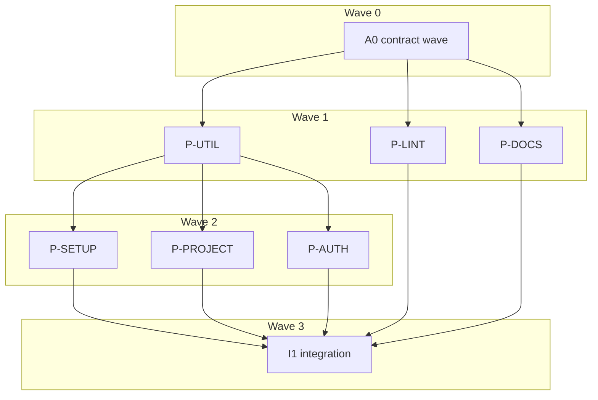

# Plan: user-owned files keep their symlink, mode and owner when ocx rewrites them

## Status

- **Plan:** plan_user_file_publish
- **State:** review
- **Tier:** high
- **Tier-grammar:** 5
- **Active phase:** 3 — I1 integration (done: hubs, gates, one review call, one fix pass)
- **Step:** finalized
- **Feature branch:** `sion` (the checked-out worktree branch; pipelines on `hex/user-file-publish--<pipeline>`); one squashed `fix:` commit
- **Last update:** 2026-11-16 (P-GROUP landed after `/hex-review` Needs Work: group-only chown retry 095421296, docs clause 43de73078; scoped verify and four acceptance modules green on 43de73078; delta re-review 0 Block, 0 Warn; a comment-only commit follows the gate)
- **Open at approval:** Q1 and Q2 default to their recommendations; D-11 is the reviewer's addition and the
  owner's to veto
- **Next:** the owner merges the pull request
- Reviewed: 43de730780ffaacf7b34aa6d719a01fcf2f64165
- **Finalize:** 2026-11-16 — `/hex-finalize` recomposed the branch to one `fix:` commit for a pull request from `sion`; the release-gate and CI results are in that pull request's ledger

---

## Overview

Resolves [ocx-sh/ocx#734](https://github.com/ocx-sh/ocx/issues/734). Classification: **bug fix**
(`workflow-bugfix.md`), scope medium, reversibility two-way door. No ADR: the owner settled the design
decisions in the planning session (D-1…D-5).

**Root cause (reproduced on released 0.6.8, Linux, scratch `HOME`).** ocx publishes files it does not own
with a primitive built for its private caches: a `0600` temp file renamed over the *unresolved* path
(`ocx_util::fs::write_bytes_atomic`, `crates/ocx_util/src/fs.rs:268`). On a pre-existing user file that
replaces a symlink with a regular file, forces the mode to `0600` and changes the owner to the writing
process. The defect is original (`55e42464c`, 2026-06-04), not a regression, and no test covers a symlinked
or mode-carrying user file.

**Observed sites** (each run against 0.6.8 unless marked):

| Site | Target | Defect |
|---|---|---|
| `crates/ocx_setup/src/lib.rs:836` | shell profiles | symlink replaced; `0644`/`0755` → `0600`; new profiles `0600` |
| `crates/ocx_config/src/edit.rs:259` | `$OCX_HOME/config.toml` | symlink replaced by a `0600` file |
| `crates/ocx_project/src/mutate.rs:22` | `ocx.lock` | symlinked lock replaced by a `0600` file |
| `crates/ocx_project/src/mutate.rs:22,446` | fresh `ocx.toml` / `ocx.lock` | created `0600` under umask 022 |
| `crates/ocx_project/src/project_lock.rs:58` | symlinked `ocx.toml` | mutators refuse it (exit 74) while reads follow it |
| `crates/ocx_oci/src/auth/store.rs:407` | `~/.docker/config.json` | `chmod 0600` forced on every acquire, fatal when it fails |
| `crates/ocx_cli/src/conventions.rs:346` | `--tags-file` | written `0600` (read, not run) |

## Decisions

Owner rulings, 2026-11-16:

- **D-1** Every user-owned file is followed through a symlink on write: resolve the link, write beside the
  final target, leave the link alone. This includes `ocx.toml`; the mutator-side refusal is dropped.
- **D-2** A link is followed only to an existing regular file. A dangling link is an error.
- **D-3** The residual risk is accepted and documented: a checkout can commit `ocx.toml` or `ocx.lock` as a
  symlink to another file the user owns, and a mutating command then rewrites that file. Its real size:
  - `ocx.lock` is reachable by a plain `ocx lock`, no opt-in. `ocx.toml` is reachable only through
    `--project` / `OCX_PROJECT`, because the CWD walk skips a symlinked `ocx.toml` (`loader.rs:638`).
  - The existing document must parse before any write. That is strict for `ocx.lock` (it needs
    `[metadata] lock_version`) and weak for `ocx.toml` (an empty or comment-only file parses).
  - D-2 and D-11 bound where a link may lead.
  - Shell activation stays gated by consent, which keys on the real file's directory for evaluation and
    for stamping (`crates/ocx_project/src/consent.rs:256`). A command run through a link stamps the
    target's directory. That is existing behaviour, measured on 0.6.8: `ocx --project <link> pull` writes
    `consent.json` for the target directory. Mutators now do the same.
- **D-4** `~/.docker/config.json`: keep the existing mode and owner, best effort and never fatal; no forced
  `chmod`; no warning. A fresh file is `0600`, as docker creates it.
- **D-5** Prevention in three layers: a clippy seam, two primitives whose names state their class, one
  behaviour-matrix acceptance test.

Design decisions made in this plan:

- **D-6 Publish stays an atomic rename, beside the resolved target.** Trade-off:

  | Option | Keeps link + mode | Torn read / crash | Hard links, xattrs, ACLs | Needs writable directory |
  |---|---|---|---|---|
  | **A. Resolve, then temp + rename beside the target (chosen)** | yes | never torn; crash leaves old or new | split / not carried | yes |
  | B. Truncate and write in place | yes | a shell sourcing mid-write reads half a profile; a crash leaves a truncated rc | kept | no |
  | C. Backup copy, then in place | yes | torn window stays; litters `.bak` files | kept | yes |

  A truncated shell profile is data loss in the user's own file, and docker reads `config.json` without a
  lock (`store.rs:447`), so A wins. Its cost is stated, not hidden: hard links to the target are split,
  extended attributes and ACLs are not carried, and a target whose directory is not writable cannot be
  updated (D-8). `SH-EMIT-19` (`.claude/rules/shell-quality/emit.md:171`) is met on its three outcomes —
  link followed, mode and owner kept, no `0600` rc — though not on its mechanism clause.
- **D-7** Owner preservation is uniform, not docker-only: the primitive `fchown`s the temp file to the
  existing file's uid/gid and ignores any failure (docker's `copyFilePermissions` does the same).
- **D-8** A profile that cannot be written is skipped, not fatal, for exactly three causes:
  `PermissionDenied`, `ReadOnlyFilesystem`, or the primitive's own typed refusal (dangling link, target not
  a regular file, foreign link — C-005). Every other I/O error keeps today's exit 74. Precedent: the session-PATH writer's `Failed`
  outcome (`crates/ocx_setup/src/session_path.rs:22`).
- **D-9** No repair pass. A file an earlier ocx already stripped to `0600` keeps `0600`, because the mode is
  now carried. The user restores it with `chmod` once.
- **D-10** The project mutation lock keys on the resolved config path, so two paths linking to one
  `ocx.toml` serialize. `ocx.lock` stays beside the path the user named (`lock_path_for`, unchanged).
- **D-11 (added by the security review, not an owner ruling — veto at handoff).** A link is followed only
  when every link in the chain is owned by the effective uid or by root. It stops root from writing
  through a link an unprivileged user planted (`sudo ocx self setup --profile /home/alice/.zshrc`) and
  stops any user from writing through a link someone else planted in a shared directory (`--tags-file
  /tmp/tags`; Linux's `protected_symlinks` covers this, macOS has no equivalent). Root-owned links stay
  followable because home-manager's chain runs through `/nix/store`. Dotfile managers and git create
  links as the user, so D-1 and D-3 are unaffected. Cost: root in a container following a link owned by
  another uid is refused.

## Scope

### In scope

The seven sites above, the new primitive, the rename of the private one, the clippy seam, the matrix test,
user docs and the utility catalog rows.

### Out of scope

- **Read-side symlink guards** — the config loader skips a symlinked discovered-tier `config.toml`
  (`crates/ocx_config/src/loader.rs:468`) and the CWD walk skips a symlinked `ocx.toml` (`loader.rs:638`).
  See Open question Q1.
- **ocx-authored files**: `$OCX_HOME/env.*` (`shims.rs:349`), `environment.d/ocx.conf`
  (`session_path/linux.rs:190`), the LaunchAgent plist, `<project>/.ocx/**` directories (`0700`, a
  hostile-clone defence) and the toolchain `.gitignore` (`toolchain_store.rs:254`, which replaces a link on
  purpose). They stay on the private primitive.
- **Index store new-file mode and `package create -o`** — see Open question Q2.
- **Windows ACLs.** A rename there gives the new file the directory's inherited ACL. Not measured, not
  changed.
- `init_project` — it still refuses anything at the path, a dangling symlink included (exit 64).

## Component contracts

### P-UTIL — `ocx_util::fs`

- **C-001** `pub fn replace_user_file(path: &Path, bytes: &[u8], new_file: NewFileMode) -> std::io::Result<()>`
  in `crates/ocx_util/src/fs/user_file.rs`, re-exported from `ocx_util::fs`. Blocking. Behaviour by what
  `symlink_metadata(path)` finds:
  - **nothing**: create `path`. The temp file is created in `path.parent()` with `NewFileMode`'s mode.
    The parent must exist; a missing parent is the underlying `NotFound`.
  - **regular file**: temp file in the same directory, created `0600` whatever `NewFileMode` says, so the
    new bytes are never readable more widely than the file they replace. Then, in this order: write,
    `sync_data`, `fchown` to the existing uid/gid (failure ignored), `fchmod` to the existing mode
    `& 0o777` (on the open file, so umask cannot clip it: `0664` stays `0664` under umask 022), publish
    through `persist_temp_file`, fsync the directory (no-op off Unix).
  - **symlink**: resolve through `resolve_user_file` (C-004), then proceed as **regular file** on the
    resolved path. The link itself is never touched.
  - **anything else** (directory, FIFO, socket): refusal `NotRegularFile`.
  - On any error: `path` and its target hold their old bytes and no temp file is left behind.
  - Non-Unix: mode and owner steps are no-ops; link resolution is identical minus the owner rule.
- **C-002** `pub enum NewFileMode { UmaskDefault, Private }` — `UmaskDefault` is `0o666 & !umask`, obtained
  by passing `0o666` to `tempfile::Builder::permissions` (creation is umask-clipped); `Private` is `0o600`.
  Only consulted when nothing exists at `path`.
- **C-004** `pub fn resolve_user_file(path: &Path) -> std::io::Result<PathBuf>` — the one resolver C-001
  and C-022 share. A path that is not a symlink (or does not exist) comes back unchanged. A symlink is
  walked link by link (`symlink_metadata` + `read_link`, at most 40 hops); each link must pass D-11's owner
  rule; the end must be an existing regular file. The result is `dunce`-canonical.
- **C-005** Refusals are typed, never string-matched: `pub enum UserFileRefusal { DanglingSymlink,
  NotRegularFile, ForeignSymlink }` (`Display` + `Error`), carried as the payload of an
  `io::Error` of kind `InvalidInput`, with `pub fn user_file_refusal(&io::Error) -> Option<UserFileRefusal>`
  to read it back. A loop or a chain past 40 hops is `DanglingSymlink`. D-11's predicate is a pure
  function `(link_uid, effective_uid) -> bool`, unit-tested as a table, because a test cannot create a
  link owned by another user without root.
- **C-003** `write_bytes_atomic` is renamed `write_private_file_atomic`; behaviour unchanged (`0600`,
  replaces a link). Its doc and those of `persist_temp_file`, `persist_temp_file_if_absent` and
  `persist_temp_file_noclobber` each say in one line: ocx-owned paths only, a user-owned file takes
  `replace_user_file`.

### P-SETUP — `ocx self setup` profiles

- **C-010** `write_profile_blocking` (`crates/ocx_setup/src/lib.rs:829`) publishes through
  `replace_user_file(path, bytes, NewFileMode::UmaskDefault)`. `create_dir_all(parent)` stays for the
  create case.
- **C-011** New `ProfileOutcome::SkippedUnwritable`. `apply_fence` and `rewrite_dedicated` return it when
  the *write* fails with `ErrorKind::PermissionDenied`, `ErrorKind::ReadOnlyFilesystem`, or an error for
  which `user_file_refusal` returns `Some`; the run continues with the next profile. Any other write
  error, and every *read* error (a directory at the profile path, a link to a directory), propagates as
  today (exit 74). `--dry-run` writes nothing and therefore never reports it.
- **C-012** Report: `ProfileOutcomeKind::SkippedUnwritable`, serialized `skipped_unwritable`, same word in
  the plain table. `derive_status` counts it like `no_op`: a run whose only change would have been that
  profile reports `status: no_op`; a run that also wrote shims reports `completed`. `profiles_changed`
  (reload hint) ignores it. `exit_code_for` ignores it: exit 0. Additive enum value (IC-15);
  `SCHEMA_VERSION` stays 1, no ledger entry.
- **C-013** For each skipped profile `emit_advisories` prints one `warn` on stderr naming the path and the
  cause, followed by the exact text ocx would have written (the managed block, or the whole content of a
  dedicated fish/nushell file) for the user to add by hand. Nothing reaches stdout.
- **C-014** The long help in `crates/ocx_cli/src/command/self_group.rs` lists `skipped_unwritable` among the
  profile outcomes and states: a profile that cannot be written is reported and warned about, never fatal.

### P-PROJECT — `ocx.toml` / `ocx.lock`

- **C-020** `publish_by_rename` (`crates/ocx_project/src/mutate.rs:22`) keeps its `create_dir_all(parent)`
  and its `ProjectErrorKind::Io` mapping, and delegates the publish to
  `replace_user_file(path, bytes, NewFileMode::UmaskDefault)`. `carry_existing_mode` and `fsync_parent` are
  deleted from `mutate.rs`; their behaviour lives in C-001. Its callers (`mutation.rs:167`,
  `lock.rs:705`, `lock.rs:720`, `mutate.rs:446`, `mutate.rs:484`) need no edit. The lock rollback's
  `remove_file` arm runs only when no lock existed before the mutation, so it can never remove a
  pre-existing link.
- **C-021** `refuse_symlink_at` is deleted. `acquire_project_lock_for_file` accepts a symlink at the config
  path; every mutator (`add`, `remove`, `lock`, `update`, `upgrade`, `set_activate`) edits the link's
  target and leaves the link.
- **C-022** `acquire_project_lock_for_file` calls `resolve_user_file(config_path)` before it computes the
  lock key and keys on the resolved file's parent directory and file name. A regular or absent
  `ocx.toml` resolves to itself, so its key is unchanged.
- **C-023** A refusal from that call (dangling, not a regular file, foreign link) fails the mutation in the
  acquire, before any lock is taken, as `ProjectErrorKind::Io` (exit 74, slug `project_io`). The same
  refusal at `ocx.lock` surfaces from the publish with the same error. The link is untouched either way.
  `init_project` is unchanged (exit 64).
- **C-024** A fresh `ocx.toml` (`ocx init`) and a fresh `ocx.lock` get the umask default mode.

### P-AUTH — `config.toml`, docker `config.json`, `--tags-file`

- **C-030** `edit_blocking` (`crates/ocx_config/src/edit.rs:259`) publishes through
  `replace_user_file(.., NewFileMode::UmaskDefault)`.
- **C-031** `acquire_config_guard` (`crates/ocx_oci/src/auth/store.rs:393`) no longer calls
  `set_permissions` (its only call, at `store.rs:407`; nothing else creates `config.json`).
  `ConfigGuard::write` publishes through `replace_user_file(.., NewFileMode::Private)` and drops its inline
  `canonicalize`. A refusal at `config.json` is `AuthError::WriteConfigFailed`.
- **C-032** `append_tags_file` (`crates/ocx_cli/src/conventions.rs:334`) publishes through
  `replace_user_file(.., NewFileMode::UmaskDefault)`.

### P-LINT — the seam

- **C-040** `clippy.toml` `disallowed-methods` gains `tempfile::NamedTempFile::persist`,
  `tempfile::NamedTempFile::persist_noclobber`, `tempfile::TempPath::persist`, `std::fs::rename` and
  `tokio::fs::rename`, each with the
  reason `publish through ocx_util::fs: replace_user_file for a file the user owns,
  write_private_file_atomic for ocx state`. Every remaining call carries an item-level
  `#[expect(clippy::disallowed_methods, reason = "…")]` naming why a raw call is right there; a test module
  may carry one module-level `#[expect]`. `clippy-warn-baseline.json` gains no entry.

### P-DOCS

- **C-050** User docs state the new behaviour and the accepted risk; the utility catalog names both
  primitives (details under the pipeline).

### Cross-cutting

- **C-060** `test/tests/test_user_file_publish.py`: one parametrized matrix, one row per user-owned writer,
  three assertions per row (S-060).

## User-experience scenarios

Profiles (`ocx --offline self setup --profile P`, seeded candidate):

- **S-001** `P` is a symlink to a `0644` file → exit 0, outcome `completed`; `P` is still a symlink; the
  target holds the block and is still `0644`.
- **S-002** `P` is a regular file at `0644`, `0640` or `0755` → mode unchanged, block written.
- **S-003** `P` does not exist, umask 022 → created `0644`.
- **S-004** `P` links into a directory with mode `0555` → exit 0, outcome `skipped_unwritable`, aggregate
  `status` `no_op` (shims already current), a stderr warning carrying the block, stdout still one valid
  JSON document, link and target byte-identical. Skipped when the effective uid is 0, where `0555` stops
  nothing.
- **S-005** `P` is a dangling symlink → as S-004, with no uid condition.
- **S-006** Re-running S-001 → outcome `no_op`, link kept.
- **S-007** `P` is a directory, or a link to one → the read fails, exit 74 as today.

`config.toml`:

- **S-010** `$OCX_HOME/config.toml` is a symlink to a `0644` file; `self setup --no-profile` → link kept,
  target gains `[shell] profiles`, target still `0644`.
- **S-011** No `config.toml`, umask 022 → created `0644`.

Project files:

- **S-020** `ocx --project L add PKG` where `L` links to a `0644` `ocx.toml` → exit 0, `L` still a link,
  target lists the tool, mode kept; `ocx.lock` is written beside `L`, not beside the target.
- **S-021** `ocx.lock` is a symlink to a valid lock; `ocx lock` → link kept, target rewritten.
- **S-022** `ocx init` then `ocx lock`, umask 022 → both files `0644`.
- **S-023** `ocx init` where a dangling symlink sits at `ocx.toml` → exit 64, unchanged.
- **S-024** `ocx lock` where `ocx.lock` is a dangling symlink → exit 74, link untouched.
- **S-025** Two paths linking to one `ocx.toml`: a mutation through one holds the lock a mutation through
  the other waits on (unit level).
- **S-026** An existing `0664` `ocx.toml` under umask 022 stays `0664` after `ocx add`.

Docker config (`DOCKER_CONFIG=D ocx login --no-verify`):

- **S-030** `D/config.json` exists at `0644` → credentials written, mode still `0644`.
- **S-031** `D/config.json` is a symlink → link kept, target updated.
- **S-032** No `config.json` → created `0600`.
- **S-033** A read (`get`) of a `0644` `config.json` leaves it `0644`.

Tags file (unit level, `conventions.rs`):

- **S-040** Existing `0644` file keeps `0644`; a symlinked tags file stays a link; a fresh file gets the
  umask default.

Matrix:

- **S-060** For each row of {profile, `config.toml`, `ocx.toml`, `ocx.lock`, docker `config.json`}: (1) a
  symlink at the path survives and the target receives the content; (2) an existing `0640` mode survives;
  (3) a fresh file is not `0600` under umask 022 — except the docker row, whose contract is `0600`.

### Error taxonomy

| Condition | Where | Outcome |
|---|---|---|
| Dangling symlink, target not a regular file, or a link owned by neither the user nor root | C-005 | `io::ErrorKind::InvalidInput` carrying a `UserFileRefusal` |
| …at a shell profile | C-011 | `skipped_unwritable`, warning, exit 0 |
| …at `ocx.toml` / `ocx.lock` | C-023 | exit 74, `project_io` |
| …at `config.json` | C-031 | `credential_store_write` |
| Target directory not writable, or read-only filesystem, at a profile | C-011 | `skipped_unwritable`, warning, exit 0 |
| `fchown` refused | C-001 | ignored |

## Parallelization

| Pipeline | Scope | Expected files | Wave | Depends on | Marks | Status |
|---|---|---|---|---|---|---|
| A0 contract wave | stubs for C-001–C-005, C-011, C-012; red tests for C-001, C-004, C-005, C-060 | `crates/ocx_util/src/fs.rs`, `crates/ocx_util/src/fs/user_file.rs` (new), every caller of the renamed function (mechanical), `crates/ocx_setup/src/lib.rs` (variant only), `crates/ocx_cli/src/api/data/self_setup.rs` (variant only), `test/tests/test_user_file_publish.py` (new) | 0 | — | | merged (4b331d335) |
| P-UTIL | C-001, C-002, C-004, C-005 | `crates/ocx_util/src/fs/user_file.rs` | 1 | A0 | | merged |
| P-LINT | C-040 | `clippy.toml`, `crates/ocx_util/src/{fs.rs,fs/symlink.rs,fs/locked_file.rs,archive.rs}`, `crates/ocx_store/src/{codesign.rs,reference_manager.rs,hardlink.rs}`, `crates/ocx_store/src/file_structure/{state_store.rs,assemble.rs}`, `crates/ocx_package/src/bundle.rs`, `crates/ocx_index/src/file_transport.rs`, `crates/ocx_package_manager/src/activation.rs`, `crates/ocx_oci/src/host_capabilities.rs` | 1 | A0 | | merged |
| P-DOCS | C-050; documents D-3 | `website/src/content/docs/getting-started/install-ocx.mdx`, `website/src/content/docs/guides/project-toolchain.mdx`, `website/src/content/docs/guides/authenticate.mdx`, `website/src/content/docs/explanation/project-toolchain.md`, `.claude/rules/arch-principles.md` | 1 | A0 | | merged |
| P-SETUP | C-010–C-014; S-001–S-007 | `crates/ocx_setup/src/lib.rs`, `crates/ocx_cli/src/command/self_group/setup.rs`, `crates/ocx_cli/src/command/self_group.rs`, `crates/ocx_cli/src/api/data/self_setup.rs`, `test/tests/test_self_setup.py` | 2 | P-UTIL | | merged |
| P-PROJECT | C-020–C-024; S-020–S-026 | `crates/ocx_project/src/{mutate.rs,project_lock.rs,lock.rs}` | 2 | P-UTIL | | merged |
| P-AUTH | C-030–C-032; S-010, S-011, S-030–S-033, S-040 | `crates/ocx_config/src/edit.rs`, `crates/ocx_oci/src/auth/store.rs`, `crates/ocx_cli/src/conventions.rs` | 2 | P-UTIL | | merged |
| I1 integration | C-060 green; S-060; hubs | hub files below | 3 | all | | merged |
| P-GROUP | C-006 (convergence: C-001 contradicts) | `crates/ocx_util/src/fs/user_file.rs`, `crates/ocx_setup/src/lib.rs` (test placement only), `website/src/content/docs/{getting-started/install-ocx.mdx,guides/authenticate.mdx,explanation/project-toolchain.md}` | 4 | I1 | | merged |

**Hub and generated files (no pipeline owns them; regenerated once at I1):** `test/SUITE_FLOOR`,
`scripts/bazel_gate_proofs.py` (`ACCEPTANCE_MODULE_TARGETS` 198 → 199: the constant and its comment at
L251–254, the assert and its message at L1685–1686), `crates/ocx_schema/tests/golden/reports.json`,
`website/src/public/schemas/reports/v1.json`, `crates/ocx_schema/contract/baseline/reports.json` (only if
the compat gate asks), `crates/ocx_sdkgen/tests/golden/rust/types.rs`,
`website/src/content/docs/reference/command-line/self.md`, `test/scoped_rows.toml` (only if
`task test:rows:check` asks).

A0 adds the enum value and the acceptance module that make these stale. No gate runs between A0 and I1 —
step commits use `--no-verify` and pipelines run only their own unit and acceptance targets — so the
goldens and counts are red on the feature branch until I1 step 2. That is expected; do not regenerate
them inside a pipeline.

**Contracts with no test of their own.** C-003 is proven by the build plus A0 step 1's grep. C-014 is
proven by `task website:reference:check` (the generated `self.md`). C-050 is proven by the docs gates
`task verify:scoped` routes for `website/**` and by `task claude:tests` for the rule file.

**Disjointness check.** Wave 1: P-UTIL owns only `fs/user_file.rs`; P-LINT touches `fs.rs` and other
crates' files none of the wave-2 pipelines list; P-DOCS touches no Rust. Wave 2: `ocx_setup` + three
`ocx_cli` files (P-SETUP), `ocx_project` (P-PROJECT), and `edit.rs` + `auth/store.rs` + `conventions.rs`
(P-AUTH) share nothing. P-LINT's `ocx_oci/src/host_capabilities.rs` is not P-AUTH's `auth/store.rs`.

**Critical path:** A0 → P-UTIL → P-PROJECT → I1.
**Shippable after wave: 2** — every site fixed; wave 1 alone ships the primitive and the seam with no
behaviour change.

### Pipeline steps

Every step: no plan or contract ID in a source comment (`code-docs.md`); test first, watch it red, then
implement; commit with `--no-verify` on the pipeline branch.

**A0 — contract wave (one commit)**

1. Rename `write_bytes_atomic` → `write_private_file_atomic` across the workspace (LSP rename), and the
   comments that name it: `session_path/macos.rs:190`, `session_path/linux.rs:184`, `mutate.rs:20,1494`,
   `lock.rs:2237`, `locked_file.rs:482`, `consent.rs:509,1667`, `state_store.rs:305`,
   `toolchain_store.rs:614`, `shell_config.rs:261`. Out of scope: `IndexStore`'s private method of the same
   name (`crates/ocx_index/src/store.rs`). Done when `grep -rn write_bytes_atomic crates` returns only
   that method and its callers. Add the one-line doc pointers of C-003.
2. Add `crates/ocx_util/src/fs/user_file.rs` with `NewFileMode`, `UserFileRefusal`, `user_file_refusal`,
   and `replace_user_file` / `resolve_user_file` whose bodies return
   `Err(std::io::Error::other("not implemented"))` — an `Err`, not `unimplemented!()`, so the red tests
   fail on their assertions and the workspace's other tests keep running. `mod` + `pub use` in `fs.rs`.
   Write the unit tests of C-001, C-002, C-004 and C-005 in that file, all red:
   - link followed (single, chain, relative link), the link itself untouched;
   - dangling link, looped link → `user_file_refusal` is `DanglingSymlink`;
   - directory at the path, link to a directory → `NotRegularFile`;
   - the owner predicate as a table: own uid, root, another uid (`ForeignSymlink`);
   - mode carried for `0644`, `0664`, `0600`, `0755`; setuid/setgid/sticky dropped;
   - the temp file of an existing `0644` file is `0600` until the `fchmod` (assert on the builder mode,
     through a seam that returns the open temp file before publish);
   - fresh file under each `NewFileMode`;
   - a failed write leaves no temp file and the old bytes.

   Expected umask-default mode comes from a probe file made with `std::fs::File::create` in the same temp
   dir, never from a `umask` call.
3. Add `ProfileOutcome::SkippedUnwritable` and `ProfileOutcomeKind::SkippedUnwritable` (with `From` and
   `Display` arms), produced nowhere yet.
4. Add `test/tests/test_user_file_publish.py` (S-060): rows as `pytest.param(..., id=...)`, each row a
   small setup function plus the command to run; env built from `dict(ocx.env)` with `HOME` and
   `DOCKER_CONFIG` under `tmp_path`; `subprocess.run(..., umask=0o022)`; module
   `pytestmark = [pytest.mark.skipif(sys.platform == "win32", ...), pytest.mark.command(...)]` naming the
   command files it drives. Rows that need the seeded candidate reuse `_seed_candidate`'s approach inline
   (do not import `test_self_setup`). Red except the docker fresh-file cell.

**P-UTIL**

1. Implement C-001, C-002, C-004 and C-005 on Unix until A0's unit tests are green. Reuse
   `persist_temp_file`; move the `fsync_parent` logic here from `ocx_project/src/mutate.rs` (copy;
   P-PROJECT deletes the original). No manifest edit: `crates/ocx_util/BUILD.bazel` globs `src/**/*.rs`,
   `std::os::unix::fs::fchown` is std, and `libc` (for `geteuid`, as `crates/ocx_config/src/lib.rs:1107`
   calls it) is already a Unix dependency of `ocx_util`.
2. Non-Unix branch and rustdoc: one summary line, an `# Errors` section, and a guard comment at the
   `0600` temp mode (the new bytes must not be wider than the old file before the `fchmod`), at the
   `fchmod` (umask would clip a mode passed to the builder), at the ignored `fchown`, and at the owner
   rule (what it stops, why root is allowed).

**P-LINT**

1. Add the five `disallowed-methods` entries. Prove the ban red first: with no `#[expect]` added yet,
   `task rust:clippy:check` must fail and name `std::fs::rename` at `crates/ocx_util/src/fs.rs`. A green
   run here means the entries did not load (`.bazelrc:95` is what hands `clippy.toml` to Bazel). Then list
   every hit; `cargo clippy -p <crate> --all-targets --locked` is fine for iterating.
2. Production sites — `ocx_util` (`fs.rs:93,97,222,223`, `fs/symlink.rs:173,259`),
   `ocx_store` (`state_store.rs:378`, `codesign.rs:61,279`), `ocx_package/src/bundle.rs:49`: item-level
   `#[expect]` with a reason that says what is renamed and why it is ocx's own (or, for `bundle.rs`, a
   fresh build artifact).
3. Test sites: one module-level `#[expect]` per test module that renames. Finish on a green
   `task rust:clippy:check` with `clippy-warn-baseline.json` unchanged.

**P-DOCS** (follow the `docs` skill and `docs-quality.md`; no migration prose)

1. `getting-started/install-ocx.mdx` near L92 and L248: setup follows a symlinked profile and keeps its
   mode; a profile it cannot write is skipped with the block printed.
2. `guides/project-toolchain.mdx` near L139: mutating commands write through a symlinked `ocx.toml` or
   `ocx.lock`; state D-3's risk in two sentences (a checked-in link can point a mutating command at
   another file you own; ocx follows only links you or root created, and only to an existing file). Leave
   the CWD-walk sentence as it is (Q1).
3. `guides/authenticate.mdx` near L84: `ocx login` keeps the file's mode and a symlink, and creates a new
   file owner-only.
4. `explanation/project-toolchain.md` L100–104: the mutation lock is keyed on the real `ocx.toml`, so two
   links to one file serialize.
5. `.claude/rules/arch-principles.md`: rename the `write_bytes_atomic` catalog row (L235), add a
   `replace_user_file` row, and fix L189's description of `publish_by_rename`.

**P-SETUP**

1. Unit tests beside `apply_fence_*` (`lib.rs:1913`): S-001, S-002, S-003, S-005, S-007 (a directory at
   the profile path and a link to a directory both return the read error, not `SkippedUnwritable`), and
   S-004 using the read-only-directory fixture pattern of `shell_config.rs:261`, skipped when the
   effective uid is 0. Red, except S-007, which pins today's behaviour.
2. Implement C-010 and C-011.
3. C-012 and C-013 in `api/data/self_setup.rs` and `self_group/setup.rs`, with unit tests for the report
   mapping, `derive_status`, `exit_code_for` and the advisory text.
4. C-014 long help. Acceptance: add S-001, S-004 and S-006 to `test/tests/test_self_setup.py` beside
   `test_setup_crlf_profile_stays_crlf`.

**P-PROJECT**

1. Flip the three tests that pin the refusal (`project_lock.rs:246`, `lock.rs:2113`, `mutate.rs:1832`) to
   S-020/S-021 semantics; add S-023, S-024, S-025, S-026 and a fresh-file mode test (S-022). All unit
   level; S-022's acceptance half is the matrix's fresh-file cell (C-060). Red.
2. C-020: delegate `publish_by_rename`; delete `carry_existing_mode` and `fsync_parent`. Existing mode
   tests (`mutate.rs:1500,1530`, `lock.rs:2240`) stay green unmodified; the inode-rotation test
   (`mutate.rs:1466`) too.
3. C-021, C-022, C-023 in `project_lock.rs`.

**P-AUTH**

1. `edit.rs`: unit tests for S-010/S-011, then C-030.
2. `auth/store.rs`: unit tests for S-030, S-031, S-033 and a dangling-link case; keep
   `dockerconfigstore_creates_file_mode_0600_on_first_put` green; then C-031.
3. `conventions.rs`: replace `append_tags_file_writes_owner_only_mode` with S-040; then C-032.

**I1 — integration**

1. Merge order: P-UTIL, P-LINT, P-DOCS, then P-SETUP, P-PROJECT, P-AUTH.
2. Regenerate the hub files; bump `SUITE_FLOOR` and `ACCEPTANCE_MODULE_TARGETS`.
3. Gates, in order, builds one at a time:
   - `task verify:scoped --force`
   - `task test:parallel --force -- tests/test_user_file_publish.py tests/test_self_setup.py tests/test_login.py tests/test_project_toml_preservation.py tests/test_shell_reconcile_edge_cases.py` (under the suite `flock`)
   - `task claude:tests` (a rule file changed)
   - `task website:reference:check`
   - `task satellite:verify` (an ecosystem crate's API changed; ocx-mirror uses only `persist_temp_file`, which keeps its name)
   - `task -x test:windows-local MODE=unit -- user_file` (the primitive has a non-Unix branch)
4. Re-run the original repro against the built binary: symlinked `.zshrc`, `0644` `.profile`, `0755`
   `.bashrc`, symlinked `config.toml`, symlinked `ocx.lock`, fresh `ocx init`.
5. One integration review: spec, quality and security (always-on: `crates/ocx_oci/**` and
   `crates/ocx_config/**` are touched).

**P-GROUP — group carry (appended by `/hex-review`, 2026-11-16)**

- **C-006** When the combined `fchown(uid, gid)` is refused, `carry_identity` retries the group alone
  (`fchown(None, gid)`), which a non-owner who is a member of that group may do. Only when the group still
  does not follow are the group bits dropped. This replaces C-001's unconditional "`fchmod` to the existing
  mode `& 0o777`" for that one case; C-001 is otherwise unchanged. Owner veto: carry the whole mode instead.
- **C-007** (owner ruling 2026-11-16, replaces C-006's bit drop) When the replacement cannot take both the uid
  and the gid of the existing file, nothing is renamed: the bytes are written through the existing inode, so
  owner, group, mode, ACLs and hard links stay. No bit is dropped. That path is not crash-atomic. A file that
  cannot be opened for writing is left untouched (`PermissionDenied`).
- **C-008** (review of the pull request, 2026-11-16) The same in-place write is taken for a file with more than
  one hard link. A profile that cannot be read is skipped like one that cannot be written. ACLs and extended
  attributes are not carried on the rename path.

1. `user_file.rs`: the group-only retry in `carry_identity`. The foreign-owner branch cannot be reached in a
   unit test without root; say so at the call, and keep `carried_mode_table` as the mode proof.
2. Docs: the three pages that say a file keeps its permissions name the exception in one clause.
3. `crates/ocx_setup/src/lib.rs`: move `unwritable_cause_skips_only_refusals_and_permission_kinds` below
   `use super::*;`.

## Landing and verification

- One squashed commit on the PR branch (`hex.md` preference). Draft subject:
  `fix: ocx keeps the symlink, mode and owner of a user file it rewrites`. Body: the root cause, the seven
  sites, D-3's accepted risk, D-9, `Closes #734`. No `!`: every change loosens a refusal or stops a
  destructive write.
- No local full `task verify`; `task verify:mark` after the gates above, naming the deferral in the body.
  CI is the full gate.
- Never edit `CHANGELOG.md`.

## Risks

| Risk | Mitigation |
|---|---|
| A hostile checkout redirects a mutation to another file the user owns (D-3) | Accepted; documented in `project-toolchain.mdx`; D-2 blocks creation at an attacker-chosen path; D-11 limits who can plant the link; the old document must parse before any write |
| A command run through a link stamps shell-activation consent for the target's directory | Existing behaviour of read commands on 0.6.8, now shared by mutators. Not changed here; "no stamp when the path went through a link" is deferred to the owner |
| `config.toml` written through a link the loader then skips on read (Q1) | Strictly better than today, where the link is destroyed; the follow-up decides the read side |
| Banning `std::fs::rename` adds `#[expect]` noise in ~15 test sites | One module-level `#[expect]` per test module |
| Clippy cannot see `cfg(windows)` code on the Linux lane | Named hole: a raw rename behind `cfg(windows)` outside `ocx_util` is not caught; the matrix test is the backstop on Unix only |
| The seam forces a helper, not the right helper | Names (C-003) and the matrix (C-060); a new user-owned writer that adds no matrix row is caught only in review |
| Hard links to a profile are split, xattrs/ACLs dropped (D-6) | Stated in the plan and the commit body; unchanged from today |
| Race between resolving a link and the rename: someone who can write a directory on the resolved path swaps it in between | Not closed. That party can already write the file directly. The file is stat'ed once (no-follow) and that result drives the carried mode and owner; a leaf swapped in afterwards is replaced by the rename, never followed. Closing it needs `openat`/`renameat` on a held directory fd — hand-rolled, deferred to the owner |
| An empty or comment-only file parses as `ocx.toml`, so "must parse first" barely limits where an `ocx.toml` link may lead | Accepted under D-3; reachable only through `--project` / `OCX_PROJECT`; D-11 limits who can plant the link. A stricter rule (target must be named `ocx.toml`) is deferred to the owner |
| A symlinked `ocx.lock` can lead outside the project with no opt-in | Accepted under D-3; the target must already be a valid lock. A same-directory rule is deferred to the owner |
| Symlinked *directories* on the way to the file are followed without an owner check, and Windows has no owner rule at all | Unchanged from before the fix; D-11 covers the leaf link chain on Unix only |
| A user who swaps `ocx.toml` between a link and a regular file while two mutations run gives them different lock keys | Lost update, only through the user's own concurrent swap |
| An owner or group that cannot be carried (`fchown` refused) | The file is written in place: owner, group and mode stay, but a kill mid-write can leave a torn file |
| A raw rename behind `cfg(windows)` (`fs/symlink.rs` `rename_replace`, a `cfg(windows)` unit test in `fs.rs`) has no `#[expect]` | No Windows clippy lane exists, so nothing reds; a future one needs `#[cfg_attr(windows, expect(…))]` there |
| Lock keys: the project lock covers `ocx.toml` only, and docker's `config.json.lock` sidecar is keyed on the unresolved path, so two links to one file do not serialize there | Unchanged from today; a lost update, never a torn file |

## Open questions

- **[NEEDS CLARIFICATION: Q1]** Lift the read-side guards too? The config loader skips a symlinked
  discovered-tier `config.toml` with a warning (`loader.rs:468`, fatal for the system tier) and the CWD walk
  skips a symlinked `ocx.toml` (`loader.rs:638`); explicit `--config` / `--project` paths already follow.
  Both are documented security decisions with tests and generated env-var text
  (`reference/environment.md:589`).
  **Recommended: no, not in this plan — file a follow-up issue.** Reason: #734 is a destructive-write bug
  that should ship alone; the read side is a threat-model decision touching per-prompt activation
  (`test_ec_scope_007`). Saying yes adds one pipeline (`crates/ocx_config/src/loader.rs`,
  `crates/ocx_env/src/vars.rs`, six flipped tests) and a security review of its own.
- **[NEEDS CLARIFICATION: Q2]** The low rows: index files written `0600` when `--index` points at a
  checkout (`crates/ocx_index/src/store.rs:483`, inferred), `package create -o` renaming over its output
  (`bundle.rs:49`, mode unmeasured), `env.*` and `environment.d/ocx.conf` at `0600`.
  **Recommended: one follow-up issue, out of this plan.** Reason: none destroys user data, and two of the
  four are unmeasured.

## Constitution deviations

None identified against `.claude/rules/arch-principles.md`: the primitive is domain-free and lives in
`ocx_util`; consumers keep their own error wrapping; no CLI type enters a library crate. The utility
catalog rows change in the same series (P-DOCS step 4).

## Schedule log
