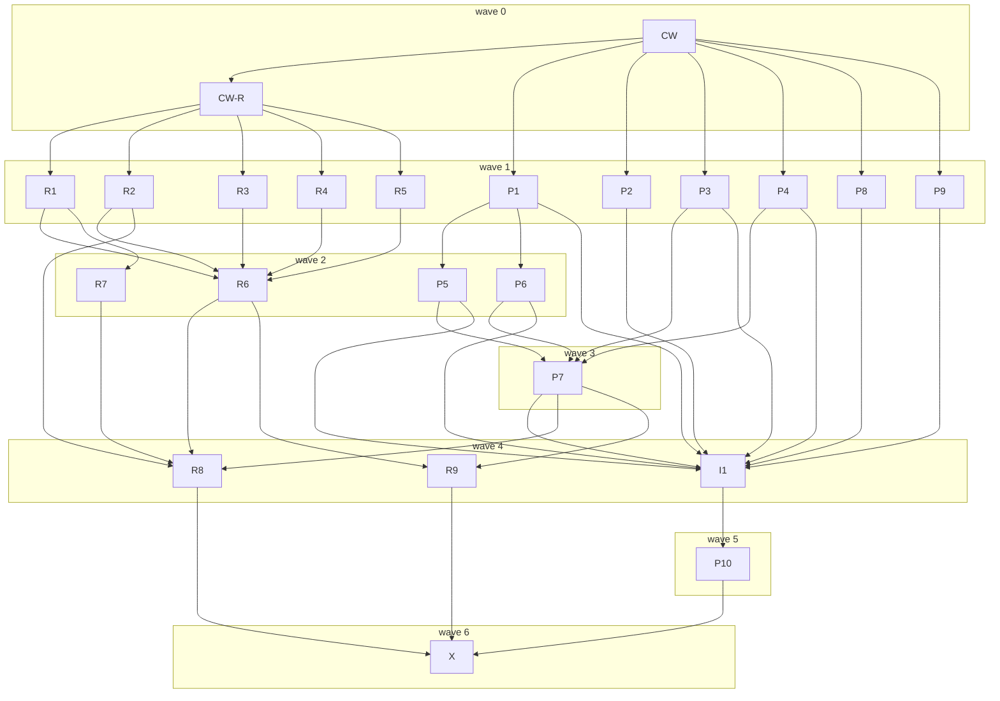

# Plan: `ocx vendor`, the direct launcher, and rules_ocx under remote execution

## Status

- **Plan:** plan_vendor_rules_ocx
- **State:** executing
- **Tier:** high
- **Tier-grammar:** 5
- **Updated:** 2026-11-26
- **Active phase:** 0 — contract waves (CW, then CW-R)
- **Step:** /hex-execute → P5 P6 P8 running; CW P9 P3 P4 P1 P2 merged
- **Feature branch:** ocx `hex/bazel-rbe-rules-ocx` (pipelines on `hex/bazel-rbe-rules-ocx--<pipeline>`, worktrees under `.agents/worktrees/`); rules_ocx one branch `hex/bazel-rbe-rules-ocx` (§ rules_ocx branch mechanics)
- **Last update:** 2026-11-26 (after 73e2701d: chore: accept the vendor ADR under goal-loop authority)
- **Next:** /hex-execute .claude/artifacts/plan_vendor_rules_ocx.md

---

## Overview

Implements [`adr_vendor_rules_ocx_remote_execution.md`](./adr_vendor_rules_ocx_remote_execution.md) (accepted under goal-loop
authority on 2026-11-26) and its companion [`system_design_vendor_rules_ocx.md`](./system_design_vendor_rules_ocx.md) ("the design"),
for goal `.agents/goals/bazel-rbe-rules-ocx.md`. Requirements, the owner's rulings, the checks and the rig come from
`.agents/discussions/bazel-rbe-rules-ocx.md` ("the source"): `## Requirements`, the blocks "Ruled by the owner", `## Verification` and
"Test setup". Code map: [`discover_bazel_rbe_rules_ocx.md`](./discover_bazel_rbe_rules_ocx.md), re-verified for file ownership by three
read-only explorers on 2026-11-26 (findings folded into § Decisions DP-1…DP-12).

**Two repositories.** `.` = this repository (ocx, the federation lead; this plan and its single Status block live here only).
`rules_ocx` = `ocx-sh/rules_ocx`, checkout `/home/mherwig/dev/ocx-sh/rules_ocx` at `9648f93` (registered as federation key `rules_ocx` in
`.agents/memory/hex.md`).

**Classification.** Feature (`workflow-feature.md`). Scope **large**; reversibility one-way (high) for the `vendor-manifest` v1 schema,
two-way for everything else (ADR § Metadata). The large-scope artifacts (ADR, system design, persisted research, discovery) exist and are
accepted, so this plan runs at `high` as the caller set it and re-decides nothing the ADR decided (DP-12). Run config: architect inline
(accepted ADR), research skipped (persisted under `.agents/research/` and listed in the ADR), adversary off (tier baseline, no new
one-way door); Review = `reviewer:spec` on the decomposition. At execution the always-on `reviewer:security` seat fires on
`crates/ocx_store/**` and `.github/workflows/**`, and `reviewer:spec` (exit codes) on `crates/ocx_cli/src/exit.rs` (`hex.md › Preferences`).

**What ships.** ocx: `ocx vendor`, `ocx package vendor`, `DIR/manifest.json` as the published, gated `vendor-manifest` v1 schema,
`VendorReport` v1, slugs `vendor_output_not_empty` (64), `vendor_value_unrepresentable` (65), `vendor_path_unrepresentable` (65), the
leaf crate `ocx_env_apply`, the `.direct` launcher kind in `ocx_shim` built for six targets and embedded in every `ocx`. rules_ocx: one
repository per set and platform built from the manifest alone, a hub from exact facts, declared symlinks and link-free directory labels,
the `OCX_INSTALL_BINARY` pair, the interface guard, rewritten examples, `e2e/bzlmod` and docs, the `e2e/rbe/` rig and `verify-rbe.yml`.

## Decisions recorded by this plan

Each is decided under the goal loop's authority; a divergence from the design or the source carries its reason.

| ID | Decision | Reason |
|---|---|---|
| DP-1 | Every `Cargo.toml` edit and every `scripts/crate_map.toml` edit lands in the contract wave CW (all eight `ocx_env_apply` edges at once). No `crates/*/BUILD.bazel` dependency edit is made: every crate uses `all_crate_deps()` (explorer, `ocx_shell/BUILD.bazel:28`). Diverges from design § 12 A1, which listed per-crate BUILD edits. | one owner per file; BUILD edits would be no-ops |
| DP-2 | No baseline file `crates/ocx_schema/contract/baseline/vendor-manifest.json` is written by hand. The gate treats a document absent from `baseline/` as all-additions; the release rotation (`task contract:*`) writes it at the next release. V-40's red is a compat-corpus case (`crates/ocx_sdkgen/tests/compat_corpus/`), its green the live goldens. Diverges from design § 3.1 and § 12 A2. | `baseline/` is the last release's state, held legitimate by `test/lint/test_contract_baseline.py`; a hand-made baseline misstates it and would freeze an unreleased schema |
| DP-3 | No test seam ships: no `OCX_*`/`__OCX_*` switch, no Starlark "test-only attr". Every design row whose red says "test seam" or "test-only attr" is shown red by a **mutation** in a scratch worktree (§ Red-proof protocol) or, where a CI-only platform forbids a mutation, by a permanent control case of the same test. | an env variable or a public attribute is interface (AGENTS.md § Interfaces); the owner's rule forbids surface beyond the documented interface |
| DP-4 | V-66 (launcher overhead) is measured locally on this Linux host by P10 and recorded; no CI bench job is added. Diverges from design § 9 "ocx CI ubuntu (bench job)": that job does not exist (explorer). | a review/measure row; a new CI job for one number is YAGNI |
| DP-5 | macOS and Windows rows are proven only by CI: ocx `verify-deep.yml` (`Acceptance (macos)`, `Acceptance (windows)`, full suite) dispatched on the feature branch, and rules_ocx `verify-deep.yml`. An unlabelled ocx pull request runs only the smoke tier there (explorer, `verify-deep.yml:23-24`). | no macOS or Windows host here; dispatch is the meta-orchestrator's act (§ External acts) |
| DP-6 | The launcher's entry-point writer takes the blob bytes as a parameter (`write_direct_launcher(dir, name, blob: &[u8], sidecar)`); only `tasks::vendor` calls `ocx_store::shim::blob_for`. | removes the design's A5 → A6 edge; the writer pipeline does not wait on the six-blob pipeline |
| DP-7 | rules_ocx test registration: CW-R creates every new Starlark test file and registers it in `ocx/tests/BUILD.bazel`; owning pipelines fill their own test files. R6 (cutover) removes the suites that load deleted functions (`launcher_test.bzl`, `package_test.bzl`, the deleted parts of `policy_test.bzl`) and owns `taskfile.yml`, `MODULE.bazel` (incl. the dogfood `ocx_dev.project` gaining `platforms`) and `pins:check`'s removal. | `ocx/tests/BUILD.bazel` and `taskfile.yml` had two owners in design § 12 (explorer) |
| DP-8 | rules_ocx deletions are by function name, not by line range: the design's ranges are off (explorer: `make_ocx_env` runs 653-790; `render_lazy_launcher` ends at 1388; 1555 is mid-body of `render_launcher`, 1486-1606). The list is in R6's steps. | ranges drifted; a range delete would leave broken bodies |
| DP-9 | `ocx_platform_constraints` leaves `ocx/defs.bzl` (design § 5.3's export list omits it); its job moves to the C-RO-09 mapping in `platforms.bzl`. | the next rules_ocx release breaks every `bins` user already; one break |
| DP-10 | The rig ships two workspaces: `e2e/rbe/baseline/` (rules_ocx 0.5.1 from its release archive, old attributes; R1) and `e2e/rbe/workspace/` (the new rules by `local_path_override`; R7). Both use `e2e/rbe/fixtures/`. | "baseline first" runs 0.5.1 before any change, and its attributes differ from the new ones |
| DP-11 | rules_ocx's guard test follows that repository's script-test pattern (`scripts/bump_ocx_test.py` is a plain `python3` script); `scripts/tests/test_check_ocx_interface.py` is a plain script with asserts, run by `python3`. The rig tests use pytest through `uv run` with `e2e/rbe/pyproject.toml` (R1). | rules_ocx has no pytest setup; `uv` is in its `lint` group |
| DP-13 | P9 ran from the plan-entry commit beside CW, not after it. | file-disjoint docs written from design § 4.1, which fixes the types as final; merged after CW |
| DP-14 | CW touched files its step list did not name: `crates/ocx_test_support/tests/workspace_structure.rs` and crate READMEs (the structure test mirrors `crate_map.toml`), `ocx_cli/src/{app.rs,app/telemetry.rs,exit/detail_rows.txt}` (exhaustive matches, slug rows), `tasks/pull.rs` (passes `LinkMode::Hardlink`); `ocx_package` gained `sha2`/`hex` for `vendor_id`. `LauncherKind {Exec, Direct}` lives in `generate.rs`; `render_toolchain.rs` gets its arm in P6. | the wave must compile and keep the structure tests green; every Cargo edit stays in CW (DP-1) |
| DP-15 | Each pipeline builds in its own `CARGO_TARGET_DIR` (`$SCRATCH/target-<pipeline>`), the feature branch in `target-feature`. Diverges from § Worker rules (one shared dir). | cargo hashes workspace crates by workspace-relative path, so a shared dir linked another worktree's `ocx_util` as fresh (a merge check failed on a module the branch has); retro entry written |
| DP-16 | `ocx_store` gains the `filetime` crate (already in `Cargo.lock` via `tar`) in P3, an orchestrator commit outside CW. | C-008 normalises symlink mtimes; std sets a link's mtime only by following it |
| DP-12 | Tier stays `high` although Phase 3 classifies scope large (tier-high.md says re-run as `xhigh`). | the caller fixed the tier; every artifact large scope demands exists and is accepted; what `xhigh` adds (research breadth, panel) is never repeated on an accepted ADR. Retro entry written |

## The R-5 cut against the source's Requirements

The ADR's R-5 ships v1 without `packages[].layers`, `tree.empty_dirs` and the `links_on_disk` attribute. **No Requirement bullet is
touched.** The Requirements ask for the command in both tiers, `--manifest-only` that downloads no layer, a versioned gated spec, the
launcher, manifest-only rules_ocx, the rig, the green PR, red/green checks and the owner's rules; none names layers, empty-directory
listing or a links attribute. Fidelity holds: empty directories are written on disk (V-21) and `--omit-links` stays (C-011). Two
**Decisions** of 2026-11-23 are narrowed, not Requirements: "the Bazel ADR also specifies the data a native download needs" is met by
specification only (ADR § Data model, "Specified for later"); "rules_ocx works from digests and blob data handed over as plain
attributes" is narrowed by DV-9 to digests (V-16). The native download itself is out of scope by the source (`## Intent`, Out of scope).

## Component contracts and scenarios (index)

The contracts are the design's § 6 (C-001…C-024, ocx) and § 7 (C-RO-01…C-RO-17, rules_ocx), each testable from outside the code; the
scenarios are § 8 (S-001…S-015); the error taxonomy is § 5.2; edge cases sit in each contract's text. This plan adds no contract. The
table is the coverage join: every ID → the pipeline that implements it → the pipeline that writes its test.

| ID | One line | Implements | Test in |
|---|---|---|---|
| C-001 | no `-o` → 64, nothing written | CW (clap) | P8 (V-39) |
| C-002 | non-empty or symlinked `DIR` → 64 before network | P7 | P8 (V-43, V-67) |
| C-003 | `--manifest-only` writes one file, no layer GET | P7 | P8 (V-19, V-38) |
| C-004 | manifest-only equals full minus `content`/`tree` | P7 | P8 (V-19) |
| C-005 | environments equal `ocx env` after token replacement | P4, P7 | P8 (V-20) |
| C-006 | patches never reach environments | P4 | P8 (V-20b) |
| C-007 | files and links equal installed `content/`; links contained | P3, P7 | P8 (V-21, V-69) |
| C-008 | normalised modes and mtimes; host-independent bytes | P3 | P8 (V-09 ocx half, V-46, V-70) |
| C-009 | staged publish, failure leaves `DIR` as it was | P3, P7 | P3 unit, P8 (V-67) |
| C-010 | only `@VENDOR_DIR@`; bad values → 65 | P7 | P8 (V-25, V-42, V-70) |
| C-011 | `--omit-links` | P7 | P8 (V-21) |
| C-012 | launcher root lookup | P5 | P5 unit, P8 (V-30, V-59, V-60, V-61), R9 (V-45) |
| C-013 | lexical absolute root; separator in root → 78 | P5 | P5 (V-68), P8 (V-14) |
| C-014 | unset then apply via `apply_one` | P1, P5 | P1 unit, P8 (V-22, V-73) |
| C-015 | `program`/`self` structurally inside root | P1 (decode), P6 (write) | P1/P6 unit (V-62) |
| C-016 | argv equals `ocx exec`'s | P5 | P8 (V-22) |
| C-017 | `execve`; Windows batch through std `Command` | P5 | P5 Windows test (V-58), P8 (V-22) |
| C-018 | launcher writes nothing | P5 | P8 (V-36) |
| C-019 | one blob per triple ≤ 512 KiB; darwin arm64 signed | P5 | P5 (V-26) |
| C-020 | Unix accepts only `.direct` | P5 | P5 (V-52) |
| C-021 | gate fails on an unversioned break | P2 | P2 (V-40) |
| C-022 | a selection brings its closure | P4, P7 | P8 (V-41 ocx half via closure assertion), R7 (V-41) |
| C-023 | `available_platforms` before leaf selection | P7 | P8 (V-54, V-57) |
| C-024 | manifest-only runs the trust checks | P7 | P8 (V-63) |
| C-RO-01 | only the two vendor argv | R3, R4 | R5 (V-18) |
| C-RO-02 | set repository run and move | R3 | R7 (V-01 and others) |
| C-RO-03 | reads only `manifest.json`; bad links `fail()` | R3 | R3 (V-69) |
| C-RO-04 | BUILD from manifest: dir labels, files, symlinks | R3 | R3 unit, R7 (V-12, V-34) |
| C-RO-05 | reserved names moved and restored | R3 | R3 unit, R7 (V-47) |
| C-RO-06 | `ocx_set` runfiles hold the whole set | R3 | R7 (V-41) |
| C-RO-07 | `ocx_tool` links in its own package | R3 | R7 (V-30), R9 (V-45) |
| C-RO-08 | hub toolchains, lazy set fetch | R4 | R4 unit, R7 (V-02) |
| C-RO-08b | platform outside `available_platforms` → `fail()` | R4 | R4 (V-50) |
| C-RO-09 | platform string → constraints | R4 | R4 unit, R7 (V-13) |
| C-RO-10 | exact facts; hit runs no ocx | R4 | R4 unit, R7 (V-33, V-55, V-56) |
| C-RO-11 | amended invariants 1 and 3 | R4, R9 (`AGENTS.md`) | R5 (V-18) |
| C-RO-12 | set repository cross-checks the fact | R3 | R3 (V-48) |
| C-RO-13 | `windows/*` set with links → `fail()` | R3 | R3 (V-49) |
| C-RO-14 | the guard script | R5 | R5 (V-18) |
| C-RO-15 | `OCX_INSTALL_BINARY` pair | R2 | R2 (V-51) |
| C-RO-16 | isolated home per run, no credential getenv | R3, R4 | R7 (V-10, V-71) |
| C-RO-17 | reproducible only when digest-pinned | R3 | R7 (V-64) |
| S-001…S-002 | fresh machine without / with lock | R4 | R7 (V-33) |
| S-003 | hidden dependency (ccache) | R3, P7 | R7 (V-41) |
| S-004 | entry point by bare name | P5, P6 | P8, R7 (V-30) |
| S-005 | cross-platform vendor | P5, P7 | P8 (V-27 on macOS CI) |
| S-006 | movable install | P5, P7 | P8 (V-24, V-36) |
| S-007 | non-empty target | P7 | P8 (V-43) |
| S-008 | private registry, no secret | R3, R4 | R7 (V-10) |
| S-009 | offline with `blob_dirs` | R3 | R7 (V-05, V-32) |
| S-010 | `bazel vendor` | R3, R4 | R7 (V-04) |
| S-011 | Windows exec platform with links | R3 | R3 (V-49) |
| S-012 | lock edit, same names | R4 | R7 (V-55) |
| S-013 | stale lock → 65 hint | P7 (existing), R3 (hint) | P8 (`lock_stale` case), R3 unit |
| S-014 | no host leaf | P7, R4 | P8, R7 (V-57) |
| S-015 | interrupted run | P3, P7 | P8 (V-67) |

## Verification map (V-01…V-73)

Every row of the design § 9 → the pipeline whose test holds it, how red is shown, where green is shown. Control kinds: **in** = a
permanent control case in the same test (the check reports failure on a bad input); **mut** = a mutation in a scratch worktree, run once
(§ Red-proof protocol); **rev** = review/measure row, no red (R-2; budgets). "rig" = rules_ocx `e2e/rbe/`, local and `verify-rbe.yml`
(`rig-buildbarn`, `rig-nativelink`). "ocx-deep" = ocx `verify-deep.yml` dispatched on the branch. "local" = this Linux host.

| V | Test owner | Red | Green at |
|---|---|---|---|
| V-01 | R7 | in (0.5.1 leg on network-less runner, baseline workspace) | rig both jobs |
| V-02 | R7 | in (`--extra_execution_platforms` with no toolchain) | rig |
| V-03 | R7 | in (flag off leg) | rig |
| V-04 | R7 | in (blocked without `bazel vendor`) | rig offline |
| V-05 | R7 | in (without `blob_dirs`) | rig offline |
| V-06 | R7 | in (baseline log lists `@ocx_tool`) | rig |
| V-07 | R7 | in (0.5.1 sh launcher on shell-less runner) | rig distroless |
| V-08 | P8 (ocx), R7 (rules) | in (0.5.1 lacks `vendor` / no `launcher_path` fixture with a launcher) | local + rig |
| V-09 | R7 (rules), P8 (ocx bytes) | mut (normalisation disabled) | rig two clients |
| V-10 | R7 | mut (planted `getenv` in a scratch copy of a rule) | rig |
| V-11 | R9 | in (missing set label) | rules_ocx `ci:deep` |
| V-12 | R7 | mut (links copied as files) | rig both jobs |
| V-13 | R7 | mut (glibc registered first) | rig |
| V-14 | P8 | in (direct start with relative `PATH` after `cd`) | local |
| V-15 | R7 | in (no `index`) | rig |
| V-16 | R7 | in (facts deleted) | rig |
| V-17 | X | in (`--override_module` at `9648f93`) | local, recorded in PR body |
| V-18 | R5 | in (planted `ocx env` fixture) | rules_ocx lint |
| V-19 | P8 | in (full run log; renamed fixture tool) | local |
| V-20 | P8 | in (one mutated expected entry) | local + ocx-deep |
| V-20b | P8 | mut (vendor lane bypassed) | local |
| V-21 | P8 | in (one flipped byte) | local + ocx-deep |
| V-22 | P8 | mut (`unset` emptied) | local + ocx-deep |
| V-23 | this plan § Reuse table | rev | `/hex-plan` review |
| V-24 | P8 | mut (root baked absolute) | local + ocx-deep |
| V-25 | P8 (ocx), R7 (rig) | mut (`${installPath}` left unresolved) | local + rig |
| V-26 | P5 | in (x86_64 darwin blob carries none) | ocx `verify-basic` unit |
| V-27 | P8 (macOS cases) | in (byte-flipped copy killed) | ocx-deep macOS |
| V-27b | P8 (macOS cases) | in (stripped copy differs) | ocx-deep macOS |
| V-27c | R9 | in (byte-flipped launcher killed) | rules_ocx `verify-deep (macos-latest)` |
| V-28 | P8 (docker distroless), R7 | in (0.5.1 sh launcher) | local + rig distroless |
| V-29 | R7 | in (0.5.1 entry-point script) | rig |
| V-30 | P8, R7 | mut (second package out of runfiles / `PATH`) | local + ocx-deep + rig |
| V-31 | R7 → R8 | rev | `e2e/rbe/RESULTS.md` |
| V-32 | R7 | in (blocked without `blob_dirs`) | rig offline |
| V-33 | R7 | in (lock deleted) | rig |
| V-34 | R7 | in (reference list minus one file) | rig both jobs |
| V-35 | P8 | in (planted `BUILD.bazel` in a fixture output) | local |
| V-36 | P8 | in (a test launcher that writes beside itself) | local + ocx-deep |
| V-37 | design § 11 | rev | ADR review (done) |
| V-38 | P8 | in (full run) | local |
| V-39 | P8 | in (run with `-o`) | local (smoke) |
| V-40 | P2 (gate), P8 (schema validation of a real manifest) | in (corpus case: removed field) | ocx `verify-basic` |
| V-41 | R7 | in (`ocx.package` of cmake alone) | rig |
| V-42 | P8 | in (fixture without the literal) | local |
| V-43 | P8 | in (empty dir) | local |
| V-44 | X | in (released `DEFAULT_OCX_VERSION`, no `vendor`) | rules_ocx CI with the dev build |
| V-45 | R9 | in (`--noenable_runfiles` → 78 with the hint) | rules_ocx `verify-deep (windows-latest)` |
| V-46 | P8 | in (unit: host separators passed to the pure renderer, P4) + golden compare | ocx-deep `Acceptance (windows)` |
| V-47 | R7 | mut (move disabled) | rig |
| V-48 | R3 | in (tampered tool name) | rules_ocx `ci:test` |
| V-49 | R3 | in (link-free Windows fixture passes) | rules_ocx `ci:test` |
| V-50 | R4 | in (available platform passes) | rules_ocx `ci:test` |
| V-51 | R2 | in (wrong hash) | rules_ocx `ci:test` |
| V-52 | P5 | in (`.direct` runs) | ocx `verify-basic` unit |
| V-53 | P8 | in (declared fixture → one tool) | local |
| V-54 | P8 | in (binding missing `darwin/arm64` left out) | local |
| V-55 | R7 | in (unchanged lock) | rig |
| V-56 | R7 | in (unchanged list) | rig |
| V-57 | P8 (ocx), R7 | in (`-p` omitted → 78) | local + rig |
| V-58 | P8 (Windows case of `test_vendor_launcher.py`); P5 unit for the `.bat`/`.cmd` dispatch decision | in (control: the same `.cmd` started by `subprocess` with `list2cmdline` quoting, the CommandLineToArgvW scheme, runs the injected command) | ocx-deep `Acceptance (windows)` |
| V-59 | P5 unit, P8 | mut (candidate (c) without the `P` under `$RUNFILES_DIR` rule) | local |
| V-60 | P5 unit, P8 | mut (blocking read) | local |
| V-61 | P5 unit, P8 | in (a different file at the `PATH` hit → 78) | local + ocx-deep macOS |
| V-62 | P1 (decoder), P6 (writer) | in (well-formed `program` runs) | ocx `verify-basic` unit |
| V-63 | P8 | in (policy rule removed → 0) | local |
| V-64 | R7 | in (pinned form writes a cache entry) | rig |
| V-65 | R7 → R8 | rev | `e2e/rbe/RESULTS.md` |
| V-66 | P5 (timer), P10 (run) | rev | local, P10 evidence (DP-4) |
| V-67 | P8 | mut (publication without staging) | local |
| V-68 | P5 | in (root without `:` runs) | local |
| V-69 | P7 + P8 (ocx), R3 (rules) | in (relative inside target passes) | local + rules_ocx `ci:test` |
| V-70 | P8 | in (normal fixture, modes as archived) | local |
| V-71 | R7 | mut (rule forced to the client home) | rig |
| V-72 | P1 (decoder), P6 (writer) | in (ordinary key accepted) | ocx `verify-basic` unit |
| V-73 | P1 unit (fold), P8 (Windows case) | in (unit: case-sensitive comparator as the control input of the pure fold) | ocx-deep `Acceptance (windows)` |

## Red-proof protocol (goal criterion "every check red once and green once")

1. **Test first.** Each test-writing step runs its test against the contract-wave stubs and records the failing line (TDD red). A test
   that passes against the stubs is wrong and is rewritten. This red is not the V-row red.
2. **in rows.** The control case is a permanent part of the test (a parametrised `control` case asserting that the check reports
   failure). One run shows both outcomes. Mandatory for every row proven only in CI.
3. **mut rows.** P10 (ocx), R8 (rules_ocx) and X apply the row's mutation in a scratch worktree, grep the mutated text to prove it
   landed, rebuild, run the one test, record the failing assertion (the row's own assertion, not setup), and discard the worktree. A
   mutation that leaves the test green means a second guard: mutate further until one reds (`quality-core.md` § Unchecked Green).
4. **Record.** Each pipeline writes only its own `.claude/artifacts/evidence/vendor_rules_ocx/<pipeline>.md` (ocx pipelines in their
   worktree; for rules_ocx pipelines the orchestrator writes the file in the lead from the pipeline's final report). The orchestrator
   folds one line per V-row into § Red-proof log at merge; no pipeline edits this plan. A CI-proven row's line names the run URL and job.
5. **Scope.** A filtered run is iteration only; a row is green when its named location ran it (`quality-core.md` § A green is only as
   wide as what ran).

## Worker rules (bind every step)

- **Scratch.** Every path below lives under `/tmp/claude-1000/-home-mherwig--herdr-worktrees-ocx-uno/884fced7-d8ab-48af-8366-591f3a7bc90b/scratchpad/`
  (`$SCRATCH`), a subdirectory per pipeline.
- **Rust.** `cargo` with `CARGO_TARGET_DIR=$SCRATCH/target` (shared, saves rebuilds): `cargo check -p <crate> --all-targets --locked`,
  `cargo test -p <crate>` (or `cargo nextest run -p <crate>`), `cargo fmt`. `cargo test -p ocx_test_support --test workspace_structure`
  after any crate-map change.
- **Bazel.** Never through a bare `task` target that invokes Bazel (it reads `~/.bazelrc`, which points at the shared remote cache).
  A local Bazel call is `ocx exec bazel -- --ignore_all_rc_files --output_user_root=$SCRATCH/bazel <cmd>` and nothing else. Bazel-only
  gates (`bazel:tag:guard`, `bazel:build:drift`, `ACCEPTANCE_MODULE_TARGETS`) are CI's; a local red caused by the missing workspace rc
  file is not a finding.
- **ocx.** Every `ocx` call: `OCX_HOME=$SCRATCH/
/home`, `HOME=$SCRATCH/
/user`, `OCX_NO_CONFIG=1`. Never the real `~/.ocx`.
- **Acceptance.** Build `ocx` with `cargo build -p ocx --locked`, place it where `test/conftest.py::ocx_binary` (`ocx_command()`)
  resolves it, run `cd test && uv run pytest tests/<module>.py -v` (the suite's own zot fixtures). No `task test`, no full `task verify`.
- **Docker.** Only compose projects the step creates, named `rules-ocx-rig-<pipeline>`, removed by the same step
  (`docker compose -p <name> down -v`). Never another container.
- **Commits.** `git add <explicit paths>`, `git commit --no-verify`, Conventional Commits; `chore:` for `.claude/**` and `.agents/**`;
  `refactor:` for behaviour-free moves (P1); no `Co-Authored-By`. Never `.serena/project.yml`. Never `CHANGELOG.md` (either repository).
  No user or rollout count anywhere.
- **Pipeline boundary.** A step that needs a file outside its pipeline's Expected files stops and reports; it does not edit it.

## How rules_ocx reaches the `ocx` of this branch

- **Locally** (R3, R4, R7, R8, R9, X): `cargo build -p ocx --locked` in the ocx feature branch (after P7 merged; X after P10), then
  `OCX_INSTALL_BINARY=$SCRATCH/ocx-under-test/ocx` and `OCX_INSTALL_BINARY_SHA256=$(sha256sum …)`, Bazel with `--lockfile_mode=off`
  (C-RO-15). Pure Starlark unit tests need no `ocx`.
- **In CI**: the dev build of the ocx pull request. The meta-orchestrator dispatches ocx `release.yml` with `mode=dev` on
  `hex/bazel-rbe-rules-ocx`, which publishes `ghcr.io/ocx-sh/dev/cli:X.Y.Z-pr<N>` for six platforms (linux musl, darwin, windows-gnullvm;
  amd64 and arm64). X writes its pinned identifier with digest into `e2e/rbe/ocx-under-test.txt`; R2's composite action
  `.github/actions/ocx-under-test` pulls it with the released `ocx` (verifying against the dev signer identity, the branch's own
  `release.yml`), exports the pair and `--lockfile_mode=off`, and runs first in `verify-basic.yml`, `verify-deep.yml` and `verify-rbe.yml`.
  The file is deleted after the owner's ocx release, when the pin moves (owner's step).

## rules_ocx branch mechanics

The grant is one branch in rules_ocx. The branch is `hex/bazel-rbe-rules-ocx`, created in the main checkout from `main` at `9648f93`.
rules_ocx pipelines run in **detached** worktrees (`git worktree add --detach .agents/worktrees/<pipeline> <branch tip>`; `.bazelignore`
lists `.agents/worktrees`), so no further branch exists; a pipeline lands by fast-forward or cherry-pick of its commits onto the one
branch in the main checkout, serialized in the DAG's order. The stardoc step (R9's last) runs in the main checkout, because stardoc does
not build in a fresh worktree there (rules_ocx `hex.md`). rules_ocx rule copies under `.claude/rules/` are generated from
`agent-config/` by `task setup` (grimoire); edits go to `agent-config/`. That repository's `hex.md` model preference (Opus for
non-trivial work) is advisory to a federated run; this plan follows the lead's model policy.

## Hub files (no code pipeline owns them; regenerated once by pipeline I1, ocx)

`crates/ocx_schema/tests/golden/{cli,cli-schema,reports,errors}.json` and `vendor-manifest.json` after P2 adds it;
`crates/ocx_sdkgen/tests/golden/rust/**`; `website/src/content/docs/reference/command-line/**` and any generated error-detail page
(`task website:reference:generate`); `test/SUITE_FLOOR` (by the collected new cases), `test/limits/**`; `ACCEPTANCE_MODULE_TARGETS`
(218 → 222) and its assertion in `scripts/bazel_gate_proofs.py`; `MODULE.bazel.lock` (new workspace member). **Exception:** `Cargo.lock`
is committed by CW, because nothing builds `--locked` without it. rules_ocx: `MODULE.bazel.lock` (R6 owns it, the one rules_ocx hub).

## Contract wave CW (ocx, wave 0)

One pipeline, serial steps, one merge. **Stub rule:** what an existing code path reaches is real and behaves as today; only what no
existing path calls may be `unimplemented!()`. Gate: `cargo check --workspace --all-targets --locked`,
`cargo test -p ocx_test_support --test workspace_structure`, the existing unit suites of every touched crate green, every new contract
test compiling and red (named in the step's evidence).

1. **Crate and edges** (sonnet). `crates/ocx_env_apply/{Cargo.toml,BUILD.bazel,src/lib.rs,src/direct.rs}` (new; BUILD copied from a
   std-only sibling); `apply_one(existing: Option<&OsStr>, kind, value, separator, fold: KeyFold) -> OsString`, the segment comparator,
   `move_to_front`/`remove_segment`/`append_unique` signatures (stubs); `direct::DirectSidecar` serde types per design § 4.2, final,
   `#[serde(deny_unknown_fields)]`, `fn validate(&self, platform_is_windows: bool) -> Result<(), SidecarError>` stub. `Cargo.toml`
   edges for `ocx`, `ocx_config`, `ocx_package`, `ocx_package_manager`, `ocx_project`, `ocx_setup`, `ocx_shell`, `ocx_shim` (+ `serde`,
   `serde_json`); `scripts/crate_map.toml` row `ocx_env_apply = []` and the eight edges; `Cargo.lock`. Red tests: the expected cases of
   `crates/ocx_util/src/{path,list}.rs` `mod tests` re-stated against `ocx_env_apply` (P1 deletes the originals); decoder cases for
   V-62 and V-72. Commit `chore: ocx_env_apply contract stubs`.
2. **Data types** (sonnet). `crates/ocx_package/src/vendor.rs` + `src/vendor/*.rs`: `VendorManifest` and every
   nested type per design § 4.1, final, `JsonSchema` derives, `DIR_TOKEN`, `MANIFEST_FILE`, `vendor_id()` stub; `src/lib.rs` module
   line; the § 4.1 example as `crates/ocx_package/src/vendor/example.json` with a green round-trip test (types are real) and a red
   `vendor_id` test. Commit `chore: vendor manifest data types`.
3. **Store and composer stubs** (sonnet). `crates/ocx_store`: `LinkMode { Hardlink, Copy }` in `src/hardlink.rs`, threaded through
   `assemble_from_layers_with_layouts` at `assemble.rs:578` with every existing caller passing `Hardlink` (real); `vendor_layout.rs`
   (`VendorLayout`, `StagedTree::{create, publish, abort}` stubs) and its `file_structure.rs` line; `shim.rs`
   `blob_for(&Platform) -> Option<&'static [u8]>` stub. `composer.rs`: `PathLane::Vendor`, `ComposePaths::vendor(token_root)` stub.
   Red tests: `VendorLayout` path rules (design § 4.1 path rules, Windows device names), `StagedTree` publish/abort, the vendor lane's
   token-rooted paths, `blob_for` per platform. Commit `chore: vendor store and composer contract stubs`.
4. **Launcher, task and CLI surface** (sonnet). `crates/ocx_package_manager/src/launcher/direct.rs`
   (`write_direct_launcher(dir, name, blob, sidecar)` stub, DP-6) and its `launcher.rs` line; the direct target kind as an enum variant
   in `launcher/generate.rs` and `tasks/render_toolchain.rs` (arms `unimplemented!()`); `tasks/vendor.rs` (`VendorRequest`,
   `VendorOutcome`, `VendorError` with `#[derive(Classify)]` slugs per design § 5.2, `PackageManager::vendor` stub) and its `tasks.rs`
   line. CLI real glue: `crates/ocx_cli/src/command/{vendor,package_vendor}.rs`, `api/data/vendor.rs` (`VendorReport` complete:
   `Printable`, `ROOT`, plain table), `command.rs`, `command/package.rs`, `command/leaf.rs` (entries, `path`, contract rows version 1),
   `api.rs` (`visitor.root::<VendorReport>()`), `exit.rs` rungs for `VendorError`. Red tests: writer byte-copy test, `vendor` unit
   smoke. Commit `chore: vendor launcher, task and command contract stubs`.

## Contract wave CW-R (rules_ocx, wave 0, after CW)

One step (sonnet). New files with final public attributes and docstrings, bodies `fail("unimplemented")`:
`ocx/private/vendor_manifest.bzl` (`read_manifest`), `ocx/private/set_repo.bzl` (`ocx_set_repo`; pure helpers `build_file_content`,
`reserved_moves`, `cross_check`), `ocx/private/set_rules.bzl` (`OcxSetInfo`, `ocx_set`, `ocx_set_toolchain`, `ocx_tool`),
`ocx/private/hub.bzl` (`ocx_hub_repo`, `hub_build_content`), `ocx/private/facts.bzl` (`fact_key`, `fact_value`, `fact_hit`); in
`ocx/private/repo_utils.bzl` only the new `make_isolated_ocx_env(rctx, home)` stub; each with `visibility(["//ocx", "//ocx/tests"])`.
`ocx/constraints/BUILD.bazel` (real: `constraint_setting` `libc`, values `glibc`, `musl`). Test files
`ocx/tests/{vendor_manifest,set_repo,facts,hub,platforms_map,download}_test.bzl` with red cases, registered in `ocx/tests/BUILD.bazel`; fixture
`ocx/tests/testdata/vendor_manifest_example.json`, a byte copy of ocx's `crates/ocx_package/src/vendor/example.json` (X checks parity).
Gate: buildifier clean; `bazel build //ocx/...` and `bazel test //ocx/tests/...` per § Worker rules, the old suites green, the new red.
Commit `chore: vendor reader and set rule contract stubs`.

## Parallelization

| Pipeline | Repo | Scope | Expected files | Wave | Depends on | Marks | Status |
|---|---|---|---|---|---|---|---|
| CW | . | contract wave: C-001 real; stubs for C-002…C-024 surfaces; DP-1 | as § Contract wave CW | 0 | — | | merged |
| CW-R | rules_ocx | contract wave: stubs for C-RO-02…C-RO-10, C-RO-12, C-RO-13, C-RO-16, C-RO-17 | as § Contract wave CW-R | 0 | CW | | pending |
| P1 | . | C-014, C-015 (decode); V-62, V-72, V-73 units | `crates/ocx_env_apply/src/**`; `crates/ocx_util/src/{path,list}.rs`, `crates/ocx_util/Cargo.toml` and the `ocx_util` row of `scripts/crate_map.toml` (only if `ocx_util` keeps a use of a moved symbol); the 15 caller files of design § 12 A1; every other file using a moved symbol (candidates: `ocx_cli/src/conventions.rs`, `ocx_cli/src/command/self_group/activate.rs`, `ocx_project/src/error.rs`, `ocx_setup/src/profiles.rs`, `ocx_shell/src/ci/{github,gitlab}_flavor.rs`, `ocx_shell/src/shell/{reconcile,tests_git_bash}.rs`); `crates/ocx_package/src/metadata/env/list.rs` (doc link) | 1 | CW | | merged |
| P2 | . | C-021; V-40 | `crates/ocx_schema/src/{lib,main}.rs`, `crates/ocx_schema/BUILD.bazel`, `crates/ocx_sdkgen/src/**`, `crates/ocx_sdkgen/tests/{compat_gate.rs,compat_corpus/**}`, `crates/ocx_sdkgen/BUILD.bazel`, `website/schema.taskfile.yml` | 1 | CW | | merged |
| P3 | . | C-007 (copy half), C-008, C-009; S-015 unit half | `crates/ocx_store/src/file_structure/{assemble.rs,vendor_layout.rs}`, `crates/ocx_store/src/hardlink.rs` | 1 | CW | review | merged |
| P4 | . | C-005 (lane), C-006, C-022 (lane); V-46 unit control | `crates/ocx_package_manager/src/composer.rs`, `crates/ocx_package/src/metadata/env/resolver.rs`, `crates/ocx_package_manager/src/tasks/resolve.rs` | 1 | CW | | merged |
| P5 | . | C-012, C-013, C-014 (apply), C-016…C-020; V-26, V-52, V-58 (dispatch unit), V-59…V-61, V-66 timer, V-68 | `crates/ocx_shim/src/**`, `crates/ocx_shim/tests/**`, `crates/ocx_shim/BUILD.bazel`, `crates/ocx_store/src/{shim.rs,shims/**}`, `crates/ocx_store/src/file_structure/shim_bin_store.rs`, `.github/workflows/build-windows-shims.yml`, `taskfiles/rust.taskfile.yml` | 2 | P1 | hard | pending |
| P6 | . | C-015 (write); S-004 writer; V-62, V-72 writer | `crates/ocx_package_manager/src/launcher/{direct,generate}.rs`, `crates/ocx_package_manager/src/tasks/render_toolchain.rs`, `crates/ocx_env/src/vars/tests.rs` | 2 | P1 | | pending |
| P7 | . | C-002…C-004, C-007, C-009…C-011, C-022…C-024 orchestration; S-007, S-013, S-014 | `crates/ocx_package_manager/src/tasks/{vendor.rs,pull.rs,toolchain_names.rs}`, `crates/ocx_package/src/vendor.rs`, `crates/ocx_package/src/vendor/*.rs` (`vendor_id` and any manifest-type fix) | 3 | P3, P4, P5, P6 | hard | pending |
| P8 | . | acceptance for C-001…C-024 and S-004…S-007, S-013…S-015 | `test/tests/{test_vendor,test_package_vendor,test_vendor_launcher,test_vendor_parity}.py`, `test/src/vendor_fixtures.py`, `test/fixtures/vendor/**`, `test/BUILD.bazel` (`module_data`) | 1 | CW | | pending |
| P9 | . | goal criterion 1 docs; AI-config upkeep | `website/src/content/docs/reference/vendor-manifest.md`, `website/src/content/docs/guides/vendor.mdx`, `website/astro.config.mjs`, `AGENTS.md`, `.claude/rules/{arch-principles,subsystem-cli-commands,subsystem-package-manager,subsystem-file-structure,subsystem-interface-contract,product-context}.md` | 1 | CW | | merged |
| I1 | . | integration gate: hub files regenerated once (§ Hub files), `cargo check --workspace --all-targets --locked`, the touched crates' unit suites, `task website:reference:generate` | the § Hub files list (ocx side) | 4 | P1…P9 | | pending |
| P10 | . | ocx proofs: every ocx V-row green locally, mut rows, V-66 | `.claude/artifacts/evidence/vendor_rules_ocx/P10.md`, `test/fixtures/vendor/windows_amd64.manifest.json` (V-46 golden, written on Linux); code fixes in any file of a merged ocx pipeline, each named in `P10.md`, never a test unless it contradicts a contract | 5 | I1 | | pending |
| R1 | rules_ocx | rig, baseline, the two rig questions | `e2e/rbe/**` except `e2e/rbe/{tests,workspace}/**` and `e2e/rbe/ocx-under-test.txt`; `taskfiles/rig.taskfile.yml`; `.bazelignore` | 1 | CW-R | | pending |
| R2 | rules_ocx | C-RO-15; V-51 | `ocx/private/{download,manifest}.bzl`, `ocx/tests/download_test.bzl` (new), `e2e/install_binary/**` (new), `.github/actions/ocx-under-test/action.yml`, `.github/workflows/{verify-basic,verify-deep}.yml` | 1 | CW-R | | pending |
| R3 | rules_ocx | C-RO-02…C-RO-07, C-RO-12, C-RO-13, C-RO-16, C-RO-17; S-003, S-009…S-011; V-48, V-49, V-69 | `ocx/private/{vendor_manifest,set_repo,set_rules}.bzl`, `ocx/private/repo_utils.bzl` (`make_isolated_ocx_env` only), `ocx/tests/{vendor_manifest,set_repo}_test.bzl`, `ocx/tests/testdata/**` except the CW-R example | 1 | CW-R | hard | pending |
| R4 | rules_ocx | C-RO-08, C-RO-08b, C-RO-09…C-RO-11 (code); S-001, S-002, S-012, S-014; V-50 | `ocx/extensions.bzl`, `ocx/private/{hub,facts,platforms}.bzl`, `ocx/defs.bzl`, `ocx/tests/{facts,hub,platforms_map,platforms}_test.bzl` | 1 | CW-R | hard | pending |
| R5 | rules_ocx | C-RO-14; V-18 | `scripts/check_ocx_interface.py`, `scripts/tests/test_check_ocx_interface.py`, `taskfiles/guard.taskfile.yml` | 1 | CW-R | | pending |
| R6 | rules_ocx | cutover: old fetch paths deleted, Bazel 9 only, wiring (DP-7, DP-8, DP-9) | `ocx/private/{project,package}.bzl` (deleted), `ocx/private/repo_utils.bzl` (dead functions), `ocx/tests/{launcher,package,policy}_test.bzl`, `ocx/tests/BUILD.bazel`, `MODULE.bazel`, `MODULE.bazel.lock`, `.bcr/presubmit.yml`, `taskfile.yml`, `bazel/*.bazelrc` (Bazel 8 lines only), root `BUILD.bazel` (if a test label moves) | 2 | R1, R2, R3, R4, R5 | | pending |
| R7 | rules_ocx | rig tests for every rig V-row; S-001…S-003, S-008…S-010, S-012, S-014 | `e2e/rbe/tests/**`, `e2e/rbe/workspace/**` | 2 | R1 | | pending |
| R8 | rules_ocx | rig green on both backends locally; rules mut rows; V-31, V-65 numbers; the CI lane | `.github/workflows/verify-rbe.yml`, `e2e/rbe/RESULTS.md` (new column); code fixes in any file of a merged rules_ocx pipeline, each named in the evidence | 4 | R2, R6, R7, P7 | | pending |
| R9 | rules_ocx | examples, `e2e/bzlmod`, docs, invariants 1 and 3 (C-RO-11 text); V-11, V-27c, V-45 | `examples/**`, `e2e/bzlmod/**`, `README.md`, `docs/**`, `AGENTS.md`, `agent-config/**`, `.claude/rules/**` (generated copies) | 4 | R6, P7 | | pending |
| X | . + rules_ocx | integration: attested blobs, V-17, V-44, fixture parity, proof ledger, CI evidence | `.claude/artifacts/evidence/vendor_rules_ocx/X.md`, `crates/ocx_store/src/shims/**` and the SHA canaries in `crates/ocx_store/src/shim.rs`; rules_ocx `e2e/rbe/ocx-under-test.txt` | 6 | P10, R8, R9 | | pending |

**Critical path:** CW → P1 → P5 → P7 → I1 → P10 → X (R8 runs beside I1 and P10) (P5 has six steps; P7 five). **Shippable after wave: 5** — the ocx half (both vendor
commands, the manifest spec and gate, the launcher on six targets, docs) once P10 has merged; the rules_ocx half only after X, because
its CI needs the dev build. **Parallelism:** wave 1 holds every pipeline file-disjointness allows; P8 and R7 write their tests against the
stubs in parallel with the code (red first) instead of waiting for it. P6 is not merged into P5 because they share no file and P6 is off
the critical path. `.`-side and `rules_ocx`-side pipelines are disjoint by `(Repo, path)`. Two deliberate sequential overlaps: P10's V-46 golden lies under
 P8's `test/fixtures/vendor/**` (P8 → P10), and R1 and R8 both write `e2e/rbe/RESULTS.md` (R1 → R7 → R8).

## Steps

Model per step: `standard` = sonnet; `hard` pipelines start at sonnet `effort: high`; escalation to opus only by counter (the same step
failed twice). **Cheap for sonnet:** CW, CW-R, P1, P2, P4, P6, P8, P9, I1, P10, R1, R2, R5, R6, R7, R8, R9, X. **Hard (sonnet high, opus on
the second failure):** P5, P7, R3, R4. **Opus by policy:** P5 step 4 only (security audit of the launcher, `hex.md` override
`reviewer:security: deep-reasoning`; AGENTS.md: security review of credential paths). Each step: Stub (already in the contract wave) →
Specify (red) → Implement (green), narrowest test per § Worker rules, its own commit.

### P1 — `ocx_env_apply` (refactor + decoder)
1. Implement `move_to_front`, `remove_segment`, `append_unique`, the comparator and `apply_one` in `ocx_env_apply` by moving the bodies
   from `ocx_util` unchanged (CW's re-stated tests go green). **Moving symbols:** those three, plus every private or public item they
   reach (`path_element_eq`, `path_element_norm`; `PATH_SEPARATOR` and `strip_one_quote_pair` only if reached). Items they do not reach
   stay in `ocx_util`. No re-export alias (AGENTS.md § Stability tiers). Commit `refactor: env-apply string functions move to a leaf crate`.
2. `grep -rn` every moved symbol across `crates/`; rewire the 15 caller files and every other user found (P1 Expected files) to
   `ocx_env_apply`, delete the originals and their `mod tests` from `ocx_util`, fix the dangling doc link
   in `metadata/env/list.rs:47`. `cargo test` for every touched crate, `workspace_structure`. Same commit type.
3. `DirectSidecar::validate` per design § 4.2 key and path rules; `KeyFold::Windows` ASCII case fold. Tests V-62/V-72 decoder (in:
   well-formed accepted), V-73 unit (control: a case-sensitive comparator fed to the same fold check yields two path keys). Commit
   `feat: direct sidecar decoding refuses reserved keys and escaping paths`.

### P2 — `vendor-manifest` schema and gate
1. `ocx_schema`: kind `vendor-manifest`, `schema_for`, URL `https://ocx.sh/schemas/vendor-manifest/v1.json`, version tied to
   `ocx_package::vendor` (`/properties/schema_version/const`); `crates/ocx_schema/BUILD.bazel` genrule output; `website/schema.taskfile.yml`
   expected list and the "exactly 8" message → 9. Unit: the schema's `schema_version` const is 1.
2. `ocx_sdkgen`: `Kind::VendorManifest` (`lint.rs:21`), `Documents.vendor_manifest` (`lib.rs:85`), the gate's loop over four documents
   (`compat.rs:1169`), absent-baseline document as all-additions (DP-2), lint rules = reports set minus L09, L13, L14; corpus case
   `vendor_manifest_property_removed` (V-40 red) and a corpus green case; the live-goldens case goes green at I1, which regenerates
   the goldens. Commit `feat: the vendor manifest is a gated published schema`.

### P3 — copy assembly and staged publication (mark `review`: `crates/ocx_store/**`)
1. `LinkMode::Copy` at `assemble.rs:578`: data and masked mode only (setuid, setgid, sticky, group/other-write cleared), file mtime kept,
   no xattr/ACL/clone metadata (no `std::fs::copy` on macOS). Unit: setuid bit cleared (V-70 half), bytes equal.
2. `VendorLayout` normalisation (C-008: dirs 0755, dir and link mtimes 315532800) and `StagedTree` (C-009: `mkdtemp` 0700 random name
   `.ocx-vendor-<random>` in `DIR`'s parent, create-new no-follow, rename onto absent or empty `DIR`, abort removes staging). Unit:
   publish, abort, a symlink planted at a staging child refused, a non-empty `DIR` untouched. Commit
   `feat: vendored trees are copied, normalised and published atomically`.

### P4 — composer vendor lane
1. `PathLane::Vendor`, `ComposePaths::vendor(token_root)`: install paths rooted at `@VENDOR_DIR@/packages/…`, no filesystem touch, no
   shim slot; `:native` separator renders the target platform's; template resolver accepts the token root (`resolver.rs`). Units: token
   paths, Windows separator for a Windows target from a Linux host (V-46 unit; control = the host separator passed in).
2. Patches off in the vendor lane (C-006): `resolve.rs` passes no patch set when the lane is `Vendor`. Unit: a matching patch rule leaves
   the item list unchanged. Commit `feat: environments compose against the vendor directory token`.

### P5 — the direct launcher (mark `hard`)
1. `crates/ocx_shim/src/direct.rs` + `core.rs`: `.direct` in the probe order (after the three on Windows; the only kind on Unix, C-020),
   decode via `ocx_env_apply::direct`, root lookup C-012 as pure functions over an injected filesystem view; C-013. Units: V-52,
   V-59, V-60 (FIFO → 78 within 1 s), V-61 (different file → 78), V-68.
2. `#[cfg(unix)] run()`: own-image identity (`/proc/self/exe`, `_NSGetExecutablePath`), env build (C-014 via `apply_one`), argv (C-016),
   `execve` (C-017 Unix). Integration tests in `crates/ocx_shim/tests/` with a hand-written sidecar: child env and argv, read-only dir.
   A `#[ignore]` timing test for V-66 (1000 runfiles entries).
3. Windows `.direct` spawn: `.bat`/`.cmd` (trailing dots/spaces trimmed, case-insensitive) through `std::process::Command` + job object
   right after spawn, refusal → 64; else the existing `CreateProcessW` path. `#[cfg(windows)]` test `tests/batch_spawn.rs` with hostile
   arguments (end to end in P8's V-58 case); a host-run unit covers the dispatch decision (extension trimming, case). Built locally
   with `task rust:check:windows` (xwin), run in CI only.
4. Security audit (opus, `/security-auditor`) of lookup, env removal, Windows spawn and batch targets against ADR § NFRs Security;
   Block findings fixed in this pipeline. It runs before the blob cut, because the shim workflow requires the last `crates/ocx_shim/`
   commit to precede the last `shims/` commit.
5. Six-target build: `rust:shim:build` for `x86_64-`/`aarch64-unknown-linux-musl`, `x86_64-`/`aarch64-apple-darwin` and the two
   gnullvm targets (cargo zigbuild); `build-windows-shims.yml` extended to the six targets (matrix, size gate, the two-blob `sed -n 1p`
   order removed). Local blobs are development bytes only: they carry no provenance attestation.
6. Embedding: `shims/` holds six blobs; `shim.rs` `blob_for` via `include_bytes!` for all six (no cfg gate), per-blob budget, SHA
   canaries, the two-blob test assumptions removed; V-26 (`LC_CODE_SIGNATURE` on arm64 darwin, none on x86_64); `shim_bin_store.rs`
   keyed per target. Commit `feat: one native launcher starts a vendored tool on every platform`. P5 merges with these locally built blobs and
   never waits on an external act; X step 0 replaces them with the CI-built, attested blobs of External act 3, cut after the last
   `crates/ocx_shim/**` or `crates/ocx_env_apply/**` change.

### P6 — launcher writers
1. `launcher/direct.rs` `write_direct_launcher`: built on the existing `write_shim_exe_then_sidecar` (`generate.rs:225`) order; byte copy
   of the given blob (never a hardlink), sidecar JSON via `DirectSidecar`, whose `env` items arrive pre-composed as a parameter (P7
   supplies them from the vendor lane, so P6 needs no P4 edge), writer
   refusals 65 (`vendor_path_unrepresentable`, `vendor_value_unrepresentable`) calling `validate`. Units: bytes equal, V-62/V-72 writer.
2. Direct target kind in `generate.rs` (entry points, the package's private environment) and `render_toolchain.rs` (selection launchers
   under `selections/<id>/shells/default/bin`, the selection environment). `crates/ocx_env/src/vars/tests.rs`: no patterned name under
   `Credential`, `HookLocal` or `State` (SEC-S1). Commit `feat: launcher writers emit direct launchers for vendored directories`.

### P7 — `tasks::vendor` (mark `hard`)
1. `pull.rs`: `VendorTarget` destination for `setup_owned` (skips `refs/`, `metadata.json`, `resolve.json`, `install.json`, `digest`,
   OCI `manifest.json`), `LinkMode::Copy`; tree listing (files with executable bit, links with relative contained targets → else 65,
   `link_free_dirs`). Units over a fixture package.
2. Manifest-only path, selection half: selection (project: `select_tool_set` + `resolve_selected_tools` at `-p`; package:
   identifiers), closure (C-022), `available_platforms` from the lock or image indexes before leaf selection (C-023), trust checks
   (C-024); no layer.
3. Manifest-only path, document half: environments via the vendor lane (C-005), names via `toolchain_surface` + `exposed_names(Skip)`
   (`names_declared`), tools, `vendor_id` (implemented in `ocx_package::vendor`), manifest serialisation.
4. Full path: `ensure_empty_or_absent` first (C-002), staging (C-009), pull per package, launchers via P6 with `blob_for(platform)`
   (omitted when `None`, C-019/V-08), `--omit-links` (C-011), value refusals (C-010), publish, `VendorOutcome`.
5. Error mapping review against design § 5.2; `S-013` `lock_stale` passthrough. Commit
   `feat: ocx vendor writes a relocatable directory and its manifest`.

### P8 — acceptance tests (written against the stubs, red first)
1. `test/src/vendor_fixtures.py`, first half: fixture packages via `make_package` / `make_package_with_entrypoints` (multi-platform,
   cmake + ccache dependency, relative links incl. a directory link, env template, entry points incl. `.cmd`); `test/BUILD.bazel`
   `module_data`.
2. Second half: `BUILD.bazel` + case variant, an empty dir, `wasip1/wasm` file package, windows-only package, a package declaring no
   names, a setuid file, the forwarding-proxy request recorder.
3. `test_vendor.py` (`pytestmark = pytest.mark.command("vendor")`, one `@pytest.mark.smoke` case): V-19, V-35, V-38, V-39, V-41 (closure),
   V-09 (ocx bytes: two vendor runs under different umask, TZ, cwd and `OCX_HOME` give equal manifest and sidecar bytes), V-25
   (ocx half: no `${` in any value), V-42, V-43, V-53, V-54, V-57, V-63, V-67, V-69, V-70, S-013; registry requests are read from `test/src/forward_proxy.py`'s
   `server.requests` (the forwarding proxy, through `HTTP_PROXY`), never from `registry_guard.py`, which answers 503.
4. `test_package_vendor.py` (`command("package vendor")`, one smoke case): the package-tier counterparts; V-08 ocx half.
5. `test_vendor_parity.py`: V-20, V-20b (a matching `[patches]` rule leaves the manifest byte-identical), V-21 (with/without `--omit-links`, empty dir on disk), V-22 (caller env holds a package dir on `PATH`,
   a list element, a `Credential` and a `SecretInput` variable; `__OCX_ENV_STATE`, `OCX_BINARY_PIN` excluded), V-40 (real manifest
   validates with `jsonschema`), V-46 (Windows case vs `test/fixtures/vendor/windows_amd64.manifest.json`, which P10 writes on Linux;
   P8 adds only its `module_data` row).
6. `test_vendor_launcher.py`: V-14, V-24, V-59, V-60, V-61 (end-to-end halves), V-28 (docker distroless; the docker check observes its own absence before skipping), V-30,
   V-36, V-27/V-27b (macOS-only, `skipif(sys.platform != "darwin")`), V-58 (with its `list2cmdline` control) and V-73 Windows cases. Each module shown red against CW.

### P9 — docs and AI config (`docs` skill; `docs-quality.md`, `docs-style.md`, `subsystem-website.md`)
1. `reference/vendor-manifest.md` (every field, the token, path rules, link to the schema URL; `doc_type: reference`) and
   `guides/vendor.mdx` (how-to: vendor, move, run; macOS quarantine and ad-hoc signature notes; Windows); sidebar entries.
2. `AGENTS.md` (ecosystem tier list and crate table gain `ocx_env_apply`; member count), `arch-principles.md` (§ Crate Layout, Utility
   Catalog), the four subsystem rules' touched rows, `product-context.md` (CLI at a glance, use cases 3 and 7). Commit `chore:`.

### P10 — ocx proofs
1. Build `ocx`; write the V-46 golden with `ocx vendor -p windows/amd64` on Linux; run P8's four modules and the touched crates' unit
   suites; fix code (never a test unless it contradicts a contract,
   naming it). 2. mut rows V-09 (ocx half), V-20b, V-22, V-24, V-25, V-30, V-59, V-60, V-67 per § Red-proof protocol. 3. V-66 timing
   run; `task satellite:verify` locally if it runs without Bazel's shared cache, else named for CI (deep-repo job). Evidence `P10.md`.

### R1 — rig (seeded from ocx `.agents/research/research_bazel-remote-repo-cache-rig-spike.md`)
1. `e2e/rbe/compose.yaml` per design § 10, Buildbarn half (project `rules-ocx-rig`, `RIG_PROJECT` override, port `RIG_PORT`, images by
   digest): nginx with the JSON access log, zot with `fixtures/gen_htpasswd.py` (per run, never committed), Buildbarn services and both
   runners. Proof: `rig:up` builds a trivial target remotely.
1b. NativeLink half (profile `nativelink`, port `RIG_PORT_NL`), the `client` service; `fixtures/seed.py` (pushes the § 10 fixtures with a given `ocx`);
   `e2e/rbe/pyproject.toml` + `uv.lock`; `rig.bazelrc`; `taskfiles/rig.taskfile.yml` (`rig:up`, `rig:seed`, `rig:test`, `rig:baseline`,
   `rig:down`). Proof: `rig:up` + `rig:seed` + `rig:down` locally.
2. **Rig question 1** — does NativeLink admit an arbitrary instance-name suffix as a per-test cache silo? Two runs with suffixes `a`,
   `b`: the second must miss. **Decided fallback:** no → per-test `--action_env=OCX_RIG_SILO=<test-id>` salt plus the legs that need a
   cold repo contents cache run with it off. Result in `e2e/rbe/RESULTS.md`.
3. **Rig question 2** — does a source-directory label keep an empty directory and a nested `BUILD` file on both backends? A scratch
   workspace (not committed) with one directory label, `find` in the action. **Decided fallback:** treat neither as kept — C-RO-04
   already gives directories holding reserved names file labels and moves the files (C-RO-05), and docs state "empty directories are
   not visible to actions" (R9). A "kept" answer only removes that docs sentence. Result in `RESULTS.md`.
4. `e2e/rbe/baseline/` (DP-10) and `task rig:baseline`: cold fetch wall time, registry requests and bytes per platform, a second fresh
   client's requests and executed actions, network-less pass/fail, recorded in `RESULTS.md` (old column). Commit
   `test: remote-execution rig with a recorded 0.5.1 baseline`.

### R2 — `ocx` under test
1. `download.bzl`: `OCX_INSTALL_BINARY` requires `OCX_INSTALL_BINARY_SHA256`; `rctx.download("file://<path>", sha256 = …)` copies the
   verified bytes; no version call (C-RO-15). `e2e/install_binary/` nested workspace + `ocx/tests/download_test.bzl`: wrong hash fails,
   right hash copies, a later edit of the source leaves `@ocx_tool` unchanged (V-51).
2. `.github/actions/ocx-under-test/action.yml` (reads `e2e/rbe/ocx-under-test.txt`; absent → released pin; pulls by digest with the
   released `ocx`, verifies the dev signer, exports the pair, `--lockfile_mode=off`) as the first step of `verify-basic.yml` and
   `verify-deep.yml` (`actionlint`). Commit `feat: ocx_download accepts a local binary pinned by its hash`.

### R3 — manifest reader, set repository and set rules (mark `hard`)
1. `read_manifest` (C-RO-03, V-69: absolute or escaping targets `fail()`, `schema_version != 1` `fail()`), fed the CW-R example.
2. Pure helpers: `build_file_content` (C-RO-04), `reserved_moves` (C-RO-05, `_ocx_reserved/<n>`, clash `fail()`), `cross_check`
   (C-RO-12, V-48), Windows links `fail()` (C-RO-13, V-49). Starlark unit tests.
3. `ocx_set_repo`: `make_isolated_ocx_env` (C-RO-16, isolated `OCX_HOME` in the repository, deleted before return, `HOME` inherited, no
   credential getenv), runs `ocx --format json vendor -o <repo>/.vendor_out -p <platform> --omit-links …` (or `package vendor`) through
   the existing `run_ocx` and `SYSEXIT_HINTS`, moves the output, writes BUILD, `repo_metadata(reproducible)` per C-RO-17.
4. `set_rules.bzl`: `ocx_set` (runfiles of the whole set, declared symlinks, restored reserved files; C-RO-06), `ocx_set_toolchain`,
   `ocx_tool` (links `<name>` and `<name>.direct` in its own package; C-RO-07). Analysis tests. Commit
   `feat!: set repositories are built from the vendor manifest alone`.

### R4 — extension, hub, facts, platforms (mark `hard`)
1. `platforms.bzl` C-RO-09 mapping + `platforms_map_test.bzl`; `platforms_test.bzl` updated; `ocx_platform_constraints` removed (DP-9).
2. `facts.bzl` exact facts (R-6, design § 4.4) + `facts_test.bzl` (hit, every field difference → miss).
3. `hub.bzl` (C-RO-08: one `toolchain_type`, per platform one `toolchain()` musl before glibc, one `ocx_tool` per name; set repos named
   only inside `toolchain()`; C-RO-08b, V-50) + `hub_test.bzl`.
4. `extensions.bzl`: tag classes per design § 5.3 (`bins`, `patch_snapshot`, `platform`, `isolated_home`, `pins`, `platform_aliases`
   removed; `platforms` required), facts read/compute with `ocx vendor --manifest-only` per platform on a miss (C-RO-10, C-RO-11:
   `module_ctx.os`, `module_ctx.read` of the lock, the `OCX_INSTALL_*` pair only), hub and set declarations; `defs.bzl` exports. Commit
   `feat!: the hub is generated from exact facts of the vendor manifest`.

### R5 — interface guard
1. `scripts/check_ocx_interface.py` per C-RO-14 over `ocx/**/*.bzl`; `scripts/tests/test_check_ocx_interface.py` (DP-11) with one planted
   violation per class (red) and a clean fixture (green); `taskfiles/guard.taskfile.yml`. Commit `test: guard rules_ocx's ocx interface`.

### R6 — cutover
1. Delete `ocx/private/{project,package}.bzl`; in `repo_utils.bzl` delete `make_ocx_env`'s home fallback and every dead function the
   explorer listed, each grepped for callers first: `valid_bin_name`, `check_bin_names`, `closure_packages`, `list_executables`,
   `declared_bins`, `path_dirs`, `resolve_bins`, `discover_bins`, `scan_bins`, `rlocation_path`, `stage_lazy_config`,
   `_RUNFILES_PREAMBLE`, `_RLOCATION_GUARD`, `env_entries`, `package_report`, `render_launcher`, `render_env_bzl`,
   `render_launchers_build`, `write_launchers`, `append_unique`, `fold_lists`, `UNKNOWN_MODIFIER_MSG`, `render_lazy_launcher`, and
   `make_ocx_env`'s home fallback (lines 676-684 at `9648f93`); port or delete `ocx/tests/{launcher,package,policy}_test.bzl`
   and their `BUILD.bazel` rows; keep `run_ocx`, `SYSEXIT_HINTS`, env classes, `CONFIG_ATTRS`, `POLICY_ATTRS`, `decode_json`, `ocx_bin`.
2. `MODULE.bazel` (`bazel_compatibility = [">=9.0.0"]`, dogfood tag gains `platforms`), `MODULE.bazel.lock`, `.bcr/presubmit.yml` (9.x),
   `taskfile.yml` (drop 8.7.0 and `DOCS_EXCLUDE`, drop `pins:check`, include `rig`, `guard`, the install-binary test; guard in `ci:lint`).
   `task guard` green on the tree (V-18 green). Commit `feat!: rules_ocx drops Bazel 8 and the ocx-home fetch paths`.

### R7 — rig tests (written against the stubs, red first)
1. `e2e/rbe/workspace/` (`ocx.toml`/`ocx.lock` over the fixtures, `MODULE.bazel` with the new attributes, BUILD targets for the cases).
2. `e2e/rbe/tests/` remote execution: V-01, V-02, V-06, V-07, V-08 (rules half: an action reads the `.wasm` file), V-12, V-13, V-28,
   V-29, V-30, V-34, V-41, V-47.
3. Caches, facts, offline, registry, measures: V-03, V-09, V-16, V-33, V-55, V-56, V-64; V-04, V-05, V-32; V-10, V-15, V-25, V-57,
   V-71; V-31, V-65 (→ a results JSON R8 folds). Witnesses per design § 10; silos per R1's answers. Each shown red against CW-R.

### R8 — rig green and CI lane
1. Local `rig:up rig:seed rig:test` on both backends with the locally built `ocx` (§ How rules_ocx reaches); fix code in R-pipelines'
   files only through a follow-up step naming the contract.
2. rules mut rows V-09, V-10, V-12, V-13, V-25 (rig half), V-30 (rig half), V-47, V-71; V-31/V-65 numbers into `RESULTS.md` (new column beside the baseline).
3. `verify-rbe.yml` (`pull_request`, `workflow_dispatch`; jobs `rig-buildbarn`, `rig-nativelink` on `ubuntu-24.04`, 45 min; checkout,
   the composite action, `task rig:up rig:seed rig:test`, log upload, `task rig:down` always; `actionlint`, `zizmor` if wired). Commit
   `ci: remote-execution rig lane on Buildbarn and NativeLink`.

### R9 — examples, `e2e/bzlmod`, docs
1. Rewrite `examples/{project,package,cross_platform}` and `e2e/bzlmod` to the new tags (no `bins`, `pins`, `platform_aliases`); an
   example repository rule that runs a set tool (V-11); macOS and Windows cases for V-27c and V-45 in `examples/cross_platform`, run by
   `ci:deep`.
2. `README.md` and `docs/**`: drop "remote execution is a non-goal" (`README.md:270`, `docs/concepts/how-it-works.md:26`); remote-cache
   guide ("only trusted lanes write a shared remote repo contents cache"); tutorial (Bazel 9); Windows `--enable_runfiles`; "one
   `ocx.project` tag per group a target needs"; the R1 question-2 sentence if the answer was "not kept"; `AGENTS.md` invariants 1 and 3
   amended (C-RO-11) via `agent-config/` where the rule is generated, `task setup`.
3. In the main checkout: `bazel run //docs:update` (stardoc) for `docs/defs.md` and `docs/extensions.md`. Commit
   `docs: vendor-based rules, examples and remote execution`.

### X — cross-repository integration
0. After External act 3: commit the six attested blobs into `crates/ocx_store/src/shims/` with their SHA canaries; push (act 1).
1. Local end to end: `ocx` from the ocx tip, rules_ocx tip, full rig on both backends; fixture parity (CW-R example equals ocx's bytes).
2. V-17: in a scratch copy of this repository, `MODULE.bazel`'s `ocx.project` tag (lines 151-155) gains `platforms`; `bazel build //...`
   with `--override_module=rules_ocx=<rules_ocx tip>` is green, and at `9648f93` it is red on the unknown attribute `platforms`.
   Recorded for the ocx PR body; the committed move waits for the rules_ocx release (DV-10).
3. After External acts 4 and 5: write `e2e/rbe/ocx-under-test.txt` with the dev identifier and digest,
   commit `ci: test rules_ocx against the ocx pull request's dev build`.
4. After External acts 2 and 6, fold CI results (ocx-deep macOS/Windows rows, rules_ocx `verify-basic`, `verify-rbe` both jobs, `verify-deep` three OS; V-44) into
   `X.md`; every V-row has its line in § Red-proof log.

## Reuse table (V-23: each step's existing function; no new selection walk, assembly, composer or launcher writer)

| Step | Existing function called | New code |
|---|---|---|
| P7.2 select (project) | `ocx_project::compose::select_tool_set` (`compose.rs:150`), `resolve_selected_tools` (`:283`) at `-p` | none |
| P7.2 select (package) | the identifier resolution every `ocx package` verb uses (`PackageManager::resolve`) | none |
| P7.2/P7.3 closure + environments | `PackageManager::compose_roots` (`composer.rs:1059`) with `ComposePaths::vendor` (a third lane of the existing producer); `resolve_env_with_attribution` (`resolve.rs:684`) with no patch set | the lane (P4) |
| P7.3 names | `toolchain_surface` (`render_toolchain.rs:158`), `exposed_names(…, NotEnumerablePolicy::Skip)` (`toolchain_names.rs:55`) | none |
| P7.2 `available_platforms` | the lock's per-tool platform map (`LockedTool`, `ocx_project/src/resolve.rs:1397`) / the image-index read of resolution | the intersection (a set operation) |
| P7.1 tree listing | `ocx_util::fs::DirWalker` (`dir_walker.rs:93`) | the three lists (files, links, link-free dirs) |
| P6.1 launcher write | `write_shim_exe_then_sidecar` (`generate.rs:225`) | the `.direct` sidecar body |
| P7.4 content | `setup_owned` (`pull.rs:424`) with `dest_override` + `VendorTarget`; `assemble_from_layers_with_layouts` with `LinkMode::Copy` | the destination variant, the link mode |
| P7.4 launchers | `launcher::generate` (`generate.rs:26`) and `render_toolchain` (`render_toolchain.rs:202`) with the direct target kind | the kind (P6) |
| P7.4 refusal of `DIR` | `ocx_util::fs::ensure_empty_or_absent` (`empty_or_absent.rs:59`) | none |
| P7.4 publish | `StagedTree` (P3) | staging (R-8) |
| P5 env apply | `ocx_env_apply::apply_one` (the functions `ocx exec` uses, moved by P1) | none |
| P7 manifest | report entry shape of `ocx env` (`EnvEntry`, `api/data/env.rs:52`) mirrored by `ocx_package::vendor` items | the manifest types (CW) |

## External acts (meta-orchestrator; never a pipeline's)

Numbered in the order X needs them.

1. Push the ocx feature branch after each merged wave that CI must see (P5's blobs, I1, P10). The ocx draft pull request is open.
2. Dispatch ocx `verify-deep.yml` on `hex/bazel-rbe-rules-ocx` after P10 (DP-5; also runs `task satellite:verify` in `deep-repo.yml`).
3. Dispatch `build-windows-shims.yml` after P10 (the last planned `crates/ocx_shim/**` change); X step 0 commits its attested blobs.
4. Dispatch ocx `release.yml` with `mode=dev` on the branch after P10; hand the identifier and digest to X step 3.
5. In rules_ocx: push `hex/bazel-rbe-rules-ocx` after X step 2 (it needs no `ocx-under-test.txt` to be pushed) and open its pull
   request.
6. After X step 3 is pushed, dispatch rules_ocx `verify-deep.yml` and `verify-rbe.yml` on that branch (`verify-basic.yml` runs on
   the pull request).
7. After X step 4 is green: mark the ocx pull request ready for review (not a draft); the same for rules_ocx if the goal asks.
8. If `task satellite:verify` reds in ocx-mirror (no grant there): goal § Issue resolution.

## Open questions

None open. The ADR's two `[NEEDS CLARIFICATION]` markers are R1 steps 2 and 3, each with a decided fallback. Owner-revisitable, not
blocking: R-3 (launcher passes `SecretInput` through) and DV-6 (Windows needs `--enable_runfiles`).

## Review record

Round 1 (one round, plan-artifact scope): `reviewer:spec` (sonnet) on the decomposition, verdict Needs Work, 3 Block, 11 Warn,
3 Suggest. Traceability, the verification map's row set, the waves and the critical path checked clean mechanically. All 17 findings
applied in the commit after 32fc6cbb: F1 pipeline I1 added for the hub files; F2 `ocx_package::vendor` files to P7; F3
`download_test.bzl` registered by CW-R; F4 P1's moving symbols stated and every user rewired; F5 P5 audit before the blob cut, attested
blobs by External act 3; F6 missing test rows added to P8 and R7; F7 P6 takes pre-composed items; F8 rig mut rows V-25, V-30; F9
`DirWalker` and `write_shim_exe_then_sidecar` in the reuse table; F10 V-17's scratch `platforms` edit; F11 CW.2, P5.4, P7.2, P8.1,
R1.1, R7.2 split; F12 R6's full deletion list; F13 fix scope of P10/R8 and the ready-for-review act; F14 Windows jobs named, V-58
moved to an acceptance case with an in-control; F15-F17 notes. Re-validation (same reviewer): F1-F3 closed; two new Blocks in the act ordering (N1 push after X step 3 while X step 3 waited on
the push; N2 act 7 both before and after X step 4) and one Warn (P5 stalling on act 3) — all three fixed: the push precedes X step 3,
act 7 follows X step 4, and the attested blobs land in X step 0 so P5 never waits. The renumbered step bodies were not re-checked line
by line by the reviewer.

## Red-proof log

(The orchestrator folds one line per V-row here at merge.)

## Schedule log

- 2026-11-26 — /hex-execute (ocx side) started: CW, then P1 P2 P3 P4 P8 P9 (wave 1), P5 P6 (after P1), P7, I1, P10. Builders capped at
  3 live, `CARGO_BUILD_JOBS=4` each (host memory). rules_ocx pipelines (CW-R, R1…R9) and X stay pending here: a second
  sub-orchestrator runs them; the meta-orchestrator runs the closing gate, review and finalize.
- 2026-11-26 — CW merged `885362b4` (steps 7bf18b63, dbea98ad, 8dcf268e, edd9a4c6; `crates/ocx_package/src/vendor/example.json` is on the
  branch for CW-R). P9 merged `15f60c35`. Open from CW: `app::seam::tests::seam_installs_no_global_subscriber_and_logs_to_err` failed
  once in a full `ocx --lib` run and passed alone (ordering; I1 re-checks); `crates/TEST_TARGET_MAP.toml` has no row for the new
  crate's Bazel test target and `.claude/artifacts/docs_ia.md` § 5 lacks the two new pages (both for I1).
- 2026-11-26 — P3 merged `2998b401` (copy mode, `VendorLayout`, `StagedTree`, symlink mtimes). P4 merged `02106463` (vendor lane,
  target separator, no patches in the lane — P4 step 2's unit landed in step 1's commit); `a153ceb9` dropped three
  `expect(dead_code)` the merge left unfulfilled. `cargo check --workspace --all-targets --locked` green on the branch after it.
  Open from P4: on a Windows host `PackageDir::content()` joins with `\\` before `content` (P7/P10 to check against C-005).
  For I1: `ocx_schema` `reports.rs` hard-codes 58 roots (now 59) and `docs.rs` needs a group for `package vendor`.
- 2026-11-26 — P1 merged `3096dec4` (functions moved, 15+ callers rewired, `ocx_util::{path,list}` deleted, sidecar `validate`).
  P2 merged `36e5cc57` (schema kind, four-document gate, corpus red/green cases). Branch `cargo check --workspace --all-targets
  --locked` green after P2. Open from P2, for P7 (owns `ocx_package/src/vendor/*.rs`): `Package.tree`, `Environment.separator`,
  `Selection.launcher_path` need the `ABSENT_WHEN_NONE` schemars extension, else the gate reds U01 `anyOf` once I1 writes the
  golden. For I1: `test/lint/test_compat_corpus.py` `CODES_BY_KIND` lacks a `vendor-manifest` key. Pre-existing, not this branch:
  `managed_config::tests::a_deadline_cutting_a_companion_install_leaves_no_half_installed_state` fails on the branch before P1
  (file untouched by this plan; `ocx.sh` resolves through this host's hosts override).
