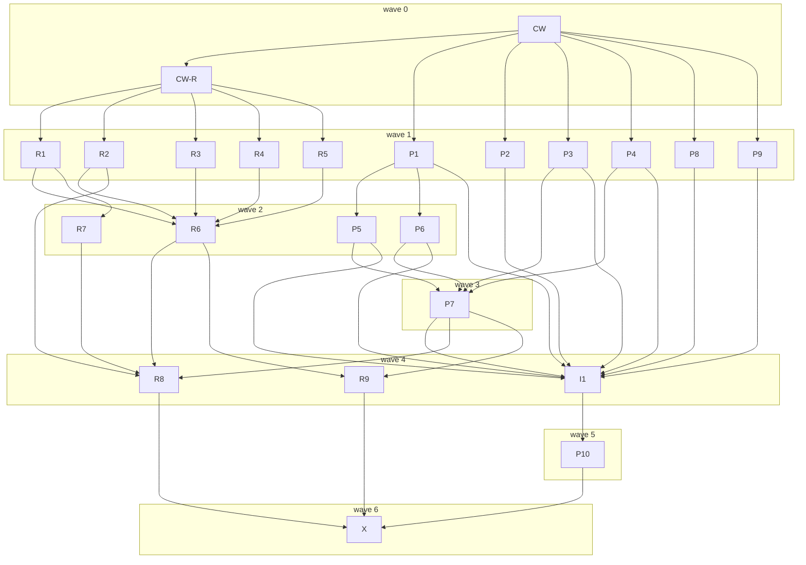
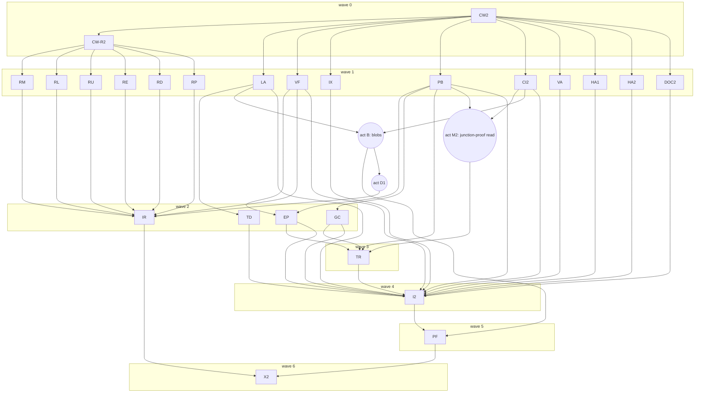

# Plan: `ocx vendor`, the direct launcher, and rules_ocx under remote execution — second run: unified launcher model, short vendored layout, rules_ocx package locking

## Status

- **Plan:** plan_vendor_rules_ocx
- **State:** executing
- **Tier:** high
- **Tier-grammar:** 5
- **Updated:** 2026-11-27
- **Active phase:** 0 — second run planned (§ Second run); first run landed (ocx `9c9e32d4`, rules_ocx `401c9c4`)
- **Step:** awaiting /hex-execute (review-fix loop; round 2 verdict Needs Work; ocx pipelines R2A…R2C)
- **Feature branch:** ocx `hex/bazel-rbe-rules-ocx` (pipelines on `hex/bazel-rbe-rules-ocx--<pipeline>`, worktrees under `.agents/worktrees/`); rules_ocx one branch `hex/bazel-rbe-rules-ocx`, its worktree `/home/mherwig/dev/ocx-sh/rules_ocx/.agents/worktrees/hex-bazel-rbe-rules-ocx` shared by the rules_ocx pipelines of a wave (DP-43)
- **Last update:** 2026-11-27 (after 7ebabeec: delta review round 2; fix pipelines R2A…R2C appended)
- **Reviewed:** 7ebabeec (rules_ocx 83477a4)
- **Next:** /hex-execute .claude/artifacts/plan_vendor_rules_ocx.md

---

## Overview

Implements [`adr_vendor_rules_ocx_remote_execution.md`](./adr_vendor_rules_ocx_remote_execution.md) (accepted under goal-loop
authority on 2026-11-26) and its companion [`system_design_vendor_rules_ocx.md`](./system_design_vendor_rules_ocx.md) ("the design"),
for goal `.agents/goals/bazel-rbe-rules-ocx.md`. Requirements, the owner's rulings, the checks and the rig come from
`.agents/discussions/bazel-rbe-rules-ocx.md` ("the source"): `## Requirements`, the blocks "Ruled by the owner", `## Verification` and
"Test setup". Code map: [`discover_bazel_rbe_rules_ocx.md`](./discover_bazel_rbe_rules_ocx.md), re-verified for file ownership by three
read-only explorers on 2026-11-26 (findings folded into § Decisions DP-1…DP-12).

**Two repositories.** `.` = this repository (ocx, the federation lead; this plan and its single Status block live here only).
`rules_ocx` = `ocx-sh/rules_ocx`, checkout `/home/mherwig/dev/ocx-sh/rules_ocx` at `9648f93` (registered as federation key `rules_ocx` in
`.agents/memory/hex.md`).

**Classification.** Feature (`workflow-feature.md`). Scope **large**; reversibility one-way (high) for the `vendor-manifest` v1 schema,
two-way for everything else (ADR § Metadata). The large-scope artifacts (ADR, system design, persisted research, discovery) exist and are
accepted, so this plan runs at `high` as the caller set it and re-decides nothing the ADR decided (DP-12). Run config: architect inline
(accepted ADR), research skipped (persisted under `.agents/research/` and listed in the ADR), adversary off (tier baseline, no new
one-way door); Review = `reviewer:spec` on the decomposition. At execution the always-on `reviewer:security` seat fires on
`crates/ocx_store/**` and `.github/workflows/**`, and `reviewer:spec` (exit codes) on `crates/ocx_cli/src/exit.rs` (`hex.md › Preferences`).

**What ships.** ocx: `ocx vendor`, `ocx package vendor`, `DIR/manifest.json` as the published, gated `vendor-manifest` v1 schema,
`VendorReport` v1, slugs `vendor_output_not_empty` (64), `vendor_value_unrepresentable` (65), `vendor_path_unrepresentable` (65), the
leaf crate `ocx_env_apply`, the `.direct` launcher kind in `ocx_shim` built for six targets and embedded in every `ocx`. rules_ocx: one
repository per set and platform built from the manifest alone, a hub from exact facts, declared symlinks and link-free directory labels,
the `OCX_INSTALL_BINARY` pair, the interface guard, rewritten examples, `e2e/bzlmod` and docs, the `e2e/rbe/` rig and `verify-rbe.yml`.

## Decisions recorded by this plan

Each is decided under the goal loop's authority; a divergence from the design or the source carries its reason.

| ID | Decision | Reason |
|---|---|---|
| DP-1 | Every `Cargo.toml` edit and every `scripts/crate_map.toml` edit lands in the contract wave CW (all eight `ocx_env_apply` edges at once). No `crates/*/BUILD.bazel` dependency edit is made: every crate uses `all_crate_deps()` (explorer, `ocx_shell/BUILD.bazel:28`). Diverges from design § 12 A1, which listed per-crate BUILD edits. | one owner per file; BUILD edits would be no-ops |
| DP-2 | No baseline file `crates/ocx_schema/contract/baseline/vendor-manifest.json` is written by hand. The gate treats a document absent from `baseline/` as all-additions; the release rotation (`task contract:*`) writes it at the next release. V-40's red is a compat-corpus case (`crates/ocx_sdkgen/tests/compat_corpus/`), its green the live goldens. Diverges from design § 3.1 and § 12 A2. | `baseline/` is the last release's state, held legitimate by `test/lint/test_contract_baseline.py`; a hand-made baseline misstates it and would freeze an unreleased schema |
| DP-3 | No test seam ships: no `OCX_*`/`__OCX_*` switch, no Starlark "test-only attr". Every design row whose red says "test seam" or "test-only attr" is shown red by a **mutation** in a scratch worktree (§ Red-proof protocol) or, where a CI-only platform forbids a mutation, by a permanent control case of the same test. | an env variable or a public attribute is interface (AGENTS.md § Interfaces); the owner's rule forbids surface beyond the documented interface |
| DP-4 | V-66 (launcher overhead) is measured locally on this Linux host by P10 and recorded; no CI bench job is added. Diverges from design § 9 "ocx CI ubuntu (bench job)": that job does not exist (explorer). | a review/measure row; a new CI job for one number is YAGNI |
| DP-5 | macOS and Windows rows are proven only by CI: ocx `verify-deep.yml` (`Acceptance (macos)`, `Acceptance (windows)`, full suite) dispatched on the feature branch, and rules_ocx `verify-deep.yml`. An unlabelled ocx pull request runs only the smoke tier there (explorer, `verify-deep.yml:23-24`). | no macOS or Windows host here; dispatch is the meta-orchestrator's act (§ External acts) |
| DP-6 | The launcher's entry-point writer takes the blob bytes as a parameter (`write_direct_launcher(dir, name, blob: &[u8], sidecar)`); only `tasks::vendor` calls `ocx_store::shim::blob_for`. | removes the design's A5 → A6 edge; the writer pipeline does not wait on the six-blob pipeline |
| DP-7 | rules_ocx test registration: CW-R creates every new Starlark test file and registers it in `ocx/tests/BUILD.bazel`; owning pipelines fill their own test files. R6 (cutover) removes the suites that load deleted functions (`launcher_test.bzl`, `package_test.bzl`, the deleted parts of `policy_test.bzl`) and owns `taskfile.yml`, `MODULE.bazel` (incl. the dogfood `ocx_dev.project` gaining `platforms`) and `pins:check`'s removal. | `ocx/tests/BUILD.bazel` and `taskfile.yml` had two owners in design § 12 (explorer) |
| DP-8 | rules_ocx deletions are by function name, not by line range: the design's ranges are off (explorer: `make_ocx_env` runs 653-790; `render_lazy_launcher` ends at 1388; 1555 is mid-body of `render_launcher`, 1486-1606). The list is in R6's steps. | ranges drifted; a range delete would leave broken bodies |
| DP-9 | `ocx_platform_constraints` leaves `ocx/defs.bzl` (design § 5.3's export list omits it); its job moves to the C-RO-09 mapping in `platforms.bzl`. | the next rules_ocx release breaks every `bins` user already; one break |
| DP-10 | The rig ships two workspaces: `e2e/rbe/baseline/` (rules_ocx 0.5.1 from its release archive, old attributes; R1) and `e2e/rbe/workspace/` (the new rules by `local_path_override`; R7). Both use `e2e/rbe/fixtures/`. | "baseline first" runs 0.5.1 before any change, and its attributes differ from the new ones |
| DP-11 | rules_ocx's guard test follows that repository's script-test pattern (`scripts/bump_ocx_test.py` is a plain `python3` script); `scripts/tests/test_check_ocx_interface.py` is a plain script with asserts, run by `python3`. The rig tests use pytest through `uv run` with `e2e/rbe/pyproject.toml` (R1). | rules_ocx has no pytest setup; `uv` is in its `lint` group |
| DP-13 | P9 ran from the plan-entry commit beside CW, not after it. | file-disjoint docs written from design § 4.1, which fixes the types as final; merged after CW |
| DP-14 | CW touched files its step list did not name: `crates/ocx_test_support/tests/workspace_structure.rs` and crate READMEs (the structure test mirrors `crate_map.toml`), `ocx_cli/src/{app.rs,app/telemetry.rs,exit/detail_rows.txt}` (exhaustive matches, slug rows), `tasks/pull.rs` (passes `LinkMode::Hardlink`); `ocx_package` gained `sha2`/`hex` for `vendor_id`. `LauncherKind {Exec, Direct}` lives in `generate.rs`; `render_toolchain.rs` gets its arm in P6. | the wave must compile and keep the structure tests green; every Cargo edit stays in CW (DP-1) |
| DP-15 | Each pipeline builds in its own `CARGO_TARGET_DIR` (`$SCRATCH/target-<pipeline>`), the feature branch in `target-feature`. Diverges from § Worker rules (one shared dir). | cargo hashes workspace crates by workspace-relative path, so a shared dir linked another worktree's `ocx_util` as fresh (a merge check failed on a module the branch has); retro entry written |
| DP-16 | `ocx_store` gains the `filetime` crate (already in `Cargo.lock` via `tar`) in P3, an orchestrator commit outside CW. | C-008 normalises symlink mtimes; std sets a link's mtime only by following it |
| DP-17 | P7 steps 1-3 run before P5 merges, from the branch with P1 P3 P4 P6; the feature branch is merged into P7 after P5 lands and before P7 step 4. | steps 1-3 call no launcher blob; file-disjoint from P5; shortens the critical path |
| DP-18 | `tree.link_free_dirs` never lists `content_dir` itself: entries are the top-most link-free directories strictly under it. | design § 4.1 says "under `content_dir`" and its example lists `content/share`; P7 step 1 had included `content_dir` for a link-free package |
| DP-19 | P5's security audit (step 4, opus) found two decoder findings in `crates/ocx_env_apply/src/direct.rs` (P1's merged file): a panic on a multibyte segment (Block) and a case-sensitive reserved-key check on Windows (Warn). P5 gains that file for a fix step 4b before the blob cut. `ocx exec` starts a `.bat`/`.cmd` whose path holds `%` the same way the audit made the launcher refuse; that existing behaviour is not changed here and is reported as a follow-up. | the blob cut must follow the last `ocx_env_apply` change; `ocx exec`'s batch path predates this plan and sits outside its contracts |
| DP-20 | P7 step 2 reimplemented project selection over `LockedTool` because the CW request type carried no config or lock; step 3 undoes it and calls `select_tool_set` + `resolve_selected_tools`, with `VendorSelection::Project` carrying config and lock, and P7 gains `crates/ocx_cli/src/command/{vendor,package_vendor}.rs` for that glue. | V-23 (no new selection walk) and parity with what `ocx exec`/`ocx env` select |
| DP-21 | I1 runs in two parts: I1a (bookkeeping the merges left: count literals, docs groups, lint tables, tag-guard reads, test-target map, stale blob names, AI-config rows) beside P7, I1b (hub regeneration, `cargo check`, unit suites) after P7. P7 step 3 did not call `compose_roots`: it installs or runs `prepare_lazy` (writes a shim tree, refuses packages declaring no names); roots are built from the closure (`closure_root`) and composed through `resolve_env(EnvScope::Vendor)`, and the vendor lane skips the shim slot. | I1a touches no P7 file and no generated file; the hub stays regenerated once. `compose_roots` has side effects the manifest-only contract (C-003) forbids |
| DP-22 | `VendorReport.platform` is the platform object every other report carries, not design § 4.3's string. | the contract lint (L11) reds a string platform in a report root; the house contract wins over the design's shorthand. The on-disk `manifest.json` keeps its platform string (§ 4.1) |
| DP-23 | Files ocx writes into `DIR` (launchers 0755, sidecars and `manifest.json` 0644) carry fixed modes and the normalised mtime, not the host umask and clock. | found by P10's V-09 proof; C-008 "normalised modes and mtimes; host-independent bytes" |
| DP-24 | Trust refusals of `ocx vendor` keep the codes `ocx package install` gives for the same policy (an unsigned package under a covering policy: 79), not design § 5.2's 81. | C-024 says the manifest path runs the same trust checks; one trust path, one code. Owner may revisit the § 5.2 row |
| DP-25 | Review-fix RV1's one Windows path-segment rule lives in `ocx_env_apply::windows_path` (the lowest crate the launcher, `ocx_package` and `ocx_store` all reach; `ocx_store` gains that edge) and refuses COM0, LPT0 and the superscript COM/LPT forms, the strictest of the three former copies. The Windows command lookup's extension list is the pure `ocx_config::env::pathext_extensions`, which `ocx vendor` applies with the default `PATHEXT` for a Windows target. | the owner's "one implementation" rule; Windows itself reserves those names, and the launcher's blobs are re-cut once for this round anyway |
| DP-26 | A binary tool's `target_path` is the metadata-derived path in both modes (first interface `PATH` directory under the install path, else `bin/`, `.exe` for a Windows target); a full run refuses (65 `vendor_path_unrepresentable`) a target the content lacks, and the `.cmd`/`.bat` rewrite of a full Windows run is gone. A batch-file program or one outside the first `PATH` directory is exposed as an entry point. | C-004 (manifest-only equals a full run) cannot hold for a rule that reads content; `--manifest-only` has none (C-003), and the schema stays v1 |
| DP-27 | `ocx vendor` probes an entry point's Windows program with the default `PATHEXT` order (`pathext_extensions(None)`), each extension lowercased, then the bare name. | the target host's `PATHEXT` is unknown at vendor time; the staged tree is read on a case-sensitive host, where `.EXE` never matches a shipped `tool.exe` |
| DP-28 | The macOS control for V-27 and V-27c is the signature itself: `codesign --verify` passes on the intact darwin/arm64 launcher and fails on a copy with one byte changed and on a copy whose signature is removed. The intact launcher's run is asserted; the runs of the two copies are printed and never asserted, because the hosted macOS arm64 image starts unsigned native code (rules_ocx deep run 45805097584: a `codesign --remove-signature` copy, "code object is not signed at all", ran to the launcher's own exit 78). The property is unchanged: the darwin/arm64 launcher ships with a valid ad-hoc signature. Diverges from design § 9 V-27 and V-27c, whose red states read "byte-flipped copy → SIGKILL" and "byte-flipped launcher in the vendored repository → killed". | Observed twice on the hosted macOS arm64 runner (rules_ocx deep runs 45796931913 and 45801614932): a copy with the byte at the `LC_MAIN` entry offset (50640) changed fails `codesign --verify` ("invalid signature (code or signature have been modified)") and still runs to the launcher's own exit 78; the kernel does not kill a process over a lazily validated modified page of an ad-hoc, linker-signed binary. The intact launcher verifies (`flags=0x20002(adhoc,linker-signed)`, 90 page hashes) and runs, so a kill is not a claim a test can make reliably |
| DP-29 | Owner requirement: CI keeps proving that the committed launcher blobs are current and run (V-74). Run: `launcher-blobs.yml` starts each of the six blobs from the checkout on its own hosted runner (`ubuntu-24.04`, `ubuntu-24.04-arm`, `macos-15-intel`, `macos-latest`, `windows-latest`, `windows-11-arm`) through `scripts/launcher_blob_check.sh`. The script lays out a vendored directory by hand and checks no-sidecar and malformed-sidecar refusals (78) and a started child. On POSIX it also checks baked and caller arguments, an expanded environment value and the exit status. On Windows it also checks the classic `.shim` mode. On `aarch64-apple-darwin` it runs `codesign --verify` on the blob and on a one-byte-changed copy (DP-28). The script reds when fewer cases ran than the target owes. Callers: `build-windows-shims.yml` (`native-blobs`, on a pull request or main push touching a blob or an input) and `deep-repo.yml` (`launcher-blobs`, the nightly tier; a red run opens the template's `nightly-red` issue). Current: `task rust:shim:inputs:check` in each `build` leg reds when `scripts/shim_inputs.py`'s digest of the non-source inputs differs from `crates/ocx_store/src/shim_inputs.sha256`. Those inputs are the toolchain file, the `shim` profile, the launcher's workspace dependency entries and registry lock closure, the `shim:build` command, and the Zig and cargo-zigbuild pins. | The recency step judged only `crates/ocx_shim/` and `crates/ocx_env_apply/`, so a toolchain, profile, dependency or Zig bump passed every gate with stale blobs. Before this, no CI job started a committed blob; `build` and `acceptance-windows` start fresh builds. The legs install nothing, and no ocx toolchain composes on macOS x64 or Windows arm64. So CI calls the script directly, and `task rust:shim:blob:check` is its local form. Workspace-member versions are left out of the digest, so a release bump needs no re-cut |
| DP-30 | Windows long paths: the launcher gives a program path the `\\?\` prefix on spawn only at or past MAX_PATH (260 UTF-16 units), as Bazel 9.2 and Rust's std do. The vendored layout is not shortened now. A spawn failure a length limit plausibly caused gains one clause on the `ocx-shim:` line naming the length, the limit and what to shorten. That covers a working directory of 260 or more (errors 3, 87, 206, 267), and a batch or relative program path past the limit (errors 2, 3, 206). It also covers a batch target whose `cmd.exe` exits non-zero. Exit codes are unchanged. The guide's Windows section states the limits. | Research verdict. Bazel 9.2.0rc1 passes a `\\?\` `lpApplicationName` as fallback, keeps the original path as `argv[0]`, and limits it to absolute normalised paths of plain executables, batch files excluded. Microsoft's `CreateProcessW` page never states the exemption, so it holds de facto, not by documentation. A started program's `GetModuleFileNameW` can return the `\\?\` form, which a 2019 CPython start-up bug hit; past 260 the alternative is no start at all. No prefix, registry policy or manifest lifts the working-directory limit, as rules_go and CPython document. Under Bazel a test's working directory is its runfiles tree, so the case is real. The layout stays because the build system's prefix dominates the length: about 80 characters are ours before the file name. Consumers read paths from the manifest, so the layout can change later without breaking them. A test harness cannot start the launcher from a working directory of 260 or more, because its own `CreateProcessW` refuses the same way. The message selection is therefore a host unit test only |
| DP-31 | V-01's red state is a rig case proving the executors have no network route, not the rules_ocx 0.5.1 baseline suite, which is removed. | Owner instruction: no test may target a retired integration. The property V-01 needs red is "the executors reach no network", and a case that tries a network address from an executor and must fail shows it without keeping 0.5.1 alive |
| DP-32 | Recorded deferrals from review round 2, kept as they are. `assemble.rs:585`: a hardlink is placed on the async worker, where a copy moves to `spawn_blocking`; one metadata operation, not a byte move. `vendor_layout.rs:199-213`: on Windows the publish removes an empty target before the rename, leaving a window in which another process can create it; the rename then fails and the run reports it. | Both are Suggest findings outside RV2's convergence gap; neither is a correctness defect, and the run allows no further refinement cycle |
| DP-12 | Tier stays `high` although Phase 3 classifies scope large (tier-high.md says re-run as `xhigh`). | the caller fixed the tier; every artifact large scope demands exists and is accepted; what `xhigh` adds (research breadth, panel) is never repeated on an accepted ADR. Retro entry written |

## The R-5 cut against the source's Requirements

The ADR's R-5 ships v1 without `packages[].layers`, `tree.empty_dirs` and the `links_on_disk` attribute. **No Requirement bullet is
touched.** The Requirements ask for the command in both tiers, `--manifest-only` that downloads no layer, a versioned gated spec, the
launcher, manifest-only rules_ocx, the rig, the green PR, red/green checks and the owner's rules; none names layers, empty-directory
listing or a links attribute. Fidelity holds: empty directories are written on disk (V-21) and `--omit-links` stays (C-011). Two
**Decisions** of 2026-11-23 are narrowed, not Requirements: "the Bazel ADR also specifies the data a native download needs" is met by
specification only (ADR § Data model, "Specified for later"); "rules_ocx works from digests and blob data handed over as plain
attributes" is narrowed by DV-9 to digests (V-16). The native download itself is out of scope by the source (`## Intent`, Out of scope).

## Component contracts and scenarios (index)

The contracts are the design's § 6 (C-001…C-024, ocx) and § 7 (C-RO-01…C-RO-17, rules_ocx), each testable from outside the code; the
scenarios are § 8 (S-001…S-015); the error taxonomy is § 5.2; edge cases sit in each contract's text. This plan adds no contract. The
table is the coverage join: every ID → the pipeline that implements it → the pipeline that writes its test.

| ID | One line | Implements | Test in |
|---|---|---|---|
| C-001 | no `-o` → 64, nothing written | CW (clap) | P8 (V-39) |
| C-002 | non-empty or symlinked `DIR` → 64 before network | P7 | P8 (V-43, V-67) |
| C-003 | `--manifest-only` writes one file, no layer GET | P7 | P8 (V-19, V-38) |
| C-004 | manifest-only equals full minus `content`/`tree` | P7 | P8 (V-19) |
| C-005 | environments equal `ocx env` after token replacement | P4, P7 | P8 (V-20) |
| C-006 | patches never reach environments | P4 | P8 (V-20b) |
| C-007 | files and links equal installed `content/`; links contained | P3, P7 | P8 (V-21, V-69) |
| C-008 | normalised modes and mtimes; host-independent bytes | P3 | P8 (V-09 ocx half, V-46, V-70) |
| C-009 | staged publish, failure leaves `DIR` as it was | P3, P7 | P3 unit, P8 (V-67) |
| C-010 | only `@VENDOR_DIR@`; bad values → 65 | P7 | P8 (V-25, V-42, V-70) |
| C-011 | `--omit-links` | P7 | P8 (V-21) |
| C-012 | launcher root lookup | P5 | P5 unit, P8 (V-30, V-59, V-60, V-61), R9 (V-45) |
| C-013 | lexical absolute root; separator in root → 78 | P5 | P5 (V-68), P8 (V-14) |
| C-014 | unset then apply via `apply_one` | P1, P5 | P1 unit, P8 (V-22, V-73) |
| C-015 | `program`/`self` structurally inside root | P1 (decode), P6 (write) | P1/P6 unit (V-62) |
| C-016 | argv equals `ocx exec`'s | P5 | P8 (V-22) |
| C-017 | `execve`; Windows batch through std `Command` | P5 | P5 Windows test (V-58), P8 (V-22) |
| C-018 | launcher writes nothing | P5 | P8 (V-36) |
| C-019 | one blob per triple ≤ 640 KiB; darwin arm64 signed | P5 | P5 (V-26) |
| C-020 | Unix accepts only `.direct` | P5 | P5 (V-52) |
| C-021 | gate fails on an unversioned break | P2 | P2 (V-40) |
| C-022 | a selection brings its closure | P4, P7 | P8 (V-41 ocx half via closure assertion), R7 (V-41) |
| C-023 | `available_platforms` before leaf selection | P7 | P8 (V-54, V-57) |
| C-024 | manifest-only runs the trust checks | P7 | P8 (V-63) |
| C-RO-01 | only the two vendor argv | R3, R4 | R5 (V-18) |
| C-RO-02 | set repository run and move | R3 | R7 (V-01 and others) |
| C-RO-03 | reads only `manifest.json`; bad links `fail()` | R3 | R3 (V-69) |
| C-RO-04 | BUILD from manifest: dir labels, files, symlinks | R3 | R3 unit, R7 (V-12, V-34) |
| C-RO-05 | reserved names moved and restored | R3 | R3 unit, R7 (V-47) |
| C-RO-06 | `ocx_set` runfiles hold the whole set | R3 | R7 (V-41) |
| C-RO-07 | `ocx_tool` links in its own package | R3 | R7 (V-30), R9 (V-45) |
| C-RO-08 | hub toolchains, lazy set fetch | R4 | R4 unit, R7 (V-02) |
| C-RO-08b | platform outside `available_platforms` → `fail()` | R4 | R4 (V-50) |
| C-RO-09 | platform string → constraints | R4 | R4 unit, R7 (V-13) |
| C-RO-10 | exact facts; hit runs no ocx | R4 | R4 unit, R7 (V-33, V-55, V-56) |
| C-RO-11 | amended invariants 1 and 3 | R4, R9 (`AGENTS.md`) | R5 (V-18) |
| C-RO-12 | set repository cross-checks the fact | R3 | R3 (V-48) |
| C-RO-13 | `windows/*` set with links → `fail()` | R3 | R3 (V-49) |
| C-RO-14 | the guard script | R5 | R5 (V-18) |
| C-RO-15 | `OCX_INSTALL_BINARY` pair | R2 | R2 (V-51) |
| C-RO-16 | isolated home per run, no credential getenv | R3, R4 | R7 (V-10, V-71) |
| C-RO-17 | reproducible only when digest-pinned | R3 | R7 (V-64) |
| S-001…S-002 | fresh machine without / with lock | R4 | R7 (V-33) |
| S-003 | hidden dependency (ccache) | R3, P7 | R7 (V-41) |
| S-004 | entry point by bare name | P5, P6 | P8, R7 (V-30) |
| S-005 | cross-platform vendor | P5, P7 | P8 (V-27 on macOS CI) |
| S-006 | movable install | P5, P7 | P8 (V-24, V-36) |
| S-007 | non-empty target | P7 | P8 (V-43) |
| S-008 | private registry, no secret | R3, R4 | R7 (V-10) |
| S-009 | offline with `blob_dirs` | R3 | R7 (V-05, V-32) |
| S-010 | `bazel vendor` | R3, R4 | R7 (V-04) |
| S-011 | Windows exec platform with links | R3 | R3 (V-49) |
| S-012 | lock edit, same names | R4 | R7 (V-55) |
| S-013 | stale lock → 65 hint | P7 (existing), R3 (hint) | P8 (`lock_stale` case), R3 unit |
| S-014 | no host leaf | P7, R4 | P8, R7 (V-57) |
| S-015 | interrupted run | P3, P7 | P8 (V-67) |

## Verification map (V-01…V-73)

Every row of the design § 9 → the pipeline whose test holds it, how red is shown, where green is shown. Control kinds: **in** = a
permanent control case in the same test (the check reports failure on a bad input); **mut** = a mutation in a scratch worktree, run once
(§ Red-proof protocol); **rev** = review/measure row, no red (R-2; budgets). "rig" = rules_ocx `e2e/rbe/`, local and `verify-rbe.yml`
(`rig-buildbarn`, `rig-nativelink`). "ocx-deep" = ocx `verify-deep.yml` dispatched on the branch. "local" = this Linux host.

| V | Test owner | Red | Green at |
|---|---|---|---|
| V-01 | R7 | in (a rig case proving the executors have no network route; DP-31) | rig both jobs |
| V-02 | R7 | in (`--extra_execution_platforms` with no toolchain) | rig |
| V-03 | R7 | in (flag off leg) | rig |
| V-04 | R7 | in (blocked without `bazel vendor`) | rig offline |
| V-05 | R7 | in (without `blob_dirs`) | rig offline |
| V-06 | R7 | in (baseline log lists `@ocx_tool`) | rig |
| V-07 | R7 | in (0.5.1 sh launcher on shell-less runner) | rig distroless |
| V-08 | P8 (ocx), R7 (rules) | in (0.5.1 lacks `vendor` / no `launcher_path` fixture with a launcher) | local + rig |
| V-09 | R7 (rules), P8 (ocx bytes) | mut (normalisation disabled) | rig two clients |
| V-10 | R7 | mut (planted `getenv` in a scratch copy of a rule) | rig |
| V-11 | R9 | in (missing set label) | rules_ocx `ci:deep` |
| V-12 | R7 | mut (links copied as files) | rig both jobs |
| V-13 | R7 | mut (glibc registered first) | rig |
| V-14 | P8 | in (direct start with relative `PATH` after `cd`) | local |
| V-15 | R7 | in (no `index`) | rig |
| V-16 | R7 | in (facts deleted) | rig |
| V-17 | X | in (`9648f93`: `unknown attribute 'platforms'`) — green, Linux, `@tools//...` only | local, Red-proof log |
| V-18 | R5 | in (planted `ocx env` fixture) | rules_ocx lint |
| V-19 | P8 | in (full run log; renamed fixture tool) | local |
| V-20 | P8 | in (one mutated expected entry) | local + ocx-deep |
| V-20b | P8 | mut (vendor lane bypassed) | local |
| V-21 | P8 | in (one flipped byte) | local + ocx-deep |
| V-22 | P8 | mut (`unset` emptied) | local + ocx-deep |
| V-23 | this plan § Reuse table | rev | `/hex-plan` review |
| V-24 | P8 | mut (root baked absolute) | local + ocx-deep |
| V-25 | P8 (ocx), R7 (rig) | mut (`${installPath}` left unresolved) | local + rig |
| V-26 | P5 | in (x86_64 darwin blob carries none) | ocx `verify-basic` unit |
| V-27 | P8 (macOS cases) | in (`codesign --verify` passes on the intact launcher, fails on a one-byte-changed copy and on a signature-removed copy; both copies' runs are printed, never asserted, DP-28) | ocx-deep macOS |
| V-27b | P8 (macOS cases) | in (stripped copy differs) | ocx-deep macOS |
| V-27c | R9 | in (`codesign --verify` passes on the intact vendored launcher, fails on a one-byte-changed copy and on a signature-removed copy; both copies' runs are printed, never asserted, DP-28) | rules_ocx `verify-deep (macos-latest)` |
| V-28 | P8 (docker distroless), R7 | in (0.5.1 sh launcher) | local + rig distroless |
| V-29 | R7 | in (0.5.1 entry-point script) | rig |
| V-30 | P8, R7 | mut (second package out of runfiles / `PATH`) | local + ocx-deep + rig |
| V-31 | R7 → R8 | rev | `e2e/rbe/RESULTS.md` |
| V-32 | R7 | in (blocked without `blob_dirs`) | rig offline |
| V-33 | R7 | in (lock deleted) | rig |
| V-34 | R7 | in (reference list minus one file) | rig both jobs |
| V-35 | P8 | in (planted `BUILD.bazel` in a fixture output) | local |
| V-36 | P8 | in (a test launcher that writes beside itself) | local + ocx-deep |
| V-37 | design § 11 | rev | ADR review (done) |
| V-38 | P8 | in (full run) | local |
| V-39 | P8 | in (run with `-o`) | local (smoke) |
| V-40 | P2 (gate), P8 (schema validation of a real manifest) | in (corpus case: removed field) | ocx `verify-basic` |
| V-41 | R7 | in (`ocx.package` of cmake alone) | rig |
| V-42 | P8 | in (fixture without the literal) | local |
| V-43 | P8 | in (empty dir) | local |
| V-44 | X | in (released `DEFAULT_OCX_VERSION`, no `vendor`) | rules_ocx CI with the dev build |
| V-45 | R9 | in (`--noenable_runfiles` → 78 with the hint) | rules_ocx `verify-deep (windows-latest)` |
| V-46 | P8 | in (unit: host separators passed to the pure renderer, P4) + golden compare | ocx-deep `Acceptance (windows)` |
| V-47 | R7 | mut (move disabled) | rig |
| V-48 | R3 | in (tampered tool name) | rules_ocx `ci:test` |
| V-49 | R3 | in (link-free Windows fixture passes) | rules_ocx `ci:test` |
| V-50 | R4 | in (available platform passes) | rules_ocx `ci:test` |
| V-51 | R2 | in (wrong hash) | rules_ocx `ci:test` |
| V-52 | P5 | in (`.direct` runs) | ocx `verify-basic` unit |
| V-53 | P8 | in (declared fixture → one tool) | local |
| V-54 | P8 | in (binding missing `darwin/arm64` left out) | local |
| V-55 | R7 | in (unchanged lock) | rig |
| V-56 | R7 | in (unchanged list) | rig |
| V-57 | P8 (ocx), R7 | in (`-p` omitted → 78) | local + rig |
| V-58 | P8 (Windows case of `test_vendor_launcher.py`); P5 unit for the `.bat`/`.cmd` dispatch decision | in (control: the same `.cmd` started by `subprocess` with `list2cmdline` quoting, the CommandLineToArgvW scheme, runs the injected command) | ocx-deep `Acceptance (windows)` |
| V-59 | P5 unit, P8 | mut (candidate (c) without the `P` under `$RUNFILES_DIR` rule) | local |
| V-60 | P5 unit, P8 | mut (blocking read) | local |
| V-61 | P5 unit, P8 | in (a different file at the `PATH` hit → 78) | local + ocx-deep macOS |
| V-62 | P1 (decoder), P6 (writer) | in (well-formed `program` runs) | ocx `verify-basic` unit |
| V-63 | P8 | in (policy rule removed → 0) | local |
| V-64 | R7 | in (pinned form writes a cache entry) | rig |
| V-65 | R7 → R8 | rev | `e2e/rbe/RESULTS.md` |
| V-66 | P5 (timer), P10 (run) | rev | local, P10 evidence (DP-4) |
| V-67 | P8 | mut (publication without staging) | local |
| V-68 | P5 | in (root without `:` runs) | local |
| V-69 | P7 + P8 (ocx), R3 (rules) | in (relative inside target passes) | local + rules_ocx `ci:test` |
| V-70 | P8 | in (normal fixture, modes as archived) | local |
| V-71 | R7 | mut (rule forced to the client home) | rig |
| V-72 | P1 (decoder), P6 (writer) | in (ordinary key accepted) | ocx `verify-basic` unit |
| V-73 | P1 unit (fold), P8 (Windows case) | in (unit: case-sensitive comparator as the control input of the pure fold) | ocx-deep `Acceptance (windows)` |
| V-74 | DP-29 | in (a blob with a changed byte, a stand-in accepting any sidecar, a missing blob, a dropped case; each changed build input) | `launcher-blobs.yml` on six native runners via `build-windows-shims.yml` and ocx-deep; `scripts:self-test` |

## Red-proof protocol (goal criterion "every check red once and green once")

1. **Test first.** Each test-writing step runs its test against the contract-wave stubs and records the failing line (TDD red). A test
   that passes against the stubs is wrong and is rewritten. This red is not the V-row red.
2. **in rows.** The control case is a permanent part of the test (a parametrised `control` case asserting that the check reports
   failure). One run shows both outcomes. Mandatory for every row proven only in CI.
3. **mut rows.** P10 (ocx), R8 (rules_ocx) and X apply the row's mutation in a scratch worktree, grep the mutated text to prove it
   landed, rebuild, run the one test, record the failing assertion (the row's own assertion, not setup), and discard the worktree. A
   mutation that leaves the test green means a second guard: mutate further until one reds (`quality-core.md` § Unchecked Green).
4. **Record.** Each pipeline writes only its own `.claude/artifacts/evidence/vendor_rules_ocx/<pipeline>.md` (ocx pipelines in their
   worktree; for rules_ocx pipelines the orchestrator writes the file in the lead from the pipeline's final report). The orchestrator
   folds one line per V-row into § Red-proof log at merge; no pipeline edits this plan. A CI-proven row's line names the run URL and job.
5. **Scope.** A filtered run is iteration only; a row is green when its named location ran it (`quality-core.md` § A green is only as
   wide as what ran).

## Worker rules (bind every step)

- **Scratch.** Every path below lives under `/tmp/claude-1000/-home-mherwig--herdr-worktrees-ocx-uno/884fced7-d8ab-48af-8366-591f3a7bc90b/scratchpad/`
  (`$SCRATCH`), a subdirectory per pipeline.
- **Rust.** `cargo` with `CARGO_TARGET_DIR=$SCRATCH/target` (shared, saves rebuilds): `cargo check -p <crate> --all-targets --locked`,
  `cargo test -p <crate>` (or `cargo nextest run -p <crate>`), `cargo fmt`. `cargo test -p ocx_test_support --test workspace_structure`
  after any crate-map change.
- **Bazel.** Never through a bare `task` target that invokes Bazel (it reads `~/.bazelrc`, which points at the shared remote cache).
  A local Bazel call is `ocx exec bazel -- --ignore_all_rc_files --output_user_root=$SCRATCH/bazel <cmd>` and nothing else. Bazel-only
  gates (`bazel:tag:guard`, `bazel:build:drift`, `ACCEPTANCE_MODULE_TARGETS`) are CI's; a local red caused by the missing workspace rc
  file is not a finding.
- **ocx.** Every `ocx` call: `OCX_HOME=$SCRATCH/
/home`, `HOME=$SCRATCH/
/user`, `OCX_NO_CONFIG=1`. Never the real `~/.ocx`.
- **Acceptance.** Build `ocx` with `cargo build -p ocx --locked`, place it where `test/conftest.py::ocx_binary` (`ocx_command()`)
  resolves it, run `cd test && uv run pytest tests/<module>.py -v` (the suite's own zot fixtures). No `task test`, no full `task verify`.
- **Docker.** Only compose projects the step creates, named `rules-ocx-rig-<pipeline>`, removed by the same step
  (`docker compose -p <name> down -v`). Never another container.
- **Commits.** `git add <explicit paths>`, `git commit --no-verify`, Conventional Commits; `chore:` for `.claude/**` and `.agents/**`;
  `refactor:` for behaviour-free moves (P1); no `Co-Authored-By`. Never `.serena/project.yml`. Never `CHANGELOG.md` (either repository).
  No user or rollout count anywhere.
- **Pipeline boundary.** A step that needs a file outside its pipeline's Expected files stops and reports; it does not edit it.

## How rules_ocx reaches the `ocx` of this branch

- **Locally** (R3, R4, R7, R8, R9, X): `cargo build -p ocx --locked` in the ocx feature branch (after P7 merged; X after P10), then
  `OCX_INSTALL_BINARY=$SCRATCH/ocx-under-test/ocx` and `OCX_INSTALL_BINARY_SHA256=$(sha256sum …)`, Bazel with `--lockfile_mode=off`
  (C-RO-15). Pure Starlark unit tests need no `ocx`.
- **In CI**: the dev build of the ocx pull request. The meta-orchestrator dispatches ocx `release.yml` with `mode=dev` on
  `hex/bazel-rbe-rules-ocx`, which publishes `ghcr.io/ocx-sh/dev/cli:X.Y.Z-pr<N>` for six platforms (linux musl, darwin, windows-gnullvm;
  amd64 and arm64). X writes its pinned identifier with digest into `e2e/rbe/ocx-under-test.txt`; R2's composite action
  `.github/actions/ocx-under-test` pulls it with the released `ocx` (verifying against the dev signer identity, the branch's own
  `release.yml`), exports the pair and `--lockfile_mode=off`, and runs first in `verify-basic.yml`, `verify-deep.yml` and `verify-rbe.yml`.
  The file is deleted after the owner's ocx release, when the pin moves (owner's step).

## rules_ocx branch mechanics

The grant is one branch in rules_ocx. The branch is `hex/bazel-rbe-rules-ocx`, created in the main checkout from `main` at `9648f93`.
rules_ocx pipelines run in **detached** worktrees (`git worktree add --detach .agents/worktrees/<pipeline> <branch tip>`; `.bazelignore`
lists `.agents/worktrees`), so no further branch exists; a pipeline lands by fast-forward or cherry-pick of its commits onto the one
branch in the main checkout, serialized in the DAG's order. The stardoc step (R9's last) runs in the main checkout, because stardoc does
not build in a fresh worktree there (rules_ocx `hex.md`). rules_ocx rule copies under `.claude/rules/` are generated from
`agent-config/` by `task setup` (grimoire); edits go to `agent-config/`. That repository's `hex.md` model preference (Opus for
non-trivial work) is advisory to a federated run; this plan follows the lead's model policy.

## Hub files (no code pipeline owns them; regenerated once by pipeline I1, ocx)

`crates/ocx_schema/tests/golden/{cli,cli-schema,reports,errors}.json` and `vendor-manifest.json` after P2 adds it;
`crates/ocx_sdkgen/tests/golden/rust/**`; `website/src/content/docs/reference/command-line/**` and any generated error-detail page
(`task website:reference:generate`); `test/SUITE_FLOOR` (by the collected new cases), `test/limits/**`; `ACCEPTANCE_MODULE_TARGETS`
(218 → 222) and its assertion in `scripts/bazel_gate_proofs.py`; `MODULE.bazel.lock` (new workspace member). **Exception:** `Cargo.lock`
is committed by CW, because nothing builds `--locked` without it. rules_ocx: `MODULE.bazel.lock` (R6 owns it, the one rules_ocx hub).

## Contract wave CW (ocx, wave 0)

One pipeline, serial steps, one merge. **Stub rule:** what an existing code path reaches is real and behaves as today; only what no
existing path calls may be `unimplemented!()`. Gate: `cargo check --workspace --all-targets --locked`,
`cargo test -p ocx_test_support --test workspace_structure`, the existing unit suites of every touched crate green, every new contract
test compiling and red (named in the step's evidence).

1. **Crate and edges** (sonnet). `crates/ocx_env_apply/{Cargo.toml,BUILD.bazel,src/lib.rs,src/direct.rs}` (new; BUILD copied from a
   std-only sibling); `apply_one(existing: Option<&OsStr>, kind, value, separator, fold: KeyFold) -> OsString`, the segment comparator,
   `move_to_front`/`remove_segment`/`append_unique` signatures (stubs); `direct::DirectSidecar` serde types per design § 4.2, final,
   `#[serde(deny_unknown_fields)]`, `fn validate(&self, platform_is_windows: bool) -> Result<(), SidecarError>` stub. `Cargo.toml`
   edges for `ocx`, `ocx_config`, `ocx_package`, `ocx_package_manager`, `ocx_project`, `ocx_setup`, `ocx_shell`, `ocx_shim` (+ `serde`,
   `serde_json`); `scripts/crate_map.toml` row `ocx_env_apply = []` and the eight edges; `Cargo.lock`. Red tests: the expected cases of
   `crates/ocx_util/src/{path,list}.rs` `mod tests` re-stated against `ocx_env_apply` (P1 deletes the originals); decoder cases for
   V-62 and V-72. Commit `chore: ocx_env_apply contract stubs`.
2. **Data types** (sonnet). `crates/ocx_package/src/vendor.rs` + `src/vendor/*.rs`: `VendorManifest` and every
   nested type per design § 4.1, final, `JsonSchema` derives, `DIR_TOKEN`, `MANIFEST_FILE`, `vendor_id()` stub; `src/lib.rs` module
   line; the § 4.1 example as `crates/ocx_package/src/vendor/example.json` with a green round-trip test (types are real) and a red
   `vendor_id` test. Commit `chore: vendor manifest data types`.
3. **Store and composer stubs** (sonnet). `crates/ocx_store`: `LinkMode { Hardlink, Copy }` in `src/hardlink.rs`, threaded through
   `assemble_from_layers_with_layouts` at `assemble.rs:578` with every existing caller passing `Hardlink` (real); `vendor_layout.rs`
   (`VendorLayout`, `StagedTree::{create, publish, abort}` stubs) and its `file_structure.rs` line; `shim.rs`
   `blob_for(&Platform) -> Option<&'static [u8]>` stub. `composer.rs`: `PathLane::Vendor`, `ComposePaths::vendor(token_root)` stub.
   Red tests: `VendorLayout` path rules (design § 4.1 path rules, Windows device names), `StagedTree` publish/abort, the vendor lane's
   token-rooted paths, `blob_for` per platform. Commit `chore: vendor store and composer contract stubs`.
4. **Launcher, task and CLI surface** (sonnet). `crates/ocx_package_manager/src/launcher/direct.rs`
   (`write_direct_launcher(dir, name, blob, sidecar)` stub, DP-6) and its `launcher.rs` line; the direct target kind as an enum variant
   in `launcher/generate.rs` and `tasks/render_toolchain.rs` (arms `unimplemented!()`); `tasks/vendor.rs` (`VendorRequest`,
   `VendorOutcome`, `VendorError` with `#[derive(Classify)]` slugs per design § 5.2, `PackageManager::vendor` stub) and its `tasks.rs`
   line. CLI real glue: `crates/ocx_cli/src/command/{vendor,package_vendor}.rs`, `api/data/vendor.rs` (`VendorReport` complete:
   `Printable`, `ROOT`, plain table), `command.rs`, `command/package.rs`, `command/leaf.rs` (entries, `path`, contract rows version 1),
   `api.rs` (`visitor.root::<VendorReport>()`), `exit.rs` rungs for `VendorError`. Red tests: writer byte-copy test, `vendor` unit
   smoke. Commit `chore: vendor launcher, task and command contract stubs`.

## Contract wave CW-R (rules_ocx, wave 0, after CW)

One step (sonnet). New files with final public attributes and docstrings, bodies `fail("unimplemented")`:
`ocx/private/vendor_manifest.bzl` (`read_manifest`), `ocx/private/set_repo.bzl` (`ocx_set_repo`; pure helpers `build_file_content`,
`reserved_moves`, `cross_check`), `ocx/private/set_rules.bzl` (`OcxSetInfo`, `ocx_set`, `ocx_set_toolchain`, `ocx_tool`),
`ocx/private/hub.bzl` (`ocx_hub_repo`, `hub_build_content`), `ocx/private/facts.bzl` (`fact_key`, `fact_value`, `fact_hit`); in
`ocx/private/repo_utils.bzl` only the new `make_isolated_ocx_env(rctx, home)` stub; each with `visibility(["//ocx", "//ocx/tests"])`.
`ocx/constraints/BUILD.bazel` (real: `constraint_setting` `libc`, values `glibc`, `musl`). Test files
`ocx/tests/{vendor_manifest,set_repo,facts,hub,platforms_map,download}_test.bzl` with red cases, registered in `ocx/tests/BUILD.bazel`; fixture
`ocx/tests/testdata/vendor_manifest_example.json`, a byte copy of ocx's `crates/ocx_package/src/vendor/example.json` (X checks parity).
Gate: buildifier clean; `bazel build //ocx/...` and `bazel test //ocx/tests/...` per § Worker rules, the old suites green, the new red.
Commit `chore: vendor reader and set rule contract stubs`.

## Parallelization (first run — landed)

Kept as history. Every row is landed; the second run's table is § Parallelization below.

| Pipeline | Repo | Scope | Expected files | Wave | Depends on | Marks | Status |
|---|---|---|---|---|---|---|---|
| CW | . | contract wave: C-001 real; stubs for C-002…C-024 surfaces; DP-1 | as § Contract wave CW | 0 | — | | merged |
| CW-R | rules_ocx | contract wave: stubs for C-RO-02…C-RO-10, C-RO-12, C-RO-13, C-RO-16, C-RO-17 | as § Contract wave CW-R | 0 | CW | | merged |
| P1 | . | C-014, C-015 (decode); V-62, V-72, V-73 units | `crates/ocx_env_apply/src/**`; `crates/ocx_util/src/{path,list}.rs`, `crates/ocx_util/Cargo.toml` and the `ocx_util` row of `scripts/crate_map.toml` (only if `ocx_util` keeps a use of a moved symbol); the 15 caller files of design § 12 A1; every other file using a moved symbol (candidates: `ocx_cli/src/conventions.rs`, `ocx_cli/src/command/self_group/activate.rs`, `ocx_project/src/error.rs`, `ocx_setup/src/profiles.rs`, `ocx_shell/src/ci/{github,gitlab}_flavor.rs`, `ocx_shell/src/shell/{reconcile,tests_git_bash}.rs`); `crates/ocx_package/src/metadata/env/list.rs` (doc link) | 1 | CW | | merged |
| P2 | . | C-021; V-40 | `crates/ocx_schema/src/{lib,main}.rs`, `crates/ocx_schema/BUILD.bazel`, `crates/ocx_sdkgen/src/**`, `crates/ocx_sdkgen/tests/{compat_gate.rs,compat_corpus/**}`, `crates/ocx_sdkgen/BUILD.bazel`, `website/schema.taskfile.yml` | 1 | CW | | merged |
| P3 | . | C-007 (copy half), C-008, C-009; S-015 unit half | `crates/ocx_store/src/file_structure/{assemble.rs,vendor_layout.rs}`, `crates/ocx_store/src/hardlink.rs` | 1 | CW | review | merged |
| P4 | . | C-005 (lane), C-006, C-022 (lane); V-46 unit control | `crates/ocx_package_manager/src/composer.rs`, `crates/ocx_package/src/metadata/env/resolver.rs`, `crates/ocx_package_manager/src/tasks/resolve.rs` | 1 | CW | | merged |
| P5 | . | C-012, C-013, C-014 (apply), C-016…C-020; V-26, V-52, V-58 (dispatch unit), V-59…V-61, V-66 timer, V-68 | `crates/ocx_shim/src/**`, `crates/ocx_shim/tests/**`, `crates/ocx_shim/BUILD.bazel`, `crates/ocx_store/src/{shim.rs,shims/**}`, `crates/ocx_store/src/file_structure/shim_bin_store.rs`, `.github/workflows/build-windows-shims.yml`, `taskfiles/rust.taskfile.yml` | 2 | P1 | hard | merged |
| P6 | . | C-015 (write); S-004 writer; V-62, V-72 writer | `crates/ocx_package_manager/src/launcher/{direct,generate}.rs`, `crates/ocx_package_manager/src/tasks/render_toolchain.rs`, `crates/ocx_env/src/vars/tests.rs` | 2 | P1 | | merged |
| P7 | . | C-002…C-004, C-007, C-009…C-011, C-022…C-024 orchestration; S-007, S-013, S-014 | `crates/ocx_package_manager/src/tasks/{vendor.rs,pull.rs,toolchain_names.rs}`, `crates/ocx_package/src/vendor.rs`, `crates/ocx_package/src/vendor/*.rs` (`vendor_id` and any manifest-type fix) | 3 | P3, P4, P5, P6 | hard | merged |
| P8 | . | acceptance for C-001…C-024 and S-004…S-007, S-013…S-015 | `test/tests/{test_vendor,test_package_vendor,test_vendor_launcher,test_vendor_parity}.py`, `test/src/vendor_fixtures.py`, `test/fixtures/vendor/**`, `test/BUILD.bazel` (`module_data`) | 1 | CW | | merged |
| P9 | . | goal criterion 1 docs; AI-config upkeep | `website/src/content/docs/reference/vendor-manifest.md`, `website/src/content/docs/guides/vendor.mdx`, `website/astro.config.mjs`, `AGENTS.md`, `.claude/rules/{arch-principles,subsystem-cli-commands,subsystem-package-manager,subsystem-file-structure,subsystem-interface-contract,product-context}.md` | 1 | CW | | merged |
| I1 | . | integration gate: hub files regenerated once (§ Hub files), `cargo check --workspace --all-targets --locked`, the touched crates' unit suites, `task website:reference:generate` | the § Hub files list (ocx side) | 4 | P1…P9 | | merged |
| P10 | . | ocx proofs: every ocx V-row green locally, mut rows, V-66 | `.claude/artifacts/evidence/vendor_rules_ocx/P10.md`, `test/fixtures/vendor/windows_amd64.manifest.json` (V-46 golden, written on Linux); code fixes in any file of a merged ocx pipeline, each named in `P10.md`, never a test unless it contradicts a contract | 5 | I1 | | merged |
| R1 | rules_ocx | rig, baseline, the two rig questions | `e2e/rbe/**` except `e2e/rbe/{tests,workspace}/**` and `e2e/rbe/ocx-under-test.txt`; `taskfiles/rig.taskfile.yml`; `.bazelignore` | 1 | CW-R | | merged |
| R2 | rules_ocx | C-RO-15; V-51 | `ocx/private/{download,manifest}.bzl`, `ocx/tests/download_test.bzl` (new), `e2e/install_binary/**` (new), `.github/actions/ocx-under-test/action.yml`, `.github/workflows/{verify-basic,verify-deep}.yml` | 1 | CW-R | | merged |
| R3 | rules_ocx | C-RO-02…C-RO-07, C-RO-12, C-RO-13, C-RO-16, C-RO-17; S-003, S-009…S-011; V-48, V-49, V-69 | `ocx/private/{vendor_manifest,set_repo,set_rules}.bzl`, `ocx/private/repo_utils.bzl` (`make_isolated_ocx_env` only), `ocx/tests/{vendor_manifest,set_repo}_test.bzl`, `ocx/tests/testdata/**` except the CW-R example | 1 | CW-R | hard | merged |
| R4 | rules_ocx | C-RO-08, C-RO-08b, C-RO-09…C-RO-11 (code); S-001, S-002, S-012, S-014; V-50 | `ocx/extensions.bzl`, `ocx/private/{hub,facts,platforms}.bzl`, `ocx/defs.bzl`, `ocx/tests/{facts,hub,platforms_map,platforms}_test.bzl` | 1 | CW-R | hard | merged |
| R5 | rules_ocx | C-RO-14; V-18 | `scripts/check_ocx_interface.py`, `scripts/tests/test_check_ocx_interface.py`, `taskfiles/guard.taskfile.yml` | 1 | CW-R | | merged |
| R6 | rules_ocx | cutover: old fetch paths deleted, Bazel 9 only, wiring (DP-7, DP-8, DP-9) | `ocx/private/{project,package}.bzl` (deleted), `ocx/private/repo_utils.bzl` (dead functions), `ocx/tests/{launcher,package,policy}_test.bzl`, `ocx/tests/BUILD.bazel`, `MODULE.bazel`, `MODULE.bazel.lock`, `.bcr/presubmit.yml`, `taskfile.yml`, `bazel/*.bazelrc` (Bazel 8 lines only), root `BUILD.bazel` (if a test label moves) | 2 | R1, R2, R3, R4, R5 | | merged |
| R7 | rules_ocx | rig tests for every rig V-row; S-001…S-003, S-008…S-010, S-012, S-014 | `e2e/rbe/tests/**`, `e2e/rbe/workspace/**` | 2 | R1 | | merged |
| R8 | rules_ocx | rig green on both backends locally; rules mut rows; V-31, V-65 numbers; the CI lane | `.github/workflows/verify-rbe.yml`, `e2e/rbe/RESULTS.md` (new column); code fixes in any file of a merged rules_ocx pipeline, each named in the evidence | 4 | R2, R6, R7, P7 | | merged |
| R9 | rules_ocx | examples, `e2e/bzlmod`, docs, invariants 1 and 3 (C-RO-11 text); V-11, V-27c, V-45 | `examples/**`, `e2e/bzlmod/**`, `README.md`, `docs/**`, `AGENTS.md`, `agent-config/**`, `.claude/rules/**` (generated copies) | 4 | R6, P7 | | merged |
| X | . + rules_ocx | integration: attested blobs, V-17, V-44, fixture parity, proof ledger, CI evidence | `.claude/artifacts/evidence/vendor_rules_ocx/X.md`, `crates/ocx_store/src/shims/**` and the SHA canaries in `crates/ocx_store/src/shim.rs`; rules_ocx `e2e/rbe/ocx-under-test.txt` | 6 | P10, R8, R9 | | merged |
| RV1 | . | convergence gaps from /hex-review high 2026-11-26: C-004 (contradicts), C-009 (partial), C-017 (partial), C-021 (partial), V-23 (contradicts) | `crates/ocx_package_manager/src/tasks/vendor.rs`, `crates/ocx_package_manager/src/launcher/{direct,generate}.rs`, `crates/ocx_package_manager/src/tasks/render_toolchain.rs`, `crates/ocx_store/src/file_structure/vendor_layout.rs`, `crates/ocx_shim/src/direct.rs`, `taskfiles/contract.taskfile.yml`, `test/lint/test_contract_baseline.py`, the tests of each | 6 | P10 | | merged |
| RV2 | . | convergence gap from /hex-review high round 2, 2026-11-26: C-021 (partial) | `taskfiles/contract.taskfile.yml`, `test/lint/test_contract_baseline.py` | 7 | RV1 | | merged |

**Critical path:** CW → P1 → P5 → P7 → I1 → P10 → X (R8 runs beside I1 and P10) (P5 has six steps; P7 five). **Shippable after wave: 5** — the ocx half (both vendor
commands, the manifest spec and gate, the launcher on six targets, docs) once P10 has merged; the rules_ocx half only after X, because
its CI needs the dev build. **Parallelism:** wave 1 holds every pipeline file-disjointness allows; P8 and R7 write their tests against the
stubs in parallel with the code (red first) instead of waiting for it. P6 is not merged into P5 because they share no file and P6 is off
the critical path. `.`-side and `rules_ocx`-side pipelines are disjoint by `(Repo, path)`. Two deliberate sequential overlaps: P10's V-46 golden lies under
 P8's `test/fixtures/vendor/**` (P8 → P10), and R1 and R8 both write `e2e/rbe/RESULTS.md` (R1 → R7 → R8).

## Steps (first run — landed)

Model per step: `standard` = sonnet; `hard` pipelines start at sonnet `effort: high`; escalation to opus only by counter (the same step
failed twice). **Cheap for sonnet:** CW, CW-R, P1, P2, P4, P6, P8, P9, I1, P10, R1, R2, R5, R6, R7, R8, R9, X. **Hard (sonnet high, opus on
the second failure):** P5, P7, R3, R4. **Opus by policy:** P5 step 4 only (security audit of the launcher, `hex.md` override
`reviewer:security: deep-reasoning`; AGENTS.md: security review of credential paths). Each step: Stub (already in the contract wave) →
Specify (red) → Implement (green), narrowest test per § Worker rules, its own commit.

### P1 — `ocx_env_apply` (refactor + decoder)
1. Implement `move_to_front`, `remove_segment`, `append_unique`, the comparator and `apply_one` in `ocx_env_apply` by moving the bodies
   from `ocx_util` unchanged (CW's re-stated tests go green). **Moving symbols:** those three, plus every private or public item they
   reach (`path_element_eq`, `path_element_norm`; `PATH_SEPARATOR` and `strip_one_quote_pair` only if reached). Items they do not reach
   stay in `ocx_util`. No re-export alias (AGENTS.md § Stability tiers). Commit `refactor: env-apply string functions move to a leaf crate`.
2. `grep -rn` every moved symbol across `crates/`; rewire the 15 caller files and every other user found (P1 Expected files) to
   `ocx_env_apply`, delete the originals and their `mod tests` from `ocx_util`, fix the dangling doc link
   in `metadata/env/list.rs:47`. `cargo test` for every touched crate, `workspace_structure`. Same commit type.
3. `DirectSidecar::validate` per design § 4.2 key and path rules; `KeyFold::Windows` ASCII case fold. Tests V-62/V-72 decoder (in:
   well-formed accepted), V-73 unit (control: a case-sensitive comparator fed to the same fold check yields two path keys). Commit
   `feat: direct sidecar decoding refuses reserved keys and escaping paths`.

### P2 — `vendor-manifest` schema and gate
1. `ocx_schema`: kind `vendor-manifest`, `schema_for`, URL `https://ocx.sh/schemas/vendor-manifest/v1.json`, version tied to
   `ocx_package::vendor` (`/properties/schema_version/const`); `crates/ocx_schema/BUILD.bazel` genrule output; `website/schema.taskfile.yml`
   expected list and the "exactly 8" message → 9. Unit: the schema's `schema_version` const is 1.
2. `ocx_sdkgen`: `Kind::VendorManifest` (`lint.rs:21`), `Documents.vendor_manifest` (`lib.rs:85`), the gate's loop over four documents
   (`compat.rs:1169`), absent-baseline document as all-additions (DP-2), lint rules = reports set minus L09, L13, L14; corpus case
   `vendor_manifest_property_removed` (V-40 red) and a corpus green case; the live-goldens case goes green at I1, which regenerates
   the goldens. Commit `feat: the vendor manifest is a gated published schema`.

### P3 — copy assembly and staged publication (mark `review`: `crates/ocx_store/**`)
1. `LinkMode::Copy` at `assemble.rs:578`: data and masked mode only (setuid, setgid, sticky, group/other-write cleared), file mtime kept,
   no xattr/ACL/clone metadata (no `std::fs::copy` on macOS). Unit: setuid bit cleared (V-70 half), bytes equal.
2. `VendorLayout` normalisation (C-008: dirs 0755, dir and link mtimes 315532800) and `StagedTree` (C-009: `mkdtemp` 0700 random name
   `.ocx-vendor-<random>` in `DIR`'s parent, create-new no-follow, rename onto absent or empty `DIR`, abort removes staging). Unit:
   publish, abort, a symlink planted at a staging child refused, a non-empty `DIR` untouched. Commit
   `feat: vendored trees are copied, normalised and published atomically`.

### P4 — composer vendor lane
1. `PathLane::Vendor`, `ComposePaths::vendor(token_root)`: install paths rooted at `@VENDOR_DIR@/packages/…`, no filesystem touch, no
   shim slot; `:native` separator renders the target platform's; template resolver accepts the token root (`resolver.rs`). Units: token
   paths, Windows separator for a Windows target from a Linux host (V-46 unit; control = the host separator passed in).
2. Patches off in the vendor lane (C-006): `resolve.rs` passes no patch set when the lane is `Vendor`. Unit: a matching patch rule leaves
   the item list unchanged. Commit `feat: environments compose against the vendor directory token`.

### P5 — the direct launcher (mark `hard`)
1. `crates/ocx_shim/src/direct.rs` + `core.rs`: `.direct` in the probe order (after the three on Windows; the only kind on Unix, C-020),
   decode via `ocx_env_apply::direct`, root lookup C-012 as pure functions over an injected filesystem view; C-013. Units: V-52,
   V-59, V-60 (FIFO → 78 within 1 s), V-61 (different file → 78), V-68.
2. `#[cfg(unix)] run()`: own-image identity (`/proc/self/exe`, `_NSGetExecutablePath`), env build (C-014 via `apply_one`), argv (C-016),
   `execve` (C-017 Unix). Integration tests in `crates/ocx_shim/tests/` with a hand-written sidecar: child env and argv, read-only dir.
   A `#[ignore]` timing test for V-66 (1000 runfiles entries).
3. Windows `.direct` spawn: `.bat`/`.cmd` (trailing dots/spaces trimmed, case-insensitive) through `std::process::Command` + job object
   right after spawn, refusal → 64; else the existing `CreateProcessW` path. `#[cfg(windows)]` test `tests/batch_spawn.rs` with hostile
   arguments (end to end in P8's V-58 case); a host-run unit covers the dispatch decision (extension trimming, case). Built locally
   with `task rust:check:windows` (xwin), run in CI only.
4. Security audit (opus, `/security-auditor`) of lookup, env removal, Windows spawn and batch targets against ADR § NFRs Security;
   Block findings fixed in this pipeline. It runs before the blob cut, because the shim workflow requires the last `crates/ocx_shim/`
   commit to precede the last `shims/` commit.
5. Six-target build: `rust:shim:build` for `x86_64-`/`aarch64-unknown-linux-musl`, `x86_64-`/`aarch64-apple-darwin` and the two
   gnullvm targets (cargo zigbuild); `build-windows-shims.yml` extended to the six targets (matrix, size gate, the two-blob `sed -n 1p`
   order removed). Local blobs are development bytes only: they carry no provenance attestation.
6. Embedding: `shims/` holds six blobs; `shim.rs` `blob_for` via `include_bytes!` for all six (no cfg gate), per-blob budget, SHA
   canaries, the two-blob test assumptions removed; V-26 (`LC_CODE_SIGNATURE` on arm64 darwin, none on x86_64); `shim_bin_store.rs`
   keyed per target. Commit `feat: one native launcher starts a vendored tool on every platform`. P5 merges with these locally built blobs and
   never waits on an external act; X step 0 replaces them with the CI-built, attested blobs of External act 3, cut after the last
   `crates/ocx_shim/**` or `crates/ocx_env_apply/**` change.

### P6 — launcher writers
1. `launcher/direct.rs` `write_direct_launcher`: built on the existing `write_shim_exe_then_sidecar` (`generate.rs:225`) order; byte copy
   of the given blob (never a hardlink), sidecar JSON via `DirectSidecar`, whose `env` items arrive pre-composed as a parameter (P7
   supplies them from the vendor lane, so P6 needs no P4 edge), writer
   refusals 65 (`vendor_path_unrepresentable`, `vendor_value_unrepresentable`) calling `validate`. Units: bytes equal, V-62/V-72 writer.
2. Direct target kind in `generate.rs` (entry points, the package's private environment) and `render_toolchain.rs` (selection launchers
   under `selections/<id>/shells/default/bin`, the selection environment). `crates/ocx_env/src/vars/tests.rs`: no patterned name under
   `Credential`, `HookLocal` or `State` (SEC-S1). Commit `feat: launcher writers emit direct launchers for vendored directories`.

### P7 — `tasks::vendor` (mark `hard`)
1. `pull.rs`: `VendorTarget` destination for `setup_owned` (skips `refs/`, `metadata.json`, `resolve.json`, `install.json`, `digest`,
   OCI `manifest.json`), `LinkMode::Copy`; tree listing (files with executable bit, links with relative contained targets → else 65,
   `link_free_dirs`). Units over a fixture package.
2. Manifest-only path, selection half: selection (project: `select_tool_set` + `resolve_selected_tools` at `-p`; package:
   identifiers), closure (C-022), `available_platforms` from the lock or image indexes before leaf selection (C-023), trust checks
   (C-024); no layer.
3. Manifest-only path, document half: environments via the vendor lane (C-005), names via `toolchain_surface` + `exposed_names(Skip)`
   (`names_declared`), tools, `vendor_id` (implemented in `ocx_package::vendor`), manifest serialisation.
4. Full path: `ensure_empty_or_absent` first (C-002), staging (C-009), pull per package, launchers via P6 with `blob_for(platform)`
   (omitted when `None`, C-019/V-08), `--omit-links` (C-011), value refusals (C-010), publish, `VendorOutcome`.
5. Error mapping review against design § 5.2; `S-013` `lock_stale` passthrough. Commit
   `feat: ocx vendor writes a relocatable directory and its manifest`.

### P8 — acceptance tests (written against the stubs, red first)
1. `test/src/vendor_fixtures.py`, first half: fixture packages via `make_package` / `make_package_with_entrypoints` (multi-platform,
   cmake + ccache dependency, relative links incl. a directory link, env template, entry points incl. `.cmd`); `test/BUILD.bazel`
   `module_data`.
2. Second half: `BUILD.bazel` + case variant, an empty dir, `wasip1/wasm` file package, windows-only package, a package declaring no
   names, a setuid file, the forwarding-proxy request recorder.
3. `test_vendor.py` (`pytestmark = pytest.mark.command("vendor")`, one `@pytest.mark.smoke` case): V-19, V-35, V-38, V-39, V-41 (closure),
   V-09 (ocx bytes: two vendor runs under different umask, TZ, cwd and `OCX_HOME` give equal manifest and sidecar bytes), V-25
   (ocx half: no `${` in any value), V-42, V-43, V-53, V-54, V-57, V-63, V-67, V-69, V-70, S-013; registry requests are read from `test/src/forward_proxy.py`'s
   `server.requests` (the forwarding proxy, through `HTTP_PROXY`), never from `registry_guard.py`, which answers 503.
4. `test_package_vendor.py` (`command("package vendor")`, one smoke case): the package-tier counterparts; V-08 ocx half.
5. `test_vendor_parity.py`: V-20, V-20b (a matching `[patches]` rule leaves the manifest byte-identical), V-21 (with/without `--omit-links`, empty dir on disk), V-22 (caller env holds a package dir on `PATH`,
   a list element, a `Credential` and a `SecretInput` variable; `__OCX_ENV_STATE`, `OCX_BINARY_PIN` excluded), V-40 (real manifest
   validates with `jsonschema`), V-46 (Windows case vs `test/fixtures/vendor/windows_amd64.manifest.json`, which P10 writes on Linux;
   P8 adds only its `module_data` row).
6. `test_vendor_launcher.py`: V-14, V-24, V-59, V-60, V-61 (end-to-end halves), V-28 (docker distroless; the docker check observes its own absence before skipping), V-30,
   V-36, V-27/V-27b (macOS-only, `skipif(sys.platform != "darwin")`), V-58 (with its `list2cmdline` control) and V-73 Windows cases. Each module shown red against CW.

### P9 — docs and AI config (`docs` skill; `docs-quality.md`, `docs-style.md`, `subsystem-website.md`)
1. `reference/vendor-manifest.md` (every field, the token, path rules, link to the schema URL; `doc_type: reference`) and
   `guides/vendor.mdx` (how-to: vendor, move, run; macOS quarantine and ad-hoc signature notes; Windows); sidebar entries.
2. `AGENTS.md` (ecosystem tier list and crate table gain `ocx_env_apply`; member count), `arch-principles.md` (§ Crate Layout, Utility
   Catalog), the four subsystem rules' touched rows, `product-context.md` (CLI at a glance, use cases 3 and 7). Commit `chore:`.

### P10 — ocx proofs
1. Build `ocx`; write the V-46 golden with `ocx vendor -p windows/amd64` on Linux; run P8's four modules and the touched crates' unit
   suites; fix code (never a test unless it contradicts a contract,
   naming it). 2. mut rows V-09 (ocx half), V-20b, V-22, V-24, V-25, V-30, V-59, V-60, V-67 per § Red-proof protocol. 3. V-66 timing
   run; `task satellite:verify` locally if it runs without Bazel's shared cache, else named for CI (deep-repo job). Evidence `P10.md`.

### R1 — rig (seeded from ocx `.agents/research/research_bazel-remote-repo-cache-rig-spike.md`)
1. `e2e/rbe/compose.yaml` per design § 10, Buildbarn half (project `rules-ocx-rig`, `RIG_PROJECT` override, port `RIG_PORT`, images by
   digest): nginx with the JSON access log, zot with `fixtures/gen_htpasswd.py` (per run, never committed), Buildbarn services and both
   runners. Proof: `rig:up` builds a trivial target remotely.
1b. NativeLink half (profile `nativelink`, port `RIG_PORT_NL`), the `client` service; `fixtures/seed.py` (pushes the § 10 fixtures with a given `ocx`);
   `e2e/rbe/pyproject.toml` + `uv.lock`; `rig.bazelrc`; `taskfiles/rig.taskfile.yml` (`rig:up`, `rig:seed`, `rig:test`, `rig:baseline`,
   `rig:down`). Proof: `rig:up` + `rig:seed` + `rig:down` locally.
2. **Rig question 1** — does NativeLink admit an arbitrary instance-name suffix as a per-test cache silo? Two runs with suffixes `a`,
   `b`: the second must miss. **Decided fallback:** no → per-test `--action_env=OCX_RIG_SILO=<test-id>` salt plus the legs that need a
   cold repo contents cache run with it off. Result in `e2e/rbe/RESULTS.md`.
3. **Rig question 2** — does a source-directory label keep an empty directory and a nested `BUILD` file on both backends? A scratch
   workspace (not committed) with one directory label, `find` in the action. **Decided fallback:** treat neither as kept — C-RO-04
   already gives directories holding reserved names file labels and moves the files (C-RO-05), and docs state "empty directories are
   not visible to actions" (R9). A "kept" answer only removes that docs sentence. Result in `RESULTS.md`.
4. `e2e/rbe/baseline/` (DP-10) and `task rig:baseline`: cold fetch wall time, registry requests and bytes per platform, a second fresh
   client's requests and executed actions, network-less pass/fail, recorded in `RESULTS.md` (old column). Commit
   `test: remote-execution rig with a recorded 0.5.1 baseline`.

### R2 — `ocx` under test
1. `download.bzl`: `OCX_INSTALL_BINARY` requires `OCX_INSTALL_BINARY_SHA256`; `rctx.download("file://<path>", sha256 = …)` copies the
   verified bytes; no version call (C-RO-15). `e2e/install_binary/` nested workspace + `ocx/tests/download_test.bzl`: wrong hash fails,
   right hash copies, a later edit of the source leaves `@ocx_tool` unchanged (V-51).
2. `.github/actions/ocx-under-test/action.yml` (reads `e2e/rbe/ocx-under-test.txt`; absent → released pin; pulls by digest with the
   released `ocx`, verifies the dev signer, exports the pair, `--lockfile_mode=off`) as the first step of `verify-basic.yml` and
   `verify-deep.yml` (`actionlint`). Commit `feat: ocx_download accepts a local binary pinned by its hash`.

### R3 — manifest reader, set repository and set rules (mark `hard`)
1. `read_manifest` (C-RO-03, V-69: absolute or escaping targets `fail()`, `schema_version != 1` `fail()`), fed the CW-R example.
2. Pure helpers: `build_file_content` (C-RO-04), `reserved_moves` (C-RO-05, `_ocx_reserved/<n>`, clash `fail()`), `cross_check`
   (C-RO-12, V-48), Windows links `fail()` (C-RO-13, V-49). Starlark unit tests.
3. `ocx_set_repo`: `make_isolated_ocx_env` (C-RO-16, isolated `OCX_HOME` in the repository, deleted before return, `HOME` inherited, no
   credential getenv), runs `ocx --format json vendor -o <repo>/.vendor_out -p <platform> --omit-links …` (or `package vendor`) through
   the existing `run_ocx` and `SYSEXIT_HINTS`, moves the output, writes BUILD, `repo_metadata(reproducible)` per C-RO-17.
4. `set_rules.bzl`: `ocx_set` (runfiles of the whole set, declared symlinks, restored reserved files; C-RO-06), `ocx_set_toolchain`,
   `ocx_tool` (links `<name>` and `<name>.direct` in its own package; C-RO-07). Analysis tests. Commit
   `feat!: set repositories are built from the vendor manifest alone`.

### R4 — extension, hub, facts, platforms (mark `hard`)
1. `platforms.bzl` C-RO-09 mapping + `platforms_map_test.bzl`; `platforms_test.bzl` updated; `ocx_platform_constraints` removed (DP-9).
2. `facts.bzl` exact facts (R-6, design § 4.4) + `facts_test.bzl` (hit, every field difference → miss).
3. `hub.bzl` (C-RO-08: one `toolchain_type`, per platform one `toolchain()` musl before glibc, one `ocx_tool` per name; set repos named
   only inside `toolchain()`; C-RO-08b, V-50) + `hub_test.bzl`.
4. `extensions.bzl`: tag classes per design § 5.3 (`bins`, `patch_snapshot`, `platform`, `isolated_home`, `pins`, `platform_aliases`
   removed; `platforms` required), facts read/compute with `ocx vendor --manifest-only` per platform on a miss (C-RO-10, C-RO-11:
   `module_ctx.os`, `module_ctx.read` of the lock, the `OCX_INSTALL_*` pair only), hub and set declarations; `defs.bzl` exports. Commit
   `feat!: the hub is generated from exact facts of the vendor manifest`.

### R5 — interface guard
1. `scripts/check_ocx_interface.py` per C-RO-14 over `ocx/**/*.bzl`; `scripts/tests/test_check_ocx_interface.py` (DP-11) with one planted
   violation per class (red) and a clean fixture (green); `taskfiles/guard.taskfile.yml`. Commit `test: guard rules_ocx's ocx interface`.

### R6 — cutover
1. Delete `ocx/private/{project,package}.bzl`; in `repo_utils.bzl` delete `make_ocx_env`'s home fallback and every dead function the
   explorer listed, each grepped for callers first: `valid_bin_name`, `check_bin_names`, `closure_packages`, `list_executables`,
   `declared_bins`, `path_dirs`, `resolve_bins`, `discover_bins`, `scan_bins`, `rlocation_path`, `stage_lazy_config`,
   `_RUNFILES_PREAMBLE`, `_RLOCATION_GUARD`, `env_entries`, `package_report`, `render_launcher`, `render_env_bzl`,
   `render_launchers_build`, `write_launchers`, `append_unique`, `fold_lists`, `UNKNOWN_MODIFIER_MSG`, `render_lazy_launcher`, and
   `make_ocx_env`'s home fallback (lines 676-684 at `9648f93`); port or delete `ocx/tests/{launcher,package,policy}_test.bzl`
   and their `BUILD.bazel` rows; keep `run_ocx`, `SYSEXIT_HINTS`, env classes, `CONFIG_ATTRS`, `POLICY_ATTRS`, `decode_json`, `ocx_bin`.
2. `MODULE.bazel` (`bazel_compatibility = [">=9.0.0"]`, dogfood tag gains `platforms`), `MODULE.bazel.lock`, `.bcr/presubmit.yml` (9.x),
   `taskfile.yml` (drop 8.7.0 and `DOCS_EXCLUDE`, drop `pins:check`, include `rig`, `guard`, the install-binary test; guard in `ci:lint`).
   `task guard` green on the tree (V-18 green). Commit `feat!: rules_ocx drops Bazel 8 and the ocx-home fetch paths`.

### R7 — rig tests (written against the stubs, red first)
1. `e2e/rbe/workspace/` (`ocx.toml`/`ocx.lock` over the fixtures, `MODULE.bazel` with the new attributes, BUILD targets for the cases).
2. `e2e/rbe/tests/` remote execution: V-01, V-02, V-06, V-07, V-08 (rules half: an action reads the `.wasm` file), V-12, V-13, V-28,
   V-29, V-30, V-34, V-41, V-47.
3. Caches, facts, offline, registry, measures: V-03, V-09, V-16, V-33, V-55, V-56, V-64; V-04, V-05, V-32; V-10, V-15, V-25, V-57,
   V-71; V-31, V-65 (→ a results JSON R8 folds). Witnesses per design § 10; silos per R1's answers. Each shown red against CW-R.

### R8 — rig green and CI lane
1. Local `rig:up rig:seed rig:test` on both backends with the locally built `ocx` (§ How rules_ocx reaches); fix code in R-pipelines'
   files only through a follow-up step naming the contract.
2. rules mut rows V-09, V-10, V-12, V-13, V-25 (rig half), V-30 (rig half), V-47, V-71; V-31/V-65 numbers into `RESULTS.md` (new column beside the baseline).
3. `verify-rbe.yml` (`pull_request`, `workflow_dispatch`; jobs `rig-buildbarn`, `rig-nativelink` on `ubuntu-24.04`, 45 min; checkout,
   the composite action, `task rig:up rig:seed rig:test`, log upload, `task rig:down` always; `actionlint`, `zizmor` if wired). Commit
   `ci: remote-execution rig lane on Buildbarn and NativeLink`.

### R9 — examples, `e2e/bzlmod`, docs
1. Rewrite `examples/{project,package,cross_platform}` and `e2e/bzlmod` to the new tags (no `bins`, `pins`, `platform_aliases`); an
   example repository rule that runs a set tool (V-11); macOS and Windows cases for V-27c and V-45 in `examples/cross_platform`, run by
   `ci:deep`.
2. `README.md` and `docs/**`: drop "remote execution is a non-goal" (`README.md:270`, `docs/concepts/how-it-works.md:26`); remote-cache
   guide ("only trusted lanes write a shared remote repo contents cache"); tutorial (Bazel 9); Windows `--enable_runfiles`; "one
   `ocx.project` tag per group a target needs"; the R1 question-2 sentence if the answer was "not kept"; `AGENTS.md` invariants 1 and 3
   amended (C-RO-11) via `agent-config/` where the rule is generated, `task setup`.
3. In the main checkout: `bazel run //docs:update` (stardoc) for `docs/defs.md` and `docs/extensions.md`. Commit
   `docs: vendor-based rules, examples and remote execution`.

### X — cross-repository integration
0. After External act 3: commit the six attested blobs into `crates/ocx_store/src/shims/` with their SHA canaries; push (act 1).
1. Local end to end: `ocx` from the ocx tip, rules_ocx tip, full rig on both backends; fixture parity (CW-R example equals ocx's bytes).
2. V-17: in a scratch copy of this repository, `MODULE.bazel`'s `ocx.project` tag (lines 151-155) gains `platforms`; `bazel build //...`
   with `--override_module=rules_ocx=<rules_ocx tip>` is green, and at `9648f93` it is red on the unknown attribute `platforms`.
   Recorded for the ocx PR body; the committed move waits for the rules_ocx release (DV-10).
3. After External acts 4 and 5: write `e2e/rbe/ocx-under-test.txt` with the dev identifier and digest,
   commit `ci: test rules_ocx against the ocx pull request's dev build`.
4. After External acts 2 and 6, fold CI results (ocx-deep macOS/Windows rows, rules_ocx `verify-basic`, `verify-rbe` both jobs, `verify-deep` three OS; V-44) into
   `X.md`; every V-row has its line in § Red-proof log.

### RV1 — convergence gaps (appended by /hex-review high, 2026-11-26)
1. C-004 contradicts: `settle_windows_binary_targets` rewrites `tools[].target_path` (`.exe` → `.cmd`/`.bat`) in a full run only, so the
   manifest-only manifest differs; and `binary_directory` guesses the first interface `PATH` directory with no check that the binary is
   there. Decide the binary target by one rule both modes share, and refuse (65) a full run whose target is absent.
2. C-009 partial: `StagedTree::publish` removes an empty `DIR` before the rename, so a failed rename loses it, and a `DIR` created in
   the window exits 74, not 64. Rename straight onto the empty directory (POSIX replaces it atomically) and map ENOTEMPTY/EEXIST/ENOTDIR
   to `vendor_output_not_empty`.
3. C-017 partial: a refused `.bat`/`.cmd` argument exits 64 naming the program, not the argument. Name the argument or amend C-017.
4. C-021 partial: `contract:rotate` and `test/lint/test_contract_baseline.py` `BASELINE_FILES` omit `vendor-manifest.json`, so after
   the first release the gate compares the manifest with itself and every later break passes. Add it to both, with a red case.
5. V-23 contradicts (Reuse table rows P6.1, P7.4 launchers): `generate_direct` and `render_direct_bin` have no production caller and
   `write_entrypoint_launchers`/`write_selection_launchers` in `tasks/vendor.rs` re-implement their loops. Route vendor through one
   writer set and delete the other.

### RV2 — convergence gap (appended by /hex-review high round 2, 2026-11-26)
1. C-021 partial: `contract:rotate` (`taskfiles/contract.taskfile.yml:45`) joins `done` and the `printf` that writes `RELEASE` on one
   line, which no shell parses, so the first rotation after a release fails before it writes a baseline. `BASELINE_FILES` and its red
   case are in place. Restore the line break, and add a check that parses or runs the rotation script, so a syntax error reds before
   a release does.

## Reuse table (V-23: each step's existing function; no new selection walk, assembly, composer or launcher writer)

| Step | Existing function called | New code |
|---|---|---|
| P7.2 select (project) | `ocx_project::compose::select_tool_set` (`compose.rs:150`), `resolve_selected_tools` (`:283`) at `-p` | none |
| P7.2 select (package) | the identifier resolution every `ocx package` verb uses (`PackageManager::resolve`) | none |
| P7.2/P7.3 closure + environments | `PackageManager::compose_roots` (`composer.rs:1059`) with `ComposePaths::vendor` (a third lane of the existing producer); `resolve_env_with_attribution` (`resolve.rs:684`) with no patch set | the lane (P4) |
| P7.3 names | `toolchain_surface` (`render_toolchain.rs:158`), `exposed_names(…, NotEnumerablePolicy::Skip)` (`toolchain_names.rs:55`) | none |
| P7.2 `available_platforms` | the lock's per-tool platform map (`LockedTool`, `ocx_project/src/resolve.rs:1397`) / the image-index read of resolution | the intersection (a set operation) |
| P7.1 tree listing | `ocx_util::fs::DirWalker` (`dir_walker.rs:93`) | the three lists (files, links, link-free dirs) |
| P6.1 launcher write | `write_shim_exe_then_sidecar` (`generate.rs:225`) | the `.direct` sidecar body |
| P7.4 content | `setup_owned` (`pull.rs:424`) with `dest_override` + `VendorTarget`; `assemble_from_layers_with_layouts` with `LinkMode::Copy` | the destination variant, the link mode |
| P7.4 launchers | `launcher::generate` (`generate.rs:26`) and `render_toolchain` (`render_toolchain.rs:202`) with the direct target kind | the kind (P6) |
| P7.4 refusal of `DIR` | `ocx_util::fs::ensure_empty_or_absent` (`empty_or_absent.rs:59`) | none |
| P7.4 publish | `StagedTree` (P3) | staging (R-8) |
| P5 env apply | `ocx_env_apply::apply_one` (the functions `ocx exec` uses, moved by P1) | none |
| P7 manifest | report entry shape of `ocx env` (`EnvEntry`, `api/data/env.rs:52`) mirrored by `ocx_package::vendor` items | the manifest types (CW) |

## External acts (meta-orchestrator; never a pipeline's)

Numbered in the order X needs them.

1. Push the ocx feature branch after each merged wave that CI must see (P5's blobs, I1, P10). The ocx draft pull request is open.
2. Dispatch ocx `verify-deep.yml` on `hex/bazel-rbe-rules-ocx` after P10 (DP-5; also runs `task satellite:verify` in `deep-repo.yml`).
3. Dispatch `build-windows-shims.yml` after P10 (the last planned `crates/ocx_shim/**` change); X step 0 commits its attested blobs.
4. Dispatch ocx `release.yml` with `mode=dev` on the branch after P10; hand the identifier and digest to X step 3.
5. In rules_ocx: push `hex/bazel-rbe-rules-ocx` after X step 2 (it needs no `ocx-under-test.txt` to be pushed) and open its pull
   request.
6. After X step 3 is pushed, dispatch rules_ocx `verify-deep.yml` and `verify-rbe.yml` on that branch (`verify-basic.yml` runs on
   the pull request).
7. After X step 4 is green: mark the ocx pull request ready for review (not a draft); the same for rules_ocx if the goal asks.
8. If `task satellite:verify` reds in ocx-mirror (no grant there): goal § Issue resolution.

## Open questions

None open. The ADR's two `[NEEDS CLARIFICATION]` markers are R1 steps 2 and 3, each with a decided fallback. Owner-revisitable, not
blocking: R-3 (launcher passes `SecretInput` through) and DV-6 (Windows needs `--enable_runfiles`).

## Review record

Round 1 (one round, plan-artifact scope): `reviewer:spec` (sonnet) on the decomposition, verdict Needs Work, 3 Block, 11 Warn,
3 Suggest. Traceability, the verification map's row set, the waves and the critical path checked clean mechanically. All 17 findings
applied in the commit after 32fc6cbb: F1 pipeline I1 added for the hub files; F2 `ocx_package::vendor` files to P7; F3
`download_test.bzl` registered by CW-R; F4 P1's moving symbols stated and every user rewired; F5 P5 audit before the blob cut, attested
blobs by External act 3; F6 missing test rows added to P8 and R7; F7 P6 takes pre-composed items; F8 rig mut rows V-25, V-30; F9
`DirWalker` and `write_shim_exe_then_sidecar` in the reuse table; F10 V-17's scratch `platforms` edit; F11 CW.2, P5.4, P7.2, P8.1,
R1.1, R7.2 split; F12 R6's full deletion list; F13 fix scope of P10/R8 and the ready-for-review act; F14 Windows jobs named, V-58
moved to an acceptance case with an in-control; F15-F17 notes. Re-validation (same reviewer): F1-F3 closed; two new Blocks in the act ordering (N1 push after X step 3 while X step 3 waited on
the push; N2 act 7 both before and after X step 4) and one Warn (P5 stalling on act 3) — all three fixed: the push precedes X step 3,
act 7 follows X step 4, and the attested blobs land in X step 0 so P5 never waits. The renumbered step bodies were not re-checked line
by line by the reviewer.

---

# Second run — unified launcher model, short vendored layout and rules_ocx package locking

Everything above this line is the first run. Its pipelines landed (ocx head `9c9e32d4`, rules_ocx head `401c9c4`) and its
Parallelization table is kept as history with every row `merged`. The sections below are the second run. Its table, headed
`## Parallelization`, is the one `/hex-execute` reads.

## Run 2 — overview

Implements two accepted records, under the goal `.agents/goals/bazel-rbe-rules-ocx.md` § Context "Second run":

- ocx: [`adr_unified_launcher.md`](./adr_unified_launcher.md) ("the launcher record": rulings R-U1…R-U10, § 3-§ 13, rows
  V-L01…V-L60, § 16 consumer requirements) and its companion [`system_design_vendor_rules_ocx.md`](./system_design_vendor_rules_ocx.md)
  § 4.0-4.2, C-012, C-020, C-025…C-032.
- rules_ocx: `.agents/adr/adr_0003_package_locking.md` ("ADR 0003": fact v2, kinds, the `update` targets, MR-1…MR-14, § Test plan)
  and the amended `.agents/adr/adr_0002_vendor_tool_sets.md`, both in the rules_ocx worktree
  `/home/mherwig/dev/ocx-sh/rules_ocx/.agents/worktrees/hex-bazel-rbe-rules-ocx`.

Neither record is redesigned here. Research is not repeated: `.agents/research/research_launcher-atomic-publish-and-runfiles.md`,
`research_launcher-platform-primitives.md`, `research_bazel-extension-facts-lock.md`. Discovery for this run: one
architecture-explorer and three explorers (2026-11-26), folded into the file sets below.

**Classification.** Feature. Scope large (two repositories, 25 pipelines). Reversibility: one-way door Medium for the record
`NAME.launch` once homes hold it (the launcher record, Metadata), two-way for the vendored layout and `vendor-manifest` v2 until a
release writes them. Tier `high` as the caller set it (DP-12 still applies). Run config: architect inline (accepted records),
research skip, adversary off; Review = one `reviewer:spec` on the decomposition only.

**What ships.** ocx: the short vendored layout `l/`, `p/<HEX16>/{c,e}` with `VendorLayout` owning every name; one record
`NAME.launch` with an inner `kind` (`direct`, `package`, `deferred`, `toolchain`) and one native launcher in vendored trees and in
homes on every OS; package launchers in `<package dir>/launchers/<G>/`, deferred tools in `deferred/<G>/`, toolchain renders in
`shells/default-<16 hex>/` behind a switched `active` with stamp v2; refresh by generation (issue 679); `ocx clean` retires
superseded launcher directories as kind `launchers`; the runfiles manifest root stage; `vendor-manifest` v2 with `record_path`,
`index_digest`, `index_lookups`; the fixes of goal item 7; amended records and user pages; rebuilt launcher blobs and a dev build.
rules_ocx: package locking by platform manifest digests in `MODULE.bazel.lock` facts (`v` 2), `update` targets per hub and for
all, paths read from the manifest only, docs and fixtures on the short layout, the pin on the dev build of the final ocx head.

## Run 2 — decisions recorded by this plan

Numbering continues from the first run. Each is decided under goal-loop authority.

| ID | Decision | Reason |
|---|---|---|
| DP-33 | The rename `ocx_env_apply::direct` → `launch` (`DirectSidecar` → `DirectRecord` with `kind`, `SIDECAR_EXTENSION` → `RECORD_EXTENSION = "launch"`, `SidecarError` → `RecordError`) is done in the contract wave with every caller rewired, as real code. The other three record kinds, `LaunchRecord::decode`, `validate` per kind and `peek_kind` are stubs there. | Callers sit in `ocx_shim`, `launcher/{direct,generate}.rs`, `tasks/{render_toolchain,vendor}.rs` (explorer). A parallel transitional module would leave a deletion of `direct.rs` for after the blob round, and `crates/ocx_env_apply/**` is a blob input. Stability tiers: rename in place. |
| DP-34 | All launcher program source (`crates/ocx_shim/**`, `crates/ocx_env_apply/**`) changes in CW2 and pipeline LA only. After act B, no step edits a launcher input: `crates/ocx_shim/**`, `crates/ocx_env_apply/**`, `Cargo.lock` (the closure of those two crates), `Cargo.toml` `[profile.shim]`/`[profile.release]` and workspace dependency entries, `.cargo/config.toml`, `rust-toolchain.toml`, the shim line of `taskfiles/rust.taskfile.yml`, the `env:` block and target list of `.github/workflows/build-windows-shims.yml` (`scripts/shim_inputs.py`). A fix that needs one reopens act B; the goal allows one or two rounds, so a second round is the last. | The committed blobs are rebuilt once (goal § Emphasis). The recency gate reds on any source edit of either crate (explorer). |
| DP-35 | Every `Cargo.toml` edit (the workspace root and every crate manifest), every `Cargo.lock` and every `scripts/crate_map.toml` edit of this run lands in CW2. LA and PB need two `windows-sys` feature groups the root `Cargo.toml:344` list lacks (`Win32_System_ProcessStatus` for `GetMappedFileNameW`; `Win32_System_IO` and `Win32_System_Ioctl` for `DeviceIoControl` with `FSCTL_SET_REPARSE_POINT`); CW2 step 1 adds them. Features are not locked, so `Cargo.lock` stays byte-identical. Discovery found no new crate edge (`ocx_store`, `ocx_config`, `ocx_shim`, `ocx_package`, `ocx_package_manager` already depend on `ocx_env_apply`, `crate_map.toml:33-118`). | DP-1 of the first run; keeps `Cargo.lock` out of every later pipeline (DP-34). |
| DP-36 | TR depends on EP. Both edit `launcher/body.rs` (EP deletes the package and deferred script bodies, TR the trampoline and `.exec` bodies) and the unused functions would otherwise warn in the other pipeline. | Two pipelines never share a file concurrently; a dead-code split would need an allow-attribute. |
| DP-37 | VF may edit `launcher/generate.rs` (`generate_direct` only) and `tasks/render_toolchain.rs` (`render_direct_bin` only), which EP and TR own later. No pipeline of wave 1 besides VF touches them. | `tasks/vendor.rs` calls both (explorer); sequential ownership is allowed, concurrent is not. |
| DP-38 | `CleanKind::Launchers` needs no ledger entry and no version bump: IC-15 makes an added enum value additive (`subsystem-interface-contract.md` IC-15). V-L41 shows the compat gate accepting the addition and redding on its removal. `__OCX_LAUNCHER_DEPTH` is a registry row copied from the shape of `OCX_BINARY_PIN` (`crates/ocx_env/src/vars.rs:19`); if it appears in `cli.json`, the row is an addition. No step of this run changes a gated document in a way that needs a ledger entry; a red compat gate at I2 is a finding, never a waiver. | The explorer's "ledger entry needed" for `CleanKind` contradicts IC-15; IC-15 wins. |
| DP-39 | `task verify:scoped --force` invokes Bazel through the workspace rc files (`.bazelrc` imports `bazel/baseline.bazelrc`, which sets the shared cache URL). A step runs `python3 scripts/scoped_gate.py --plan` first. If the plan routes no Bazel lane, it runs `task verify:scoped --force` with scratch `HOME` and `OCX_HOME`. If it routes one, it runs the other lanes by hand (`cargo fmt`, `cargo clippy -p <crate> --all-targets --locked -- -D warnings`, `cargo test -p <crate>`, the named acceptance modules) and records "verify:scoped not run: routes a Bazel lane (rc-file rule)". CI is the full gate. | The rule "every Bazel call uses `--ignore_all_rc_files`" binds; `task` has no knob to pass it. |
| DP-40 | Before act B, the embedded blobs are the first run's launcher, which reads `.direct` only. A worker that wants an end-to-end check before B builds the host launcher (`cargo build -p ocx_shim --profile shim --locked`), copies it over `crates/ocx_store/src/shims/ocx-shim-x86_64-unknown-linux-musl` and its `RECORDED_SHA256` row in its own worktree, builds `ocx`, tests, then restores both with `git checkout --`. It never stages either file. The merge-time file-set check rejects a branch that carries them. | No build seam swaps the embedded blob (explorer); `include_bytes!` is compile time. |
| DP-41 | The junction proof (V-L31, V-L32) runs in the new job `junction-proof` in `basic-repo.yml` on `windows-latest`: once as the runner's user and once as a standard local user the job creates (`New-LocalUser`, then `Start-Process -Credential -Wait`). The meta-orchestrator reads its result after act M2 and tells TR which Windows switch to build: variant A, `retarget_link` in place; variant B′, today's `symlink::replace_atomic`, with the pull-request text stating the exception (M6 of the launcher record). | M6 has no run-time fallback; the switch is chosen before TR launches. Hosted runners run elevated, so the standard-user leg is built explicitly. |
| DP-42 | `ShimBinStore` and `hardlink::update` are deleted by TR's last step when no caller remains. The files under `.bin/ocx-shim/` on disk stay (R-U2). | The launcher record § 13: the store stays "until no writer remains and are then deleted (internal)". |
| DP-43 | rules_ocx pipelines of one wave share the branch worktree (goal, recorded decision). Each worker runs only its own named Bazel test targets, with `--ignore_all_rc_files` and its own `--output_user_root=$SCRATCH/run2/<pipeline>/bazel`. A load error from a file outside its set is retried after 5 minutes and never edited. IR runs the whole suite. | A half-edited sibling file can break a package load; named targets limit what a run loads. |
| DP-44 | System design C-RO-01 ("the only ocx argv rules_ocx builds are … `vendor` … and … `package vendor`") and C-RO-14 are amended to admit the two argv forms of ADR 0003 § The `update` targets: `ocx --project <scratch>/ocx.toml update --no-pull …` and `ocx --index <dir> index update <identifier>`, only inside the generated update program. RU changes `scripts/check_ocx_interface.py` to match; DOC2 amends the two lines. | ADR 0003 is the newer accepted record and requires those calls; the guard would red on them. |
| DP-45 | ADR 0003 MR-3 says a record is "the launcher's basename, minus one `.exe`, plus `.launch`" on every OS; the launcher record (V-L05) strips `.exe` on Windows only. rules_ocx reads `record_path` verbatim and derives nothing, so no behaviour differs. RD appends one sentence to MR-3: "The name is whatever `record_path` says; rules_ocx never derives it." RM's tests use a Unix tool named `foo.exe` with record `foo.exe.launch` from the fixture. | Quoted in § Run 2 — record contradictions; wording only. |
| DP-46 | Two dev builds. D1 after act B (the vendored format and the new launcher are on the branch), so rules_ocx local and CI work runs against a real build early; D2 at the final ocx head after the last review cycle, which the final pin names (goal rules_ocx item 4). | "Land the vendored format first, because the dev build and rules_ocx depend on it" (goal § Emphasis); the final pin must name the final head. |
| DP-47 | The user-page list is built by search (`website/src/content/docs/`, names `.shim`, `.shimref`, `.exec`, `.direct`, `entrypoints/`, `shells/default`, `selections/default`, `render_stamp`, `trampoline`, `ocx clean`, `--enable_runfiles`). The research file § 2 lists decision-record sentences and the test surface, not pages. | The brief pointed at § 2; § 2 holds no page list. |
| DP-48 | Each pipeline builds in its own `CARGO_TARGET_DIR=$SCRATCH/run2/target-<pipeline>` (DP-15). `$SCRATCH` = `/tmp/claude-1000/-home-mherwig--herdr-worktrees-ocx-uno/884fced7-d8ab-48af-8366-591f3a7bc90b/scratchpad`. | As the first run. |

## Run 2 — record contradictions found while planning

1. ADR 0003 MR-3: "named `NAME.launch` (the launcher's basename, minus one `.exe`, plus `.launch`)". The launcher record V-L05:
   "`/a/foo.exe` → `/a/foo.exe.launch` (Unix)". Resolved by DP-45; no behaviour conflict, because rules_ocx reads `record_path`.
2. System design C-RO-01: "The only ocx argv rules_ocx builds are `ocx --format json vendor …` and `ocx --format json package vendor …`".
   ADR 0003: "Run `ocx --project SCRATCH/ocx.toml update --no-pull ARGS`" and "run `ocx --index <snapshot dir> index update <identifier>`".
   Resolved by DP-44.
3. The architecture explorer reported that `CleanKind::Launchers` "breaks the machine interface, so … ledger entry plus a bumped
   version". IC-15: "Enum values and union variants are open in the schema; adding one is additive". Resolved by DP-38.

Nothing in the two records was found impossible to plan. The § 14 amendments of the launcher record are already present in the seven
records (each names `adr_unified_launcher`); DOC2 step 1 checks each amendment text and applies any that is missing.

## Run 2 — owner's rules (bind every step; copied into every worker brief)

- Launcher files are built complete in a staging directory and published with one rename or one link switch. A published launcher
  directory is never edited. No design relies on old and new files working side by side.
- Nothing writes into a launcher directory that an older `ocx` published (`entrypoints/`, `shims/…`, `shells/default`,
  `render_stamp.json`).
- One launcher program and one record file with an inner `kind` key, the same on Linux, macOS and Windows.
- `manifest.json` is the only interface between `ocx vendor` and rules_ocx. rules_ocx derives no file name itself.
- A lock holds one platform manifest digest per platform and never the digest of an image index.
- Do not re-implement any environment, package-content or other construction method; adjust the current interfaces (§ Reuse table
  of the first run still applies: composer, `select_tool_set`, `resolve_selected_tools`, `DirWalker`, `assemble_from_layers_with_layouts`).
- Reuse pull requests 784 (ocx) and 36 (rules_ocx); nothing needs a second pull request.
- Never edit `CHANGELOG.md`. Never write a rollout or user count anywhere. `.serena/project.yml` stays untouched and out of every commit.
- Every Bazel call: `ocx exec bazel -- --ignore_all_rc_files --output_user_root=$SCRATCH/run2/<pipeline>/bazel <cmd>`. Every `ocx`,
  `task` and `grim` call: `OCX_HOME=$SCRATCH/run2/<pipeline>/home HOME=$SCRATCH/run2/<pipeline>/user OCX_NO_CONFIG=1`, or it is
  reported as not run. Never the shared Bazel remote cache, never the real `~/.ocx`.
- No push, no pull-request act, no issue act, no workflow dispatch by a worker. No git write in the rules_ocx repository by a worker.
- Secrets and credential-bearing logs are never written to any file.
- ocx commits on pipeline branches: `git add <explicit paths>`, `git commit --no-verify`, Conventional Commits whose subject is the
  changelog line; `chore:` for `.claude/**` and `.agents/**`; `refactor:` for behaviour-free renames; no `Co-Authored-By`.
- Never stage `crates/ocx_store/src/shims/**`, `crates/ocx_store/src/shim_inputs.sha256` or the `RECORDED_SHA256` rows of
  `crates/ocx_store/src/shim.rs`: act B owns them (DP-40).
- A step that needs a file outside its pipeline's Expected files stops and reports. A new error variant in
  `crates/ocx_package_manager/src/error.rs` or a new rung in `crates/ocx_cli/src/exit.rs` is declared in CW2; a step that needs
  another stops and reports.
- Verification per step: the named failing test first (red against the stubs, failing line recorded), then green, then DP-39. Never a
  local full `task verify`.
- Evidence: each pipeline writes only `.claude/artifacts/evidence/vendor_rules_ocx/run2/<pipeline>.md` (rules_ocx pipelines: the
  orchestrator writes it in ocx from the final report). Red-proof protocol of the first run (§ Red-proof protocol) applies unchanged.

## Run 2 — component contracts

Normative text is the cited section of the record; each line here is what a test asserts. IDs C-101… (ocx) and C-RO-18… (rules_ocx)
continue the first run's C-001…C-032 and C-RO-01…C-RO-17, which stay in force as amended by the records.

### ocx — record (`ocx_env_apply::launch`, the launcher record § 3.1-3.3)

- **C-101** `LaunchRecord::decode(bytes, windows)` accepts one valid record per kind and refuses: an extra key, a key of a sibling
  kind, an unknown key in an `env[]` entry, a missing, unknown or duplicate `kind`, a struct `kind` other than the peek,
  `schema_version` ≠ 1, more than 1 MiB, a NUL in any string (`RecordError` variant per case) [V-L01].
- **C-102** `encode` is compact JSON of the kind's struct, `kind` first, fields in declaration order, then `\n`; byte-equal to the
  four § 3.3 examples [V-L02].
- **C-103** Per-kind validation of § 3.2: `toolchain` `tier = project` ⇔ `project_root` present and absolute, else `TierMismatch`;
  `@VENDOR_DIR@` outside `direct` → `TokenOutsideDirect`; `package_root` absolute; `deferred.identifier` pinned; `ocx` absolute, not
  a batch file [V-L03, V-L04].
- **C-104** `record_path_for(launcher, windows)`: `C:\a\cmake.exe` → `C:\a\cmake.launch` with `windows`; `/a/foo.exe` →
  `/a/foo.exe.launch` without [V-L05].
- **C-105** `peek_kind(bytes)` returns the `kind` of any JSON object holding a valid `kind`, ignoring every other key (a
  `schema_version: 2` record included), `None` otherwise; never validates [V-L39].

### ocx — launcher program (`crates/ocx_shim`, § 3.4, § 5)

- **C-106** The launcher reads only `NAME.launch`. A launcher beside only `.shim`, `.shimref`, `.exec` or `.direct` exits 78 naming
  the expected `NAME.launch`; the one-line parsers and `SIDECAR_PROBE_ORDER` are gone [V-L08; C-020].
- **C-107** Home kinds build exactly the frozen argv of § 3.4's table (`launcher exec <root> -- NAME …`, `launcher shim <id> --
  NAME …`, `--project <root> exec -- NAME …`, `--global exec -- NAME …`); `toolchain` alone removes `OCX_GLOBAL`, `OCX_PROJECT`; every
  home kind increments `__OCX_LAUNCHER_DEPTH` [V-L07].
- **C-108** Program resolution: non-empty `OCX_BINARY_PIN` (absolute, else 78) → record `ocx` (toolchain) → the launcher's own
  `PATH` walk skipping empty and relative entries, its own directory and any candidate with a sibling `ocx.launch`; a batch program
  is 78 on every rung; Unix `execve` of the absolute path, Windows `lpApplicationName` always set; an empty pin is unset [V-L06,
  V-L10, V-L11, V-L12].
- **C-109** `__OCX_LAUNCHER_DEPTH` ≥ 32 → 78 "launcher loop"; an entry point named `ocx` starts the real `ocx` at depth 1 [V-L13,
  V-L14].
- **C-110** Home kinds read the record beside the kernel's image path `I` (`/proc/self/exe`, ` (deleted)` → 78; `proc_pidpath`;
  Windows mapped file resolved by handle); `NAME` is `I`'s file name; no stat-then-open compare [V-L15…V-L19].
- **C-111** Kind `direct` keeps the started-path rules and root stages 0-2; stage 3 reads the runfiles manifest per § 5 step 6
  (sources, bounds 64 MiB / 64 KiB / 4096 candidates / 16 MiB, escaping, UTF-8 root on Windows, dedupe before the cap, root
  hygiene, `$RUNFILES_MANIFEST_FILE` only when it lists `P`); 78 only when no tree and no manifest gives a root [V-L43…V-L49; C-012,
  C-027, MR-4, MR-13].
- **C-112** The Windows batch-spawn failure line (`crates/ocx_shim/src/direct.rs:755-763`, "failed to start … through cmd.exe: exit …;
  hint") is printed with the length-limit hint when `length_limit_hint` returns one [carried review Warn 1; `basic-repo.yml ›
  unit-native (windows-latest)`].
- **C-113** Each of the six blobs is ≤ 640 KiB and starts every record kind on its own OS [V-L57, V-L58, V-L36].

### ocx — vendored format (`VendorLayout`, `tasks::vendor`, `ocx_package::vendor`, § 3.5, § 4.2)

- **C-114** The vendored tree is exactly `manifest.json`, `l/NAME[.exe]` + `l/NAME.launch`, `p/<HEX16>/c/…`, `p/<HEX16>/e/NAME[.exe]` +
  `NAME.launch`; every name comes from `VendorLayout`; the composer's vendor lane takes `p/<HEX16>/c` from `ComposePaths::vendor(token_root,
  keys)`; the selection environment names the same paths as `packages[]` [V-L50; C-026].
- **C-115** `VendorLayout::package_keys` refuses two digests sharing a `HEX16` with `PackageKeyClash { first, second }`; `ocx vendor`
  exits 65 `vendor_path_unrepresentable` naming both [V-L51].
- **C-116** `check_relative_path` refuses a segment equal to `_ocx_reserved` (ASCII case-insensitive) with
  `PathViolation::ReservedSegment`; a package path holding one → 65 [V-L56; C-025].
- **C-117** `manifest.json` has `schema_version: 2` and validates against the v2 schema; `tools[]` and `packages[].entrypoints[]` carry
  `record_path` exactly when `launcher_path` is present [V-L53, V-L50; MR-1, MR-3].
- **C-118** `packages[].index_digest` is present on a root resolved through an image index, absent for a platform-manifest
  identifier and every dependency; `index_lookups[] {path, found}` lists, with `--index`, every path read under it, relative,
  `/`-separated, sorted, deduplicated, and is absent without `--index` [V-L54, V-L55; C-031, C-032].
- **C-119** A vendor run with `--index DIR` leaves `DIR` byte-identical, a digest-addressed package included (`place_package`,
  `verify_selection` on `read_only_view()`) [V-L60; C-030, R-U10].
- **C-120** A bare platform manifest identifier vendors for `-p P` with `platform = P`, `available_platforms = ["any"]`, exit 0
  [V-L59; C-029, R-U9].
- **C-121** A declared binary the content lacks is refused with 65; the message names the package identifier, says its `binaries`
  claim lists `<name>`, a program the content does not hold, and that the publisher must correct the claim [V-L52; R-U1, C-028].
- **C-122** A tool or entry-point name ending in `.launch` (ASCII case-insensitive) is refused by `ocx vendor` with 65; names equal
  after case folding collapse on a Windows or macOS target [V-L27, vendor half].
- **C-123** `check_relative_path` agrees with every path rule of system design § 4.1 (a table test, one case per rule) [carried
  review Warn 3].

### ocx — home layout and publish (§ 4.1, § 4.3, § 6)

- **C-124** `LauncherGeneration::of(b"", 1, 1)` = `d7c9115eb03568da`; `render_fingerprint("0123456789abcdef", {"cmake" → § 4.1
  record})` = `202755de66972decba3905023b7f5f3303c0472810eec3a7f0ffe02691de8f68`; `host()` is `None` on a host with no blob.
- **C-125** `publish_dir(staged, target)`: Unix replaces an absent or empty target, maps `ENOTEMPTY`/`EEXIST` to `AlreadyThere`;
  Windows publishes only onto an absent target; `staged` stays for the caller. `retarget_link(target, link)`: Unix stages a sibling
  link exclusively and renames it over `link`; Windows sets the junction data in place; an absent link is created; a non-link is an
  error. `retire_dir(dir)`: acts only on a real directory, renames to `.gc-<random>` then removes; a refused rename leaves `dir`
  whole (`LeftForLater`); `EXDEV` removes in place; sweeps sibling `.gc-*` and `.staging-*` [V-L21, V-L22, V-L30, V-L31, V-L32].
- **C-126** `TempStore::scratch(prefix)` creates the lock file before the directory and holds it until drop; `ocx clean` skips it
  [V-L26].
- **C-127** Package entry points: on pull, `launchers/<G>/` is written into the locked temp package directory; on first use,
  `compose_roots` runs § 6.2 steps 1-8 (completeness check, retire an incomplete or linked `D`, stage in a scratch, `mkdir` of
  `launchers` without `-p`, `publish_dir`, `AlreadyThere` → winner checked, `D` on `PATH` in place of `entrypoints`, read-only
  fallback to a complete `entrypoints/` with one warning, else 77 or 74 naming the path); `entrypoints/` is never written
  [V-L20…V-L25].
- **C-128** Every home launcher is a byte copy of the embedded host blob (link count 1); a Windows home holds `NAME.exe` and
  `NAME.launch` only, no extensionless script [V-L37, V-L38].
- **C-129** Deferred tools live under `deferred/<G>/<registry>/<repo>/<alg>/<2>/<30>/{digest, refs/blobs/, l/}`, staged in
  `fs.temp.scratch("deferred")`, published with `publish_dir`; the composer emits `<tree>/l` [V-L26; carried: clean deleting the
  staging directory].
- **C-130** A home writer skips a `.launch`-suffixed name with one warning [V-L27, home half].

### ocx — toolchain render, prompt gate, detection, refresh, clean (§ 6.4, § 8, § 10-§ 12)

- **C-131** A render with new content publishes `shells/default-<16 hex>/bin/{NAME[.exe], NAME.launch}` from an exclusive
  `.staging-<16 hex>` and switches `active`; a repeated render is a no-op by the v2 stamp fingerprint; a render whose stamp directory is
  intact but `active` names another directory re-switches without publishing; `refuse_symlinked_home(_leaves)` runs before staging;
  the render deletes nothing; the v2 stamp (`render_stamp.v2.json`) is written last [V-L28, V-L35].
- **C-132** Neither render nor clean writes, renames or deletes `shells/default`, `entrypoints/`, `shims/…`, `render_stamp.json` or
  `.bin/ocx-shim/*` [V-L29; R-U2].
- **C-133** Prompt gate: v2 first (stamp present, `active` names `shells/<shell_dir>`, bin fingerprint matches), then v1 exactly as
  today; any other target refused; unknown `v` reads absent [V-L33].
- **C-134** An older `ocx` and the new one rendering and prompting alternately on one home: every launcher starts; the older prompt
  omits the project entry only while `active` names a new directory [V-L34].
- **C-135** `is_ocx_trampoline`: true for a native trampoline (sibling record peeks `toolchain`), an old `.exec` pair, an old marker
  script, a `schema_version: 2` trampoline record; false for `package` and `deferred`; a FIFO at the record path does not hang; two
  project homes on one `PATH` do not loop (65) [V-L39, V-L40].
- **C-136** `ocx_setup::run` phase 1.6: when `$OCX_HOME/ocx.lock` exists, render the global home; a failure warns, never fails setup;
  after `ocx self update` to a build with a new blob, `active` names a new directory [V-L42].
- **C-137** `ocx clean` retires non-current `launchers/<G'>`, `deferred/<G'>`, and every `shells/default-<16 hex>`, `.staging-*`,
  `.gc-*` that is neither the stamp's `shell_dir` nor `previous_shell_dir`, under the home's `toolchain-render` lock, reported as
  `launchers`; `--dry-run` only reports; a Windows refusal leaves the directory whole [V-L30, V-L41, V-L32].
- **C-138** On Windows the `active` switch has no window without `active`: the two `junction_proof_*` tests pass in `junction-proof`
  (variant A); if they fail, TR builds variant B′ and a `cfg(windows)` unit asserts that the render calls `symlink::replace_atomic`, and
  the pull request states the exception (DP-41) [V-L31, V-L32].

### ocx — carried fixes and records

- **C-139** `build-windows-shims.yml` lists every file `scripts/shim_inputs.py` hashes in both `paths:` lists (`.cargo/config.toml`
  included) [carried review Warn 2].
- **C-140** `generate_is_idempotent` asserts: a second generation over a complete `launchers/<G>` returns `AlreadyThere` and leaves the
  directory byte-identical [carried].
- **C-141** Two acceptance cases: a private dependency's binary is reachable from the program an entry point starts; an entry point is
  started by bare name through `PATH` [carried].
- **C-142** The doc comment at `crates/ocx_package_manager/src/tasks/pull.rs:466-472` states what the code does after EP (review row,
  no red) [carried].
- **C-143** The seven records carry the § 14 amendments verbatim; C-RO-01/C-RO-14 carry DP-44; every user page that names a changed
  surface is current (review row) [goal ocx item 8].

### rules_ocx (ADR 0003; amends C-RO-02…C-RO-04, C-RO-07, C-RO-10, C-RO-12, C-RO-17)

- **C-RO-18** Declaration kinds in order `project`, `pinned` (`@sha256:<64 hex>`), `index`, `tag`; an identifier with a bad first
  character → X7 (§ Declaration kinds).
- **C-RO-19** Fact key `<tier>|<name>`, value `v` 2 with `kind`, `tools` per platform, `available_platforms`, `pins[platform]` (bare
  platform manifest digests only, never an image index), `snapshot.files` for `index`; a v1 value or a non-digest pin is a miss
  (§ Fact key and value) [MR-5, MR-8].
- **C-RO-20** On a miss the extension runs, per platform, `ocx --format json [--remote] [--frozen] … vendor|package vendor -o OUT -p P
  --omit-links --manifest-only`; `--remote` for `tag` only (a tag resolves on a fresh home), `--frozen` for `index` only; step 8's
  same-index check retries once, then X3; `hub_platform_error` runs on the recorded value; `reproducible = True` (§ Extension
  algorithm) [MR-6, MR-7, MR-9, MR-12; goal rules item 4].
- **C-RO-21** A `tag` or `pinned` set vendors `<declared repo>@<pins[P]>` with `-p P`, no `--remote`; an `index` set keeps
  `--index … --frozen` and `watch_tree`; a failed set fetch adds the X6 hint except on exit 65 (§ Set repository per kind) [MR-10].
- **C-RO-22** `cross_check` fails when the vendored root digest differs from `expected_digest`, with the clause `the root package is
  sha256:<actual> where the fact recorded sha256:<expected>`; the message tail is `run bazel run @<name>//:update` for `tag`/`pinned`,
  the snapshot text for `index`, `run bazel mod deps --lockfile_mode=update` for `project`; a clause with an empty expected value is
  skipped (§ Set and hub checks).
- **C-RO-23** The set repository moves every top-level entry of the vendor output and reads only `manifest.json` by name; launcher and
  record paths come from `launcher_path`/`record_path`; `ocx_tool` links both under their manifest basenames side by side; the parser
  has no fixed `packages`/`selections` prefix; `schema_version` ≠ 2 → X5; a missing `index_lookups` under `--index` → X9 (§ Paths
  from the manifest) [MR-1…MR-4, MR-11].
- **C-RO-24** `ocx_update` writes `plan.txt` in the fixed field order (golden); a tag value outside `A-Za-z0-9._:/@+=,-`, with `..` or
  userinfo, or a path holding `"`, `%` or a newline → E10; selection refuses in the order E9, E3, E1, E2 before any `ocx` call; no
  declaration → `rules_ocx: no ocx declarations`, exit 0 [goal rules item 2].
- **C-RO-30** The program runs per kind: `pinned` → E4, a dependency's file → E5, a write target outside the workspace → E12, `project`
  on a scratch copy with `ocx update --no-pull` (MR-14), `index` with `ocx index update`, an `ocx` failure → E6 and the loop goes on;
  then one nested `bazel --noblock_for_lock mod deps --lockfile_mode=update --repo_env=RULES_OCX_UPDATE=<names>` (E7, E11); a
  missing `bazel` → E8; Windows ARGS with `& | < > ^ %` or `"` → E13; exit code by § The `update` targets step 4.
- **C-RO-31** Each hub BUILD has `alias(name = "update")`; `@rules_ocx//:update` exists; a tool named `update` is refused by
  `hub_content_error`.
- **C-RO-25** `ocx.lock` is published by a unique temporary file and a rename; a symlinked `ocx.lock` → E14 (§ Publishing).
- **C-RO-26** Each declaration and platform prints one result line, `sha256:<old> -> sha256:<new>` or `unchanged`; a set
  `RULES_OCX_UPDATE` prints W1 on every evaluation (§ Output lines).
- **C-RO-27** Without a runfiles tree a vendored tool starts on Windows and Linux (`manifest_runfiles_test`, Linux twin with
  `--noenable_runfiles --spawn_strategy=local`, `bazel coverage`); consumer docs and the e2e/example rc files drop
  `--enable_runfiles` (§ Runfiles and Windows) [MR-13; V-L46…V-L49].
- **C-RO-28** Fixtures and `docs/guides/windows-path-length.md` follow the short layout; `vendor_manifest_example.json` is a byte
  copy of ocx `crates/ocx_package/src/vendor/example.json` [goal rules item 3].
- **C-RO-29** `e2e/rbe/ocx-under-test.txt` names the dev build of the final ocx head [goal rules item 4].

## Run 2 — scenarios

- **S-101 Upgrade on an existing Windows home.** A home an older `ocx` built (`.exe` + `.shim`/`.shimref`/`.exec`) gets the new `ocx`.
  The next `ocx exec` composes `launchers/<G>` and `deferred/<G>/…`; the next render switches `active` to `shells/default-<hex>`. Old
  `.exe` files stay and start their tools through frozen command lines. Error: a read-only home composes the old `entrypoints/` with
  one warning, or fails naming the path (77 permission, 74 otherwise).
- **S-102 Two `ocx` versions on one home.** The older prompt in `bin` mode omits project tools while a new render is active; the
  older render heals `active` to `shells/default`; the new render re-switches without publishing. Error: none; every state is
  complete (C-134).
- **S-103 Upgrade of `ocx` with a new launcher blob.** `ocx self update` → phase 1.6 renders the global home into a new directory.
  Error: a render failure prints a warning and setup succeeds.
- **S-104 Concurrent first use.** Two `ocx exec` start at once on a package without `launchers/<G>`: both exit 0, one directory
  exists. Error: an incomplete `D` from a crash is retired and republished; `LeftForLater` falls back as S-101's error.
- **S-105 Clean after upgrade.** `ocx clean` reports old generations as `launchers`; `--dry-run` reports only. Error: on Windows a
  directory with a running `.exe` stays whole for a later clean.
- **S-106 Vendored tool on Windows Bazel without `--enable_runfiles`.** The launcher finds its root through the runfiles manifest.
  Error: neither tree nor manifest → 78 naming up to eight candidates and the `--enable_runfiles` hint.
- **S-107 Short layout.** `ocx vendor -o out cmake` writes `l/cmake` + `l/cmake.launch` and `p/<HEX16>/c/…`. Errors: two packages
  sharing a `HEX16` → 65 naming both digests; a tool named `x.launch` → 65; a path segment `_ocx_reserved` → 65.
- **S-108 node 26.13.1.** `ocx vendor` refuses with 65 and a message naming `ocx.sh/nodejs/node:26.13.1`, its `binaries` claim
  `corepack`, and the publisher's fix; `--manifest-only` succeeds (C-028).
- **S-109 Vendor with `--index`.** The index directory is byte-identical afterwards; the manifest lists `index_lookups`.
- **S-110 Locked tag in Bazel.** `ocx.package(name = "jq", package = "…/jq:1.8")` on a fresh machine writes a fact with one platform
  manifest digest per platform; each set vendors `<repo>@<pin>`; after the tag moves, a clean output base builds the old content.
  Errors: a platform outside the index → `hub_platform_error` at resolve time; a pin gone from the registry → X6; offline with no
  fact → X1.
- **S-111 `bazel run @jq//:update`.** Only that fact moves; `@rules_ocx//:update` moves all or the named ones; a pinned hub prints E4.
  Errors: E1, E2, E3, E9 with exit 64 and no ocx call; E11 on a held output-base lock; E14 on a symlinked `ocx.lock`.
- **S-112 Old launchers by kind on disk.** A launcher started beside only `.direct` exits 78 naming `NAME.launch` (C-106).

## Run 2 — error taxonomy

| Surface | Code / text | Cause | Remediation shown |
|---|---|---|---|
| launcher | 78, names `NAME.launch` | no record, wrong kind, malformed, schema ≠ 1 | rewrite by the `ocx` that owns the directory (first use or render) |
| launcher | 78 "no ocx found on PATH" | no pin, no baked `ocx`, no `ocx` on `PATH` outside launcher directories | install `ocx` or set `OCX_BINARY_PIN` |
| launcher | 78 "launcher loop" | depth ≥ 32 | the two launchers named by the trace |
| launcher | 78 "runfiles manifest larger than 64 MiB" / line over 64 KiB / NUL | hostile or broken manifest | none; Bazel's manifest is bounded |
| launcher | 78 no vendored root, ≤ 8 candidates, Windows hint | neither tree nor manifest | `--enable_runfiles` or stage the manifest |
| `ocx vendor` | 65 `vendor_path_unrepresentable` | `HEX16` clash, `.launch` name, `_ocx_reserved` segment, missing declared binary | message names the package(s) and the fix |
| composition | 77 / 74 naming the path | read-only or foreign-owned home without a complete `entrypoints/` | fix permissions, or run once as the owner |
| render | warning, exit unchanged | render failure in setup phase 1.6 | next render point heals |
| rules_ocx | X1…X9, E1…E14, W1 | ADR 0003 § Error texts | each text names its fix |

## Run 2 — ecosystem crate API changes

ocx-mirror (the lockstep repository, `/home/mherwig/dev/ocx-sh/ocx-mirror`) was searched for every symbol below on 2026-11-26. It names
`ocx_index::IndexStore` (constructor and readers), `ocx_env` constants and `ocx_util::fs::{persist_temp_file, path_exists_lossy}`; it
names nothing in `ocx_env_apply`, `ocx_package::vendor` or `ocx_config::env::is_ocx_trampoline`. This run has no grant there.

| Crate (tier) | Change | Kind | Lockstep effect |
|---|---|---|---|
| `ocx_env_apply` (ecosystem) | module `direct` → `launch`; `DirectSidecar` → `DirectRecord` (+ `kind`); `SIDECAR_EXTENSION` → `RECORD_EXTENSION`; `SidecarError` → `RecordError` (+ variants); new `LaunchKind`, `LaunchRecord`, `PackageRecord`, `DeferredRecord`, `ToolchainRecord`, `ToolchainTier`, `peek_kind`, `record_path_for`, `MAX_RECORD_BYTES`, `MAX_PEEK_BYTES` | **break** (rename in place, DP-33) | none: ocx-mirror names no `ocx_env_apply` item |
| `ocx_package` (ecosystem) | `vendor::SCHEMA_VERSION` 1 → 2; new optional fields `record_path` (tools, entry points), `index_digest` (packages), `index_lookups` (manifest), type `IndexLookup` | **break** for struct literals (new pub fields) | none: ocx-mirror names no `ocx_package::vendor` item |
| `ocx_index` (ecosystem) | `IndexStore::with_lookup_recorder`, `IndexStore::lookup_recorder`, type `LookupRecorder`; one private field; `new`, `with_locks_root`, `refusing_links`, `machine_local` unchanged | additive | none; `IndexStore` keeps `Debug`, `Clone` |
| `ocx_util` (ecosystem) | new `fs::publish` (`publish_dir`, `retarget_link`, `retire_dir`, `Published`, `Retired`) | additive | none |
| `ocx_env` (ecosystem) | registry row `__OCX_LAUNCHER_DEPTH` | additive | none |
| `ocx_config` (ecosystem) | `is_ocx_trampoline` signature unchanged, one more true case | behaviour | none |
| `ocx_store`, `ocx_package_manager`, `ocx_setup`, `ocx_cli` | internal | — | — |

The two breaks are unavoidable by the records (rename in place; manifest v2 fields) and reach no consumer. Act M9 runs
`task satellite:verify` before finalize to show it.

## Run 2 — interface records

| Document | Change | Ledger / version |
|---|---|---|
| `vendor-manifest` | v2 (R-U4) | no baseline exists; no ledger entry (R-U4, DP-2); golden regenerated by I2 |
| `reports` (`ocx clean`) | `CleanKind` gains `launchers` | additive (IC-15, DP-38); no entry; V-L41 shows the gate |
| `cli.json` | possibly a `__OCX_LAUNCHER_DEPTH` env row | additive; no entry |
| errors document, exit codes, slugs | none new (65, 74, 77, 78 reused) | — |
| `VendorReport` v1 | values change (paths), schema unchanged | — |

## Run 2 — the launcher binary round and the dev builds (meta-orchestrator; never a worker's)

What a pipeline may assume:

- **Before act B** the embedded blobs are the first run's launcher. An `ocx` built from the branch writes `NAME.launch` records that
  the embedded launcher cannot read: unit tests are unaffected; acceptance cases that start a launcher are red. Workers in wave 1
  test the launcher through `crates/ocx_shim`'s own tests (the test binary is built from source) and may use DP-40 for an end-to-end
  check on Linux. rules_ocx Starlark unit tests need no `ocx`.
- **After act B** the embedded blobs are LA's launcher on all six targets. Acceptance runs end to end on Linux; Windows and macOS rows
  are proven by the CI jobs of § Run 2 — platform proofs. No step edits a launcher input (DP-34).
- **After D1** rules_ocx runs against a published dev build carrying the short layout, `vendor-manifest` v2 and the new launcher.
  Before D1 (and before act B) rules_ocx has only the first run's pin (`0.6.8-pr784_20261126125712`, schema 1, old layout); RM's
  parser refuses it, so rules_ocx is not pushed until IR has written the D1 pin.

Acts, in order:

- **M1** — after CW2 and CW-R2 merge: nothing external.
- **M2** — after PB and CI2 have merged (early push, for the `junction-proof` result), or after all of wave 1 of ocx if LA is already
  merged by then: push `hex/bazel-rbe-rules-ocx` (PR 784). When LA merges later, push once more for act B. The
  pull-request run of `build-windows-shims.yml` builds six artifacts; its recency and digest gates are red by design (stale committed
  blobs). Acceptance jobs are red where wave-1 tests are red first; that is expected on a draft. Read the `junction-proof` job and
  decide variant A or B′ for TR (DP-41).
- **B** — the launcher binary round, the procedure of commit `cd864016`, `crates/ocx_store/src/shim.rs` module doc (`:4-11`) and
  `subsystem-ci.md` § Windows Shim Build: download the six artifacts of M2's run; copy them into `crates/ocx_store/src/shims/` with
  mode 100755; set the six `RECORDED_SHA256` rows in `shim.rs`'s test module; write `python3 scripts/shim_inputs.py --print` into
  `crates/ocx_store/src/shim_inputs.sha256`; commit `build(shim): launcher blobs cut for the launch record`; push. Watch
  `build-windows-shims.yml` (size gate V-L57, recency, digest) and `launcher-blobs.yml` (six legs, V-L58, V-L36) green; an
  infrastructure red is rerun once.
- **D1** — dispatch `release.yml` with `mode=dev` on the branch at B's head; record the identifier and digest for IR.
- **M3** — after IR: commit (Conventional) and push the rules_ocx branch (PR 36); its CI runs against D1.
- **M4** — after PF: push ocx; the PR CI runs every new acceptance case.
- **D2** — after the last review/execute cycle: dispatch `release.yml` `mode=dev` at the final ocx head; hand it to X2.
- **M5** — after X2: commit and push rules_ocx; dispatch its `verify-deep.yml` and `verify-rbe.yml`.
- **M6** — before `/hex-finalize`: dispatch ocx `verify-deep.yml` on the final head (goal, recorded decision); rules_ocx deep run.
- **M9** — before finalize: `OCX_MIRROR_DIR=/home/mherwig/dev/ocx-sh/ocx-mirror task satellite:verify` with scratch `HOME`/`OCX_HOME`
  (ecosystem crates changed); a red follows the goal's § Issue resolution (no grant in ocx-mirror).

## Run 2 — platform proofs (no step claims a Windows or macOS result from this host)

| Row | Proven by |
|---|---|
| V-L06, V-L39 (Windows) | `basic-repo.yml › unit-native (windows-latest)` |
| V-L19 | `basic-repo.yml › unit-native (windows-latest)` and `unit-native (macos-latest)` |
| C-112 (batch failure line) | `basic-repo.yml › unit-native (windows-latest)` |
| V-L08 (Windows), V-L58, V-L36 | `launcher-blobs.yml` six legs; V-L36 also `unit-native (macos-latest)` |
| V-L57 | `build-windows-shims.yml › build` |
| V-L09, V-L11, V-L34 (Windows), V-L38 | `deep-repo.yml › acceptance-native (windows-latest)` (act M6) |
| V-L31, V-L32 | `basic-repo.yml › junction-proof` (new); red → variant B′ ships and the pull request says so (DP-41) |
| V-L46, V-L47 | rules_ocx `verify-deep.yml` Windows leg with `--noenable_runfiles` (act M5) |
| ADR 0003 `windows-update-target` | rules_ocx `verify-deep.yml › windows-update-target` (new) |

## Run 2 — hub files

ocx, regenerated once by I2 and by no other pipeline: `crates/ocx_schema/tests/golden/{cli,cli-schema,reports,errors,vendor-manifest}.json`,
`crates/ocx_sdkgen/tests/golden/rust/**`, `website/src/content/docs/reference/command-line/**` and every page `task
website:reference:generate` writes (with `vendor-manifest.md` if the schema task generates it; otherwise DOC2 owns it), `test/SUITE_FLOOR`,
`test/limits/**`, `ACCEPTANCE_MODULE_TARGETS` and its assertion if a module count changes, `MODULE.bazel.lock` if `bazel mod deps
--lockfile_mode=error` reds. `crates/ocx_schema/contract/baseline/**` is never edited (release rotation only). `Cargo.lock` is CW2's
(DP-35). rules_ocx: `MODULE.bazel.lock` and `docs/defs.md` (stardoc), regenerated by IR.

## Run 2 — contract wave CW2 (ocx, wave 0)

One pipeline, serial steps, one merge. Stub rule of the first run: what an existing code path reaches is real and behaves as today;
only what nothing calls yet may be `unimplemented!()`. Gate: `cargo check --workspace --all-targets --locked`, `cargo test -p
ocx_test_support --test workspace_structure`, the unit suites of every touched crate green except the new contract tests, which compile
and are red (failing lines in the evidence). Model: sonnet.

1. **Record rename and record types** (DP-33). Files: `crates/ocx_env_apply/src/{launch.rs (git mv from direct.rs), lib.rs}`; callers
   `crates/ocx_shim/src/{direct.rs,core.rs,main.rs}` (rename only; `core.rs:124` `DIRECT_EXTENSION` follows `RECORD_EXTENSION`),
   `crates/ocx_package_manager/src/launcher/{direct.rs,generate.rs}`, `crates/ocx_package_manager/src/tasks/{render_toolchain.rs,vendor.rs}`;
   `scripts/launcher_blob_check.sh` hand-written records (`:43`, `:82`, `:95`, `:110`, expected stderr `:76`, `:84`) so
   `launcher-blobs.yml` stays meaningful; root `Cargo.toml` `windows-sys` features `Win32_System_ProcessStatus`, `Win32_System_IO`,
   `Win32_System_Ioctl` (DP-35; `Cargo.lock` unchanged, checked by `git diff --exit-code Cargo.lock`); `crates/ocx_env/src/vars.rs` (+ its tests) registry row `__OCX_LAUNCHER_DEPTH`. Real:
   `DirectRecord` with `kind` and `schema_version`, `RECORD_EXTENSION`, `encode`, `record_path_for`, `DirectRecord`'s existing
   validation. Stubs: `PackageRecord`, `DeferredRecord`, `ToolchainRecord` validation, `LaunchRecord::decode`, `peek_kind`. Red tests:
   V-L01…V-L05 cases. The existing `ocx_shim` and `ocx_env_apply` unit suites pass with `.launch` in place of `.direct`. Must not touch:
   layout paths, launcher behaviour beyond the rename. Commit `feat(vendor)!: the vendored launcher record is NAME.launch with a kind key`.
2. **Vendored format contract.** Files: `crates/ocx_package/src/vendor.rs`, `crates/ocx_package/src/vendor/*.rs`,
   `crates/ocx_package/src/vendor/example.json` (v2, short layout, `record_path`, `index_digest`, `index_lookups`; § 4.1 of the system
   design); `crates/ocx_store/src/file_structure/vendor_layout.rs` (stubs: `PackageKey`, `PackageKeyClash`, `package_keys`,
   `RESERVED_SEGMENTS`, `relative_record`, `relative_entrypoint_record`, the new `PathViolation::ReservedSegment`);
   `crates/ocx_index/src/{store.rs,lib.rs}` (stubs: `LookupRecorder`, `IndexStore::with_lookup_recorder`, `lookup_recorder`);
   `crates/ocx_package_manager/src/lib.rs` (stub `PackageManager::index_lookups() -> Option<Vec<IndexLookup>>`);
   `crates/ocx_package_manager/src/tasks/vendor.rs` (only what the type change forces: `record_path: None`, `index_digest: None`,
   `index_lookups: None`). Real: `SCHEMA_VERSION = 2`, the v2 types, the round-trip test of `example.json`. Red tests: `package_keys`
   clash, reserved segment, recorder records a found and an absent path. Commit `feat(vendor)!: vendor manifest schema version 2 types`.
3. **Home layout contract.** Files: `crates/ocx_util/src/{fs.rs,fs/publish.rs}` (stubs `publish_dir`, `retarget_link`, `retire_dir`,
   `Published`, `Retired`); `crates/ocx_store/src/launcher_generation.rs` (new; stubs `LauncherGeneration::{of,host,as_str}`,
   `render_fingerprint`, real `HOME_LAUNCHER_REVISION = 1`) and its `lib.rs` line; `crates/ocx_store/src/file_structure/shim_store.rs`
   (real: `ShimStore::new(root, marker)`, `shims` keeps `bin`), `crates/ocx_store/src/file_structure.rs` (real: `deferred(&G)`,
   `deferred_root()`), `crates/ocx_store/src/file_structure/package_store.rs` (real: `PackageDir::launchers(&LauncherGeneration)` =
   `<package dir>/launchers/<G>` and `PackageDir::launchers_root()`, beside `entrypoints()` at `:121` and its `PinnedPackageRef` twin at
   `:220`; EP and GC read them and never edit the file), `crates/ocx_store/src/file_structure/temp_store.rs` (real: `scratch`, `LockedScratch`, moved from
   `crates/ocx_package_manager/src/tasks/export_archive.rs:31-56`, whose caller is rewired), `toolchain_store.rs` (real `render_dir`,
   stub `active_target_name`), `state_store.rs` (real: `RenderStampV2`, `render_stamp_v2_file`, `global_render_stamp_v2_file`, read
   and write mirroring v1, unknown `v` reads absent); `crates/ocx_package_manager/src/tasks/toolchain_names.rs` (real:
   `is_record_name`, ASCII case-insensitive `.launch` suffix); `crates/ocx_cli/src/api/data/clean.rs` (real: `CleanKind::Launchers`,
   `Display`). Error variants every later pipeline needs, declared here: none beyond the existing ones is foreseen (65 via
   `VendorError`, I/O classification for 74/77); a pipeline that needs one stops and reports. Red tests: C-124 goldens, C-125
   semantics per OS (Unix cases here). C-126 gets a green characterization test here (the move is real); its red is EP.4's mutation
   (V-L26). Commit `chore: launcher generation and publish contract stubs`.

## Run 2 — contract wave CW-R2 (rules_ocx, wave 0, after CW2)

One step (sonnet), in the rules_ocx worktree, no git write. Files: `ocx/private/update_repo.bzl` (new: `ocx_update_repo` rule with its
attributes; pure helpers `plan_content`, `check_value`, `select_declarations` with `fail("unimplemented")` bodies) and the program
templates it names (`ocx/private/update.sh.tpl`, `ocx/private/update.bat.tpl`, empty with a header line); `ocx/private/facts.bzl` (new
stubs only: `declaration_kind`, `fact_value_v2`, `fact_decode_v2`, `index_inputs`, `same_index_check`); `ocx/private/set_repo.bzl`
(real attribute declarations `expected_digest`, `hub`, `kind` on `ocx_set_repo`, unused); `ocx/tests/update_repo_test.bzl` (new, red)
and red cases appended to `ocx/tests/{facts,hub,set_repo,vendor_manifest}_test.bzl`; `ocx/tests/BUILD.bazel` registration; every `bzl_library` target and dependency this run needs in `ocx/BUILD.bazel` and
`ocx/private/BUILD.bazel` (new files included), so no later pipeline edits a BUILD file; a pipeline that needs another target stops
and reports;
`ocx/tests/testdata/vendor_manifest_example.json` replaced by a byte copy of ocx `crates/ocx_package/src/vendor/example.json` after
CW2 step 2 (and its `.bzl` twin if one embeds it). Gate: buildifier clean; `bazel test` of the old suites green and the new cases red,
per § Run 2 — owner's rules. Report the diff to the orchestrator, which commits.

## Run 2 — pipelines

Model per step: `standard` = sonnet. `hard` pipelines start at sonnet `effort: high`; opus only by counter (the same step failed
twice). **Opus by policy:** LA step 8 (security audit of the lookup and program resolution, the launcher record § 20; `hex.md`
`reviewer:security: deep-reasoning`). Each step: specify (red against the stubs, failing line recorded) → implement (green) → DP-39 →
its own commit. Every pipeline: **must not touch** anything outside its Expected files, `CHANGELOG.md`, `.serena/project.yml`, the
blob files of act B; the lines below name the nearest temptations.

### LA — the launcher program and the record decoder (mark `hard`)

Expected files: `crates/ocx_env_apply/src/**`, `crates/ocx_shim/**` except `crates/ocx_shim/Cargo.toml` (CW2, DP-35). Must not touch: any
other crate, any `Cargo.toml` or `Cargo.lock`, the blobs.

1. Record decode and validation (C-101, C-103, C-105): `LaunchRecord::decode`, per-kind `validate`, `peek_kind`, NUL scan, 1 MiB bound.
   Red first: CW2's V-L01…V-L05 cases. Then `cargo test -p ocx_env_apply`. Commit `feat(launcher): one record file with four kinds`.
2. Dispatch on the record (C-106): the launcher reads `record_path_for`; `SIDECAR_PROBE_ORDER`, `parse_one_line`, `parse_shim_sidecar`,
   `parse_shimref_sidecar`, `parse_exec_sidecar` and their tests deleted; a launcher beside only an old sidecar exits 78 naming
   `NAME.launch`. Red first: V-L08 unit. Commit `feat(launcher)!: the launcher reads only NAME.launch`.
3. Home kinds (C-107, C-108, C-109): the four argv builders keep the frozen tokens (`core.rs:389-402` constants; the golden pairs with
   `launcher/body.rs` tokens stay); program resolution rungs; empty pin = unset; `__OCX_LAUNCHER_DEPTH` + 1 and the 32 limit; the NULL
   rung deleted. Red first: V-L06, V-L07, V-L10, V-L12, V-L14 units. Commit `feat(launcher): home launchers resolve ocx without
   searching their own directory`.
4. Image path on Linux (C-110): `LookupFs::image_path` on the trait, `RealFs` and `FakeFs`; Linux `/proc/self/exe` with ` (deleted)` → 78;
   home kinds read beside `I`; `direct` keeps `P` plus the inode check. Red first: V-L15…V-L18 units. Commit `feat(launcher): home
   launchers read the record beside the loaded image`.
5. Image path on macOS and Windows (C-110): `proc_pidpath`; `GetMappedFileNameW` → `\\?\GLOBALROOT` open → `GetFinalPathNameByHandleW`.
   Red first: V-L19 `cfg(target_os = "macos")` and `cfg(windows)` units written against the stub (`cargo check --target
   x86_64-pc-windows-gnullvm -p ocx_shim` if the target is installed, else reported as not run); green in CI only. Commit
   `feat(launcher): image path on macOS and Windows`.
6. Runfiles manifest stage (C-111): `LookupFs::read_lines`, the § 5 step 6 parser and bounds, the `$RUNFILES_MANIFEST_FILE` rule, root
   hygiene, Windows UTF-8 root decode. Red first: V-L43, V-L44, V-L45 units. Commit `feat(launcher): find the vendored root through the
   runfiles manifest`.
7. Carried Warn 1 and budget (C-112, C-113): red first, a `cfg(windows)` test of the batch failure line (`crates/ocx_shim/tests/batch_spawn.rs`
   or a unit beside `spawn_batch`) asserting the message and hint, shown red by a one-word change of the message in a scratch copy; then
   the `SHIM_SIZE_BUDGET` check on a host build (`cargo build -p ocx_shim --profile shim --locked`, size recorded). Commit
   `test(launcher): the batch start failure line is covered`.
8. Security audit (opus, `security-auditor` skill) of § 5 and § 3.4 as implemented: CWE-427 search order, manifest parsing bounds,
   FIFO and non-regular files, depth guard, environment trust. Findings are fixed inside LA's file set before merge, each with its
   own red test; anything outside is reported. Evidence `run2/LA-security.md`.

### VF — the vendored format (mark `hard`)

Expected files: `crates/ocx_store/src/file_structure/vendor_layout.rs`, `crates/ocx_package_manager/src/composer.rs`,
`crates/ocx_package_manager/src/tasks/{vendor.rs,resolve.rs}`, `crates/ocx_package_manager/src/launcher/direct.rs`,
`crates/ocx_package_manager/src/launcher/generate.rs` (`generate_direct` only) and `crates/ocx_package_manager/src/tasks/render_toolchain.rs`
(`render_direct_bin` only) (DP-37), `crates/ocx_package/src/vendor.rs`, `crates/ocx_package/src/vendor/*.rs`. Must not touch: the
home lanes of `composer.rs` (`:759-767`, `:993-1000`), `crates/ocx_index/**`, launcher source.

1. Layout names (C-114 names, C-115, C-116, C-123): `VendorLayout` functions of § 4.2, `package_keys` with the full-digest clash check,
   the reserved segment, a table test with one case per path rule of system design § 4.1 (carried Warn 3). Red first: CW2's cases and
   the table test. Commit `feat(vendor): short vendored layout names`.
2. Composer vendor lane (C-114 lane): `ComposePaths::vendor(token_root, keys)` replaces `VENDOR_PACKAGE_SUFFIX_COMPONENTS` and the
   hand-written tail of `VendorLane::package_dir`; `install_path_for` returns content and entry-point directories; the caller at
   `tasks/resolve.rs:700`. Red first: the `composer.rs` vendor-lane units (`:8146`, `:8160`) on the new paths. Commit
   `refactor(vendor): the composer takes vendored paths from VendorLayout`.
3. Tree paths (C-114): `place_package`, `write_entrypoint_launchers`, `write_selection_launchers` write `l/` and `p/<HEX16>/{c,e}`;
   `relative_launcher_dir` users (`vendor.rs:525`); in-file tests at `vendor.rs:2254-2271`, `:2336`, `:2350`. Red first: those tests on
   the new paths. Commit `feat(vendor)!: vendored trees use the short layout`.
4. Manifest fields (C-117, C-118 `index_digest`, C-122): `build_manifest` writes `record_path` for every launcher; `read_closures` keeps
   `chain[0]` as `SelectedRoot.index_digest`, written for roots only; `.launch` names refused (65) with `is_record_name`; in-file tests
   at `:2749`, `:1435-1524`. Red first: a manifest unit asserting `record_path` and `index_digest`. Commit `feat(vendor): the manifest
   lists record paths and the selecting index`.
5. Read-only view, lookups, refusal text (C-118 `index_lookups`, C-119, C-121): `place_package` and `verify_selection` on
   `manager.read_only_view()`; `index_lookups` from `PackageManager::index_lookups()`, sorted and deduplicated; the R-U1 message in
   `ensure_binary_targets_exist`. C-120 needs no code (met today, `tasks/vendor.rs:310-312`); VA.2 holds its test. Red first: a unit
   that seeds a writable index and asserts no write; the message text. Commit `fix(vendor): a vendor run writes nothing into the index
   directory`.

### IX — the index lookup recorder

Expected files: `crates/ocx_index/src/**`, `crates/ocx_cli/src/app/context.rs`, `crates/ocx_package_manager/src/lib.rs`
(`index_lookups` only). Must not touch: `IndexStore::new` and the other constructors' signatures (ocx-mirror calls them), any other
manager method.

1. Recording (C-118 lookups half): the five `read_index_document` call sites (`store.rs:157`, `:396`, `:415`, `:432`, `:480`) record
   `{path relative to the store root, found}`; the recorder survives `Clone` and `read_only_view`. Red first: CW2's recorder cases.
2. Attachment: `context.rs:358-363` attaches a recorder only when `--index` is given; `PackageManager::index_lookups()` returns it.
   Red first: a unit on the manager. Commit `feat(vendor): record the index paths a vendor run reads`.

### PB — publish primitives and the generation key (mark `review`)

Expected files: `crates/ocx_util/src/fs/publish.rs`, `crates/ocx_store/src/launcher_generation.rs`,
`crates/ocx_store/src/file_structure/toolchain_store.rs` (`active_target_name` only). Must not touch: callers, `symlink.rs`,
`hardlink.rs`.

1. Generation key (C-124): `of`, `host`, `render_fingerprint` with the two goldens of § 4.1. Red first: CW2's goldens.
2. `publish_dir` and `retire_dir` (C-125): Unix and Windows arms; `retire_dir` sweeps `.gc-*`, `.staging-*`. Red first: V-L21, V-L22
   (two concurrent publishes converge), V-L30 outcome cases at the helper level.
3. `retarget_link` (C-125, C-138): Unix staged link + rename; Windows `FSCTL_SET_REPARSE_POINT` in place; two `#[ignore]` Windows tests
   named `junction_proof_retarget_under_lookup` (10000 retargets against a concurrent lookup loop, a second concurrent retargeter, a
   directory-symlink `active` healed) and `junction_proof_retire_running_exe` (V-L32); `active_target_name`. Red first: the Unix
   retarget unit. Commit `feat(store): publish, retarget and retire helpers for launcher directories`.

### CI2 — launcher CI (wave 1; lands before act M2)

Expected files: `.github/workflows/{build-windows-shims,basic-repo,launcher-blobs}.yml`, `scripts/launcher_blob_check.sh`,
`scripts/tests/{test_shim_inputs,test_launcher_blob_check}.py`, `.claude/tests/test_workflows.py` (only if a new glob needs a row).
Must not touch: the `env:` block and target list of `build-windows-shims.yml` (blob inputs, DP-34), any deploy or release workflow.

1. Carried Warn 2 (C-139): a test in `scripts/tests/test_shim_inputs.py` asserting every file `shim_inputs.py` hashes appears in both
   `paths:` lists of `build-windows-shims.yml`; red today (`.cargo/config.toml` missing, observed), green after adding it. Commit
   `ci(shim): rebuild the launcher blobs when the cargo configuration changes`.
2. Every record kind per blob (C-113, V-L58, V-L36): red first, a `test_launcher_blob_check.py` case expecting the new case names;
   `launcher_blob_check.sh` cases for `direct`, `package`, `deferred`, `toolchain` (a stub `ocx` on `PATH` that prints its argv), the
   old-sidecar 78 case, and the macOS signature and quarantine cases. Commit `ci(shim): check each committed launcher with every record
   kind`.
3. `junction-proof` job (DP-41): `windows-latest`, runs the two `junction_proof_*` tests as the runner user and as a created standard
   user; `permissions: contents: read`; pinned action SHAs as the file's other jobs; `.claude/tests/test_workflows.py` green. Commit
   `ci: prove the in-place junction retarget on Windows`.

### VA — vendor acceptance (written against the stubs, red first)

Expected files: `test/tests/{test_vendor,test_package_vendor,test_vendor_launcher,test_vendor_parity}.py`, `test/src/vendor_fixtures.py`,
`test/fixtures/vendor/**` except `windows_amd64.manifest.json` (PF). Must not touch: other test modules, `test/src/` helpers other than
`vendor_fixtures.py`, `test/BUILD.bazel`.

1. Layout and records (V-L27 vendor half, V-L50, V-L53, V-L56): `/content/` → `/c/`, `l/` paths, `.launch` records with `kind`,
   `record_path` present and the file existing, `_ocx_reserved` refused, `x.launch` refused; the parity rewrite at
   `test_vendor_parity.py:108` maps `<home>/packages/…` to `@VENDOR_DIR@/p/<HEX16>/c`.
2. Manifest fields and behaviour (V-L52, V-L54, V-L55, V-L59, V-L60): a fixture with a missing declared binary and the message text;
   `index_digest` per root kind; `index_lookups` with and without `--index`; bare platform manifest; index directory tree hash
   unchanged. Commit `test(vendor): short layout, record paths and manifest v2 fields`.

### HA1 — launcher acceptance (red first)

Expected files: `test/tests/{test_entrypoints,test_entrypoints_crossplat,test_launcher_exec,test_trampoline_exec,test_lazy_loading,test_windows_shim,test_exec_env_compat}.py`,
`test/src/launcher_fixtures.py` (new: the stub `ocx` that prints its argv, shared by HA1's modules). Must not touch:
`test/src/toolchain_fixtures.py` (HA2), `test/conftest.py`, `test/BUILD.bazel`.

1. Entry points (V-L13, V-L20, C-141, S-104): an entry point named `ocx`; two packages with `ocx` entry points; an `ocx-previous` install
   gains `launchers/<G>` at the next `ocx exec` with `entrypoints/` byte-identical; two concurrent `ocx exec` on a package without
   `launchers/<G>` both exit 0 and one directory exists; a private dependency's binary reachable from the program an entry point starts;
   an entry point started by bare name through `PATH`.
2. Launcher behaviour (V-L07, V-L10, V-L14, V-L40, S-112): frozen argv per kind through the stub `ocx`; the `PATH` walk with the
   launcher's directory first; depth-32 loop → 78; two project homes on `PATH` → 65; a launcher beside only `NAME.direct` exits 78
   naming `NAME.launch`.
3. Windows and compatibility (V-L09, V-L11, V-L38, S-101): old `.exe` + `.shim`/`.exec` placed on disk start through the new `ocx`
   (`test_exec_env_compat.py` with Windows bodies); a planted `ocx.exe` is never started; a Windows home holds `.exe` and `.launch` only
   and starts from cmd, PowerShell, Git Bash (Windows-only cases, green in act M6). S-101's read-only error path is unit-only (V-L25,
   EP.3), because the suite may run as root. Commit `test(launcher): one launcher per home kind`.

### HA2 — render, clean, setup and the remaining modules (red first)

Expected files (fixed by a search on 2026-11-26 for `.direct`, `.shim`, `.shimref`, `.exec`, `entrypoints/`, `shells/default`,
`render_stamp` under `test/`): `test/tests/{test_toolchain_render,test_toolchain_cli,test_toolchain_activate,test_toolchain_env,test_toolchain_offline_after_pull,test_clean,test_self_update,test_self_setup}.py`,
`test/tests/{test_dependencies,test_exec_modes,test_execution_records,test_package_inspect_closure,test_patches,test_project_env,test_project_pull}.py`
(edited only where a hit names a changed surface; false hits are listed in the evidence), `test/src/{toolchain_fixtures,shell_matrix}.py`.
Must not touch: VA's and HA1's modules, `test/conftest.py`.

1. Render and gate (V-L28, V-L34): a new directory per new content, a repeated render writes nothing; `ocx-previous` and the new `ocx`
   alternating on one home.
2. Clean and setup (V-L30, V-L41, V-L42): retirement as `launchers`, `--dry-run`; `ocx self update` to a build with a new blob makes
   `active` name a new directory.
3. The other modules of the list: paths and file names follow the new layout. Commit `test(toolchain): render directories, clean and
   refresh after upgrade`.

### DOC2 — records, user pages and AI config

Expected files: `.claude/artifacts/{adr_windows_exe_shim,adr_package_entry_points,adr_toolchain_activation,system_design_toolchain_activation,adr_exec_env_model,adr_self_update_handoff,adr_vendor_rules_ocx_remote_execution,system_design_vendor_rules_ocx}.md`;
`website/src/content/docs/**` except generated pages (§ Run 2 — hub files); `.claude/rules/{subsystem-file-structure,subsystem-package-manager,subsystem-ci,arch-principles,product-context}.md`.
Skill `docs`; rules `docs-quality.md`, `docs-style.md`, `subsystem-website.md`. Must not touch: `CHANGELOG.md`, code, the launcher
record itself.

1. Records (C-143): for each § 14 amendment, grep its replacement text in the target record (pass) or apply it verbatim (then grep
   again); the evidence lists one line per amendment. Amend C-RO-01 and C-RO-14 (DP-44). Commit `chore: decision records follow the
   unified launcher model`.
2. User pages (DP-47): `explanation/{entry-points,deferred-packages,storage,toolchain-render,toolchain-tree,toolchain-activation,launcher-forwarding,records-launcher-frames}`,
   `guides/{vendor,clean-up,update-ocx,stable-paths,install-options}`, `reference/{vendor-manifest (if hand-written),environment
   (`__OCX_LAUNCHER_DEPTH` if the registry lint wants a section),glossary,metadata/entry-points}`, `publishing/entry-points`,
   `troubleshooting/shell`; then every other page the DP-47 search lists, edited only where it names a changed surface. Red first: the
   DP-47 search run over the vendored-layout and launcher pages lists old names; green when it lists none outside history notes. No
   migration prose (AGENTS.md § Stability tiers). Commit `docs: launchers, records and the short vendored layout`.
3. AI config: `subsystem-file-structure.md` (`deferred/`, `launchers/<G>`, `shells/default-<hex>`, stamp v2), `subsystem-package-manager.md`,
   `subsystem-ci.md` (§ Windows Shim Build: record kinds, `junction-proof`), `arch-principles.md` glossary, `product-context.md` storage
   tree; `task claude:tests` green (scratch `HOME`). Commit `chore: AI config follows the launcher generation layout`.

### EP — package entry points, deferred tools and pull (wave 2)

Expected files: `crates/ocx_package_manager/src/composer.rs` (home lanes), `crates/ocx_package_manager/src/launcher/{generate.rs,body.rs,launcher.rs}`,
`crates/ocx_package_manager/src/tasks/{prepare_lazy.rs,pull.rs,materialize_lazy.rs}`. Depends on VF, PB. Reads, never edits,
`package_store.rs` (CW2). Must not touch: `render_toolchain.rs`, the trampoline and `.exec` bodies in `body.rs` (TR's), the vendor lane.

1. Writer (C-128, C-130): `generate` writes `NAME[.exe]` (embedded host blob, 0755) and `NAME.launch` of kind `package` into a staging
   directory; no script, no hardlink, no `.shim`, no Unix script on Windows; `.launch` names skipped with a warning; the package and
   deferred script bodies and `shim_sidecar_body` deleted from `body.rs`, token constants kept. Red first: V-L37 and the Windows-target
   listing unit (V-L38 writer half). Commit `feat(launcher): package entry points are native launchers with a package record`.
2. Pull and idempotence (C-140, C-142): on pull, `launchers/<G>/` in the locked temp package directory (`pull.rs:696-707`);
   `generate_is_idempotent` rewritten to assert C-140; the doc comment at `pull.rs:466-472` corrected. Red first: the idempotency
   assertion against today's writer. Commit `fix(launcher): entry-point generation is idempotent`.
3. First use (C-127): § 6.2 in `compose_roots`; the composer emits `launchers/<G>` in place of `entrypoints`; read-only fallback. Red
   first: V-L21…V-L25 units (fault after the first launcher; concurrent first use; incomplete or linked `D`; package directory removed;
   read-only tempdir, run as non-root). Commit `feat(launcher): write entry-point launchers on first use by generation`.
4. Deferred tools (C-129): `prepare_lazy` under `fs.deferred(&G)`, staging in `fs.temp.scratch("deferred")`, `l/` last,
   `publish_shim_dir` → `publish_dir`; `materialize_lazy.rs:18` and `prepare_lazy.rs:526` comments reworded. Red first: V-L26 (staging
   survives `ocx clean`). Commit `fix(launcher): ocx clean no longer deletes a deferred tool while it is built`.

### GC — `ocx clean` retires launcher directories (wave 2)

Expected files: `crates/ocx_package_manager/src/tasks/clean.rs`, `crates/ocx_cli/src/command/clean.rs`, `crates/ocx_cli/src/api/data/clean.rs`
(`Clean::new` signature only if needed). Depends on PB. Must not touch: the stores' layout code, `render_toolchain.rs` (it calls
`refuse_symlinked_home` with today's signature and reads `RenderStampV2` through CW2's real reader).

1. Package and deferred generations (C-137): non-current `launchers/<G'>` and `deferred/<G'>` retired with `retire_dir`, counted as
   `launchers`; `deferred/<G>/…` walked with marker `l`, rooted in lock pins; old `shims/` unchanged; `.bin/ocx-shim` untouched. Red
   first: V-L41 unit.
2. Toolchain homes (C-137, C-132): for every home named by a v2 stamp (global and `state/projects/<key>/`), under its `toolchain-render`
   lock after `refuse_symlinked_home`, retire `default-<16 hex>`, `.staging-*`, `.gc-*` except `shell_dir` and `previous_shell_dir`;
   `default` never. Red first: V-L29 clean half, V-L30. Commit `feat(clean): ocx clean retires superseded launcher directories`.

### TD — trampoline detection (wave 2)

Expected files: `crates/ocx_config/src/env.rs`. Depends on LA (`peek_kind`). Must not touch: any other `ocx_config` file.

1. C-135: rule 2 of § 11 for every OS, bounded regular-file read, `MAX_PEEK_BYTES`; rules 1 and 3 kept. Red first: V-L39 units (native
   trampoline, schema-2 record, `package` false, FIFO). Commit `feat(toolchain): recognise native trampolines by their record`.

### TR — toolchain render, prompt gate and setup refresh (wave 3, mark `hard`)

Expected files: `crates/ocx_package_manager/src/tasks/render_toolchain.rs`, `crates/ocx_package_manager/src/{activation.rs,mutate.rs}`,
`crates/ocx_package_manager/src/launcher/{body.rs,env_tests.rs,project_selector_tests.rs}`, `crates/ocx_store/src/file_structure/{state_store.rs,toolchain_store.rs,shim_bin_store.rs}`,
`crates/ocx_store/src/{hardlink.rs,file_structure.rs}` (deletions of DP-42), `crates/ocx_setup/src/lib.rs`; `tasks/clean.rs` and
`composer.rs` only to follow a changed `refuse_symlinked_home(_leaves)` signature. Depends on EP, GC, PB, and act M2's variant word
(DP-41). Must not touch: `crates/ocx_util/src/fs/{publish,symlink}.rs`, launcher source.

1. Publish a render (C-131): § 6.4 steps 1, 2, 4-8 on Unix: exposed names, records via `LaunchRecord::encode`, `G`, `F`; v2-stamp no-op;
   exclusive `.staging-<16 hex>`; `default-<16 hex>` with at most eight tries; `retarget_link`; stamp v2 written last; the render
   deletes nothing. Red first: V-L28, V-L35 units.
2. Tree rework and switch (C-131, C-132, C-138): `ensure_shell_tree`, `heal_active`, `refuse_symlinked_home_leaves` and
   `tree_own_directories` for `shells/default-<hex>` without writing `shells/default`; the re-switch of step 3; the Windows switch per
   the variant (A `retarget_link`, B′ `symlink::replace_atomic`), with a `cfg(windows)` unit asserting which call runs. Red first:
   V-L29 render half. Commit `feat(toolchain)!: each render with new content publishes a new directory and switches active`.
3. Gate (C-133, C-134): v2-then-v1 gate in `activation.rs`; trampoline and `.exec` bodies deleted from `body.rs` (old ones stay
   recognised by TD's rules 1 and 3); `env_tests.rs` builds fixtures without them. Red first: V-L33. Commit `feat(toolchain): the prompt
   gate reads the v2 render stamp`.
4. Setup (C-136): phase 1.6 between `ocx_setup/src/lib.rs:331` and `:343`. Red first: V-L42 unit. Commit `feat(setup): the update
   hand-off refreshes the global toolchain`.
5. Deletions (DP-42): `ShimBinStore` and its `file_structure.rs` accessor, `hardlink::update`, once `cargo check --workspace
   --all-targets --locked` shows no caller. Commit `refactor(store): drop the launcher hardlink store`.

### I2 — integration (wave 4)

Expected files: § Run 2 — hub files (ocx). Depends on every ocx pipeline of waves 1-3. Must not touch: any non-hub file;
`crates/ocx_schema/contract/baseline/**`; `Cargo.lock`. Steps: regenerate each hub file once, minimally; `cargo check --workspace
--all-targets --locked`; the touched crates' unit suites; `task website:reference:generate`; the compat gate (V-L41 acceptance half,
V-L53 schema half; red first: the gate run with the `launchers` value removed from the golden in a scratch copy). A red compat gate is
a finding (DP-38). Commit `chore: regenerate goldens and generated references`.

### PF — ocx proofs (wave 5)

Expected files: `.claude/artifacts/evidence/vendor_rules_ocx/run2/PF.md`, `test/fixtures/vendor/windows_amd64.manifest.json` (V-46 golden,
written on Linux); code fixes in a file of a merged ocx pipeline, each named in `PF.md`, at most one function per fix, never a launcher
input (DP-34), never a test unless it contradicts a contract. A larger fix is reported, not made. Depends on I2; runs after act B.
Steps: every local V-L row green (§ Run 2 — coverage), every `mut` row red then green per the first run's protocol, the named acceptance
modules end to end.

### RM — rules_ocx manifest reader, set repository, set rules (Repo rules_ocx)

Expected files: `ocx/private/{vendor_manifest,set_repo,set_rules,versions,download}.bzl`, `ocx/tests/{vendor_manifest,set_repo,manifest}_test.bzl`,
`ocx/tests/testdata/**` except the CW-R2 example, `ocx/tests/{dev_tools_test,ocx_tool_test}.sh` (only if they name `.direct`). Depends on
CW-R2. Must not touch: BUILD files (CW-R2), `extensions.bzl`, `facts.bzl`, `hub.bzl`.

1. Parser (C-RO-23): v2 only, X5 for 1; `record_path`; no fixed prefixes; field relations kept; X9. Red first: CW-R2 cases.
2. Set repository and rules (C-RO-21, C-RO-22, C-RO-23): red first, the `set_repo_test` rows of ADR 0003 § Test plan (`cross_check`
   root digest and tails, empty expected value skipped, vendor argv per kind); then move all top-level entries; `_TOP_LEVEL` and
   `_sidecar()` gone; per-kind argv; X6 except exit 65; `ocx_tool` links launcher and record under manifest basenames; `versions.bzl`
   messages say schema 2 (DP-45 fixture case `foo.exe` → `foo.exe.launch`).

### RL — rules_ocx facts, extension, hub (Repo rules_ocx, mark `hard`)

Expected files: `ocx/extensions.bzl`, `ocx/private/{facts,hub,platforms,repo_utils}.bzl`, `ocx/defs.bzl` (only if an export changes),
`ocx/tests/{facts,hub,platforms_map,platforms}_test.bzl`. Depends on CW-R2. Must not touch: BUILD files, `set_repo.bzl`,
`update_repo.bzl`.

1. Facts (C-RO-18, C-RO-19): kinds, key, v2 value, hit rules, `RULES_OCX_UPDATE` read once, `fact_cacheable` removed. Red first: the
   `facts_test` rows of ADR 0003 § Test plan.
2. Resolve (C-RO-20): red first, the same-index and switch-scope `facts_test` rows; per-kind argv (`--remote` for `tag`, `--frozen` for
   `index`), step 8's same-index check (retry once, X3), `hub_platform_error` on the recorded value, `reproducible = True`.
3. Hub and wiring (C-RO-26, C-RO-31): red first, the `hub_test` rows; result lines and W1; the `ocx_update` repository declared through
   CW-R2's rule; hub `alias(update)`; `update` reserved.

### RU — rules_ocx update targets (Repo rules_ocx)

Expected files: `ocx/private/{update_repo.bzl,update.sh.tpl,update.bat.tpl}`, `ocx/tests/update_repo_test.bzl`, `MODULE.bazel`
(`use_repo` only), root `BUILD.bazel` (alias only), `scripts/check_ocx_interface.py`, `scripts/tests/test_check_ocx_interface.py`.
Depends on CW-R2. Must not touch: `extensions.bzl`, `hub.bzl`, `ocx/BUILD.bazel`, `ocx/private/BUILD.bazel`.

1. Plan and values (C-RO-24): `plan_content` golden, `check_value`, `select_declarations` order. Red first: the `update_repo_test` rows.
2. Programs (C-RO-25, C-RO-30): `update.sh` and `update.bat` per § The `update` targets and § Publishing; the guard admits the two argv
   forms of DP-44 only in the templates. Red first: the guard's script test for an `ocx update` outside the template.

### RE — rules_ocx e2e (Repo rules_ocx, red first)

Expected files: `e2e/rbe/tests/**`, `e2e/rbe/workspace/**`, `e2e/rbe/fixtures/**`. Depends on CW-R2. Must not touch:
`e2e/rbe/ocx-under-test.txt`, `e2e/rbe/RESULTS.md`, `ocx/**`.

1. `e2e/rbe/tests/test_package_lock.py` with every e2e row of ADR 0003 § Test plan; the changes to `test_caches_facts.py:96`,
   `:173-186`; `test_remote_exec.py::test_tag_locked_tool_runs_remotely`. Reds recorded against the first run's pin where they are
   observed today (`test_fresh_home_tag_resolves`); the rest red by their listed mutation at IR; greens at IR and X2.

### RD — rules_ocx docs (Repo rules_ocx)

Expected files: `README.md`, `docs/**` except `docs/defs.md`, `AGENTS.md`, `agent-config/**`, `.claude/rules/**` (regenerated copies),
`site/**` (only through its port script if one generates it), `.agents/adr/adr_0003_package_locking.md` (DP-45 sentence only). Must not
touch: code, examples, `CHANGELOG.md`.

1. C-RO-27 docs half, C-RO-28 page half: red first, a search of the listed pages for `--enable_runfiles`, `.direct`, `selections/`,
   `packages/` paths; then drop the `--enable_runfiles` requirements (`README.md:19`, `docs/concepts/design.md:43-44`,
   `docs/guides/cross-platform.md:89`, `docs/guides/remote-cache.md:22,25`, `docs/tutorial.md:56`); the short layout in
   `docs/concepts/{design,how-it-works}.md` and `docs/guides/windows-path-length.md` (recomputed example path); a page for the `update`
   targets; `AGENTS.md:87` schema 2; invariants text per C-RO-11 and DP-44; the search lists none.

### RP — rules_ocx platform jobs and examples (Repo rules_ocx)

Expected files: `examples/**`, `e2e/bzlmod/**`, `.github/workflows/{verify-basic,verify-deep}.yml`, `taskfile.yml` (CI targets only). Must
not touch: `.github/workflows/verify-rbe.yml`, release or publish workflows, `ocx/**`.

1. C-RO-27, red first by today's behaviour: `examples/cross_platform:no_runfiles_test` asserts 78 on Windows today; becomes
   `manifest_runfiles_test`; a tool calling another by bare name; drop the runfiles lines in `e2e/bzlmod/.bazelrc:5-6` and the three
   example `.bazelrc` files; Linux twin `--noenable_runfiles --spawn_strategy=local` in `verify-basic.yml` (V-L48, 78 observed with the
   first run's pin); `bazel coverage` of a target using a vendored tool (V-L49); a Windows non-ASCII workspace copy (V-L47);
   `windows-update-target` (ADR 0003 § Platforms).

### IR — rules_ocx integration (Repo rules_ocx, wave 2)

Expected files: `MODULE.bazel.lock`, `docs/defs.md`, `e2e/rbe/ocx-under-test.txt` (the D1 pin), `e2e/rbe/RESULTS.md`; fixes in a file of
a merged rules_ocx pipeline, at most one function per fix, named in the evidence. Depends on RM, RL, RU, RE, RD, RP, ocx VF, and acts B
and D1. Must not touch: ocx files, `CHANGELOG.md`.

1. Regenerate `MODULE.bazel.lock` (`bazel mod deps --lockfile_mode=update`, rc-file rule) and `docs/defs.md` (stardoc; if stardoc
   does not build in the worktree, report it for the meta-orchestrator); buildifier; `bazel test //ocx/tests/...` (the whole suite).
2. Against a local `cargo build -p ocx --locked` of the ocx branch after act B (`OCX_INSTALL_BINARY` + SHA, `--lockfile_mode=off`):
   `e2e/bzlmod` and the rig on both backends; RE's rows green locally; write the D1 pin.

### X2 — cross-repository integration (wave 6)

Expected files: `.claude/artifacts/evidence/vendor_rules_ocx/run2/X2.md`; rules_ocx `e2e/rbe/ocx-under-test.txt` (the D2 pin). Depends
on PF, IR, and act D2. Must not touch: code in either repository.

1. Byte parity of rules_ocx `ocx/tests/testdata/vendor_manifest_example.json` with ocx `crates/ocx_package/src/vendor/example.json`;
   write the D2 pin (C-RO-29); rig and `e2e/bzlmod` locally green against D2; collect the CI run URLs of § Run 2 — platform proofs after
   acts M4, M5, M6 into `X2.md`.

## Parallelization

| Pipeline | Repo | Scope | Expected files | Wave | Depends on | Marks | Status |
|---|---|---|---|---|---|---|---|
| CW2 | . | contract wave: C-101…C-105 types, C-114…C-118 types, C-124…C-126 surfaces; DP-33, DP-35 | § Run 2 — contract wave CW2 | 0 | — | | merged |
| CW-R2 | rules_ocx | contract wave: C-RO-18…C-RO-26, C-RO-30, C-RO-31 stubs, C-RO-28 fixture, every BUILD target | § Run 2 — contract wave CW-R2 | 0 | CW2 | | merged |
| LA | . | C-101, C-103, C-105…C-113; V-L01…V-L08, V-L10, V-L12, V-L14…V-L19, V-L43…V-L45; carried Warn 1 | `crates/ocx_env_apply/src/**`, `crates/ocx_shim/**` | 1 | CW2 | hard | merged |
| VF | . | C-114…C-119, C-121…C-123; V-L27 (vendor), V-L50, V-L51, V-L52, V-L54, V-L56, V-L60; R-U1, R-U6, R-U10; carried Warn 3 | § VF | 1 | CW2 | hard | merged |
| IX | . | C-118 (lookups); V-L55; R-U7 | `crates/ocx_index/src/**`, `crates/ocx_cli/src/app/context.rs`, `crates/ocx_package_manager/src/lib.rs` | 1 | CW2 | | merged |
| PB | . | C-124, C-125, C-138 (helper); V-L21, V-L22, V-L31, V-L32 (tests) | § PB | 1 | CW2 | review | merged |
| CI2 | . | C-113 (checks), C-139; V-L31/V-L32 job, V-L36, V-L58; carried Warn 2 | § CI2 | 1 | CW2 | | merged |
| VA | . | acceptance for C-114…C-122 (C-120 met today: V-L59, R-U9); S-107…S-109 | § VA | 1 | CW2 | | merged |
| HA1 | . | acceptance for C-106…C-110, C-127, C-128, C-135, C-141; S-101, S-104, S-112 | § HA1 | 1 | CW2 | | merged |
| HA2 | . | acceptance for C-131, C-134, C-136, C-137; S-102, S-103, S-105 | § HA2 | 1 | CW2 | | merged |
| DOC2 | . | C-143; goal ocx item 8 (records, pages) | § DOC2 | 1 | CW2 | | merged |
| EP | . | C-127…C-130, C-140, C-142; V-L20…V-L26, V-L27 (home), V-L37, V-L38 (writer) | § EP | 2 | VF, PB | | merged |
| GC | . | C-132 (clean), C-137; V-L29 (clean), V-L30, V-L41 | § GC | 2 | PB | | merged |
| TD | . | C-135; V-L39 | `crates/ocx_config/src/env.rs` | 2 | LA | | merged |
| TR | . | C-131…C-134, C-136, C-138; V-L28, V-L29 (render), V-L33, V-L34, V-L35, V-L42; DP-42 | § TR | 3 | EP, GC, PB; act M2 (variant) | hard | merged |
| I2 | . | hub files; V-L41 and V-L53 gate halves | § Run 2 — hub files (ocx) | 4 | LA, VF, IX, PB, CI2, VA, HA1, HA2, DOC2, EP, GC, TD, TR | | merged |
| PF | . | every local V-L row green, `mut` rows red/green | § PF | 5 | I2; act B | | merged |
| RM | rules_ocx | C-RO-21…C-RO-23; MR-1…MR-4, MR-10, MR-11 | § RM | 1 | CW-R2 | | merged |
| RL | rules_ocx | C-RO-18…C-RO-20, C-RO-26, C-RO-31; MR-5…MR-9, MR-12; goal rules item 4 (`--remote`) | § RL | 1 | CW-R2 | hard | merged |
| RU | rules_ocx | C-RO-24, C-RO-25, C-RO-30; MR-14; DP-44 guard | § RU | 1 | CW-R2 | | merged |
| RE | rules_ocx | e2e rows of ADR 0003; S-110, S-111 | § RE | 1 | CW-R2 | | merged |
| RD | rules_ocx | C-RO-27 (docs), C-RO-28 (pages); DP-45 | § RD | 1 | CW-R2 | | merged |
| RP | rules_ocx | C-RO-27; V-L46…V-L49; MR-13; S-106 | § RP | 1 | CW-R2 | | merged |
| IR | rules_ocx | integration; D1 pin; RE green locally | § IR | 2 | RM, RL, RU, RE, RD, RP, VF; acts B, D1 (after LA, CI2) | | merged |
| X2 | . + rules_ocx | C-RO-29; fixture parity; CI evidence | § X2 | 6 | PF, IR; act D2 | | merged |
| R1A | . | review Block B1: deferred-tool launchers of an older release or another generation are served (ADR § 10); claim set from package metadata; PATH strip covers their directories | `crates/ocx_package_manager/src/tasks/materialize_lazy.rs`, `crates/ocx_cli/src/command/launcher/shim.rs`, their tests, `test/tests/test_lazy_loading.py` | 7 | X2 | review | merged |
| R1B | . | review High H1: prompt gate compares size and file identity before hashing; clean keeps the directory `active` names when its read fails; `clean` help text | `crates/ocx_package_manager/src/tasks/render_toolchain.rs`, `crates/ocx_package_manager/src/activation.rs`, the clean task and command files | 7 | X2 | | merged |
| R1C | . | review Warns: C-125 junction target in verbatim form, `retire_dir` on an absent directory, first-use re-check before retire, `LeftForLater` reported, vendor refuses a non-UTF-8 host path | `crates/ocx_util/src/fs/publish.rs`, `crates/ocx_package_manager/src/launcher/generate.rs`, `crates/ocx_package_manager/src/tasks/prepare_lazy.rs`, `crates/ocx_package_manager/src/tasks/vendor.rs` | 7 | X2 | | merged |
| R1D | . | review Warns: launcher diagnostics, runfiles manifest read once per path, record write error keeps its cause and exits 65, V-L18 call-site test, old-model text in the launcher writer | `crates/ocx_shim/**`, `crates/ocx_env_apply/**`, `crates/ocx_package_manager/src/launcher.rs`, `crates/ocx_package_manager/src/launcher/{safety,body,direct}.rs`, `crates/ocx_package_manager/src/error.rs` | 7 | X2 | hard | merged |
| R1E | . | review Highs H3…H5 and doc Warns: pages and records match the code | `website/src/content/docs/**` (hand-written pages), `crates/ocx_env/src/vars.rs` (doc text), `.claude/artifacts/adr_unified_launcher.md`, `.claude/rules/{subsystem-file-structure,arch-principles}.md` | 7 | X2 | | merged |
| R1F | . | review Warns: recency gate fails on empty input, workflow names, path filter covers the launcher writer, shim tests run in the deep Windows leg | `.github/workflows/**`, `scripts/**` | 7 | X2 | | merged |
| R1R | rules_ocx | review Warns: batch update wrapper (argument check, E12 real path, header), `facts.bzl` X2 before index read, test rows, update guide | `ocx/private/update.bat.tpl`, `ocx/private/facts.bzl`, `taskfile.yml`, `docs/**`, their tests | 7 | X2 | | merged |
| R1I | . | review High H2 and hub files: per-OS skip ceilings and suite floors from the measured deep run, generated reference pages and goldens, red-proof log; launcher binary round 3 and dev build D3 are the meta-orchestrator's | § Run 2 — hub files (ocx) | 8 | R1A…R1F | | merged |
| R2A | . | delta review High A1 and Warns: `ocx clean` keeps the manifests a deferred tree's claim check reads; a home whose metadata is gone still refuses with exit 81; the launcher directory listing fails closed on a read error; tests for the refusal and for the loop guard; limit files for the new cases | `crates/ocx_package_manager/src/tasks/{clean,materialize_lazy}.rs`, `crates/ocx_cli/src/command/launcher/shim.rs`, `test/tests/test_lazy_loading.py`, `test/SUITE_FLOOR`, `test/SKIP_CEILING`, `test/limits/**`, the census pins | 9 | R1I | | pending |
| R2B | . | delta review Warns: a zero file identity is no identity in the per-prompt gate; a call-site test for the declared-binary `executable` flag | `crates/ocx_store/src/file_structure/state_store.rs`, `crates/ocx_package_manager/src/tasks/vendor.rs` (tests only) | 9 | R1I | | pending |
| R2C | . | delta review doc Warns and convergence gaps C-137, C-RO-30: pages name the right slug, the deferred first use, the vendor refusals, the skipped home; ADR § 12 states the sweep's lock limit; this plan's C-137 and C-RO-30 lines match the code | `website/src/content/docs/**` (hand-written pages), `.claude/artifacts/adr_unified_launcher.md`, this plan's § Run 2 — component contracts | 9 | R1I | | pending |

External gates (the round nodes): M2 needs only PB and CI2 merged, because TR needs only the `junction-proof` result; if LA is still
running then, M2 is an early push for that result alone, and a second push after LA starts act B. If LA is already merged, one push
serves both. B needs LA and CI2; D1 needs B; IR needs D1; PF needs B; X2 needs D2.

**Critical path:** CW2 → VF → EP → TR → I2 → PF → X2 (VF 5 steps, EP 4, TR 5). The second-longest chain is CW2 → LA (8 steps, one on
opus) → B → PF; LA is the bottleneck of wave 1, and the early M2 push keeps TR from waiting on it. **Shippable after wave: 5**
— the ocx half (short layout, manifest v2, one launcher and record on every OS, generation directories, render switch, clean, refresh,
fixes, docs) once PF has merged; the rules_ocx half after X2, because its CI needs D2. **Parallelism:** wave 1 holds every pipeline that
file-disjointness allows; VA, HA1, HA2 and RE write tests red first beside the code. Two deliberate serial chains: VF → EP (both edit
`composer.rs`) and EP → TR (both edit `launcher/body.rs`, DP-36). rules_ocx wave-1 pipelines share one worktree and are file-disjoint
(DP-43).

## Run 2 — coverage

Red kinds: **mut** = mutation in a scratch worktree, landed-grep, the row's own assertion red, reverted green (first run § Red-proof
protocol); **in** = a permanent control case in the same test; **obs** = the red is today's observed behaviour, recorded before the
change; **claim** = green only in the named CI job (§ Run 2 — platform proofs), red by a mutated test build in the same job or by the
row's control case; **rev** = review row, no red.

### Goal items

| Item | Steps | Check (red / green) |
|---|---|---|
| ocx 1 short layout | CW2.2, VF.1-4, VA.1 | V-L50, V-L51 (mut / `test_vendor.py`, `ocx_store` unit) |
| ocx 2 one record | CW2.1, LA.1-2, VF.4, EP.1, TR.1 | V-L01, V-L08, V-L50 (mut) |
| ocx 3 native launcher in Unix homes, detection | EP.1, TR.1-3, TD.1 | V-L37, V-L38, V-L39 (mut; claim on Windows) |
| ocx 4 atomic construction | PB.2-3, EP.3-4, TR.1-2, CI2.3 | V-L21, V-L28, V-L31 (mut; claim) |
| ocx 5 issue 679 generations and refresh | PB.1, EP.3, TR.4, GC.1-2 | V-L20, V-L42, V-L41 (mut) |
| ocx 6 runfiles manifest | LA.6, RP.1 | V-L43…V-L49 (mut; obs V-L48; claim V-L46, V-L47) |
| ocx 7 fixes | VF.5 (node), LA.7, CI2.1, VF.1 (three Warns), HA1.1 (two tests), EP.4 (clean race), EP.2 (idempotent, doc comment) | V-L52; C-112; C-139 (obs); C-123; C-141; V-L26; C-140; C-142 (rev) |
| ocx 8 records, pages, blobs, dev build | DOC2.1-3, act B, D1, D2 | C-143 (rev); V-L57, V-L58 (claim) |
| rules 1 package locking | RL.1-2, RM.2, RE.1 | ADR 0003 facts_test and `test_moved_tag_keeps_the_locked_digests` (mut) |
| rules 2 `update` targets | RU.1-2, RL.3, RE.1, RP.1 | `update_repo_test`, `test_hub_update_moves_only_that_declaration`, `windows-update-target` (mut; claim) |
| rules 3 paths from the manifest, fixtures, page | RM.1-2, CW-R2, RD.1 | `vendor_manifest_test`, `test_hub_tool_finds_its_record` (mut) |
| rules 4 pin, fresh-home tag | RL.2, IR.2, X2.1 | `test_fresh_home_tag_resolves` (obs / green after RL), C-RO-29 (rev) |

### Rulings

| Ruling | Step | Check |
|---|---|---|
| R-U1 | VF.5 | V-L52 |
| R-U2 | GC.1 | V-L29 (`.bin/ocx-shim` unchanged) |
| R-U3 | — | record of the architect's review, nothing to build |
| R-U4 | CW2.2 | V-L53 |
| R-U5 | LA.6 | V-L44 |
| R-U6 | VF.4 | V-L54 |
| R-U7 | IX.1-2, VF.5 | V-L55 |
| R-U8 | VF.4, LA.6, RM.2 | V-L50, V-L46, V-L48 |
| R-U9 | VA.2 (met today), RL.2 | V-L59, `test_platform_outside_the_index_is_refused` |
| R-U10 | VF.5 | V-L60 |

### V-L rows

| Row | Step | Red | Green at |
|---|---|---|---|
| V-L01 | LA.1 | mut | local unit; `verify-basic.yml › test` |
| V-L02 | LA.1 (golden in CW2.1) | mut | local unit |
| V-L03, V-L04, V-L05 | LA.1 | mut | local unit |
| V-L06 | LA.3 | mut | local unit; claim Windows unit-native |
| V-L07 | LA.3, HA1.2 | mut | local unit and `test_launcher_exec.py`, `test_trampoline_exec.py`, `test_lazy_loading.py` |
| V-L08 | LA.2 | mut | local unit; claim `launcher-blobs.yml` Windows |
| V-L09 | HA1.3 | mut | claim `deep-repo.yml` acceptance-native Windows |
| V-L10 | LA.3, HA1.2 | mut | local |
| V-L11 | HA1.3 | mut | claim deep Windows |
| V-L12 | LA.3 | mut | local unit |
| V-L13 | HA1.1 | mut | local `test_entrypoints.py` |
| V-L14 | LA.3, HA1.2 | mut | local |
| V-L15…V-L18 | LA.4 | mut | local unit |
| V-L19 | LA.5 | claim (test build with `GetModuleFileNameW`) | Windows and macOS unit-native |
| V-L20 | HA1.1 | mut | local with `ocx-previous` |
| V-L21…V-L25 | PB.2 (V-L21, V-L22 helper), EP.3 | mut | local unit (V-L25 as non-root) |
| V-L26 | EP.4 | mut | local unit |
| V-L27 | VF.4, EP.1, VA.1 | mut | local unit and `test_vendor.py` |
| V-L28 | TR.1, HA2.1 | mut | local unit and `test_toolchain_render.py` |
| V-L29 | TR.2, GC.2 | mut | local unit with a seeded older home |
| V-L30 | PB.2, GC.2, HA2.2 | mut | local unit and `test_clean.py` |
| V-L31, V-L32 | PB.3, CI2.3 | claim (remove-then-rename with a pause, test build) | `junction-proof` |
| V-L33 | TR.3 | mut | local unit |
| V-L34 | HA2.1 | mut | local with `ocx-previous`; claim deep Windows |
| V-L35 | TR.1 | mut | local unit |
| V-L36 | CI2.2, act B | in (one-byte-changed copy) | claim macOS unit-native, `launcher-blobs.yml` aarch64-apple-darwin |
| V-L37 | EP.1 | mut | local unit |
| V-L38 | EP.1, HA1.3 | mut | claim deep Windows (`test_windows_shim.py`) |
| V-L39 | TD.1 | mut | local unit; claim Windows unit-native |
| V-L40 | HA1.2 | mut | local `test_trampoline_exec.py` |
| V-L41 | GC.1, HA2.2, I2 | mut (constant `G`; value removed from the schema) | local and compat gate in `verify-basic.yml › lint` |
| V-L42 | TR.4, HA2.2 | mut | local `test_self_update.py` |
| V-L43…V-L45 | LA.6 | mut | local unit |
| V-L46, V-L47 | RP.1 | claim (manifest stage removed in a test build; ANSI read) | rules_ocx `verify-deep.yml` Windows |
| V-L48 | RP.1 | obs (78 with the first run's pin) | rules_ocx job `test` / Linux twin |
| V-L49 | RP.1 | obs or mut | rules_ocx job `test` |
| V-L50 | VF.3, VF.4, VA.1 | mut | local `test_vendor.py`, `test_package_vendor.py` |
| V-L51 | VF.1 | mut | local `ocx_store` unit |
| V-L52 | VF.5, VA.2 | obs (today's message) | local `test_vendor.py` |
| V-L53 | CW2.2, VA.1, I2 | mut (v1 written) | local; schema golden in lint |
| V-L54 | VF.4, VA.2 | obs (absent today) | local `test_package_vendor.py` |
| V-L55 | IX, VF.5, VA.2 | mut (recorder not attached) | local `test_vendor.py` |
| V-L56 | VF.1, VA.1 | mut | local |
| V-L57 | LA.7, act B | mut (budget lowered in scratch) | local host build; `build-windows-shims.yml › build` |
| V-L58 | CI2.2, act B | in (a blob that accepts any record) | claim six legs |
| V-L59 | VA.2 (met today, `tasks/vendor.rs:310-312`) | mut (a refusal added for a bare manifest) | local `test_package_vendor.py` |
| V-L60 | VF.5, VA.2 | obs (dispatch object written today) | local `test_vendor.py` |

### Consumer requirements

| MR | ocx step | rules_ocx step |
|---|---|---|
| MR-1 | CW2.2 (V-L53) | RM.1 (X5) |
| MR-2 | VF.1 (V-L56) | RM.2 (refuses a top-level `_ocx_reserved`) |
| MR-3 | VF.4 (V-L50) | RM.1-2 (DP-45) |
| MR-4 | LA.4-6 (C-111) | RM.2 (`test_hub_tool_finds_its_record`) |
| MR-5 | — (met today) | RL.1 (pins) |
| MR-6 | VA.2 (V-L59) | RL.2 (`hub_platform_error`) |
| MR-7 | — (met today) | RL.2 |
| MR-8 | VF.4 (V-L54) | RL.2 (same-index check) |
| MR-9 | IX, VF.5 (V-L55) | RL.1 (snapshot inputs), RM.1 (X9) |
| MR-10 | VF.5 (C-028) | RM.2 (X6 except 65) |
| MR-11 | — (met today, VA.1 keeps it) | RM.2 |
| MR-12 | VF.5 (V-L60) | RL.2 (`--remote`), RE.1 (`test_set_fetch_leaves_the_snapshot_unchanged`) |
| MR-13 | LA.6 | RP.1 |
| MR-14 | — (met today) | RU.2 (scratch copy, C-RO-30) |

### Carried items

| Item | Step | Check |
|---|---|---|
| Warn 1 `crates/ocx_shim/src/direct.rs:755-763` | LA.7 | C-112, claim Windows unit-native (mut: message text changed) |
| Warn 2 `build-windows-shims.yml:20-55` | CI2.1 | C-139 (obs today) |
| Warn 3 system design path rules | VF.1 | C-123 (mut: one rule removed) |
| private dependency behind an entry point | HA1.1 | C-141 (mut: dependency `PATH` entry dropped) |
| entry point by bare name through `PATH` | HA1.1 | C-141 (mut: `launchers/<G>` left off `PATH`) |
| `ocx clean` deletes deferred staging | CW2.3, EP.4 | V-L26 |
| `generate_is_idempotent` asserts nothing | EP.2 | C-140 (mut: second run rewrites) |
| stale doc comment `tasks/pull.rs:466-472` | EP.2 | C-142 (rev) |
| R-U10 read-only view | VF.5 | V-L60 |
| R-U1 clearer refusal (issue 787) | VF.5 | V-L52 |
| user pages for every changed surface | DOC2.2 | C-143 (rev; `/hex-review` docs seat) |

## Run 2 — open questions

None open. Every ambiguity met while planning is decided in § Run 2 — decisions recorded by this plan.

## Run 2 — review record

Round 1 (one round, plan-artifact scope): `reviewer:spec` (sonnet) on the decomposition. Verdict Needs Work: 2 Block, 8 Warn,
4 Suggest. Mechanically clean: every C-1xx, C-RO-18…C-RO-29 and S-1xx in a Scope cell; every V-L row, ruling, MR item and goal item in
§ Run 2 — coverage; waves equal 1 + the deepest dependency; DP-34 holds; no ledger gap; no local platform claim. Applied:

- B1 `windows-sys` features for `GetMappedFileNameW` and `FSCTL_SET_REPARSE_POINT` had no owner → CW2 step 1 adds them (DP-35 amended;
  `Cargo.lock` unchanged); LA no longer owns `crates/ocx_shim/Cargo.toml`.
- B2 no owner for the `launchers/<G>` accessor → CW2 step 3 adds `PackageDir::launchers` in `package_store.rs`; EP and GC read it.
- W3 C-120/V-L59 had no implementing step → marked met today (VF.5 text, VA scope, coverage row with its mutation red).
- W4 S-112, S-104 had no acceptance step → HA1.1 and HA1.2; S-101's read-only path stated unit-only.
- W5 HA2's set was a search at run time → fixed list from a search made now; HA1 owns a new `test/src/launcher_fixtures.py`.
- W6 critical path ignored M2 → M2 needs only PB and CI2 (early push), B needs LA and CI2; gates drawn in the mermaid; second chain named.
- W7 external acts missing from Depends-on → added to TR, PF, IR, X2.
- W8 GC ↔ TR coupling on `refuse_symlinked_home` → TR depends on GC and follows any signature change in its callers.
- W9 rules_ocx BUILD files → every `bzl_library` target is CW-R2's.
- W10 oversized steps → VF.3 split (paths / manifest fields), EP.1 split (writer / pull and idempotence), TR.1 split (publish / tree rework
  and switch), LA.4 split (Linux / macOS and Windows), RL.2 split (resolve / hub and wiring), IR.1 split (regeneration / local e2e).
- W11 missing "must not touch" and red-first → a line per pipeline, red-first named for LA.7, RM.2, RL.2-3, RP.1, DOC2.2, I2; PF and IR
  fixes bounded to one function.
- W12 untestable contracts → C-138 rewritten as an outcome, C-RO-22 and C-RO-26 stated, C-RO-24 split into C-RO-24, C-RO-30, C-RO-31;
  C-126's CW2 test is a green characterization test, its red is EP.4's.
- S13 Status `plan-approved` set after this record. S14 `shim.rs` mentions hardlinks only in comments about VERSIONINFO; no caller, no
  edit (it is not a blob input, but it is a `paths:` trigger). S15 C-RO-29 named in X2.1. S16 DOC2.1 greps each amendment.

No re-validation round: no Block remained open after the fixes, and the plan-artifact scope runs one round.

Closing review, round 1 (code-diff scope, tier high, 2026-11-27, ocx `9c9e32d4..40e157a7`, rules_ocx `401c9c4..31d9973`): ten sonnet seats
(four spec slices with the convergence check, test coverage, quality, security, performance, docs with user feedback, CI). Cross-model
review skipped: the codex harness returned `malformed_output` twice on the whole diff and `nox review` has no path filter. Verdict
**Request Changes**: 1 Block, 6 High, about 45 Warn. Not converged.

- B1 (`materialize_lazy.rs`, `command/launcher/shim.rs`): a deferred-tool launcher an older release wrote (`shims/…/bin/NAME`) or
  another generation wrote (`deferred/<G'>/…`) is refused with `ShimNameNotClaimed` (exit 65) by the new `ocx`, because the claim set
  is read from `deferred/<host G>` only. Root cause: ADR § 10 promised served command lines without tracing the served command's own
  preconditions; verification rows were derived from the artifact list, not from the consumer's refusal sites. → R1A.
- H1 (`render_toolchain.rs` `directory_matches`): every prompt of a `bin`-mode project hashes every launcher and record. Root cause:
  the cheap-prompt rule lived only in the v1 gate's code, with no verification row. → R1B.
- H2 (`test/limits/**`): per-OS skip ceilings and floors not moved for the platform-conditioned cases. → R1I.
- H3 (`explanation/entry-points.mdx`), H4 (`ocx_env/src/vars.rs` doc for `OCX_BINARY_PIN`), H5 (`clean` help text): pages contradict
  the code. Decision: the quote refusal in `launcher/safety.rs` stays (no relaxation of a refusal without a Windows run); the page is
  corrected and a follow-up issue asks whether a JSON record still needs it. → R1E, R1B.
- One security-class finding in rules_ocx (`ocx/private/update.bat.tpl`, argument handling) was rated a hardening Warn after
  root-cause analysis by reading; it is recorded by reference in the goal file. → R1R.
- Convergence: met C-101, C-103…C-112, C-114…C-124, C-126…C-136, C-138, C-140, C-142, C-RO-18…C-RO-24, C-RO-26…C-RO-29, C-RO-31,
  MR-1…MR-14; partial C-125 (Windows junction target in verbatim form), C-137 (sweep of other generations takes no lock; stated limit
  of ADR § 12), C-RO-25 (batch atomicity, CI only), C-RO-30 (batch E12 real path), ADR § 10 (B1); not judged by a spec seat C-102,
  C-113, C-139, C-141, C-143 (the delta round judges them).
- Deferred to follow-up issues: unify the two launcher writers and the `windows: bool` and `marker` parameters into enums; compose
  probes launcher completeness twice; two serial syncs per launcher name; vendor walks a tree twice; `nox review` path filter.

Delta review, round 2 (code-diff scope, tier high, loop mode, 2026-11-27, ocx `40e157a7..7ebabeec`, rules_ocx `6ebbe1b^..83477a4`):
eight sonnet seats (three spec slices with the convergence check, test coverage, quality with CI, security, performance, docs) and one
cross-model pass (`nox review`, ran, verdict `needs-attention`). Verdict **Needs Work**: 0 Block, 2 High, about 20 Warn.

- Round-1 findings: B1, H1, H3, H4, H5 resolved (four seats each read the claim set, the PATH strip and the containment check; no
  route to a wrong program or a self re-entry found). H2 resolved as far as the measured run reaches; the per-OS ceilings cite no
  run id beside their numbers.
- A1 High (`tasks/materialize_lazy.rs`, `tasks/clean.rs`; cross-model pass, confirmed by reading): `ocx clean` keeps a deferred
  tree's config blobs but not its manifests, and the claim check now reads those manifests, so every deferred tool that was never
  started refuses with exit 81 after an ordinary `ocx clean`. Root cause: the B1 fix moved the claim source to package metadata
  without adding that metadata to the root set of the tree that needs it; the goal file recorded the symptom as a decision
  ("no fetch") instead of asking why a kept tree loses what it reads. → R2A.
- A2 High (rules_ocx `taskfile.yml`, `deep:windows-update-target`): the `no bazel found` row calls `expect` inside a subshell, so a
  failed expectation there never reaches the final failure list. Root cause: the helper records failures in a shell variable and the
  row needed an environment override, written as a subshell. Not fixed in this run: rules_ocx spent its second outer cycle; reported
  in the DONE block and as a follow-up issue.
- Warns to R2A…R2C: the launcher directory listing swallows a read error and fails open; a zero file identity matches on size alone;
  no test for the exit-81 refusal, for the loop guard through an older `shims/<id>/bin`, or for the `executable` call site; five page
  gaps (slug for a refused `@VENDOR_DIR@` root, deferred first use, vendor refusals, skipped home, `clean` lede).
- Warns not fixed (follow-up issues or the DONE block): rules_ocx items (three security-class findings by reference in the goal
  file, the X2 text read as a retry trigger, the loose `launch_line` pattern behind V-L48, the memo comment); the Windows-only
  hostile-argument test tolerates exit 64 on the arguments it is about; `_snapshot` maps a Windows permission error to a constant;
  `launcher_unsafe_hint` wording; `random_hex16` and `retarget_symlink` duplicates; the completeness re-check and the retire are
  not serialised (narrow window, same class as the limit ADR § 12 gains in R2C); the fast path believes a same-size in-place rewrite
  (inside the trust boundary, stated in the stamp's doc).
- Convergence: met C-102, C-113, C-139, C-141, C-143, C-125, ADR § 10; partial C-137 (lock wording, → R2C), C-RO-30 (this plan's
  line lags ADR 0003 of rules_ocx, → R2C), C-RO-25 (code matches; no Windows run at the head covers the publish).
- Gate evidence beside this review: ocx deep probe run 45985987951 red on two Windows acceptance tests (a fixture wrote a batch
  leaf into a wasm package; fixed at 7ebabeec) and on the two unit targets fixed at c3608b2b; rules_ocx gate run 45989881945 red on
  its Windows leg.

## Run 2 — red-proof log

Each row is taken from the evidence files in `.claude/artifacts/evidence/vendor_rules_ocx/run2/` and their commits; rows that cite R1V.md are new runs (Linux only, mutations reverted). A row that says "not shown: needs a Windows host or a deliberately failing CI run" has no red for that Windows-only or in-job part. A mutation row names the first failing test and the passed and failed counts of the mutated run, then of the restored run, each a filtered run of the named scope (PF.md, protocol at its head). Rows with `No red recorded` are open items for the goal criterion "Red and green shown for every Verification check". V-L31, V-L32, V-L36, V-L58, V-L09, V-L11, V-L34, V-L38 (Windows half), V-L46 to V-L49 are CI claims, not runnable on this host.

| Check | Red | Green | Evidence (file, commit) |
|---|---|---|---|
| V-L01 | mutation in `ocx_env_apply/src/launch.rs`; first failing test `tests::contract_decode_refuses_an_unknown_key_in_an_env_entry` (77 passed; 1 failed) | restored: 78 passed; 0 failed | PF.md (5ca26f13) |
| V-L02 | mutation in `ocx_env_apply/src/launch.rs`; first failing test `tests::contract_encode_is_byte_equal_to_the_four_examples` (77 passed; 1 failed) | restored: 78 passed; 0 failed | PF.md (5ca26f13) |
| V-L03 | mutation in `ocx_env_apply/src/launch.rs`; first failing test `tests::contract_toolchain_tier_mismatch_is_refused` (77 passed; 1 failed) | restored: 78 passed; 0 failed | PF.md (5ca26f13) |
| V-L04 | mutation in `ocx_env_apply/src/launch.rs`; first failing test `tests::contract_token_outside_direct_is_refused` (77 passed; 1 failed) | restored: 78 passed; 0 failed | PF.md (5ca26f13) |
| V-L05 | mutation in `ocx_env_apply/src/launch.rs`; first failing test `tests::contract_record_path_for_unix_keeps_the_name` (77 passed; 1 failed) | restored: 78 passed; 0 failed | PF.md (5ca26f13) |
| V-L06 | mutation in `ocx_shim/src/core.rs`; first failing test `tests::vl06_an_empty_pin_resolves_to_the_next_rung` (161 passed; 3 failed) | restored: 164 passed; 0 failed. CI: `Unit Test (Windows)` success, run 45973179707 at 04152fdc (X2.md, 40e157a7). | PF.md (5ca26f13) |
| V-L07 | mutation in `ocx_shim/src/core.rs`; first failing test `tests::vl07_the_selector_strip_folds_case_on_windows_only` (162 passed; 2 failed) | restored: 164 passed; 0 failed | PF.md (5ca26f13) |
| V-L08 | msg: mutation in `ocx_shim/src/direct.rs`; first failing test `tests::a_missing_sidecar_names_the_path_it_tried` (162 passed; 2 failed) | restored: 164 passed; 0 failed. CI: the six `Committed blobs (native)` legs succeeded in run 45973179806 at 04152fdc (X2.md, 40e157a7). | PF.md (5ca26f13) |
| V-L09 | Platform-independent part (an old `entrypoints/NAME` launcher starts through `launcher exec`, `test_exec_env_compat.py`): mutation in `ocx_cli/src/command/launcher.rs` (the `Exec` verb renamed); the named test red at `test_exec_env_compat.py:768` (5 failed; 6 passed; 2 skipped). Windows `.exec` case: not shown: needs a Windows host or a deliberately failing CI run. | Platform-independent part: restored, 11 passed; 0 failed; 2 skipped. Windows deep leg: not on record (X2.md: pending). | R1V.md, HA1.md (3452fb73), X2.md (40e157a7) |
| V-L10 | a: mutation in `ocx_shim/src/core.rs`; first failing test `tests::vl10_the_walk_skips_empty_relative_own_and_other_launcher_entries` (163 passed; 1 failed) | restored: 164 passed; 0 failed / b: mutation in `ocx_shim/src/core.rs`; first failing test `tests::vl10_a_path_with_the_launchers_directory_first_still_finds_the_real_ocx` (161 passed; 3 failed); restored: 164 passed; 0 failed | PF.md (5ca26f13) |
| V-L11 | Platform-independent part (the `ocx_shim` PATH walk never takes an empty or relative entry; `windows` is a runtime flag there): first mutation, dropping the entry check alone, did not go red (a second check on the candidate guards it); both checks dropped: first failing test `core::tests::vl10_the_walk_skips_empty_relative_own_and_other_launcher_entries` (173 passed; 2 failed). The Windows case `test_launcher_never_starts_a_planted_ocx_exe_in_cwd_or_its_own_directory` and `lpApplicationName`: not shown: needs a Windows host or a deliberately failing CI run. | Platform-independent part: restored, 175 passed; 0 failed. Windows deep leg: not on record. | R1V.md, HA1.md (3452fb73), X2.md (40e157a7) |
| V-L12 | mutation in `ocx_shim/src/core.rs`; first failing test `tests::vl12_a_batch_program_is_refused_on_every_rung` (163 passed; 1 failed) | restored: 164 passed; 0 failed | PF.md (5ca26f13) |
| V-L13 | Mutation in `ocx_shim/src/core.rs` (the launcher blob rebuilt for x86_64 musl, swapped over the committed one, ocx rebuilt, blob restored): the sibling-record check removed from the PATH walk, first failing test `test_two_packages_with_an_ocx_entry_point_on_path_start_the_real_ocx` at `test_entrypoints.py:1219` (28 passed; 1 failed; 1 skipped); `test_entry_point_named_ocx_starts_the_real_ocx_without_a_loop` did not go red under that mutation (the own-directory check also guards it) and went red at `:1196` with both checks removed (2 failed). Stub red from HA1.md kept: `test_entrypoints.py:1139`. | Control with the unmutated locally built blob: the two cases 2 passed. Restored, committed blob: `test_entrypoints` 29 passed; 0 failed; 1 skipped. | R1V.md, HA1.md (3452fb73), PFA.md (808bd4dd) |
| V-L14 | mutation in `ocx_shim/src/core.rs`; first failing test `tests::vl14_a_depth_past_the_counter_range_is_a_launcher_loop` (161 passed; 3 failed) | restored: 164 passed; 0 failed | PF.md (5ca26f13) |
| V-L15 | mutation in `ocx_shim/src/direct.rs`; first failing test `tests::a_home_launcher_started_by_a_bare_argv0_off_path_runs_its_record` (157 passed; 7 failed) | restored: 164 passed; 0 failed | PF.md (5ca26f13) |
| V-L16 | mutation in `ocx_shim/src/direct.rs`; first failing test `tests::a_home_launcher_started_by_a_bare_argv0_off_path_runs_its_record` (157 passed; 7 failed) | restored: 164 passed; 0 failed | PF.md (5ca26f13) |
| V-L17 | a: mutation in `ocx_shim/src/direct.rs`; first failing test `tests::v61_a_direct_launcher_whose_started_path_is_not_the_image_is_refused` (162 passed; 2 failed) | restored: 164 passed; 0 failed / b: mutation in `ocx_shim/src/direct.rs`; first failing test `tests::vl17_a_home_kind_makes_no_identity_check_between_the_started_path_and_the_image` (163 passed; 1 failed); restored: 164 passed; 0 failed | PF.md (5ca26f13) |
| V-L18 | mutation in `ocx_shim/src/direct.rs`; first failing test `tests::vl18_an_image_path_the_kernel_marks_deleted_is_refused` (163 passed; 1 failed) | restored: 164 passed; 0 failed. Call-site test `a_launcher_whose_file_was_deleted_exits_78_saying_so`: red with the `checked_image_link` call replaced by a plain string, green restored (R1D.md, commit 61a7a1cd). | PF.md (5ca26f13) |
| V-L19 | Red: a Linux harness whose `image_path` returns argv0 fails with "…/active/probe is not …/render/probe" (LA.md). Green: `Unit Test (Windows)` and `Unit Test (macOS)` succeeded in run 45973179707 at 04152fdc (X2.md). | see Red | LA.md (751acc71), X2.md (40e157a7) |
| V-L20 | Mutation in `ocx_package_manager/src/launcher/generate.rs` (`first_use` returns the older `entrypoints/` before publishing `launchers/<G>`); first failing test `test_previous_release_install_gains_launchers_dir_at_next_exec_and_keeps_entrypoints` at `test_entrypoints.py:1236` ("first use must publish exactly one launchers/<G>; found []"; 27 passed; 2 failed; 1 skipped). Previous release: the installed `ocx` 0.6.8 through `OCX_TEST_PREVIOUS_OCX`. | Restored: `test_entrypoints` 29 passed; 0 failed; 1 skipped with `OCX_TEST_PREVIOUS_OCX` set. | R1V.md, HA1.md (3452fb73), PFA.md (808bd4dd) |
| V-L21 | mutation in `ocx_package_manager/src/launcher/generate.rs`; first failing test `generate::tests::a_read_only_package_directory_without_entrypoints_fails_naming_the_path` (36 passed; 6 failed) | restored: 42 passed; 0 failed | PF.md (5ca26f13) |
| V-L22 | mutation in `ocx_package_manager/src/launcher/generate.rs`; first failing test `generate::tests::two_concurrent_first_uses_converge_on_one_complete_directory` (40 passed; 2 failed) | restored: 42 passed; 0 failed | PF.md (5ca26f13) |
| V-L23 | mutation in `ocx_package_manager/src/launcher/generate.rs`; first failing test `generate::tests::first_use_replaces_a_symlinked_directory_and_leaves_its_target_alone` (40 passed; 2 failed) | restored: 42 passed; 0 failed | PF.md (5ca26f13) |
| V-L24 | mutation in `ocx_package_manager/src/launcher/generate.rs`; first failing test `generate::tests::first_use_of_a_removed_package_fails_and_creates_nothing` (40 passed; 2 failed) | restored: 42 passed; 0 failed | PF.md (5ca26f13) |
| V-L25 | mutation in `ocx_package_manager/src/launcher/generate.rs`; first failing test `generate::tests::a_read_only_package_directory_falls_back_to_a_complete_older_entrypoints` (41 passed; 1 failed) | restored: 42 passed; 0 failed | PF.md (5ca26f13) |
| V-L26 | mutation in `ocx_store/src/file_structure/temp_store.rs`; first failing test `prepare_lazy::tests::a_deferred_tree_being_staged_survives_the_temp_sweep_and_publishes_under_deferred` (10 passed; 1 failed) | restored: 11 passed; 0 failed | PF.md (5ca26f13) |
| V-L27 | mutation in `ocx_package_manager/src/tasks/vendor.rs`; first failing test `vendor::tests::a_name_ending_in_the_record_suffix_is_refused` (50 passed; 1 failed) | restored: 51 passed; 0 failed. Vendor half: `tool_name_ending_in_launch[control_other_suffix]` red at `test_vendor.py:456` (`KeyError: 'record_path'`) before the vendor change (VA.md, f287538f). | PF.md (5ca26f13) |
| V-L28 | mutation in `ocx_package_manager/src/tasks/render_toolchain.rs`; first failing test `render_toolchain::tests::a_second_render_changes_nothing_and_replaces_no_inode` (113 passed; 5 failed) | restored: 118 passed; 0 failed | PF.md (5ca26f13) |
| V-L29 | mutation in `ocx_package_manager/src/tasks/clean.rs`; first failing test `clean::tests::clean_retires_render_directories_the_stamp_does_not_keep` (35 passed; 4 failed) | restored: 39 passed; 0 failed | PF.md (5ca26f13) |
| V-L30 | mutation in `ocx_package_manager/src/tasks/clean.rs`; first failing test `clean::tests::clean_retires_render_directories_the_stamp_does_not_keep` (35 passed; 4 failed) | restored: 39 passed; 0 failed | PF.md (5ca26f13) |
| V-L31 | Platform-independent part (the junction reparse-buffer encoder `mount_point_buffer`): mutation in `ocx_util/src/fs/publish.rs`; first failing test `fs::publish::tests::mount_point_buffer_drops_a_verbatim_prefix` (21 passed; 1 failed). The in-job proof (`junction_proof_retarget_under_lookup`, Windows only, a reader against a retarget): not shown: needs a Windows host or a deliberately failing CI run; the unit parts do not test atomicity under lookup. The workflow-structure red of CI2.md stands. | Platform-independent part: restored, 22 passed; 0 failed. CI: `Junction proof (standard)` and `(runner)` succeeded in run 45973179707 at 04152fdc (X2.md). | R1V.md, CI2.md (f61ed81e), X2.md (40e157a7) |
| V-L32 | Platform-independent part (`retire_dir` leaves a directory whole when the rename is refused): mutation in `ocx_util/src/fs/publish.rs`; first failing test `fs::publish::tests::retire_leaves_dir_whole_when_rename_is_refused` (21 passed; 1 failed). The in-job proof (`junction_proof_retire_running_exe`, a running `.exe`, Windows only): not shown: needs a Windows host or a deliberately failing CI run. | Platform-independent part: restored, 22 passed; 0 failed. CI: both `Junction proof` legs succeeded in run 45973179707 at 04152fdc. | R1V.md, CI2.md (f61ed81e), X2.md (40e157a7) |
| V-L33 | mutation in `ocx_package_manager/src/activation.rs`; first failing test `bin_mode_entry_tests::v2_stamp_refuses_an_active_that_names_another_complete_directory` (1637 passed; 1 failed) | restored: 1638 passed; 0 failed | PF.md (5ca26f13) |
| V-L34 | Mutation in `ocx_package_manager/src/tasks/render_toolchain.rs`: switching only at the commit call did not turn the check red (the stamp-current arm re-switches `active`); both switch sites writing `default` (inside `switch_active`): `test_two_ocx_versions_alternate_on_one_home_and_every_launcher_starts` red at `test_toolchain_activate.py:1547` (1 failed). Stub red from HA2.md kept: `:1556`. Previous release: the installed `ocx` 0.6.8. | Restored: the test 1 passed; `test_toolchain_activate` 35 passed; 0 failed. Windows deep leg: not shown: needs a Windows host or a deliberately failing CI run (X2.md: pending). | R1V.md, HA2.md (428baaec) |
| V-L35 | mutation in `ocx_package_manager/src/tasks/render_toolchain.rs`; first failing test `render_toolchain::tests::the_staging_directory_is_created_exclusively` (117 passed; 1 failed) | restored: 118 passed; 0 failed | PF.md (5ca26f13) |
| V-L36 | Red: `test_a_launcher_that_accepts_any_record_fails_every_case[no-record]` (`assert None` on the old case names) in the checker's own test (CI2.md). | Green: the six `Committed blobs (native)` legs (run 45973179806) and `Unit Test (macOS)` succeeded at 04152fdc (X2.md). | CI2.md (f61ed81e), X2.md (40e157a7) |
| V-L37 | mutation in `ocx_package_manager/src/launcher/generate.rs`; first failing test `generate::tests::a_launch_suffixed_name_is_skipped` (37 passed; 5 failed) | restored: 42 passed; 0 failed | PF.md (5ca26f13) |
| V-L38 | Writer half (Linux acceptance): mutation in `ocx_package_manager/src/launcher/generate.rs` (an extra `NAME.shim` written); `test_linux_install_writes_only_launcher_and_record` red at `test_entrypoints_crossplat.py:109` (2 passed; 1 failed; 3 skipped). Earlier writer-half red: `left: ["cmake","ctest"]` against the `.exe`/`.launch` pairs (EP.md). Windows start half (`test_windows_shim.py`): not shown: needs a Windows host or a deliberately failing CI run. | Writer half: restored, `test_entrypoints_crossplat` 3 passed; 0 failed; 3 skipped; `ocx_package_manager --lib` after EP.1 (EP.md). Windows start half: no green on record (X2.md: pending). | R1V.md, EP.md (2d5f6040), HA1.md (3452fb73), X2.md (40e157a7) |
| V-L39 | mutation in `ocx_config/src/env.rs`; first failing test `tests::a_launch_path_is_peeked_directly` (57 passed; 3 failed) | restored: 60 passed; 0 failed. CI: `Unit Test (Windows)` success, run 45973179707 at 04152fdc (X2.md, 40e157a7). | PF.md (5ca26f13) |
| V-L40 | Mutation in `ocx_config/src/env.rs` (`is_ocx_trampoline` ignores the record signal); `test_item22_vl40_two_project_homes_on_one_path_exit_65_through_native_launchers` red at `test_trampoline_exec.py:444` (`assert 78 == 65`: the launcher depth counter ends the loop with exit 78 "launcher loop" instead of the timeout the test docstring names; 1 failed). Stub red from HA1.md kept: `:136`. | Restored: `test_trampoline_exec` 19 passed; 0 failed; 6 skipped. | R1V.md, HA1.md (3452fb73), PFA.md (808bd4dd) |
| V-L41 | mutation in `ocx_package_manager/src/tasks/clean.rs`; first failing test `clean::tests::clean_retires_launcher_generations_other_than_the_hosts` (37 passed; 2 failed) | restored: 39 passed; 0 failed | PF.md (5ca26f13) |
| V-L42 | Acceptance: mutation in `ocx_setup/src/lib.rs` (phase 1.6 condition inverted); `test_self_update_renders_the_global_toolchain_into_a_new_directory` red at `test_self_update.py:903` ("phase 1.6 publishes one new directory; shells/ holds []"; 1 failed). Unit half red from TR.md kept. | Acceptance: restored, the test 1 passed; `test_self_update` 28 passed; 0 failed. Unit: `ocx_setup --lib` 306 passed (TR.md). | R1V.md, TR.md (d7a9b59f), HA2.md (428baaec), PF.md (5ca26f13) |
| V-L43 | a: mutation in `ocx_shim/src/direct.rs`; first failing test `tests::vl43_an_escaped_line_unescapes_its_key_and_target_and_splits_at_the_first_space` (163 passed; 1 failed) | restored: 164 passed; 0 failed / b: mutation in `ocx_shim/src/direct.rs`; first failing test `tests::vl43_duplicate_roots_are_deduplicated_before_the_cap_of_4096` (163 passed; 1 failed); restored: 164 passed; 0 failed | PF.md (5ca26f13) |
| V-L44 | mutation in `ocx_shim/src/direct.rs`; first failing test `tests::vl44_an_inherited_manifest_that_does_not_list_the_started_path_is_ignored` (162 passed; 2 failed) | restored: 164 passed; 0 failed | PF.md (5ca26f13) |
| V-L45 | mutation in `ocx_shim/src/direct.rs`; first failing test `tests::a_windows_manifest_root_on_the_current_drive_is_rejected` (160 passed; 4 failed) | restored: 164 passed; 0 failed | PF.md (5ca26f13) |
| V-L46 | Red not shown: needs a Windows host or a deliberately failing CI run. | Green not shown: a Windows leg is the only place this runs. The only CI run on record, GitHub Actions run 45980786141 (head 48d3ace), has its `deep (windows-latest)` job failed at the step `Run task ci:deep`, so it is not a green for this row. The Linux twin of the same test is green, see V-L48. | R1X.md (rules_ocx 6c4881f; gh run view 45980786141) |
| V-L47 | Red not shown: needs a Windows host or a deliberately failing CI run. | Green not shown (same as V-L46); the non-ASCII workspace probe runs only on Windows. | R1X.md (rules_ocx 6c4881f) |
| V-L48 | Mutation in `ocx/private/set_rules.bzl` line 116, `runfiles = info.runfiles.merge(ctx.runfiles(files = [exe, record]))` changed to `runfiles = ctx.runfiles(files = [exe])` (text proved present by `diff`), so the runfiles manifest holds no `.launch` line for the tool; `bazel test --noenable_runfiles --spawn_strategy=local //:manifest_runfiles_test` in `examples/cross_platform` failed with `ocx-shim: no vendored root found for l/jq: 2 candidate(s) rejected: ...`, `exit=78`, `tree=no`, `manifest=MANIFEST`, `by path: jq printed no version`; 1 test failed. A first mutation that dropped only `record` from the runfiles did not turn the test red (it passed). The plan's older red with the first run's pin is not reproducible: the pins 0.6.8-pr784_20261126073008 and _20261126125712 emit vendor manifest schema_version 1 and the rules fail at analysis with `unsupported vendor manifest schema_version 1: this rules_ocx reads 2`, and pin _20261127010502 already passes the test. | The unmutated tree with the pinned dev ocx 0.6.8-pr784_20261127084913 (sha256 c497c95c...): `//:manifest_runfiles_test PASSED`, 1 test passes; the log shows `tree=no`, `manifest=MANIFEST`, `launch_line=...jq.launch ...` and `launcher without a runfiles tree OK`. | R1X.md (rules_ocx 6c4881f) |
| V-L49 | The same mutation as V-L48; `bazel coverage --verbose_test_summary //:host_test //:manifest_runfiles_test` failed with `ocx-shim: no vendored root found for l/jq: ...` and `exit=78`; `//:host_test FAILED`, `//:manifest_runfiles_test FAILED`; 2 tests failed. This shows the coverage run is sensitive to a launcher that cannot find its root, not that coverage alone breaks it: no coverage-specific mutation was found. | The unmutated tree, same ocx: `bazel coverage` Build completed successfully, `//:host_test PASSED`, `//:manifest_runfiles_test PASSED`, 2 tests pass (`WARNING: There was no coverage found.` is printed and the exit code is 0). | R1X.md (rules_ocx 6c4881f) |
| V-L50 | Mutation in `ocx_package_manager/src/tasks/vendor.rs` (the tool's `record_path` always `None`); first failing lines `test_vendor.py:303` (`KeyError: 'record_path'`) and `vendor_fixtures.py:204`; 61 passed; 11 failed; 1 skipped over `test_vendor`, `test_package_vendor`, `test_vendor_parity`. Stub red from VA.md kept. | Restored: `test_vendor`, `test_package_vendor`, `test_vendor_parity` together 72 passed; 0 failed; 1 skipped. | R1V.md, VA.md (bdc92193), PFA.md (808bd4dd) |
| V-L51 | mutation in `ocx_store/src/file_structure/vendor_layout.rs`; first failing test `vendor_layout::tests::contract_package_keys_refuses_a_hex16_clash_naming_both` (397 passed; 1 failed) | restored: 398 passed; 0 failed | PF.md (5ca26f13) |
| V-L52 | mutation in `ocx_package_manager/src/tasks/vendor.rs`; first failing test `vendor::tests::a_declared_binary_the_content_lacks_names_the_package_and_the_claim` (50 passed; 1 failed) | restored: 51 passed; 0 failed | PF.md (5ca26f13) |
| V-L53 | mutation in `ocx_package/src/vendor.rs`; first failing test `tests::example_round_trips` (3 passed; 1 failed) | restored: 4 passed; 0 failed | PF.md (5ca26f13) |
| V-L54 | mutation in `ocx_package_manager/src/tasks/vendor.rs`; first failing test `vendor::tests::the_manifest_lists_record_paths_and_the_selecting_index` (51 passed; 1 failed) | restored: 52 passed; 0 failed | PF.md (5ca26f13) |
| V-L55 | mutation in `ocx_package_manager/src/tasks/vendor.rs`; first failing test `vendor::tests::the_manifest_lists_index_lookups_only_with_a_recorder` (50 passed; 1 failed) | restored: 51 passed; 0 failed | PF.md (5ca26f13) |
| V-L56 | mutation in `ocx_store/src/file_structure/vendor_layout.rs`; first failing test `vendor_layout::tests::contract_check_relative_path_refuses_reserved_segment` (396 passed; 2 failed) | restored: 398 passed; 0 failed | PF.md (5ca26f13) |
| V-L57 | mutation in `ocx_store/src/shim.rs` (`SHIM_SIZE_BUDGET` lowered); first failing test `tests::blob_for_serves_the_six_launcher_targets` (36 passed; 2 failed; rerun by R1V on the filter `shim::`: 19 passed; 2 failed, the second `shim::tests::every_blob_is_within_the_size_budget`). A local replay of the size lines of the `build-windows-shims.yml` validate step against the committed Linux launcher is red with the budget at 100 KiB (`496960B exceeds SHIM_SIZE_BUDGET 102400B`). CI half (the `Cross-build` budget step): not shown: needs a deliberately failing CI run. | restored: 38 passed; 0 failed (PF.md); R1V rerun 21 passed; 0 failed; the replay is green at the real budget (`496960B <= 655360B`). CI half not proven: all six `Cross-build` jobs of run 45973179806 failed at another step with "Committed blobs must be re-cut when shim sources change". PF.md also records that `SHIM_SIZE_BUDGET` is 640 KiB while the plan says 512 KiB; the host launcher is 471592 bytes (LA.md). | PF.md (5ca26f13), R1V.md |
| V-L58 | Red: the checker's case `a launcher that accepts any record fails every case` (CI2.md). | Green: the six `Committed blobs (native)` legs succeeded in run 45973179806 at 04152fdc (X2.md). | CI2.md (f61ed81e), X2.md (40e157a7) |
| V-L59 | mutation in `ocx_package_manager/src/tasks/vendor.rs`; first failing test `vendor::tests::a_flat_manifest_offers_any_and_an_index_offers_its_candidates` (51 passed; 1 failed) | restored: 52 passed; 0 failed | PF.md (5ca26f13) |
| V-L60 | place_package: mutation in `ocx_package_manager/src/tasks/vendor.rs`; first failing test `vendor::tests::placing_a_package_writes_nothing_into_the_index_directory` (0 passed; 1 failed) | restored: 1 passed; 0 failed / verify_selection: mutation in `ocx_package_manager/src/tasks/vendor.rs`; first failing test `vendor::tests::verifying_a_selection_reads_the_index_only_through_the_read_only_view` (0 passed; 1 failed); restored: 1 passed; 0 failed | PF.md (5ca26f13) |

## Red-proof log

(The orchestrator folds one line per V-row here at merge.)

ocx side, folded from `.claude/artifacts/evidence/vendor_rules_ocx/P10.md` (Steps 1-3), `P5-security.md` and the pipeline
reports. "in" = the permanent control case and the main case ran in one run (both outcomes); "mut" = mutation in a scratch
worktree, landed-grep, owner assertion red, reverted green; "CI" = not runnable on this Linux host, proven in ocx-deep only
(DP-5), not yet run. rules_ocx rows (R-pipelines, X) are the other sub-orchestrator's.

- V-08 (ocx half) — in: `package_vendor::wasm_package_has_files_and_no_launcher`, host-tool control gets a launcher — local
- V-09 (ocx half) — mut: `normalise_tree` disabled → `vendor::…byte_identical_across_hosts` red on the tree listing (tightened
  owner case, `e649f5ee`) and `setuid_bit_is_cleared_and_modes_and_mtimes_are_normalised` red; green after revert — local
- V-14 — in: `vendor_launcher::relative_path_entry_start_survives_tool_chdir` — local
- V-19 — in: `vendor::manifest_only_fetches_no_layer_and_equals_full_run_without_content` (+ package tier) — local
- V-20 — in: `vendor_parity::selection_environment_equals_ocx_env_report`, `entrypoint_environment_equals_package_env_self` — local
- V-20b — mut: vendor lane bypassed in `resolve.rs` → V-20b case red; green after revert — local
- V-21 — in: `vendor_parity::vendored_tree_equals_installed_content_with_empty_dir`, `vendored_links_follow_omit_links_flag` — local
- V-22 — mut: sidecar `unset` emptied → V-22 parity case red; green after revert — local
- V-24 — mut: writer bakes the absolute root → V-24 case red; green after revert — local
- V-25 (ocx half) — mut: raw template kept for vendored content (needed a second guard: `check_item` also disabled) → V-25 red;
  green after revert — local
- V-26 — in: unit, `LC_CODE_SIGNATURE` present in the aarch64-apple-darwin blob, absent in x86_64 (control) — local unit
- V-27, V-27b — CI: ocx-deep macOS (cases skip here with a reason)
- V-28 — in: `vendor_launcher::launcher_starts_on_image_without_a_shell` (docker ran; `/bin/sh` control fails in the image) — local
- V-30 — mut: selection environment from the first root only → V-30 red; green after revert — local
- V-35 — in: `vendor::vendor_output_carries_no_bazel_file_or_term` — local
- V-36 — in: `vendor_launcher::launcher_from_read_only_tree_leaves_tree_unchanged` (+ shim unit half) — local; also CI
- V-38 — in: manifest-only case, full-run control holds the layer GETs — local
- V-39 — in: `vendor::vendor_without_output_exits_usage_and_writes_nothing` (+ package tier) — local (smoke)
- V-40 — in: sdkgen corpus `vendor_manifest_property_removed` red / `_added` green (P2); real manifest validates against the
  generated schema (`vendor_parity::real_manifest_validates_against_published_schema`) — local
- V-42, V-43, V-53, V-54, V-57 (ocx half), V-61, V-63, V-69, V-70 — in: cases and controls listed in P10.md Step 1 — local
  (V-61 macOS half: CI)
- V-46 — in: `vendor_parity::windows_amd64_manifest_equals_golden` against `test/fixtures/vendor/windows_amd64.manifest.json`
  (written on Linux by P10); host-separator unit control in P4 — local; CI: ocx-deep `Acceptance (windows)`
- V-52 — in: shim unit, `.direct` accepted on Unix, other kinds refused — local unit
- V-58 — dispatch-decision unit (extension trimming, case) local; batch-spawn case — CI: ocx-deep `Acceptance (windows)`
- V-59 — mut: unit level red (rule removed: 2 `v59` tests fail, control passes); end to end the rebuilt blob stayed green (own
  tree found first), red once sidecar byte-identity was also disabled — local
- V-60 — mut: `O_NONBLOCK` dropped, blob rebuilt → V-60 case red; green after revert (also unit, P5) — local
- V-62, V-72 — in: decoder (P1) and writer (P6) units, well-formed / ordinary-key controls — local unit
- V-66 — rev: shim profile, 1000 runfiles entries, min 3.712 ms, median 3.793 ms (3 runs; budget ≤ 5 ms) — local (DP-4)
- V-67 — mut: `DIR` created before success → `test_failed_vendor_leaves_target_as_it_was_and_no_staging[absent]` red; green after
  revert. No kill-mid-download case: the plan's mutation is "publication without staging"; the kill half rests on `StagedTree` units
- V-68 — in + mut: shim units (root without `:` runs; separator check removed → 2 tests red) — local unit
- V-73 — in: unit fold control (P1) and Windows fold mutation (P5) red; Windows case — CI: ocx-deep `Acceptance (windows)`
- V-23 — rev: Reuse table held except where DP-20/DP-21 record why (`compose_roots` not called by the manifest path)
- Windows long-path launcher (`batch_spawn` `a_direct_launcher_starts_a_program_past_max_path`,
  `a_classic_launcher_starts_a_pinned_ocx_past_max_path`) — in: red on commit `6272e9ce` (prefix dropped), run
  45819208830, `repo / Unit Test (Windows)`: `FAIL //crates/ocx_shim:batch_spawn passed=3 failed=2`, the classic case with
  `ocx-shim: pinned ocx not found: …` and the direct case with `ocx-shim: failed to start …`. Green: the same target
  `passed=5` on `9e3040cd` (`21878237` reverts the mutation). This closes RV2's deferred Warn on
  `crates/ocx_shim/tests/batch_spawn.rs` (a red never observed)
- V-17 (this repository builds with the new rules_ocx) — in, Linux only, tool repositories only: a scratch copy of this
  repository with `platforms = ["linux/amd64+libc.glibc"]` on the `ocx.project` tag and `register_toolchains("@tools//:all")`
  in `MODULE.bazel`, rules_ocx overridden to its branch head, dev `ocx` `0.6.8-pr784_20261126120642`. Green:
  `bazel build @tools//...` analysed 33 targets and succeeded; `shellcheck`, `uv`, `node`, `python3` and `zot` ran
  through their launchers. Red: the same copy against rules_ocx `main` (`9648f93`) fails with
  `unknown attribute 'platforms'`. Not covered: this workspace's own targets, and any host but Linux
- RV2 Block 1 (`contract:rotate`) — in: `test/lint/test_contract_baseline.py` runs the task's own body on a scratch repository;
  red on the old line ("syntax error near unexpected token `printf'"), red without the removal (stale `vendor-manifest.json`) — local
- RV2 Warn 2, 3 — in: `test_shim_inputs.py` red against the previous script for the release profile, `.cargo/config.toml`,
  workflow `env:`, the target list, a path and a `[patch]` dependency; `test_workflows.py` red with the digest dropped from the
  recency pathspec — local
- RV2 Warn 5, Suggest 10 — mut: a byte count in `extended_length_path` and a disabled reserved-character rule each red — local unit
- V-74 — in: `scripts/tests/test_launcher_blob_check.py` (host Linux blob green; changed byte, accept-everything stand-in,
  missing blob and a dropped case red) and `test_shim_inputs.py` (each input changed red, release version bump green) — local;
  the six native legs of `launcher-blobs.yml` — CI, not yet run

## Schedule log

- 2026-11-26 — /hex-execute (ocx side) started: CW, then P1 P2 P3 P4 P8 P9 (wave 1), P5 P6 (after P1), P7, I1, P10. Builders capped at
  3 live, `CARGO_BUILD_JOBS=4` each (host memory). rules_ocx pipelines (CW-R, R1…R9) and X stay pending here: a second
  sub-orchestrator runs them; the meta-orchestrator runs the closing gate, review and finalize.
- 2026-11-26 — CW merged `885362b4` (steps 7bf18b63, dbea98ad, 8dcf268e, edd9a4c6; `crates/ocx_package/src/vendor/example.json` is on the
  branch for CW-R). P9 merged `15f60c35`. Open from CW: `app::seam::tests::seam_installs_no_global_subscriber_and_logs_to_err` failed
  once in a full `ocx --lib` run and passed alone (ordering; I1 re-checks); `crates/TEST_TARGET_MAP.toml` has no row for the new
  crate's Bazel test target and `.claude/artifacts/docs_ia.md` § 5 lacks the two new pages (both for I1).
- 2026-11-26 — P3 merged `2998b401` (copy mode, `VendorLayout`, `StagedTree`, symlink mtimes). P4 merged `02106463` (vendor lane,
  target separator, no patches in the lane — P4 step 2's unit landed in step 1's commit); `a153ceb9` dropped three
  `expect(dead_code)` the merge left unfulfilled. `cargo check --workspace --all-targets --locked` green on the branch after it.
  Open from P4: on a Windows host `PackageDir::content()` joins with `\\` before `content` (P7/P10 to check against C-005).
  For I1: `ocx_schema` `reports.rs` hard-codes 58 roots (now 59) and `docs.rs` needs a group for `package vendor`.
- 2026-11-26 — P1 merged `3096dec4` (functions moved, 15+ callers rewired, `ocx_util::{path,list}` deleted, sidecar `validate`).
  P2 merged `36e5cc57` (schema kind, four-document gate, corpus red/green cases). Branch `cargo check --workspace --all-targets
  --locked` green after P2. Open from P2, for P7 (owns `ocx_package/src/vendor/*.rs`): `Package.tree`, `Environment.separator`,
  `Selection.launcher_path` need the `ABSENT_WHEN_NONE` schemars extension, else the gate reds U01 `anyOf` once I1 writes the
  golden. For I1: `test/lint/test_compat_corpus.py` `CODES_BY_KIND` lacks a `vendor-manifest` key. Pre-existing, not this branch:
  `managed_config::tests::a_deadline_cutting_a_companion_install_leaves_no_half_installed_state` fails on the branch before P1
  (file untouched by this plan; `ocx.sh` resolves through this host's hosts override).
- 2026-11-26 — P6 merged `563c7051`. Contract change: P6 deleted the contract wave's unused `LauncherKind`/`generate_kind` and
  ships two sibling writers instead, `launcher::generate_direct(entries, dest, blob, sidecar_for)` and
  `tasks::render_toolchain::render_direct_bin(bin, surface, blob, sidecar_for)`; P7 calls those. Open from P6:
  `render_direct_bin` applies no case-insensitive name fold (two names differing by case collide on a case-insensitive
  filesystem) — P7 decides. P5: orchestrator commit `d0f6792b` adds `libc` (Unix) to `ocx_shim` for `O_NONBLOCK` (DP-16 kind).
- 2026-11-26 — P8 merged (four modules: `test_vendor.py` 27 cases, `test_package_vendor.py` 13, `test_vendor_parity.py` 9,
  `test_vendor_launcher.py` 15; each run once against the stubs: every case that reaches `vendor` red on
  `not implemented: PackageManager::vendor`, the no-`-o` usage cases green, macOS/Windows cases skipped with reasons).
  For P10: V-67 kills nothing (a failed run instead; the kill is P10's mutation); V-63 expects exit 81, V-69 asserts 65 only;
  V-46 golden must be written in the test's masked shape. For I1: `scripts/bazel_tag_guard.py` `HAND_DECLARED_READS` for
  `test_vendor_launcher.py` (docker) and the schema-binary read of `test_vendor_parity.py`; `test/SUITE_FLOOR` (+64 cases).
- 2026-11-26 — P5 merged `f1ca4227`: `.direct` lookup, decode, Unix exec, Windows batch spawn; security audit (opus) 2 Block,
  2 Warn, 6 Suggest, all Blocks fixed (`41bb5d7a`, `5fc5f62f`; record `.claude/artifacts/evidence/vendor_rules_ocx/P5-security.md`);
  six launcher blobs built locally with cargo-zigbuild + zig 0.16.0 (development bytes, no provenance; X step 0 replaces them),
  each under 512 KiB, `LC_CODE_SIGNATURE` on aarch64-apple-darwin only (V-26 unit). Branch check and `launcher::direct` green.
  V-66 timing (1000 runfiles entries): 3.8 ms release, 5.3 ms debug (P10 reruns with the size profile). For I1: stale two-blob
  names in `test/tests/test_trampoline_exec.py` and `crates/ocx_store/CLAUDE.md`; `.claude/rules/subsystem-ci.md` § Windows Shim
  Build Workflow; `rust-toolchain.toml` lists only the gnullvm targets; `crates/TEST_TARGET_MAP.toml` rows for
  `//crates/ocx_shim:direct_launch`, `batch_spawn` and the new `ocx_shim_bin_test` count.
- 2026-11-26 — I1a merged `3e841fa8` (`b4b6b368`): report-root count 59, `vendor` on the `publishing` docs page,
  `CODES_BY_KIND` vendor-manifest, tag-guard reads, test-target map rows, `ACCEPTANCE_MODULE_TARGETS` 222, stale blob names,
  `docs_ia.md` rows, `_STEM_REWRITES` for `package_vendor`. It also raised the Bazel floor constants in
  `scripts/bazel_{gate,floor}_proofs.py` for the new crate, derived from BUILD files, not measured: the first CI Bazel run
  confirms the stage-3/4 floors. `rust-toolchain.toml` unchanged (the workflow adds the four musl/darwin targets itself).
- 2026-11-26 — P7 merged `bde10a59` (steps f977815c, 491fb4ed, cc9a3bef, a9db8faf, cda0b360, ab64ce27). Selection reuses
  `select_tool_set` + `filter_by_names` + `check_duplicate_selection` in the CLI glue and `resolve_selected_tools` in the task
  (DP-20; the request carries the selected tools, since `filter_by_names` lives in `ocx_cli`). Selection names fold case for
  windows and darwin targets; launchers take the target's windows-ness. Package tier with no leaf for the platform: existing
  79 `package_not_found` (design § 5.2 silent). P7's run of P8's modules: 41 passed, 16 failed, 7 skipped; the 16 are
  test/design disagreements handed to P10 (manifest-only equality keeps `content`, trust code 79 vs 81, Bazel-name scan reads
  the manifest, symlinked home never reaches a value, setuid lost in the fixture, a `..` link that stays inside, wasm fixture
  claims no binary, package-tier no-leaf code, parity reads `$OCX_HOME/packages`, three launcher-test harness defects).
- 2026-11-26 — I1 merged: I1b `cf20545b` (goldens `cli`, `reports`, `errors`, new `vendor-manifest`; sdkgen rust golden; website
  reference pages via `cargo run -p ocx_schema -- docs`; `test/SUITE_FLOOR` 4530 → 4594; no ledger entry, additions only;
  `MODULE.bazel.lock` unchanged, rules_rs reads `Cargo.lock`), `bf95e2ad` (structure-table counts), L11 fix `cdbd00bc` +
  `c0bfadaa` (DP-22), text fixes `ce6108f2` (~160 bare plan IDs removed from comments; docs examples on the lint's packages).
  Checks on `ce6108f2`: `cargo check --workspace --all-targets --locked` green; `cargo clippy --workspace --all-targets --locked
  -- -D warnings` and `cargo fmt --check` green (I1b, before the comment-only merge); unit run over the 15 touched crates 7928
  passed, failures = the two known environmental reds + 4 `sdk_rust::real_binary` cases that need `SDK_TEST_OCX_BINARY`
  (Bazel sets it) + the fixed structure tables; `cargo test -p ocx_schema -p ocx_sdkgen` green but `real_binary`;
  `cd test && uv run pytest lint -q` 805 passed; `.claude/tests` 607 passed. `test/limits/**` not regenerated (per-OS runs).
- 2026-11-26 — P10 done on the branch (`f5fc5cca`, `7cf514b0`, `1f2fc2bd`, `563fe145`, `e649f5ee`, `6603b619`, `6b0ec4d3`,
  `58e36d95`): the 16 disagreements arbitrated against the contracts (test corrections only, each named in P10.md; no code
  defect among them), V-46 golden written on Linux, nine mut rows red then green, V-66 3.79 ms median (shim profile),
  `satellite:verify` green against a clone of ocx-mirror (no upgrade needed), umask/clock leak fixed (DP-23). Final local state
  of the tip: the four vendor modules 59 passed, 5 skipped (3 macOS, 2 Windows: CI only); `cargo clippy --workspace
  --all-targets --locked -- -D warnings` green; `cargo fmt --check` green; lint tier 805 passed; `.claude/tests` 607 passed.
  Not run here: Bazel gates, macOS/Windows cases, the full acceptance suite (CI). rules_ocx pipelines CW-R, R1-R9 and X:
  pending in this table — the other sub-orchestrator runs them.
- 2026-11-26 — /hex-execute review-fix RV1 (ocx side) started from `33a9c0c1`: contract wave `2e9605f3` (shared Windows segment rule in
  `ocx_env_apply::windows_path`, `pathext_extensions`, `ocx_store` → `ocx_env_apply` edge; DP-25). Pipelines on
  `hex/bazel-rbe-rules-ocx--rvfix-
`: pa (vendor task, launcher writer, vendor layout; findings 3-7, 12-14, 17, 18, 21), pb (env_apply,
  binary name, config dispatch, shim; 12, 15, 21), pc (store copy, shim comment, pull/composer dedup; 9, 17, 20), pd (CLI options; 16),
  pe (contract rotation, shim workflow; 8, 10), pf (docs, two acceptance modules, the 32-tool observation; 1, 2, 11, 19, 21, 22, 23).
- 2026-11-26 — RV1 merged on the feature branch: pf `fc2f69ab`, pe `cc94c2ff` (+ rule text), pb `2d0ef5f7`, pc `60344f44`, pa `eeb141f7`,
  pd `c52c83a9`; goldens `abd50871` (`cli.json` and the Rust SDK list vendor's `--output` after `--platform`; the compat gate matches
  arguments by id), fixture `ab5a35f8` (the Windows-only fixture ships `tool.exe`; DP-26 red it in V-46). Not a defect: 23 (32 tools =
  the default group's exposed names), `tree_size` (no original), two message items of 21f. Gate on `ab5a35f8`: `cargo fmt --check`,
  `cargo clippy --workspace --all-targets --locked -- -D warnings` green; unit tests of the ten touched crates 6347 passed, the known
  seam ordering flake (passes alone) and the four `real_binary` cases (green with `SDK_TEST_OCX_BINARY`); vendor modules 59 passed,
  5 skipped (macOS/Windows); lint tier 807, `.claude/tests` 692, crate-map script tests 102, `test:rows:check` green. Shim sources
  (`crates/ocx_shim/**`, `crates/ocx_env_apply/**`) changed: the six blobs need the `build-windows-shims.yml` re-cut (External act 3).
- 2026-11-26 — RV2 (review round 2: 1 Block, 8 Warn, 1 deferred Warn, 10 Suggest) closed in one cycle on base `1256eed3`. Red proof of
  the long-path tests as commits `6272e9ce` (prefix dropped) and `21878237` (its revert). Block 1: `contract:rotate` parses, drops a
  baseline copy the new tag lacks, and the lint tier runs its body. Warn 2-9 and Suggest 10 (Windows segment characters, escaped
  program text), the `.direct` constant and the remedy assertion fixed; `assemble.rs:585` and `vendor_layout.rs:199-213` recorded
  as DP-32 deferrals; DP-31 records V-01's new control. A long batch path: cmd.exe limits every path to MAX_PATH, so the hint stays
  on a non-zero exit, as one `ocx-shim:` failure line. Gate: lint tier 808, `.claude/tests` 697, scripts 1059, vendor modules 59
  passed and 6 skipped, `ocx_shim` and `ocx_env_apply` units 223, Linux and Windows-target clippy clean, `cargo fmt` clean. Shim
  sources and inputs changed again: re-cut pending (External act 3).
- 2026-11-26 — Launcher blobs re-cut (`cd864016`) from shim run 45820961401 on `cc24f08d`: all six digests changed, the input
  digest stayed `e2fc4047`. `ocx_store` `shim::` units 21, `.claude/tests/test_workflows.py` 442, the musl x64 native check
  4 cases. The long-path red is observed (run 45819208830, `passed=3 failed=2`), closing RV2's deferred Warn; V-17 green on
  Linux for the tool repositories, red at `9648f93`. Both in the Red-proof log.
