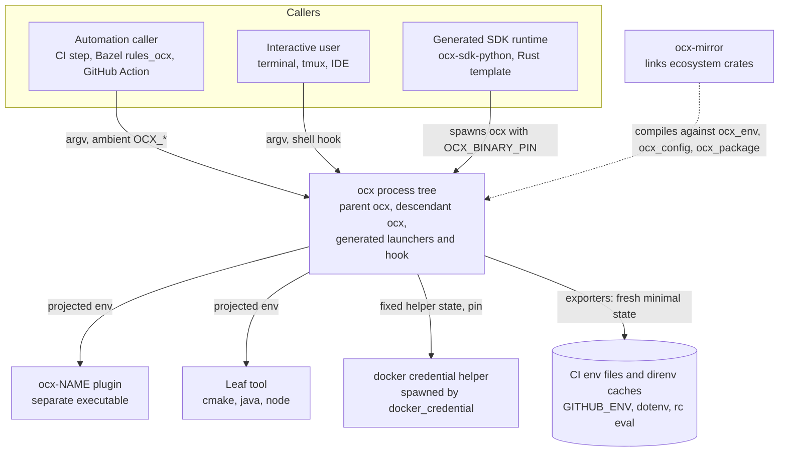
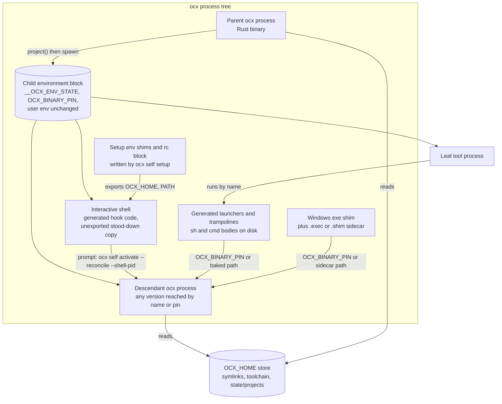
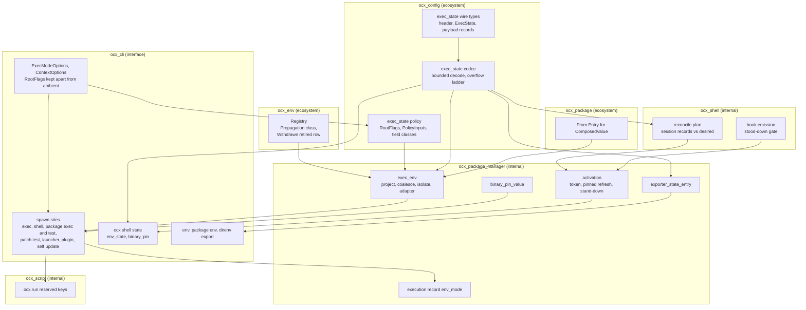
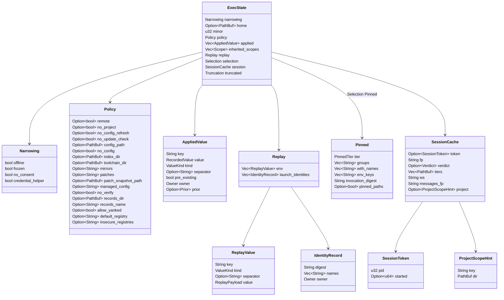
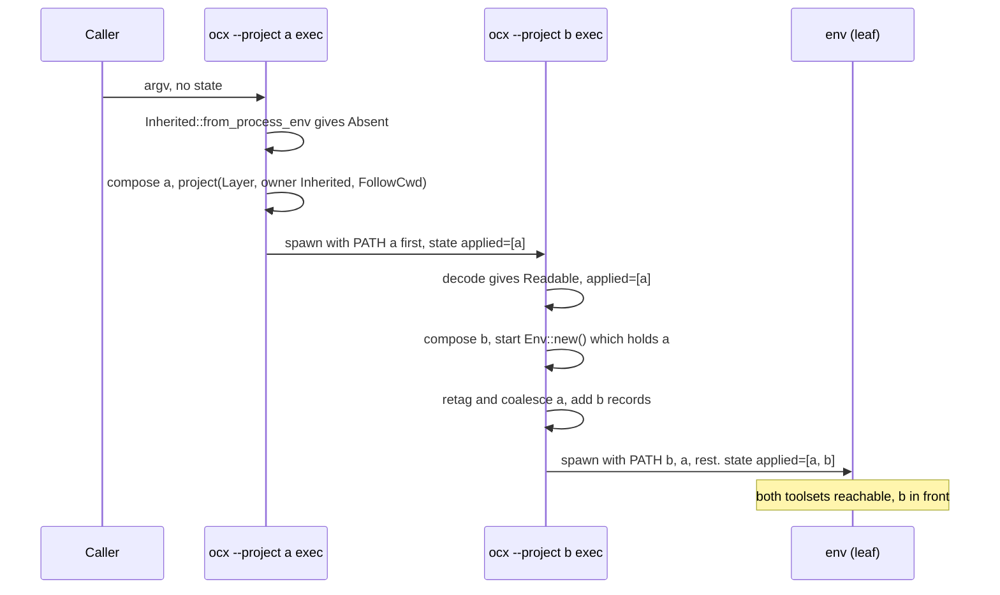
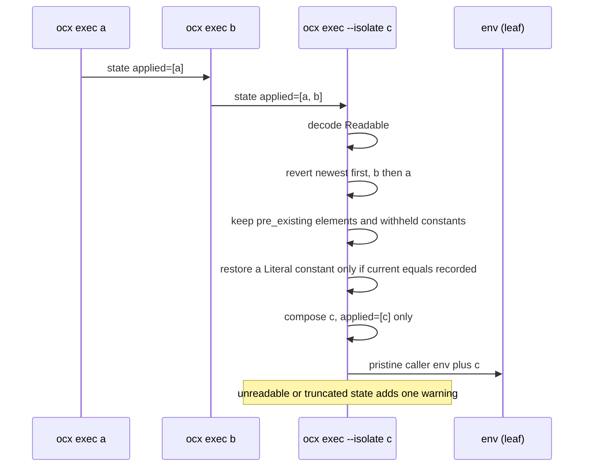
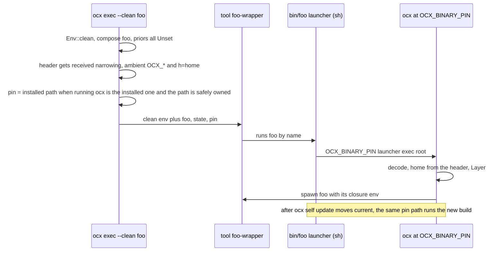
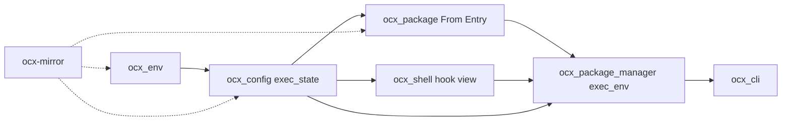

# System Design: Execution-Environment Model

## Metadata

**Status:** Draft (companion to a Proposed ADR)
**Author:** `/hex-architect` tier `xhigh`
**Date:** 2026-11-06
**Beads Issue:** N/A
**Related PRD:** N/A. The owner's requirements live in the discussion `.agents/discussions/exec-env-model.md` (data), corrected by [`discover_exec_env_model.md`](./discover_exec_env_model.md).
**Related ADRs:** [`adr_exec_env_model.md`](./adr_exec_env_model.md) (the decision; component contracts C0-C12 and the field-by-field wire types), [`adr_shell_env_overhaul.md`](./adr_shell_env_overhaul.md), [`adr_shell_env_addenda.md`](./adr_shell_env_addenda.md), [`adr_toolchain_activation.md`](./adr_toolchain_activation.md), [`adr_global_toolchain_tier.md`](./adr_global_toolchain_tier.md), [`adr_package_entry_points.md`](./adr_package_entry_points.md), [`adr_windows_exe_shim.md`](./adr_windows_exe_shim.md), [`adr_exec_resolution_record.md`](./adr_exec_resolution_record.md)
**GitHub Issues:** [#678](https://github.com/ocx-sh/ocx/issues/678), [grimoire#297](https://github.com/grimoire-rs/grimoire/issues/297), [#679](https://github.com/ocx-sh/ocx/issues/679) (deferred)

**Tech Strategy Alignment:**
- [x] Language follows the Golden Path: Rust 2024, Tokio (`.claude/rules/product-tech-strategy.md`)
- [x] No database. Not applicable.
- [x] No infrastructure tier. ocx is a local binary. Not applicable.
- [x] Observability: ocx uses `tracing` for debug logs and a JSON diagnostic report; no OTel in the binary. Not applicable.
- [x] No new workspace dependency. `base64` (`Cargo.toml:176`) and `flate2` (`Cargo.toml:213`) are workspace dependencies. One new crate edge: `crates/ocx_config/Cargo.toml` gains `base64` (WP2, lockstep row in the ADR).

## Executive Summary

ocx passes state from one of its processes to a descendant through two environment variables. `__OCX_ENV_STATE` holds a frozen plaintext header (narrowing flags and the home), then a compressed payload: policy, applied values with owner tags, replay data and the shell's selection. Every ocx version honours the header; only the same major reads the payload. `OCX_BINARY_PIN` names the ocx binary for generated files. Everything else in the environment is user input that ocx reads and never writes into a child. One projection function builds every child environment, in one of three modes: layer (default), isolate, clean. A hook shell that meets a state it cannot read stands down and never writes over it.

### Sections dropped from the template

| Template section | Why dropped |
|---|---|
| Infrastructure, deployment, environments, CI/CD pipeline | ocx is a local binary. No servers. CI changes are limited to the Windows matrix check for OQ-1 |
| Scalability (users, requests, data volume) | No service. The one capacity dimension is environment size, covered under NFRs |
| Availability, RTO, RPO | No service. State lives in a process environment and dies with it, except the exporter copies named in section 10 |
| Database, ER model, data retention | No database. The on-disk store is unchanged. Section 7 models the in-environment record instead |
| Authentication, RBAC | No new auth surface. Credential and secret handling is covered under Security |

---

## 1. Context (C4 Level 1)

### System Context Diagram



### Actors & External Systems

| Actor or system | Type | Interaction with the two variables | Evidence |
|---|---|---|---|
| Automation caller | System | Sets public `OCX_*` as input. Never sets `__OCX_ENV_STATE`. May consume a fresh minimal state an exporter wrote to `$GITHUB_ENV` under a `[patches]` tier | `crates/ocx_cli/src/command/toolchain_env.rs:225-228` |
| Interactive user | Person | Runs `ocx exec`, `ocx shell`, the per-prompt hook. Uses `ocx shell state` to inspect | `crates/ocx_cli/src/command/self_group/activate.rs:178-238` |
| Generated SDK runtime | System | Writes `OCX_BINARY_PIN`; strips nothing: child = parent snapshot, caller pairs, pin last (D-45); may parse the header grammar | `crates/ocx_sdkgen/templates/rust/spawn.rs:36-66` |
| Plugin | System | Receives the projected environment (layer, no composition, no credentials, secret inputs inherited) | `crates/ocx_cli/src/app/plugin_dispatch.rs:94-120` |
| ocx-mirror | System | Lockstep consumer of `ocx_env`, `ocx_config`, `ocx_package`; reads received policy through `ocx_config::exec_state` | `scripts/crate_map.toml`; `task satellite:verify` |
| Credential helper | System | Receives a fixed minimal state built once at init (header `2;n=credential_helper`, an encoded default payload), the pin, and `__OCX_CREDENTIAL_HELPER=1` until 0.7 for an older ocx inside the helper. OQ-3 is only whether the spawn inherits the ambient environment | `crates/ocx_cli/src/app/context.rs:111-116`; `crates/ocx_env/src/vars.rs:513-518` |
| CI env files, direnv caches | Persisted copies | Hold an exporter's fresh minimal state for the rest of a job or a shell's life; read later by any ocx version | ADR C9 |
| Leaf tool | System | Receives the projected environment. May itself run `ocx` or a launcher | n/a |

---

## 2. Containers (C4 Level 2)

A container here is a separately executing or separately persisted unit. The environment block is drawn as a container because it is the transport.

### Container Diagram



### Container Descriptions

| Container | Technology | Reads | Writes | Change in this design |
|---|---|---|---|---|
| Parent ocx | Rust | its own inherited state (once), ambient `OCX_*`, flags | the child environment through `project()` | One seam replaces `apply_ocx_config` and five start functions |
| Child environment block | OS process environment | n/a | n/a | Carries exactly two ocx-written variables |
| Descendant ocx | Rust; may be an older version | the header always; the payload when the major matches; never `OCX_BINARY_PIN` from its own env | its own children's env | Warns once on another major, honours the header, ignores the payload |
| Interactive shell + hook | Generated bash, zsh, fish, nu, elvish, PowerShell code | `__OCX_ENV_STATE` (by the ocx it invokes) | session records and cache via emitted code; an unexported stood-down copy that never reaches a child | Owner-tagged records, shell-instance token, pinned selection, stand-down without write |
| Launchers and trampolines | Generated sh and cmd bodies | `${OCX_BINARY_PIN:-ocx}`, `${OCX_BINARY_PIN:-<baked>}`; trampolines `unset OCX_GLOBAL OCX_PROJECT` | nothing | None. Bodies are frozen (`crates/ocx_package_manager/src/launcher/body.rs:15-37,74-100`) |
| Windows exe shim | Rust, no `ocx_env` edge | `OCX_BINARY_PIN`; `OCX_HOME` for an optional containment pre-check | strips `OCX_GLOBAL`, `OCX_PROJECT` for trampolines | None. Pre-check skipped when `OCX_HOME` is absent (`crates/ocx_shim/src/main.rs:214-252`) |
| Setup env shims, rc block | Generated shell files | n/a | export `OCX_HOME` | None. `OCX_HOME` becomes class SetupWritten (`crates/ocx_setup/src/shims.rs:94-98`) |
| `$OCX_HOME` store | Filesystem | n/a | n/a | None. No new persisted state |

---

## 3. Components (C4 Level 3)

### Components inside the ocx binary



### Component Responsibilities

| Component | Responsibility | Lives in | Depends on |
|---|---|---|---|
| Registry | One `Propagation` class per variable; the warn-once `Withdrawn` retired change | `crates/ocx_env/src/lib.rs` (replaces `Child`, `:80-87`), `vars.rs`, `retired.rs` | `ocx_exit` |
| Wire types | The header and payload shapes, invariants S-1 to S-7 | new `crates/ocx_config/src/exec_state.rs` and children | `ocx_env`, `serde` |
| Codec | Encode with the overflow ladder; bounded decode to `Inherited`, header honoured when the payload fails | `exec_state/codec.rs`, `exec_state/header.rs` | `base64` (new to this crate), `flate2` (`crates/ocx_config/Cargo.toml:59`), `serde_json` |
| Policy | The policy write rule and the per-class precedence split | `exec_state/policy.rs` | Wire types |
| From Entry | Converts a package env `Entry` into a `ComposedValue` | `crates/ocx_package/src/metadata/env/apply.rs` | Wire types |
| Projection | Builds a complete child env for a mode; coalesces records; reverts under isolate; writes pin and state | new `crates/ocx_package_manager/src/exec_env.rs` and children; adapter moved from `apply.rs:71-86` | Codec, Policy, `ocx_config::env::Env` (`env.rs:136-175`) |
| Hook view | Plans session-record changes against desired D; never touches inherited records | `crates/ocx_shell/src/shell/reconcile.rs`, `reconcile/plan.rs` | Codec, wire types |
| Hook emission | Emits the stood-down gate and the `--shell-pid` argument per shell | `crates/ocx_shell/src/shell/hook.rs` | none |
| Activation | Chooses behaviour per inherited state: fresh, claim, retag, reconcile, pinned refresh, stand down. Picks the desired scopes for the cwd, leaving out every scope in `inherited_scopes`, for the hook and the login stream alike | `crates/ocx_package_manager/src/activation.rs` | Hook view, `ocx_project` consent |
| Pin | Decides the `OCX_BINARY_PIN` value, with the ownership check | `crates/ocx_package_manager/src/launcher/generate.rs` (beside `:85-94`) | `ocx_store::FileStructure`, `dunce` |
| Exporter entry | Builds the fresh minimal state exporters append under a patch tier, copying only the inherited narrowing names; returns nothing for a running-shell sink over a readable state | `crates/ocx_package_manager/src/lib.rs` (replaces `:661-681`) | Codec |
| Record | Adds `env_mode`; deletes `stack` | `crates/ocx_package_manager/src/record/execution_record.rs` | none |
| Options | Clap grammar for the three modes; `RootFlags` kept apart from ambient values | `crates/ocx_cli/src/options/exec_mode.rs`, `app/context_options.rs` | Policy |
| Spawn sites | Call `project` or the adapter and spawn with `env_clear().envs(..)` | ADR C5 table | Projection, Pin, Options |
| Dump | Reports the decoded state, relaxing fields, the pin and notes; applied values verbatim | `crates/ocx_cli/src/command/shell_state.rs`, `api/data/shell_state.rs` | Codec, Activation |
| Exporters | Append the state entry in place of `__OCX_LAUNCH_IDENTITIES`; `--shell` and `direnv export` append none over a readable state (ADR C9) | `command/toolchain_env.rs`, `command/env.rs`, `command/direnv_export.rs` | Exporter entry |
| Starlark host | Reserves `__OCX_ENV_STATE` beside `OCX_BINARY_PIN` in `ocx.run` and `ocx.env` | `crates/ocx_script/src/ocx_module.rs:31-55` | none |

### Boundary rules

| Rule | Why | Evidence |
|---|---|---|
| `ocx_config` holds only the wire format, codec, applied-value records and policy resolution | It is ecosystem tier and links into ocx-mirror; a plugin is a descendant that must read received policy | `arch-principles.md` satellite rule; ADR C0 |
| Exec semantics, projection, session behaviour and the hook live in internal crates | No stability obligation; satellites drive spawns through the CLI | ADR C0 |
| `Verdict`, `ProjectScopeHint`, `ScopeId` move from `ocx_shell` into `ocx_config` | They are payload fields; `ocx_config` has no edge to `ocx_shell` | `scripts/crate_map.toml:31`; `crates/ocx_shell/src/shell/reconcile/ledger.rs:84-89,98-111,134-152` |
| `ocx_shell` never imports `ocx_project` or `ocx_package_manager` | Cargo cycle; sequencing belongs in `ocx_package_manager::activation` | `crates/ocx_shell/CLAUDE.md` |
| No new crate edge | `ocx_config` already depends on `ocx_env`; `ocx_shell` and `ocx_package_manager` already depend on `ocx_config` | `scripts/crate_map.toml:31,38` |
| CLI types stay out of library crates | `ExecModeOptions` (clap) maps to `exec_env::ExecMode` (plain enum) | `subsystem-cli.md` |

---

## 4. Code (C4 Level 4)

Signatures only. Names are a design proposal; the plan may rename internals freely. The wire types (header, `ExecState` and every payload type, `Inherited`, `UnreadableReason`, the `Policy` fields, `RootFlags`, `PolicyInputs`) are defined field by field once, in ADR C2, C3 and C8. Section 7 shows them as a diagram. This section adds the non-wire signatures.

### Module layout

```
crates/ocx_config/src/exec_state.rs                  // re-exports, MAJOR, MINOR, limits
crates/ocx_config/src/exec_state/header.rs           // header grammar, Narrowing, HeaderView
crates/ocx_config/src/exec_state/applied_value.rs    // AppliedValue, RecordedValue, Prior, Owner, ValueKind
crates/ocx_config/src/exec_state/replay.rs           // Replay, ReplayValue, ReplayPayload, IdentityRecord
crates/ocx_config/src/exec_state/selection.rs        // Selection, Pinned, PinnedTier
crates/ocx_config/src/exec_state/session_cache.rs    // SessionCache, SessionToken, Verdict, ProjectScopeHint
crates/ocx_config/src/exec_state/codec.rs            // encode, decode, Inherited, Encoded, UnreadableReason
crates/ocx_config/src/exec_state/policy.rs           // Policy, RootFlags, PolicyLayer, PolicyInputs, FieldClass
crates/ocx_package_manager/src/exec_env.rs           // ExecMode, Spawn, project, ChildEnvironment
crates/ocx_package_manager/src/exec_env/coalesce.rs  // S-6, S-7
crates/ocx_package_manager/src/exec_env/isolate.rs   // revert, pre_existing, S-4
crates/ocx_package_manager/src/exec_env/adapter.rs   // apply_child_env, ChildSpawn
```

### `ocx_env`

```rust
pub enum Propagation { UserInput, SecretInput, SetupWritten, State, BinaryPin, HookLocal, Credential }

impl EnvVar {
    pub const fn propagation(&self) -> Propagation;
}

/// Every variable the projection removes from a child: Credential and HookLocal.
pub fn removed_at_spawn() -> impl Iterator<Item = &'static EnvVar>;

// No secret classifier (removed 2026-11-07, D-29): applied values are recorded as composed.

// retired.rs: a replacement may be a flag, and a change may be a warn-once withdrawal
pub enum Replacement { Variable(&'static EnvVar), Flag(&'static str) }
// `Change` gains `Withdrawn`: warn once on stderr, never honour, never exit.
```

### `ocx_package_manager::exec_env`

```rust
pub enum ExecMode { Layer, Isolate, Clean }

pub struct Spawn<'a> {
    pub mode: ExecMode,
    pub written: &'a PolicyLayer,
    pub binary_pin: Option<&'a Path>,
    pub composed: &'a [ComposedValue],
    pub composed_owner: Owner,
    pub composed_scope: Option<Scope>,         // Some only for `ocx exec` (ADR C5)
    pub invocation: &'a [ComposedValue],
    pub replay_env: &'a [ComposedValue],
    pub launch_identities: &'a [(String, Vec<String>)],
    pub selection: Selection,
}
pub struct ChildEnvironment { pub env: Env, pub warnings: Vec<ProjectionWarning> }
pub enum ProjectionWarning {
    InheritedUnreadable { found_major: Option<u32>, reason: UnreadableReason },
    IsolateIncomplete { cause: IsolateGap },
    ValuesKept { changed: usize, withheld: usize },
    Truncated { truncation: Truncation, encoded_len: usize },
}
pub enum IsolateGap { Unreadable, Truncated }

pub fn project(inherited: &Inherited, spawn: &Spawn<'_>) -> ChildEnvironment;

// adapter.rs: moved from ocx_package apply.rs:71-86; every caller is in ocx_cli
pub struct ChildSpawn<'a> {
    pub mode: ExecMode,
    pub written: &'a PolicyLayer,
    pub binary_pin: Option<&'a Path>,
    pub entries: &'a [Entry],
    pub owner: Owner,
    pub scope: Option<Scope>,
    pub invocation: &'a [Entry],
    pub replay_env: &'a [Entry],
    pub identities: &'a LaunchIdentities,
    pub selection: Selection,
}
pub fn apply_child_env(inherited: &Inherited, spawn: &ChildSpawn<'_>) -> ChildEnvironment;
```

### `ocx_package_manager` (other)

```rust
// launcher/generate.rs
pub fn binary_pin_value(fs: &FileStructure, running: Option<&Path>) -> Option<PathBuf>;

// activation.rs
pub struct SessionInput {
    // today's plain fields stay; two are added:
    pub inherited: Inherited,
    pub shell: SessionToken,                   // from --shell-pid, plus the start time read once
}
pub fn shell_instance(pid: u32) -> SessionToken;   // start time where the platform exposes it
pub enum SessionOutcome {
    Reconcile { plan: Plan, session: SessionChange },
    StandDown { header: HeaderView, reason: UnreadableReason },  // emits the gate, writes nothing
    PinnedNotice { pinned: Pinned },
    Silent,
}
/// RetagThenClaim: a foreign token, or an unclaimed FollowCwd state that holds Session records.
pub enum SessionChange { Keep, Claim, RetagThenClaim }
pub fn derive(input: &SessionInput) -> Result<SessionOutcome, ActivationError>;
/// Scopes to compose for the cwd: Global and the cwd project, minus every scope already in
/// `inherited`; empty inside an inherited project (the global tier yields there too).
pub fn desired_scopes(cwd_project: Option<&Path>, global_enabled: bool, inherited: &[Scope]) -> Vec<Scope>;

// lib.rs (replaces launch_identity_entry). Reads only the inherited narrowing names and
// whether the state is readable; never copies records, policy or scopes.
pub enum ExportSink { RunningShell, Persisted }    // --shell, direnv | --ci, the report
pub fn exporter_state_entry(identities: &LaunchIdentities, inherited: &Inherited,
                            sink: ExportSink) -> Option<Entry>;

// record/execution_record.rs
pub enum EnvMode { Layer, Isolate, Clean }   // serde snake_case, open enum on the wire
```

### `ocx_shell`

```rust
pub enum RepairScope { RecordsOnly, OwnedPrefixes }   // OwnedPrefixes only after AllAppliedDropped and
                                                      // only while inherited_scopes is empty; never after PayloadDropped

/// Plans changes to session-owned records only. An element named by an inherited record,
/// or a record marked pre_existing, is never removed.
pub fn plan(desired: &Desired, current: &CurrentEnv, state: &ExecState,
            owned_prefixes: &[PathBuf], repair: RepairScope) -> Plan;

impl Plan {
    /// The state the hook writes: header, policy, inherited records and replay unchanged;
    /// inherited_scopes and selection change only on RetagThenClaim.
    pub fn next_state(&self, prior: &ExecState, token: SessionToken) -> ExecState;
}

// hook.rs
/// Shell code that copies `__OCX_ENV_STATE` by reference into an unexported variable and
/// re-emits the hook with a first gate clause that skips while the two are equal. Takes no
/// value: the emitted code never embeds the state as a literal (ADR C7).
pub fn stand_down_gate(shell: Shell) -> String;
```

### `ocx_cli`

```rust
// options/exec_mode.rs
#[derive(clap::Args)]
pub struct ExecModeOptions { isolate: bool, clean: bool }   // conflicts_with, exit 64
impl ExecModeOptions { pub fn mode(&self) -> exec_env::ExecMode; }

// app/context.rs: Context gains inherited, received, ambient, root_flags and binary_pin
impl Context {
    pub fn inherited(&self) -> &Inherited;
    pub fn policy_inputs(&self, no_consent_flag: bool) -> PolicyInputs<'_>;
    pub fn binary_pin(&self) -> Option<&Path>;     // memoised once in try_init (ADR C6)
}

// api/data/shell_state.rs
pub struct EnvStateReport {
    pub status: EnvStateStatus,                // absent | readable | unreadable (open enum)
    pub major: u32,                            // the major this ocx reads
    pub minor: Option<u32>,                    // readable only
    pub found_major: Option<u32>,              // unreadable with a parsed header only
    pub narrowing: Vec<NarrowingName>,         // offline | frozen | no_consent | credential_helper
    pub home: Option<PathBuf>,
    pub truncated: Option<TruncationName>,     // inherited_dropped | all_applied_dropped | payload_dropped
    pub policy: PolicyReport,                  // the 18 Policy fields, each omitted when unset
    pub relaxing_policy: Vec<&'static str>,    // set relaxing fields plus home, sorted
    pub session_claimed: Option<bool>,
    pub inherited_scopes: Vec<ScopeReport>,    // omitted when empty; oldest first
    pub applied: Vec<AppliedRow>,
    pub replay: Option<ReplaySummary>,
    pub selection: Option<SelectionReport>,
}
pub struct AppliedRow {
    pub key: String,
    pub value: String,                         // the exact string ocx wrote
    pub kind: AppliedKind,                     // path | list | constant
    pub owner: OwnerName,                      // session | inherited
    pub scope: Option<ScopeName>,              // session only: global | project
    pub source: Option<SourceName>,            // session only: composed | invocation
    pub pre_existing: Option<bool>,            // present only as true
    pub prior: Option<PriorReport>,            // constants only
}
pub enum PriorReport { Unset, Value { value: String }, Withheld }          // tagged `type`
pub enum ScopeReport { Global, Project { root: PathBuf } }                // tagged `type`
pub struct ReplaySummary { pub env_count: usize, pub launch_identity_count: usize }
pub enum SelectionReport {                                                 // tagged `type`
    FollowCwd,
    PinnedProject { project_dir: PathBuf, groups: Vec<String>, with_names: Vec<String>, env_keys: Vec<String> },
    PinnedGlobal { groups: Vec<String> },
}
pub struct BinaryPinReport { pub path: Option<PathBuf>, pub exists: bool, pub matches_running: bool }
```

---

## 5. Key Design Decisions

| Decision | Options considered | Chosen | Rationale (detail in the ADR) |
|---|---|---|---|
| Transport shape | A two variables, B three classes, C forwarded publics, D file pointer | A | The owner's rule-count priority and the frozen-surface constraint; matrix 49 (A), 46 (D), 45 (B), 37 (C), with sensitivity lines |
| Default exec mode | revert, layer | Layer | Nesting works; launchers already layer (ADR R1). Conflicts with product principle 4, edited in the same change |
| Versioning | cross-version reader, same-format only, major plus additive minor | Major in a frozen header, additive minor in the payload | Re-adopts A-04's additive rule; minors never stand shells down; the header survives majors (ADR C3) |
| Encoding | plain base64url JSON, zlib + base64url | Plaintext header, then zlib + base64url payload | About 4x smaller; fits cmd.exe at about 120 values; the header stays readable by every version |
| Crate home | `ocx_shell`, all in `ocx_config`, split | Wire and policy in `ocx_config`; projection and session in internal crates | Ecosystem tier holds only what a plugin must read (ADR C0) |
| Policy write rule | every flag, root flags only | Five root flags through `RootFlags`, plus `--no-consent` | `--no-verify` stays one-shot by construction (ADR C2) |
| Policy precedence | one order, split by class | Narrowing (header names) and neutral: flag, received, ambient. Relaxing (every other field, `no_config_refresh` and `no_update_check` included): flag, explicit ambient, received at the env slot. `to_write(Clean)` writes the env-slot result | A forged or stale value cannot relax an explicit local setting; SYSTEM locks still clamp; a local `OCX_NO_VERIFY=0` survives `--clean` (ADR C8) |
| Removal authority in the hook | owned prefix, record | Record, with `pre_existing` | Prefix removal strips outer frames' values |
| Unreadable state in a hook shell | rebuild and repair, stand down with a write, stand down without a write | Stand down without a write | Never destroys a state another build wrote (ADR R9) |
| Shell identity | none, random nonce, pid plus start time | Pid plus start time | Survives re-sourcing and `exec $SHELL`; tmux panes, IDE terminals and nested shells are foreign (ADR C7) |
| Secrets in state | record all, record none, presence only for secret-classed keys | Record all, except ocx's four credentials (amended 2026-11-07, D-29) | The exact-value revert the hook and isolate need; the state is as readable as the environment |
| Exporter state | inherited state, fresh minimal state | Fresh minimal state with the inherited narrowing names; none for `--shell` and `direnv export` over a readable state | Persisted copies never carry records or policy and never drop a narrowing; a running shell's state is never replaced (ADR C9) |
| Hook in an exec-spawned shell | reload every scope, `__OCX_EXEC_SCOPE` yield, `inherited_scopes` list | `inherited_scopes`: the hook and the login stream never compose an inherited scope (owner decision 2026-11-07) | Exec = snapshot, shell = live; no pid test; about 30 B per scope, survives rungs 1 and 2 (ADR C2, C7) |
| Pin value | `current_exe`, installed path always, canonical identity with ownership check | Canonical identity with ownership check | Follows `self update` without misdirecting dev builds or trusting a writable path (ADR C6) |
| `OCX_HOME` | always written, setup-written class | Setup-written; home in the header when needed | Setup files export it; the projection must not (ADR R4) |

---

## 6. Interface Design

Replaces the template's "API Design". These are the externally observable surfaces.

### CLI grammar

| Command | Before | After |
|---|---|---|
| `ocx exec` | `--clean`, `--stack` (unreleased) | `--isolate`, `--clean` (mutually exclusive, exit 64) |
| `ocx shell` | `--stack` (unreleased) | `--isolate`, `--clean` |
| `ocx package exec` | `--clean` | `--isolate`, `--clean` |
| `ocx package test` | `--clean` | `--isolate`, `--clean` |
| `ocx patch test` | none | `--isolate`, `--clean` |
| root `--global` | flag, or `OCX_GLOBAL` env | flag only; the env name warns once until 0.7, then is inert |
| `ocx self activate --reconcile` (hidden) | no shell identity | gains hidden `--shell-pid <pid>` |

### Environment surface

| Variable | Before | After |
|---|---|---|
| `__OCX_ENV_STATE` | hook ledger, `1.<payload>` | transport state, `2[;n=<names>][;h=<b64url home>].<payload>` (ADR C3); header grammar frozen |
| `OCX_BINARY_PIN` | running `current_exe` | `binary_pin_value` (ADR C6); name and shape frozen |
| `OCX_HOME` | forwarded set-always | user and setup input only; never written into a child |
| Every other `Forward`-declared public `OCX_*` (`crates/ocx_env/src/vars.rs`) | forwarded, set-or-remove (`crates/ocx_config/src/env.rs:207-294`) | user input only; inherited untouched |
| `OCX_GLOBAL` | read as the global selector | `Withdrawn` retired row: one stderr notice per process naming `--global`, never honoured, removed in 0.7 |
| `OCX_ENV`, `__OCX_EXEC_SCOPE`, `__OCX_LAUNCH_IDENTITIES` | declared | deleted; names inert |
| `__OCX_CREDENTIAL_HELPER` | written into the helper spawn | still written as `1` into that one exempt spawn until 0.7, for an older ocx inside the helper; read by no new ocx; then deleted (ADR Other decisions) |

### Diagnostic report

`ocx shell state --format json` gains `env_state` and `binary_pin` and loses `ledger`. Field rules: ADR C10; types: section 4. `schema_version` is unchanged because no contract baseline exists (`test/lint/test_contract_baseline.py:1-12`); the break travels in a `!` commit subject.

### Versioning strategy

| Surface | Strategy |
|---|---|
| Header grammar | Frozen forever. New narrowing names and segments may be added; old readers ignore them |
| Payload | Major in the header, minor in the JSON. Same major: accept any minor, ignore unknown fields; a field added in a minor must be safe to lose. A major for a semantic break. Not a user contract; may change in any release within these rules |
| Decoded JSON field names | Not a user contract (only the dump report is). Between ocx versions of one major a wire contract: serialized names, defaults and meaning stay stable; a rename or removal bumps the major unless a serde alias keeps the old name readable (ADR C2, C3) |
| Dump report | Additive fields free; removals and renames are `!` breaks (pre-baseline: commit subject only) |
| Execution record | Additive `env_mode`; `schemaVersion` stays 1 (`crates/ocx_schema/src/lib.rs:44-47`) |

---

## 7. Data Model

### ExecState structure

Every field, as defined in ADR C2 and C3.



Enums: `RecordedValue { Literal(String) }`, `Prior { Unset, Value(String), Withheld }`, `Owner { Session { scope, source }, Inherited }`, `ScopeId { Global, Project }`, `Scope { Global, Project { root } }` (canonical root, compared only, at most 16), `SessionSource { Composed, Invocation }`, `ValueKind { Path, List, Constant }`, `ReplayPayload { Literal(String) }`, `Selection { FollowCwd, Pinned(Pinned) }`, `PinnedTier { Project { dir }, Global }`, `Verdict { Inert, NoProject }`, `Truncation { None, InheritedDropped, AllAppliedDropped, PayloadDropped }`.

### Decoded example

A shell entered with `ocx --offline shell -g default` in `/work/app`, then `ocx exec -- bash` inside it, as seen by that inner bash before its hook runs. Payload field names are not a user contract; within major 2 they are stable (section 6).

```
header: 2;n=offline
```

```json
{
  "minor": 0,
  "policy": {},
  "applied": [
    { "key": "PATH", "value": { "literal": "/home/u/.ocx/packages/ocx.sh/sha256/1f/2e/content/bin" },
      "kind": "path", "pre_existing": false, "owner": "inherited" },
    { "key": "JAVA_HOME", "value": { "literal": "/home/u/.ocx/packages/ocx.sh/sha256/9a/8b/content" },
      "kind": "constant", "pre_existing": false, "owner": "inherited", "prior": "unset" },
    { "key": "PATH", "value": { "literal": "/home/u/.ocx/packages/ocx.sh/sha256/77/66/content/bin" },
      "kind": "path", "pre_existing": false, "owner": "inherited" }
  ],
  "inherited_scopes": [ { "type": "project", "root": "/work/app" } ],
  "replay": { "env": [], "launch_identities": [] },
  "selection": "follow_cwd",
  "session": { "token": null, "fp": "", "tiers": [], "ws": "", "messages_fp": "" },
  "truncated": "none"
}
```

The first two records came from `ocx shell` (Session, Composed) and were retagged inherited at the `ocx exec` spawn; their scope entered `inherited_scopes` as the pinned project root. The third came from `ocx exec`, whose `composed_scope` is the same root, so the list holds one entry. The token is unclaimed after the spawn; bash's login stream claims it with bash's pid and, inside `/work/app`, composes nothing (F8). `offline` sits in the header, so any later ocx version honours it.

### Wire form

```
__OCX_ENV_STATE=2;n=offline.eJyrVkrLz1eyUkpKLFKqBQAvSAW...    (illustrative; payload zlib, base64url, no padding)
```

### Size budget

| Part | Typical size before compression | Notes |
|---|---|---|
| Header | 2-200 chars | At most 2,048; plaintext |
| Policy | 0-400 B | Only set fields |
| One path record | 90-160 B | Store paths repeat and compress well |
| One constant record with prior | 120-300 B | Every record holds its value |
| Session cache | 150-400 B | Fingerprints are hex |
| Inherited scopes | about 30 B each; typically 1-3, at most 16 | One distinct list, not a scope per record; kept at rungs 1 and 2 |
| Encoded cap | 8,169 chars | the emitted cmd.exe line `SET "__OCX_ENV_STATE=<value>"` adds 22 chars to the value and the line limit is 8,191 (ADR C3). About 120 composed values fit (research, zlib: 3,426 chars at 50, 12,447 at 200) |

### Lifetime and migration

| Aspect | Rule |
|---|---|
| Lifetime | The process environment. A spawn rewrites the value. Exporters persist a fresh minimal copy into CI env files, rc evals and direnv caches (ADR C9) |
| Retention | Inherited records are coalesced at every spawn, so size grows with distinct values, not with depth |
| Migration | None on disk. A `1.` value in an open shell makes the new hook stand down without writing (F5) |

---

## 8. Flows

### F1. Nesting, default layer



### F2. Isolate at depth 2



### F3. Hook prompt, follow-cwd

```mermaid
sequenceDiagram
    participant S as Shell prompt
    participant H as ocx self activate --reconcile --shell-pid
    participant P as activation::derive
    participant R as reconcile::plan
    S->>H: prompt fires (gate passed: state differs from any stood-down copy)
    H->>H: decode once, read the shell start time
    H->>P: SessionInput with inherited state and shell token
    P->>P: Readable, FollowCwd, token this shell's or unclaimed
    P->>P: unclaimed and Session records present: retag them Inherited first
    P->>P: stat fingerprint, return Silent when unchanged
    P->>P: desired_scopes(cwd project, global, inherited_scopes)
    P->>P: consent, compose D from those scopes only
    P->>R: D, current env, state
    R->>R: diff session records only
    R-->>P: Plan; next_state keeps header, policy, inherited records
    P-->>H: Reconcile with Keep, Claim or RetagThenClaim
    H-->>S: shell code edits PATH and sets __OCX_ENV_STATE
```

### F4. Pinned `ocx shell` and refresh

```mermaid
sequenceDiagram
    participant U as User in /work/app
    participant O as ocx shell -g dev --env FOO=1
    participant S as Spawned shell
    participant H as hook
    U->>O: run
    O->>O: compose app dev as Session Composed, FOO as Session Invocation
    O->>S: spawn SHELL, selection Pinned app dev, token unclaimed
    S->>H: rc login stream, ocx self activate
    H-->>S: Pinned and unclaimed, claim with shell pid, apply nothing
    U->>S: cd /work/other
    S->>H: prompt
    H-->>S: one notice naming the pinned selection, nothing applied
    U->>S: edit /work/app/ocx.toml
    S->>H: prompt
    H->>H: consent checked, then one bounded probe of app ocx.toml and ocx.lock
    H->>H: recompose consented groups only
    H-->>S: reconcile Composed records; FOO and inherited records untouched
    Note over H: a project edit that also sets FOO is not written: the Invocation record owns the key
```

### F5. Upgrade with an open shell

```mermaid
sequenceDiagram
    participant U as User
    participant S as Shell holding a 1. value
    participant N as new ocx via current
    participant E as ocx exec in that shell
    Note over S: ocx self update moved current
    S->>E: user runs ocx exec before the next prompt
    E-->>S: one warning naming formats 1 and 2, payload ignored
    S->>N: next prompt, ocx self activate --reconcile
    N->>N: decode gives Unreadable, major 1
    N-->>S: one notice with the recovery; gate code; no state written
    Note over S: the gate code copies the 1. value by reference into an unexported variable, never as a literal
    S->>S: later prompts: gate sees the same value, skips the hook
    U->>S: unset __OCX_ENV_STATE
    S->>N: next prompt, state differs from the copy
    N-->>S: fresh follow-cwd session, old values stay in place
```

### F6. Launcher inside `--clean`, then after an update



### F7. tmux pane started inside `ocx shell`

```mermaid
sequenceDiagram
    participant P as Pinned shell, pid 100
    participant T as tmux server
    participant Q as New pane shell, pid 200
    participant H as hook in pane
    P->>T: tmux, environment snapshot with token pid 100
    T->>Q: new pane inherits the snapshot
    Q->>H: rc login stream, --shell-pid 200
    H->>H: token pid 100 is foreign
    H->>H: retag Session records and identities Inherited; their scope enters inherited_scopes
    H->>H: reset session cache, FollowCwd, claim pid 200
    H-->>Q: compose the cwd's non-inherited scopes on top; nothing inherited reverted
```

The same flow covers an IDE that captured a login shell's environment and opens terminals from it.

### F8. Shell spawned by `ocx exec`: no reload of the inherited scope

Owner decision 2026-11-07 (ADR C7). Global tier not inherited, because a project exec composes no global tier.

```mermaid
sequenceDiagram
    participant X as ocx --project P -g x exec -- bash
    participant B as bash
    participant H as hook
    X->>B: state with P-with-x records Inherited, inherited_scopes = [Project P]
    B->>H: rc login stream, cwd inside P
    H->>H: desired_scopes gives nothing: P inherited, global yields inside P
    H-->>B: claim the token, apply nothing
    Note over B: an edit to P's ocx.toml changes nothing; P is not watched
    B->>H: cd /work/q, prompt
    H-->>B: compose global and Q as Session Composed, in front
    B->>H: cd back into P, prompt
    H-->>B: remove the Session records; P's values byte-identical
    B->>H: cd /tmp, prompt
    H-->>B: compose the global tier as Session Composed
```

---

## 9. Failure Modes

| Condition | Detected by | Behaviour | User sees |
|---|---|---|---|
| State of another major | header parse | Hook stands down without writing; others ignore the payload; every reader honours the header | one warning, or one hook notice with the recovery |
| Header invalid | header parse | Narrowing names parsed so far honoured; `h` dropped; payload ignored | one warning |
| Payload corrupt, oversized, bomb, trailing bytes, too deep | bounded decode | Same as another major, header honoured | one warning |
| State over cap at write | `encode` | Overflow ladder: drop inherited records, then all applied records, then the payload; `inherited_scopes` kept at rungs 1 and 2; truncation stays sticky | one warning; `truncated` in the dump |
| Header-only state (rung 3) | decode step 5 | `Readable` with the default payload and `PayloadDropped`; header honoured; never a stand-down. `inherited_scopes` lost, so a hook may re-apply an inherited scope (path and list idempotent, constants re-set). A 17th distinct scope has the same effect for the oldest one: the encoder drops it (`MAX_INHERITED_SCOPES`, ADR C2) | `truncated: payload_dropped` in the dump |
| Header beyond the length or UTF-8 limit | decode step 2 runs before step 4 | Narrowing names in the first `MAX_HEADER` bytes honoured; payload unreadable | one warning |
| Unclaimed FollowCwd state holding Session records | activation | Retag them Inherited, then claim | nothing; the dump shows inherited owners |
| Applied or replay record on a reserved `OCX_*`/`__OCX_*` key in a received payload | decode step 10 | Whole payload unreadable (`applied.key`, `replay.env.key`); no downgrade step | one unreadable-state notice |
| Exporter `--shell` or `direnv export` over a readable state | exporter entry | No state entry emitted; launch identities not delivered | a launcher matches patch rules only by `*` |
| Isolate cannot fully revert | projection | Proceeds; keeps changed constants, withheld priors and `pre_existing` elements | one warning with counts |
| Foreign session token | activation | Retag Session records, fresh follow-cwd session on top | nothing; the dump shows inherited owners |
| Received relaxing value meets a different explicit ambient value | `PolicyInputs::env_slot` | Ambient wins | one stderr line naming the variable |
| `current_exe` fails, or the pin path fails the ownership check | context init | Pin removed, or the exact running binary | `binary_pin_missing` note, or `matches_running` in the dump |
| Pin names a deleted binary | launcher body | Shell reports command not found | `binary_pin.exists = false` in the dump |
| Older ocx reached by name | n/a | Older ocx ignores the state; its hook overwrites it (ADR C7 residual) | loses received policy and replay (accepted) |
| Rung 2 or 3 truncation in a hook shell | hook | Owned-prefix repair for the session only at rung 2 with an empty `inherited_scopes`; otherwise no repair | repair may remove outer frames' store paths; without repair stale session values may remain; warned either way |
| Hostile unreadable value (quotes, `$(...)`, newline) | hook | Stand down; the gate copies the value by reference | one notice; no code from the value runs |

---

## 10. Security Architecture

### Trust model

The state is untrusted input with the same authority as the public variables it replaces. Any principal that can set `__OCX_ENV_STATE` in a process can already set `OCX_CONFIG`, `OCX_NO_VERIFY` or `PATH` there. The design keeps that equivalence, adds bounds the public variables never had, and narrows two paths where the state could otherwise do more than the variables did.

| Control | Rule | ADR |
|---|---|---|
| Bounded decode | Header first, within the frozen `MAX_HEADER` = 2,048 bytes, before the length and UTF-8 checks; checked 10-digit major; length before base64; inflate through `take`; trailing bytes refused; serde_json recursion limit; record, tier and scope caps; each policy value checked by the parser of the variable it replaces; secret literals downgraded, only Credential and `OCX_AUTH_*` literals rejected | C3 |
| Header honoured on failure | Narrowing (`offline`, `frozen`, `no_consent`, `credential_helper`) and `home` survive an unreadable payload, so a version boundary never silently widens policy or loses the helper's self-deadlock guard | C3, C5 |
| Policy write rule | Only five root flags reach child policy, through `RootFlags`; `--no-verify` never does | C2 |
| Precedence split | Received relaxing values enter at the env slot, below SYSTEM locks, and lose to an explicit ambient value | C8 |
| Path building | Outside `policy` and the header, nothing builds a path from state, except the pinned project dir (absolute, canonical, consent before parse, one bounded probe) and the tier list (at most 8, stat only). `inherited_scopes` roots and `ProjectScopeHint.dir` are compared only, never opened or joined | S-5 |
| Value supply | A-06 lists every field that supplies a value: header, `policy`, `replay.env`, `replay.launch_identities`, `Prior::Value`, `AppliedValue.value` (operand only), the pinned dir, `Pinned.pinned_paths`, the tiers | A-06 row |
| Secrets | Credentials and `OCX_AUTH_*` never recorded; every other value is recorded as composed (D-29); a non-UTF-8 prior is withheld; Clean priors are captured against the clean start; the dump shows the recorded values | C1, S-2 |
| Pin | Installed path only when canonical paths match and, on Unix, the path chain is owned by the euid or root and not group- or world-writable | C6 |
| Exporters | Persisted copies hold a fresh minimal state: launch identities and the inherited narrowing names only; a running shell's readable state is never replaced | C9 |
| Output | Strip set removed from state-derived strings before the stand-down notice, the cd notice and the plain dump: C0 (U+0000-U+001F), DEL, C1 (U+0080-U+009F, including CSI U+009B), bidi controls U+061C, U+200E, U+200F, U+202A-U+202E, U+2066-U+2069 | C7, C10 |
| Stood-down gate | Emitted code copies the state by reference into an unexported variable; the value is never embedded in shell code | C7 |
| Starlark | Scripts can neither read nor overwrite the pin or the state | C5 |

### STRIDE

| Threat | Scenario | Mitigation |
|---|---|---|
| Spoofing | A non-ocx process forges a state to look like an ocx parent | Trust equivalence; S-5; advisory fields only compared; the session token is identity, not authority |
| Tampering | A forged record makes isolate or the hook remove a user value | S-4: a record only undoes itself; `Literal` constants restore only on equality; `pre_existing` elements are kept; S-3: `PATH`/`PATHEXT` never constant |
| Tampering | A forged pinned selection points the hook at another project | Refresh recomposes only that project's consented `ocx.toml` groups; `with_names` and `env_keys` are display only; `--env` values are never re-applied from state |
| Repudiation | No trace of which mode ran | `env_mode` in execution records; disagreement warnings on stderr |
| Information disclosure | State readable in `/proc/<pid>/environ`, `ps e`, crash dumps, CI logs | No credential or `OCX_AUTH_*` value; Clean copies no caller values. Residual: every other value is recorded, which is the exposure the environment already has, and a stale prior |
| Tampering | A hostile unreadable value injects shell code through the stood-down gate | The gate copies by reference; no literal from the state reaches emitted code |
| Denial of service | Oversized or zip-bomb value; cmd.exe dropping a long variable | Bounded decode; 8,169-char cap derived from the emitted line; the stood-down gate skips the hook without a process start |
| Elevation of privilege | Inherited relaxing policy (`no_verify`, `insecure_registries`, `mirrors`) under `sudo -E` | Same residual as A-06 and today's variables; an explicit ambient value wins; SYSTEM locks clamp; the dump lists `relaxing_policy` |
| Elevation of privilege | A writable directory on the pin path swaps the binary launchers run | Ownership and mode check before the installed path is chosen; else the running binary |

### Data protection

| Item | Rule |
|---|---|
| Credentials (`secret, child = Scrub`) | Never recorded; removed at every spawn (`crates/ocx_env/src/lib.rs:375-387`) |
| Secret inputs (`secret` without Scrub, e.g. `OCX_ANNOUNCE_TOKEN`) | Inherited untouched under layer and isolate, absent under clean, never recorded |
| Secret-named `[env]` values | Applied to the child and recorded as composed; `--isolate` reverts by exact value (amended 2026-11-07, D-29) |
| Plugins | Receive no credentials; receive ambient user `OCX_*` and secret inputs unchanged |
| Persisted exporter copies | Hold no applied values and no policy |

---

## 11. Non-Functional Requirements

### Performance

| Metric | Target | Measurement |
|---|---|---|
| Decode at `MAX_ENCODED` | at most 1 ms p99 added to a hook prompt | `test/bench/shell_latency.py` with a cap-sized fixture |
| Hook no-op path | stat-only after one decode (`activate.rs:234`), plus one start-time read where supported | same bench |
| Stood-down shell | no process start per prompt | same bench |
| Projection | dominated by process spawn | not separately gated |

### Size

| Limit | Value | Margin at cap |
|---|---|---|
| cmd.exe line, and inherited variables cmd.exe keeps | 8,191 chars | cap is 8,169: the emitted `SET "__OCX_ENV_STATE=<value>"` adds 22 chars (`crates/ocx_shell/src/shell.rs:543`); the value alphabet needs no escaping (`shell.rs:613-615`, `shell/escape.rs:72-74`) |
| Windows per variable | 32,767 chars | 25% used |
| Linux per string, name included | 131,071 B | under 7% used |
| macOS total `ARG_MAX` | 1 MiB | under 1% used |

### Compatibility

| Rule | Detail |
|---|---|
| Header | Every version parses and honours it |
| Payload | Same major: any minor, unknown fields ignored. Other major: payload ignored |
| Fail-safe readers | Hook stands down without writing; exec family, launchers and plugins warn once; `shell state` reports |
| Windows keys | Compared ASCII-case-insensitively at encode, decode, coalesce and the guard (S-7) |
| Frozen on disk | `OCX_BINARY_PIN` name and absolute-path shape; launcher, shim and trampoline argv; trampoline unset line; Windows sidecars |

### Observability

| Pillar | Implementation |
|---|---|
| Inspection | `ocx shell state` (ADR C10) |
| Warnings | one per process per condition on stderr; never stdout |
| Logs | `tracing` debug on overflow rungs and isolate gaps |
| Records | `env_mode` in execution records |

---

## 12. Dependencies

### Internal

| Crate | Change | Tier | Lockstep |
|---|---|---|---|
| `ocx_env` | classes, `Withdrawn`, deletions | ecosystem | ocx-mirror |
| `ocx_config` | new `exec_state` (wire, codec, policy); delete `apply_ocx_config`, `OcxConfigView`, `forward!`; add `base64` | ecosystem | ocx-mirror |
| `ocx_package` | `From<&Entry>`; `apply_child_env` moves out | ecosystem | ocx-mirror |
| `ocx_shell` | hook view, stood-down gate, `--shell-pid`; delete `Ledger`, start functions | internal | no |
| `ocx_package_manager` | `exec_env`, pin, activation, exporter entry, record | internal | no |
| `ocx_cli` | grammar, `RootFlags`, spawn sites, dump, exporters, pin memo, helper state | interface | no |
| `ocx_script` | reserved key | internal | no |
| `ocx_sdkgen` | spawn template spec, conformance fixture | internal (CLI is interface) | sibling SDKs |

### External

| Dependency | Use | Status |
|---|---|---|
| `base64` | codec, header `h` | workspace `Cargo.toml:176`; new edge from `ocx_config` |
| `flate2` | codec | already in `crates/ocx_config/Cargo.toml:59` |
| `sha2`, `hex` | `invocation_digest` | workspace `Cargo.toml:174-175` |
| `dunce` | pin canonicalization | already in `crates/ocx_package_manager/Cargo.toml:36` |
| `external/docker_credential` | helper spawn env | unread here (OQ-3) |

### Dependency diagram



---

## 13. Risks & Mitigations

| Risk | Probability | Impact | Mitigation |
|---|---|---|---|
| A later spawn site bypasses the projection | Medium | High | firewall assertion in `crates/ocx_package_manager/src/launch.rs` tests (ADR C5) |
| Users hit the overflow ladder in large monorepos | Low | Medium | warning and dump note; revisit with digests for inherited records |
| Open shells stand down at a major break | Low | Low | majors only for semantic breaks; minors are additive; one notice with the recovery |
| A rolled-back `current` overwrites a new state (1.x hook) | Low | Medium | documented residual; old binaries cannot change |
| `ocx exec -- bash` surprises users (follow-cwd session on top; the global tier composes outside the inherited project) | Medium | Low | docs present `ocx shell` as the way to enter |
| Relaxing precedence surprises a user who expected a parent flag to stick | Low | Low | disagreement warning; owner confirms the trade |
| Pid reuse where no start time is readable | Low | Low | named residual; WP4 adds start-time readers |
| Windows junction defeats the pin rule | Low | Low | fallback to the exact running binary (OQ-1) |
| Credential helper spawn clears the env | Low | Medium | read the submodule before WP5 (OQ-3) |
| An older ocx inside a credential helper deadlocks on the outer pull's lock | Low | High | `__OCX_CREDENTIAL_HELPER=1` stays in the helper spawn until 0.7 |
| A user edits the inherited project in an exec-spawned shell and expects a reload | Medium | Low | exec = snapshot is the owner's trade; docs present `ocx shell` as the live form; `shell state` lists `inherited_scopes` |
| Rung 3 loses `inherited_scopes`, or a chain of more than 16 distinct scopes makes the encoder drop the oldest (`MAX_INHERITED_SCOPES`) | Low | Low | path and list re-application is idempotent; constants re-set; warned |
| ocx-mirror uses `apply_ocx_config` | Unknown | Medium | `task satellite:verify` in the same series |
| Cross-repo fixtures in ocx-sdk-python | Medium | Low | cross-repo note; fixtures re-checked when the help sentence moves |

---

## 14. Implementation Phases

Work packages, file owners and the DAG are defined in the ADR's Implementation Plan (WP1-WP13).

### Phase 1: Contracts
- [ ] WP1 registry classes, `Withdrawn` row
- [ ] WP2 `exec_state` wire types, header, codec, policy (stubs first, then bodies)
- [ ] WP6 CLI grammar, `RootFlags`, precedence split

### Phase 2: Consumers (parallel after Phase 1)
- [ ] WP3 pin value with ownership check
- [ ] WP4 hook, session token, stand-down, pinned refresh
- [ ] WP5 projection, spawn sites, firewall, helper state, Starlark keys
- [ ] WP7 exporters
- [ ] WP8 record field
- [ ] WP9 dump
- [ ] WP10 SDK spec and conformance

### Phase 3: Proof, docs, deletion
- [ ] WP11 goldens, references, website pages, `.claude/rules/product-context.md`
- [ ] WP12 acceptance tests, each shown red first; exploratory hardening session
- [ ] WP13 delete the old seams (after WP4, WP5, WP7)
- [ ] ocx-mirror lockstep upgrade; `task satellite:verify`

---

## 15. Open Questions

Carried from the ADR, with its recommendations:

| OQ | Topic | Recommendation |
|---|---|---|
| OQ-1 | Windows `current` junction canonicalization | Ship the rule; fall back to the exact running binary; verify on the Windows matrix before WP3 closes |
| OQ-2 | SDK spawners and `__OCX_ENV_STATE` | Strip (fresh root); superseded 2026-11-07 (D-45): the SDK strips nothing |
| OQ-3 | Whether the docker_credential helper spawn inherits the ambient environment | The helper state is decided (fixed, built at init); read the submodule before WP5 to choose between the two pairs and a full projected environment |

---

## Appendix

### Glossary

| Term | Definition |
|---|---|
| Layer | Default mode: the child starts from the caller's environment and the composition goes in front |
| Isolate | Like layer, after first reverting every value ocx recorded as applied, except pre-existing elements |
| Clean | The child starts empty except for the composition, the state and the pin |
| Header | The frozen plaintext part of the state: major, narrowing names, home. Every version honours it |
| Narrowing | Policy that only restricts: `offline`, `frozen`, `no_consent`, `credential_helper` |
| Relaxing | Policy that widens what ocx accepts or where it reads: mirrors, insecure registries, `no_verify`, paths, and the two kill switches `no_config_refresh` and `no_update_check`, where a local `=0` wins |
| Inherited scope | A scope (`Global`, or `Project` with its canonical root) an outer frame composed, kept in `inherited_scopes`; the hook and the login stream never compose it again |
| Exec = snapshot, shell = live | An exec-spawned shell keeps what its spawner composed for its whole life; `ocx shell` refreshes on `ocx.toml` and `ocx.lock` edits |
| Strip set | Characters removed before a state-derived string is printed: C0, DEL, C1, and the bidi controls listed in section 10 |
| Applied value | One recorded change ocx made to a variable, with its owner and, for constants, its prior |
| Session record | An applied value owned by the hook or by `ocx shell` in this shell instance |
| Invocation record | A session record from `ocx shell --with/--env`; kept or removed, never re-applied |
| Inherited record | An applied value from an outer frame; never touched by the hook |
| Withheld | A non-UTF-8 prior that the state does not hold and never restores |
| Session token | The claiming shell's pid and start time; a mismatch marks the session foreign |
| Replay | Data a launcher re-applies: the former `OCX_ENV` payload and launch identities |
| Selection | `FollowCwd`, or `Pinned` for a shell entered with `ocx shell` |
| Stand-down | A hook that found an unreadable state: applies, reverts and writes nothing, and skips later prompts until the value changes |
| Pin | `OCX_BINARY_PIN`, the ocx binary generated files call |

### References

- [`adr_exec_env_model.md`](./adr_exec_env_model.md)
- [`discover_exec_env_model.md`](./discover_exec_env_model.md)
- [`research_env_state_encoding.md`](./research_env_state_encoding.md), [`research_env_transport_shape_council.md`](./research_env_transport_shape_council.md), [`research_ocx_exec_env_transport_inventory.md`](./research_ocx_exec_env_transport_inventory.md), [`research_ocx_env_transport_history.md`](./research_ocx_env_transport_history.md), [`research_nested_env_state_prior_art.md`](./research_nested_env_state_prior_art.md), [`research_inherited_state_adjacent_fields.md`](./research_inherited_state_adjacent_fields.md), [`research_env_leak_community_reports.md`](./research_env_leak_community_reports.md)
- [`system_design_toolchain_activation.md`](./system_design_toolchain_activation.md)
- [jdx/mise#13950](https://github.com/jdx/mise/pull/13950) (digests instead of values in tool state)

---

## Approval

| Role | Name | Date | Status |
|---|---|---|---|
| Architect | `/hex-architect` xhigh | 2026-11-06 | Drafted |
| Owner | | | Pending |
| Security | | | Pending |

---

## Changelog

| Date | Author | Change |
|---|---|---|
| 2026-11-06 | `/hex-architect` xhigh | Initial design |
| 2026-11-06 | `/hex-architect` xhigh | Review panel fix pass: header and versioning, crate split, no-write stand-down, shell token, secrecy, policy write rule and precedence split, exporter minimal state, pin ownership, flows F5 and F7, section 10 rewritten |
| 2026-11-07 | `/hex-architect` xhigh | Second fix pass, following the ADR's Review record: `inherited_scopes` and flow F8 (owner decision), cap 8,169 from the emitted cmd.exe line, field names stable within a major, `PayloadDropped`, `stand_down_gate(shell)` by reference, `Spawn.composed_scope`, `exporter_state_entry` with narrowing and sink, relaxing kill switches, failure modes and security controls updated, helper marker until 0.7 |
| 2026-11-07 | A2 pipeline SEC | Amendment (plan D-28, D-29, D-45): the secret classifier, `Present`, `FromInherited` and the report's `withheld` field are removed; the SDK strips nothing. Mirrors the ADR amendment |
