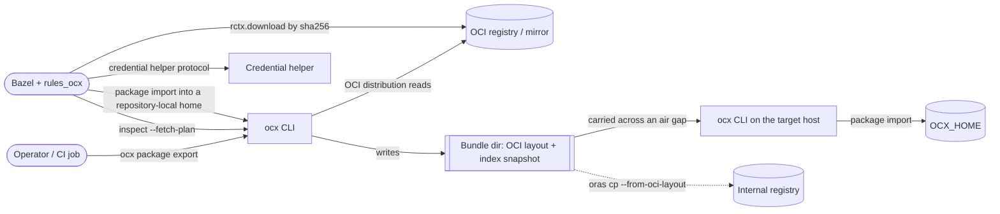
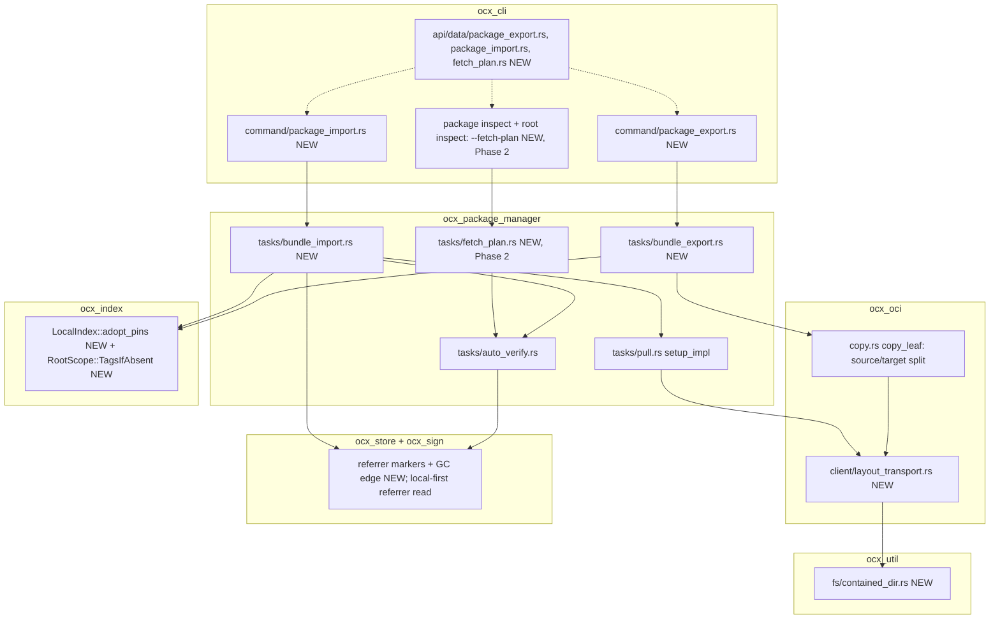
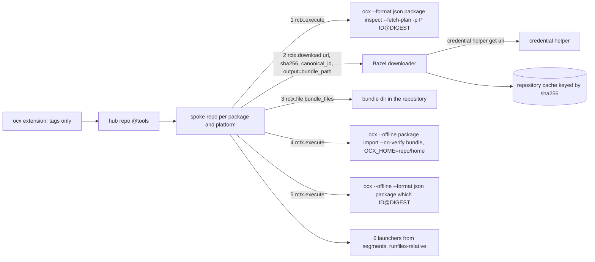

# System design: package bundles and the Bazel fetch plan

**Status:** Draft, revised after review round 1. Companion to `adr_package_export_import.md` (Proposed, 2026-11-08).
**Scope:** component contracts, C4 views, data contracts, security, NFRs, phases and the test map. Trade-offs and decisions live in the ADR, and this file does not repeat them.
**Conventions:** paths are relative to the repository root. `file:line` marks a claim checked in code. **UNVERIFIED** marks one that was not. **NEW** marks a building block that does not exist today.

## 1. Inputs and fixed points

| Fixed point | Source |
|---|---|
| The pull pipeline: cap, then completeness, then digest, then extract. Codesign follows extraction, and finalisation is atomic. | `crates/ocx_oci/src/client.rs:862-1019`, `crates/ocx_package_manager/src/tasks/pull.rs:726-858` |
| A layer already on disk skips the fetch before any client is needed | `crates/ocx_package_manager/src/tasks/pull.rs:748-753` |
| Package storage is keyed by the logical name, not the routed one | `crates/ocx_package_manager/src/tasks/pull.rs:841-842` |
| The dial-site guard runs only when a layer must be fetched, and returns early when the routed registry equals the logical one | `crates/ocx_package_manager/src/tasks/pull.rs:772-777`, `crates/ocx_package_manager/src/tasks/pull_local.rs:307`, `crates/ocx_index/src/lib.rs:306-311,429-430` |
| With no physical route, `route_for_dial` returns `unrouted()`: `NotInIndex` when a source is authoritative for the registry, `PolicyResolutionBlocked` when the local index names the registry an index namespace no source serves, otherwise the logical identifier passed through | `crates/ocx_index/src/lib.rs:379-391`, `crates/ocx_index/src/chained_index.rs:911-926` |
| A plain `OciIndex` source keeps the trait defaults: jurisdiction `FallThrough`, no `index_base_url`, serves no registry; a `LocalIndex` built by `new` has no index namespaces | `crates/ocx_index/src/index_impl.rs:110-113,141-150`, `crates/ocx_index/src/local_index.rs:83-103` |
| Auto-verify runs before materialisation, with its own `registry_client` | `crates/ocx_package_manager/src/tasks/pull.rs:252`, `crates/ocx_package_manager/src/tasks/auto_verify.rs:35,119` |
| `OciTransport` is sealed. Only `ocx_oci` implements it. | `crates/ocx_oci/src/lib.rs:102-106`, `crates/ocx_oci/src/client/transport.rs:256` |
| A registry-to-registry copy carries referrers (depth 8, at most 256 per leaf) and the cosign sidecar tags | `crates/ocx_oci/src/copy.rs:116,172,206,236,418`, `crates/ocx_oci/src/tag.rs:103` |
| The copy carries the repository description (`__ocx.desc`) through `pull_description` and `push_description` | `crates/ocx_cli/src/command/package_copy.rs:151-163`, `crates/ocx_oci/src/tag.rs:29` |
| `package copy` requires exactly one `-p` for a digest source, because a leaf carries no platform | `crates/ocx_cli/src/command/package_copy.rs:32-39` |
| The blob store is digest-keyed per registry: `<registry>/<alg>/<2hex>/<30hex>/data` | `crates/ocx_store/src/file_structure/blob_store.rs:54-74,124` |
| Local index writers. Merge only; a pin is never deleted. | `crates/ocx_index/src/local_index.rs:142` (`refresh_tags`), `:369` (`persist_dispatch`), `:397` (`commit_root_tag`), `:634` (`commit_published_root`) |
| A first-sight merge adopts the fetched root's package-level fields, `repository` included; `Routing` adopts them on first sight only; a usable committed root is kept | `crates/ocx_index/src/local_index.rs:825-837` |
| `IndexStore` and `read_bounded` follow symlinks | `crates/ocx_index/src/store.rs:384,405,424`, `crates/ocx_util/src/fs/bounded_read.rs:83,86` |
| Ancestor-symlink refusal for writes, path-based, so not used for bundle writes (§ 5.3) | `crates/ocx_util/src/fs/symlink_walk.rs:54` (`refuse_if_symlink_in_path`) |
| Archive guards | `crates/ocx_util/src/archive/tar.rs:223-305`, `crates/ocx_util/src/archive/error.rs:35,42` |
| `prefix` with `..` is refused at assembly | `crates/ocx_store/src/file_structure/assemble.rs:181-185` |
| Reused classifications | `offline_mode` 81 (`crates/ocx_package_manager/src/error.rs:54-61`); `invalid_manifest` 65 (`crates/ocx_oci/src/client/error.rs:55-57`); `no_signatures_found` 79 (`crates/ocx_sign/src/verify/error.rs:36-39`); `template_unknown_token` 65 (`crates/ocx_package/src/metadata/template/error.rs:122`) |
| `options::SignatureVerify` is the install surface's `--verify`/`--no-verify` pair | `crates/ocx_cli/src/options/verify.rs:32`, `crates/ocx_cli/src/command/install.rs:32` |
| `ocx env` env entries carry `key`, `value`, `kind`, `separator` | `crates/ocx_cli/src/api/data/env.rs:52-61` |
| The report contract is declared per leaf | `crates/ocx_cli/src/command/contract.rs:30-82` |
| `--referrers`/`--no-referrers` is a flattened pair, on by default | `crates/ocx_cli/src/options/referrers.rs:7-31` |
| `ocx clean` keeps only objects an install symlink, a dependent or a registered lock holds | `website/src/content/docs/reference/command-line/commands.md:73` |
| `oci-spec` 0.10.0 and `rustix` 1.1.5 are in the tree; `ocidir` and `cap-std` are not | `Cargo.lock:4097-4098,5757-5758` |
| rules_ocx env classes: `OCX_INSECURE_REGISTRIES` site, `OCX_NO_VERIFY` explicit; launchers bake `OCX_HOME`; the `.bat` launcher forwards `%*` | `rules_ocx/ocx/private/repo_utils.bzl:51,72-76,1516,1536,1540` |

## 2. C4 level 1: context



Actors and trust:

- **The operator** chooses which bundle to import. Content import is a trust act on bytes the digests already bind. Pin adoption is a separate act, scoped to the IDs the operator names (§ 5.4).
- **The registry** is untrusted for content: every byte is digest-verified. It is trusted only for availability.
- **Bazel** dials registry URLs outside ocx's SSRF guard. ocx emits only targets its own dial check admits, and the guarantee stops there (§ 8.4).

## 3. C4 level 2: containers

| Container | Tech | Role in this design |
|---|---|---|
| `ocx` binary (`crates/ocx_cli`) | Rust and Tokio | Parses the CLI, dispatches commands and renders reports |
| `ocx_util` | library | NEW directory capability `ContainedDir` for traversal-safe bundle reads and writes |
| `ocx_oci` | library | NEW `LayoutTransport`, `Client::open_oci_layout`/`create_oci_layout`. `copy_leaf` gains a source/target client split. Phase 2: NEW `Client::blob_url`/`manifest_url`. |
| `ocx_index` | library | NEW `LocalIndex::adopt_pins`, `PointerPolicy`, `RootScope::TagsIfAbsent` |
| `ocx_store` | library | NEW referrer markers in the blob tier and their GC edge |
| `ocx_sign` | library | The referrer listing is read local-first |
| `ocx_package_manager` | library | NEW tasks `bundle_export`, `bundle_import`; Phase 2 `fetch_plan` |
| `ocx_package` | library | Phase 2: NEW env and entrypoint segment rendering |
| Bundle directory | filesystem | The persisted contract (§ 5.2) |
| `rules_ocx` repository rules | Starlark | Phase 3: plan, download, import, launchers (§ 4.2) |
| Bazel downloader and repository cache | Bazel | Fetches every blob by checksum and caches it by checksum |

## 4. C4 level 3: components

### 4.1 Chain A: the ocx CLI to ocx_package_manager to the stores and the index



### 4.2 Chain B: rules_ocx repository rules (materialiser C)



Rules for chain B:

- **Platform.** A spoke runs ocx once per platform it serves (`-p`), matching the single-platform model (`adr_platform_model_unification.md` D4).
- **Laziness.** Spokes are fetched lazily by Bazel, which replaces `bins` (ADR Decision 6).
- **Starlark parses only the plan.** It writes files the plan names and never reads `index.json`, a manifest or the store (rules_ocx invariant 1).
- **Verification happens once, at step 1**, against the user's trust ladder. Step 4 passes `--no-verify`, a fixed argument that never reads the ambient environment. The `OCX_NO_VERIFY` explicit class still governs step 1 (`repo_utils.bzl:72-76`). Import re-hashes every blob against the same digests step 1 verified. The bypass warning that `--no-verify` prints is expected in the fetch log.

## 5. Contracts

### 5.1 CLI grammar

| Command | Grammar | Notes |
|---|---|---|
| Export | `ocx package export [-p PLATFORM] [--referrers \| --no-referrers] -o DIR ID...` | One platform rule (below). `-o` is required. Each `ID` exports with its dependency closure and its repository description. `--offline` exits 81 `offline_mode`. |
| Import | `ocx package import [--verify \| --no-verify] DIR [ID...]` | `--verify`/`--no-verify` is `options::SignatureVerify` (`crates/ocx_cli/src/options/verify.rs:32`), flattened exactly as `install` does (`crates/ocx_cli/src/command/install.rs:32`). `ID...` names the packages whose tag pins are adopted (§ 5.4). Import dials no registry in any mode. |
| Fetch plan, OCI tier | `ocx --format json package inspect --fetch-plan [-p PLATFORM] ID@DIGEST...` | Digest identifiers only; a tag is 64 `fetch_plan_needs_digest`. `-p` defaults to the host: it selects the child of an image index and renders `:native`/`:posix` modifiers. Conflicts with `--resolve` and `--closure` (clap `conflicts_with`), so one invocation emits one report root. |
| Fetch plan, project tier | `ocx --format json inspect --fetch-plan [-p PLATFORM] [-g GROUP]... [NAME...]` | Driven by the lock. Needs a current lock, exiting 78 or 65 exactly as `inspect` does. |

**Export platform rule.** For a tag, `-p` defaults to the host. For a digest identifier, exactly one `-p` is required, and it declares the leaf's platform or selects the child of an image index. A digest without `-p` exits 64 `bundle_platform_required`. This is the same rule `package copy` applies to a digest source (`crates/ocx_cli/src/command/package_copy.rs:32-39`); export restates it, it does not import it.

**Runtime checks, in order** (all in `tasks/bundle_export.rs`, before any write):

1. A digest identifier without `-p` exits 64 `bundle_platform_required`.
2. `-o` names a file, or a non-empty directory with no `oci-layout`, which exits 64 `bundle_output_not_bundle`. An absent path or an empty directory is initialised: `oci-layout` is written first, `index.json` last (§ 5.5). A directory with `oci-layout` and no `index.json` is an uncommitted first export (a crash, § 5.5) and is resumed with empty membership. The check uses `ensure_empty_or_absent` and is a runtime check, not clap.
3. No registry client (`--offline`) exits 81 `offline_mode` through `require_client()`.

**Import inputs:**

| Input | Outcome |
|---|---|
| `DIR` does not exist | 79 `bundle_not_found` |
| `DIR` exists and has no `oci-layout`, or it is malformed | 65 `bundle_layout_invalid` |
| `oci-layout` present, `index.json` absent (an uncommitted first export) | 65 `bundle_layout_invalid`; the remedy is re-running the export |
| A valid layout whose `index.json` lists no package | exit 0, empty `items` and `pins`, nothing written |
| A digest-only bundle (no `index/`) | Content imports. A named `ID` with a tag exits 79 `bundle_package_not_found`; a bare named `ID` yields no pin rows. |
| A named `ID` whose repository no listed leaf belongs to | 79 `bundle_package_not_found` |

Plain mode prints the reports as tables. `--fetch-plan` in plain mode prints one row per blob: package key, kind, short digest, size. The plan is machine-first.

### 5.2 Bundle on-disk contract (persisted, one-way door)

```
DIR/
  oci-layout                   exactly {"imageLayoutVersion":"1.0.0"}
  index.json                   application/vnd.oci.image.index.v1+json
                               annotations: {"sh.ocx.bundle.version": "1"}
  blobs/<alg>/<hex>            alg in {sha256, sha384, sha512}; content == digest, always
  index/<registry>/...         the existing --index collection grammar; tagged exports only
  trust/trusted_root.json      optional, advisory, never read by import
```

| Rule | Contract |
|---|---|
| B-1 | Every `blobs/` file's bytes hash to its name. The exporter writes through the transport, which verifies; the importer verifies again. |
| B-2 | **Membership is `index.json`.** Each exported leaf is a descriptor with a `platform` and `org.opencontainers.image.ref.name` = `<registry>/<repo>@<leaf digest>`. A tagged export also lists its image index with `ref.name` = `<registry>/<repo>:<tag>`. A leaf is in the bundle exactly when it is listed. |
| B-3 | Referrer manifests are listed without `ref.name`, carrying `artifactType` when the source carried one (the oras-go convention). Cosign sidecar tags (`sha256-<hex>.sig`/`.att`/`.sbom`, `crates/ocx_oci/src/tag.rs:103`) are listed with `ref.name` = `<registry>/<repo>:<sidecar tag>`. The repository description is listed with `ref.name` = `<registry>/<repo>:__ocx.desc`. |
| B-4 | A listed leaf whose config, metadata or layer blob is absent, or whose dependency leaf is not listed and complete, makes the bundle incomplete. Import refuses it before any write (65 `bundle_incomplete`): import is the completeness check. |
| B-5 | The snapshot under `index/` holds a root, a tag row and the dispatch object for each tagged export, and nothing for digest exports or dependencies. Root package-level fields are copied from the exporter's home. |
| B-6 | One bundle holds one tag-to-digest answer per tag. An append that would pin a tag to another digest is refused before any write (64 `bundle_pin_conflict`), and the bundle is left unchanged. |
| B-7 | `sh.ocx.bundle.version` is `"1"`. Import refuses an absent or unknown value (65 `bundle_version_unsupported`). Additive content, such as new annotations or extra files, never bumps it. A change in what an existing file means bumps it. The value's semantics are reserved for optional bundle signing later. |
| B-8 | Import reads `ref.name` only in its digest form (B-2) and for the sidecar and `__ocx.desc` lookups (B-3). It never takes a tag pin from `ref.name`. Files outside the paths above are ignored. |
| B-9 | The exporter holds `lock_scoped(locks_root, "bundle", DIR, …)` for the whole run, so two concurrent exports into one `DIR` serialise. `index.json` is replaced last, by tempfile and rename (§ 5.5). |
| B-10 | Bundle files are written readable (0644, 0755 for directories). A bundle is a transport artifact, not private state. |
| B-11 | A bundle is written only by ocx. A third-party tool that rewrites `index.json` may drop the version annotation; the result is then refused by B-7. |

### 5.3 Bundle file access (`ContainedDir`, NEW in `ocx_util`)

Every bundle read and write goes through one directory capability rooted at `DIR`. `DIR` itself may be a symlink, since the operator named it. Nothing below it may be.

```rust
// crates/ocx_util/src/fs/contained_dir.rs — NEW, domain-free
pub struct ContainedDir { /* directory handle on the canonicalised root */ }
impl ContainedDir {
    pub fn open(root: &Path) -> Result<ContainedDir, ContainedDirError>;
    /// Opens `relative` with no symlink traversal in any component; the handle must be a
    /// regular file and no larger than `cap`.
    pub fn read_bounded(&self, relative: &RelativePath, cap: u64) -> Result<Vec<u8>, ContainedDirError>;
    pub fn open_stream(&self, relative: &RelativePath, expected_size: u64) -> Result<std::fs::File, ContainedDirError>;
    pub fn list_dir(&self, relative: &RelativePath, max_entries: usize) -> Result<Vec<Entry>, ContainedDirError>;
    /// Opens the parent no-follow, creates a temp file relative to that handle (`O_EXCL`),
    /// then renames relative to the same handle (`renameat`). No path is re-walked.
    pub fn write_atomic(&self, relative: &RelativePath, bytes: &[u8]) -> Result<(), ContainedDirError>;
    /// Copies the tree under `relative` out to `dest`, bounded in total (see caps).
    pub fn copy_out(&self, relative: &RelativePath, dest: &Path) -> Result<(), ContainedDirError>;
}
```

**Contract:**

- **No TOCTOU.** Reads check the opened handle, not a pre-`stat` of the path. Writes create and rename relative to an already-opened parent handle, so no path-based check (`refuse_if_symlink_in_path`) runs between check and use. `read_bounded` (`crates/ocx_util/src/fs/bounded_read.rs:83,86`) follows symlinks and is not used for bundle files.
- **Platform mechanism.** The mechanism is chosen in WP-1 by the `deps` skill: `openat2` with `RESOLVE_BENEATH | RESOLVE_NO_SYMLINKS` and `renameat` through `rustix` on Linux, per-component `O_NOFOLLOW` plus `renameat` elsewhere on Unix, or `cap-std`. The Windows mechanism (no-follow open and a rename relative to a directory handle, `FileRenameInfo` with `RootDirectory`) is UNVERIFIED (§ 14).
- **Caps.**
  - `oci-layout`: 4 KiB.
  - `index.json`: 16 MiB.
  - Each manifest, root document and dispatch object: 4 MiB, equal to `MAX_METADATA_BLOB_BYTES`.
  - Each `list_dir`: 65 536 entries.
  - Each `copy_out` of `index/`: 262 144 files and 256 MiB in total.
  - Blobs stream with the descriptor size as the bound, and the existing pull caps apply on top.
- **Snapshot.** `LocalIndex` never opens a path inside `DIR`. `IndexStore` reads follow symlinks (`crates/ocx_index/src/store.rs:384,405,424`) and are not taught otherwise. Instead:
  - Import `copy_out`s `DIR/index/**` into a private directory under `$OCX_HOME/temp/` and points `LocalIndex` at the copy.
  - Export seeds such a copy, writes its rows there through `LocalIndex`, and copies the changed files back in with `write_atomic` (§ 5.5).
- **Errors.** A symlink, a non-regular file, a path escape or an over-cap file is 65 `bundle_entry_not_regular`. An I/O fault is 74.

**Ecosystem search** (QW8, "don't own non-domain code"):

- **`oci-spec`** is in the tree (`Cargo.lock:4097`). Its image-index and descriptor types (de)serialise `index.json`. That `oci-spec` exposes an `oci-layout` type is UNVERIFIED.
- **`ocidir`** (OCI layout read and write) is not in the tree. WP-1 evaluates it with the `deps` skill and adopts it if it supports handle-based containment and the read set `LayoutTransport` needs.
- **What ocx owns** in every case: the OCX annotation, membership semantics, the snapshot, and containment.

### 5.4 Import: entry points and pin adoption

These sketches are contracts, not implementations.

```rust
// crates/ocx_oci/src/client/layout_transport.rs — NEW
pub(crate) struct LayoutTransport { dir: ContainedDir, mode: LayoutMode /* ReadOnly | ReadWrite */, graph: OnceCell<LayoutGraph> }
impl crate::sealed::Sealed for LayoutTransport {}
impl OciTransport for LayoutTransport {
    // reads: manifests and blobs by digest; tags only from ref.name (export side, sidecar and __ocx.desc lookups)
    // referrers: answered from LayoutGraph (listed manifests whose `subject` names the digest)
    // writes (ReadWrite only): blobs, manifests; a tag => a ref.name descriptor staged for the commit (§ 5.5)
    // catalog: ClientError (unsupported); ensure_auth: no-op
}
// crates/ocx_oci/src/client.rs — NEW production constructors
impl Client {
    pub fn open_oci_layout(dir: ContainedDir) -> Result<Client, ClientError>;   // validates oci-layout, index.json, version
    pub fn create_oci_layout(dir: ContainedDir) -> Result<Client, ClientError>; // empty → initialise; bundle → open RW
}

// crates/ocx_index/src/local_index.rs — NEW
pub enum PointerPolicy { AdoptOnFirstSight /* export: home → bundle */, OwnNameOnly /* import: bundle → home */ }
pub enum PinOutcome { Added { tag: String, digest: Digest }, Unchanged { tag: String, digest: Digest },
                      KeptLocal { tag: String, local: Digest, offered: Digest },
                      WithheldRouting { tag: String, offered: Digest } }
impl LocalIndex {
    /// Copies `tags` of `identifier` from `source`: dispatch objects first, then the root under
    /// `RootScope::TagsIfAbsent`, decided under the catalog lock.
    pub async fn adopt_pins(&self, source: &LocalIndex, identifier: &PackageRef, tags: &[&str],
                            pointer: PointerPolicy) -> Result<Vec<PinOutcome>>;
}

// crates/ocx_package_manager/src/tasks/bundle_import.rs — NEW
impl PackageManager {
    pub async fn import_bundle(&self, bundle_dir: &Path, adopt: &[PackageRef], verify: bool)
        -> Result<ImportOutcome, Error>;
}
// crates/ocx_package_manager/src/package_manager.rs — NEW view (an accessor-shaped constructor)
impl PackageManager {
    /// Same FileStructure; pull and auto-verify client = `client`; index = `index`.
    pub fn with_source(&self, client: ocx_oci::Client, index: ocx_index::Index) -> PackageManager;
}
```

**The import index has no routing roots.** `import_bundle` builds:

```
Index::from_chained(LocalIndex(<empty private dir>), [Index::from_remote(OciIndex over the layout client)], ChainMode::Default)
  .with_content_store(home blobs)
  .read_only_view()
```

- **Routing.** No root carries a `repository` pointer, so `physical_reference` is `None` and `route_for_dial` returns `unrouted()` (`crates/ocx_index/src/lib.rs:306-309,379-391`). It never reaches the carve-out at `:429`.
- **Jurisdiction.** For `unrouted()` to pass the logical identifier through rather than refuse, the import index must hold no authoritative source and no index namespace:
  - its only source is the layout-backed `OciIndex`, which keeps the trait defaults: `FallThrough`, no `index_base_url` (`crates/ocx_index/src/index_impl.rs:110-113,148-150`), so `NotInIndex` cannot fire;
  - its `LocalIndex` is built by `LocalIndex::new` without `with_index_namespaces` (`crates/ocx_index/src/local_index.rs:83-103`), so `refuse_unrouted` cannot fire (`crates/ocx_index/src/chained_index.rs:911-920`).
  - So `ocx.sh/cmake` imports even when the home's own chain has `index.ocx.sh` authoritative for `ocx.sh`. Tested (§ 11).
- **Dial guard.** The pull's own `guard_physical_dial` then sees routed = logical and returns at the not-a-rewrite carve-out before any DNS lookup (`crates/ocx_index/src/lib.rs:429-430`, `crates/ocx_package_manager/src/tasks/pull.rs:774-777`). This replaces the round-0 `is_local()`/`dials_network()` flag, which is deleted (QW8): no code path skips the guard.
- **Writes.** The view writes no index (`LocalWritePolicy::ReadOnly`) and warms only `$OCX_HOME/blobs`.

`import_bundle` runs these steps in order. Steps 1 and 2 write nothing.

1. **Open and validate.** Open `ContainedDir`, the layout client and the snapshot copy (§ 5.3). Check `oci-layout`, `index.json` and the version (B-7).
2. **Enumerate and preflight.**
   - List the leaves (B-2) and resolve each closure from its metadata, digest-pinned.
   - Confirm every blob of every listed leaf is present and regular (B-4).
   - Resolve every named `ID` against the listed repositories, exiting 79 if one is absent.
   - **Signature presence**, unless `--no-verify`: every leaf a `[[trust.policy]]` covers must have at least one carried referrer or sidecar tag naming it. Otherwise the run exits 79 `bundle_signatures_missing` before any write.
3. **Materialise content.** For each leaf, run `with_source(layout_client, import_index).setup(…)` with candidate = false (the `package pull` path).
   - **Verification.** Auto-verify runs first, against the layout client (`auto_verify.rs:119`). The bundle's referrers and sidecar tags are the signature source. The trust root comes from the ladder.
   - **Content.** Manifests are staged into `blobs/`. Layers stream through `HashingAsyncReader`, the caps, the extraction guards and codesign.
   - **A carried signature that fails verification is refused per leaf**, with the existing auto-verify code. Leaves already imported stay; each passed its own verification. The run then exits with that code, and step 5 does not run, so no pin is adopted.
4. **Persist referrers.** For each verified subject, copy its referrer manifests and blobs into `blobs/` and add one marker per referrer (§ 5.8, `BlobStore::add_referrer_marker`).
5. **Adopt pins**, strictly after every leaf succeeded. For each named `ID`, call `home.adopt_pins(snapshot, id, tags, PointerPolicy::OwnNameOnly)`. The tag list is every tag the snapshot pins for a bare `ID`, or the one tag of `ID:tag`.
6. **Report.** Build the `ImportOutcome`. One stderr status line (`UserInterface::status`, not a warning) says imported content is collectable by `ocx clean` until something installs or locks it, and that `DIR` re-imports it.

**Pin adoption under `RootScope::TagsIfAbsent` and `PointerPolicy::OwnNameOnly`:**

| Home state | Snapshot root | Outcome |
|---|---|---|
| Root present, tag absent | any | Tag row added (`added`). The home's `repository` and package-level fields stay: the committed root is kept (`local_index.rs:829-830`), and `TagsIfAbsent` writes no package-level field. |
| Root present, tag pins the same digest | any | `unchanged` |
| Root present, tag pins another digest | any | `kept_local`, exit 0 |
| Root absent | `repository` is `oci://<registry>/<repo>` of the package itself (derived shape) | A bare root is created: `repository` (that own-name value) and the adopted tag rows, nothing else (`added`) |
| Root absent | `repository` names any other location | Nothing written, `withheld_routing`. A first-sight merge would adopt that pointer (`local_index.rs:833-837`), and a local answer wins on every later resolve. |

`TagsIfAbsent` does not reuse `merge_root`'s first-sight base. That base is the whole fetched root with only `tags` emptied (`crates/ocx_index/src/local_index.rs:829-838`), so `status`, `deprecated_message`, `superseded_by` and any unmodelled field would land too. The field allowlist for a created root is `repository` plus `tags`; a later `ocx index update` fills the rest. An adopted tag row is copied as served, `yanked` and `ephemeral` included: both only refuse or expire a pin.

Every `added` row's dispatch object is read from the snapshot copy and written only if its bytes hash to the row's `content` digest and parse as an OCI image index. Otherwise the run exits 65 `bundle_layout_invalid` with nothing adopted. This is the recompute-and-verify `LocalIndex` documents for its own writes (`.claude/rules/subsystem-oci.md` § LocalIndex, "Write path"; the code site is UNVERIFIED).

Dependency roots are never adopted. An offline install by digest needs none: storage is keyed by the logical name (`pull.rs:841-842`), and the router is consulted only to dial a missing layer (`pull.rs:772-777`). An imported, complete package dials nothing. The end-to-end behaviour of `ocx --offline package install ID@DIGEST` with no local root is pinned by a test (§ 11), since the call order inside `setup_impl` is UNVERIFIED.

**Invariants the importer adds** (each is a test in § 11):

- **I-1.** The layout client never writes `state/referrers/<registry>.json`. `copy.rs:216-219` probes `ReferrersApiCapability` on the transport. Where the probe's cache write attaches is UNVERIFIED (§ 14); the layout constructors attach none.
- **I-2.** `[mirrors]` routing (`Client::transport_reference`) is not applied to a layout client.
- **I-3.** Import makes no registry or DNS request. Trust services may run only where the ambient mode allows them (`adr_offline_verify_trust_cache.md`).
- **I-4.** Trust anchors are never read from `DIR`, `trust/trusted_root.json` included.
- **I-5.** No root carrying a foreign `repository` pointer, and no dependency root, reaches the home index.

### 5.5 Export, and atomic append

```rust
// crates/ocx_oci/src/copy.rs — signature change (internal tier, no shim)
pub async fn copy_leaf(source_client: &Client, target_client: &Client, source: &OciIdentifier,
                       target: &OciIdentifier, leaf_digest: &Digest, include_referrers: bool,
                       scratch_root: &Path) -> Result<LeafCopy, ClientError>;
// registry copy passes the same client twice; export passes Client::create_oci_layout(dir) as target.

// crates/ocx_package_manager/src/tasks/bundle_export.rs — NEW
impl PackageManager {
    pub async fn export_all(&self, ids: &[PackageRef], platform: Option<&Platform>, bundle_dir: &Path,
                            referrers: bool) -> Result<Vec<ExportOutcome>, Error>;
}
```

The export flow has three write boundaries and one commit point:

1. **Lock and read.** Take the bundle lock (B-9). Write `oci-layout` if absent. Read the current `index.json` through `ContainedDir`; if it is absent, membership is empty (a new or uncommitted bundle).
   - **Seed the snapshot.** `copy_out` `DIR/index/**` into a private directory under `$OCX_HOME/temp/`, keeping only committed rows: a tag row whose `<registry>/<repo>:<tag>` descriptor `index.json` lists, and the dispatch objects those rows name. Residue from a crashed run is dropped here.
2. **Resolve and preflight** (no write).
   - Resolve every `ID` through the ordinary chain under the ambient mode. A committed local pin wins (silence principle): the bundle exports what this machine resolves.
   - Compute the closure, the new `index.json` descriptors and the snapshot rows.
   - Refuse any snapshot row that would pin an existing tag to another digest (64 `bundle_pin_conflict`).
3. **Boundary 1: blobs.** Write the dispatch index raw, then `copy_leaf` each leaf and dependency leaf, with referrers, sidecar tags and `__ocx.desc` (`pull_description`/`push_description`, as `package_copy.rs:151-163` does). Blobs are content-addressed and inert until listed.
4. **Boundary 2: snapshot rows.** Call `seeded_index.adopt_pins(home_index, id, [tag], PointerPolicy::AdoptOnFirstSight)` for tagged exports only, against the private seeded copy, never `DIR`. The rows are add-only (the preflight guarantees no conflict).
   - The changed files are then copied into `DIR/index/` with `write_atomic`, in `LocalIndex`'s crash-safe order: dispatch objects, roots, catalog.
   - A root file in `DIR` is replaced whole by the seeded copy's version, which drops uncommitted residue and keeps every committed row.
5. **Boundary 3, the commit.** `index.json` is rewritten by tempfile and rename. It is the union of the old descriptors and the new ones, keyed by digest and `ref.name`.
6. **Advisory trust root.** When the bundle carries signatures and the exporter's ladder resolves a trusted-root document, export writes `trust/trusted_root.json`. Whether a TUF-fetched public-good root serialises to that document is UNVERIFIED (§ 14).

**Crash semantics** (one failure test per boundary, § 11):

- **Before boundary 3**, `index.json` is the previous one, so no new platform is a member.
- **Blobs** written before a crash are unlisted, and a re-run dedupes them.
- **Snapshot rows** written before a crash are inert for import: import adopts pins only for listed packages. For an `ocx --index DIR/index` reader, such a row resolves to leaves that were never imported. An offline install then exits 81 for it, which is the absent-platform behaviour.
- **A pin conflict** is refused at step 2, before boundary 1, so it leaves no trace. The conflict check reads committed rows only, so residue from a crashed run never blocks a re-run.
- **A crashed first export into an empty `DIR`** leaves `oci-layout`, blobs and possibly snapshot residue, with no `index.json`.
  - A re-run resumes it: the § 5.1 check 2 accepts the directory, membership starts empty, blobs dedupe by digest, and step 1 drops the residue.
  - Import refuses that directory with 65 `bundle_layout_invalid` (§ 5.1).

### 5.6 Fetch-plan report (`fetch_plan`, Phase 2)

```rust
// crates/ocx_package_manager/src/tasks/fetch_plan.rs — NEW
impl PackageManager {
    pub async fn fetch_plan_all(&self, roots: &[PackageRef], platform: &Platform) -> Result<FetchPlan, Error>;
}
// crates/ocx_oci/src/client.rs — NEW: the URL ocx itself would dial, after `[mirrors]` routing;
// mirrors the fork's private to_v2_blob_url (external/rust-oci-client/src/client.rs:2487).
impl Client { pub fn blob_url(&self, target: &OciIdentifier, digest: &Digest) -> Result<String, ClientError>;
              pub fn manifest_url(&self, target: &OciIdentifier, digest: &Digest) -> Result<String, ClientError>; }
// crates/ocx_package/src/metadata/template/segments.rs — NEW
pub enum Segment { Text(String), PackageRoot { package: String /* plan key */, path: RelativePath } }
```

**Generation rules:**

- **Verification.** Auto-verify runs for each policy-covered package before the plan is emitted, and fails closed.
- **Targets.** Each package is routed through `Index::route_for_dial` (`crates/ocx_index/src/lib.rs:306-311`), the same check a real dial runs. The URL is `blob_url`/`manifest_url` over that answer. There is no second, stricter guard over every host, which would refuse localhost, private registries and `[mirrors]` entries ocx itself dials.
- **Network.** No layer bytes are fetched. A test asserts this through the network-refusal seam (`crates/ocx_oci/src/client.rs:149`).
- **Index writes.** The `ReadOnly` view writes no index.
- **Interpolation.** Tokens resolve to segments, and `:native`/`:posix` render for the `-p` platform. An unknown token exits 65 `template_unknown_token` (`crates/ocx_package/src/metadata/template/error.rs:122`), as `env` refuses.
- **Paths.** A segment `path` is lexically normalised (`lexical_normalize`) and must be a non-escaping `RelativePath`. Otherwise it exits 65 `fetch_plan_path_escapes`.
- **Package key.** `<alg>-<hex>` of the package's leaf digest. Bazel repository names derive from it, so a key is stable across plans. Two closure members with the same leaf digest are one content and merge into one entry, keeping the first `identifier` in closure order.
- **Order.** `packages` is in closure order: roots in argument order, then dependencies in the order `ocx package inspect --closure` reports them. `env` is in the composer's application order, and `blobs` is manifest, config, then layers in manifest order. No map iteration reaches the JSON.
- **v1 scope.** There is no `compression`, `strip_components` or `prefix`. Materialiser C needs none of them, because ocx assembles. Native extraction (B) would add them additively, keeping the one-way-door surface small.

**Schema sketch** (names follow IC-02 to IC-08; the golden is authoritative once it lands, and this sketch is consistent with it by construction):

```json
{
  "schema_version": 1,
  "platform": "linux/amd64",
  "roots": ["sha256-<leaf0>"],
  "packages": [{
    "key": "sha256-<leaf0>",
    "identifier": "ocx.sh/cmake:3.28@sha256:<leaf0>",
    "name": "cmake",
    "blobs": [
      {"kind": "manifest", "digest": "sha256:<leaf0>", "media_type": "application/vnd.oci.image.manifest.v1+json",
       "size": 1234, "url": "https://ghcr.io/v2/ocx-sh/cmake/manifests/sha256:<leaf0>", "bundle_path": "blobs/sha256/<leaf0>"},
      {"kind": "config", "digest": "sha256:<c>", "media_type": "…", "size": 456,
       "url": "https://ghcr.io/v2/ocx-sh/cmake/blobs/sha256:<c>", "bundle_path": "blobs/sha256/<c>"},
      {"kind": "layer", "digest": "sha256:<l>", "media_type": "…tar+xz", "size": 9876543,
       "url": "https://ghcr.io/v2/ocx-sh/cmake/blobs/sha256:<l>", "bundle_path": "blobs/sha256/<l>"}
    ],
    "dependencies": [{"package": "sha256-<leaf1>", "visibility": "public"}],
    "binaries": ["cmake", "ctest"], "binaries_complete": true,
    "self_env": [{"key": "PATH", "kind": "path", "segments": [{"type": "package_root", "package": "sha256-<leaf0>", "path": "bin"}]}],
    "entrypoints": [{"name": "cmake-gui", "target": [{"type": "package_root", "package": "sha256-<leaf0>", "path": "bin/cmake-gui"}], "args": []}]
  }],
  "env": [{"key": "PATH", "kind": "path", "segments": [{"type": "package_root", "package": "sha256-<leaf0>", "path": "bin"}]},
          {"key": "CMAKE_ROOT", "kind": "constant", "segments": [{"type": "package_root", "package": "sha256-<leaf0>", "path": "share/cmake"}]}],
  "bundle_files": [{"path": "oci-layout", "content": "{\"imageLayoutVersion\":\"1.0.0\"}"},
                   {"path": "index.json", "content": "{…the listed leaves, version annotation…}"}]
}
```

**Field rules:**

- **`name`.** Project tier only; omitted on the OCI tier (IC-04).
- **Env entries** are `{key, kind, separator?, segments}`. `kind` and `separator` are exactly `ocx env`'s fields (`crates/ocx_cli/src/api/data/env.rs:58-61`). `segments` replaces `value`, so a field never changes meaning under one name (IC-16).
- **Segments** are internally tagged with `type`, with an unknown arm (IC-05, IC-15). `type` is the union discriminator; `kind` is the env modifier. They are different fields with different jobs.
- **Blob `kind`** is an open enum: `manifest`, `config`, `layer`.
- **`bundle_files`** carries the exact bytes of every non-blob file a content-only bundle needs, so that the downloaded blobs plus these files form a bundle `ocx package import` accepts (§ 11, plan-to-import test). Starlark writes them verbatim and never parses them.
- **Credentials.** No `Authorization`, token, cookie or URL userinfo appears anywhere. A test asserts this over the serialised plan.
- **Digest algorithms.** For a non-`sha256` digest, rules_ocx passes `integrity` (SRI) instead of `sha256`. `canonical_id` is the digest string.

### 5.7 Export and import reports

```json
// root package_export
{"schema_version": 1, "bundle_dir": "/abs/DIR", "platform": "linux/amd64",
 "items": [{"identifier": "ocx.sh/cmake:3.28@sha256:<leaf>", "status": "added", "blob_count": 5,
            "written_size": 10485760, "referrer_count": 2, "dependencies": ["ocx.sh/zlib@sha256:<leaf>"]}]}
// root package_import
{"schema_version": 1, "bundle_dir": "/abs/DIR",
 "items": [{"identifier": "ocx.sh/cmake@sha256:<leaf>", "platform": "linux/amd64", "status": "imported",
            "verification": "verified"}],
 "pins":  [{"identifier": "ocx.sh/cmake:3.28", "status": "kept_local", "digest": "sha256:<bundle>",
            "local_digest": "sha256:<home>"}]}
```

**Field triggers.** All statuses are open enums (IC-09, IC-15).

| Report | Field | Trigger |
|---|---|---|
| Export item | one row | per exported leaf, roots and dependencies alike |
| Export item | `status` | `added` when this run listed the leaf; `unchanged` when `index.json` already listed it |
| Export item | `blob_count`, `written_size`, `referrer_count` | blobs, bytes and referrer manifests this run wrote for the leaf. All zero on `unchanged`. |
| Export item | `dependencies` | the leaf's direct dependency leaves, pinned |
| Import item | one row | per listed leaf |
| Import item | `status` | `imported` when this run materialised the package; `unchanged` when the store already held it |
| Import item | `verification` | `verified`, `not_covered` (no policy), `opted_out` (`--no-verify`) |
| Import pin | one row | per (named `ID`, tag) considered |
| Import pin | `status` | `added`, `unchanged`, `kept_local` or `withheld_routing` (§ 5.4) |
| Import pin | `digest` | always: the snapshot's dispatch digest for the tag |
| Import pin | `local_digest` | only on `kept_local`: the home's digest |

**Plain mode.** A `kept_local` or `withheld_routing` row prints one stderr line through `UserInterface::status` naming the remedy: `ocx --index DIR/index …` offline, or `ocx index update <ID>` online. The stdout table stays result-only. The collectability note (§ 5.4 step 6) is stderr only. A JSON field would carry the same value on every item and therefore no information.

### 5.8 Local referrer listing (same release as import)

- **Store.** `blobs/<registry>/<alg>/<2hex>/<30hex>/referrers/<alg>-<hex>`, NEW. These are empty marker files in the subject's blob directory, one per referrer manifest digest. Only import writes them, add-only, with no document to merge or lock (`BlobStore::add_referrer_marker`, NEW).
- **Read.** The verify pipeline's referrer listing unions the markers with the registry listing, reading digest-verified from `blobs/`. Under `--offline`, or with no registry client, the local set alone decides. Absence still fails closed. The read seam in `crates/ocx_sign` is UNVERIFIED (§ 14).
- **GC.** `ocx clean` treats each marker as a forward edge from the subject blob to the referrer manifest and its blobs, so a reachable subject keeps its signatures. The clean-walk file is UNVERIFIED (§ 14).

## 6. Exit codes and `error.detail` slugs

There is no new `ExitCode` (`adr_exit_code_taxonomy.md`). NEW slugs are proposals for the plan to confirm against the registry.

| Failure | Code | Slug |
|---|---|---|
| Digest identifier without `-p` on export | 64 | `bundle_platform_required` (NEW) |
| `-o` is a file, or a non-empty directory with no `oci-layout` (runtime check, `tasks/bundle_export.rs`) | 64 | `bundle_output_not_bundle` (NEW) |
| Append would pin a tag to a second digest. Next action: a new `DIR`, or export by digest. | 64 | `bundle_pin_conflict` (NEW) |
| Tag passed to the OCI-tier `--fetch-plan` | 64 | `fetch_plan_needs_digest` (NEW) |
| Import `DIR` does not exist | 79 | `bundle_not_found` (NEW) |
| Named `ID` (or `ID:tag`) not in the bundle | 79 | `bundle_package_not_found` (NEW) |
| Policy-covered subject with no carried signature, found in preflight before any write. Next action: re-export with `--referrers`. | 79 | `bundle_signatures_missing` (NEW, wraps `no_signatures_found`) |
| Malformed or absent `oci-layout`, `index.json`, manifest or snapshot | 65 | `bundle_layout_invalid` (NEW) |
| Symlink, non-regular file, path escape or over-cap file in the bundle | 65 | `bundle_entry_not_regular` (NEW) |
| Blob bytes do not hash to the name | 65 | existing `DigestMismatch` |
| Listed leaf incomplete | 65 | `bundle_incomplete` (NEW) |
| Unknown or absent `sh.ocx.bundle.version` | 65 | `bundle_version_unsupported` (NEW) |
| Invalid manifest, or a layer media type ocx cannot extract | 65 | existing `invalid_manifest` (`crates/ocx_oci/src/client/error.rs:55-57`) |
| Plan segment path escapes its package root | 65 | `fetch_plan_path_escapes` (NEW) |
| Unknown interpolation token while rendering the plan | 65 | existing `template_unknown_token` |
| Write failure in `DIR` or `$OCX_HOME` | 74 | existing I/O classification |
| Plan target refused by the dial check | 78 | existing `SsrfError` |
| Offline with no usable trust root, for a policy-covered package | 78 | existing (`adr_offline_verify_trust_cache.md`) |
| Signature verification failed under policy | 65 / 77 / 78 | existing auto-verify classification |
| Export registry failures | 69 / 75 / 79 / 80 | as `package copy` |
| Export under `--offline` | 81 | existing `offline_mode` (`crates/ocx_package_manager/src/error.rs:54-61`) |
| Offline install of a platform absent from the bundle | 81 | existing offline content miss |

## 7. Data flows

### 7.1 Export, then air gap, then import, then offline use

```
online host:   ocx package export -p linux/amd64 -o B ocx.sh/cmake:3.28
               lock → resolve (local pin) → preflight → blobs (index, leaf, closure, referrers, sidecars, __ocx.desc)
               → snapshot rows (adopt_pins home → B, AdoptOnFirstSight) → index.json commit
               ocx package export -p darwin/arm64 -o B ocx.sh/cmake:3.28      (append: same index digest, new leaf)
transfer:      tar/rsync/USB B
offline host:  ocx package import B ocx.sh/cmake
               validate → preflight → per leaf: auto-verify(layout) → stage blobs → extract layers
               → referrer markers → adopt_pins(B → home, OwnNameOnly) → report
               ocx --offline package install ocx.sh/cmake@sha256:<leaf>        (always works after import)
               ocx --offline package install ocx.sh/cmake:3.28                 (works when the pin was added;
                                                                                else --index B/index)
               ocx --offline exec -- cmake --version   (locked project: digests from ocx.lock, no index)
```

### 7.2 Fetch plan, then a Bazel spoke (materialiser C)

```
spoke repo rule:  ocx --format json package inspect --fetch-plan -p linux/amd64 ocx.sh/cmake@sha256:<leaf>
                  → plan JSON (blobs with url, digest, size, bundle_path; segments; bundle_files)
                  for blob in packages[*].blobs: rctx.download(url, output=bundle/<bundle_path>,
                                                               sha256=hex, canonical_id=digest)
                  for f in bundle_files: rctx.file(bundle/<f.path>, f.content)
                  OCX_HOME=<repo>/home ocx --offline package import --no-verify bundle
                  OCX_HOME=<repo>/home ocx --offline --format json package which ocx.sh/cmake@sha256:<leaf>
                  render launchers from env/self_env/entrypoints segments, runfiles-relative
```

## 8. Security

### 8.1 STRIDE

| Threat | Surface | Control |
|---|---|---|
| Spoofing | A bundle claims another package's identity | Content identity is the digest. Tag pins land only for named IDs, only absent tags, never a foreign pointer (§ 5.4). `[[trust.policy]]` verification runs at import and at every later install. |
| Tampering | Blob, manifest, layer or dispatch object altered | B-1 hashing on read. `HashingAsyncReader` on layers and the digest check on manifests: the transport computes digests from bytes, never from the filename. |
| Tampering | Path traversal or symlink planted in the bundle | Every bundle file goes through `ContainedDir`: no symlink in any component, a regular-file check on the handle, size caps (§ 5.3). The snapshot is copied out before `LocalIndex` reads it, under total caps. Export writes create and rename relative to an opened parent handle, so no path is re-walked (CWE-59, CWE-367). |
| Tampering | Bazel-side extraction | Under C, ocx extracts with its archive guards (`crates/ocx_util/src/archive/tar.rs:223-305`): entry escape, symlink ancestors, hardlink escape, setuid stripping and the symlink sweep. Native extraction (B) is off. It may be enabled only after S2a's hostile fixture is refused or confined as ocx does, on Linux, macOS and Windows. |
| Tampering | Plan paths rendered into launchers | Segment `path` is a non-escaping `RelativePath` (65). rules_ocx keeps `sh_quote`/`bat_value`. The Windows `.bat` `%*` launcher (`repo_utils.bzl:1536`) is replaced by a native executable launcher. |
| Repudiation | What did an import change? | The `package_import` report enumerates every item and every pin outcome, and stderr names `kept_local` and `withheld_routing`. |
| Information disclosure | Credentials in the plan or bundle | Neither carries one; the plan is asserted free of userinfo and tokens. |
| Information disclosure | `Authorization` across a redirect ([bazelbuild/bazel#29660](https://github.com/bazelbuild/bazel/issues/29660)) | The header is sent to the first host before any refusal, so a misconfigured helper pattern leaks it. Controls: helper patterns name exact hosts; rules_ocx pins the minimum Bazel that drops the header across origins (S1); an HTTPS→HTTP redirect is a hard fail. |
| Denial of service | Oversized or numerous blobs, decompression bombs | Existing caps: compressed `take(size)`, decompressed `max(256 MiB, 100 × size)`, `MAX_BLOBS_PER_MANIFEST`, `MAX_COPIED_BLOB_BYTES`, referrer depth and count (`copy.rs:418`). Plus the `ContainedDir` file and entry caps. |
| Elevation | SSRF through plan URLs Bazel dials | Narrowed guarantee (§ 8.4). |
| Elevation | A routing pointer from a bundle redirects later resolves | Never adopted (I-5). |
| Elevation | The layout client poisons the referrer capability cache | I-1, tested. |
| Elevation | An inherited `OCX_BINARY_PIN` or `__OCX_ENV_STATE` reaches a tool's nested ocx | Rendered launchers unset both before exec. |

### 8.2 What a malicious bundle can and cannot do

**It can:**

- consume disk and CPU up to the caps;
- add tag pins, but only for IDs the operator named, only for tags the home has never pinned, and only on a root the home already has or one in derived shape. That is a substitution capability for those named, absent tags. The report lists every pin added;
- carry referrers that fail verification. Under policy that fails closed; without policy they are ignored.

**It cannot:**

- place a byte in the store that does not match its digest;
- read or write outside `DIR` and `$OCX_HOME`, or make ocx follow a link it planted;
- move or delete an existing pin, or roll a pinned tag back;
- change any root's `repository` pointer, or add a root for a package the operator did not name;
- supply trust anchors;
- pass a `[[trust.policy]]`-covered package without a valid signature;
- trigger a registry or DNS request;
- escape an extraction root;
- change `state/` caches.

### 8.3 Offline trust

- The trust root comes from the six-rung ladder (`subsystem-oci.md`, `trust_resolve.rs`). The bundle never contributes a rung (I-4).
- **Air-gap prerequisite** (docs). Offline verification needs a pinned trust root: `OCX_SIGSTORE_TRUSTED_ROOT` or a `[trust.sigstore]` rung. Without one, the trust-root cache eventually expires and verification exits 78.
- `trust/trusted_root.json` exists so an operator can install that rung deliberately. Nothing reads it implicitly.
- Offline verification of a carried signature also needs the bundle to hold its Rekor inclusion proof. That cosign 3.x bundles embed it is UNVERIFIED (§ 14), and the signed round-trip test (§ 11) reds if they do not.

### 8.4 The plan's SSRF guarantee, narrowed

- **What holds.** Every plan target is the `route_for_dial` answer (`crates/ocx_index/src/lib.rs:306-311`), so the plan never names a rewritten host ocx's own dial would refuse.
- **What is out of scope:**
  - **directly named hosts.** Private registries, localhost and `[mirrors]` entries pass the dial check, as they do for ocx;
  - **DNS rebinding** between plan time and Bazel's connect;
  - **redirects** the registry issues to Bazel.

The docs name all three gaps.

**HTTP.** The plan emits `http://` only for a registry ocx treats as insecure (`OCX_INSECURE_REGISTRIES`, forwarded by rules_ocx as a site variable, `repo_utils.bzl:51`). rules_ocx `fail()`s on any `http://` URL whose host is not loopback and not declared insecure in the module.

**Redirect hosts.** Each registry's redirect targets (ghcr.io → its blob CDN, Docker Hub → its CDN) are recorded by S1. They are listed in rules_ocx's documented credential-helper configuration as hosts that receive no credential. Whether `--downloader_config` `block` directives apply to redirect targets is UNVERIFIED (S1).

**Downloader configuration.** `--downloader_config` rewrites cover every blob byte. Plan generation reads manifests through ocx itself, so a site that relies only on `--downloader_config` rewrites also needs the same mirror in ocx's `[mirrors]`, a warm ocx manifest cache, or `bazel vendor`.

## 9. Non-functional requirements

| NFR | Line |
|---|---|
| Scalability | Export and import are O(blobs), streamed, with bounded concurrency through the existing pull and copy fan-out (`OCX_JOBS`). Bundle size is the sum of compressed blobs, deduplicated by digest. |
| Availability | Import needs no network ever, and an offline install after import needs none. Export needs the registry and exits 81 offline. The plan needs the registry or ocx's warm manifest cache. |
| Latency | Import costs local read plus decompress, the pull pipeline minus the network. Plan generation fetches no layer (asserted). Budgets are measured in Phase 2 against the repository's own `ocx.lock` before any number is committed. |
| Disk (Bazel) | C keeps compressed blobs and the extracted tree in each spoke. rules_ocx deletes the spoke's bundle directory after step 5; the repository cache keeps its own copy. |
| Security | Every blob is digest-verified at export, import and in Bazel. There are no credentials in artifacts, and trust anchors never come from input (§ 8). |
| Cost | No new infrastructure. Bazel's repository cache deduplicates blobs by sha256 across repositories and workspaces. |
| Operability | JSON reports with open-enum statuses; `kept_local`/`withheld_routing` on stderr; `error.detail` slugs (§ 6). A bundle is inspectable with stock tools. |

## 10. Phases and file-disjoint work packages

Contract-first: each phase lands its signatures as stubs before its tests (`workflow-feature.md`).

| WP | Phase | Owns (files) | Depends on |
|---|---|---|---|
| S1 | 0 | `.claude/artifacts/research_bazel_spike_auth_redirect.md` (results only) | none |
| S2b | 0 | `.claude/artifacts/research_bazel_spike_vendor_home.md` (results only) | none |
| WP-1 | 1 | `crates/ocx_util/src/fs/contained_dir.rs` (NEW), `crates/ocx_util/src/fs.rs` (mod line); the `deps` decision record | none |
| WP-2 | 1 | `crates/ocx_oci/src/client/layout_transport.rs` (NEW), `client.rs` (constructors), `copy.rs` (client split) | WP-1 (signatures) |
| WP-3 | 1 | `crates/ocx_index/src/local_index.rs` (`adopt_pins`, `PointerPolicy`, `PinOutcome`, `RootScope::TagsIfAbsent`; `merge_root` is in this file, `:780-859`) | none |
| WP-4a | 1 | `crates/ocx_store/src/file_structure/blob_store.rs` (`add_referrer_marker`), the clean-walk file (UNVERIFIED) | none |
| WP-4b | 1 | the `crates/ocx_sign` referrer-listing file (UNVERIFIED) | WP-4a (signatures) |
| WP-5 | 1 | `crates/ocx_package_manager/src/tasks/bundle_export.rs`, `tasks/bundle_import.rs` (NEW), `tasks.rs` (mod), `package_manager.rs` (`with_source`), `error.rs` (slugs) | WP-2, WP-3, WP-4a, WP-4b (signatures) |
| WP-6 | 1 | `crates/ocx_cli/src/command/package_export.rs`, `command/package_import.rs` (NEW), `command/package.rs`, `command/contract.rs` rows, `api/data/package_export.rs`, `api/data/package_import.rs` (NEW), `api/data.rs`, `api.rs`, `crates/ocx_schema/tests/golden/*` | WP-5 (signatures) |
| WP-7 | 1 | `test/tests/test_package_bundle.py`, `test/tests/test_package_bundle_policy.py` (NEW, `command` and smoke markers), `test/SUITE_FLOOR`, `test/ocx.toml` and `test/ocx.lock` (`oras`, plus `skopeo` if S3 keeps it, in `[group.test.tools]`); runs S3 | WP-6 |
| WP-8 | 1 | docs (§ 13) | WP-6 |
| WP-9 | 2 | `crates/ocx_oci/src/client.rs` (`blob_url`, `manifest_url`) | WP-2 merged (same file) |
| WP-10 | 2 | `crates/ocx_package/src/metadata/template/segments.rs` (NEW) | none |
| WP-11 | 2 | `crates/ocx_package_manager/src/tasks/fetch_plan.rs` (NEW), `error.rs` (two slugs) | WP-9, WP-10; WP-5 merged (`error.rs`) |
| WP-12 | 2 | `command/package_inspect.rs`, the root inspect command file, `api/data/fetch_plan.rs` (NEW), golden, `command/contract.rs` rows | WP-11; WP-6 merged (`contract.rs`) |
| WP-13 | 2 | `test/tests/test_fetch_plan.py` (NEW), including the plan-to-import test | WP-12 |
| R-1…R-n | 3 | rules_ocx: its own ADR and plan. Materialiser C, hub and spokes, launcher rendering from segments, native Windows launchers, `isolated_home` deletion, `bins` deprecation, credential-helper and downloader docs (`docs/concepts/how-it-works.md`, `docs/guides/offline-mirror.md`, `AGENTS.md` contract section) | Phase 2 merged, S1 and S2b reported |

**DAG.** S1 and S2b run alongside Phase 1. WP-1 feeds WP-2. WP-4a feeds WP-4b. WP-2, WP-3, WP-4a and WP-4b feed WP-5, then WP-6, then WP-7 and WP-8. WP-7's signed round trip therefore cannot go green without the local-first referrer read. Phase 2 needs WP-2, WP-5 and WP-6 merged, plus S1. Phase 3 needs Phase 2 and S2b.

**Handover.** The round-0 shared ownership of `tasks/bundle_import.rs` between two WPs is removed. The marker write sits behind `BlobStore::add_referrer_marker` (WP-4a), which WP-5 calls, so only WP-5 owns that file.

**Interface-contract steps in each CLI WP:**

- regenerate `cli.json` and `reference/command-line/**` (`task website:reference:generate`);
- add a report golden;
- add a `CONTRACT` row;
- add the compat-gate classification: additive, no ledger `[[break]]`;
- add a smoke test and a `command` marker for the new modules;
- raise `test/SUITE_FLOOR` in the same commit.

No `CHANGELOG.md` edit and no migration prose.

## 11. Verification map

| Requirement | Test | Level |
|---|---|---|
| Unsigned round trip: export a multi-layer package, import into an empty `OCX_HOME`, offline install by digest, exec | `test_package_bundle.py::test_export_import_offline_install_exec`. Network refused via the client seam (`client.rs:149`); `exec` prints the tool version. | acceptance (zot) |
| **Signed** round trip under `[[trust.policy]]`, with no registry reachable | `test_package_bundle_policy.py::test_signed_export_import_offline_install_with_no_registry`. A pinned `OCX_SIGSTORE_TRUSTED_ROOT` is set; install re-verifies from local markers. | acceptance (zot + sigstore profile) |
| Missing signatures | `test_package_bundle_policy.py::test_import_without_referrers_exits_79_bundle_signatures_missing` (export `--no-referrers`); `test_one_unsigned_leaf_of_two_writes_nothing` (79, store and index byte-identical) | acceptance |
| Index-authoritative default registry | `test_package_bundle.py::test_import_ocx_sh_name_while_index_authoritative`: the home's config makes an index authoritative for `ocx.sh`; importing an `ocx.sh/…` bundle exits 0 with no `NotInIndex` and no request | acceptance |
| Locked project, zero egress | `test_package_bundle.py::test_locked_project_import_then_offline_exec`: `ocx lock`, export the lock's digests, fresh home, import, `ocx --offline exec`, egress refused. Expectation: locks pin by digest, so no index is needed. | acceptance |
| Description carried | `test_package_bundle.py::test_export_carries_description`: `__ocx.desc` is listed; after `oras cp` into zot, `ocx package description pull` returns the README | acceptance |
| A missing platform fails 81 for that platform only | `test_package_bundle.py::test_absent_platform_exits_81_only_for_that_platform` | acceptance |
| An append leaves existing blobs unchanged | `test_package_bundle.py::test_append_keeps_existing_blob_bytes_and_mtime` | acceptance |
| Atomic append, one test per boundary | `bundle_export.rs` unit tests: crash injected after boundary 1, after boundary 2, and before the rename. Each asserts the old `index.json` and that import lists no new platform. Plus `test_pin_conflict_leaves_bundle_byte_identical` (64). | unit + acceptance |
| Crashed first export | `bundle_export.rs` unit: crash after boundary 2 of a first export into an empty `DIR`; import exits 65; a re-run, including one whose tag moved upstream in between, exits 0 and lists the leaf | unit |
| Pins | `test_named_absent_tag_added`, `test_conflicting_pin_kept_local`, `test_unnamed_package_gets_no_pin`, `test_foreign_pointer_withheld_on_first_sight`, `test_dependency_root_never_adopted`, `test_home_repository_pointer_unchanged_after_import`, `test_created_root_carries_only_repository_and_tags` (snapshot root seeded with `status` and `superseded_by`), `test_dispatch_object_digest_mismatch_adopts_nothing` (65) | acceptance + `local_index.rs` unit |
| Offline install by digest needs no root | `test_offline_digest_install_after_import_with_no_local_root` (settles the § 5.4 UNVERIFIED) | acceptance |
| Containment | `test_symlinked_blob_refused`, `test_symlink_in_snapshot_refused`, `test_snapshot_ancestor_symlink_refused`, `test_fifo_in_blobs_refused`, `test_export_into_symlinked_subdir_refused`, `test_snapshot_over_total_cap_refused` (all 65 or 74, store untouched) | acceptance + `contained_dir.rs` unit |
| Tampering | `test_tampered_blob_refused_and_store_untouched` (65) | acceptance |
| Inputs | `test_import_missing_dir_79`, `test_import_empty_dir_65`, `test_import_zero_package_bundle_exit_0`, `test_import_digest_only_bundle`, `test_import_named_id_absent_79`, `test_export_non_bundle_output_64`, `test_export_digest_without_platform_64`, `test_export_offline_81_offline_mode` | acceptance |
| Bundle version | `test_unknown_bundle_version_refused` | acceptance |
| Capability cache | `test_import_never_writes_referrer_capability_cache` (I-1) | acceptance |
| Interop (oras-go family) | `test_oras_copy_then_install_and_verify`: `oras cp -r --from-oci-layout` into zot, then install and verify the same digests and signatures. Plus `oras discover --oci-layout` listing the referrers. | acceptance |
| Third-party rewrite | `test_oras_written_layout_marker_recorded`: records whether `oras cp --to-oci-layout` keeps `sh.ocx.bundle.version`. The result goes into the docs. | acceptance |
| skopeo (S3) | `test_skopeo_copy_from_bundle`: `skopeo copy oci:DIR:<ref>`. A red drops skopeo from ADR driver 7. | acceptance |
| Plan | `test_plan_contains_no_credentials`, `test_plan_fetches_no_layer`, `test_plan_tag_refused_64`, `test_plan_path_escape_65`, `test_plan_unknown_token_65`, `test_plan_target_equals_route_for_dial` | acceptance |
| Plan to import | `test_plan_blobs_plus_bundle_files_import_cleanly`: download every plan URL into `bundle_path`, write `bundle_files`, then `ocx --offline package import --no-verify` exits 0 | acceptance |
| Interface contract | schema golden byte tests, the `CONTRACT` consistency test, `crates/ocx_schema/tests/docs.rs`, the compat gate, `contract_lint` | T0 / unit |
| rules_ocx: no network from a filled repository cache | e2e: warm `--repository_cache` plus ocx's manifest cache, `bazel clean --expunge`, network blocked, build green | rules_ocx e2e |
| rules_ocx: actions reach no network | e2e: build with `--sandbox_default_allow_network=false` | rules_ocx e2e |
| rules_ocx: `--downloader_config` | e2e: a rewrite of the registry host to a local mirror; build green, no request to the original host | rules_ocx e2e |
| rules_ocx: `bazel vendor` round trip | e2e: `bazel vendor --vendor_dir=V`, move the workspace, build offline with `--vendor_dir=V` (S2b) | rules_ocx e2e |
| rules_ocx: moved output base | e2e: two `--output_base` values, identical launcher bytes (Python comparison, not the proxied `diff`) | rules_ocx e2e |
| rules_ocx: action keys identical across two `OCX_HOME`s | e2e: `--execution_log_compact_file` across two homes and two output bases; the action digests diff empty | rules_ocx e2e |

**Red-state proof** (`quality-core.md` § Unchecked Green). Each guard test is shown red by mutating its guard:

- drop the digest check;
- drop `TagsIfAbsent`;
- drop `OwnNameOnly`;
- drop the no-follow open;
- drop the preflight;
- drop `route_for_dial` from the plan.

**Spikes:**

- **S1, auth and redirects** (gates Phase 2).
  - **Measures:** which Bazel release first contains commit 4f13ff7 (drops `Authorization`, `Proxy-Authorization` and `Cookie` on a cross-origin hop and re-adds credential-helper headers for the new URL), and whether rules_ocx's minimum supported Bazel does.
  - **Fixture:** ghcr.io and Docker Hub blobs that answer 307 to a CDN, through a logging proxy.
  - **Records**, per registry and Bazel version:
    - which hosts receive `Authorization`;
    - the redirect target hosts;
    - that an HTTPS→HTTP redirect fails;
    - whether `--downloader_config` `block` applies to redirect targets;
    - whether a manifest GET needs an `Accept` header and whether `rctx.download` can send one.
  - **Pass:** no credential reaches a non-registry host on the pinned minimum.
  - **Otherwise:** rules_ocx raises its minimum, or defaults that registry to `ocx_home`. If the manifest GET fails, the plan carries manifest and config bytes in `bundle_files`; they are JSON text ocx already holds.
  - Note [bazelbuild/bazel#30013](https://github.com/bazelbuild/bazel/issues/30013): credentials are looked up by exact URL.
- **S2b, vendor and moved output base with a repository-local home** (gates Phase 3).
  - **Measures:** whether `bazel vendor` keeps, rewrites or rejects the absolute symlinks ocx writes under the repository-local home (`refs/`, `symlinks/`), and whether a build from the vendor directory or a moved output base still finds `packages/…/content`.
  - **Pass:** vendor round trip and moved output base both green.
  - **Otherwise:** the NEW materialise-only import mode (ADR § Bazel materialiser), which writes content trees with no `refs/`.
- **S2a, native extraction** (only if B is ever pursued).
  - **Benign half:** whiteouts, intra- and cross-layer hardlinks, relative and dangling symlinks, strip and prefix, a darwin Mach-O with a broken signature.
  - **Hostile half:** absolute and `..` symlinks, a write through a symlink, a hardlink to a host file, `../` entry names, setuid bits, FIFO and device entries.
  - **Pass:** refused or confined as ocx does, on Linux, macOS and Windows.
- **S3, skopeo.** Runs inside WP-7 (§ 11 row).

## 12. Risk register

| Risk | Likelihood | Impact | Mitigation |
|---|---|---|---|
| #29660 leaks or breaks a credentialed redirect | medium | high (credential exposure) | S1 gate, exact-host helpers, pinned minimum Bazel, per-registry `ocx_home` fallback |
| `bazel vendor` breaks the repository-local home | medium | medium (no vendor support under C) | S2b gate; materialise-only import mode as the contingency |
| Air-gapped tag resolution surprises users (pins withheld) | medium | low | stderr remedy line; the `--index DIR/index` docs; digest and lock pins always work |
| Partial bundles confuse `oras cp` of an image index | high | low | Documented. Per-leaf copy by digest works. Interop is guaranteed for complete exports. |
| Bundle format needs a semantic change later | low | high (one-way door) | B-7 fails closed; additive changes need no bump |
| The fetch plan needs a breaking change after rules_ocx consumes it | low | high (cross-repo one-way door) | v1 carries only what C needs; B fields are additive; `schema_version` |
| GC evicts imported referrers while their subject survives | low | medium (offline verify fails closed) | Marker forward edge in the clean walk (§ 5.8) |
| Imported content collected by `ocx clean` before use | medium | low | stderr note; docs; `DIR` re-imports |

## 13. Doc surfaces

| Surface | Change |
|---|---|
| `website/src/content/docs/guides/work-offline.mdx` | A bundle section: export, carry, import, then offline install. Named IDs and pin adoption. The `--index DIR/index` option. The air-gap trust prerequisite (`OCX_SIGSTORE_TRUSTED_ROOT`). The `ocx clean` caveat. "Written only by ocx; read by oras". |
| `website/src/content/docs/explanation/local-index.md` | Import is a named, adds-only pin writer that never adopts a routing pointer. A bundle snapshot is a shipped index copy. |
| `website/src/content/docs/reference/command-line/**` | Regenerated (`task website:reference:generate`). Never hand-edited. |
| `.claude/rules/subsystem-oci.md` | Write paths gain `adopt_pins`/`TagsIfAbsent`/`PointerPolicy`. Module map gains `layout_transport.rs`. |
| `.claude/rules/subsystem-cli-commands.md` | Rows for `package export` and `package import`, and `--fetch-plan` on both inspects |
| `.claude/rules/subsystem-package-manager.md` | `bundle_export`, `bundle_import`, `fetch_plan` tasks; the `with_source` view |
| `.claude/rules/subsystem-file-structure.md` | Referrer markers |
| `.claude/rules/arch-principles.md` | Utility catalog row for `ContainedDir`; ADR index row |
| `.claude/rules/product-context.md` | Differentiator #9 gains bundle-based air-gap transfer |
| rules_ocx `docs/concepts/how-it-works.md`, `docs/guides/offline-mirror.md`, `AGENTS.md` | Materialiser C, credential helper with exact hosts, the narrowed SSRF guarantee, `--downloader_config` plus `[mirrors]`, mode fates (Phase 3) |

## 14. Unverified items the plan must settle first

1. The call order inside `setup_impl` for an imported package with no local root: no `NotInIndex` and no route before the on-disk check. Settled by the § 11 test.
2. Where `ReferrersApiCapability::probe` writes its cache (`copy.rs:216-219`), so the layout constructors can attach none (I-1).
3. The `crates/ocx_sign` referrer-listing read seam, and the clean-walk file (§ 5.8).
4. The Windows no-follow open and handle-relative rename for `ContainedDir` (`FileRenameInfo` with `RootDirectory`), and whether `oci-spec` 0.10 exposes an `oci-layout` type.
5. Whether `ocx --offline package which ID@DIGEST` prints the package root for a pulled, never-installed package.
6. Whether cosign 3.x bundles, as `ocx package sign` writes them, embed the Rekor inclusion proof that offline verification needs.
7. How a TUF-fetched public-good trusted root serialises to `trust/trusted_root.json`.
8. Whether `auto_verify` re-runs for a package already in the store on a later install (the marker read covers both answers).
9. `oras` and `skopeo` availability on ocx.sh for `[group.test.tools]`, and how the oras CLI addresses a full-reference `ref.name` (the digest form always works).
10. ocx's multi-layer overlap rule in `assemble_from_layers_with_layouts` (S2a only).

## 15. Deferred findings (round 1)

- **QW3, repeatable `-p` on export.** The owner chose a single `-p` with append after an explicit re-ask. The pin-conflict error names the remedy instead (QW9).
- **QW6, split the Bazel half into its own ADR.** The owner kept both halves in one scope. The ADR header separates the two one-way doors (QS).
- **QW4, accept `.tar`/`.tar.zst` on import.** Refused for v1: untar first, and add it when asked. Recorded in ADR § Out of scope.
- **QS, Phase 1b as a separate ADR.** Superseded: referrer persistence ships in the same release as import (W5).
- **SS6, bundle signing.** Out of scope. `sh.ocx.bundle.version` reserves the extension point (B-7).
