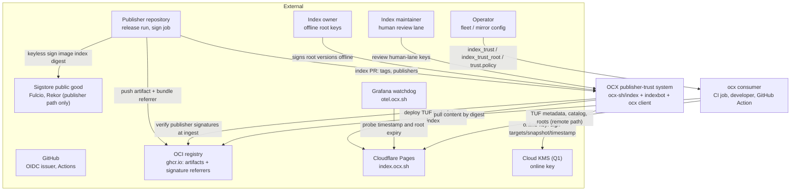
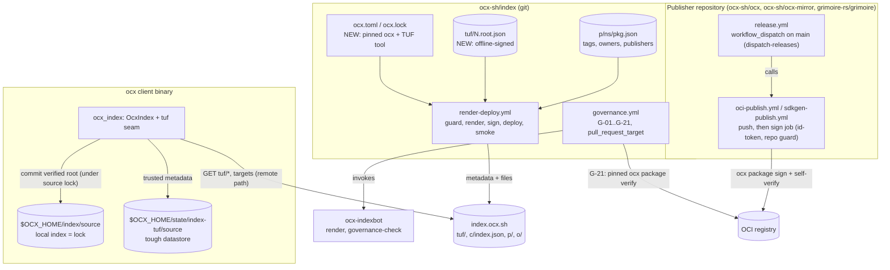
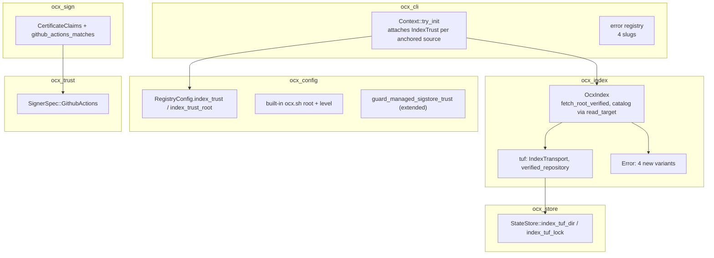
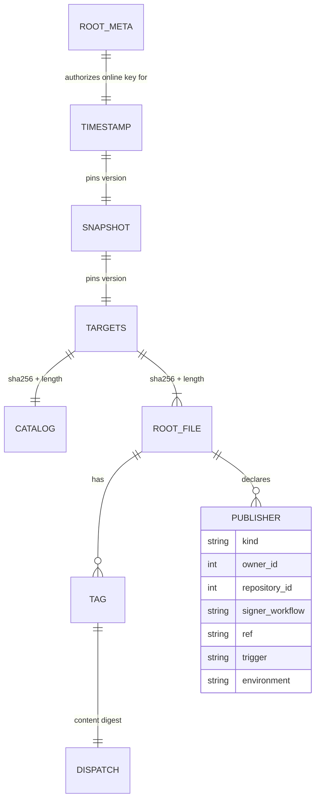

# System Design: Publisher trust distribution (minimal TUF over the index)

## Metadata

**Status:** Draft
**Author:** architect (Opus), for Michael Herwig
**Date:** 2026-10-25
**Beads Issue:** N/A — [ocx-sh/ocx#199](https://github.com/ocx-sh/ocx/issues/199), [ocx-sh/ocx#403](https://github.com/ocx-sh/ocx/issues/403), [ocx-sh/ocx-mirror#7](https://github.com/ocx-sh/ocx-mirror/issues/7)
**Related PRD:** `.agents/discussions/release-signing-trust-default.md`
**Related ADRs:** [`adr_publisher_trust_distribution.md`](./adr_publisher_trust_distribution.md) (matrix, threat model, decisions D1–D10), `adr_trust_policy.md`, `adr_servable_index_snapshot.md`, `adr_index_indirection.md`, `adr_managed_config_tier.md`, `adr_oci_referrers_signing_v1.md`, `adr_exit_code_taxonomy.md`

**Tech Strategy Alignment:**
- [x] Rust 2024/Tokio client; Python indexbot; GitHub Actions + OIDC
- [x] DB choice — n/a (static files, git)
- [x] Infra tier fit — Cloudflare Pages for the index (existing)
- [ ] Secrets — an online key in a cloud KMS deviates from "GitHub Secrets" (ADR Q1); the environment-secret fallback does not
- [ ] Observability via OpenTelemetry — the watchdog runs on the owner's Grafana stack (`otel.ocx.sh`); no client telemetry

## Executive Summary

The ocx.sh index becomes a minimal TUF repository: an offline owner root, one online key over targets, snapshot and timestamp, no delegations. Its targets are the existing catalog and every root, so the served index files do not change. Publishers declare their GitHub Actions signer in the root; the index bot admits a new tag only if its Sigstore signature verifies against that declaration. The ocx client verifies the TUF chain with `tough` whenever it writes remote index data into its local index. Onboarding and anchor rotation need no client release; committed and offline resolves need no network.

---

## 1. Context (C4 Level 1)



| Actor/System | Type | Interaction |
|---|---|---|
| Publisher | Person + CI | Signs image-index digests in the run that pushed them; authors index PRs |
| Index owner | Person | Holds two offline root keys; signs root versions |
| Index maintainer | Person | Approves human-lane edits (`publishers`, `repository`, `owners`, yank) |
| Operator | Person | Replaces the index root per namespace; adds artifact policies |
| Consumer | Process | Resolves tags; verifies TUF on the remote write path |
| Sigstore | System | Publisher signatures only; the index path no longer uses it |
| Cloud KMS | System | Holds the online key if Q1 picks KMS; otherwise a GitHub environment secret |
| Cloudflare Pages | System | Serves static files; untrusted for integrity |
| Grafana watchdog | System | Alerts from outside GitHub on stale metadata |

---

## 2. Containers (C4 Level 2)



| Container | Technology | Purpose | Status |
|---|---|---|---|
| Publishing workflows | GitHub Actions, `ocx package sign` | Push, then sign the pushed digest in the same run | Changed (sign job, dispatch-releases) |
| `ocx-sh/index` repo | git, JSON, PR lanes | Roots, `publishers`, root metadata | `tuf/` and toolchain new |
| `governance.yml` + G-21 | indexbot, pinned `ocx` | Ingest gate on every new or changed tag row | New contract |
| `render-deploy.yml` | indexbot, TUF tool, wrangler | Render, sign TUF metadata, deploy, smoke | Sign job new |
| ocx client | Rust binary, `tough` | Verifies on the remote write path | New seam |
| Watchdog | Grafana alert rule | Expiry probe from outside GitHub | New |

---

## 3. Components (C4 Level 3)

### Client components



| Component | Responsibility | Dependencies |
|---|---|---|
| `ocx_trust::SignerSpec::GithubActions` | Parse and compile the `github_actions` matcher | `ocx_trust` only |
| `ocx_sign::verify::claims` | Extract SAN, issuer, `.15`/`.17`/`.20`/`.23` from the chain-verified leaf; match | existing x509 parsing in `identity.rs` |
| `ocx_config` | `index_trust`, `index_trust_root`, built-in `ocx.sh` root, managed guard | `ocx_trust` |
| `ocx_store::StateStore` | Path owner for the datastore and the update lock | — |
| `ocx_index::tuf` | `tough` transport adapter, per-process verified repository, error mapping | `tough` (external), `ocx_store`, `ocx_config` |
| `ocx_cli::app::context` | Attaches trust to each anchored `OcxIndex` source | all of the above |

No `ocx_sign` edge into `ocx_index` and no verifier trait: the index path no longer uses Sigstore.

### 3.1 Rust contracts

Signatures only; bodies are the builder's.

**`ocx_trust` (`crates/ocx_trust/src/lib.rs`)**

```rust
#[serde(tag = "kind", rename_all = "snake_case")]
pub enum SignerSpec {
    Keyless(KeylessMatcher),
    Key(KeyMatcher),
    GithubActions(GithubActionsMatcher),
    #[serde(other)]
    Unknown,
}

pub struct GithubActionsMatcher {
    pub owner_id: u64,               // Fulcio OID 1.3.6.1.4.1.57264.1.17
    pub repository_id: u64,          // .15
    pub signer_workflow: String,     // "owner/repo/.github/workflows/<file>.yml"
    #[serde(rename = "ref")]
    pub git_ref: String,             // exact SAN suffix after '@'
    #[serde(default, skip_serializing_if = "Option::is_none")]
    pub trigger: Option<String>,     // .20 Build Trigger
    #[serde(default, skip_serializing_if = "Option::is_none")]
    pub environment: Option<String>, // .23
    /// Keys this build does not know. Non-empty => the entry accepts nobody.
    #[serde(flatten, skip_serializing_if = "BTreeMap::is_empty")]
    #[schemars(skip)]
    pub unrecognized: BTreeMap<String, serde_json::Value>,
}

pub struct CompiledGithubActions {
    pub owner_id: u64,
    pub repository_id: u64,
    pub signer_workflow: String,
    pub git_ref: String,
    pub trigger: Option<String>,
    pub environment: Option<String>,
}

pub const GITHUB_ACTIONS_OIDC_ISSUER: &str = "https://token.actions.githubusercontent.com";
```

Compile rules:

- `TrustPolicy::compile` (lib.rs:561–583) drops an entry with non-empty `unrecognized` and logs WARN; it never returns `Err` for it. A policy left with no entries accepts nobody.
- Zero IDs, empty strings, or a `signer_workflow` outside `^[^/@]+/[^/@]+/\.github/workflows/[^/@]+\.ya?ml$` return `Err` (author error, [GAP] G6). sigstore-go skips an empty expected extension; OCX refuses one.
- `.24` Token Subject is never read: its form varies with repository age since 2026-04-23 ([GAP] G4).
- `PolicyBackend` gains `GithubActions(CompiledGithubActions)`; every `match` stays exhaustive.
- Test: `kind` never lands in `unrecognized` (internally tagged enum plus flatten).

**`ocx_sign` (`crates/ocx_sign/src/verify/claims.rs`)**

```rust
pub struct CertificateClaims {
    pub subject_alternative_name: String,
    pub oidc_issuer: String,
    pub source_repository_id: Option<u64>,       // .15, DER UTF8String of decimal digits
    pub source_repository_owner_id: Option<u64>, // .17
    pub build_trigger: Option<String>,           // .20
    pub deployment_environment: Option<String>,  // .23
}

/// Reads the leaf the chain check verified. Duplicate extension OIDs and
/// undecodable values are `BundleParseFailed`.
pub fn certificate_claims(leaf: &x509_cert::Certificate) -> Result<CertificateClaims, VerifyErrorKind>;

/// SAN must equal `https://github.com/{signer_workflow}@{git_ref}` exactly.
/// A pinned field missing from the certificate is a mismatch, never a skip.
pub fn github_actions_matches(rule: &CompiledGithubActions, claims: &CertificateClaims) -> bool;
```

The `VerifyPipeline` identity step calls `github_actions_matches`, so G-21 and operator `[[trust.policy]]` share one matcher.

**`ocx_config` (`crates/ocx_config/src/registry.rs`, `loader.rs`)**

```rust
pub struct RegistryConfig {
    // existing: index, trusted_hosts, ...
    #[serde(default)]
    pub index_trust: Option<IndexTrust>,
    #[serde(default)]
    pub index_trust_root: Option<PathBuf>, // absolute path to an operator root.json
}

#[serde(rename_all = "snake_case")]
pub enum IndexTrust {
    Enforce,
    Warn,
    Off,
    /// A value written by a newer ocx: reads as `Enforce`.
    #[serde(other)]
    Unknown,
}

pub enum IndexTrustRoot { BuiltIn(&'static [u8]), File(PathBuf) }

pub struct IndexTrustSettings {
    pub level: IndexTrust, // Enforce or Warn only
    pub root: IndexTrustRoot,
}

/// Initial root of the `ocx-sh/index` TUF repository (R0 ceremony output).
pub const DEFAULT_OCX_SH_INDEX_ROOT: &[u8] = include_bytes!("index_trust/ocx.sh.1.root.json");

impl Config {
    /// `None`: no root applies or the level is `off` — today's behaviour.
    pub fn index_trust(&self, namespace: &str) -> Option<IndexTrustSettings>;
}
```

Resolution rules:

| Rule | Source |
|---|---|
| A higher operator tier replaces each field; `system_locked` holds | `merge` (registry.rs:64–80) |
| Both fields come from `config.toml` tiers only, never a project manifest | Go: `go.mod` cannot change `GOSUMDB` |
| From a managed snapshot, `index_trust`, `index_trust_root` and `index` on an anchored namespace drop with WARN unless `[managed] source` is digest-pinned | extend `guard_managed_sigstore_trust` (loader.rs:320); fixes A8 |
| An explicit `index_trust_root` without `index_trust` means `Enforce` | ADR D9 |
| Built-in: namespace `ocx.sh` only, level per rollout stage (`off` → `warn` → `enforce`) | ADR D10 |

**`ocx_store` (`crates/ocx_store/src/file_structure/state_store.rs`)**

```rust
impl StateStore {
    /// `state/index-tuf/<to_relaxed_slug(source)>/` — the `tough` datastore.
    pub fn index_tuf_dir(&self, source: &str) -> PathBuf;
    /// Per-source update lock, held from TUF refresh through root commit.
    pub fn index_tuf_lock(&self, source: &str) -> PathBuf;
}
```

**`ocx_index` (`crates/ocx_index/src/tuf.rs`)**

```rust
/// `tough::Transport` over `OcxIndex`'s HTTP stack: retry ladder, SSRF guard, proxy,
/// TLS roots. `file://` sources use tough's filesystem transport.
#[derive(Debug, Clone)]
pub(crate) struct IndexTransport { /* the source's client */ }

#[async_trait::async_trait]
impl tough::Transport for IndexTransport { /* fetch(url) -> TransportStream */ }

pub struct IndexTrustBinding {
    pub level: ocx_config::IndexTrust,
    pub root: ocx_config::IndexTrustRoot,
    pub datastore: PathBuf,
    pub lock: PathBuf,
}

impl OcxIndex {
    pub fn with_index_trust(self, binding: IndexTrustBinding) -> Self;
    /// Per-process memo (singleflight) of a `tough::RepositoryLoader` load with
    /// `ExpirationEnforcement::Safe`, metadata base `<index>/tuf/`, targets base `<index>/`.
    /// Reloads when the datastore's trusted snapshot version moved past the memo's.
    async fn verified_repository(&self) -> Result<Option<Arc<tough::Repository>>>;
    /// The one root GET. `read_target("p/<ns>/<pkg>.json")` when trust is attached;
    /// plain GET otherwise. One uncached reload before an invalid or rollback error.
    async fn fetch_root_verified(&self, repository: &str, freshness: Freshness) -> Result<Option<Vec<u8>>>;
    /// Held by the three commit sites across fetch and `commit_published_root`.
    pub async fn update_guard(&self) -> Result<Option<LockGuard>>;
}
```

Seam routing (A1; line numbers in `crates/ocx_index/src/`):

| Path | Today | After |
|---|---|---|
| `resolve_root` → `fetch_root` | `ocx_index.rs:793`, `:823` | `fetch_root` calls `fetch_root_verified` |
| `fetch_root_document` inline GET | `ocx_index.rs:1190` | replaced by `fetch_root_verified`, before the memo |
| `revalidate_root_document` | `ocx_index.rs:1210` | via `fetch_root` |
| `fetch_root_uncached` (prune) | `ocx_index.rs:931`; caller `crates/ocx_package/src/prune.rs:464` | via `fetch_root_verified` |
| `fetch_catalog_document` | `ocx_index.rs:1010` | `read_target("c/index.json")` |
| Commit sites | `chained_index.rs:439`, `:877`; `local_index.rs:626` | hold `update_guard` across fetch and commit (A15) |

`remote_view` reads through the same seam and takes no lock (it writes nothing).

Level handling: `enforce` returns the error. `warn` logs WARN once per source per process, resolves from unverified bytes in memory, and skips `commit_published_root` (A14).

New error variants (`crates/ocx_index/src/error.rs`), rows in § 5.4:

```rust
IndexTrustUnsigned { index_source: String, url: String },
IndexTrustInvalid { index_source: String, #[source] source: tough::error::Error },
IndexTrustExpired { index_source: String, role: String, expires: String },
IndexTrustRollback { index_source: String, role: String, served: u64, trusted: u64 },
```

The P1 spike fixes the mapping from `tough::error::Error` kinds to these four. OCX code reads no clock; `tough` does.

**`ocx_cli`**

- `Context::try_init`: for each `OcxIndex` source with `config.index_trust(ns) == Some(_)`, attach an `IndexTrustBinding`. Independent of `build_auto_verify`.
- `--no-verify` and `OCX_NO_VERIFY` never reach the binding (W2).
- Register the four slugs in the error-detail docs.

### 3.2 Index-side components

| Component | Contract |
|---|---|
| `tuf/<N>.root.json` (new) | Committed through an owner-signed PR; never written by CI |
| `schema/root.schema.json` | + `publishers`: 1–8 items of `{kind: "github_actions", owner_id ≥ 1, repository_id ≥ 1, signer_workflow (pattern above), ref, trigger?, environment?}`, `additionalProperties: false`; required after the P3 PR |
| `CONTRIBUTING.md` | `publishers` joins the G-05 human-review key list |
| indexbot classifier | Allowlist: only `tags`, `desc`, `source` changes can auto-merge |
| indexbot G-05 | `publishers` edits human-only; base-has/head-lacks → human; `publishers` + `tags` in one PR refused |
| indexbot G-21 | `pull_request_target`, head JSON read as data. For each tag row added or changed in a root, build a policy from the **base** `publishers` (head for a new root). Run the digest-pinned `ocx package verify <repository>@<content>` from an empty temp dir, `OCX_NO_CONFIG=1`, `OCX_CONFIG=<generated>`. Exit 0 passes; every other code fails the check. Every lane |
| Branch protection | Required checks with "require branches to be up to date"; admins included (deferred decision 3) |
| `ocx.toml` / `ocx.lock` (new) | Pin `ocx` and the TUF tool for G-21, sign and smoke |
| `render-deploy.yml` triggers | `push` to `main`, `schedule`, `workflow_dispatch` only; a structural test asserts it (A11) |
| `render-deploy.yml` concurrency | Workflow-level group, `cancel-in-progress: false` |
| job `guard` | Content changed, or served timestamp older than 1 day |
| job `render` | No secrets; `indexbot render` (digest-pinned) for `c/` and `p/`; site build separate; uploads the files |
| job `sign` | Environment `index-signing` (main-only deployment policy); online-key access (KMS via OIDC, or environment secret). Re-renders `c/` and `p/` from the same SHA without cache; fails unless byte-identical to `render`'s upload (A4). Base = served metadata, fetched uncached. Targets = `c/index.json` + every root; snapshot and timestamp versions = served + 1; timestamp expiry 7 d. Verifies the output with the pinned `ocx` against the newest committed root before upload (A26) |
| job `deploy` | `needs: sign`; `contents: read`; wrangler; refuses versions ≤ served |
| job `smoke` | Served metadata verifies with the pinned `ocx`; timestamp has ≥ 6 days left |
| Watchdog (outside GitHub) | Grafana alert on an HTTP probe of `/tuf/timestamp.json` (alert < 5 days left) and the newest root's expiry (alert < 30 days) (A18, [GAP] G1) |
| TUF tool (P3 spike) | `tuftool` (same `tough` library as the client) or python-tuf's `Repository` API in indexbot. Acceptance: the pinned client verifies the output; the six spike cases in § 12 pass |

---

## 4. Key Design Decisions

| Decision | Options | Chosen | Rationale |
|---|---|---|---|
| Trust model | A, B, C1, C2 (D eliminated by owner ruling) | C1 | Matrix 418 vs 370 / 364 / 348 (ADR) |
| What is signed | Catalog only; TUF targets over catalog and roots | TUF targets: `c/index.json` + every root | No served-file change; `tough` checks hash and length |
| Anchor | Compiled CI identity; embedded `root.json` | Embedded `root.json` | Rotates by chain (Sigstore, gh) |
| Freshness | Bespoke `version`/`expires`; TUF timestamp | TUF timestamp 7 d, daily re-sign | Sigstore cadence ([GAP] confirmations) |
| `consistent_snapshot` | true; false | false | No hash-prefixed copies; one uncached reload covers CDN skew |
| Client checks | Every resolve; remote write path | Remote write path | Local index is the lock; apt, Go |
| Publisher identity consumer | Client; bot at ingest | Bot at ingest | PyPI, npm, NuGet |
| Signer vocabulary | SAN regex; `github_actions` kind | `github_actions` | gh, PyPI, sigstore-go precedent; no per-release regex |
| Phase-1 identity | Dispatched `sign.yml` oracle; sign in the pushing run | Sign in the pushing run, `dispatch-releases` | uv, ruff; closes the oracle (A10) |
| Online key home | Cloud KMS; GitHub environment secret | Q1 | KMS has precedent; the secret is golden path |
| Signing tool | tuftool; python-tuf | P3 spike | Pick the one the client verifies |

---

## 5. API Design

### 5.1 Endpoints (index, static)

| Method | Endpoint | Purpose |
|---|---|---|
| GET | `/tuf/<N>.root.json` | Root versions, offline-signed; clients chain from the embedded one |
| GET | `/tuf/timestamp.json` | Online key; 7-day expiry; pins the snapshot |
| GET | `/tuf/snapshot.json` | Online key; pins the targets version |
| GET | `/tuf/targets.json` | Online key; sha256 and length of `c/index.json` and every root |
| GET | `/c/index.json` | Catalog, unchanged bytes, verified as a target |
| GET | `/p/<ns>/<pkg>.json` | Root, verified as a target |
| GET | `/p/<ns>/<pkg>/o/<algo>/<hex>.json` | Dispatch object; hashes to the root's `content` (unchanged) |
| GET | `/config.json` | Format version; unsigned; tampering is denial of service only |

### 5.2 Examples

```json
// p/ocx/cli.json (excerpt)
{
  "name": "ocx/cli",
  "repository": "oci://ghcr.io/ocx-sh/ocx",
  "publishers": [{
    "kind": "github_actions",
    "owner_id": 456,
    "repository_id": 789,
    "signer_workflow": "ocx-sh/ocx/.github/workflows/oci-publish.yml",
    "ref": "refs/heads/main",
    "trigger": "workflow_dispatch"
  }],
  "tags": { "0.7.0": { "content": "sha256:…", "observed": "…" } }
}
```

```toml
# config.toml — a mirror that re-signs the index under its own TUF root
# and accepts only its own artifact signatures
[registries."ocx.sh"]
index = "https://index.mirror.corp.example"
index_trust = "enforce"
index_trust_root = "/etc/ocx/index-mirror-root.json"

[[trust.policy]]
scope = "ocx.sh/"
signers = [
  { kind = "github_actions", owner_id = 1001, repository_id = 2002,
    signer_workflow = "corp/ocx-mirror/.github/workflows/oci-publish.yml", ref = "refs/heads/main" },
]
```

A byte-faithful mirror (`[mirrors."<host>"] index`) serves `/tuf/` too and verifies under the built-in root unchanged.

### 5.3 Built-in default

```toml
# effective default for ocx.sh; the level moves off -> warn -> enforce by release
[registries."ocx.sh"]
index_trust = "off"
# root: DEFAULT_OCX_SH_INDEX_ROOT (tuf/1.root.json of ocx-sh/index)
```

### 5.4 Error rows (new slugs, existing codes)

| Variant | Code | Slug | `enforce` | Next action named in the message |
|---|---|---|---|---|
| `IndexTrustUnsigned` | 78 ConfigError | `index_trust_unsigned` | fail | Set `index_trust_root`, or `index_trust = "off"` for an unsigned private index |
| `IndexTrustInvalid` | 65 DataError | `index_trust_invalid` | fail after one uncached reload | Report: data was altered or mis-served |
| `IndexTrustExpired` | 75 TempFail | `index_trust_expired` | fail | Retry later; check the system clock |
| `IndexTrustRollback` | 81 PolicyBlocked | `index_trust_rollback` | fail after one uncached reload | Report; delete `state/index-tuf/<source>/` only after the operator confirms a server rollback |

At `warn` every row is one WARN per source per process and nothing is committed. No new exit code.

### 5.5 Versioning

Index wire: new `/tuf/` files only; `c/index.json` unchanged; roots gain `publishers` (no `deny_unknown_fields` on `IndexRoot`). Config: additive keys; an unknown level narrows to `enforce`. CLI: no change. The TUF spec version `tough` 0.22 reads is pinned in the TUF tool.

---

## 6. Data Model



| Entity | Retention |
|---|---|
| Root metadata versions | Forever under `tuf/` (old clients chain through them) |
| Timestamp, snapshot, targets | Replaced every deploy |
| Root `publishers` | Git history |
| Client datastore | Until deleted; deletion = first contact (7-day bound) |
| Local index | Unchanged format |

Migration: none on clients. Index side: R0 commits root v1; the P3 PR adds `publishers` to every existing root; existing tag rows are grandfathered. Rollback: built-in level back to `off` in a release, or operator `index_trust = "off"`.

---

## 7. Security Architecture

| Mechanism | Implementation | Notes |
|---|---|---|
| Publisher authentication | Fulcio certificate from the pushing run's `sign` job; repository guard | `.15`, `.17`, ref and trigger pins |
| Ingest authorization | G-21 against base `publishers`; human lanes G-04/G-05 | `publishers` edits human-only |
| Index authentication | TUF: offline root, online key in `index-signing` environment | Root revokes the online key |
| Operator authorization | `config.toml` tiers; `system_locked`; managed only when digest-pinned | Project manifests cannot change index trust |

Data protection: HTTPS stays, but integrity no longer rests on it. The datastore is non-secret. No PII beyond public IDs. Secrets: the online key (Q1); `GITHUB_TOKEN` scopes unchanged.

| STRIDE | Mitigation |
|---|---|
| Spoofing | Immutable-ID pins; exact SAN; repository guard on `sign` jobs |
| Tampering | TUF chain over catalog and roots; content digest-verified below |
| Repudiation | Publisher signatures in Rekor; index metadata versions public |
| Information disclosure | Public metadata only |
| Denial of service | Expiry refuses only new online resolves; daily re-sign; external watchdog |
| Elevation of privilege | Only `index-signing` jobs reach the online key; root keys offline |

Full threat table: ADR § Threat model (T1–T13).

---

## 8. Non-Functional Requirements

| Metric | Target | Measurement |
|---|---|---|
| Added requests, committed local resolve | 0 | Acceptance test (fixture request count) |
| Added requests, remote write path | ≤ 4 per source per process | Acceptance test |
| Cold runner, first remote resolve | Index host only: embedded root, one root probe, three metadata files; no Sigstore CDN | Acceptance test on an empty `$OCX_HOME` |
| `--frozen` on a fresh runner | No index request; digests only; trust rests on the lock author | Stated gap (`go.sum` shape) |
| Verify CPU, warm datastore | < 10 ms (estimate) | Unit benchmark, informational |
| Added latency, remote path | p95 ≤ 150 ms | Measured against `index.ocx.sh` before S2 |
| Catalog / targets size | 13,059 B, 132 packages (2026-10-25) / ≈ 25 KB (estimate) | Ceiling ≈ 10⁴ packages (≈ 2 MB); then hash-bin delegations or TAP 16 |
| Served timestamp validity | ≥ 5 days in steady state | Watchdog |
| Signing outage tolerance | 6 days before `enforce` refuses new online resolves | 7-day expiry, daily re-sign |
| Online-key compromise recovery | One owner root re-sign; clients recover on next fetch, no release | Validation test |
| Committed / offline / frozen resolves | Unaffected by index or signing outages | No check on those paths |

Security NFR (testable): at `enforce`, no root from an anchored source is committed unless its bytes match a target in a TUF chain from the configured root, with unexpired, non-rolled-back metadata. Each clause has a red test.

Operability NFR: two offline keys plus one online key; yearly root re-sign; every refusal carries an `error.detail` slug; the reset is deleting one datastore directory.

---

## 9. Infrastructure

```
GitHub Actions (ocx-sh/index)                           Cloudflare Pages (index.ocx.sh)
  push main / */15 cron / dispatch   (workflow concurrency)
    guard ─> render (no secrets) ─> sign (env index-signing, online key)
                                       └─> deploy (contents: read) ───────────> /tuf/, /c/, /p/
                                              └─> smoke (pinned ocx verifies)
Owner (offline) ─ signs tuf/<N+1>.root.json ─> PR ─> human lane
Grafana watchdog (otel.ocx.sh) ─ probes /tuf/timestamp.json, root expiry

GitHub Actions (publisher repo)
  gh workflow run release.yml (main) ─> oci-publish.yml: push ─> sign job ─> ghcr referrer
```

| Environment | Infrastructure |
|---|---|
| Development | Local static-index fixture serving a TUF repo built by the P3 tool; Sigstore compose profile for publisher signatures |
| Staging | Scratch fork of `ocx-sh/index` deploying to a preview Pages branch, with a staging root |
| Production | `ocx-sh/index` main |

---

## 10. Dependencies

| Dependency | Purpose | Criticality | Fallback |
|---|---|---|---|
| `ocx-indexbot` | Render, governance | High | Previous release, digest-pinned |
| Pinned `ocx` in the index repo (new) | G-21, sign verification, smoke | High | Previous release; G-21 never degrades to pass |
| TUF tool (new) | Sign metadata | High | Spike picks; pinned |
| `tough` 0.22 | Client TUF | High | Unified with the sigstore fork; upgrade together |
| GitHub Actions + OIDC | Signing jobs | High | 6-day headroom |
| Cloud KMS (if chosen) | Online key | High | 6-day headroom; root can rotate to a new key |
| Cloudflare Pages | Serving | High | Byte-faithful mirrors verify under the same root |
| Fulcio / Rekor | Publisher signatures only | Med | G-21 fails closed; rerun |

---

## 11. Risks & Mitigations

| Risk | Probability | Impact | Mitigation |
|---|---|---|---|
| `tough` 0.22 misses a needed rule (e.g. spec 5.3.11) | Med | High | P1 spike gates P1; fallback: upgrade `tough` with the fork |
| Extension pin silently ignored (CVE-2026-48815 class) | Low | High | Red test per field; golden certificate cross-checked by sigstore-go |
| Daily re-sign stops (schedule disabled after 60 days idle, cron starved) | Med | Med | External watchdog; push and dispatch triggers as manual recovery |
| CDN serves metadata and targets from different deploys | Med | Low | One uncached reload before `invalid` or `rollback` |
| Online key exfiltrated (environment-secret variant) | Low | High | Root revokes the key; KMS variant avoids exfiltration (Q1) |
| Root keys lost | Low | High | 1-of-2 threshold with a separately stored backup |
| Acceptance fixtures under `ocx.sh` go red at S2/S3 | High | Low | Fixtures set `index_trust` explicitly (P1 task) |
| ocx-mirror breaks on new enum variants | Med | Med | Same change series; `task satellite:verify` |
| G-21 degrades to pass on tool failure | Low | High | Exit 0 is the only pass |
| Per-source lock serializes parallel first resolves | Med | Low | Lock held only across one fetch and commit; per-process memo |

---

## 12. Implementation Phases

Arrows are hard dependencies; items in one phase are file-disjoint.

```
P0 signing (ocx, ocx-mirror, grimoire) ────────────────────────────────────────┐
R0 root ceremony ──────────────┐                                                 │
P1-spike tough ─> P1a trust kind + claims ─┐                                     │
                  P1b config + store ──────┼─> P1c ocx_index tuf seam ─> P1d cli ─┼─> release R1 (off)
P1′ index schemas ─> P2 indexbot G-21 <────┘                                     │       │
P3-spike TUF tool ─> P3 render-deploy sign + watchdog + publishers PR (needs P0) <┘       v
                                                       R2: warn (14 days watchdog green)
                                                       R3: enforce after the soak
```

### P0: phase-1 signing (repos: ocx, ocx-mirror, grimoire)
- [ ] cargo-dist `dispatch-releases = true` in `dist-workspace.toml`; regenerate `release.yml` (deferred decision 6)
- [ ] `sign` job in each publishing workflow, guarded by `github.repository_id`; self-verify red/green
- [ ] Structural check: every `id-token: write` job carries the guard
- [ ] Own-certificate decode gate: `.15`, `.17`, `.20` present and decimal on the first signed release
- [ ] Backfill via `backfill-sign.yml` (reviewer-gated), subjects from release records; delete the workflow after

### R0: root ceremony
- [ ] Two offline keys (primary, backup); root v1 with threshold 1, 365-day expiry; online key listed; committed to `tuf/`

### P1: ocx client (repo: ocx; inert until R2)
- [ ] **Spike first** (`tough` 0.22): one-online-key repo loads; root chain v1→v3; expired timestamp refused; rollback refused; key rotation discards trusted timestamp and snapshot (5.3.11); transport adapter carries the SSRF guard
- [ ] P1a `github_actions` kind and compile rules; claims extraction and matcher in `VerifyPipeline`; red tests per field
- [ ] P1b `index_trust*` fields, built-in root, managed guard; `StateStore` paths; config schema regeneration
- [ ] P1c `ocx_index::tuf`, seam routing table, update guard, error rows
- [ ] P1d `Context::try_init` wiring; error-detail docs
- [ ] Rekor v2 / TSA bundle spike (publisher path; A22)
- [ ] Acceptance tests (ADR § Validation); fixtures under `ocx.sh` set an explicit level
- [ ] Docs: `[registries]` reference keys, an index-trust explanation page, the mirror/air-gapped guide override section, error-detail pages; `subsystem-file-structure.md` `state/` contract
- [ ] `task satellite:verify` green

### P1′ / P2: index repo + indexbot
- [ ] Root schema `publishers`; CONTRIBUTING G-05 list
- [ ] Classifier allowlist, G-05 extension, G-21 contract; `tests/security/`
- [ ] Release indexbot before the schema change; pin it and the R1 `ocx` by digest in new `ocx.toml`/`ocx.lock`

### P3: index signing (repo: ocx-sh/index)
- [ ] TUF tool spike (tuftool vs python-tuf); acceptance: pinned client verifies
- [ ] `render-deploy.yml` concurrency, triggers test, guard / render / sign / deploy / smoke; environment `index-signing`
- [ ] Staging proof on a scratch repo
- [ ] Watchdog alert rules on otel.ocx.sh
- [ ] Human PR adding `publishers` to every root (after P0); schema makes it required

### P4 / P5: enforcement (repo: ocx)
- [ ] R2: built-in level `warn`; golden real-bundle vector captured
- [ ] R3: `enforce` after the ADR S2 gate; breaking-marked commit subject

---

## 13. Open Questions

Owned by the ADR: Q1 long-lived keys for the index anchor, Q2 third-party packages before C2, Q3 revocation for lock-pinned digests; plus eight deferred owner decisions. See [`adr_publisher_trust_distribution.md` § Open questions](./adr_publisher_trust_distribution.md#open-questions).

---

## Appendix

### Glossary

| Term | Definition |
|---|---|
| Vouching | The index asserting, through its TUF targets, that every listed root passed ingest |
| Anchor | The TUF root a client trusts for a source |
| Online key | The key signing targets, snapshot and timestamp on every deploy |
| Datastore | The client's persisted trusted TUF metadata per source |
| Ingest | The index PR checks that admit a tag row |
| Publisher declaration | `publishers` in a root: CI identities allowed to sign that package's releases |
| Remote write path | Any operation that writes data fetched from a published index source into the local index |

### References

- [`adr_publisher_trust_distribution.md`](./adr_publisher_trust_distribution.md)
- `.claude/artifacts/research_publisher_trust_{package_ecosystems,frameworks,oci_policy,gapcheck}.md`, `discover_publisher_trust_architecture_map.md`
- `.agents/research/research_stable_signer_identity.md`, `.agents/research/review_publisher_trust_round1_triage.md`
- `.claude/rules/subsystem-oci.md` (local index = lock), `subsystem-file-structure.md` (`state/` contract), `subsystem-interface-contract.md` (IC-22)

---

## Approval

| Role | Name | Date | Status |
|------|------|------|--------|
| Architect | architect (Opus) | 2026-10-25 | Draft (round-1 fix pass) |
| Owner | Michael Herwig | | Pending |
| Security | security-auditor | | Pending |

---

## Changelog

| Date | Author | Change |
|------|--------|--------|
| 2026-10-25 | architect (Opus) | Initial design (option B) |
| 2026-10-25 | architect (Opus) | Round-1 fix pass: redesigned around C1 (minimal TUF); verified root seam, update lock, four error rows, hardened G-21, watchdog |
