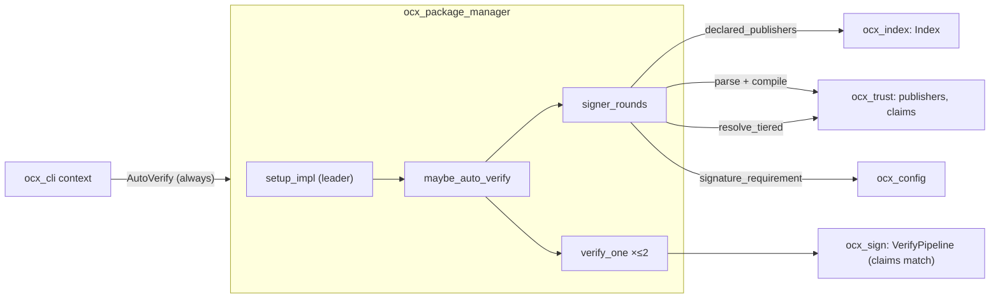

# System Design: Publisher trust — client-checked `publishers` (slice 1)

## Metadata

**Status:** Draft (slice 1 ready for planning)
**Author:** architect (Opus), for Michael Herwig
**Date:** 2026-10-25 · rewritten 2026-11-13
**Beads Issue:** N/A — [ocx-sh/ocx#199](https://github.com/ocx-sh/ocx/issues/199), [ocx-sh/ocx#403](https://github.com/ocx-sh/ocx/issues/403)
**Related:** [`adr_publisher_trust_distribution.md`](./adr_publisher_trust_distribution.md) (Accepted; decisions D-1…D-14, threat model, wire table), `.agents/discussions/release-signing-trust-default-2026-11-12.md`, [`research_fulcio_claim_oids.md`](./research_fulcio_claim_oids.md)

**Tech Strategy Alignment:** Rust 2024 / Tokio; pytest acceptance; GitHub Actions for the e2e dispatch. No new crate, no new crate edge.

## Executive Summary

A package's index root declares `publishers`: signer entries in the `[[trust.policy]]` vocabulary, keyless entries optionally pinning Fulcio certificate claims. When ocx fetches a package (install, pull, exec, on-demand install, companion), it verifies the package signature against those entries, then against any operator policy covering the package; both must pass. The list comes from the local index copy and is never fetched for the check. A per-registry `signatures` setting turns the check off or makes a declaration mandatory. Attestation commands use the same signer set, and `ocx package sbom` takes the newest verified SBOM.

Later slices (release signing, index ingest gate, catalog signature with `expires`, `[sigstore."<host>"]`) are designed in the ADR § Sequencing and summarised in § 8.

---

## 1. Components

| Crate | Component | Change |
|---|---|---|
| `ocx_index` | `wire::IndexRoot` | + `publishers: Option<serde_json::Value>` (C-001) |
| `ocx_index` | `Index::declared_publishers` | new local-only read (C-003) |
| `ocx_index` | `merge_root` | **unchanged** (C-002 pins it) |
| `ocx_trust` | `publishers` module | strict parse + compile of index entries (C-004, C-005) |
| `ocx_trust` | `claims` module | claim-key vocabulary (C-006) |
| `ocx_trust` | `KeylessMatcher` / `CompiledKeyless` | + `claims` (C-007) |
| `ocx_sign` | `verify::identity` | claims match (C-008) |
| `ocx_sign` | `VerifyContext` | + `transparency` (C-012); `VerifyErrorKind` unchanged |
| `ocx_sign` | `verify::identity` pipeline | per-candidate transparency (C-012) |
| `ocx_config` | `RegistryConfig.signatures`, `Config::signature_requirement` | new (C-009) |
| `ocx_package_manager` | `tasks::signer_rounds` (new module) | one decision for install and the verify commands; `RoundsError` with the four new rows (C-010, C-014) |
| `ocx_package_manager` | `tasks::auto_verify` | always constructed; rounds; lazy trust root (C-010, C-012, C-013, C-015) |
| `ocx_package_manager` | `tasks::{find,find_or_install}` | origin gate for declared packages (C-011) |
| `ocx_package_manager` | `tasks::{attest,sbom,verify}` | both rounds bind one document; newest wins over the eligible set (C-016, C-017) |
| `ocx_cli` | `app::context` | build `AutoVerify` unconditionally (C-010) |
| `ocx_cli` | `command::package_verify`, `package_sbom`, `package_sign_common` | use `signer_rounds` (C-016) |
| `test/` | acceptance + previous-release test | C-018 |
| two fixture repos (`e2e-package`, `e2e-index` with `client-e2e.yml`) | e2e dispatch | C-019 |
| `website/` | `reference/configuration.md`, index reference, error-detail rows | C-020 |



## 2. Data flow (install of a package not yet in the store)

1. `setup_impl` resolves the identifier (today's rules; a first resolve may commit the root).
2. Leader only, always: no skip for installed content. `find` / `find_or_install` of a declared package treat content as installed only with an origin marker (C-011).
3. `signer_rounds(logical, …)` (C-010):
   a. `Index::declared_publishers(logical)` → `Option<Value>`, the effective list of C-003, no request. No root known (lock or digest install on an empty home) → `None`.
   b. `Config::signature_requirement(logical.registry())`.
   c. `ocx_trust::parse_publishers` + `compile` → publisher round or refusal.
   d. `resolve_tiered(operator, project, target)` → operator round.
4. Nothing covers → INFO line, proceed. Covered and opted out → one WARN, proceed (C-015).
5. Refusal from 3 (`required`, unrecognised, invalid) → error (C-014).
6. Publisher round: `verify_one` with the compiled publisher policy; a "nobody matched" failure is remapped to `PublisherMismatch` (C-013).
7. Operator round: `verify_one` with the tiered policies (today's behaviour).
8. Download proceeds.

Trust root: resolved lazily on the first keyless candidate, memoized per batch; its unavailability fails that candidate only (C-012).

## 3. Types (signatures only)

```rust
// ocx_index::wire
pub struct IndexRoot {
    // existing fields …
    /// Raw `publishers`, uninterpreted here; `ocx_trust::parse_publishers` decides.
    /// Presence-preserving: `null` deserializes to `Some(Value::Null)`.
    #[serde(default, deserialize_with = "present_value")]
    pub publishers: Option<serde_json::Value>,
}

// ocx_index
impl Index {
    /// The effective list (C-003): committed ∩ fetched, adopt on absent→present, keep on fetched-absent.
    /// Never issues a request; an unreadable committed root is an error.
    pub async fn declared_publishers(&self, logical: &PackageRef) -> Result<Option<serde_json::Value>>;
}

// ocx_trust::claims
pub enum ClaimEncoding { Raw, Der }
pub struct ClaimSelector { pub oid: String /* dotted */, pub encoding: ClaimEncoding }
pub enum ClaimKeyError { UnknownName(String), OutsideFulcioArc(String), NotAClaim(String) }
pub fn resolve_claim_key(key: &str) -> Result<ClaimSelector, ClaimKeyError>;
pub struct CompiledClaim { pub selector: ClaimSelector, pub expected: String }

// ocx_trust (operator side, extended)
pub struct KeylessMatcher {
    pub identity: Option<String>,
    pub identity_regexp: Option<String>,
    pub oidc_issuer: Option<String>,
    #[serde(default, skip_serializing_if = "BTreeMap::is_empty")]
    pub claims: BTreeMap<String, String>,
}
// CompiledKeyless gains `claims: Vec<CompiledClaim>`; identity matcher becomes Option.

// ocx_trust::publishers
pub enum PublisherEntry {
    Usable(PolicyBackend),
    Unrecognised { index: usize, reason: String },
    Invalid { index: usize, reason: String },
}
pub struct PublisherSet { pub entries: Vec<PublisherEntry> }
pub enum PublishersRefusal { Unrecognised { reasons: Vec<String> }, Invalid { reasons: Vec<String> } }
pub fn parse_publishers(value: &serde_json::Value) -> PublisherSet;
impl PublisherSet {
    /// One ANY-of policy over the usable entries; a refusal when none is usable.
    pub fn compile(&self) -> Result<CompiledPolicy, PublishersRefusal>;
}

// ocx_config
pub enum SignatureRequirement {
    IfDeclared, Required, Off,
    /// A value from a newer ocx; reads as `Required`.
    #[serde(other)] Unknown,
}
pub struct RegistryConfig { /* existing */ #[serde(default)] pub signatures: Option<SignatureRequirement> }
impl Config { pub fn signature_requirement(&self, registry: &str) -> SignatureRequirement; }

// ocx_sign::verify
pub enum Transparency { Verify, VerifyIfRootAvailable }
// VerifyContext gains `pub transparency: Transparency`.

// ocx_package_manager::tasks::signer_rounds
pub struct SignerRounds {
    pub publishers: Option<CompiledPolicy>,      // None: undeclared or `off`
    pub operator: Vec<CompiledPolicy>,           // resolve_tiered output, may be empty
}
pub enum RoundsDecision { Uncovered, Covered(SignerRounds), Refused(RoundsError) }
pub async fn signer_rounds(input: SignerRoundsInput<'_>) -> Result<RoundsDecision, RoundsError>;
```

`RoundsError` (`#[derive(Classify)]`, C-014):

```rust
PublisherMismatch { source: VerifyErrorKind },      // 77 publisher_mismatch
PublishersUnrecognized { reasons: Vec<String> },    // 82 publishers_unrecognized
PublishersInvalid { reasons: Vec<String> },         // 65 publishers_invalid
PublishersRequired { registry: String },            // 81 publishers_required
```

## 4. Component contracts

Each contract names its test seam. Error rows give variant, exit code, slug.

### C-001 — `IndexRoot.publishers` is carried raw

- **Input:** a root document. **Output:** `publishers = Some(value)` for any JSON value under the key (array, object, string, number, null), `None` when the key is absent.
- **Never:** fails the root parse because of `publishers`.
- **Edge:** `"publishers": null` → `Some(Value::Null)` (treated invalid by C-004).
- **Test:** unit in `wire.rs` over the six shapes; install-level test that `"publishers": null` refuses 65.

### C-002 — the local merge does not change

- **Input:** `merge_root(committed, fetched, scope)` with `publishers` in either side.
- **Output:** first sight (no usable committed root) carries the fetched `publishers`; `RootScope::Package` overwrites it when the fetched root carries a different value; `RootScope::Tags` and `RootScope::Routing` leave it alone, and a routing pointer's first write (a lock or digest pin resolved in a fresh home) does not adopt it (execution amendment, S-016); a fetched root without the key never removes it.
- **Test:** four characterisation unit tests in `local_index.rs` (these pin existing behaviour; they pass before any change).

### C-003 — `Index::declared_publishers` makes no request

- **Input:** a logical `PackageRef`.
- **Output (as built):** `DeclaredPublishers { Undeclared, Declared(value), Diverged }` — the effective list. Committed present and a root fetched by this process present (the `OcxIndex` memo, shared across clones) → the element-wise intersection (JSON value equality); committed absent, fetched present → fetched; fetched absent → committed; neither → `None`. An empty intersection of two non-empty lists is `Diverged`, refused 77 `publisher_mismatch` with a message saying the lists share no entry and naming `ocx index update <pkg>`; a declared `[]` is `Declared([])`, refused 65 by C-004. Never widens the committed list. `Index::committed_publishers` reads the committed root alone; digest and lock requests use it (R-8). A derived (plain OCI) source yields `None`.
- **Errors:** an unreadable or unparsable committed root is an error (fails closed), not `None`.
- **Edge:** `ReadOnly` views (inspect, patch companions) find the memo, not the local copy.
- **Test:** unit with a transport stub asserting zero calls, one test per effective-list row and one corrupt-root refusal; acceptance request count (S-010).

### C-004 — `parse_publishers` classifies each entry, fail-closed

- **Input:** `&serde_json::Value`.
- **Output:** `PublisherSet` with one `PublisherEntry` per array element, in order.
- **Rules:**

| Value / entry | Class |
|---|---|
| not an array, or an empty array | one `Invalid` (index 0) |
| element not an object, or no string `kind` | `Invalid` |
| `kind` other than `keyless` / `key` | `Unrecognised` |
| a field outside the kind's set (`keyless`: `kind, identity, identity_regexp, oidc_issuer, claims`; `key`: `kind, key_pem`), `sigstore` included | `Unrecognised` |
| `keyless` without string `oidc_issuer`; with both `identity` and `identity_regexp`; with none of `identity`, `identity_regexp`, non-empty `claims`; a non-string value; an `identity_regexp` that fails to compile under a 64 KiB size limit | `Invalid` |
| `claims` key: unknown name | `Unrecognised` |
| `claims` key: dotted but outside `1.3.6.1.4.1.57264.1.`, or `.1.7`; non-string value | `Invalid` |
| `key` with a `key` field (a path) | `Invalid` — checked before the unknown-field rule; a remote document never names a local file |
| `key_pem` of an unsupported key type | `Unrecognised` |
| `key` without `key_pem`, or a PEM that does not parse | `Invalid` |
| otherwise | `Usable` |

- **Never:** panics, reads a file, or makes a request.
- **Test:** table-driven unit test, one row per line above plus a mixed list.

### C-005 — `PublisherSet::compile`

- **Output:** `Ok(CompiledPolicy)` with the usable backends as ANY-of, scope = the package (`system_locked: false`, no `builder`), when one or more entries are usable. Unusable entries are dropped with one debug line each.
- **Errors:** no usable entry and one or more `Unrecognised` → `PublishersRefusal::Unrecognised`; no usable entry and all `Invalid` → `PublishersRefusal::Invalid`.
- **Test:** unit — usable beside unrecognised compiles; only unrecognised refuses `Unrecognised`; only invalid refuses `Invalid`.

### C-006 — claim-key vocabulary

- **Input:** a claim key string.
- **Output:** `ClaimSelector`:
  - a name from [OID]'s table `.1.8`–`.1.24` (snake_case Fulcio names, `issuer` = `.1.8`) → that OID, `Der`;
  - `1.3.6.1.4.1.57264.1.N`, N a canonical positive decimal (no leading zeros, u32, no sub-arcs): N ≤ 6 → `Raw`; N = 7 → `NotAClaim`; N ≥ 8 → `Der` (also above the table).
- **Errors:** other dotted keys (incl. a leading zero or a sub-arc) → `OutsideFulcioArc`; other strings → `UnknownName`.
- **Test:** unit over every table row, N = 1, 6, 7, 8, 24, 99, a foreign arc, a leading zero, a sub-arc, an unknown name.

### C-007 — operator `[[trust.policy]]` keyless gains `claims`

- **Input:** `KeylessMatcher` with `claims`.
- **Output:** `compile_keyless_matcher` accepts `oidc_issuer` plus at least one of `identity`, `identity_regexp`, non-empty `claims`; never `identity` and `identity_regexp` together.
- **Errors:** an unknown claim name or bad OID key in operator config → `TrustPolicyInvalid` (78, existing slug); unknown *fields* stay tolerated (existing behaviour).
- **Test:** unit in `ocx_trust`; config schema regenerates with `claims`.

### C-008 — claims match in `verify::identity`

- **Input:** the chain-verified leaf certificate and `CompiledKeyless`.
- **Output:** match when the issuer matches `.1.8` (today), the SAN matches `identity` / `identity_regexp` when given, and **every** compiled claim matches: the extension with that OID is present exactly once and its value, decoded per encoding (`Raw`: the bytes as UTF-8; `Der`: a minimal-length UTF8String TLV with no trailing bytes), equals `expected` byte for byte. The `.1.8` extension and the SAN are likewise matched only when present exactly once.
- **Errors:** a mismatch reports `IdentityMismatch` (77, existing); the publisher round remaps it (C-013).
- **Edge:** absent extension never matches, not even `""`; present-empty matches only `""`; malformed or non-minimal DER and a non-UTF8String tag are non-matches with no raw fallback; a duplicate extension is a non-match; a certificate with only `.1.1` is refused (`IssuerMismatch`, 77) with a warning naming `.1.8` (execution amendment: the warning carries the hint, the error stays the existing kind).
- **Test:** unit with synthesized certificates (`x509_cert` builder, the `pipeline.rs` self-signed helper) — one red and one green per rule; one recorded GitHub-Actions Fulcio leaf from public Rekor (a GitHub-Actions-signed public release, `test/tests/fixtures/golden/github_actions_leaf.pem` with expected claims and the source entry UUID beside it; if none can be fetched, synthesized certificates only and the e2e run carries the real-certificate proof) as a fixture, matched by name and by raw OID for `source_repository_identifier` and `source_repository_owner_identifier`, and rejected on a changed `build_signer_uri`. The `e2e-package` certificate is exercised by the e2e dispatch (C-019).

### C-009 — `signatures` per registry

- **Input:** merged `Config`, the package's logical registry.
- **Output:** `[registries."<registry>"] signatures` (snake_case values `if_declared` | `required` | `off`), keys normalised like registry identifiers before the lookup, default `IfDeclared`; `Unknown` → `Required` with one WARN per process naming the value; `Unknown` is skipped in the JSON schema.
- **Rules:** merge Some-wins per tier; `system_locked` holds; read from `config.toml` tiers only (managed included; `ocx.toml` has no `[registries]`).
- **Test:** unit for default, each value, unknown value, tier override, system lock.

### C-010 — `signer_rounds` and `AutoVerify` construction

- **Input:** logical identifier, index, config, operator and project policies, opt-out flag.
- **Output (in order):**
  1. `requirement = signature_requirement(registry)`.
  2. `declared = declared_publishers(logical)` unless `requirement == Off`.
  3. `declared = Some(v)` → `parse_publishers(v).compile()`: `Ok` → publisher round; `Err` → `Refused` (C-014). `declared = None` (no root known included) and `Required` → `Refused(PublishersRequired)` naming `ocx index update <pkg>`.
  4. `operator = resolve_tiered(…)`; its `TrustPolicyInvalid` (78) propagates.
  5. No publisher round, no operator policy, no refusal → `Uncovered`.
- **Opt-out:** applied by the caller after the decision: `Covered` or `Refused` plus opt-out → skip with C-015's warning.
- **`AutoVerify`:** constructed on every context (`build_auto_verify` no longer returns `None`), so the hook always runs; with no coverage it costs one local read.
- **Test:** unit over the ADR check table, one row per case.

### C-011 — origin gate on the find fast path

- **Input:** `find` / `find_or_install` (and the `--no-pull` local probe) of a package whose root declares `publishers` (C-003); the content's `refs/verified/`.
- **Output:** the content counts as installed only when `refs/verified/` holds a marker for that logical repository, written only after that repository's publisher round ran and passed (execution amendment after review: `refs/origins/` is written by every genuine fetch, undeclared and `--no-verify` included, so it cannot vouch for a check). Under an explicit opt-out the gate is open for that invocation and no marker is written. Otherwise it falls through to the pull, which verifies. Undeclared packages keep today's fast path. The declaration is memoised per batch. Every `setup_impl` leader verifies, as today; there is no "skip when installed".
- **Edge:** content installed by `pull_local` or `--no-verify` under another name has no marker for the declared repository, so it is verified before it is linked (S-017).
- **Test:** unit with a store fixture (no marker → falls through to the pull); acceptance S-017 and a declared package with its marker (zero requests).

### C-012 — per-candidate transparency

- **Input:** a round's candidates, each `Key` or `Keyless`.
- **Output:** `VerifyContext.transparency` is `Verify` or `VerifyIfRootAvailable`. A key candidate's log evidence is checked when a trust root is available with no network (override, home file, cache) and ignored otherwise (`signed_at = None`); `signed_at` comes from a verified SET only. Operator key-only policies keep log checks whenever the root is local.
- **Trust root:** today's six-rung ladder, resolved lazily on the first keyless candidate and memoized per batch (existing `OnceCell`); its unavailability fails that candidate only and the round continues to the next.
- **Wiring:** also in `ocx package verify` and `ocx package sbom` (C-016).
- **Test:** unit — a key candidate with an unreachable Rekor URL and no cache passes; a mixed set offline with no cache still accepts the key candidate; a logged key candidate with a local root gets `signed_at`; acceptance S-006.

### C-013 — publisher-round error mapping

- **Input:** the publisher round's `VerifyErrorKind`.
- **Output:** `IdentityMismatch`, `IssuerMismatch`, and a key-policy "no key matched" → `RoundsError::PublisherMismatch { source }`. Every other kind passes through unchanged (`NoSignaturesFound` 79, `SignatureInvalid` 65, `CertChainInvalid` 65, `TransparencyLogUnavailable` 75, `CandidateLimitExhausted` 65, …).
- **Message:** names the package, says no listed publisher signed it, and names `ocx index update <pkg>` when the root is committed locally.
- **Test:** unit per mapped kind and one pass-through.

### C-014 — new error rows (`RoundsError`)

The four variants live on `ocx_package_manager::tasks::signer_rounds::RoundsError` (`#[derive(Classify)]`), so the `ocx index update` hint stays in the operations tier; `ocx_sign::VerifyErrorKind` gains nothing and `ocx_trust::PublishersRefusal` stays unclassified.

| Variant | Exit | Slug | Next action named |
|---|---|---|---|
| `PublisherMismatch { source }` | 77 `PermissionDenied` | `publisher_mismatch` | install a release a listed publisher signed, refresh the root with `ocx index update <pkg>`, or `--no-verify` |
| `PublishersUnrecognized` | 82 `Unsupported` | `publishers_unrecognized` | upgrade ocx, or `signatures = "off"` for the registry |
| `PublishersInvalid` | 65 `DataError` | `publishers_invalid` | report the index entry to the index maintainer |
| `PublishersRequired` | 81 `PolicyBlocked` | `publishers_required` | loosen `signatures` for the registry, or `--no-verify` |

Counterparts in the same commit: `ocx_exit` detail rows (`detail_rows.txt`), the `errors.json` golden, the sdkgen goldens, the error-detail docs, and a contract-ledger entry for whatever the compat gate reports. Each slug raises its code's distinct-slug count (IC-22).

### C-015 — opt-out

- **Input:** `--no-verify` or `OCX_NO_VERIFY` (flag wins), and a `Covered` or `Refused` decision.
- **Output:** no verification, no refusal, and exactly one `log::warn!` per batch with the existing text: `signature verification skipped for policy-covered package(s) via --no-verify / OCX_NO_VERIFY`.
- **Edge:** `Uncovered` plus opt-out → no warning (today).
- **Test:** existing `test_auto_verify.py:170` stays green; new acceptance case with a publisher-only package.

### C-016 — `ocx package verify` and `ocx package sbom`

- **Input:** a package, optional signer flags.
- **Output:** with `--certificate-identity`/`--certificate-oidc-issuer` or `--key`, those replace every round (today). Without them the commands resolve first, then read publishers (the effective list, also for a digest identifier — an explicit verify is deliberately at least as strict as an install), then run the rounds from C-010 (the resolve may commit or memo the root, so a fresh home sees the declaration); both rounds must pass, in signature mode, in `--attestation` mode and for `ocx package sbom`, and both bind one document: a document is eligible only when it verifies in every applicable round (matched by referrer digest). Trust-root handling per C-012. `Uncovered` keeps today's "no signer" error; for the SBOM command with nothing covering (no flags, no policy, no publishers) today's permissive mode stays.
- **Errors:** as C-013 and C-014.
- **Test:** acceptance — attestation by a listed signer verifies; by another signer fails 77 `publisher_mismatch`; publisher-signed A beside operator-signed B → neither eligible. Library half in `tasks/attest.rs` / `tasks/sbom.rs`.

### C-017 — newest verified attestation wins

- **Input:** the eligible attestations (C-016) of one predicate type for one subject.
- **Output:** one → it. Several, all with a transparency-log `signed_at`, and one strictly newest → that one.
- **Errors:** any candidate with `signed_at = None`, or two different documents sharing the newest time → `MultipleAttestations` (65, existing slug).
- **Never:** an unverified or refused candidate takes part.
- **Known limit:** Rekor v2 entries carry no integrated time, so they refuse as unlogged.
- **Test:** unit in `package_sbom.rs`'s selection (three cases); acceptance with two SBOMs signed at different times.

### C-018 — compatibility

- **Previous release:** the `ocx-previous` test tool installs a package whose root carries `publishers` (including an unrecognised entry) and exits 0.
- **Packages without `publishers`:** byte-identical install output and exit codes to today.
- **Test:** acceptance module using `test/src/previous_release.py`.

### C-019 — end-to-end fixtures

`ocx-sh/e2e-package` (public; cargo-built Rust program with one dependency; GHCR; public Sigstore). Published once by dispatch, never per pull request. `release.yml` takes a `case` input (`main`, `two-sboms`), so the `two-sboms` tag is signed by the pinned release workflow and `build_signer_uri` matches the `claims` root. The GHCR package is linked to the repository, given Actions access and made public after the first `release.yml` run:

| Tag | Signed by | Attestation |
|---|---|---|
| `main` | release workflow, dispatched from `refs/heads/main` | SBOM by the release workflow |
| `tag` | release workflow, triggered by a tag push | — |
| `other` | a second workflow in the same repository | SBOM by the second workflow |
| `key` | `ocx package sign --key` | — |
| `unsigned` | nothing | — |
| `two-sboms` | release workflow | two SBOMs by the release workflow, minutes apart |

`ocx-sh/e2e-index` (public; GitHub Pages static site in the index layout; logical registry `e2e.ocx.sh`, every `repository` = `oci://ghcr.io/ocx-sh/e2e-package`):

| Root | `publishers` |
|---|---|
| `e2e/claims` | keyless, issuer GitHub, claims by name: repository ID, owner ID, `build_signer_uri` @ main, `build_trigger = workflow_dispatch`; plus the `key` entry |
| `e2e/oid` | same claims keyed by raw OID |
| `e2e/tagged` | keyless `identity_regexp` over `refs/tags/` |
| `e2e/none` | absent |
| `e2e/future` | one `{ "kind": "future" }` and one keyless entry carrying `sigstore` |

Runner workflow `.github/workflows/client-e2e.yml` lives in `ocx-sh/e2e-index`, not in this repository, because GitHub dispatches a `workflow_dispatch` workflow only when its file is on the default branch and the branch under test cannot write `main`. Input `ocx_ref` (a 40-hex SHA only); it checks out `ocx-sh/ocx` at that ref (`persist-credentials: false`, `submodules: recursive`), builds `ocx` with cargo and runs this repository's `test/e2e/` module (pytest, `working-directory: test`, marker `e2e_public`, excluded from `task verify` and the Bazel acceptance targets; no secrets) with `[registries."e2e.ocx.sh"] index = "https://ocx-sh.github.io/e2e-index"`. Expected: `claims` and `oid` → `main`, `key` pass, `tag`/`other` 77, `unsigned` 79; `tagged` → `tag` passes; `none` → `unsigned` passes, and 81 under `signatures = "required"`; `future` → 82; `two-sboms` → the newer SBOM.

### C-020 — documentation

- `website/src/content/docs/reference/configuration.md`: `signatures` under `[registries]`, `claims` on keyless signers.
- The index-format reference: `publishers` and the entry rules of C-004, with a claims example pairing `build_signer_uri` with `source_repository_identifier`; mention `build_signer_digest` for reusable workflows.
- Error-detail pages for the four slugs.
- No migration prose (AGENTS.md); the break is the commit subject.

## 5. UX scenarios

| ID | Action | Outcome | Error cases |
|---|---|---|---|
| S-001 | `ocx package install ocx.sh/acme/tool:1.0`, root lists the release workflow, release signed by it, no local config | installs; no warning | — |
| S-002 | same, release signed by another workflow | exit 77 `publisher_mismatch`, nothing installed | committed root after rotation: message names `ocx index update acme/tool` |
| S-003 | same, release unsigned | exit 79 `no_signatures_found` | — |
| S-004 | package whose root has no `publishers` | installs as today, INFO line | `signatures = "required"` → 81 `publishers_required` |
| S-005 | root lists only `{ "kind": "future" }` | exit 82 `publishers_unrecognized` | plus a usable entry: installs when that entry matches |
| S-006 | root lists a `key` publisher; Sigstore unreachable; no trust-root cache | installs | wrong key → 77 |
| S-007 | root lists publisher P; operator `[[trust.policy]]` covers with key K | installs only with both P's and K's signatures | missing K → 77 `identity_mismatch` (operator round); missing P → 77 `publisher_mismatch` |
| S-008 | `signatures = "off"` for the registry, operator policy covers | only the operator signature is checked | — |
| S-009 | `--no-verify` (or `OCX_NO_VERIFY=1`) on a publisher-only package signed by nobody | installs; one warning line | — |
| S-010 | `ocx exec` / find of an already-installed package carrying its origin marker, `--offline`, `--frozen` or `ocx.lock` | zero index requests; zero registry requests when installed | content not installed under `--offline`: today's offline rules |
| S-011 | `ocx package sbom` on a package with two SBOMs by a listed signer | the newer SBOM | one unlogged (key) candidate among them → 65 `multiple_attestations` |
| S-012 | `ocx package verify --attestation` with no flags, SBOM by another signer | exit 77 `publisher_mismatch` | explicit `--certificate-identity` → verified against that identity only |
| S-013 | previous ocx release installs a package whose root carries `publishers` | installs, unverified | — |
| S-014 | root adds a second publisher; fresh `$OCX_HOME` | releases signed by either install | committed home: after `ocx index update <pkg>` |
| S-015 | config sets `signatures = "strict"` (a future value) | treated as `required`, one WARN | — |
| S-016 | fresh home, `ocx.lock` pinning a declared package | installs undeclared with the INFO line; operator policy still applies | `signatures = "required"` → 81 `publishers_required` naming `ocx index update <pkg>` |
| S-017 | content installed via an undeclared repository at digest D, then a declared package whose tag resolves to D is run with `ocx exec` | it is verified (origin gate, C-011) | signed by nobody listed → 77 `publisher_mismatch` |

## 6. Non-functional

| Metric | Target | Measured by |
|---|---|---|
| Index requests added by the feature | 0 on every path | stub-transport unit test; acceptance request count |
| Requests on a find of installed content carrying its origin marker (declared) or any installed undeclared package | 0 | C-011 acceptance, S-010 |
| Sigstore requests for a key-only check with no local trust root | 0 | C-012 tests |
| Extra cost on an uncovered package | one local root read (committed + memo) | — |
| Referrer fetches when both rounds apply | ≤ 2 × the per-round cap (16) | existing cap tests |

## 7. Risks

| Risk | Mitigation |
|---|---|
| A claim decode branch silently ignored | red unit test per branch (C-008), recorded real certificate |
| `.1.23` / `.1.24` unconfirmed on real certificates | e2e certificate checks them before any guide uses them |
| Acceptance fixtures under `ocx.sh` start verifying | fixtures write no `publishers` unless a test asserts on them |
| ocx-mirror links `ocx_trust` / `ocx_index` / `ocx_config` (ecosystem tier) | `task satellite:verify` in the same change series |
| Local Sigstore stack issues email certificates only | claims are proven by unit tests (recorded public-Rekor GitHub-Actions leaf) plus the e2e dispatch; local acceptance uses `identity` entries |
| Rekor v2 entries have no integrated time | known limit of newest-wins (C-017): unlogged candidates refuse |
| Slice 3 ingest parses `publishers` differently from `serde_json` | slice 3 applies the same duplicate-key rule |
| `e2e-index` runner workflow reads this repository at an arbitrary ref | 40-hex `ocx_ref` only, no secrets, `persist-credentials: false` (C-019) |

## 8. Later slices (designed, not built)

Owned by the ADR § Sequencing. In short:

- **Slice 2, release signing:** dispatched `release.yml` from `main`, `sign` job with repository guard and self-verify, reviewer-gated maintenance workflow for backfills and corrected SBOMs, both listed in `publishers`.
- **Slice 3, index repository:** `publishers` in `schema/root.schema.json`, ingest gate against base `publishers`, human review for removals, `ocx.sh` bot policy (public-Sigstore keyless and `key`).
- **Slice 4, catalog signature:** signature over `c/index.json` bytes by a signer list in the `publishers` vocabulary (built in for `ocx.sh`, `index_publishers` per registry), `index_signature` levels and rollout, `expires` (30 d, 7-day re-sign, external alert at < 21 d), `index_expiry = "ignore"`, package-file hash check, `ocx index sign`, `[sigstore."<host>"]` tables, and the `sigstore` publisher field becoming usable.

## 9. Open questions

None blocking slice 1. Carried from the ADR: third-party namespaces before a publisher can sign its own entry; revocation for lock-pinned digests.

---

## Changelog

| Date | Author | Change |
|------|--------|--------|
| 2026-10-25 | architect (Opus) | Initial design (option B), then C1 (TUF) |
| 2026-11-13 | architect (Opus) | Rewritten for slice 1 of option E: client-checked `publishers`, claims, `signatures`, contracts C-001…C-020, scenarios S-001…S-015. TUF design deleted |
| 2026-11-13 | hex-plan review | Round 1 fixes R-1…R-14, P-D-1, P-D-2 |
