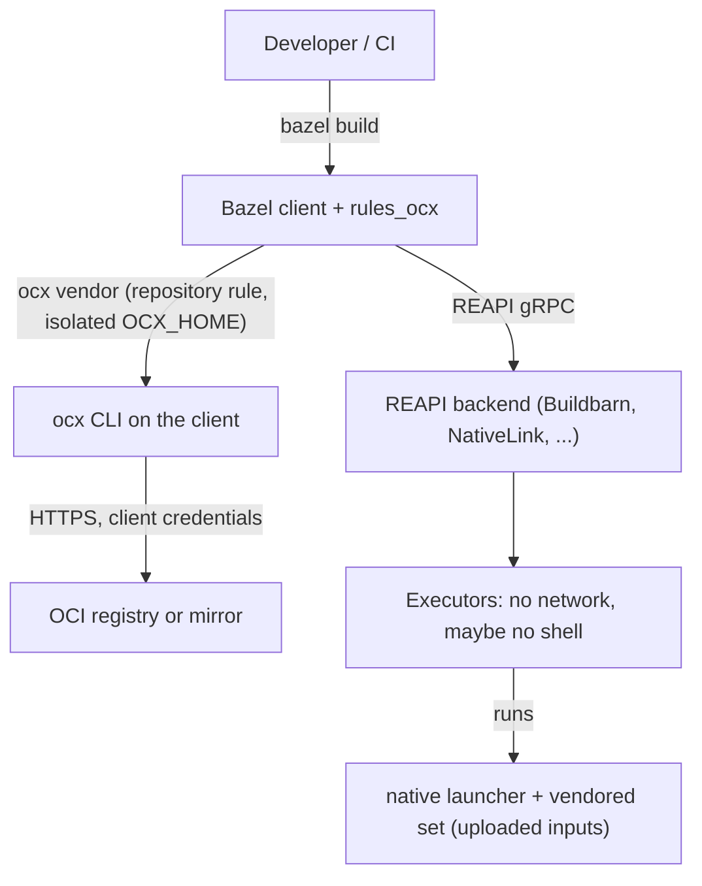
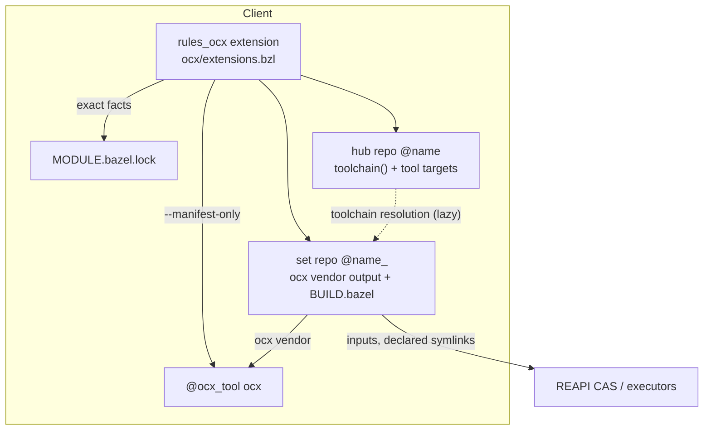
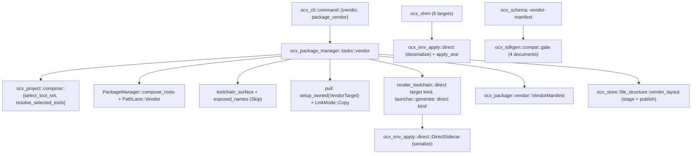

# System Design: `ocx vendor`, the vendor manifest, the direct launcher, and rules_ocx under remote execution

## Metadata

**Status:** Draft
**Author:** architect worker (`/hex-architect`, tier high, goal loop)
**Date:** 2026-11-26
**Beads Issue:** N/A
**Related PRD:** `.agents/discussions/bazel-rbe-rules-ocx.md` (the "source")
**Related ADRs:** [`adr_vendor_rules_ocx_remote_execution.md`](./adr_vendor_rules_ocx_remote_execution.md) (decisions, matrices, R-1…R-8, OQ-01…OQ-46, DV-1…DV-13), [`adr_unified_launcher.md`](./adr_unified_launcher.md) (the record `NAME.launch`, the short layout, the runfiles manifest stage, home launcher kinds), [`adr_windows_exe_shim.md`](./adr_windows_exe_shim.md), [`adr_ocx_interface_contract.md`](./adr_ocx_interface_contract.md), [`adr_crate_split_workspace.md`](./adr_crate_split_workspace.md)

**Tech Strategy Alignment:**
- [x] Rust 2024 + Tokio in ocx; Starlark + Python (pytest, uv) in rules_ocx tests; GitHub Actions
- [x] No database, no new infrastructure tier beyond a CI-only docker compose rig
- [x] Deviations documented in the ADR

Repositories: **ocx** = this repository (`/home/mherwig/.herdr/worktrees/ocx/uno`); **rules_ocx** = `ocx-sh/rules_ocx` (checkout at `/home/mherwig/dev/ocx-sh/rules_ocx`, `main` at `9648f93`). Paths are relative to each repository's root.

## Executive Summary

`ocx vendor` and `ocx package vendor` write one selection of packages, with their dependencies and a native launcher per tool, into a relocatable directory described by `DIR/manifest.json`. rules_ocx runs that command in one repository rule per set and platform, in an isolated home, builds a hub from exact facts the same command produces with `--manifest-only`, and declares files, link-free directories and symlinks from the manifest alone. Tools then run on network-less, shell-less executors with no `ocx` present.

---

## 1. Context (C4 Level 1)



| Actor/System | Type | Interaction |
|---|---|---|
| Developer / CI | Person / system | declares `ocx.project` / `ocx.package` in `MODULE.bazel`; runs builds |
| ocx CLI | System (this repo) | runs on the client only; writes the vendored directory |
| OCI registry / mirror | External | read by ocx with the client's Docker/ocx configuration |
| REAPI backend | External | executes actions; must keep symlink nodes in an input root |
| Later consumers (shell files, installer renderers such as an `ocx-dist` plugin) | Future systems | read the same directory and manifest; not built here |

## 2. Containers (C4 Level 2)



| Container | Technology | Purpose |
|---|---|---|
| `ocx vendor` | Rust, `crates/ocx_cli` → `crates/ocx_package_manager` | writes directory + manifest |
| Vendored directory | files + `manifest.json` | the interface; relocatable, read-only at run time |
| Direct launcher | Rust, std + `serde`/`serde_json`, `crates/ocx_shim` + `crates/ocx_env_apply` | starts a tool with its composed environment, no `ocx` |
| rules_ocx extension | Starlark | facts, hub and set repository declarations |
| Set repository rule | Starlark | runs `ocx vendor`, generates `BUILD.bazel` from the manifest |
| Hub repository | Starlark (generated) | `toolchain()` per platform, one `ocx_tool` per tool name |
| Rig | docker compose (`e2e/rbe/` in rules_ocx) | nginx, zot, Buildbarn, NativeLink, network-less runners |

## 3. Components (C4 Level 3)

### 3.1 ocx



| Component | Responsibility | New / changed | Files |
|---|---|---|---|
| `ocx_env_apply` [ecosystem; std + `serde`] | `move_to_front`, `remove_segment`, `append_unique`, the segment comparator, `apply_one(existing, kind, value, separator)`, the Windows key fold, `launch::LaunchRecord` (`peek_kind`, then one plain struct per kind with `deny_unknown_fields`; validation; `record_path_for`; `adr_unified_launcher.md` § 3.1) | new crate; the three functions move from `ocx_util` | `crates/ocx_env_apply/**` |
| `ocx_package::vendor` | manifest types (`VendorManifest` …), `DIR_TOKEN`, `MANIFEST_FILE`, `vendor_id()`, schema derives | new module | `crates/ocx_package/src/vendor.rs`, `crates/ocx_package/src/vendor/*.rs` |
| `tasks::vendor` | orchestration only; calls the functions in the diagram | new | `crates/ocx_package_manager/src/tasks/vendor.rs` |
| composer | `PathLane::Vendor`, `ComposePaths::vendor(token_root, keys)` taking the content and entry-point paths from `VendorLayout` (no hand-derived path tail), no shim slot under it, `:native` renders the target separator | changed | `crates/ocx_package_manager/src/composer.rs`, `crates/ocx_package/src/metadata/env/resolver.rs`, `crates/ocx_package_manager/src/tasks/resolve.rs` |
| names | `exposed_names`, `NotEnumerablePolicy`, `NameOwner` (same crate as `tasks::vendor`; no visibility change) | unchanged code | `crates/ocx_package_manager/src/tasks/toolchain_names.rs` |
| assembly | `LinkMode::{Hardlink, Copy}` at `assemble.rs:578`; copy writes data and the masked mode only and keeps the file mtime | changed | `crates/ocx_store/src/file_structure/assemble.rs`, `crates/ocx_store/src/hardlink.rs` |
| staging | `VendorLayout`: every name of the short layout (§ 4.0) and `package_keys` (the `HEX16` clash refusal), normalisation (C-008), `StagedTree` (`mkdtemp` 0700 beside `DIR`, rename into place) | new | `crates/ocx_store/src/file_structure/vendor_layout.rs` |
| pull | `setup_owned` takes a `VendorTarget` destination that skips `refs/`, `metadata.json`, `resolve.json`, `install.json`, `digest`, OCI `manifest.json` | changed | `crates/ocx_package_manager/src/tasks/pull.rs` |
| launcher writers | direct target kind in the renderer and the entry-point generator; every launcher is a byte copy of the target's blob beside its `NAME.launch` record | changed | `crates/ocx_package_manager/src/tasks/render_toolchain.rs`, `crates/ocx_package_manager/src/launcher/generate.rs`, `crates/ocx_package_manager/src/launcher/direct.rs` (new) |
| shim blobs | six embedded blobs, `blob_for(&Platform) -> Option<&'static [u8]>`, budget per blob, SHA and signature canaries | changed | `crates/ocx_store/src/shim.rs`, `crates/ocx_store/src/shims/`, `crates/ocx_store/src/file_structure/shim_bin_store.rs` |
| launcher | one program on every OS; reads `NAME.launch` only (C-020); lookup C-012 with the runfiles manifest stage; batch spawn C-017 | changed | `crates/ocx_shim/src/{main,core}.rs`, `crates/ocx_shim/src/direct.rs` (new) |
| schema + gate | kind `vendor-manifest`, golden, baseline, `Kind::VendorManifest` | changed | `crates/ocx_schema/src/{lib,main}.rs`, `crates/ocx_schema/tests/golden/vendor-manifest.json`, `crates/ocx_schema/contract/baseline/vendor-manifest.json`, `crates/ocx_sdkgen/src/{lib,compat,lint,versions,ir}.rs`, `website/schema.taskfile.yml` |
| CLI | two leaves, `VendorReport`, contract rows | new | `crates/ocx_cli/src/command/{vendor,package_vendor}.rs`, `crates/ocx_cli/src/api/data/vendor.rs`, `command.rs`, `command/package.rs`, `command/leaf.rs`, `api.rs` |

**Crate map edits** (`scripts/crate_map.toml`): new row `ocx_env_apply = []`. `"ocx_env_apply"` is added to the row of every crate that calls a moved function or links the record types: `ocx` (`crates/ocx_cli`), `ocx_config`, `ocx_package`, `ocx_package_manager`, `ocx_project`, `ocx_setup`, `ocx_shell`, and `ocx_shim` (`ocx_shim = ["ocx_env_apply"]`). `ocx_util` only defined the functions and keeps no caller, so it gets no edge. `ocx_shim/Cargo.toml` gains `serde` (derive) and `serde_json`, external crates the crate map does not list. `ocx_package` (ecosystem) gains a module and an edge, and `ocx_util` (ecosystem) loses three public functions: both oblige `task satellite:verify` in the same change series, and ocx-mirror is upgraded there if it calls a moved function. `AGENTS.md` (the ecosystem-tier list under "Stability tiers" and the crate table) and `.claude/rules/arch-principles.md` (§ Crate Layout, Utility Catalog) get the new crate in the same commit.

### 3.2 rules_ocx

| Component | Responsibility | Files |
|---|---|---|
| `ocx_download` | adds `OCX_INSTALL_BINARY` + `OCX_INSTALL_BINARY_SHA256`: `rctx.download("file://<path>", sha256 = …)` copies the verified bytes; no version call | `ocx/private/download.bzl`, `ocx/private/manifest.bzl` |
| manifest reader | the one parse surface: `read_manifest(rctx, path) -> struct`; rejects `schema_version != 2`, absolute or escaping link targets | `ocx/private/vendor_manifest.bzl` (new) |
| set repository rule | `ocx_set_repo`: isolated home, runs `ocx vendor`, moves the output to the repository root, moves reserved names, writes `BUILD.bazel` | `ocx/private/set_repo.bzl` (new) |
| build rules | `ocx_set` (runfiles of the whole set, declared symlinks, restored reserved files), `ocx_set_toolchain`, `ocx_tool` | `ocx/private/set_rules.bzl` (new), `ocx/defs.bzl` |
| hub | `ocx_hub_repo`: generated from facts | `ocx/private/hub.bzl` (new) |
| extension | tag classes, exact facts, hub and set declarations | `ocx/extensions.bzl`, `ocx/private/facts.bzl` (new) |
| constraints | `//ocx/constraints:libc` (`glibc`, `musl`); platform-string mapping | `ocx/constraints/BUILD.bazel` (new), `ocx/private/platforms.bzl` |
| guard | interface check over the sources | `scripts/check_ocx_interface.py` (new), `scripts/tests/test_check_ocx_interface.py`, `taskfiles/guard.taskfile.yml` (new) |
| deleted | lazy `bins`, absolute launcher rendering, project/package fetch bodies, `make_ocx_env`'s home fallback | `ocx/private/project.bzl`, `ocx/private/package.bzl`, `ocx/private/repo_utils.bzl:653-704,1325-1387,1555-1706` |
| rig | compose file, fixtures, tests, baseline | `e2e/rbe/**`, `taskfiles/rig.taskfile.yml`, `.github/workflows/verify-rbe.yml` |

## 4. Data formats

### 4.0 Directory layout (issue 785; names owned by `VendorLayout`)

```
DIR/manifest.json
DIR/l/NAME[.exe]                 selection launcher, one per tool
DIR/l/NAME.launch                its record, kind direct
DIR/p/<HEX16>/c/…                package content
DIR/p/<HEX16>/e/NAME[.exe]       entry-point launcher of the package
DIR/p/<HEX16>/e/NAME.launch      its record, kind direct
```

`HEX16` is the first 16 hex characters of the package digest's hex part, without the algorithm. `ocx vendor` compares the full digests of the run and refuses two packages that share a `HEX16` with 65 `vendor_path_unrepresentable`, naming both. The manifest names every path, so a consumer derives no name (`adr_unified_launcher.md` § 4.2).

### 4.1 `DIR/manifest.json` — `https://ocx.sh/schemas/vendor-manifest/v2.json`

`schema_version` is `2` (`adr_unified_launcher.md` R-U4, M3): the dev build rules_ocx pinned wrote v1 with the old layout, and a bump lets rules_ocx refuse that build by number (MR-1). No release has written either version: no baseline under `crates/ocx_schema/contract/baseline/` and no `vendor-manifest` entry in `ledger.toml`, so the compat gate reads every field as an addition, but a version above 1 on an item the baseline does not hold needs a ledger entry that lists it: `ledger.toml` carries one `semantic` entry (`subjects = ["*"]`) saying version 1 was written only by pre-release builds.

Rules for every path field, as `VendorLayout::check_relative_path` (`crates/ocx_store/src/file_structure/vendor_layout.rs:91-110`) applies them: not empty; no leading `/`; no empty segment, so no `//` and no trailing `/`; no `.` or `..` segment. For a `windows/*` platform each segment also passes `ocx_env_apply::windows_path::check_segment` (`crates/ocx_env_apply/src/windows_path.rs:26-43`), in this order: no `\`; no `:`; no control character U+0000 to U+001F and none of `<`, `>`, `"`, `|`, `?`, `*`; not a device name — `CON`, `PRN`, `AUX`, `NUL`, `COM0`-`COM9`, `LPT0`-`LPT9` and the superscript `COM¹`, `COM²`, `COM³`, `LPT¹`, `LPT²`, `LPT³`, in any ASCII case, judged on the part before the first `.` with trailing spaces removed, so `nul.txt`, `NUL .txt` and `com1.tar.gz` are device names and `CONSOLE`, `COM10` and `my.CON` are not; and no segment ending in `.` or a space. On every platform a segment equal to `_ocx_reserved` (ASCII case-insensitive) is refused: `VendorLayout::RESERVED_SEGMENTS` names it as a name ocx never writes, so a consumer may use it (MR-2, C-025). The record decoder applies the same rules to `self` and to the part of `program` after `@VENDOR_DIR@/`, and also refuses NUL and the token anywhere in them (`crates/ocx_env_apply/src/direct.rs:143-155`). Unset optionals are omitted (IC-04); enums are open (IC-15); keys snake_case (IC-06); no `additionalProperties: false` (IC-18). Pretty-printed, object keys in declaration order, every list sorted by the stated key, so the bytes are stable.

| Field | Type | Meaning |
|---|---|---|
| `schema_version` | integer, const `2` | bumped only through the gate's ledger once a baseline exists |
| `content` | enum `present` \| `absent` | `absent` after `--manifest-only`: no package file, launcher or record exists |
| `platform` | string | canonical platform string of the run (`linux/amd64+libc.glibc`) |
| `available_platforms` | string[] sorted | C-023: the platforms on which every selected package has a leaf, computed before leaf selection |
| `vendor_id` | string | `sha256:` + hex SHA-256 of `platform`, `\n`, then the sorted package digests joined by `\n`; two directories with equal `vendor_id` hold the same files |
| `dir_token` | string, const `@VENDOR_DIR@` | the one token a value may contain; stands for the absolute path of `DIR` |
| `packages[]` | object[] sorted by `digest` | every package of the closure, once |
| `packages[].identifier` | string | pinned identifier `registry/repository[:tag]@sha256:<hex>` |
| `packages[].digest` | string | platform-manifest digest |
| `packages[].index_digest` | string, optional | roots only: the image index digest the root was selected from (R-U6, MR-8); omitted when the identifier named a platform manifest and on every dependency; never enters a lock |
| `packages[].package_dir` | string | `p/<HEX16>` |
| `packages[].content_dir` | string | `p/<HEX16>/c` |
| `packages[].dependencies` | string[] sorted | digests of direct dependencies |
| `packages[].names_declared` | boolean | `false` when metadata claims neither binaries nor entry points (no tools come from it) |
| `packages[].entrypoints[]` | `{name, launcher_path, record_path, environment}` sorted by `name` | the package's own launchers: `launcher_path` = `p/<HEX16>/e/<name>`, plus `.exe` for a Windows platform; `record_path` = `p/<HEX16>/e/<name>.launch`; `environment` names the entry point's private environment |
| `packages[].tree` | object, present iff `content` is `present` | |
| `tree.files[]` | `{path, executable}` sorted by `path` | every regular file under `content_dir` |
| `tree.links[]` | `{path, target}` sorted by `path` | every symlink; `target` is relative and resolves inside `content_dir` (C-007) |
| `tree.link_free_dirs` | string[] sorted | top-most directories under `content_dir` with no link at or below them |
| `environments[]` | object[]: selection first, then entry points sorted by `id` | |
| `environments[].id` | string | opaque: `selection:default`, or `entrypoint:<digest>:<name>` |
| `environments[].scope` | tagged union on `type`: `{type: "selection", selection}` \| `{type: "entrypoint", package, name}` | |
| `environments[].items[]` | `{key, value, kind, separator?}` in application order | the names and `kind` `$def` (`path`, `constant`, `list`) of the `ocx env` report's `EnvEntry`; `separator` on `list` only; the only non-literal text is `dir_token` |
| `selections[]` | object[] (one in v1) | |
| `selections[].id` | string | `default` |
| `selections[].groups` / `.bindings` | string[] | the selection as given (bindings resolved from `-g` included) |
| `selections[].roots` | string[] | digests of the selected packages, in selection order |
| `selections[].environment` | string | id of the composed environment |
| `selections[].launcher_dir` | string | `l` |
| `tools[]` | object[] sorted by `(selection, name)` | every exposed name |
| `tools[].name` / `.selection` / `.kind` | string / string / enum `binary` \| `entrypoint` | |
| `tools[].package` | string | digest of the owning package (`NameOwner`, last walked wins) |
| `tools[].environment` | string | the selection's environment |
| `tools[].target_path` | string | the binary file, or the package's entry-point launcher |
| `tools[].launcher_path` | string, omitted when no launcher blob exists for `platform` (e.g. `wasip1/wasm`) | `l/<name>`, plus `.exe` for a Windows platform |
| `tools[].record_path` | string, present exactly when `launcher_path` is | `l/<name>.launch`, the record the launcher reads; a consumer that copies or links the launcher places this file beside it under its basename |
| `index_lookups[]` | `{path, found}` sorted by `path`, deduplicated; present only when the run had `--index` | every path under the `--index` directory that resolution read (R-U7, MR-9): `path` relative to that directory, `/`-separated; `found` false when it was absent. Recorded at `IndexStore::read_index_document` (`crates/ocx_index/src/store.rs:624-638`) |

Not in v2, specified as later additive fields (R-5): `packages[].layers[]` `{digest, size, media_type}` plus a physical blob URL after index and mirror resolution, for the native download; `tree.empty_dirs`. Empty directories are written on disk in v2.

Example (`content: present`, two packages; `ocx vendor -o out -p linux/amd64+libc.glibc cmake node`, no `--index`, so no `index_lookups`). The digests are made-up repeating values; `HEX16` is the first 16 hex of each:

```json
{
  "schema_version": 2,
  "content": "present",
  "platform": "linux/amd64+libc.glibc",
  "available_platforms": ["darwin/arm64", "linux/amd64+libc.glibc", "windows/amd64"],
  "vendor_id": "sha256:0b5f2a4e9c7d3b1a0b5f2a4e9c7d3b1a0b5f2a4e9c7d3b1a0b5f2a4e9c7d3b1a",
  "dir_token": "@VENDOR_DIR@",
  "packages": [
    {
      "identifier": "ocx.sh/kitware/cmake:3.31.6@sha256:1f2e3d4c5b6a79881f2e3d4c5b6a79881f2e3d4c5b6a79881f2e3d4c5b6a7988",
      "digest": "sha256:1f2e3d4c5b6a79881f2e3d4c5b6a79881f2e3d4c5b6a79881f2e3d4c5b6a7988",
      "index_digest": "sha256:9c8b7a6f5e4d3c2b9c8b7a6f5e4d3c2b9c8b7a6f5e4d3c2b9c8b7a6f5e4d3c2b",
      "package_dir": "p/1f2e3d4c5b6a7988",
      "content_dir": "p/1f2e3d4c5b6a7988/c",
      "dependencies": [],
      "names_declared": true,
      "entrypoints": [],
      "tree": {
        "files": [{"path": "p/1f2e3d4c5b6a7988/c/bin/cmake", "executable": true}],
        "links": [{"path": "p/1f2e3d4c5b6a7988/c/bin/cmake3", "target": "cmake"}],
        "link_free_dirs": ["p/1f2e3d4c5b6a7988/c/share"]
      }
    },
    {
      "identifier": "ocx.sh/nodejs/node:24.21.0@sha256:5a0c1e9d2b7f3a4c5a0c1e9d2b7f3a4c5a0c1e9d2b7f3a4c5a0c1e9d2b7f3a4c",
      "digest": "sha256:5a0c1e9d2b7f3a4c5a0c1e9d2b7f3a4c5a0c1e9d2b7f3a4c5a0c1e9d2b7f3a4c",
      "index_digest": "sha256:7e6d5c4b3a291807e6d5c4b3a291807e6d5c4b3a291807e6d5c4b3a29180e6d5",
      "package_dir": "p/5a0c1e9d2b7f3a4c",
      "content_dir": "p/5a0c1e9d2b7f3a4c/c",
      "dependencies": [],
      "names_declared": true,
      "entrypoints": [
        {"name": "npm", "launcher_path": "p/5a0c1e9d2b7f3a4c/e/npm", "record_path": "p/5a0c1e9d2b7f3a4c/e/npm.launch", "environment": "entrypoint:sha256:5a0c1e9d2b7f3a4c5a0c1e9d2b7f3a4c5a0c1e9d2b7f3a4c5a0c1e9d2b7f3a4c:npm"}
      ],
      "tree": {
        "files": [{"path": "p/5a0c1e9d2b7f3a4c/c/bin/node", "executable": true}],
        "links": [],
        "link_free_dirs": ["p/5a0c1e9d2b7f3a4c/c/bin", "p/5a0c1e9d2b7f3a4c/c/lib"]
      }
    }
  ],
  "environments": [
    {
      "id": "selection:default",
      "scope": {"type": "selection", "selection": "default"},
      "items": [
        {"key": "PATH", "value": "@VENDOR_DIR@/p/1f2e3d4c5b6a7988/c/bin", "kind": "path"},
        {"key": "CMAKE_ROOT", "value": "@VENDOR_DIR@/p/1f2e3d4c5b6a7988/c/share/cmake-3.31", "kind": "constant"},
        {"key": "PATH", "value": "@VENDOR_DIR@/p/5a0c1e9d2b7f3a4c/c/bin", "kind": "path"},
        {"key": "PATH", "value": "@VENDOR_DIR@/p/5a0c1e9d2b7f3a4c/e", "kind": "path"}
      ]
    },
    {
      "id": "entrypoint:sha256:5a0c1e9d2b7f3a4c5a0c1e9d2b7f3a4c5a0c1e9d2b7f3a4c5a0c1e9d2b7f3a4c:npm",
      "scope": {"type": "entrypoint", "package": "sha256:5a0c1e9d2b7f3a4c5a0c1e9d2b7f3a4c5a0c1e9d2b7f3a4c5a0c1e9d2b7f3a4c", "name": "npm"},
      "items": [
        {"key": "PATH", "value": "@VENDOR_DIR@/p/5a0c1e9d2b7f3a4c/c/bin", "kind": "path"}
      ]
    }
  ],
  "selections": [
    {"id": "default", "groups": [], "bindings": ["cmake", "node"], "roots": ["sha256:1f2e3d4c5b6a79881f2e3d4c5b6a79881f2e3d4c5b6a79881f2e3d4c5b6a7988", "sha256:5a0c1e9d2b7f3a4c5a0c1e9d2b7f3a4c5a0c1e9d2b7f3a4c5a0c1e9d2b7f3a4c"], "environment": "selection:default", "launcher_dir": "l"}
  ],
  "tools": [
    {"name": "cmake", "selection": "default", "kind": "binary", "package": "sha256:1f2e3d4c5b6a79881f2e3d4c5b6a79881f2e3d4c5b6a79881f2e3d4c5b6a7988", "environment": "selection:default", "target_path": "p/1f2e3d4c5b6a7988/c/bin/cmake", "launcher_path": "l/cmake", "record_path": "l/cmake.launch"},
    {"name": "node", "selection": "default", "kind": "binary", "package": "sha256:5a0c1e9d2b7f3a4c5a0c1e9d2b7f3a4c5a0c1e9d2b7f3a4c5a0c1e9d2b7f3a4c", "environment": "selection:default", "target_path": "p/5a0c1e9d2b7f3a4c/c/bin/node", "launcher_path": "l/node", "record_path": "l/node.launch"},
    {"name": "npm", "selection": "default", "kind": "entrypoint", "package": "sha256:5a0c1e9d2b7f3a4c5a0c1e9d2b7f3a4c5a0c1e9d2b7f3a4c5a0c1e9d2b7f3a4c", "environment": "selection:default", "target_path": "p/5a0c1e9d2b7f3a4c/e/npm", "launcher_path": "l/npm", "record_path": "l/npm.launch"}
  ]
}
```

### 4.2 The record `NAME.launch`, kind `direct`, `schema_version` 1 (R-1; private to ocx, written with the launcher bytes of the same release)

One JSON object per launcher, file `NAME.launch` beside the launcher `NAME` (`NAME.exe` on Windows), at the manifest's `record_path`. UTF-8, at most 1 MiB. `peek_kind` reads `kind`, then `serde_json` deserialises the whole bytes into that kind's struct (`DirectRecord`), which carries `kind` and has `deny_unknown_fields`, as does each `env[]` entry (`EnvRecord`); an unknown `kind`, a missing or duplicate `kind`, `schema_version != 1`, an unknown field, a type mismatch or a broken rule below exits 78. A vendored tree holds only kind `direct`. The home kinds `package`, `deferred` and `toolchain`, their fields and examples are in `adr_unified_launcher.md` § 3; the launcher program is the same.

| Field | Type | Rule |
|---|---|---|
| `kind` | string | `direct` |
| `schema_version` | integer | `1` |
| `vendor_id` | string | equals the manifest's `vendor_id` (binds the record to its set) |
| `self` | string | the launcher's path relative to `DIR` **without** `.exe`, manifest path rules (§ 4.1); `l/cmake` for `l/cmake[.exe]` |
| `program` | string | `@VENDOR_DIR@/` followed by a path obeying the manifest path rules for the platform; the token appears nowhere else in it |
| `args` | string[] | baked entry-point arguments, token allowed |
| `unset` | string[] | keys removed from the child's environment |
| `env` | object[] | `{key, value, kind, separator?}` as `environments[].items[]`, applied in order |

Key rules (writer refuses with 65, decoder with 78): non-empty, no `=`, no NUL; an `env` key must not equal (ASCII case-insensitive on Windows) a key in `unset`, `OCX_BINARY_PIN` or a `__OCX_*` key. The writer encodes compact JSON, `kind` first, fields in declaration order, one trailing `\n`, so the bytes are stable across hosts; the launcher's root binding compares them byte for byte (C-012). Example, `l/cmake.launch` (pretty-printed here; the file is one line):

```json
{"kind": "direct",
 "schema_version": 1,
 "vendor_id": "sha256:0b5f2a4e9c7d3b1a0b5f2a4e9c7d3b1a0b5f2a4e9c7d3b1a0b5f2a4e9c7d3b1a",
 "self": "l/cmake",
 "program": "@VENDOR_DIR@/p/1f2e3d4c5b6a7988/c/bin/cmake",
 "args": [],
 "unset": ["OCX_ANNOUNCE_GIT_TOKEN", "OCX_BINARY_PIN", "OCX_IDENTITY_TOKEN", "OCX_KEY_PASSWORD", "OCX_SIGNING_KEY", "OCX_TELEMETRY_HEADERS", "__OCX_ENV_STATE"],
 "env": [
   {"key": "PATH", "value": "@VENDOR_DIR@/p/1f2e3d4c5b6a7988/c/bin", "kind": "path"},
   {"key": "CMAKE_ROOT", "value": "@VENDOR_DIR@/p/1f2e3d4c5b6a7988/c/share/cmake-3.31", "kind": "constant"}]}
```

`unset` is `ocx_env::keys_with(Credential, HookLocal, State)` at build time plus `OCX_BINARY_PIN` (the example abridges the HookLocal keys). `SecretInput` variables are not listed (R-3). A registry test forbids a patterned name (one with a `{…}` placeholder) under `Credential`, `HookLocal` or `State`, so the list is always enumerable.

### 4.3 `VendorReport` (stdout, `--format json`), report root v1

```json
{"schema_version": 1, "ocx_version": "0.7.0", "output_dir": "/abs/out", "manifest_path": "/abs/out/manifest.json", "content": "present",
 "platform": "linux/amd64+libc.glibc", "packages": [{"identifier": "ocx.sh/kitware/cmake:3.31.6@sha256:…", "digest": "sha256:…"}],
 "tool_count": 1, "written_size": 61234567}
```

### 4.4 rules_ocx facts (in `MODULE.bazel.lock`, extension `@rules_ocx//ocx:extensions.bzl%ocx`)

One fact per declaration (rules_ocx ADR 0003, K2; the ADR is the authority for this table). Keys and values are strings; values are JSON with `"v":2`. A value whose `v` is not 2 is a miss.

| Kind of declaration | Key | Lock it holds | Hit when |
|---|---|---|---|
| `project` | `project\|<hub name>` | the full `ocx.lock` text; `tools`, `available_platforms`, `schema_version` | every input equals the tag's, `lock` byte for byte |
| `tag` (package, tag, no digest, no `index`) | `package\|<hub name>` | `pins`: one platform manifest digest per listed platform; `tools`; `available_platforms` | `identifier` and `platforms` equal the tag's |
| `pinned` (package with a digest) | `package\|<hub name>` | the same `pins`, resolved from the declared digest | as `tag` |
| `index` (package with `index`) | `package\|<hub name>` | `pins` plus `snapshot.files`, the `index_lookups` paths with length and hash | as `tag`, and every listed snapshot file unchanged |

A lock holds platform manifest digests only, never an image index digest; `packages[].index_digest` is read once to check that every platform of a tag came from one index, and dropped. A miss recomputes: one `ocx vendor --manifest-only -p <p>` per listed platform into a scratch directory (`--remote` for `tag`), and the new value replaces the old under the same key. `RULES_OCX_UPDATE` forces kind `tag` to resolve again; no other flag re-resolves a fact. Every kind is reproducible: a set vendors `<repo>@<pin>` for `tag` and `pinned`.

## 5. API design

### 5.1 ocx CLI (both leaves version 1, output mode `Report{root: VendorReport}`)

| Leaf path | Arguments | Notes |
|---|---|---|
| `vendor` | `-o/--output DIR` (required, `value_name = "DIR"`, `conventions::absolute_dir`), `-p/--platform PLATFORM` (one, default host via `conventions::platform_or_default`), `-g/--group GROUP` (repeatable), `--manifest-only`, `--omit-links`, `[NAME]...` | selection grammar of `ocx exec`; root flags `--project`/`--global`, `--offline`, `--blob-dir`, `--blob-cache-dir`, `--index` apply |
| `package vendor` | `-o/--output DIR` (required), `-p/--platform`, `--manifest-only`, `--omit-links`, `PACKAGE...` (≥ 1) | identifiers as every `ocx package` verb takes them |

Obligations (`.claude/rules/subsystem-cli-commands.md`): `Leaf` entries + `Leaf::path` + contract rows in `crates/ocx_cli/src/command/leaf.rs`; arms in `command.rs` and `command/package.rs`; `visitor.root::<VendorReport>()` in `api.rs`; goldens `crates/ocx_schema/tests/golden/{cli,reports}.json` regenerated; no ledger entry (additions carry version 1); `website/src/content/docs/reference/command-line/**` via `task website:reference:generate`; `@pytest.mark.smoke` on one case per leaf and `pytestmark = pytest.mark.command("vendor")` / `("package vendor")`; `test/SUITE_FLOOR` raised by the number of new cases.

### 5.2 Exit codes and slugs

| Condition | Code | `error.detail` slug | Where |
|---|---|---|---|
| `-o` missing, bad flag, `PACKAGE` missing | 64 | clap usage | CLI |
| `DIR` exists and is not an empty directory (a symlink at `DIR` included) | 64 | `vendor_output_not_empty` | `ensure_empty_or_absent` |
| I/O writing the staging tree or publishing it | 74 | existing I/O slugs | store |
| A resolved value holds `@VENDOR_DIR@`, NUL, non-UTF-8, or the home's or `DIR`'s absolute path after replacement; a reserved key in an env record | 65 | `vendor_value_unrepresentable` | `tasks::vendor` |
| A `program`, launcher or link target breaks the path rules (absolute, escaping, Windows device name) | 65 | `vendor_path_unrepresentable` | `tasks::vendor` |
| Lock out of sync with `ocx.toml` | 65 | `lock_stale` (existing) | project prologue |
| Unknown author template in metadata | 65 | existing interpolation slug | resolver |
| A selected binding has no leaf for `-p` at the locked version | 78 | existing slug (observed: `no 'darwin/amd64' leaf for binding 'pnpm' at the locked version`) | project resolution |
| Package or binding not found / blob dir missing | 79 | existing slugs | resolution |
| Trust policy, yank or `allow_unverified` refusal (both modes) | 81 | existing verification slugs | auto-verify |
| Offline and a blob is not local | 81 | existing offline slug | pull |
| Registry unreachable / transient | 69 / 75 | existing | client |
| Auth | 80 | existing | client |

Launcher (no error document; one stderr line naming what it tried): 78 record missing, not a regular file, over 1 MiB, malformed, unknown `kind`, version or field, own path not the running image (kind `direct`), root holding the list separator, no root candidate accepted, a runfiles manifest over 64 MiB, a manifest line over 64 KiB or holding NUL, a launcher depth of 32 or more (home kinds), or only an old kind (`.direct`, `.shim`, `.shimref`, `.exec`) beside the launcher; 64 an argument std refuses for a `.bat`/`.cmd` target; 74 own path unknown or spawn failed; otherwise the child's code (Unix: the process is replaced).

### 5.3 rules_ocx Starlark surface

| Tag / rule | Attributes | Change |
|---|---|---|
| `ocx.download` | `dist_manifest`, `triple`, `version` | env `OCX_INSTALL_BINARY` + `OCX_INSTALL_BINARY_SHA256` |
| `ocx.policy` | `allow_unverified`, `allow_yanked`, `sigstore_trusted_root` | unchanged |
| `ocx.project` | `name`*, `ocx_toml`*, `ocx_lock`*, `platforms`* (full platform strings), `groups`, `bindings` (binding names), `config`, `no_config`, `blob_dirs` (labels → `--blob-dir`) | `bins`, `patch_snapshot`, `platform`, `isolated_home` removed (always isolated) |
| `ocx.package` | `name`*, `package`*, `platforms`*, `index`, `config`, `no_config`, `blob_dirs` | `bins`, `patch_snapshot`, `pins`, `platform_aliases`, `isolated_home` removed (a digest-pinned `package` replaces `pins`) |
| `ocx_tool` (hub) | toolchain-resolved executable for one name | new |
| `@<name>//:toolchain_type` | `OcxSetInfo { tools: dict[name → FilesToRunProvider], files: depset }` | new |
| `ocx/defs.bzl` exports | `ocx_download`, `ocx_set_repo`, `ocx_hub_repo`, `ocx_set`, `ocx_set_toolchain`, `ocx_tool`, `OcxSetInfo` | `ocx_project_repo`, `ocx_package_repo`, `ocx_package_hub` removed |

Usage: `genrule(tools = ["@tools//:cmake"], cmd = "$(execpath @tools//:cmake) --version > $@")`, or `ctx.actions.run(executable = ctx.executable._cmake, …)` from an attribute with `cfg = "exec"` (no shell needed).

## 6. Contracts — ocx

Each contract is testable from outside the code; the row that holds it is in brackets.

- **C-001** `ocx vendor` and `ocx package vendor` without `-o` exit 64 and create no file or directory anywhere [V-39].
- **C-002** An existing `DIR` that is not an empty directory, or is a symlink, is refused with 64 `vendor_output_not_empty` before any network request; `DIR` is left byte-identical [V-43, V-67].
- **C-003** `--manifest-only` leaves `DIR` holding exactly `manifest.json`, `content: "absent"`, no `tree`; the registry log shows manifest and config requests only, no layer blob [V-19, V-38].
- **C-004** For one selection and platform, the manifest of `--manifest-only` equals the manifest of a full run after deleting `content` and every `packages[].tree` from both [V-19].
- **C-005** Every `environments[]` item list of scope `selection` equals the `items` of `ocx --format json env --pinned` (project) or `ocx --format json package env` (package) for the same selection, run against an install in a home `H` with no patches configured, after replacing each `H/packages/…/` package-path prefix with `@VENDOR_DIR@/packages/…/`. An entry-point environment equals the same package's `env --self` surface likewise [V-20].
- **C-006** Patches never reach `environments[]`: with `[patches]`, `OCX_PATCHES` or `OCX_PATCH_SNAPSHOT` set to a rule matching a selected package, the manifest is byte-identical to the run without them [V-20b].
- **C-007** For each package, `tree.files`, `tree.links` and the bytes, executable bit and link target of every entry equal the installed package's `content/`; every link target is relative and resolves inside `content_dir`, else 65 `vendor_path_unrepresentable` [V-21, V-69].
- **C-008** Under `DIR`: every directory mode 0755 (Unix), every directory and symlink mtime 315532800, every regular file keeps the archive's mtime and its mode with setuid, setgid, sticky and group/other-write cleared; no xattr, ACL or clone metadata is copied. `manifest.json` and every record are byte-identical across two hosts differing in OS user, umask, timezone, working directory and `OCX_HOME` [V-09, V-46, V-70].
- **C-009** Publication (R-8): the whole tree is written under a fresh `mkdtemp` directory (mode 0700, random name `.ocx-vendor-<random>`) in `DIR`'s parent, every node created new and never through an existing symlink; the top directory is set to 0755 and renamed onto `DIR` (absent, or empty and removed immediately before the rename). Any failure removes the staging directory and leaves `DIR` as it was; a crash can leave only a `.ocx-vendor-*` directory in the parent [V-67].
- **C-010** No value in `environments[]` or a record contains `${`-syntax of a package author; the only non-literal text is `@VENDOR_DIR@`. A value that already contains `@VENDOR_DIR@`, NUL, non-UTF-8, or the home's or `DIR`'s absolute path after replacement (a symlinked home, an 8.3 or `\\?\` form included) is refused with 65 [V-25, V-42, V-70].
- **C-011** Under `--omit-links`, no symlink exists under `DIR` and `tree.links` is unchanged; without it every listed link exists with its listed target [V-21].
- **C-012** Launcher lookup for kind `direct` (R-1, spike 6; the home kinds and the full step list are `adr_unified_launcher.md` § 5):
  1. `P` is the unresolved started path: on Unix `argv[0]` if it holds `/`, joined lexically onto the working directory, else the first `PATH` entry of the launcher's own environment holding a regular executable file of that name; on Windows `GetModuleFileNameW`. The image path `I` is the kernel's record of the loaded image (`/proc/self/exe` on Linux, `proc_pidpath` on macOS, the mapped file resolved by handle on Windows; `adr_unified_launcher.md` § 5 step 2). A record beside `I` decides the kind (§ 5 step 3 there); a home kind runs from it. For kind `direct`, on Unix `stat(P)` must have the device and inode of `I`, else 78; `I` serves this kind for that check only.
  2. `S` = `record_path_for(P)` = `<dir(P)>/<name>.launch`, `<name>` = the file name of `P`, minus one trailing `.exe` (ASCII case-insensitive) on Windows only. Every record read opens non-blocking, requires a regular file and reads at most 1 MiB; else 78. No file at `S`, or a record not of kind `direct` → 78 naming `S`. The record is never looked up through a manifest: every form rules_ocx builds places it beside the launcher (MR-3, MR-4, C-026, C-027).
  3. Root candidates, in order; `C` is accepted iff `<C>/<self>.launch` passes the same read and is byte-identical to the record of step 2, so it carries the same `vendor_id`. Byte equality is the trust anchor; no manifest can supply it:
     (a) `P` minus one trailing `.exe`, when it ends with `/<self>` (separators normalised; ASCII case-insensitive on Windows): `C` = the prefix;
     (b) each directory entry of `<P>.runfiles`, sorted by name, at most 4096 examined, an entry read only if `<C>/<self>.launch` exists;
     (c) only when `P` lies lexically under `$RUNFILES_DIR`: each entry of `$RUNFILES_DIR` likewise;
     (d) the runfiles manifest, for the case with no tree (`adr_unified_launcher.md` § 5 step 6, the normative text): sources (i) `<P>.runfiles/MANIFEST`, (ii) `<P>.runfiles_manifest`, (iii) `$RUNFILES_MANIFEST_FILE` only when it holds a line whose target equals `P` (R-U5). Each opens with `read_regular_bounded`'s rule (non-blocking, `fstat` on the handle, regular file only) and is read as a stream; over 64 MiB → 78; a line over 64 KiB or holding NUL → 78; bytes are not transcoded on Unix, and on Windows a candidate root is decoded once as UTF-8 into an `OsString` (never the ANSI code page); a Windows line that is not UTF-8 is skipped. A line is split at its first space; a line starting with a space is escaped (Bazel 7.4.0+): its key unescapes `\s`, `\n`, `\b` and its target `\n`, `\b`, other `\x` stay two characters; an unescaped line keeps backslashes verbatim; an empty target is skipped. A line is a candidate when its key ends with `/<self>.launch` and its target, `\` read as `/` on Windows, ends with `/<self>.launch` (both ASCII case-folded on Windows); `C` = the target minus that suffix. A `C` that is not absolute UTF-8, holds NUL, CR, LF, a `.` or `..` segment or the list separator is rejected. Candidates are deduplicated by `C` before the cap of 4096, in file order; the candidate records read together are capped at 16 MiB. `RUNFILES_MANIFEST_ONLY` is never read. Minimum Bazel: 7.4.0 for escaped lines, 8.0 for non-ASCII Windows paths.
  4. No candidate → 78, naming the first eight candidates and the count; on Windows the line keeps the `--enable_runfiles` hint, because a manifest can be absent too. 78 only when neither a tree nor a manifest gives a root (MR-13) [V-30, V-59, V-60, V-61; `adr_unified_launcher.md` V-L43…V-L49].

  Threat model of (d)(iii): a process whose environment an attacker controls is already lost (`PATH`, `LD_PRELOAD`); the "lists `P`" rule stops a benign inherited variable (an outer test's manifest) from diverting the launcher, and the byte binding stops a manifest from naming a foreign set (`adr_unified_launcher.md` M9).
- **C-013** The root is made absolute by a lexical join onto the working directory, no symlink resolved; a root containing the platform's list separator (`:` Unix, `;` Windows) exits 78 [V-14, V-68].
- **C-014** The child environment starts from the launcher's own; every `unset` key is removed (ASCII case-insensitive on Windows); then each `env` record is applied in order with `ocx_env_apply::apply_one` after replacing every `@VENDOR_DIR@` with the root (on Windows, `/` becomes `\` in `program`, in `path` values and in the replaced root). `SecretInput` variables pass through (R-3) [V-22, V-73].
- **C-015** `program` and `self` are structurally inside the root: they obey § 4.2's rules, enforced by the writer (65 `vendor_path_unrepresentable`) and the decoder (78); `path`, `list` and `constant` values are free text and may name paths outside the root, as under `ocx exec` [V-62].
- **C-016** argv: `[program, args…, user-args…]`, `argv[0]` equal to what `ocx exec` passes for the same tool [V-22].
- **C-017** Unix: `execve` (process replaced). Windows: when `program`'s extension, after trimming trailing dots and spaces, is `.bat` or `.cmd` (ASCII case-insensitive), the launcher spawns through `std::process::Command` (std's batch-argument escaping; an argument std refuses exits 64 naming it) and assigns the child to its kill-on-close job object right after spawn; every other program goes through the existing `CreateProcessW` path with explicit application name, job object, std-handle whitelist and exit-code passthrough [V-22, V-58].
- **C-018** The launcher writes no file, directory or environment state; it runs from a read-only `DIR` [V-36].
- **C-019** One blob per target triple serves every launcher of that triple; launchers inside `DIR` are byte copies of it; each of the six blobs is ≤ 640 KiB, asserted per target in CI; the `aarch64-apple-darwin` blob carries `LC_CODE_SIGNATURE` and the `x86_64-apple-darwin` blob does not [V-26].
- **C-020** One launcher program on every OS reads only `NAME.launch`, whose `kind` selects what it runs (`direct` here; `package`, `deferred`, `toolchain` in homes, `adr_unified_launcher.md` § 3.4). It has no reader for `.direct`, `.shim`, `.shimref` or `.exec`: a launcher beside only those exits 78 naming the expected `NAME.launch` [V-52, `adr_unified_launcher.md` V-L08].
- **C-021** The gate fails when a field of `vendor-manifest` is removed, retyped or made required without a ledger entry and a bumped `schema_version`; an additive optional field passes [V-40].
- **C-022** A selection brings its closure: every package the selection's roots reach through an edge that `composer::dep_admitted(effective_visibility, self_view = false)` admits (the rule `ocx env` without `--self` applies) is under `DIR`, and its `PATH` entries are in the selection environment [V-41].
- **C-023** `available_platforms`: project tier, the lock keys for which every selected binding has a pinned leaf; package tier, the intersection of the identifiers' image-index platforms. It is computed from the lock or the indexes before leaf selection, so it is the same for every `-p` that resolves [V-54, V-57].
- **C-024** `--manifest-only` runs the same trust-policy, yank and `allow_unverified` checks as a full run and fails with the same code [V-63].

Consumer contracts (rules_ocx `.agents/adr/adr_0003_package_locking.md:497-514`, MR-1…MR-14; verdicts in `adr_unified_launcher.md` § 16):

- **C-025** (MR-2) Every path field is relative, `/`-separated and passes § 4.1's rules; no segment equals `_ocx_reserved` (ASCII case-insensitive), a name ocx never writes (`VendorLayout::RESERVED_SEGMENTS`); a package path holding one is refused with 65 `vendor_path_unrepresentable` [V-L56].
- **C-026** (MR-3) `launcher_path` and `record_path` are present together or not at all; the record sits in the launcher's directory, named by the launcher's basename minus one `.exe` (Windows) plus `.launch`; in a full run both files exist [V-L50].
- **C-027** (MR-4) The launcher finds its record from the name it was started by (C-012 step 2), so a consumer that links or copies the launcher and the record under their manifest basenames into one directory works; kind `direct` uses the started path, never the kernel's image path, because a runfiles tree reaches the launcher through links [V-11, V-30, V-L46, V-L48].
- **C-028** (MR-10, MR-11) `--manifest-only` writes the same fields as a full run except `content` and `packages[].tree` (C-004). A full run may refuse where `--manifest-only` succeeds: a declared binary the content lacks is refused (65, R-U1). `--omit-links` writes no link and keeps every link in `tree.links` (C-011) [V-19, V-21, V-L52].
- **C-029** (MR-6, R-U9) An identifier naming a bare platform manifest is vendored for the requested `-p P` with `platform` = P and `available_platforms` = `["any"]`; ocx cannot tell which platforms it serves (a bare manifest records none) and refuses nothing for it. The consumer's platform check runs at resolve time through the image index (`index_digest`, `available_platforms` of the first resolve); its lock holds platform manifest digests only, and `index_digest` is read and never stored [V-L59].
- **C-030** (MR-12, R-U10) A vendor run writes nothing into the `--index` directory: `place_package` and `verify_selection` run on `manager.read_only_view()`. `--remote` resolves live; `--frozen --index` that needs a missing entry exits 81 [V-L60].
- **C-031** (MR-8, R-U6) A root resolved through an image index carries `packages[].index_digest`; a root named by platform-manifest digest and every dependency carry none [V-L54].
- **C-032** (MR-9, R-U7) With `--index`, `index_lookups[]` lists every path under that directory resolution read, found or absent, sorted and deduplicated; without `--index` the field is absent [V-L55].

## 7. Contracts — rules_ocx

- **C-RO-01** The only ocx argv rules_ocx builds are `ocx --format json vendor …` and `ocx --format json package vendor …`, plus, only inside the generated update program (`bazel run @<name>//:update`), the two forms of the `update` targets: `ocx --project <scratch>/ocx.toml update --no-pull …` and `ocx --index <dir> index update <identifier>` [V-18] (DP-44, ADR 0003 § The `update` targets).
- **C-RO-02** A set repository runs `ocx vendor -o <repo>/.vendor_out -p <platform> --omit-links [-g …] [names…]` (or `package vendor`), moves every top-level entry of `.vendor_out` (`manifest.json`, `l`, `p`) to the repository root, deletes `.vendor_out` and the scratch home, and returns `repo_metadata(reproducible = True)` only when C-RO-17 allows.
- **C-RO-03** It reads `<repo>/manifest.json` and no other ocx-written file; `schema_version != 2`, an absolute link target, or one that resolves outside its `content_dir`, `fail()`s [V-69].
- **C-RO-04** Generated `BUILD.bazel`: one directory label per `link_free_dirs` entry that holds no reserved name; file labels for every other `tree.files` entry; one declared symlink per `tree.links` entry at its path with its target; every `launcher_path` and `record_path` as a file label.
- **C-RO-05** Reserved names (`BUILD`, `BUILD.bazel`, `MODULE.bazel`, `REPO.bazel`, `WORKSPACE`, `WORKSPACE.bazel`, `WORKSPACE.bzlmod`, matched ASCII case-insensitively) found in `tree.files` are moved to `<repo>/_ocx_reserved/<n>` (`n` counting from 0 in manifest order) and declared back at their original path by an output action; their directories are handled with file labels. A vendored top level that already holds `_ocx_reserved` `fail()`s [V-47].
- **C-RO-06** `ocx_set` returns runfiles holding every file, directory label, declared symlink, restored reserved file, launcher and record of the set; every `ocx_tool` of the set carries those runfiles [V-41].
- **C-RO-07** `ocx_tool` outputs, in its own package, a symlink named by the basename of the tool's `launcher_path` to the launcher and a symlink named by the basename of its `record_path` to the record, so C-012 finds the record beside `P`; rules_ocx derives no name (no `.exe`, no `.launch` of its own). On Windows without symlink support Bazel writes both as copies, still side by side (claim; proven by `adr_unified_launcher.md` V-L46 in rules_ocx `verify-deep (windows-latest)`). The declared links are created by a rule in the set repository's own package, never through `root_symlinks` from another repository: that form crashes Bazel 9.2.0 for a tool in the exec configuration (spike 6).
- **C-RO-08** Hub: one `toolchain_type`; per platform one `toolchain(exec_compatible_with = …)`, musl registered before glibc; one `ocx_tool` per tool name (`toolchains = ["//:toolchain_type"]`, `executable = True`), the shape spike 5 ran. The hub BUILD names a set repository only inside `toolchain()`; only the selected platform's set repository is fetched for `build`, `fetch <target>` and `vendor <target>`; `bazel vendor` with no target fetches all [V-02].
- **C-RO-08b** A `platforms` entry outside `available_platforms` `fail()`s naming the platform; nothing is silently omitted [V-50].
- **C-RO-09** Platform strings map to constraints: OS `linux`, `darwin`, `windows`, `wasip1` → `@platforms//os:{linux,macos,windows,wasi}`; arch `amd64`, `arm64`, `wasm` → `@platforms//cpu:{x86_64,aarch64,wasm32}`; `+libc.musl` → `//ocx/constraints:libc` = `musl`; `+libc.glibc`, no libc feature, and every other feature or variant carry no further constraint [V-13].
- **C-RO-10** Facts per § 4.4. With every fact a hit the extension runs no `ocx` and makes no network request; any input difference recomputes that declaration's fact [V-33, V-55, V-56].
- **C-RO-11** Amended invariant 3 (rules_ocx `AGENTS.md:70-71`): an extension impl may read `module_ctx.os`, read the tag's `ocx.lock` with `module_ctx.read`, read the `OCX_INSTALL_*` variables, download ocx and run `ocx vendor --manifest-only`, only to compute facts that miss; nothing else, and never a credential or secret variable. Amended invariant 1 (`AGENTS.md:63-67`): `manifest.json` of `ocx vendor` is the one ocx document rules_ocx parses.
- **C-RO-12** A set repository compares its real manifest's tool names and kinds and `available_platforms` (kinds `index` and `project` only) with the fact; a difference, or a root digest other than the fact's `pin`, `fail()`s naming the fix for the kind (`bazel run @<name>//:update` for `tag`, `pinned` and `index`; `bazel mod deps --lockfile_mode=update` for `project`). Residual risk after C-RO-10's exact comparison: only an `ocx` whose output changed for the same lock, which this check catches [V-48].
- **C-RO-13** A `windows/*` set whose manifest lists any link `fail()`s naming the package [V-49].
- **C-RO-14** `scripts/check_ocx_interface.py` fails on: an ocx subcommand other than C-RO-01's (the two update forms are admitted only in the update program's template files; DP-44); a path segment of an ocx home (`layers/`, `blobs/`, `symlinks/`, `refs/`, `metadata.json`, `install.json`, `resolve.json`, or `packages/` under a home variable); a package metadata field name (`binaries`, `entrypoints`, `env`, `dependencies`) read from anything but the manifest struct [V-18].
- **C-RO-15** `OCX_INSTALL_BINARY` requires `OCX_INSTALL_BINARY_SHA256`; `ocx_download` and the extension copy the file through `download("file://<path>", sha256 = …)`, so a mismatch fails and a later edit of the source file changes nothing; CI legs that set the pair run with `--lockfile_mode=off` [V-51].
- **C-RO-16** Every ocx run (repository rule and extension) gets a fresh scratch `OCX_HOME` inside its own working directory, deleted before return; the client's own home is never read; `HOME` and the process environment are inherited (Docker configuration and credential helpers); `config`/`no_config`, `blob_dirs` and the environment form of `--blob-cache-dir` are forwarded; no `getenv` of a credential or secret variable [V-10, V-71].
- **C-RO-17** `repo_metadata(reproducible = True)` only when every root is digest-pinned: project tier by the lock, a `tag` or `pinned` set by the `<repo>@<pin>` it vendors; an `index` set is as before ADR 0003 [V-64].

## 8. Scenarios

- **S-001 Fresh machine, no lock.** `ocx.project(name = "tools", groups = ["build"], platforms = ["linux/amd64+libc.glibc", "linux/arm64+libc.glibc"])`; the extension reads `ocx.lock`, finds no fact, downloads ocx, runs `--manifest-only` once per platform, writes one fact, declares the hub and two set repositories. `bazel build //:gen` fetches only the exec platform's set.
- **S-002 Fresh machine, lock kept.** Same build: no `ocx` run in the extension, zero registry requests until the selected set fetches (V-33).
- **S-003 Hidden dependency.** cmake from group `build` runs a compile that needs ccache; ccache's package is in the set and on the composed `PATH`; the genrule declares only `@tools//:cmake` (V-41).
- **S-004 Entry point by bare name.** A tool calls `npm` (an entry point of node) by bare name; the composed `PATH` reaches `p/<HEX16>/e/npm`, a direct launcher applying node's private environment (V-30).
- **S-005 Cross-platform vendor.** On Linux, `ocx vendor -p darwin/arm64 -o out` writes the arm64 Mach-O launcher blob verbatim; on a macOS runner it starts (V-27).
- **S-006 Movable install.** `mv out /opt/tools; chmod -R a-w /opt/tools; PATH=/usr/bin /opt/tools/l/cmake --version` works with no `ocx` (V-24, V-36).
- **S-007 Non-empty target.** `ocx vendor -o .` in a project directory exits 64 and changes nothing (V-43).
- **S-008 Private registry.** The repository rule inherits `HOME` and the Docker configuration; facts, repository, marker files, action keys and execution log hold no secret (V-10).
- **S-009 Offline.** `ocx.project(blob_dirs = ["//third_party:ocx_export"], …)` with the client's network blocked fetches and builds (V-05, V-32).
- **S-010 `bazel vendor`.** After `bazel vendor --vendor_dir=v`, a blocked network builds (V-04).
- **S-011 Windows exec platform with links.** The set repository fails with the package named (C-RO-13).
- **S-012 Lock edit, same tool names.** A pin moves; the fact's `lock` text differs, so the extension recomputes and the set refetches (V-55).
- **S-013 Stale lock.** `ocx.toml` edited without `ocx lock`: `ocx vendor` exits 65 `lock_stale`; rules_ocx maps 65 to its hint.
- **S-014 No host leaf.** A Linux client declares a `windows/amd64`-only set; `--manifest-only -p windows/amd64` succeeds on Linux and the hub declares its toolchain (V-57).
- **S-015 Interrupted run.** `ocx vendor` is killed mid-download; `DIR` is as before (absent), and a retry with the same `-o` succeeds (V-67).

## 9. Verification

Every check of the source's `## Verification` (lines 726-772) is a row; a row the ratified proposal replaced keeps its ID and says so. Rows V-47 onward come from review round 1. "Rig" = rules_ocx `e2e/rbe/`, run locally and in `verify-rbe.yml`, jobs `rig-buildbarn` and `rig-nativelink` on `ubuntu-24.04` (each green at least once). "ocx CI" = the acceptance legs of ocx's `verify-deep.yml` (`acceptance (ubuntu-latest | macos-latest | windows-latest)`) and `verify-basic.yml`. macOS and Windows rows are named CI checks; nothing is claimed for them from this host. Five rows are "review/measure, no red" (R-2: V-23, V-31, V-37; and the budgets V-65, V-66).

| ID | Check | Repo | Red (control) | Green | Where |
|---|---|---|---|---|---|
| V-01 | A build passes on executors with no network | rules_ocx | a rig case on the same executors fails to reach any network address (plan DP-31) | passes, runner `network_mode: none` | rig, both jobs |
| V-02 | Exec platform ≠ host: the exec platform's tool is used; the registry log shows only that platform's blobs (C-RO-08) | rules_ocx | `--extra_execution_platforms` at a platform no `toolchain()` matches → resolution error | log holds only the exec platform's blob digests | rig |
| V-03 | (replaced 2026-11-25) A second output base takes the repository from the repo contents cache; with the remote repo contents cache on, a fresh client makes 0 registry requests | rules_ocx | flag off: rule run counter 1, 6+ `/v2/` lines | flag on: counter 0, 0 `/v2/` lines in that leg's log slice | rig |
| V-04 | After `bazel vendor`, network blocked, the build passes | rules_ocx | blocked without `bazel vendor` fails in fetch | passes from `--vendor_dir` in a `network_mode: none` client container | rig `offline` |
| V-05 | Checked-in export directory as `blob_dirs`, network blocked, the build passes | rules_ocx | without `blob_dirs` fails 69/81 | passes | rig `offline` |
| V-06 | The execution log of an action using a tool lists no `ocx` binary among its inputs | rules_ocx | 0.5.1 log lists `@ocx_tool` | zero inputs named `ocx`/`ocx.exe` | rig |
| V-07 | (replaced) A tool runs through the native launcher on an executor image with no shell: a direct `ctx.actions.run` (no shell) on the shell-less runner; genrule integration on the shell runner | rules_ocx | the same direct action with 0.5.1's sh launcher fails on the shell-less runner (`/bin/sh` not found) | direct action passes on the shell-less runner; genrule passes on the shell runner | rig, distroless runner |
| V-08 | A package for a platform with no `ocx` build (`wasip1/wasm`) is vendored and used as an action input | ocx + rules_ocx | before the change: unknown command | manifest with no `launcher_path`; an action reads the `.wasm` file | ocx CI ubuntu; rig |
| V-09 | (replaced) The files of one set's repository on two machines have equal input digests (C-008) | rules_ocx + ocx | normalisation disabled (test seam): a umask-077 client gives a different repo-contents-cache key | two client containers (uid, umask, TZ, path differ) give identical input digests | rig, two client containers |
| V-10 | A private package fetches with no secret in `MODULE.bazel.lock` (incl. recorded inputs and env entries), the repository, `external/@*.marker`, any action key or the execution log (C-RO-16) | rules_ocx | a planted `getenv` of the token in a test-only rule → the scan finds it in the marker file | the scan for the per-run htpasswd token finds nothing | rig (zot with per-run htpasswd) |
| V-11 | A repository rule runs a tool another set repository provided | rules_ocx | the same rule at a missing set label fails | `rctx.execute([rctx.path(Label("@tools_linux_amd64//:l/jq")), "--version"])` exits 0 (the label path is the manifest's `launcher_path`) | rules_ocx `ci:deep` |
| V-12 | (replaced) On both backends an action sees every link as a link with its relative target, a link to a directory included | rules_ocx | a set whose links are copied as files (test-only attr) fails the `readlink` check | `readlink` of each listed link equals its target | rig, both jobs |
| V-13 | A musl-constrained platform gets the `+libc.musl` leaf; the default gets glibc (C-RO-09) | rules_ocx | toolchains registered glibc-first → musl platform gets glibc | the tool reports its libc | rig |
| V-14 | A tool that changes its working directory still finds its files through the launcher (C-013) | ocx | the same tool started directly with a relative `PATH` entry fails after `cd` | through the launcher it passes | ocx CI ubuntu |
| V-15 | A floating tag with a local `index` resolves with no registry request; the same tag with no index is an error | rules_ocx | no `index` → error naming the tag | `index` → 0 `/v2/` requests in resolution | rig |
| V-16 | (narrowed, DV-9) A non-root module declares a package by digest, no `ocx.lock` in the root; with facts kept, loading and analysis make zero registry requests | rules_ocx | facts deleted → requests during the extension | facts kept → 0 requests before the fetch | rig |
| V-17 | (DV-10) This repository builds with the new rules_ocx | ocx | `--override_module` at a rules_ocx commit before the change fails on the removed `ocx.project` attributes | `bazel build //...` with `--override_module=rules_ocx=<new>` passes | local run, recorded in the PR body. Green 2026-11-26, Linux, tool repositories only: `bazel build @tools//...` (33 targets) with `platforms` and `register_toolchains("@tools//:all")` added; red at `9648f93` on `unknown attribute 'platforms'`; this workspace's own targets not built |
| V-18 | rules_ocx runs only the vendor commands and reads only the manifest (C-RO-01, C-RO-14) | rules_ocx | one planted `ocx env` call → guard exits 1 | guard exits 0 on the tree | rules_ocx `verify-basic` lint |
| V-19 | `--manifest-only` downloads no layer and its manifest equals the full run's in every shared part (C-003, C-004) | ocx | a full run's log holds layer GETs; a fixture tool renamed between the two runs breaks equality | no layer GET; equality holds | ocx CI ubuntu |
| V-20 | Environments equal the `ocx env` report after token replacement (C-005) | ocx | the expected report with one entry mutated → fails | equal | ocx CI all three OS |
| V-20b | Patches never reach the manifest (C-006) | ocx | the vendor lane bypassed in a test seam → a matching patch rule changes the manifest | byte-identical with and without the rule | ocx CI ubuntu |
| V-21 | Vendored files equal the installed `content` in bytes, executable bit and link targets, with and without `--omit-links`; empty directories present on disk (C-007, C-011) | ocx | one byte flipped in the vendored copy → fails | passes | ocx CI all three OS |
| V-22 | A child started through a vendored launcher sees the environment and argv `ocx exec` gives it, the caller's environment holding a package dir on `PATH`, a list element, a `Credential` and a `SecretInput` variable; the comparison excludes `__OCX_ENV_STATE` and `OCX_BINARY_PIN`, which only `ocx exec` writes (C-014, C-016, C-017) | ocx | launcher built with `unset` emptied → the credential reaches the child | equal | ocx CI all three OS |
| V-23 | (review/measure, no red) The plan names, for each step, the existing function it calls and adds no selection walk, assembly, composer or launcher writer | ocx | — | plan table complete | `/hex-plan` review |
| V-24 | A vendored directory runs after it is moved, with no `ocx` on `PATH` | ocx | launcher with a root baked absolute (test seam) fails after `mv` | passes | ocx CI all three OS |
| V-25 | rules_ocx reads no author env syntax: a package with an env template builds and the manifest holds only the token (C-010) | ocx + rules_ocx | a `${installPath}` left unresolved (test seam) → the scan finds `${` | no `${` in any value; rig build passes | ocx CI ubuntu; rig |
| V-26 | The darwin arm64 launcher blob from the Linux cross build carries a code signature (C-019) | ocx | the x86_64 darwin blob carries none (the control) | `LC_CODE_SIGNATURE` present | ocx `verify-basic` unit test |
| V-27 | On Apple Silicon a tool starts through the launcher after hardlink under another name, copy, rename and tar round trip; a quarantined copy is blocked and runs after `xattr -d com.apple.quarantine`; the launcher's ad-hoc signature passes `codesign --verify`, and a one-byte-changed copy and a copy with the signature removed both fail it (DP-28 of the plan: the hosted image starts both copies, so their runs are printed, never asserted) | ocx | one-byte-changed copy → `codesign --verify` fails; signature-removed copy → `codesign --verify` fails | the four paths exit 0; quarantine behaviour as stated | ocx CI `acceptance (macos-latest)` |
| V-27b | (OQ-01) darwin content pulled on macOS with and without `OCX_NO_CODESIGN` is byte-identical for the sampled signed packages | ocx | a stripped (`codesign --remove-signature`) copy differs after the signing pass | node, shfmt, python-build-standalone sha256 lists equal | ocx CI `acceptance (macos-latest)` |
| V-27c | (OQ-32) On Apple Silicon a set tool runs after `bazel vendor` and from Bazel's disk cache | rules_ocx | one-byte-changed launcher in the vendored repository → `codesign --verify` fails; signature-removed copy → `codesign --verify` fails (DP-28 of the plan; runs printed, never asserted) | passes | rules_ocx `verify-deep (macos-latest)` |
| V-28 | A tool starts on an image with no `/bin/sh`, through the launcher, started directly (no shell wrapper) | ocx + rules_ocx | the 0.5.1 sh launcher on the same image fails | passes | rig distroless runner; ocx CI ubuntu (`docker run gcr.io/distroless/static` with the launcher as entrypoint) |
| V-29 | A tool with entry points starts with no `ocx` among its inputs and none on the executor | rules_ocx | 0.5.1 entry-point script needs `ocx` → fails | passes, no `ocx` input | rig |
| V-30 | One tool of a set starts another by bare name, an entry point included (C-012) | ocx + rules_ocx | the second package left out of the runfiles (test-only attr) → not found | passes | ocx CI all three OS; rig |
| V-31 | (review/measure, no red) A batch of actions is timed against the number of files in the set, on both backends | rules_ocx | — | numbers in `e2e/rbe/RESULTS.md` beside the 0.5.1 baseline | rig |
| V-32 | Network blocked, `blob_dirs` at an export or blob cache: the repository rule fetches | rules_ocx | blocked without `blob_dirs` fails | passes | rig `offline` |
| V-33 | Fresh output base with `MODULE.bazel.lock` kept: no `ocx` call and no registry request during resolution; lock deleted: both (C-RO-10) | rules_ocx | lock deleted: extension log line + `/v2/` requests | kept: neither | rig |
| V-34 | A using action over link-free dirs has the same input list as with file labels only; its runfiles tree holds one link per directory label | rules_ocx | the file-labels-only reference list minus one file fails the compare | lists equal; link count = labels | rig, both jobs |
| V-35 | Manifest, records and every non-launcher file of `DIR` hold no Bazel file and no Bazel term (DV-12 exempts launcher bytes) | ocx | a planted `BUILD.bazel` in a fixture output → the scan exits 1 | the scan for `BUILD`, `bazel`, `runfiles`, `WORKSPACE` finds none outside package content and launcher blobs | ocx CI ubuntu |
| V-36 | A tool starts from a read-only directory and every file is unchanged after the run (C-018) | ocx | a test launcher that writes beside itself → tree hash changes | tree hash equal | ocx CI all three OS |
| V-37 | (review/measure, no red) The design lists what a Chocolatey package needs and where the manifest or directory gives each item | ocx | — | § 11 | ADR review |
| V-38 | After `--manifest-only` the directory holds only the manifest, at the same place as a full run, saying `content: "absent"` (C-003) | ocx | a full run holds more files and says `present` | one file, `absent` | ocx CI ubuntu |
| V-39 | `ocx vendor` with no `-o` exits 64 and writes nothing (C-001) | ocx | with `-o` it writes | 64, no file | ocx CI ubuntu (smoke) |
| V-40 | The manifest of a real run validates against the published schema; a breaking change without a new version reds the gate (C-021) | ocx | a removed field → `Unacknowledged` | unchanged schema green; real manifest validates (`jsonschema` in pytest) | ocx `verify-basic` |
| V-41 | (owner rule) A tool from a set brings the whole set: cmake's action finds ccache, which only the group declares (C-022, C-RO-06) | rules_ocx | `ocx.package` of cmake alone → ccache not found | `ocx.project(groups = ["build"])` → passes | rig |
| V-42 | A value that already contains `@VENDOR_DIR@` is refused with 65 (C-010) | ocx | fixture without the literal → 0 | with it → 65 `vendor_value_unrepresentable` | ocx CI ubuntu |
| V-43 | A non-empty target is refused with 64 and left unchanged (C-002) | ocx | an empty dir → 0 | non-empty → 64, tree hash equal | ocx CI ubuntu |
| V-44 | The rules_ocx pull request is green against the build of the ocx pull request | rules_ocx | the same jobs with the released `DEFAULT_OCX_VERSION` fail (no `vendor`) | `verify-basic`, `verify-rbe` (both jobs), `verify-deep` green with the `OCX_INSTALL_BINARY` pair | rules_ocx CI |
| V-45 | (changed 2026-11-26) Windows with `--enable_runfiles`: the launcher finds its root in the runfiles tree, a tool calling another by bare name included. Without the flag: see `adr_unified_launcher.md` V-L46, V-L47 | rules_ocx | the tree stages removed (test-only build of the launcher) → 78 | passes | rules_ocx `verify-deep (windows-latest)` (claim until green) |
| V-46 | A manifest for `windows/amd64` written on Linux equals the one written on Windows (C-008) | ocx | host-native separators (test seam) → differ | byte-identical | ocx CI `acceptance (windows-latest)` against a golden from ubuntu |
| V-47 | A package holding `BUILD.bazel` and a case variant `build` builds with each file at its place in the runfiles (C-RO-05) | rules_ocx | the move disabled (test-only attr) → label or glob error | both files present at their paths | rig |
| V-48 | The set repository's cross-check fails on a tampered fact (C-RO-12) | rules_ocx | one tool name edited in the fact (with `lock` left equal) → `fail()` naming the update command | untampered → passes | rules_ocx `ci:test` |
| V-49 | A `windows/*` set with links fails naming the package (C-RO-13) | rules_ocx | a link-free Windows fixture → passes | the links fixture → `fail()` | rules_ocx `ci:test` |
| V-50 | A `platforms` entry outside `available_platforms` fails naming it (C-RO-08b) | rules_ocx | an available platform → passes | an unavailable one → `fail()` | rules_ocx `ci:test` |
| V-51 | `OCX_INSTALL_BINARY` with a wrong `OCX_INSTALL_BINARY_SHA256` fails; with the right one `@ocx_tool` is a copy (C-RO-15) | rules_ocx | wrong hash → fail | right hash → passes; editing the source file afterwards leaves `@ocx_tool` unchanged | rules_ocx `ci:test` |
| V-52 | (changed 2026-11-26) A launcher beside only a `.direct`, `.shim`, `.shimref` or `.exec` file exits 78 naming `NAME.launch`, on every OS (C-020) | ocx | a `NAME.launch` beside it → runs | each old kind alone → 78 | ocx CI ubuntu (unit, `crates/ocx_shim`); `launcher-blobs.yml`, six legs (Windows and macOS claims) |
| V-53 | (OQ-30) A package declaring neither binaries nor entry points yields no tools, stays in `packages` and the environment, `names_declared: false`, in both modes | ocx | a fixture with one binary declared → one tool, `true` | the undeclared fixture → zero tools, `false` | ocx CI ubuntu |
| V-54 | `available_platforms` is the intersection over the selection (C-023) | ocx | the fixture binding missing `darwin/arm64` left out of the selection → `darwin/arm64` listed | with it → not listed | ocx CI ubuntu |
| V-55 | (R-6) A lock edit that keeps every tool name recomputes the fact | rules_ocx | unchanged lock → no extension call logged | edited pin → one call logged, set refetched | rig |
| V-56 | (R-6) A changed `platforms` list recomputes the fact and declares the new set | rules_ocx | unchanged list → no call | added platform → one call, new repository declared | rig |
| V-57 | (R-7) A Linux client declares a set with no Linux leaf (`windows/amd64` only) | rules_ocx + ocx | `-p` omitted (host default) → 78 naming the binding | `platforms = ["windows/amd64"]` → facts and hub written | rig; ocx CI ubuntu |
| V-58 | (SEC-B1) A `.cmd` target with hostile arguments (`"`, `%`, `&`, `\|`, spaces) never runs an injected command: std passes it verbatim or the launcher exits 64 | ocx | the target spawned through the `CreateProcessW` quoter (test seam) → the injected command runs | no injected command; argument verbatim or 64 | ocx CI `acceptance (windows-latest)` |
| V-59 | (SEC-W1, codex) With two candidate roots holding the same `self` and different `vendor_id`, and a stale `RUNFILES_DIR` naming another tree, the launcher uses its own tree | ocx | candidate (c) without the "P under `$RUNFILES_DIR`" rule (test seam) → the other tree is used | own tree used | ocx CI ubuntu |
| V-60 | (SEC-W2) A FIFO at a candidate's record path does not hang the launcher | ocx | a blocking read (test seam) → timeout in the test | 78 or the next candidate within 1 s | ocx CI ubuntu |
| V-61 | (SEC-W3) A `PATH` search that finds a different file than the running image exits 78 | ocx | the identity check disabled (test seam) → the other file's record is used | 78 for a `direct` record | ocx CI ubuntu and `acceptance (macos-latest)` |
| V-62 | (SEC-W4) A `program` outside the token form is refused by the writer (65) and the decoder (78) (C-015) | ocx | a well-formed `program` → runs | `/bin/sh`, `@VENDOR_DIR@/../x`, `@VENDOR_DIR@/CON` → 65 / 78 | ocx CI ubuntu (unit) |
| V-63 | (SEC-S6) `--manifest-only` refuses a package the trust policy refuses, with the full run's code (C-024) | ocx | the policy rule removed → 0 | policy refuses → 81 in both modes | ocx CI ubuntu |
| V-64 | (changed 2026-11-26, rules_ocx ADR 0003) A tag-only `ocx.package` is locked by per-platform pins; its set repository is reproducible and a moved tag changes nothing until the update (C-RO-17) | rules_ocx | the `tag` kind given no fact → no repo contents cache entry | a clean output base builds the old content; the entry is written | rig |
| V-65 | (review/measure, no red) A 100000-file fixture: `json.decode` plus BUILD generation in the set rule within 10 s | rules_ocx | — | time recorded in `e2e/rbe/RESULTS.md` | rig |
| V-66 | (review/measure, no red) Launcher start overhead with 1000 runfiles entries ≤ 5 ms on Linux | ocx | — | time recorded in the benchmark output | ocx CI ubuntu (bench job) |
| V-67 | (R-8) A run killed mid-download leaves `DIR` as it was and a retry succeeds; a symlink at `DIR` is refused with 64 (C-002, C-009) | ocx | publication without staging (test seam) → `DIR` non-empty after the kill | `DIR` absent after the kill; retry exits 0; symlink → 64 | ocx CI ubuntu |
| V-68 | (SEC-S3) A root containing the list separator exits 78 (C-013) | ocx | a root without it → runs | `/tmp/a:b/out` → 78 | ocx CI ubuntu |
| V-69 | (SEC-S4) An absolute or escaping link target is refused by ocx (65) and by `read_manifest` (C-007, C-RO-03) | ocx + rules_ocx | a relative inside target → passes | `/etc/passwd` and `../../x` → 65; a hand-edited manifest → `fail()` | ocx CI ubuntu; rules_ocx `ci:test` |
| V-70 | (SEC-S5) A value still holding the home path after replacement is refused (65); a setuid file is vendored without the bit (C-008, C-010) | ocx | a normal fixture → 0, modes as archived | symlinked home → 65; setuid bit cleared | ocx CI ubuntu |
| V-71 | (R-4) A tampered layer in the client's own `$OCX_HOME` does not reach the set repository (C-RO-16) | rules_ocx | the rule forced to the client home (test-only attr) → tampered bytes in the repository | isolated home → bytes equal the digest | rig |
| V-72 | (SEC-S2) An `env` record on `OCX_BINARY_PIN`, `__OCX_ENV_STATE` or an `unset` key is refused (writer 65, decoder 78) | ocx | an ordinary key → accepted | each reserved key → 65 / 78 | ocx CI ubuntu (unit) |
| V-73 | (QUAL-W6, SEC-S2) On Windows, `unset` and `path` records match `Path`/`PATH` case-insensitively (C-014) | ocx | a case-sensitive compare (test seam) → two path variables in the child | one `Path`, prepended correctly | ocx CI `acceptance (windows-latest)` |
| V-74 | (owner, plan DP-29) Each committed launcher blob is current with every build input and starts on its own OS and architecture from a hand-laid vendored directory (C-019) | ocx | a changed byte, a launcher that accepts any record, a missing blob or a dropped case → red; a changed toolchain, profile, dependency or Zig pin → red | every case passes on all six runners; recorded input digest matches | ocx `launcher-blobs.yml` (shim PRs, main, nightly deep) |
| V-75 | Pointer: runfiles manifest parse, hygiene and root derivation → `adr_unified_launcher.md` V-L43, V-L45 | — | — | — | — |
| V-76 | Pointer: inherited `RUNFILES_MANIFEST_FILE` → `adr_unified_launcher.md` V-L44 (the record-through-manifest case is deleted) | — | — | — | — |
| V-77 | Pointer: Linux local `--noenable_runfiles` → `adr_unified_launcher.md` V-L48; `bazel coverage` → V-L49 | — | — | — | — |
| V-78 | Pointer: the short layout and `record_path` → `adr_unified_launcher.md` V-L50 | — | — | — | — |
| V-79 | Pointer: the `HEX16` clash → `adr_unified_launcher.md` V-L51 | — | — | — | — |
| V-80 | Pointer: node 26.13.1, a declared binary the content lacks, is refused with the clearer message (R-U1) → `adr_unified_launcher.md` V-L52 | — | — | — | — |

Rows for the manifest v2 and the consumer contracts C-025…C-032 are `adr_unified_launcher.md` V-L50…V-L56, V-L59 and V-L60; the launcher, record, home and render rows are V-L01…V-L49 there. That table is the one source for those IDs; the rows above that name them are pointers.

## 10. Test setup — the rig (rules_ocx `e2e/rbe/`)

- **One compose file** `e2e/rbe/compose.yaml`, project `rules-ocx-rig` (override `RIG_PROJECT`), seeded from `.agents/research/research_bazel-remote-repo-cache-rig-spike.md` (images pinned by digest as listed there). Services: `nginx` (the only container with published ports), `zot` (htpasswd generated per run by `e2e/rbe/fixtures/gen_htpasswd.py`, never committed), Buildbarn `frontend`, `storage-0`, `storage-1`, `scheduler`, `runner-installer`, `worker-hardlinking`, `runner-ubuntu` (`network_mode: none`), `runner-noshell` (`gcr.io/distroless/static`, `bb_runner` started directly, `network_mode: none`, property `container-image=…noshell`), NativeLink `nativelink` and `nativelink-worker` (`network_mode: none`) under compose profile `nativelink`, and a `client` service (Bazel + ocx, `network_mode: none`) for the offline and two-machine legs.
- **One entry point.** nginx publishes `127.0.0.1:${RIG_PORT:-18500}` (`listen 80; http2 on;`: `/v2/` → zot, everything else `grpc_pass` → Buildbarn) and `127.0.0.1:${RIG_PORT_NL:-18502}` (`/v2/` → zot, gRPC → NativeLink), with the spike's JSON access log. Two REAPI backends cannot share one path namespace, so each gets a port on the same proxy.
- **Silos.** Buildbarn: `--remote_instance_name=hardlinking/<test-id>` (proven). NativeLink: an instance-name suffix if admitted, else `--action_env=OCX_RIG_SILO=<test-id>` plus legs with the repo contents cache off (ADR `[NEEDS CLARIFICATION]`).
- **Fixtures** pushed into zot by `e2e/rbe/fixtures/seed.py` with the ocx under test: multi-platform (linux amd64/arm64 glibc + musl, darwin arm64, windows amd64); cmake depending on a ccache group; relative links incl. a link to a directory; login-required; an env template; entry points (incl. a `.cmd` entry point for Windows); `BUILD.bazel` + a case variant; an empty directory; a `wasip1/wasm` file package; a `windows/amd64`-only package; a tool declaring neither binaries nor entry points; a 100000-file package.
- **Example workspace** `e2e/rbe/workspace/` with `ocx.toml`/`ocx.lock` over the fixtures.
- **Tests** `e2e/rbe/tests/test_*.py` (pytest via `uv run`); witnesses: nginx log slices (registry requests and bytes), `--execution_log_json_file` (inputs, digests), `--build_event_json_file` (cache hits), a run counter written by the test harness's wrapper around `@ocx_tool` (never by rules_ocx).
- **Host limits:** compose project and ports of its own; every Bazel call uses `--ignore_all_rc_files` plus `e2e/rbe/rig.bazelrc` and a scratch `--output_user_root`, never the shared cache; every ocx call has a scratch `OCX_HOME`; the rig removes only what it created (`docker compose -p rules-ocx-rig down -v`).
- **Tasks** `taskfiles/rig.taskfile.yml`: `rig:up`, `rig:seed`, `rig:test`, `rig:baseline`, `rig:down`.
- **CI** `.github/workflows/verify-rbe.yml` (`pull_request`, `workflow_dispatch`): jobs `rig-buildbarn` and `rig-nativelink` on `ubuntu-24.04`, timeout 45 min each; steps: checkout, `.github/actions/ocx-under-test` (pulls the build named in `e2e/rbe/ocx-under-test.txt`, an identifier with digest, exports `OCX_INSTALL_BINARY` and its SHA-256, sets `--lockfile_mode=off`; absent file → released pin), `task rig:up rig:seed rig:test`, upload logs, `task rig:down` (always). The same composite action runs first in `verify-basic.yml` and `verify-deep.yml`. The file is deleted after the owner's ocx release, when the pin moves.
- **Baseline first.** `task rig:baseline` runs `e2e/rbe/workspace` with rules_ocx 0.5.1 before any change and records in `e2e/rbe/RESULTS.md`: cold client fetch wall time, registry requests and bytes per platform, a second fresh client's registry requests and executed actions, and whether the build passes on network-less executors. The same task runs again on the new rules; both columns stay.

## 11. Chocolatey item list (V-37)

| nuspec / package item | Source in this design | Gap |
|---|---|---|
| `id` | `packages[].identifier` repository part, or the selection's binding names | none |
| `version` | tag in `packages[].identifier` | absent for a digest-only identifier: the renderer must refuse or ask (accepted) |
| `authors`, `description`, `projectUrl`, `licenseUrl` | `ocx package description pull` | outside the manifest by OQ-23 (accepted) |
| files under `tools/` | the whole `DIR` | none |
| executables to shim | `tools[].launcher_path` (`.exe` on Windows) | none |
| files not to shim (`.ignore`) | every `tree.files` entry with `executable` under `content_dir` | none |
| install location writable? | not required: C-018 | none |
| dependencies on other Chocolatey packages | none needed: the closure is inside `DIR` | none |

## 12. Work packages (hint for `/hex-plan`)

File-disjoint within each repository: every file below has exactly one owner. Contract-first stubs per package. Arrows read "must merge before".

**ocx**

| WP | Scope (files; owned by this WP only) | Stubs first | Depends on |
|---|---|---|---|
| A1 | `crates/ocx_env_apply/**` (new, incl. `BUILD.bazel`); the root `Cargo.toml` members, **every** crate `Cargo.toml` edit (`ocx_cli`, `ocx_config`, `ocx_package`, `ocx_package_manager`, `ocx_project`, `ocx_setup`, `ocx_shell`, `ocx_shim` incl. `serde`/`serde_json`, `ocx_util`), `Cargo.lock`, the matching `crates/*/BUILD.bazel` dep edits except `crates/ocx_shim/BUILD.bazel`, which A5 owns (its `ocx_env_apply`, `serde` and `serde_json` labels included), `scripts/crate_map.toml`; removal from `crates/ocx_util/src/{path,list}.rs`; the 15 caller files: `crates/ocx_cli/src/command/{toolchain_exec,launcher/shim}.rs`, `crates/ocx_config/src/{env,exec_state/revert}.rs`, `crates/ocx_package/src/metadata/env/list.rs`, `crates/ocx_package_manager/src/{activation,exec_env}.rs`, `crates/ocx_project/src/env.rs`, `crates/ocx_setup/src/session_path/{linux,macos,windows}.rs`, `crates/ocx_shell/src/{shell,ci}.rs`, `crates/ocx_shell/src/shell/{reconcile/plan,tests_path_parity}.rs` | `apply_one`, `direct::DirectSidecar` | — |
| A2 | `crates/ocx_package/src/vendor.rs`, `crates/ocx_package/src/vendor/*.rs`, `crates/ocx_package/src/lib.rs` (module registration), `crates/ocx_schema/src/{lib,main}.rs`, `crates/ocx_schema/tests/golden/vendor-manifest.json`, `crates/ocx_schema/contract/baseline/vendor-manifest.json`, `crates/ocx_sdkgen/src/**`, `website/schema.taskfile.yml` | `VendorManifest` types + § 4.1's example as a test fixture (handed to B2) | — |
| A3 | `crates/ocx_store/src/file_structure/assemble.rs`, `crates/ocx_store/src/hardlink.rs`, `crates/ocx_store/src/file_structure/vendor_layout.rs` (new), `crates/ocx_store/src/file_structure.rs` (registration) | `LinkMode`, `VendorLayout`, `StagedTree` | — |
| A4 | `crates/ocx_package_manager/src/composer.rs`, `crates/ocx_package/src/metadata/env/resolver.rs`, `crates/ocx_package_manager/src/tasks/resolve.rs` | `PathLane::Vendor`, `ComposePaths::vendor` | — |
| A5 | `crates/ocx_shim/src/**` (not `Cargo.toml`), `crates/ocx_shim/BUILD.bazel`, `crates/ocx_store/src/shim.rs`, `crates/ocx_store/src/shims/*`, `crates/ocx_store/src/file_structure/shim_bin_store.rs`, `.github/workflows/build-windows-shims.yml` (extended to six targets), `taskfiles/rust.taskfile.yml` (`rust:shim:build`) | unix `run()`, `NAME.launch` read (C-020), `shim::blob_for` | A1 |
| A6 | `crates/ocx_package_manager/src/launcher/{direct,generate}.rs`, `crates/ocx_package_manager/src/launcher.rs` (registration), `crates/ocx_package_manager/src/tasks/render_toolchain.rs`, `crates/ocx_env/src/vars/tests.rs` (patterned-name registry test) | direct target kind | A1, A3, A5 |
| A7 | `crates/ocx_package_manager/src/tasks/vendor.rs` (incl. `index_digest`, the read-only view of C-030), `crates/ocx_package_manager/src/tasks/pull.rs` (`VendorTarget`), `crates/ocx_package_manager/src/tasks.rs` (registration), `crates/ocx_index/src/store.rs` (the lookup recorder of C-032) | `PackageManager::vendor(VendorRequest) -> VendorOutcome` | A2, A3, A4, A5, A6 |
| A8 | `crates/ocx_cli/src/command/{vendor,package_vendor}.rs`, `crates/ocx_cli/src/api/data/vendor.rs`, `crates/ocx_cli/src/{command,api}.rs`, `crates/ocx_cli/src/app/context.rs` (attaches the recorder to the `--index` store), `crates/ocx_cli/src/command/{package,leaf}.rs`, goldens `cli.json` and `reports.json`, `website/src/content/docs/reference/command-line/**` (generated) | leaves behind the contract rows | A7 |
| A9 | `test/tests/test_vendor.py`, `test/tests/test_package_vendor.py`, `test/tests/test_vendor_launcher.py`, `test/tests/test_vendor_parity.py`, `test/fixtures/vendor/**`, `test/SUITE_FLOOR`, `test/bazel.bzl` module rows | tests written red against A8's stubs | A8 |
| A10 | `website/src/content/docs/reference/vendor-manifest.md`, `website/src/content/docs/guides/vendor.mdx` (incl. macOS quarantine and ad-hoc signature notes), `AGENTS.md` (ecosystem-tier list, crate table), `.claude/rules/arch-principles.md`, the touched rows of `.claude/rules/subsystem-*.md` | — | A8 |

DAG: `A1 → A5 → A6 → A7`; `A3 → A6`; `{A2, A3, A4} → A7 → A8 → {A9, A10}`.

**rules_ocx**

| WP | Scope (files; owned by this WP only) | Stubs first | Depends on |
|---|---|---|---|
| B0 | `e2e/rbe/**` except `e2e/rbe/tests/**` and `e2e/rbe/ocx-under-test.txt` (compose, nginx, zot, Buildbarn, NativeLink configs, seeder, htpasswd generator, baseline), `taskfiles/rig.taskfile.yml`, `.bazelignore` | — | — (baseline runs against 0.5.1 via `task -t taskfiles/rig.taskfile.yml`) |
| B1 | `ocx/private/download.bzl`, `ocx/private/manifest.bzl`, `ocx/private/versions.bzl`, `.github/actions/ocx-under-test/action.yml`, `.github/workflows/verify-basic.yml`, `.github/workflows/verify-deep.yml` | the env pair | — |
| B2 | `ocx/private/vendor_manifest.bzl`, `ocx/private/set_repo.bzl`, `ocx/private/set_rules.bzl`, `ocx/constraints/BUILD.bazel`, `ocx/tests/vendor_manifest_test.bzl` (fed A2's example) | `read_manifest`, `ocx_set_repo` | A2 example |
| B3 | `ocx/extensions.bzl`, `ocx/private/hub.bzl`, `ocx/private/facts.bzl`, `ocx/private/platforms.bzl`, `ocx/defs.bzl`, `ocx/tests/BUILD.bazel` | tag classes, facts comparison | B1, B2 |
| B4 | deletions in `ocx/private/{project,package,repo_utils}.bzl`; `MODULE.bazel` (`bazel_compatibility = [">=9.0.0"]`); `.bcr/presubmit.yml`; `taskfile.yml` (rig and guard includes, Bazel matrix, lint wiring) | — | B0, B3, B5 |
| B5 | `scripts/check_ocx_interface.py`, `scripts/tests/test_check_ocx_interface.py`, `taskfiles/guard.taskfile.yml` | — | — |
| B6 | `e2e/rbe/tests/**`, `.github/workflows/verify-rbe.yml`, `e2e/rbe/ocx-under-test.txt` | — | B0, B3, B4; the ocx dev build (A8 on the ocx branch, `release.yml mode=dev`) |
| B7 | `examples/**`, `e2e/bzlmod/**`, `README.md`, `docs/**` (incl. `docs/concepts/how-it-works.md` dropping "remote execution is a non-goal", `docs/guides/remote-cache.md` with "only trusted lanes write a shared remote repo contents cache", `docs/tutorial.md`, the Windows `--enable_runfiles` requirement dropped (the launcher reads the runfiles manifest), "one `ocx.project` tag per group a target needs", regenerated `docs/defs.md`, `docs/extensions.md`), `AGENTS.md` invariants 1 and 3 (C-RO-11), `.claude/rules/` | — | B3 |

DAG: `{B1, B2} → B3 → {B4, B7}`; `{B0, B5} → B4`; `{B0, B3, B4, ocx dev build} → B6`; cross-repository `A2 → B2`.

## 13. Risks & Mitigations

| Risk | Probability | Impact | Mitigation |
|---|---|---|---|
| Runfiles lookup differs on remote executors or Windows | Med | High | C-012's `vendor_id`-bound acceptance; V-30, V-45, V-59, `adr_unified_launcher.md` V-L43…V-L49; spike 6 covered Linux; the Windows manifest file name and line shape stay unverified until V-L46 passes |
| `ocx_util` API move breaks ocx-mirror | Med | Med | `task satellite:verify` in the same series; mirror upgraded there |
| A blob exceeds 640 KiB on musl, macOS or Windows with `serde_json` | Low | Med | per-target CI size gate (C-019); measured 365 KiB on gnu |
| Manifest large for big packages | Low | Low | only in the repository's file; V-65 budget |
| Dev build unavailable or private in rules_ocx CI | Low | High | the composite action authenticates with the workflow token for `ghcr.io/ocx-sh` |
| Repo contents cache with declared output symlinks behaves differently from the spike's links-deleted rule | Med | Med | V-03 re-measures with the real rule |
| Windows users without `--enable_runfiles` | Med | Med | the manifest stage of C-012 (`adr_unified_launcher.md` § 5); a set whose restored reserved file lives only in `bazel-out` still needs a tree, and the 78 names the missing program |

## 14. Open Questions

The two `[NEEDS CLARIFICATION]` markers of `adr_vendor_rules_ocx_remote_execution.md` (NativeLink silo; empty dir and nested BUILD under a directory label) stay there. The one of `adr_unified_launcher.md` § 10 (entry points for an older ocx sharing the home) is decided there under goal-loop authority, 2026-11-26. This file adds none. Spikes 5 and 6 are absorbed; Windows runfiles behaviour stays the CI checks V-45 and `adr_unified_launcher.md` V-L46, V-L47.

## Appendix — Glossary

| Term | Definition |
|---|---|
| Set | what one extension tag declares: a project's groups and bindings, or one package; always with its dependency closure |
| Vendored directory (`DIR`) | the output of one `ocx vendor` run |
| Direct launcher | the native program beside a `NAME.launch` record of kind `direct`; starts the target with no `ocx` |
| Record | `NAME.launch` beside a launcher; its `kind` selects what the one launcher program runs (`adr_unified_launcher.md` § 3) |
| `HEX16` | the first 16 hex characters of a package digest; the name of its directory `p/<HEX16>/` |
| `@VENDOR_DIR@` | the manifest's one token for the absolute path of `DIR` |
| `vendor_id` | the digest that binds records to their set |
| Facts | per-extension key/value strings Bazel stores in `MODULE.bazel.lock` |

## Changelog

| Date | Author | Change |
|------|--------|--------|
| 2026-11-26 | architect worker | Initial design |
| 2026-11-26 | architect worker | Review round 1: JSON sidecar, `vendor_id`, lookup order, staged publish, isolated home, exact facts, explicit platforms, batch spawn, V-47…V-73, WP ownership and DAG |
| 2026-11-26 | architect worker | Second run (`adr_unified_launcher.md`): short layout § 4.0 (`l/`, `p/<HEX16>/c`, `p/<HEX16>/e`); manifest v1 changed in place with `record_path`; § 4.1 path rules restated from `VendorLayout::check_relative_path` and `check_segment` (reserved characters, `COM0`/`LPT0`, superscript digits, stem before the first dot); § 4.2 record `NAME.launch` kind `direct`; C-012 runfiles manifest stage and the record-through-manifest fallback; C-020 one program, no old kinds; C-RO-07 names from the manifest; V-45 and V-52 changed; V-75…V-80 added |
| 2026-11-26 | architect worker | Review round 1 (spec, quality, security, SOTA, codex): manifest `schema_version` 2 (R-U4) with `packages[].index_digest` (R-U6) and `index_lookups[]` (R-U7); `_ocx_reserved` refused as a segment; C-012 loses the record-through-manifest fallback, keeps `$RUNFILES_MANIFEST_FILE` under the "lists `P`" rule (R-U5) with manifest hygiene and a threat model; consumer contracts C-025…C-032 for MR-2…MR-12 (R-U8…R-U10); one verification ID space: V-75…V-80 are pointers to `adr_unified_launcher.md` V-L rows; C-RO-07 cites V-L46 and its CI job; rules_ocx reads schema 2; WP A7 and A8 own the index recorder and the read-only view |
