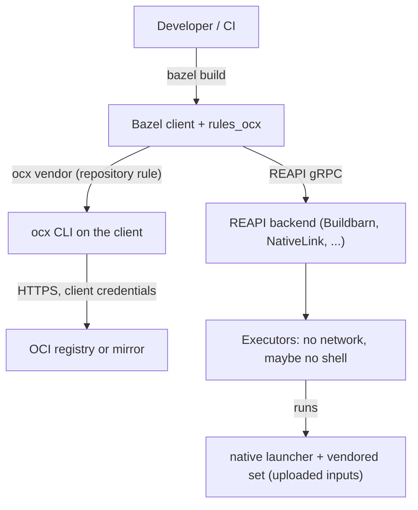
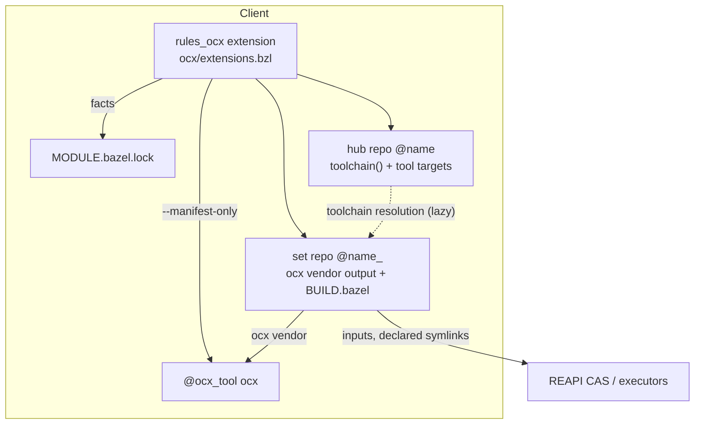
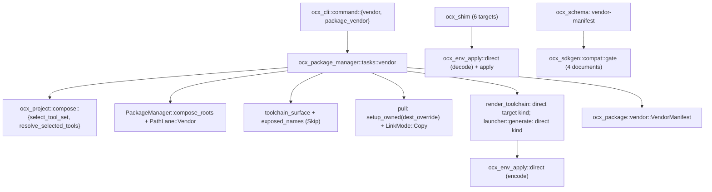

# System Design: `ocx vendor`, the vendor manifest, the direct launcher, and rules_ocx under remote execution

## Metadata

**Status:** Draft
**Author:** architect worker (`/hex-architect`, tier high, goal loop)
**Date:** 2026-11-26
**Beads Issue:** N/A
**Related PRD:** `.agents/discussions/bazel-rbe-rules-ocx.md` (the "source")
**Related ADRs:** [`adr_vendor_rules_ocx_remote_execution.md`](./adr_vendor_rules_ocx_remote_execution.md) (decisions, matrices, OQ-01…OQ-46, DV-1…DV-11), [`adr_windows_exe_shim.md`](./adr_windows_exe_shim.md), [`adr_ocx_interface_contract.md`](./adr_ocx_interface_contract.md), [`adr_crate_split_workspace.md`](./adr_crate_split_workspace.md)

**Tech Strategy Alignment:**
- [x] Rust 2024 + Tokio in ocx; Starlark + Python (pytest, uv) in rules_ocx tests; GitHub Actions
- [x] No database, no new infrastructure tier beyond a CI-only docker compose rig
- [x] Deviations documented in the ADR

Repositories: **ocx** = this repository (`/home/mherwig/.herdr/worktrees/ocx/uno`); **rules_ocx** = `ocx-sh/rules_ocx` (checkout at `/home/mherwig/dev/ocx-sh/rules_ocx`, `main` at `9648f93`). Paths below are relative to each repository's root.

## Executive Summary

`ocx vendor` and `ocx package vendor` write one selection of packages, with their dependencies and a native launcher per tool, into a relocatable directory described by `DIR/manifest.json`. rules_ocx runs that command in one repository rule per set and platform, builds a hub from facts the same command produces with `--manifest-only`, and declares files, link-free directories and symlinks from the manifest alone. Tools then run on network-less, shell-less executors with no `ocx` present.

---

## 1. Context (C4 Level 1)



| Actor/System | Type | Interaction |
|---|---|---|
| Developer / CI | Person / system | declares `ocx.project` / `ocx.package` in `MODULE.bazel`; runs builds |
| ocx CLI | System (this repo) | runs on the client only; writes the vendored directory |
| OCI registry / mirror | External | read by ocx with the client's own config and credentials |
| REAPI backend | External | executes actions; must keep symlink nodes in an input root |
| Later consumers (shell files, installer renderers such as an `ocx-dist` plugin) | Future systems | read the same directory and manifest; not built here |

## 2. Containers (C4 Level 2)



| Container | Technology | Purpose |
|---|---|---|
| `ocx vendor` | Rust, `crates/ocx_cli` → `crates/ocx_package_manager` | writes directory + manifest |
| Vendored directory | files + `manifest.json` | the interface; relocatable, read-only at run time |
| Direct launcher | Rust std-only, `crates/ocx_shim` + `crates/ocx_env_apply` | starts a tool with its composed environment, no `ocx` |
| rules_ocx extension | Starlark | facts, hub and set repository declarations |
| Set repository rule | Starlark | runs `ocx vendor`, generates `BUILD.bazel` from the manifest |
| Hub repository | Starlark (generated) | `toolchain()` per platform, one `ocx_tool` per tool name |
| Rig | docker compose (`e2e/rbe/` in rules_ocx) | nginx, zot, Buildbarn, NativeLink, network-less runners |

## 3. Components (C4 Level 3)

### 3.1 ocx



| Component | Responsibility | New / changed | Files |
|---|---|---|---|
| `ocx_env_apply` [ecosystem, std-only] | `move_to_front`, `remove_segment`, `append_unique`, the segment comparator, `apply_one(existing, kind, value, separator)`, `direct::{encode, decode}` | new crate; functions move from `ocx_util` | `crates/ocx_env_apply/**` |
| `ocx_package::vendor` | manifest types (`VendorManifest` …), `DIR_TOKEN`, `MANIFEST_FILE`, schema derives | new module | `crates/ocx_package/src/vendor.rs`, `crates/ocx_package/src/vendor/*.rs` |
| `tasks::vendor` | orchestration only; calls the functions in the diagram | new | `crates/ocx_package_manager/src/tasks/vendor.rs` |
| composer | `PathLane::Vendor`, `ComposePaths::vendor()`, no shim slot under it, `:native` renders the target separator | changed | `crates/ocx_package_manager/src/composer.rs`, `crates/ocx_package/src/metadata/env/resolver.rs`, `crates/ocx_package_manager/src/tasks/resolve.rs` |
| names | `exposed_names`, `NotEnumerablePolicy`, `NameOwner` become reachable from `tasks::vendor` (same crate; no visibility change needed) | unchanged code | `crates/ocx_package_manager/src/tasks/toolchain_names.rs` |
| assembly | `LinkMode::{Hardlink, Copy}` at `assemble.rs:578`; copy keeps the file's mtime and mode | changed | `crates/ocx_store/src/file_structure/assemble.rs`, `crates/ocx_store/src/hardlink.rs` |
| pull | `setup_owned` takes a `VendorTarget` destination that skips `refs/`, `metadata.json`, `resolve.json`, `install.json`, `digest`, OCI `manifest.json` | changed | `crates/ocx_package_manager/src/tasks/pull.rs` |
| launcher writers | direct target kind in the renderer and the entry-point generator | changed | `crates/ocx_package_manager/src/tasks/render_toolchain.rs`, `crates/ocx_package_manager/src/launcher/generate.rs`, `crates/ocx_package_manager/src/launcher/direct.rs` (new) |
| shim blobs | six embedded blobs, budget per blob, SHA and signature canaries | changed | `crates/ocx_store/src/shim.rs`, `crates/ocx_store/src/shims/`, `crates/ocx_store/src/file_structure/shim_bin_store.rs` |
| launcher | `#[cfg(unix)] run()` via `exec`; `.direct` kind on every OS; lookup C-012 | changed | `crates/ocx_shim/src/{main,core}.rs`, `crates/ocx_shim/src/direct.rs` (new) |
| schema + gate | kind `vendor-manifest`, golden, baseline, `Kind::VendorManifest` | changed | `crates/ocx_schema/src/{lib,main}.rs`, `crates/ocx_schema/tests/golden/vendor-manifest.json`, `crates/ocx_schema/contract/baseline/vendor-manifest.json`, `crates/ocx_sdkgen/src/{lib,compat,lint,versions,ir}.rs`, `website/schema.taskfile.yml` |
| CLI | two leaves, `VendorReport`, contract rows | new | `crates/ocx_cli/src/command/{vendor,package_vendor}.rs`, `crates/ocx_cli/src/api/data/vendor.rs`, `command.rs`, `command/package.rs`, `command/leaf.rs`, `api.rs` |

Crate map edits (`scripts/crate_map.toml`): new row `ocx_env_apply = []`; `"ocx_env_apply"` added to the rows of `ocx_config`, `ocx_package`, `ocx_shell`, `ocx_setup`, `ocx_package_manager`, `ocx` and `ocx_shim` (the last turns `ocx_shim = []` into `ocx_shim = ["ocx_env_apply"]`); `ocx_util` needs no edge (it keeps no caller of the moved functions). `ocx_package` (ecosystem) gains a module and an edge, and `ocx_util` (ecosystem) loses three public functions: both oblige `task satellite:verify` in the same change series, and ocx-mirror is upgraded there if it calls a moved function. The `AGENTS.md` crate table and `.claude/rules/arch-principles.md` § Crate Layout and Utility Catalog get the new row in the same commit.

### 3.2 rules_ocx

| Component | Responsibility | Files |
|---|---|---|
| `ocx_download` | adds `OCX_INSTALL_BINARY` (an absolute path; skips the numeral-only `version` check; checks `ocx --format json version` ≥ `MIN_OCX_VERSION` with pre-release ordering) | `ocx/private/download.bzl`, `ocx/private/versions.bzl`, `ocx/private/manifest.bzl` |
| manifest reader | the one parse surface: `read_manifest(rctx, path) -> struct`, rejects `schema_version != 1` | `ocx/private/vendor_manifest.bzl` (new) |
| set repository rule | `ocx_set_repo`: runs `ocx vendor`, moves the output to the repository root, renames reserved names, writes `BUILD.bazel` | `ocx/private/set_repo.bzl` (new) |
| build rules | `ocx_set` (runfiles of the whole set, declared symlinks, restored reserved files), `ocx_set_toolchain`, `ocx_tool` | `ocx/private/set_rules.bzl` (new), `ocx/defs.bzl` |
| hub | `ocx_hub_repo`: generated from facts | `ocx/private/hub.bzl` (new) |
| extension | tag classes, facts, hub and set declarations | `ocx/extensions.bzl` |
| constraints | `//ocx/constraints:libc` (`glibc`, `musl`) | `ocx/constraints/BUILD.bazel` (new), `ocx/private/platforms.bzl` |
| guard | interface check over the sources | `scripts/check_ocx_interface.py` (new), `scripts/tests/test_check_ocx_interface.py` |
| deleted | lazy `bins`, absolute launcher rendering, project/package fetch bodies | `ocx/private/project.bzl`, `ocx/private/package.bzl`, `ocx/private/repo_utils.bzl:1325-1387,1555-1706` |
| rig | compose file, fixtures, tests, baseline | `e2e/rbe/**`, `taskfiles/rig.taskfile.yml`, `.github/workflows/verify-rbe.yml` |

## 4. Data formats

### 4.1 `DIR/manifest.json` — `https://ocx.sh/schemas/vendor-manifest/v1.json`

Rules for every field: every path is relative to `DIR`, uses `/`, has no `.` or `..` segment and no leading `/`; unset optionals are omitted (IC-04); enums are open (IC-15); keys snake_case (IC-06); no `additionalProperties: false` (IC-18). The document is pretty-printed JSON with object keys in declaration order and every list sorted by the key stated below, so it is byte-stable.

| Field | Type | Meaning |
|---|---|---|
| `schema_version` | integer, const `1` | bumped only through the gate's ledger |
| `content` | enum `present` \| `absent` | `absent` after `--manifest-only`: no package file, launcher or sidecar exists |
| `platform` | string | canonical platform string the run resolved for (`linux/amd64+libc.glibc`) |
| `available_platforms` | string[] sorted | the platforms on which every package of the selection has a leaf: project tier, the lock keys pinned for every selected binding (intersection); package tier, the intersection of the identifiers' image-index platforms |
| `dir_token` | string, const `@VENDOR_DIR@` | the one token a value may contain; stands for the absolute path of `DIR` |
| `packages[]` | object[] sorted by `digest` | every package of the closure, once |
| `packages[].identifier` | string | pinned identifier `registry/repository[:tag]@sha256:<hex>` |
| `packages[].digest` | string | platform-manifest digest |
| `packages[].package_dir` | string | `packages/<registry>/<algorithm>/<2>/<30>` |
| `packages[].content_dir` | string | `<package_dir>/content` |
| `packages[].dependencies` | string[] sorted | digests of direct dependencies |
| `packages[].layers[]` | `{digest, size, media_type}` in manifest order | data for the later native download |
| `packages[].names_declared` | boolean | `false` when metadata claims neither binaries nor entry points (no tools come from it) |
| `packages[].entrypoints[]` | `{name, launcher_path, environment}` sorted by `name` | the package's own launchers under `<package_dir>/entrypoints/`; `launcher_path` ends in `.exe` for a Windows platform; `environment` is the entry point's private environment |
| `packages[].tree` | object, present iff `content` is `present` | |
| `tree.files[]` | `{path, executable}` sorted by `path` | every regular file under `content_dir` |
| `tree.links[]` | `{path, target}` sorted by `path` | every symlink; `target` verbatim (relative by ocx's assembly guard) |
| `tree.link_free_dirs` | string[] sorted | top-most directories under `content_dir` with no link at or below them |
| `tree.empty_dirs` | string[] sorted | directories with no entry |
| `environments[]` | object[], selection first, then entry points sorted by `id` | |
| `environments[].id` | string | opaque; `selection:default`, or `entrypoint:<digest>:<name>` |
| `environments[].scope` | tagged union on `type`: `{type: "selection", selection}` \| `{type: "entrypoint", package, name}` | |
| `environments[].items[]` | `{key, value, kind, separator?}` in application order | same names and `kind` `$def` (`path`, `constant`, `list`) as the `ocx env` report's `EnvEntry`; `separator` on `list` only; values resolved, the only remaining syntax is `dir_token` |
| `selections[]` | object[] (one in v1) | |
| `selections[].id` | string | `default` |
| `selections[].groups` / `.bindings` | string[] | the selection as given (bindings resolved from `-g` included) |
| `selections[].roots` | string[] | digests of the selected packages, in selection order |
| `selections[].environment` | string | id of the composed environment |
| `selections[].launcher_dir` | string | `selections/<id>/shells/default/bin` |
| `tools[]` | object[] sorted by `(selection, name)` | every exposed name |
| `tools[].name` / `.selection` / `.kind` | string / string / enum `binary` \| `entrypoint` | |
| `tools[].package` | string | digest of the owning package (`NameOwner`, last walked wins) |
| `tools[].environment` | string | the selection's environment |
| `tools[].target_path` | string | the binary file, or the package's entry-point launcher |
| `tools[].launcher_path` | string, omitted when no launcher exists for `platform` (e.g. `wasip1/wasm`) | `<launcher_dir>/<name>[.exe]` |

Example (`content: present`, abridged to one package; `ocx vendor -o out -p linux/amd64+libc.glibc cmake`):

```json
{
  "schema_version": 1,
  "content": "present",
  "platform": "linux/amd64+libc.glibc",
  "available_platforms": ["darwin/arm64", "linux/amd64+libc.glibc", "windows/amd64"],
  "dir_token": "@VENDOR_DIR@",
  "packages": [
    {
      "identifier": "ocx.sh/kitware/cmake:3.31.6@sha256:1f2e3d4c5b6a79881f2e3d4c5b6a79881f2e3d4c5b6a79881f2e3d4c5b6a7988",
      "digest": "sha256:1f2e3d4c5b6a79881f2e3d4c5b6a79881f2e3d4c5b6a79881f2e3d4c5b6a7988",
      "package_dir": "packages/ocx.sh/sha256/1f/2e3d4c5b6a79881f2e3d4c5b6a79881f2e3d4c5b6a7988",
      "content_dir": "packages/ocx.sh/sha256/1f/2e3d4c5b6a79881f2e3d4c5b6a79881f2e3d4c5b6a7988/content",
      "dependencies": [],
      "layers": [{"digest": "sha256:aa00…", "size": 52428800, "media_type": "application/vnd.oci.image.layer.v1.tar+zstd"}],
      "names_declared": true,
      "entrypoints": [],
      "tree": {
        "files": [{"path": "packages/ocx.sh/sha256/1f/2e3d4c5b6a79881f2e3d4c5b6a79881f2e3d4c5b6a7988/content/bin/cmake", "executable": true}],
        "links": [{"path": "packages/ocx.sh/sha256/1f/2e3d4c5b6a79881f2e3d4c5b6a79881f2e3d4c5b6a7988/content/bin/cmake3", "target": "cmake"}],
        "link_free_dirs": ["packages/ocx.sh/sha256/1f/2e3d4c5b6a79881f2e3d4c5b6a79881f2e3d4c5b6a7988/content/share"],
        "empty_dirs": []
      }
    }
  ],
  "environments": [
    {
      "id": "selection:default",
      "scope": {"type": "selection", "selection": "default"},
      "items": [
        {"key": "PATH", "value": "@VENDOR_DIR@/packages/ocx.sh/sha256/1f/2e3d4c5b6a79881f2e3d4c5b6a79881f2e3d4c5b6a7988/content/bin", "kind": "path"},
        {"key": "CMAKE_ROOT", "value": "@VENDOR_DIR@/packages/ocx.sh/sha256/1f/2e3d4c5b6a79881f2e3d4c5b6a79881f2e3d4c5b6a7988/content/share/cmake-3.31", "kind": "constant"}
      ]
    }
  ],
  "selections": [
    {"id": "default", "groups": [], "bindings": ["cmake"], "roots": ["sha256:1f2e3d4c5b6a79881f2e3d4c5b6a79881f2e3d4c5b6a79881f2e3d4c5b6a7988"], "environment": "selection:default", "launcher_dir": "selections/default/shells/default/bin"}
  ],
  "tools": [
    {"name": "cmake", "selection": "default", "kind": "binary", "package": "sha256:1f2e3d4c5b6a79881f2e3d4c5b6a79881f2e3d4c5b6a79881f2e3d4c5b6a7988", "environment": "selection:default", "target_path": "packages/ocx.sh/sha256/1f/2e3d4c5b6a79881f2e3d4c5b6a79881f2e3d4c5b6a7988/content/bin/cmake", "launcher_path": "selections/default/shells/default/bin/cmake"}
  ]
}
```

(The digest is a made-up repeating value and `aa00…` marks elision in this page only; a real document carries full digests. The store split is 2 hex then 30 hex of the digest.)

### 4.2 `.direct` sidecar, grammar v1 (one-way door; extension of `SIDECAR_PROBE_ORDER`)

`<launcher-stem>.direct` beside every direct launcher. Bytes: UTF-8 fields, each terminated by one NUL (`\0`). No escaping exists: NUL cannot occur in a path, argument, key or value on any supported OS, and ocx refuses (65) to write a value that contains one. Maximum size 1 MiB.

```
file    := "ocx-direct" NUL "1" NUL record* "end" NUL           ; nothing after the final NUL
record  := "self"     NUL relpath NUL                           ; exactly once, first record
         | "program"  NUL value NUL                             ; exactly once
         | "arg"      NUL value NUL                             ; zero or more, in order (baked entry-point args)
         | "unset"    NUL key NUL                               ; zero or more
         | "path"     NUL key NUL value NUL                     ; prepend with move-to-front dedup
         | "list"     NUL key NUL separator NUL value NUL       ; append-unique with the settled separator
         | "constant" NUL key NUL value NUL                     ; replace
relpath := the launcher's own path relative to DIR, "/" separated, no ".."
value   := text in which every "@VENDOR_DIR@" stands for the absolute root
```

Any other tag, a missing `self`/`program`/`end`, bytes after `end`, an empty key or a key containing `=` is malformed (78). Example for `selections/default/shells/default/bin/cmake` (NUL shown as `␀`):

```
ocx-direct␀1␀self␀selections/default/shells/default/bin/cmake␀program␀@VENDOR_DIR@/packages/ocx.sh/sha256/1f/2e3d4c5b6a79881f2e3d4c5b6a79881f2e3d4c5b6a7988/content/bin/cmake␀unset␀OCX_IDENTITY_TOKEN␀unset␀OCX_KEY_PASSWORD␀unset␀OCX_SIGNING_KEY␀unset␀OCX_TELEMETRY_HEADERS␀unset␀OCX_ANNOUNCE_GIT_TOKEN␀unset␀OCX_BINARY_PIN␀unset␀__OCX_ENV_STATE␀path␀PATH␀@VENDOR_DIR@/packages/ocx.sh/sha256/1f/2e3d4c5b6a79881f2e3d4c5b6a79881f2e3d4c5b6a7988/content/bin␀constant␀CMAKE_ROOT␀@VENDOR_DIR@/packages/ocx.sh/sha256/1f/2e3d4c5b6a79881f2e3d4c5b6a79881f2e3d4c5b6a7988/content/share/cmake-3.31␀end␀
```

(The `unset` list is whatever `ocx_env::keys_with(Credential, HookLocal, State)` returns at build time, plus `OCX_BINARY_PIN`; the example shows today's five credentials and the state key.)

### 4.3 `VendorReport` (stdout, `--format json`), report root v1

```json
{"schema_version": 1, "output_dir": "/abs/out", "manifest_path": "/abs/out/manifest.json", "content": "present",
 "platform": "linux/amd64+libc.glibc", "packages": [{"identifier": "ocx.sh/kitware/cmake:3.31.6@sha256:…", "digest": "sha256:…"}],
 "tool_count": 1, "written_size": 61234567}
```

### 4.4 rules_ocx facts (in `MODULE.bazel.lock`, extension `@rules_ocx//ocx:extensions.bzl%ocx`)

Keys and values are strings (values JSON-encoded), as the 2026-11-18 experiment used.

```
"set|tools|lock:<hash(lock)>:<len(lock)>|g:lint,test|n:|*"                      -> '{"v":1,"available_platforms":["darwin/arm64","linux/amd64+libc.glibc"]}'
"set|tools|lock:<hash(lock)>:<len(lock)>|g:lint,test|n:|linux/amd64+libc.glibc" -> '{"v":1,"schema_version":1,"tools":[["cmake","binary"],["ccache","binary"]]}'
"pkg|node|ocx.sh/nodejs/node@sha256:<hex>|darwin/arm64"                           -> '{"v":1,"schema_version":1,"tools":[["node","binary"],["npm","entrypoint"]]}'
```

`hash()` is Starlark's deterministic 32-bit string hash; the byte length and the cross-check C-RO-12 cover its collisions. Size: spike 5 measured 13263 B of JSON (14714 B escaped in a 64511-byte lock) for this repository's 20 tools on 4 platforms, with digests and entry-point names that v1 facts do not carry, so v1 stays below that.

## 5. API design

### 5.1 ocx CLI (both leaves version 1, output mode `Report{root: VendorReport}`)

| Leaf path | Arguments | Notes |
|---|---|---|
| `vendor` | `-o/--output DIR` (required, `value_name = "DIR"`, `conventions::absolute_dir`), `-p/--platform PLATFORM` (one, default host via `conventions::platform_or_default`), `-g/--group GROUP` (repeatable), `--manifest-only`, `--omit-links`, `[NAME]...` | selection grammar of `ocx exec`; root flags `--project`/`--global`, `--offline`, `--blob-dir`, `--blob-cache-dir`, `--index` apply |
| `package vendor` | `-o/--output DIR` (required), `-p/--platform`, `--manifest-only`, `--omit-links`, `PACKAGE...` (≥ 1) | identifiers as every `ocx package` verb takes them |

Obligations (`.claude/rules/subsystem-cli-commands.md`): `Leaf` entries + `Leaf::path` + contract rows in `crates/ocx_cli/src/command/leaf.rs`; arms in `command.rs` and `command/package.rs`; `visitor.root::<VendorReport>()` in `api.rs`; goldens `crates/ocx_schema/tests/golden/{cli,reports}.json` regenerated; no ledger entry (additions carry version 1); `website/src/content/docs/reference/command-line/**` via `task website:reference:generate`; `@pytest.mark.smoke` on one case per leaf and `pytestmark = pytest.mark.command("vendor")` / `("package vendor")`; `test/SUITE_FLOOR` raised by the number of new cases.

### 5.2 Exit codes and slugs

| Condition | Code | `error.detail` slug | Where |
|---|---|---|---|
| `-o` missing, bad flag, `PACKAGE` missing | 64 | clap usage | CLI |
| `DIR` exists and is not an empty directory | 64 | `vendor_output_not_empty` | `ensure_empty_or_absent` |
| I/O writing `DIR` | 74 | existing I/O slugs | store |
| Resolved value holds `@VENDOR_DIR@` or NUL, or is not UTF-8 | 65 | `vendor_value_unrepresentable` | `tasks::vendor` |
| Lock out of sync with `ocx.toml` | 65 | `lock_stale` (existing) | project prologue |
| Unknown author template in metadata | 65 | existing interpolation slug | resolver |
| A selected binding has no leaf for `-p` at the locked version | 78 | existing slug (observed: `no 'darwin/amd64' leaf for binding 'pnpm' at the locked version`) | project resolution |
| Package or binding not found / blob dir missing | 79 | existing slugs | resolution |
| Offline and a blob is not local | 81 | existing offline slug | pull |
| Registry unreachable / transient | 69 / 75 | existing | client |
| Auth | 80 | existing | client |

Launcher (no error document; one stderr line naming every path tried): 78 sidecar missing, malformed, or no root candidate accepted; 77 program or a substituted `path` value outside the root; 74 own path unknown or spawn failed; otherwise the child's code (Unix: the process is replaced).

### 5.3 rules_ocx Starlark surface

| Tag / rule | Attributes | Change |
|---|---|---|
| `ocx.download` | `dist_manifest`, `triple`, `version` | env `OCX_INSTALL_BINARY` added |
| `ocx.policy` | `allow_unverified`, `allow_yanked`, `sigstore_trusted_root` | unchanged |
| `ocx.project` | `name`*, `ocx_toml`*, `ocx_lock`*, `groups`, `bindings` (new: binding names), `platforms` (new: default = facts' `available_platforms`), `config`, `no_config`, `isolated_home`, `blob_dirs` (new: labels → `--blob-dir`), `links_on_disk` (new, default `False`) | `bins`, `patch_snapshot`, `platform` removed |
| `ocx.package` | `name`*, `package`* (must carry `@sha256:` for facts, else the extension is non-reproducible), `platforms`, `index`, `config`, `no_config`, `isolated_home`, `blob_dirs`, `links_on_disk` | `bins`, `patch_snapshot`, `pins`, `platform_aliases` removed (a pinned `package` replaces `pins`) |
| `ocx_tool` (hub) | toolchain-resolved executable for one name | new |
| `@<name>//:toolchain_type` | `OcxSetInfo { tools: dict[name → FilesToRunProvider], files: depset }` | new |
| `ocx/defs.bzl` exports | `ocx_download`, `ocx_set_repo`, `ocx_hub_repo`, `ocx_set`, `ocx_set_toolchain`, `ocx_tool`, `OcxSetInfo` | `ocx_project_repo`, `ocx_package_repo`, `ocx_package_hub` removed |

Usage: `genrule(tools = ["@tools//:cmake"], cmd = "$(execpath @tools//:cmake) --version > $@")`.

## 6. Contracts — ocx

Each contract is testable from outside the code; the verification row that holds it is in brackets.

- **C-001** `ocx vendor` and `ocx package vendor` without `-o` exit 64 and create no file or directory anywhere [V-39].
- **C-002** An existing `DIR` that is not an empty directory is refused with 64 `vendor_output_not_empty` before any network request; `DIR` is left byte-identical [V-43].
- **C-003** `--manifest-only` leaves `DIR` holding exactly `manifest.json`, `content: "absent"`, no `tree`, and the registry log shows manifest and config requests only, no layer blob [V-19, V-38].
- **C-004** For one selection and platform, the manifest of `--manifest-only` equals the manifest of a full run after deleting `content` and every `packages[].tree` from both [V-19].
- **C-005** Every `environments[]` item list of kind `selection` equals the `items` of `ocx --format json env --pinned` (project) or `ocx --format json package env` (package) for the same selection, run against an install in a home `H` with no patches configured, after replacing each `H/packages/…/` prefix of a package path with `@VENDOR_DIR@/packages/…/` [V-20]. An entry-point environment equals the same package's `env --self` surface likewise.
- **C-006** Patches never reach `environments[]`: with `[patches]`, `OCX_PATCHES` or `OCX_PATCH_SNAPSHOT` set to a rule that matches a selected package, the manifest is byte-identical to the run without them [V-20b].
- **C-007** For each package, `tree.files`, `tree.links` and the bytes, executable bit and link target of every entry equal the installed package's `content/` [V-21].
- **C-008** Every directory under `DIR` has mode 0755 (Unix), every directory and symlink has mtime 315532800, every regular file keeps the archive's mode and mtime; `manifest.json` and every sidecar are byte-identical across two hosts differing in OS user, umask, timezone, working directory and `OCX_HOME` [V-09, V-46].
- **C-009** The manifest is written last, to `DIR/manifest.json.tmp` then renamed; a run killed before the rename leaves no `manifest.json` [unit test in `tasks::vendor`].
- **C-010** No value in `environments[]` or a sidecar contains `${`-syntax of a package author; the only non-literal text is `@VENDOR_DIR@`. A resolved value that already contains `@VENDOR_DIR@` or NUL is refused with 65 [V-25, V-42].
- **C-011** Under `--omit-links`, no symlink exists under `DIR` and `tree.links` is unchanged; without it every listed link exists with its listed target [V-21].
- **C-012** Launcher lookup. Let `P` be the unresolved path the launcher was started by (`argv[0]` if it holds a separator, else the first `PATH` hit; `GetModuleFileNameW` on Windows), `S` = `<dir(P)>/<stem(P)>.direct` (stem strips one `.exe`). `S` must exist (else 78). Read `self` from `S`. Candidates in order: (1) for each entry `x` of `$RUNFILES_DIR` sorted by name, `$RUNFILES_DIR/x`; (2) for each entry `x` of `P.runfiles` sorted, `P.runfiles/x`; (3) `dir(P)` lexically stripped of `self`'s directory depth. The first candidate `C` for which `C/<self>.direct` is byte-identical to `S` is the root. None → 78 naming every candidate [V-30, spike 6].
- **C-013** The root is made absolute by joining it lexically onto the working directory; no symlink is resolved [V-14].
- **C-014** The child environment starts from the launcher's own environment; every `unset` key is removed; then `path`, `list`, `constant` records are applied in file order with `ocx_env_apply::apply_one`, after replacing every `@VENDOR_DIR@` with the root (on Windows, `/` becomes `\` in `program`, `arg` paths and `path` values) [V-22].
- **C-015** The launcher refuses (77) a `program` or substituted `path` value whose lexical normal form is outside the root [unit tests in `crates/ocx_shim`].
- **C-016** argv: `[program, arg…, user-args…]`, with `argv[0]` equal to what `ocx exec` passes for the same tool [V-22].
- **C-017** Unix: `execve` (process replaced, no wait). Windows: `CreateProcessW` with explicit application name, kill-on-close job object, std-handle whitelist and exit-code passthrough, as the existing kinds [V-22 on `windows-latest`].
- **C-018** The launcher writes no file, directory or environment state; it runs from a read-only `DIR` [V-36].
- **C-019** The same blob bytes serve every launcher of one target triple; the six embedded blobs are each ≤ 512 KiB; the `aarch64-apple-darwin` blob carries `LC_CODE_SIGNATURE` and the `x86_64-apple-darwin` blob does not [V-26, unit tests in `crates/ocx_store/src/shim.rs`].
- **C-020** On Unix the launcher accepts only `.direct`; a `.shim`, `.shimref` or `.exec` sidecar exits 78 until [ocx-sh/ocx#679](https://github.com/ocx-sh/ocx/issues/679). On Windows `.direct` is probed after the three existing kinds.
- **C-021** The gate fails when a field of `vendor-manifest` is removed, retyped or made required without a ledger entry and a bumped `schema_version`; an additive optional field passes [V-40].
- **C-022** A selection's tool set is the closure's: every package of the set is under `DIR`, and the selection environment includes the PATH entries of every interface-admitted dependency [V-41].

## 7. Contracts — rules_ocx

- **C-RO-01** The only ocx argv rules_ocx builds are `ocx --format json vendor …` and `ocx --format json package vendor …` (plus `ocx --format json version` inside `ocx_download`) [V-18].
- **C-RO-02** A set repository runs `ocx vendor -o <repo>/.vendor_staging -p <platform> [--omit-links] [-g …] [names…]` (or `package vendor`) with `make_ocx_env` and the pinned env classes, moves the three top-level entries of the staging directory to the repository root, deletes the staging directory and any isolated home, and returns `repo_metadata(reproducible = True)`.
- **C-RO-03** It reads `<repo>/manifest.json` and no other ocx-written file; `schema_version != 1` → `fail()` naming the ocx version range this rules_ocx supports.
- **C-RO-04** Generated `BUILD.bazel`: one directory label per `link_free_dirs` entry that holds no reserved name; file labels for every other `tree.files` entry; one declared symlink per `tree.links` entry at its path with its target; launchers and sidecars as file labels.
- **C-RO-05** Reserved names (`BUILD`, `BUILD.bazel`, `MODULE.bazel`, `REPO.bazel`, `WORKSPACE`, `WORKSPACE.bazel`, `WORKSPACE.bzlmod`) found in `tree.files` are renamed in the repository to `<name>.ocx_reserved` and declared back at the original path by an output action; their directories drop out of `link_free_dirs` handling.
- **C-RO-06** `ocx_set` returns runfiles holding every file, directory label, declared symlink, restored reserved file, launcher and sidecar of the set; every `ocx_tool` of the set carries those runfiles (the whole set travels).
- **C-RO-07** `ocx_tool` outputs a symlink `<name>` to the tool's launcher and a symlink `<name>.direct` to its sidecar, both in its own package, so C-012 finds `S` beside `P`. The declared links are created by this rule in the set repository's own package, never through `root_symlinks` from another repository: that form crashes Bazel 9.2.0 for a tool in the exec configuration (`missing metadata` in `SourceManifestAction`, spike 6).
- **C-RO-08** Hub: one `toolchain_type`; per platform one `toolchain(exec_compatible_with = os + cpu [+ libc:musl])`, musl registered before glibc; one `ocx_tool` per facts tool name (`toolchains = ["//:toolchain_type"]`, symlinks the resolved launcher, `executable = True`), the shape spike 5 ran. The hub BUILD names a set repository only inside a `toolchain()`'s `toolchain` attribute, never in a target analysis always follows (a `filegroup` over all sets would fetch all). Only the selected platform's set repository is fetched for `build`, `fetch <target>` and `vendor <target>` (spike 5, Bazel 9.2.0); `bazel vendor` with no target fetches all.
- **C-RO-08b** An explicit `platforms` entry outside the facts' `available_platforms` `fail()`s naming the platform and the manifest's reason, never a silent omission.
- **C-RO-09** A platform string with `+libc.musl` maps to `//ocx/constraints:libc` = `musl`; `+libc.glibc` and no libc feature map to no libc constraint [V-13].
- **C-RO-10** Facts keys per § 4.4. With every key present the extension runs no `ocx` and makes no network request [V-33].
- **C-RO-11** Amended invariant 3 (rules_ocx `AGENTS.md:70-71`): an extension impl may read `module_ctx.os` and the three `OCX_INSTALL_*` variables, download the pinned ocx and run `ocx vendor --manifest-only`, only to compute facts that are absent; nothing else. Amended invariant 1 (`AGENTS.md:63-67`): `manifest.json` of `ocx vendor` is the one ocx document rules_ocx parses; the `--format json` shapes of other commands are no longer a parse surface.
- **C-RO-12** A set repository compares the `tools` names of its real manifest with the facts' names for its key; a difference `fail()`s naming `bazel mod deps --lockfile_mode=update`.
- **C-RO-13** A `windows/*` set whose manifest lists any link `fail()`s naming the package and OQ-38's limit.
- **C-RO-14** `scripts/check_ocx_interface.py` fails on: an ocx subcommand other than C-RO-01's; a path segment of an ocx home (`packages/` under a home variable, `layers/`, `blobs/`, `symlinks/`, `refs/`, `metadata.json`, `install.json`, `resolve.json`); a package metadata field name (`binaries`, `entrypoints`, `env`, `dependencies` read from anything but the manifest struct) [V-18].
- **C-RO-15** `OCX_INSTALL_BINARY=<abs path>` makes `@ocx_tool` a symlink to that file after `ocx --format json version` reports a version ≥ `MIN_OCX_VERSION` (pre-release suffix allowed and ordered below its release).

## 8. Scenarios

- **S-001 Fresh machine, no lock.** `ocx.project(name = "tools", groups = ["build"])`; the extension downloads ocx, runs `--manifest-only` once for platforms and once per platform, writes facts, declares the hub and one set repository per platform. `bazel build //:gen` fetches only the exec platform's set. A five-group set of this repository resolves on 4 of its 10 lock keys (spike 5), so `available_platforms` holds those 4.
- **S-002 Fresh machine, lock kept.** Same build: no `ocx` run in the extension, zero registry requests until the selected set fetches (V-33).
- **S-003 Hidden dependency.** cmake from group `build` runs a compile that needs ccache; ccache's package is in the set, its `bin` is on the composed `PATH`, the genrule declares only `@tools//:cmake` (V-41).
- **S-004 Entry point by bare name.** A tool calls `npm` (an entry point of node) by bare name; the composed `PATH` reaches `packages/…/entrypoints/npm`, a direct launcher applying node's private environment (V-30).
- **S-005 Cross-platform vendor.** On Linux, `ocx vendor -p darwin/arm64 -o out` writes the arm64 Mach-O launcher blob verbatim; on a macOS runner it starts (V-27).
- **S-006 Movable install.** `mv out /opt/tools; chmod -R a-w /opt/tools; PATH=/usr/bin /opt/tools/selections/default/shells/default/bin/cmake --version` works with no `ocx` (V-24, V-36).
- **S-007 Non-empty target.** `ocx vendor -o .` in a project directory exits 64 and changes nothing (V-43).
- **S-008 Private registry.** The repository rule inherits the client's Docker config; facts, repository, action keys and execution log hold no secret (V-10).
- **S-009 Offline.** `ocx.project(blob_dirs = ["//third_party:ocx_export"])` with the client's network namespace blocked fetches and builds (V-05, V-32).
- **S-010 `bazel vendor`.** After `bazel vendor --vendor_dir=v`, a blocked network builds (V-04).
- **S-011 Windows exec platform with links.** The set repository fails with the package named (C-RO-13).
- **S-012 Stale facts.** `ocx.lock` changes with a colliding 32-bit hash and equal length; the set repository's cross-check fails with the update command (C-RO-12).
- **S-013 Stale lock.** `ocx.toml` edited without `ocx lock`: `ocx vendor` exits 65 `lock_stale`; rules_ocx maps 65 to its hint.

## 9. Verification

Every check of the source's `## Verification` (lines 726-772) is a row; a row the ratified proposal replaced keeps its ID and says so. "Rig" = the compose rig in rules_ocx `e2e/rbe/`, run locally and in `verify-rbe.yml` job `rig` on `ubuntu-24.04`. "ocx CI" jobs are the acceptance legs of ocx's `verify-deep.yml` (`acceptance (ubuntu-latest | macos-latest | windows-latest)`) and `verify-basic.yml`. macOS and Windows rows are named CI checks; nothing is claimed for them from this host.

| ID | Check | Repo | Red (control) | Green | Where |
|---|---|---|---|---|---|
| V-01 | A build passes on executors with no network | rules_ocx | same build with rules_ocx 0.5.1 (launchers re-enter `ocx`) fails | new rules: build passes, runner `network_mode: none` | rig, `rig / buildbarn` and `rig / nativelink` |
| V-02 | Exec platform ≠ host: the exec platform's tool is used; registry log shows only that platform's blobs | rules_ocx | `--extra_execution_platforms` pointing at a second platform with only the host set declared → resolution error | log holds blob digests of the exec platform's manifest only | rig |
| V-03 | (replaced 2026-11-25) A second output base on one machine takes the repository from the repo contents cache and the rule does not run; with the remote repo contents cache on, a fresh client makes 0 registry requests | rules_ocx | flag off: rule run counter 1, 6+ `/v2/` lines | flag on: counter 0, 0 `/v2/` lines for that leg's log slice | rig |
| V-04 | After `bazel vendor`, network blocked, the build passes | rules_ocx | blocked network without `bazel vendor` fails in fetch | passes from `--vendor_dir` in a `network_mode: none` client container | rig, `rig / offline` |
| V-05 | Checked-in export directory as `blob_dirs` label, network blocked, the build passes | rules_ocx | same without `blob_dirs` fails 69/81 | passes | rig, `rig / offline` |
| V-06 | The execution log of an action using a tool lists no `ocx` binary among its inputs | rules_ocx | 0.5.1 log lists `@ocx_tool` | new log: zero inputs named `ocx`/`ocx.exe` | rig |
| V-07 | (replaced) A plain `genrule` uses a tool through the native launcher on an executor image with no shell | rules_ocx | same genrule on the shell-less runner with 0.5.1's sh launchers fails (`/bin/sh` not found) | passes | rig, distroless runner |
| V-08 | A package for a platform with no `ocx` build (`wasip1/wasm`) is vendored and used as an action input | ocx + rules_ocx | `ocx vendor -p wasip1/wasm` before the change: unknown command | manifest with no `launcher_path`; genrule reads the `.wasm` file | ocx CI ubuntu; rig |
| V-09 | (replaced) The files of one set's repository on two machines have equal input digests in the execution log | rules_ocx + ocx | without C-008's normalisation, a umask-077 client produces a different repo-contents-cache key | two client containers (uid/umask/TZ/path differ) produce identical input digests | rig, two client containers |
| V-10 | A private package fetches with no secret in `MODULE.bazel.lock`, the repository, any action key or the execution log | rules_ocx | planted fixture writes the token into `config` → the scan finds it | scan of all four for the zot htpasswd token finds nothing | rig (zot with htpasswd) |
| V-11 | A repository rule runs a tool another set repository provided | rules_ocx | the same rule pointing at a missing set label fails | `rctx.execute([rctx.path(Label("@tools_linux_amd64//:selections/default/shells/default/bin/jq")), "--version"])` exits 0 | rules_ocx `ci:deep` |
| V-12 | (replaced) On both backends an action sees every link as a link with its relative target, a link to a directory included | rules_ocx | a set repository whose links are copied as files (test-only attr) fails the `readlink` check | `readlink` of each listed link equals its target on Buildbarn and NativeLink | rig |
| V-13 | A musl-constrained platform gets the `+libc.musl` leaf; the default gets glibc | rules_ocx | toolchains registered glibc-first → musl platform gets glibc | `ldd`-free check: the tool prints its libc | rig |
| V-14 | A tool that changes its working directory still finds its files through the launcher | ocx | the same tool started directly from the package with a relative `PATH` entry fails after `cd` | through the launcher (root made absolute, C-013) it passes | ocx CI ubuntu |
| V-15 | A floating tag with a local `index` resolves with no registry request; the same tag with no index is an error | rules_ocx | no `index` → error naming the tag | `index` label → 0 `/v2/` requests in resolution | rig |
| V-16 | (narrowed, DV-9) A non-root module declares a package by digest, no `ocx.lock` in the root; with facts kept, loading and analysis make zero registry requests; the manifest carries `layers` | rules_ocx | facts deleted → requests during the extension | facts kept → 0 requests before the fetch | rig |
| V-17 | (DV-10) This repository builds with the new rules_ocx | ocx | `--override_module` at a rules_ocx commit before the change fails on `ocx.project(bins…)` removal | `bazel build //...` with `--override_module=rules_ocx=<new>` passes | local run on this host, recorded in the PR body |
| V-18 | rules_ocx runs only `vendor` and reads only its manifest; the guard fails on another ocx command, a home path, a metadata field | rules_ocx | one planted `ocx env` call → guard exits 1 | guard exits 0 on the tree | rules_ocx `verify-basic` lint |
| V-19 | `--manifest-only` downloads no layer and its manifest equals the full run's in every shared part (C-004) | ocx | a full run's log holds layer GETs; changing one tool name in a fixture's metadata between the two runs breaks equality | registry log: no layer GET; equality holds | ocx CI ubuntu |
| V-20 | Environments equal the `ocx env` report of an install of the same selection after token replacement (C-005) | ocx | control mutates one entry of the expected report → test fails | equal | ocx CI all three OS |
| V-20b | Patches never reach the manifest (C-006) | ocx | with the vendor lane bypassed in a test seam, a matching patch rule changes the manifest | byte-identical with and without the patch rule | ocx CI ubuntu |
| V-21 | Files of a vendored package equal the installed `content` in bytes, modes and link targets (C-007, C-011) | ocx | flip one byte in the vendored copy → compare fails | compare passes, with and without `--omit-links` | ocx CI all three OS |
| V-22 | A child started through a vendored launcher sees the environment `ocx exec` gives it, the caller's environment holding a package dir on `PATH`, a list element and a credential (C-014, C-016, C-017) | ocx | launcher built with the `unset` records stripped → credential reaches the child | equal environments and argv | ocx CI all three OS (`windows-latest` covers C-017) |
| V-23 | (review) The plan names, for each step, the existing function it calls and adds no selection walk, assembly, composer or launcher writer | ocx | review finding on any step without a named function | plan table complete | `/hex-plan` review |
| V-24 | A vendored directory runs after it is moved, with no `ocx` on `PATH` | ocx | launcher with a root baked absolute (test seam) fails after `mv` | passes | ocx CI all three OS |
| V-25 | rules_ocx reads no author env syntax: a package with an env template builds, and the manifest holds no template, only the token (C-010) | ocx + rules_ocx | fixture value with `${installPath}` left unresolved (test seam) → schema check finds `${` | no `${` in any value; rig build passes | ocx CI ubuntu; rig |
| V-26 | The darwin arm64 launcher blob from the Linux cross build carries a code signature, read from its bytes (C-019) | ocx | the x86_64 darwin blob carries none (the control) | `LC_CODE_SIGNATURE` present in the arm64 blob | ocx `verify-basic` unit test (every host) |
| V-27 | On Apple Silicon a tool starts through the launcher after hardlink under another name, copy, rename and tar round trip; one changed byte is killed | ocx | byte-flipped copy → killed (SIGKILL) | all four paths exit 0 | ocx CI `acceptance (macos-latest)` |
| V-27b | (OQ-01) darwin content pulled on macOS with and without `OCX_NO_CODESIGN` is byte-identical for the sampled signed packages | ocx | a stripped (`codesign --remove-signature`) copy differs after the signing pass | node, shfmt, python-build-standalone sha256 lists equal | ocx CI `acceptance (macos-latest)` |
| V-28 | A tool starts on an image with no `/bin/sh`, through the launcher | ocx + rules_ocx | the 0.5.1 sh launcher on the same image fails | direct launcher passes | rig distroless runner; ocx CI ubuntu (`docker run gcr.io/distroless/static`) |
| V-29 | A tool with entry points starts with no `ocx` among its inputs and none on the executor | rules_ocx | 0.5.1 entry-point script needs `ocx` → fails | passes, log has no `ocx` input | rig |
| V-30 | One tool of a set starts another by bare name, an entry point included (C-012) | ocx + rules_ocx | the second tool's package left out of the runfiles (test-only attr) → not found | passes | ocx CI all three OS; rig |
| V-31 | A batch of actions is timed against the number of files in the set, on both backends | rules_ocx | n/a (measurement; control = 0.5.1 numbers in the baseline) | numbers recorded in `e2e/rbe/RESULTS.md` | rig |
| V-32 | Network blocked, `--blob-dir` at an export or blob cache: the repository rule fetches | rules_ocx | blocked without `blob_dirs` fails | passes | rig `offline` |
| V-33 | Fresh output base with `MODULE.bazel.lock` kept: no `ocx` call and no registry request during resolution; lock deleted: both (C-RO-10) | rules_ocx | lock deleted: extension log line + `/v2/` requests | kept: neither | rig |
| V-34 | A using action over a package with link-free dirs has the same input list as with file labels only; its runfiles tree holds one link per directory label | rules_ocx | test-only attr forcing file labels gives the reference list; a list missing one file fails | lists equal; link count = labels | rig |
| V-35 | Directory and manifest hold no Bazel file and no Bazel term | ocx | a planted `BUILD.bazel` in a fixture output → the scan exits 1 | scan of a vendored fixture and its manifest for `BUILD`, `bazel`, `runfiles`, `WORKSPACE` finds none outside package content | ocx CI ubuntu |
| V-36 | A tool starts from a read-only directory and every file is unchanged after the run (C-018) | ocx | a test launcher that writes a file beside itself → the tree hash changes | tree hash equal | ocx CI all three OS |
| V-37 | (review) The ADR lists what a Chocolatey package needs and where the manifest or directory gives each item; an item with no source is a finding | ocx | — | table § 11 | ADR review |
| V-38 | After `--manifest-only` the directory holds the manifest only, at the same place as a full run, and it says `content: "absent"` (C-003) | ocx | a full run holds more files and says `present` | one file, `absent` | ocx CI ubuntu |
| V-39 | `ocx vendor` with no `-o` exits 64 and writes nothing (C-001) | ocx | with `-o` it writes | 64, no file | ocx CI ubuntu (smoke) |
| V-40 | The manifest of a real run validates against the published schema; a breaking change without a new version turns the gate red (C-021) | ocx | unchanged schema → gate green; a removed field → `Unacknowledged` | real manifest validates (`jsonschema` in pytest) | ocx `verify-basic` (`ocx_sdkgen` tests, schema golden) |
| V-41 | (owner rule) A tool from a set brings the whole set: cmake's genrule finds ccache, which only the group declares (C-022, C-RO-06) | rules_ocx | `ocx.package` of cmake alone (no group) → ccache not found | `ocx.project(groups=["build"])` → passes | rig |
| V-42 | A value that already contains `@VENDOR_DIR@` is refused with 65 (C-010) | ocx | fixture without the literal → exit 0 | fixture with it → 65 `vendor_value_unrepresentable` | ocx CI ubuntu |
| V-43 | A non-empty target is refused with 64 and left unchanged (C-002) | ocx | an empty dir → 0 | non-empty → 64, tree hash equal | ocx CI ubuntu |
| V-44 | rules_ocx's pull request is green against the build of the ocx pull request | rules_ocx | the same jobs with the released `DEFAULT_OCX_VERSION` fail (no `vendor` command) | `verify-basic`, `verify-rbe`, `verify-deep` green with `OCX_INSTALL_BINARY` | rules_ocx CI |
| V-45 | The launcher on Windows finds its root in a runfiles tree with `--enable_runfiles` and exits 78 naming the flag without it | rules_ocx | `--noenable_runfiles` → 78 with the hint | `--enable_runfiles` → passes (pending spike 6) | rules_ocx `verify-deep (windows-latest)` |
| V-46 | A manifest for `windows/amd64` written on Linux equals the one written on Windows (C-008) | ocx | host-native separators (test seam) → differ | byte-identical | ocx CI `acceptance (windows-latest)` against a golden produced on ubuntu |

## 10. Test setup — the rig (rules_ocx `e2e/rbe/`)

- **One compose file** `e2e/rbe/compose.yaml`, project name `rules-ocx-rig` (override `RIG_PROJECT`), seeded from `.agents/research/research_bazel-remote-repo-cache-rig-spike.md` (images pinned by digest as listed there). Services: `nginx` (the only published container), `zot` (htpasswd for the login fixture), Buildbarn `frontend`, `storage-0`, `storage-1`, `scheduler`, `runner-installer`, `worker-hardlinking`, `runner-ubuntu` (`network_mode: none`), `runner-noshell` (`gcr.io/distroless/static` with `bb_runner` started directly, `network_mode: none`, platform property `container-image=…noshell`), NativeLink `nativelink` (CAS + AC + scheduler) and `nativelink-worker` (`network_mode: none`), and a `client` profile service (Bazel + ocx, `network_mode: none`, used by the offline and two-machine legs).
- **One entry point.** nginx publishes `127.0.0.1:${RIG_PORT:-18500}` (`listen 80; http2 on;`: `/v2/` → zot, everything else `grpc_pass` → Buildbarn frontend) and `127.0.0.1:${RIG_PORT_NL:-18502}` (`/v2/` → zot, gRPC → NativeLink), with the JSON access log of the spike. Two REAPI backends cannot share a path namespace, so each gets a port on the same proxy.
- **Silos.** Buildbarn: `--remote_instance_name=hardlinking/<test-id>` (proven). NativeLink: instance-name suffix if admitted, else `--action_env=OCX_RIG_SILO=<test-id>` plus repo-contents-cache-off legs (first `[NEEDS CLARIFICATION]` of the ADR).
- **Fixtures** pushed into zot by `e2e/rbe/fixtures/seed.py` with the ocx under test (`ocx package push`/`copy`): multi-platform (linux amd64/arm64 glibc + musl, darwin arm64, windows amd64), one with a dependency (cmake → ccache group), one with relative links incl. a link to a directory, one needing login, one with an env template, one with entry points, one holding a `BUILD.bazel` and an empty directory, a `wasip1/wasm` file package.
- **Example workspace** `e2e/rbe/workspace/` (one, used by every leg) with `ocx.toml`/`ocx.lock` over the fixtures.
- **Tests** `e2e/rbe/tests/test_*.py` (pytest via `uv run`), each leg a test; witnesses: nginx log slices (registry requests and bytes), `--execution_log_json_file` (inputs, digests), `--build_event_json_file` (cache hits), the rule's run counter (an `OCX_RIG_RUN_LOG` written by the test harness's wrapper around `@ocx_tool`, never by rules_ocx).
- **Host limits** (run rules): compose project and ports of its own; every Bazel call runs with `--ignore_all_rc_files` plus `e2e/rbe/rig.bazelrc` and a scratch `--output_user_root`, never the shared cache; every ocx call has a scratch `OCX_HOME` and `HOME`; the rig removes only the containers and volumes it created (`docker compose -p rules-ocx-rig down -v`).
- **Tasks** `taskfiles/rig.taskfile.yml`: `rig:up`, `rig:seed`, `rig:test`, `rig:baseline`, `rig:down`.
- **CI** `.github/workflows/verify-rbe.yml`: `pull_request`, `workflow_dispatch`; one job `rig` on `ubuntu-24.04`, timeout 45 min; steps: checkout, `.github/actions/ocx-under-test` (pulls the build named in `e2e/rbe/ocx-under-test.txt`, an identifier with digest, and exports `OCX_INSTALL_BINARY`; absent file → released pin), `task rig:up rig:seed rig:test`, upload logs, `task rig:down` (always). The same composite action runs first in `verify-basic.yml` and `verify-deep.yml` so every leg tests the dev build. The file is deleted after the owner's ocx release when the pin moves.
- **Baseline first.** `task rig:baseline` runs `e2e/rbe/workspace` with rules_ocx 0.5.1 before any change and records into `e2e/rbe/RESULTS.md`: cold client fetch wall time, registry requests and bytes per platform, a second fresh client's registry requests and executed actions, and whether the build passes on network-less executors. The same task runs again on the new rules; both columns stay in the file.

## 11. Chocolatey item list (V-37)

| nuspec / package item | Source in this design | Finding |
|---|---|---|
| `id` | `packages[].identifier` repository part, or the selection's binding names | none |
| `version` | tag in `packages[].identifier` | absent for a digest-only identifier: a renderer must refuse or ask (finding, accepted) |
| `authors`, `description`, `projectUrl`, `licenseUrl` | not in the manifest; `ocx package description pull` | outside the manifest by OQ-23 (accepted) |
| files under `tools/` | the whole `DIR` | none |
| executables to shim | `tools[].launcher_path` (`.exe` on Windows) | none |
| files not to shim (`.ignore`) | every `tree.files` entry with `executable` under `content_dir` | none |
| install location writable? | not required: C-018 | none |
| dependencies on other Chocolatey packages | none needed: the closure is inside `DIR` | none |

## 12. Work packages (hint for `/hex-plan`)

File-disjoint within each repository; contract-first stubs listed per package. Arrows are "must merge before".

**ocx**

| WP | Scope (files) | Stubs first | Depends on |
|---|---|---|---|
| A1 | `crates/ocx_env_apply/**` (new: apply fns, `direct` codec with encode/decode tests), move of the three fns out of `crates/ocx_util/src/{path,list}.rs`, the 15 caller files, `scripts/crate_map.toml`, `Cargo.toml` members, `crates/ocx_env_apply/BUILD.bazel` | `apply_one`, `direct::{Sidecar, encode, decode}` signatures | — |
| A2 | `crates/ocx_package/src/vendor{,/…}.rs`, `crates/ocx_schema/src/{lib,main}.rs`, `crates/ocx_schema/tests/golden/vendor-manifest.json`, `crates/ocx_schema/contract/baseline/vendor-manifest.json`, `crates/ocx_sdkgen/src/**`, `website/schema.taskfile.yml` | `VendorManifest` types + example document as a test fixture (handed to rules_ocx B2) | — |
| A3 | `crates/ocx_store/src/file_structure/assemble.rs`, `crates/ocx_store/src/hardlink.rs`, `crates/ocx_store/src/file_structure/vendor_layout.rs` (new: path math + normalisation) | `LinkMode`, `VendorLayout` | — |
| A4 | `crates/ocx_package_manager/src/composer.rs`, `crates/ocx_package/src/metadata/env/resolver.rs`, `crates/ocx_package_manager/src/tasks/resolve.rs` | `PathLane::Vendor`, `ComposePaths::vendor` | — |
| A5 | `crates/ocx_shim/**`, `crates/ocx_store/src/shim.rs`, `crates/ocx_store/src/shims/*`, `.github/workflows/build-windows-shims.yml` (renamed to cover six targets), `taskfiles/rust.taskfile.yml` (`rust:shim:build`) | unix `run()` + `.direct` probe | A1 |
| A6 | `crates/ocx_package_manager/src/launcher/{direct,generate}.rs`, `crates/ocx_package_manager/src/tasks/render_toolchain.rs` | direct target kind | A1, A3 |
| A7 | `crates/ocx_package_manager/src/tasks/vendor.rs`, `crates/ocx_package_manager/src/tasks/pull.rs` (`VendorTarget`), `crates/ocx_package_manager/src/tasks.rs` | `PackageManager::vendor(VendorRequest) -> VendorOutcome` | A2, A3, A4, A6 |
| A8 | `crates/ocx_cli/src/command/{vendor,package_vendor}.rs`, `crates/ocx_cli/src/api/data/vendor.rs`, `crates/ocx_cli/src/{command,api}.rs`, `crates/ocx_cli/src/command/{package,leaf}.rs`, goldens `cli.json`, `reports.json`, `website/src/content/docs/reference/command-line/**` (generated) | leaves returning `unimplemented!()` behind the contract rows | A7 (types: A2) |
| A9 | `test/tests/test_vendor.py`, `test/tests/test_package_vendor.py`, `test/tests/test_vendor_launcher.py`, `test/tests/test_vendor_parity.py`, fixtures under `test/fixtures/vendor/`, `test/SUITE_FLOOR`, `test/bazel.bzl` module rows | tests written red against A8's stubs | A8 (spec from this document) |
| A10 | `website/src/content/docs/reference/vendor-manifest.md`, `website/src/content/docs/guides/vendor.mdx`, `AGENTS.md` crate table, `.claude/rules/arch-principles.md`, `.claude/rules/subsystem-*.md` touched rows | — | A8 |

**rules_ocx**

| WP | Scope (files) | Stubs first | Depends on |
|---|---|---|---|
| B0 | `e2e/rbe/**` (compose, nginx, zot, Buildbarn, NativeLink configs, fixtures seeder, baseline), `taskfiles/rig.taskfile.yml`, `.bazelignore` | — | — (runs against 0.5.1 first) |
| B1 | `ocx/private/download.bzl`, `ocx/private/versions.bzl`, `ocx/private/manifest.bzl`, `.github/actions/ocx-under-test/action.yml` | `OCX_INSTALL_BINARY` | — |
| B2 | `ocx/private/vendor_manifest.bzl`, `ocx/private/set_repo.bzl`, `ocx/private/set_rules.bzl`, `ocx/constraints/BUILD.bazel`, `ocx/tests/vendor_manifest_test.bzl` (fed A2's example document) | `read_manifest`, `ocx_set_repo` | A2 example |
| B3 | `ocx/extensions.bzl`, `ocx/private/hub.bzl`, `ocx/private/platforms.bzl`, `ocx/defs.bzl` | tag classes, facts key fn | B2 |
| B4 | deletions in `ocx/private/{project,package,repo_utils}.bzl`, `MODULE.bazel` (`bazel_compatibility = [">=9.0.0"]`), `.bcr/presubmit.yml`, `taskfile.yml` Bazel matrix | — | B3 |
| B5 | `scripts/check_ocx_interface.py`, `scripts/tests/test_check_ocx_interface.py`, `taskfile.yml` lint wiring | — | — |
| B6 | `e2e/rbe/tests/**`, `.github/workflows/verify-rbe.yml`, `e2e/rbe/ocx-under-test.txt` | — | B0, B3, ocx dev build (A8 merged on the ocx branch, `release.yml mode=dev`) |
| B7 | `examples/**`, `e2e/bzlmod/**`, `README.md`, `docs/**` (incl. `docs/concepts/how-it-works.md` dropping "remote execution is a non-goal", `docs/guides/remote-cache.md`, `docs/tutorial.md`, regenerated `docs/defs.md`, `docs/extensions.md`), `AGENTS.md` invariants 1 and 3 (C-RO-11), `.claude/rules/` | — | B3 |

DAG: `A1 → A5, A6`; `A3 → A6`; `{A2, A3, A4, A6} → A7 → A8 → {A9, A10}`; `A2 → B2 → B3 → {B4, B7}`; `{B0, B3, dev build} → B6`; `B1`, `B5` independent. Cross-repository: rules_ocx consumes only A2's schema and example until B6, which needs the dev build of the ocx pull request.

## 13. Risks & Mitigations

| Risk | Probability | Impact | Mitigation |
|---|---|---|---|
| Runfiles lookup differs on remote executors or Windows | Med | High | C-012's byte-identity acceptance; V-30, V-45; Linux legs confirmed by spike 6 |
| Unselected platforms' sets fetched by toolchain resolution | Low | Med | hub holds only `toolchain()`; spike 5 showed one-repository fetches; V-02 re-checks with the real rules |
| `ocx_util` API move breaks ocx-mirror | Med | Med | `task satellite:verify` in the same series; mirror upgraded there |
| Manifest grows large for big packages | Low | Low | only in the repository's file; facts carry names only |
| Dev build unavailable or private in rules_ocx CI | Low | High | composite action authenticates with the workflow token for `ghcr.io/ocx-sh` packages |
| Repo contents cache with declared output symlinks behaves differently from the spike's links-deleted rule | Med | Med | V-03 re-measures with the real rule; `links_on_disk` stays opt-in |

## 14. Open Questions

The two `[NEEDS CLARIFICATION]` markers of the ADR (NativeLink silo; empty dir and nested BUILD under a directory label). Spike 5 is absorbed (C-RO-08, § 4.4, `available_platforms`). Spike 6 is absorbed (`research_launcher-runfiles-lookup-spike.md`: C-012 candidates 2 and 3 confirmed on Linux, candidate 1 not exercised; Windows manifest-only runfiles remain V-45).

## Appendix — Glossary

| Term | Definition |
|---|---|
| Set | what one extension tag declares: a project's groups and bindings, or one package; always with its dependency closure |
| Vendored directory (`DIR`) | the output of one `ocx vendor` run |
| Direct launcher | the native program with a `.direct` sidecar; starts the target with no `ocx` |
| `@VENDOR_DIR@` | the manifest's one token for the absolute path of `DIR` |
| Facts | per-extension key/value strings Bazel stores in `MODULE.bazel.lock` |

## Changelog

| Date | Author | Change |
|------|--------|--------|
| 2026-11-26 | architect worker | Initial design |
